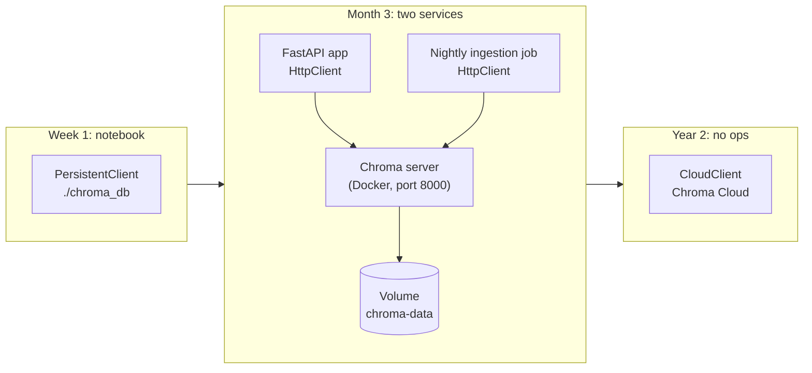

# Chroma: The Complete Guide

> 📚 **Before you start**
>
> - [In-Memory, On-Disk and Cloud Vector DBs](../03-embeddings-and-vector-databases/in-memory-on-disk-and-cloud-vector-dbs.md), for the four deployment styles (library, embedded, server, managed) this lesson refers to.
> - [Storage and Indexing (HNSW, IVF)](../03-embeddings-and-vector-databases/storage-and-indexing-hnsw-ivf.md), for HNSW and its `M`, `ef_construction` and `ef_search` settings.
> - [Embeddings and Similarity Search](../03-embeddings-and-vector-databases/embeddings-and-similarity-search.md), for cosine similarity and the toy embedding model reused here.

## Introduction

Think of the first notebook a small kirana shop owner keeps. It is not a bank ledger with auditors and branches. It sits on the counter, it is easy to write in, and it is good enough to run the shop for years. When the shop grows into a chain, the owner moves to proper accounting software, but the habits from the notebook (what to write, how to find it) carry over.

**Chroma** plays that role for vector search. It is an open-source vector database designed so that you can go from `pip install` to working semantic search in a few lines of Python, with no server to set up. It stores your text, its embeddings and its metadata together, can compute embeddings for you, and saves everything to a folder. When you outgrow one process, the same code talks to a Chroma server or to Chroma Cloud.

This is the first of five tool lessons in this module. Each one teaches a real product, and each one maps it back to the ideas from the previous module: indexes, filters, persistence and deployment.


*The tools in this module. They all store an id, a vector and metadata, then return the k nearest items for a query with a filter. They differ in who runs them, how you write filters and how they report scores.*

By the end of this lesson you will be able to:

- choose between Chroma's in-memory, persistent, server and cloud clients;
- create a collection with the right distance metric and index settings;
- add, upsert, update, get and delete records, and avoid the classic "add silently ignored" bug;
- query with text or with vectors, read the nested result format, and turn distances back into similarities;
- filter with `where` (metadata) and `where_document` (text), and plug in your own embedding model.

> 💡 **Key Insight**
>
> A Chroma **collection** is one table of records, where each record is `id + document + embedding + metadata`. Everything else is detail: the **client** decides where that table lives, the collection's **embedding function** decides how text becomes vectors, and its **space** decides how distance is measured. Get those three right at creation time, because changing them later means rebuilding the collection.

---

## Core Explanation

### 1. Where Chroma fits

In the deployment picture from the previous module, Chroma covers three of the four styles with one API:

| Client | Code | Data lives | Use it for |
|---|---|---|---|
| **In-memory** | `chromadb.Client()` | RAM of your process; gone when it exits | Tests, notebooks, throwaway experiments |
| **Persistent (embedded)** | `chromadb.PersistentClient(path="./chroma_db")` | Files in that folder | Prototypes, single-service apps, local tools |
| **HTTP client** | `chromadb.HttpClient(host="localhost", port=8000)` | A Chroma server you run | Several processes sharing one database |
| **Cloud client** | `chromadb.CloudClient(tenant=..., database=..., api_key=...)` | Chroma Cloud, run by the Chroma team | No database operations at all |

Every client returns collection objects with the **same methods**, so code written against a persistent client in a notebook runs unchanged against a server later. Under the hood, a single-node Chroma (in-memory, persistent or a single server) indexes vectors with **HNSW**, the graph index you built in the previous module. The distributed version behind Chroma Cloud uses a different index family (SPANN, a cluster-based design closer to IVF) whose settings you cannot change.

### 2. Install and create a client

```bash
pip install chromadb
```

```python
# not-run: needs the chromadb package
import chromadb

memory_client = chromadb.Client()                                # in-memory
disk_client = chromadb.PersistentClient(path="./chroma_db")      # embedded, saved to ./chroma_db
# server_client = chromadb.HttpClient(host="localhost", port=8000)
# cloud_client = chromadb.CloudClient(tenant="...", database="...", api_key="...")

print(disk_client.heartbeat())   # a timestamp in nanoseconds means the client is alive
```

Example output:

```
1791964800123456789
```

A persistent client writes a SQLite file plus index files into the folder. Treat that folder like a database's data directory: one application process owns it, and you back it up by copying it while the app is stopped.

### 3. Records, and a toy model to make them concrete

Every record in a collection has four parts:

| Field | Type | Required? | Example |
|---|---|---|---|
| `id` | string, unique in the collection | Yes | `"faq-01"` |
| `document` | the text | Either a document or an embedding | `"UPI payment failed but money was debited..."` |
| `embedding` | list of floats, same length for every record | Computed from the document if you leave it out | `[0.9812, 0.0, 0.1927, 0.0, 0.0]` |
| `metadata` | flat dict of str, int, float, bool (or a list of one of these) | No | `{"topic": "payments", "lang": "en"}` |

To show real values in this lesson without downloading a model, we reuse the idea of the toy embedding model from [Embeddings and Similarity Search](../03-embeddings-and-vector-databases/embeddings-and-similarity-search.md): five named dimensions, a hand-written table of word vectors, and a sentence vector that is the normalised sum. The same help-centre FAQ appears in every lesson of this module, so you can compare tools on identical data.

```python
import re
import numpy as np

DIMS = ["money", "travel", "tech", "food", "weather"]
LEXICON = {
    # word:      money travel tech food weather
    "upi":       (0.9, 0.0, 0.4, 0.0, 0.0),
    "payment":   (1.0, 0.0, 0.1, 0.0, 0.0),
    "bhugtan":   (1.0, 0.0, 0.1, 0.0, 0.0),   # Hindi: payment
    "paisa":     (1.0, 0.0, 0.0, 0.0, 0.0),   # Hindi: money
    "money":     (1.0, 0.0, 0.0, 0.0, 0.0),
    "debited":   (0.9, 0.0, 0.0, 0.0, 0.0),
    "deducted":  (0.9, 0.0, 0.0, 0.0, 0.0),
    "failed":    (0.3, 0.0, 0.3, 0.0, 0.0),
    "fail":      (0.3, 0.0, 0.3, 0.0, 0.0),
    "refund":    (1.0, 0.1, 0.0, 0.0, 0.0),
    "wallet":    (0.8, 0.0, 0.2, 0.0, 0.0),
    "bank":      (0.9, 0.0, 0.0, 0.0, 0.0),
    "account":   (0.6, 0.0, 0.3, 0.0, 0.0),
    "train":     (0.0, 1.0, 0.0, 0.0, 0.0),
    "ticket":    (0.3, 0.8, 0.0, 0.0, 0.0),
    "tatkal":    (0.1, 0.9, 0.0, 0.0, 0.0),
    "journey":   (0.0, 0.9, 0.0, 0.0, 0.0),
    "booking":   (0.2, 0.7, 0.1, 0.0, 0.0),
    "cancelled": (0.2, 0.5, 0.0, 0.0, 0.0),
    "delayed":   (0.0, 0.7, 0.0, 0.0, 0.2),
    "late":      (0.0, 0.6, 0.0, 0.0, 0.1),
    "app":       (0.1, 0.0, 1.0, 0.0, 0.0),
    "password":  (0.0, 0.0, 1.0, 0.0, 0.0),
    "login":     (0.0, 0.0, 1.0, 0.0, 0.0),
    "otp":       (0.2, 0.0, 0.9, 0.0, 0.0),
    "phone":     (0.1, 0.0, 1.0, 0.0, 0.0),
    "reset":     (0.0, 0.0, 0.6, 0.0, 0.0),
    "biryani":   (0.0, 0.0, 0.0, 1.0, 0.0),
    "chai":      (0.0, 0.0, 0.0, 1.0, 0.0),
    "catering":  (0.0, 0.2, 0.0, 0.9, 0.0),
    "rain":      (0.0, 0.1, 0.0, 0.0, 0.9),
    "monsoon":   (0.0, 0.1, 0.0, 0.0, 1.0),
    "flooding":  (0.0, 0.2, 0.0, 0.0, 0.9),
}

def embed(text):
    """Toy embedding model: sum the known word vectors, then scale to length 1."""
    words = re.findall(r"[a-z]+", text.lower())
    vectors = [LEXICON[w] for w in words if w in LEXICON]
    v = np.sum(vectors, axis=0) if vectors else np.zeros(len(DIMS))
    length = np.linalg.norm(v)
    return (v / length if length else v).round(4).tolist()

DOCS = [
    ("faq-01", "UPI payment failed but money was debited from my bank account", {"topic": "payments", "lang": "en"}),
    ("faq-02", "How to get a refund for a cancelled train ticket", {"topic": "travel", "lang": "en"}),
    ("faq-03", "Tatkal ticket booking opens one day before the journey", {"topic": "travel", "lang": "en"}),
    ("faq-04", "Reset your app password using the OTP sent to your phone", {"topic": "account", "lang": "en"}),
    ("faq-05", "UPI bhugtan fail ho gaya par paisa kat gaya", {"topic": "payments", "lang": "hi"}),
    ("faq-06", "Train delayed due to heavy rain and monsoon flooding", {"topic": "travel", "lang": "en"}),
    ("faq-07", "Order biryani and chai on your train journey with e-catering", {"topic": "food", "lang": "en"}),
    ("faq-08", "A wallet refund reaches your bank account in 5 to 7 days", {"topic": "payments", "lang": "en"}),
]

ids = [d[0] for d in DOCS]
documents = [d[1] for d in DOCS]
metadatas = [d[2] for d in DOCS]
embeddings = [embed(text) for text in documents]
print(ids[0], embeddings[0], metadatas[0])
```

Output:

```
faq-01 [0.9812, 0.0, 0.1927, 0.0, 0.0] {'topic': 'payments', 'lang': 'en'}
```

These four parallel lists (`ids`, `documents`, `metadatas`, `embeddings`) are exactly what Chroma's write methods take: element `n` of each list belongs to record `n`.

### 4. Create a collection: name, embedding function, space

```python
# not-run: needs the chromadb package
collection = disk_client.get_or_create_collection(
    name="help_centre",
    configuration={"hnsw": {"space": "cosine", "ef_construction": 200}},
)
print(collection.name, collection.count())
```

Example output:

```
help_centre 0
```

Three decisions are frozen into a collection when you create it:

| Setting | Default | What to choose |
|---|---|---|
| **Embedding function** | Chroma's default: `all-MiniLM-L6-v2` (384 dimensions), run locally through ONNX | The model your whole system will use. Queries must use the same one |
| **`space`** (distance) | `l2`, the **squared** Euclidean distance | `cosine` for most text embedding models; `ip` (inner product) when the model's docs say so |
| **HNSW settings** | `max_neighbors` 16 (this is `M`), `ef_construction` 100, `ef_search` 100 | Raise `ef_construction` and `max_neighbors` for better recall on large collections; raise `ef_search` (can be changed later) when recall is low |

Use `get_or_create_collection` in application code so that restarting the app reopens the existing collection instead of failing. Use `create_collection` when you *want* an error if the name is taken.

### 5. Writing: add, upsert, update, delete

```python
# not-run: needs the chromadb package
collection.add(ids=ids, documents=documents, metadatas=metadatas)   # Chroma embeds the documents
print(collection.count())
print(collection.get(ids=["faq-05"], include=["documents", "metadatas"]))
```

Example output:

```
8
{'ids': ['faq-05'], 'documents': ['UPI bhugtan fail ho gaya par paisa kat gaya'], 'metadatas': [{'lang': 'hi', 'topic': 'payments'}], ...}
```

Here we passed only documents, so Chroma ran its embedding function on each one. If you already have vectors (from a batch job, or from an embedding API you pay for once), pass `embeddings=` as well and Chroma stores them without re-embedding.

The four write methods differ in one important way: **what happens when an id already exists**.

| Method | id is new | id already exists |
|---|---|---|
| `add` | inserts | **ignored, with no error** |
| `upsert` | inserts | overwrites the record |
| `update` | error is logged, nothing written | overwrites only the fields you pass |
| `delete` | nothing | removes it (`delete(ids=[...])` or `delete(where={...})`) |

That first row bites almost everyone once: you fix a typo in a document, call `add` again, and search still returns the old text. Here is the behaviour in miniature, so you can see it:

```python
class MiniCollection:
    """Mimics how Chroma's add and upsert treat existing ids."""

    def __init__(self):
        self.records = {}

    def add(self, ids, documents):
        for i, doc in zip(ids, documents):
            if i not in self.records:          # existing ids are skipped silently
                self.records[i] = doc

    def upsert(self, ids, documents):
        for i, doc in zip(ids, documents):
            self.records[i] = doc

mini = MiniCollection()
mini.add(["faq-02"], ["How to get a refnd for a cancelled train ticket"])     # typo
mini.add(["faq-02"], ["How to get a refund for a cancelled train ticket"])    # fix, via add
print("after add:   ", mini.records["faq-02"])
mini.upsert(["faq-02"], ["How to get a refund for a cancelled train ticket"])
print("after upsert:", mini.records["faq-02"])
```

Output:

```
after add:    How to get a refnd for a cancelled train ticket
after upsert: How to get a refund for a cancelled train ticket
```

Rule of thumb: **ingestion jobs that may run more than once should use `upsert`**, with ids derived from the source (file path plus chunk number, or a hash of the content), so re-running the job updates records instead of duplicating or ignoring them.

Before sending a batch, it pays to validate it on your side, because errors from a large batch are hard to trace back to one record:

```python
ALLOWED = (str, int, float, bool)

def validate_batch(ids, documents, metadatas, embeddings):
    problems = []
    if len(set(ids)) != len(ids):
        problems.append("duplicate ids in the batch")
    if not len(ids) == len(documents) == len(metadatas) == len(embeddings):
        problems.append("lists have different lengths")
    if len({len(e) for e in embeddings}) > 1:
        problems.append("embeddings have different dimensions")
    for i, m in zip(ids, metadatas):
        for key, value in m.items():
            if not isinstance(value, ALLOWED) and not isinstance(value, list):
                problems.append(f"{i}: metadata '{key}' is a {type(value).__name__}")
    return problems or ["ok"]

print(validate_batch(ids, documents, metadatas, embeddings))
bad_meta = metadatas[:7] + [{"topic": "payments", "tags": {"bank": "SBI"}}]
bad_emb = embeddings[:7] + [[0.1, 0.2]]
print(validate_batch(ids[:7] + ["faq-01"], documents, bad_meta, bad_emb))
```

Output:

```
['ok']
['duplicate ids in the batch', 'embeddings have different dimensions', "faq-01: metadata 'tags' is a dict"]
```

Metadata must be **flat**: a nested dict like `{"bank": "SBI"}` is rejected. Flatten it into `bank: "SBI"` before writing.

### 6. Querying, and reading the result

You can query with text (Chroma embeds it with the collection's embedding function) or with a vector you computed yourself:

```python
# not-run: needs the chromadb package and the default embedding model download
results = collection.query(
    query_texts=["UPI payment failed and money deducted"],
    n_results=3,
)
for doc_id, dist, doc in zip(results["ids"][0], results["distances"][0], results["documents"][0]):
    print(f"{doc_id}  distance {dist:.3f}  {doc}")
```

Example output (illustrative; exact distances depend on the model version):

```
faq-01  distance 0.268  UPI payment failed but money was debited from my bank account
faq-05  distance 0.493  UPI bhugtan fail ho gaya par paisa kat gaya
faq-08  distance 0.601  A wallet refund reaches your bank account in 5 to 7 days
```

Two things about that result trip up beginners.

**The result is nested, one inner list per query.** `query_texts` takes a list, so you can send several queries in one call, and every field in the result is a list of lists: `results["ids"][0]` is the ids for the first query. Here is a helper that turns that column-shaped result into one row per hit. We build a result of the same shape from the toy model so you can run it:

```python
def toy_query(query_texts, n_results=3):
    """Returns a dict shaped like Chroma's query() result, using cosine distance."""
    matrix = np.array(embeddings)
    out = {"ids": [], "documents": [], "metadatas": [], "distances": []}
    for text in query_texts:
        distances = 1 - matrix @ np.array(embed(text))
        best = np.argsort(distances, kind="stable")[:n_results]
        out["ids"].append([ids[n] for n in best])
        out["documents"].append([documents[n] for n in best])
        out["metadatas"].append([metadatas[n] for n in best])
        out["distances"].append([round(float(distances[n]), 4) for n in best])
    return out

def to_rows(result):
    rows = []
    for q, hit_ids in enumerate(result["ids"]):
        for rank, hit_id in enumerate(hit_ids, start=1):
            rows.append({"query": q, "rank": rank, "id": hit_id,
                         "distance": result["distances"][q][rank - 1],
                         "topic": result["metadatas"][q][rank - 1]["topic"]})
    return rows

result = toy_query(["is my train late because of rain", "forgot login password"], n_results=2)
print(result["ids"])
for row in to_rows(result):
    print(row)
```

Output:

```
[['faq-06', 'faq-03'], ['faq-04', 'faq-05']]
{'query': 0, 'rank': 1, 'id': 'faq-06', 'distance': 0.0904, 'topic': 'travel'}
{'query': 0, 'rank': 2, 'id': 'faq-03', 'distance': 0.1524, 'topic': 'travel'}
{'query': 1, 'rank': 1, 'id': 'faq-04', 'distance': 0.0039, 'topic': 'account'}
{'query': 1, 'rank': 2, 'id': 'faq-05', 'distance': 0.7575, 'topic': 'payments'}
```

**Chroma returns distances, not similarities: smaller is better.** What the number means depends on the collection's space. For vectors of length 1 (which most text models produce), each space is a simple function of cosine similarity:

| `space` | Distance Chroma reports | Convert to cosine similarity |
|---|---|---|
| `cosine` | `1 - cos` | `1 - distance` |
| `l2` | squared Euclidean, which is `2 - 2 cos` for unit vectors | `1 - distance / 2` |
| `ip` | `1 - dot product` | `1 - distance` |

```python
a, b = np.array(embed(documents[0])), np.array(embed(documents[7]))
cos = float(a @ b)
print(f"cosine similarity     {cos:.4f}")
print(f"cosine distance       {1 - cos:.4f}")
print(f"squared L2 distance   {float(np.sum((a - b) ** 2)):.3f}    (2 - 2cos = {2 - 2 * cos:.3f})")
```

Output:

```
cosine similarity     0.9986
cosine distance       0.0014
squared L2 distance   0.003    (2 - 2cos = 0.003)
```

So for normalised embeddings, all three spaces give the **same ranking**; only the numbers differ. That matters when you set a relevance threshold: a threshold of 0.3 means something very different in `cosine` and `l2` spaces. Decide the space first, then tune thresholds on real queries.

The `include` argument controls which fields come back. By default `query` returns documents, metadatas and distances; ask for `"embeddings"` only when you need them, because they make the response much larger.

### 7. Filtering with `where` and `where_document`

Chroma filters in two places, which can be combined:

- **`where`** filters on **metadata**, with MongoDB-style operators.
- **`where_document`** filters on the **document text**, for example `{"$contains": "refund"}`.

```python
# not-run: needs the chromadb package
results = collection.query(
    query_texts=["money deducted"],
    n_results=3,
    where={"$and": [{"topic": "payments"}, {"lang": {"$in": ["en", "hi"]}}]},
    where_document={"$contains": "UPI"},
)
print(results["ids"][0])
```

Example output:

```
['faq-01', 'faq-05']
```

Only two records pass both filters, so only two come back even though we asked for three. The filter is applied **during** the search, not after it, so you never get "top 3, then two were filtered out". The `where` operators are:

| Operator | Meaning | Example |
|---|---|---|
| (none) or `$eq` | equal | `{"lang": "hi"}` |
| `$ne` | not equal | `{"lang": {"$ne": "hi"}}` |
| `$gt`, `$gte`, `$lt`, `$lte` | numeric comparison | `{"year": {"$gte": 2025}}` |
| `$in`, `$nin` | in, or not in, a list | `{"topic": {"$in": ["travel", "food"]}}` |
| `$contains`, `$not_contains` | a list-valued field includes a value | `{"tags": {"$contains": "irctc"}}` |
| `$and`, `$or` | combine conditions | `{"$or": [{"topic": "food"}, {"lang": "hi"}]}` |

To make the semantics exact, here is a small evaluator for this filter language. It is a teaching copy, not Chroma's code, but it agrees with the documented behaviour, including one subtle rule: `$nin` also matches records that **do not have** the field at all.

```python
def matches(meta, where):
    if "$and" in where:
        return all(matches(meta, w) for w in where["$and"])
    if "$or" in where:
        return any(matches(meta, w) for w in where["$or"])
    for key, cond in where.items():
        if not isinstance(cond, dict):
            cond = {"$eq": cond}
        (op, target), = cond.items()
        present, value = key in meta, meta.get(key)
        if op == "$nin":
            ok = not present or value not in target
        elif not present:
            ok = False
        else:
            ok = {"$eq": lambda: value == target, "$ne": lambda: value != target,
                  "$gt": lambda: value > target, "$gte": lambda: value >= target,
                  "$lt": lambda: value < target, "$lte": lambda: value <= target,
                  "$in": lambda: value in target,
                  "$contains": lambda: target in value,
                  "$not_contains": lambda: target not in value}[op]()
        if not ok:
            return False
    return True

filters = {
    "Hindi only": {"lang": "hi"},
    "payments or food": {"topic": {"$in": ["payments", "food"]}},
    "English travel": {"$and": [{"topic": "travel"}, {"lang": {"$eq": "en"}}]},
    "no 'year' field is fine for $nin": {"year": {"$nin": [2024]}},
}
for name, where in filters.items():
    print(f"{name:<34}", [i for i, m in zip(ids, metadatas) if matches(m, where)])
```

Output:

```
Hindi only                         ['faq-05']
payments or food                   ['faq-01', 'faq-05', 'faq-07', 'faq-08']
English travel                     ['faq-02', 'faq-03', 'faq-06']
no 'year' field is fine for $nin   ['faq-01', 'faq-02', 'faq-03', 'faq-04', 'faq-05', 'faq-06', 'faq-07', 'faq-08']
```

### 8. Bring your own embedding model

The default model is small and English-centred. For Hindi, Tamil or mixed-language content, or for better quality, you will want another model. You have two options:

1. **Compute embeddings yourself** and pass `embeddings=` on write and `query_embeddings=` on query. Simple and explicit, and the right choice when another service already produces the vectors.
2. **Give the collection an embedding function**, so `documents=` and `query_texts=` keep working. Chroma ships wrappers for popular providers and for `sentence-transformers`, and you can write your own: any class with a `__call__(self, input)` that takes a list of strings and returns a list of vectors.

```python
# not-run: needs the chromadb package
from chromadb import Documents, EmbeddingFunction, Embeddings

class ToyEmbeddingFunction(EmbeddingFunction):
    def __call__(self, input: Documents) -> Embeddings:
        return [embed(text) for text in input]

toy_collection = memory_client.get_or_create_collection(
    name="help_centre_toy",
    embedding_function=ToyEmbeddingFunction(),
    configuration={"hnsw": {"space": "cosine"}},
)
toy_collection.upsert(ids=ids, documents=documents, metadatas=metadatas)
print(toy_collection.query(query_texts=["forgot login password"], n_results=1)["ids"])
```

Example output:

```
[['faq-04']]
```

The important rule is the same whichever option you pick: **one collection, one embedding model**. Vectors from two different models live in different spaces, so mixing them gives meaningless distances. When you switch models, create a new collection and re-embed everything.

### 9. Running Chroma as a server

When a second process needs the same data (say, a FastAPI service and a nightly ingestion job), run Chroma as a server. You met Docker in [Docker and Cloud Deployment](../../apis-and-apps-fastapi-streamlit-and-docker/course.md#m9):

```bash
docker run -d -p 8000:8000 -v ./chroma-data:/data chromadb/chroma
# or, without Docker, after pip install chromadb:
chroma run --path ./chroma-data
```

Then switch the client and keep the rest of your code:

```python
# not-run: needs a running Chroma server
client = chromadb.HttpClient(host="localhost", port=8000)
collection = client.get_or_create_collection(name="help_centre", configuration={"hnsw": {"space": "cosine"}})
```



### 10. Strengths and limits

| Strengths | Limits to know |
|---|---|
| Fastest path from zero to working search; embeds text for you | A persistent folder is owned by one process; share through a server instead |
| Same API from notebook to server to cloud | Single-node HNSW holds the index in RAM, so collection size is bounded by memory |
| Metadata and document filters built in | No built-in replication on a single node; plan backups yourself |
| Plays well with LangChain and other frameworks | Filters must use flat metadata; nested JSON needs flattening |

Chroma is the default choice for prototypes and for many production apps with up to a few million records. The next lesson goes the other way: a library with no database features at all, but with the most index choices and raw speed of any tool in this module.

---

## Try It Yourself

1. **Pick the right write method.** You run a nightly job that reads 5,000 FAQ articles and writes them with ids like `"faq-<article id>"`. Some articles change every day. Which method should the job call, and what goes wrong with each of the other two?
2. **Convert distances.** A collection in `l2` space returns a distance of `0.36` for a hit, and your threshold is "cosine similarity at least 0.8". Should you keep the hit? Write a one-line conversion and use the toy model to check that `l2` and `cosine` spaces rank `faq-01`, `faq-05`, `faq-08` the same way for the query "money deducted".
3. **Write filters.** Using `matches`, write a filter for "payments records that are not in Hindi" and another for "travel or food, but only English". Print the matching ids.

<details>
<summary>Show answers</summary>

**1.** Use `upsert`. With `add`, changed articles are silently ignored on every run after the first, so search keeps serving yesterday's text. With `update`, new articles are never inserted (update only touches existing ids). Also delete records whose article was removed upstream, or they live on forever.

**2.**

```python
def l2_to_cosine(distance):
    return 1 - distance / 2

print(round(l2_to_cosine(0.36), 4))

q = np.array(embed("money deducted"))
for name in ["faq-01", "faq-05", "faq-08"]:
    v = np.array(embeddings[ids.index(name)])
    print(name, f"cosine distance {1 - v @ q:.4f}", f"squared L2 {np.sum((v - q) ** 2):.4f}")
```

Output:

```
0.82
faq-01 cosine distance 0.0188 squared L2 0.0375
faq-05 cosine distance 0.0299 squared L2 0.0597
faq-08 cosine distance 0.0117 squared L2 0.0234
```

0.82 is above 0.8, so keep it. Both columns put `faq-08` first, then `faq-01`, then `faq-05`: same ranking, and the L2 numbers are twice the cosine distances (up to rounding, because the toy vectors are stored to 4 decimals). (Notice our toy model ranks the wallet refund above the failed UPI payment; a real model, which understands "deducted" and "failed" together, would not. Toy models are for seeing mechanics, not for judging quality.)

**3.**

```python
not_hindi_payments = {"$and": [{"topic": "payments"}, {"lang": {"$ne": "hi"}}]}
english_travel_or_food = {"$and": [{"topic": {"$in": ["travel", "food"]}}, {"lang": "en"}]}
print([i for i, m in zip(ids, metadatas) if matches(m, not_hindi_payments)])
print([i for i, m in zip(ids, metadatas) if matches(m, english_travel_or_food)])
```

Output:

```
['faq-01', 'faq-08']
['faq-02', 'faq-03', 'faq-06', 'faq-07']
```

</details>

---

## Real-World Examples

- **Internal "ask the docs" bots** in startups often start as a Python service with a `PersistentClient` folder, filled by a script that upserts Notion or Confluence pages, and move to a Chroma server when a second service needs the data.
- **Local and desktop AI tools** embed a user's files into an embedded Chroma collection, so private documents never leave the laptop.
- **Teaching and hackathons** use Chroma's in-memory client because a full working retrieval demo fits on one screen.
- **Agent memory**: many agent frameworks store long-term memories (facts, past conversations) as records in a Chroma collection, filtered by `user_id` metadata.

---

## Common Misconceptions

### "Calling add again updates my records"

`add` ignores ids that already exist, without raising an error. Use `upsert` to insert-or-replace, or `update` to change existing records.

### "A smaller distance threshold works the same in every collection"

The number depends on the space. `l2` distances for unit vectors are twice the `cosine` distances. Always know which space a collection uses before setting thresholds.

### "Chroma is only for toy projects"

Chroma runs as a server and as a managed cloud service with the same API. The embedded mode is a convenience, not the only option.

### "I can switch embedding models and keep the collection"

Every stored vector belongs to the model that produced it. A new model means a new collection and a full re-embed, ideally built alongside the old one and switched over when it is ready.

---

## Interview Relevance

*"Walk me through storing and querying documents in Chroma."* A strong answer names the client choice (in-memory, persistent, HTTP, cloud), the collection with an explicit `space` (usually cosine) and embedding function, writing with `upsert` and stable ids, querying with `query_texts` or `query_embeddings`, `n_results`, `where` and `where_document`, and reading the nested result (`results["ids"][0]`). Mention that Chroma returns distances (lower is better) and that the default space is squared L2.

*"Why might search return stale text after you re-ran ingestion?"* Because `add` skips existing ids silently; the fix is `upsert` with deterministic ids.

*"What index does Chroma use, and what can you tune?"* HNSW on single-node deployments, with `space`, `ef_construction`, `max_neighbors` (M) and `ef_search`; the distributed cloud version uses SPANN with fixed settings.

---

## Key Takeaways

- **One API, four places to run**: `Client()` in memory, `PersistentClient` in a folder, `HttpClient` against a server, `CloudClient` against Chroma Cloud.
- **A collection fixes three things at creation**: embedding function, distance space (default squared L2; choose `cosine` for most text models) and HNSW settings.
- **Use `upsert` with stable ids** for anything that may run twice; `add` silently ignores existing ids.
- **Results are nested per query and report distances**, where smaller is better; convert to similarity using the space's formula before applying thresholds.
- **Filters**: `where` on flat metadata with `$eq`, `$in`, `$gte`, `$and`, `$or` and friends; `where_document` on the text.

---

**Up next:** [FAISS](faiss.md)
