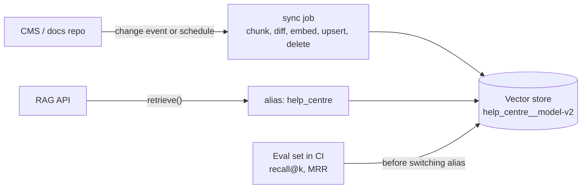

# Embedding-Based Retrieval Pipelines: The Complete Guide

> 📚 **Before you start**
>
> - [Semantic Search Explained](../03-embeddings-and-vector-databases/semantic-search-explained.md), for the two pipelines (indexing and querying), chunking, score thresholds, recall@k and MRR.
> - [Chroma](chroma.md) and [Vector Search in MongoDB and Cassandra](vector-search-in-mongodb-and-cassandra.md), for upserts, deterministic ids, filters and the tools a pipeline can write to.
> - [What is RAG?](../course.md#m2), for where retrieval sits in a RAG system.

## Introduction

Think about how a big railway enquiry counter stays useful. Someone has to collect every new circular, timetable change and refund rule, file it in the right drawer, and pull out old circulars when they are withdrawn. When a passenger asks a question, the clerk does not read every drawer; they go to the likely ones, pick the two or three most relevant sheets, and answer from those, saying which circular they used. If the filing falls behind, the counter confidently gives yesterday's rules.

A vector database is only the drawers. An **embedding-based retrieval pipeline** is the whole job around it: getting documents in (and out) correctly, keeping them in sync as sources change, and turning a question into a short, relevant, cited set of passages. The previous lessons taught the stores; this lesson builds the pipeline that every one of them needs, in plain Python, so you can see each step.

By the end of this lesson you will be able to:

- build an ingestion pipeline: clean, chunk, give chunks stable ids, embed in batches with a cache and retries, and upsert;
- keep the store in sync incrementally: detect new, changed, unchanged and deleted chunks;
- build a query pipeline: embed, filter, search, threshold, de-duplicate and assemble cited context;
- switch embedding models safely with versioned indexes;
- measure retrieval quality with recall@k and MRR before and after every change.

> 💡 **Key Insight**
>
> Retrieval quality is decided mostly **outside** the vector database: by how you chunk, which ids you give chunks, whether deletes and edits reach the index, which filters you apply, and how you trim and cite the results. Treat the pipeline as the product and the vector store as a replaceable part, and measure it with a small set of real questions every time you change anything.

---

## Core Explanation

### 1. The whole pipeline

![Two pipelines around a vector store. Ingest: sources (docs, tickets, web pages) are cleaned and chunked with ids like doc#n and a content hash, compared with what is already stored (new, changed, unchanged, gone), embedded in batches with retries and a cache keyed by hash, and upserted or deleted along with text and metadata. Store: a versioned vector store named after the embedding model, which can be any tool from this module. Query: a question with user, tenant and language is embedded with the same model, searched for the top k with filters, post-processed with a threshold, de-duplication and reranking, and turned into context chunks with citations](/img/diagrams/retrieval-augmented-generation-rag/vdb-retrieval-pipeline.svg)
*The central picture of this module. Every tool you met plugs into the middle band; everything else is the pipeline you build.*

We will build every box. To keep the code runnable offline, we need an embedding model that works on any text. The toy word table from the earlier lessons only knows about thirty words, so here we use a different stand-in: **hashed character n-grams** from scikit-learn. It turns text into a 512-number vector by counting short letter sequences ("ref", "efu", "fun", ...), so texts that share spellings get similar vectors. That captures **wording**, not meaning, so it is a weaker model than a real one, but it has the right shape (fixed length, normalised) and the pipeline code around it is exactly what you would write for a real model.

```python
import hashlib
import re
import numpy as np
from sklearn.feature_extraction.text import HashingVectorizer

MODEL_NAME = "char-ngram-hash-512"
_vectorizer = HashingVectorizer(analyzer="char_wb", ngram_range=(3, 4), n_features=512,
                                alternate_sign=False, norm="l2")

def embed_batch(texts):
    """Stand-in embedding model: one normalised 512-number vector per text."""
    return _vectorizer.transform([t.lower() for t in texts]).toarray().astype(np.float32)

v = embed_batch(["Refund for a cancelled ticket", "refund of cancelled tickets", "Tatkal timings"])
print(v.shape, np.round(v[0] @ v[1], 3), np.round(v[0] @ v[2], 3))
```

Output:

```
(3, 512) 0.849 0.087
```

The first two sentences share most of their letter sequences and score high; the third shares little. A real embedding model would also match "money back for a dropped booking", which shares no spelling; keep that difference in mind when reading scores below.

### 2. Source documents

Our sources are three help-centre articles, each with an id, a title, a last-updated date and a language. Articles are usually Markdown or HTML exported from a CMS:

```python
SOURCES = {
    "refunds": {"title": "Refunds for cancelled tickets", "lang": "en", "updated": "2026-09-01", "body": """
# Refunds for cancelled tickets

If you cancel a confirmed ticket before chart preparation, the refund is credited to the original
payment method. Cancellation charges depend on the class of travel.

For UPI and wallet payments, the refund usually reaches your account in 3 to 5 working days.
For card payments it can take up to 7 working days.

Tatkal tickets are not refunded when you cancel a confirmed Tatkal ticket yourself.
"""},
    "upi-failures": {"title": "UPI payment failed but money debited", "lang": "en", "updated": "2026-08-15", "body": """
# UPI payment failed but money debited

Sometimes a UPI payment fails after the amount is debited from your bank account. Do not pay again
immediately. The bank reverses failed UPI debits automatically, usually within 48 hours.

If the money has not come back after 48 hours, raise a complaint with the transaction reference number
from your UPI app.
"""},
    "tatkal": {"title": "Tatkal booking rules", "lang": "en", "updated": "2026-07-20", "body": """
# Tatkal booking rules

Tatkal booking opens one day before the date of journey, excluding the date of journey. AC classes
open at 10:00 and non-AC classes at 11:00.

Each user can book a limited number of Tatkal tickets per month. Keep passenger details saved in
advance to book quickly.
"""},
}
print({doc_id: len(src["body"]) for doc_id, src in SOURCES.items()})
```

Output:

```
{'refunds': 431, 'upi-failures': 352, 'tatkal': 290}
```

### 3. Clean, chunk and give every chunk a stable id

Chunking (splitting documents into passages that each carry one idea) was introduced in [Semantic Search Explained](../03-embeddings-and-vector-databases/semantic-search-explained.md), and the later lessons on [Text Splitters](../course.md#m5) and [Chunking Strategies](../course.md#m6) go deep on it. Here we use a simple, sensible rule: split on blank lines (paragraphs), drop the Markdown heading markers, and prefix each chunk with the article title so a chunk still makes sense on its own.

Each chunk gets two identifiers:

- a **chunk id** that says *where* it came from, `"<doc id>#<position>"`, used as the id in the vector store, so re-running ingestion overwrites instead of duplicating;
- a **content hash** that says *what* it contains, used to detect changes and to cache embeddings.

```python
def clean(text):
    text = re.sub(r"^#+\s*", "", text, flags=re.M)        # drop Markdown heading markers
    return re.sub(r"[ \t]+", " ", text).strip()

def chunk_document(doc_id, src):
    paragraphs = [p.replace("\n", " ").strip() for p in clean(src["body"]).split("\n\n")]
    paragraphs = [p for p in paragraphs if p and p != src["title"]]
    chunks = []
    for n, para in enumerate(paragraphs):
        text = f"{src['title']}: {para}"                   # title prefix gives each chunk context
        chunks.append({
            "id": f"{doc_id}#{n}",
            "text": text,
            "hash": hashlib.sha256(text.encode()).hexdigest()[:12],
            "metadata": {"doc_id": doc_id, "lang": src["lang"], "updated": src["updated"]},
        })
    return chunks

all_chunks = [c for doc_id, src in SOURCES.items() for c in chunk_document(doc_id, src)]
print(len(all_chunks), "chunks")
for c in all_chunks[:3]:
    print(c["id"], c["hash"], c["text"][:70] + "...")
```

Output:

```
7 chunks
refunds#0 804781386818 Refunds for cancelled tickets: If you cancel a confirmed ticket before...
refunds#1 65a81803675e Refunds for cancelled tickets: For UPI and wallet payments, the refund...
refunds#2 dcd26100232c Refunds for cancelled tickets: Tatkal tickets are not refunded when yo...
```

### 4. Embed in batches, with a cache and retries

Embedding is where most ingestion time and money go. Three habits make it cheap and robust:

- **Batch** many texts per call (embedding APIs accept lists; local models are much faster on batches).
- **Cache** embeddings by `(model name, content hash)`, so unchanged chunks are never embedded twice, even when you rebuild the index.
- **Retry** failed calls with exponential backoff, because embedding APIs rate-limit and occasionally fail.

```python
class EmbeddingCache:
    def __init__(self, embed_fn, model_name, batch_size=16):
        self.embed_fn, self.model_name, self.batch_size = embed_fn, model_name, batch_size
        self.cache = {}
        self.calls = self.texts_embedded = 0

    def get(self, chunks):
        missing = [c for c in chunks if (self.model_name, c["hash"]) not in self.cache]
        for start in range(0, len(missing), self.batch_size):
            batch = missing[start:start + self.batch_size]
            vectors = self.embed_fn([c["text"] for c in batch])
            self.calls += 1
            self.texts_embedded += len(batch)
            for c, vec in zip(batch, vectors):
                self.cache[(self.model_name, c["hash"])] = vec
        return np.array([self.cache[(self.model_name, c["hash"])] for c in chunks])

embedder = EmbeddingCache(embed_batch, MODEL_NAME, batch_size=4)
vectors = embedder.get(all_chunks)
print("first run: ", vectors.shape, "calls:", embedder.calls, "texts embedded:", embedder.texts_embedded)
vectors = embedder.get(all_chunks)
print("second run:", vectors.shape, "calls:", embedder.calls, "texts embedded:", embedder.texts_embedded)
```

Output:

```
first run:  (7, 512) calls: 2 texts embedded: 7
second run: (7, 512) calls: 2 texts embedded: 7
```

The second run embedded nothing: every chunk was already cached. In production the cache is a table (or a column in the store itself), not a dict, but the key is the same.

Retries look like this. The fake embedding function below fails twice, the way a rate-limited API might, and the wrapper waits a little longer each time. (We record the waits instead of sleeping, so the example runs instantly.)

```python
def with_retries(fn, attempts=5, base_delay=0.5):
    waits = []

    def wrapped(texts):
        for attempt in range(attempts):
            try:
                return fn(texts)
            except RuntimeError as err:
                if attempt == attempts - 1:
                    raise
                waits.append(base_delay * 2 ** attempt)   # 0.5s, 1s, 2s, ... (time.sleep in real code)
        return None
    wrapped.waits = waits
    return wrapped

failures = {"left": 2}
def flaky_embed(texts):
    if failures["left"]:
        failures["left"] -= 1
        raise RuntimeError("429 Too Many Requests")
    return embed_batch(texts)

safe_embed = with_retries(flaky_embed)
print(safe_embed(["hello"]).shape, "after waiting", safe_embed.waits, "seconds")
```

Output:

```
(1, 512) after waiting [0.5, 1.0] seconds
```

Real code also adds a little random "jitter" to each wait, so many workers do not retry at the same instant, and respects any `Retry-After` time the API sends.

### 5. The store, and incremental sync

Any store from this module works. To keep the lesson self-contained we use a small in-memory store with the operations every one of them offers: upsert by id, delete by id, and search with a metadata filter.

```python
class MemoryStore:
    def __init__(self, name):
        self.name = name
        self.records = {}                      # id -> {"vector", "text", "hash", "metadata"}

    def upsert(self, chunks, vectors):
        for c, v in zip(chunks, vectors):
            self.records[c["id"]] = {"vector": v, "text": c["text"], "hash": c["hash"], "metadata": c["metadata"]}

    def delete(self, ids):
        for i in ids:
            self.records.pop(i, None)

    def search(self, query_vector, k=5, where=None):
        hits = []
        for i, r in self.records.items():
            if where and any(r["metadata"].get(key) != val for key, val in where.items()):
                continue
            hits.append((float(r["vector"] @ query_vector), i))
        hits.sort(key=lambda h: (-h[0], h[1]))
        return [(round(score, 3), i) for score, i in hits[:k]]
```

The heart of a maintainable pipeline is **sync**: compare the chunks the sources produce *now* with what the store holds, and apply only the differences. That handles all four cases, including the one most pipelines forget, **deletions**:

```python
def sync(store, sources, embedder):
    fresh = {c["id"]: c for doc_id, src in sources.items() for c in chunk_document(doc_id, src)}
    stored = {i: r["hash"] for i, r in store.records.items()}
    new = [c for i, c in fresh.items() if i not in stored]
    changed = [c for i, c in fresh.items() if i in stored and stored[i] != c["hash"]]
    gone = [i for i in stored if i not in fresh]
    to_write = new + changed
    if to_write:
        store.upsert(to_write, embedder.get(to_write))
    store.delete(gone)
    return {"new": len(new), "changed": len(changed),
            "unchanged": len(fresh) - len(new) - len(changed), "deleted": len(gone)}

store = MemoryStore(f"help_centre__{MODEL_NAME}")
print("first sync: ", sync(store, SOURCES, embedder), "records:", len(store.records))
print("re-run:     ", sync(store, SOURCES, embedder))

SOURCES["upi-failures"]["body"] = SOURCES["upi-failures"]["body"].replace("48 hours", "24 hours")
SOURCES["tatkal"]["body"] = SOURCES["tatkal"]["body"].split("\n\nEach user")[0] + "\n"   # last paragraph removed
print("after edits:", sync(store, SOURCES, embedder), "records:", len(store.records))
```

Output:

```
first sync:  {'new': 7, 'changed': 0, 'unchanged': 0, 'deleted': 0} records: 7
re-run:      {'new': 0, 'changed': 0, 'unchanged': 7, 'deleted': 0}
after edits: {'new': 0, 'changed': 2, 'unchanged': 4, 'deleted': 1} records: 6
```

The re-run did nothing, the edit re-embedded only the two chunks that mention the changed time limit, and the removed paragraph was deleted from the store. Without the delete step, the old Tatkal paragraph would keep being retrieved long after it was removed from the website.

Two refinements real pipelines add. When a whole **document** is deleted at the source, delete all its chunks by metadata (`where doc_id = ...`), which every store supports. And when chunk positions shift (a paragraph inserted at the top renumbers everything below it), position-based ids cause extra re-embedding; the content-hash cache absorbs most of that cost, since the texts themselves have not changed.

### 6. The query pipeline

Now the other half: from a question to a small, trustworthy context for the model.

```python
def retrieve(store, question, k=6, min_score=0.25, per_doc=2, where=None, char_budget=600):
    q = embed_batch([question])[0]
    hits = store.search(q, k=k, where=where)                       # step 1: search with filters
    hits = [(s, i) for s, i in hits if s >= min_score]             # step 2: drop weak matches
    kept, per_doc_count = [], {}
    for score, chunk_id in hits:                                   # step 3: at most per_doc per document
        doc_id = store.records[chunk_id]["metadata"]["doc_id"]
        if per_doc_count.get(doc_id, 0) < per_doc:
            per_doc_count[doc_id] = per_doc_count.get(doc_id, 0) + 1
            kept.append((score, chunk_id))
    context, used = [], 0                                          # step 4: fit the budget, cite
    for score, chunk_id in kept:
        text = store.records[chunk_id]["text"]
        if used + len(text) > char_budget:
            break
        context.append(f"[{chunk_id}] {text}")
        used += len(text)
    return hits, "\n".join(context)

hits, context = retrieve(store, "How long does a UPI refund take after the payment failed?")
print("scored hits:", hits)
print(context)
```

Output:

```
scored hits: [(0.539, 'upi-failures#0'), (0.492, 'upi-failures#1'), (0.487, 'refunds#1'), (0.42, 'refunds#0'), (0.307, 'refunds#2'), (0.267, 'tatkal#0')]
[upi-failures#0] UPI payment failed but money debited: Sometimes a UPI payment fails after the amount is debited from your bank account. Do not pay again immediately. The bank reverses failed UPI debits automatically, usually within 24 hours.
[upi-failures#1] UPI payment failed but money debited: If the money has not come back after 24 hours, raise a complaint with the transaction reference number from your UPI app.
[refunds#1] Refunds for cancelled tickets: For UPI and wallet payments, the refund usually reaches your account in 3 to 5 working days. For card payments it can take up to 7 working days.
```

Each step has a reason:

| Step | Why |
|---|---|
| Search with **filters** | Respect language, tenant and permissions before anything else |
| **Score threshold** | Return nothing rather than something irrelevant; tune it on real questions, per model |
| **Per-document cap** | Stop one long article from filling every slot, so the answer can draw on several sources |
| **Budget** | The model's context window and your costs are limited; the best chunks go first |
| **Citations** (`[upi-failures#0]`) | The model can cite them, and you can show users where an answer came from |

A **reranking** step usually sits between search and the threshold in production: a slower, more accurate model re-scores the top 20 to 50 hits. You will add it in [Reranking](../course.md#m6).

### 7. Changing the embedding model safely

Sooner or later you will switch to a better embedding model. Vectors from two models cannot be mixed, so you **rebuild**. The safe way is the blue-green pattern: build a new store next to the old one, check it, then switch traffic by changing one pointer (an **alias**).

```python
aliases = {"help_centre": store.name}                 # what the app reads from
stores = {store.name: store}

def rebuild(model_name, embed_fn):
    new_store = MemoryStore(f"help_centre__{model_name}")
    sync(new_store, SOURCES, EmbeddingCache(embed_fn, model_name))
    stores[new_store.name] = new_store
    return new_store

wider = HashingVectorizer(analyzer="char_wb", ngram_range=(2, 5), n_features=1024, alternate_sign=False, norm="l2")
candidate = rebuild("char-ngram-hash-1024", lambda texts: wider.transform([t.lower() for t in texts]).toarray())
print("built:", candidate.name, len(candidate.records), "records")
aliases["help_centre"] = candidate.name                # the switch: one pointer, instant rollback
print("alias now points to:", aliases["help_centre"])
```

Output:

```
built: help_centre__char-ngram-hash-1024 6 records
alias now points to: help_centre__char-ngram-hash-1024
```

Many stores support this directly: Qdrant has collection aliases, and in the others you keep the current collection or index name in configuration. Keep the old store until the new one has proven itself, so rollback is one more pointer change. And remember the query side: the app must embed questions with the **new** model at the moment the alias switches, so store the model name alongside the alias and read both together.

### 8. Measure before and after every change

A retrieval change (chunk size, model, threshold, filters) is only an improvement if it retrieves the right chunks more often. Keep a small **evaluation set**: real questions, each labelled with the chunk ids that answer it. Then compute recall@k (did any right chunk appear in the top k?) and MRR (how high was the first right chunk?), the metrics from [Semantic Search Explained](../03-embeddings-and-vector-databases/semantic-search-explained.md):

```python
EVAL_SET = [
    ("UPI payment failed but money debited, when will I get it back?", {"upi-failures#0"}),
    ("How many days for a refund to a wallet?", {"refunds#1"}),
    ("When does Tatkal booking open for AC classes?", {"tatkal#0"}),
    ("Do I get money back if I cancel my Tatkal ticket?", {"refunds#2"}),
    ("Amount cut from account but transaction unsuccessful", {"upi-failures#0"}),
    ("I need to travel tomorrow, how do I book in a hurry?", {"tatkal#0"}),
]

def evaluate(store_to_test, embed_fn, k=3):
    recall_hits, reciprocal_ranks = 0, []
    for question, relevant in EVAL_SET:
        ranked = [i for _, i in store_to_test.search(embed_fn([question])[0], k=k)]
        recall_hits += any(i in relevant for i in ranked)
        rank = next((n for n, i in enumerate(ranked, start=1) if i in relevant), None)
        reciprocal_ranks.append(1 / rank if rank else 0.0)
    return round(recall_hits / len(EVAL_SET), 2), round(sum(reciprocal_ranks) / len(EVAL_SET), 2)

print("512 features:  recall@3, MRR =", evaluate(store, embed_batch))
print("1024 features: recall@3, MRR =", evaluate(candidate, lambda t: wider.transform([x.lower() for x in t]).toarray()))
```

Output:

```
512 features:  recall@3, MRR = (0.83, 0.75)
1024 features: recall@3, MRR = (0.83, 0.75)
```

Both stores miss one of the six questions: a paraphrase that shares little spelling with its answer, which is exactly the weakness of a spelling-based model and exactly what a real semantic model fixes. The wider model scores no better, so the switch in section 7 would have bought nothing. The evaluation set tells you that before your users do, and in a real project this is the moment you would try a proper embedding model instead.

Twenty to fifty real questions is enough to start catching regressions, and the set grows every time a user reports a bad answer. Run it in CI whenever the pipeline changes, exactly like unit tests; the [RAG Evaluation](../course.md#m9) module builds on this with end-to-end metrics.

### 9. Operating the pipeline

| Concern | What to do |
|---|---|
| **Scheduling** | Run sync on a schedule (hourly, nightly) or on change events from the CMS; make it safe to re-run at any time |
| **Throughput** | Batch embeddings, run several batches in parallel within the provider's rate limits, and write to the store in batches |
| **Deletes and permissions** | Sync deletions; store permission fields (team, tenant, access level) as metadata and **always** filter on them |
| **Versions** | Name stores by embedding model and chunking version; switch with an alias |
| **Monitoring** | Track chunks per document, empty-result rate, score distribution, latency and embedding cost; alert on sudden changes |
| **Freshness** | Store `updated` dates as metadata, so you can prefer recent content or answer "as of" a date |



---

## Try It Yourself

1. **Delete a whole document.** Remove the `"tatkal"` article from `SOURCES` and run `sync`. How many chunks are deleted, and does `retrieve` still return any Tatkal chunk for "When does Tatkal booking open?"
2. **Tune the threshold.** Call `retrieve` with `min_score=0.5` for "How long does a UPI refund take after the payment failed?". What changes, and what is the risk of setting the threshold too high?
3. **Per-document cap.** Set `per_doc=1` and `k=6` for the question "refund for card payments and wallet payments". Which chunks are kept, and why might the answer now be incomplete?

<details>
<summary>Show answers</summary>

**1.**

```python
del SOURCES["tatkal"]
print(sync(store, SOURCES, embedder))
hits, context = retrieve(store, "When does Tatkal booking open?")
print(hits)
```

Output:

```
{'new': 0, 'changed': 0, 'unchanged': 5, 'deleted': 1}
[(0.313, 'refunds#2')]
```

The one remaining Tatkal chunk is deleted. The question still finds the refunds chunk about Tatkal tickets, because it shares the word "Tatkal", which is correct behaviour: that chunk is still on the website.

**2.**

```python
hits, context = retrieve(store, "How long does a UPI refund take after the payment failed?", min_score=0.5)
print(hits)
print(context)
```

Output:

```
[(0.539, 'upi-failures#0')]
[upi-failures#0] UPI payment failed but money debited: Sometimes a UPI payment fails after the amount is debited from your bank account. Do not pay again immediately. The bank reverses failed UPI debits automatically, usually within 24 hours.
```

Fewer chunks survive the threshold. Too high a threshold returns nothing for questions phrased differently from the documents (and our spelling-based stand-in model is especially sensitive to phrasing), so tune thresholds on the evaluation set, per model.

**3.**

```python
hits, context = retrieve(store, "refund for card payments and wallet payments", k=6, per_doc=1)
print(context)
```

Output:

```
[refunds#1] Refunds for cancelled tickets: For UPI and wallet payments, the refund usually reaches your account in 3 to 5 working days. For card payments it can take up to 7 working days.
[upi-failures#0] UPI payment failed but money debited: Sometimes a UPI payment fails after the amount is debited from your bank account. Do not pay again immediately. The bank reverses failed UPI debits automatically, usually within 24 hours.
```

Only one chunk per article is kept. If the full answer needs two paragraphs of the same article (for example, card and wallet timelines in one place but cancellation rules in another), a cap of 1 drops part of it. Caps of 2 or 3 are a common compromise.

</details>

---

## Real-World Examples

- **Company knowledge assistants** sync Confluence, Google Drive or Notion nightly, using document ids plus content hashes, and filter every search by the user's group memberships stored as metadata.
- **E-commerce support bots** re-index product and policy pages when the CMS publishes a change, so a withdrawn offer disappears from answers within minutes.
- **Search teams** keep a few hundred labelled questions and block any pipeline change that lowers recall@k, the way unit tests block code changes.
- **Model upgrades** at scale are done blue-green: a new index is built in the background, compared on the evaluation set and switched by alias.

---

## Common Misconceptions

### "Once documents are embedded, the job is done"

Sources change. Without incremental sync and deletes, the index drifts from reality and the assistant quotes withdrawn rules.

### "Random ids are fine"

Random ids turn every re-run into duplicates. Use deterministic ids from the source location, plus a content hash to detect changes.

### "A higher top k always gives better answers"

More chunks add noise, cost and context-window pressure. Retrieve generously, then threshold, de-duplicate and rerank down to a few strong chunks.

### "We can switch embedding models in place"

Vectors from different models are incompatible. Build a new index, evaluate it, and switch with an alias.

---

## Interview Relevance

*"Design the ingestion pipeline for a RAG system over a company wiki."* A strong answer covers connectors, cleaning, chunking with title context, deterministic chunk ids plus content hashes, batched embedding with caching and retries, upserts and deletes from a diff, permission metadata, scheduling or change events, versioned indexes with aliases, and monitoring.

*"How do you keep a vector index in sync with changing documents?"* Recompute chunks for changed documents, compare ids and hashes with what is stored, upsert new and changed chunks, delete missing ones, and delete all chunks of deleted documents by metadata filter.

*"How do you know a retrieval change helped?"* A labelled evaluation set with recall@k and MRR, run before and after the change, ideally in CI.

---

## Key Takeaways

- **Two pipelines share one model**: ingest (clean, chunk, id, embed, upsert, delete) and query (embed, filter, search, threshold, de-duplicate, cite).
- **Stable ids plus content hashes** make ingestion idempotent, enable incremental sync and let an embedding cache skip unchanged text.
- **Sync deletes, not just inserts**, or the index keeps serving content that no longer exists.
- **Switch models blue-green**: a new store per model, evaluated, then switched with an alias.
- **Measure with recall@k and MRR on real questions** every time anything in the pipeline changes.

---

**Up next:** [Lab: Same search in three vector DBs](lab-same-search-in-three-vector-dbs.md)
