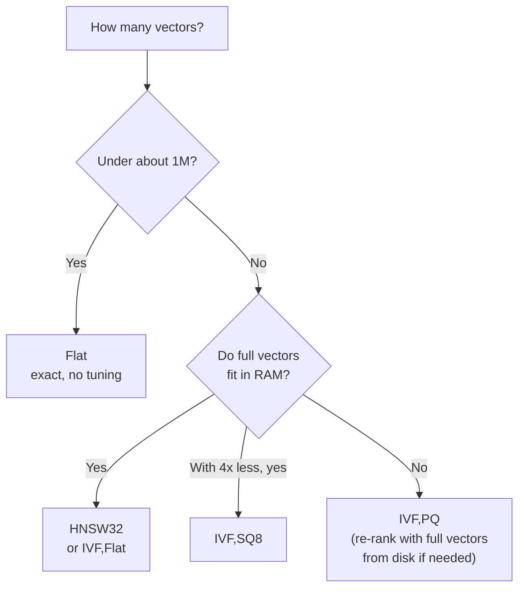

# FAISS: The Complete Guide

> 📚 **Before you start**
>
> - [Chroma](chroma.md), for collections, the toy help-centre data and the idea of distances versus similarities.
> - [Storage and Indexing (HNSW, IVF)](../03-embeddings-and-vector-databases/storage-and-indexing-hnsw-ivf.md), for IVF (`nlist`, `nprobe`), HNSW (`M`, `ef_search`) and product quantization, which FAISS implements.
> - [In-Memory, On-Disk and Cloud Vector DBs](../03-embeddings-and-vector-databases/in-memory-on-disk-and-cloud-vector-dbs.md), for the difference between a library and a database.

## Introduction

A good mechanic's workshop does not sell you a car. It has engines, gearboxes and tyres on the shelves, and if you know what you want, you can assemble exactly the machine you need: a light scooter for city errands, or a truck that hauls tonnes. What it does not give you is a showroom, a warranty or a driver.

**FAISS** (Facebook AI Similarity Search, from Meta's research team) is that workshop for vector search. It is a C++ library with Python bindings that contains almost every vector index from research and industry: exact search, IVF, HNSW, product quantization and many combinations, on CPU and on GPU. It is extremely fast and battle-tested at billions of vectors. But it is a **library**, not a database: no server, no metadata, no filtering language, no automatic persistence. Those you build around it.

Many tools you will use later run FAISS (or ideas from it) inside. Learning it directly teaches you what a vector database actually does for you, and gives you a power tool for batch jobs and research.

By the end of this lesson you will be able to:

- create FAISS indexes, add vectors and read the `D, I` arrays that `search` returns;
- get cosine similarity right with `normalize_L2` and `IndexFlatIP`;
- attach your own ids and keep metadata in a side table;
- choose an index with `index_factory` strings such as `"HNSW32"` or `"IVF1024,PQ64"`, train it and tune it;
- filter, delete, save and load, and know when FAISS is the wrong tool.

> 💡 **Key Insight**
>
> FAISS gives you exactly one thing: **a fast answer to "which stored row numbers are nearest to this query vector?"** You hand it a `float32` matrix, and it hands back distances and row numbers. Everything that turns row numbers into useful answers (ids, text, metadata, filters, persistence, updates) is your code's job. That is both its power and its cost.

---

## Core Explanation

### 1. The contract: matrices in, matrices out

```bash
pip install faiss-cpu      # or faiss-gpu builds for NVIDIA GPUs
```

Every FAISS index has the same core methods:

| Method | Input | What it does |
|---|---|---|
| `index.add(xb)` | `float32` array of shape `(n, d)` | Appends `n` vectors; they get row numbers `ntotal, ntotal+1, ...` |
| `index.search(xq, k)` | `float32` array of shape `(nq, d)`, and `k` | Returns `D` and `I`, both of shape `(nq, k)` |
| `index.ntotal` | | How many vectors are stored |
| `index.train(xt)` | sample vectors | Needed first for IVF and PQ indexes (`index.is_trained` tells you) |

`D` holds distances (or similarities, depending on the metric) and `I` holds the row numbers of the hits, best first. If fewer than `k` results exist, the missing slots are filled with `I = -1`.

Here is the same contract in plain NumPy, so you can run it and see the shapes. This is a teaching copy of `IndexFlatIP` (exact inner-product search), not FAISS itself:

```python
import numpy as np

class TeachingFlatIP:
    """Mimics faiss.IndexFlatIP: exact inner-product search over float32 rows."""

    def __init__(self, d):
        self.d = d
        self.xb = np.zeros((0, d), dtype=np.float32)

    @property
    def ntotal(self):
        return len(self.xb)

    def add(self, x):
        x = np.ascontiguousarray(x, dtype=np.float32)
        assert x.ndim == 2 and x.shape[1] == self.d, "expected shape (n, d)"
        self.xb = np.vstack([self.xb, x])

    def search(self, xq, k):
        scores = np.asarray(xq, dtype=np.float32) @ self.xb.T           # (nq, ntotal)
        order = np.argsort(-scores, axis=1, kind="stable")[:, :k]
        D = np.take_along_axis(scores, order, axis=1)
        I = order.astype(np.int64)
        if k > self.ntotal:                                               # pad like FAISS does
            pad = k - self.ntotal
            D = np.hstack([D, np.full((len(xq), pad), -np.finfo(np.float32).max, np.float32)])
            I = np.hstack([I, np.full((len(xq), pad), -1, np.int64)])
        return D, I

rng = np.random.default_rng(0)
xb = rng.normal(size=(5, 4)).astype(np.float32)
index = TeachingFlatIP(d=4)
index.add(xb)
D, I = index.search(xb[:2], k=3)
print("ntotal:", index.ntotal)
print("D shape", D.shape, "I shape", I.shape)
print("I =", I.tolist())
_, I_big = index.search(xb[:1], k=7)
print("asking for 7 of 5:", I_big.tolist())
```

Output:

```
ntotal: 5
D shape (2, 3) I shape (2, 3)
I = [[1, 0, 4], [1, 4, 0]]
asking for 7 of 5: [[1, 0, 4, 2, 3, -1, -1]]
```

Three habits come straight from this contract:

- **Always pass 2-D `float32` arrays.** A single query must be shaped `(1, d)`, not `(d,)`. FAISS raises an error for wrong shapes and wrong dtypes, and `float64` NumPy arrays (the default) are the most common cause.
- **Check for `-1` in `I`** before using a row number as a list index; in Python, `-1` silently picks the last item.
- **Inner product does not guarantee that a stored vector is its own best match.** Look at the first row of `I`: the query was `xb[0]`, yet row 1 ranks above row 0, because row 1 is a longer vector. Section 3 explains why, and how normalising fixes it.

### 2. The real thing with the help-centre data

Here is our toy help-centre data from the previous lesson, as a matrix:

```python
import re

DIMS = ["money", "travel", "tech", "food", "weather"]
LEXICON = {
    "upi": (0.9, 0, 0.4, 0, 0), "payment": (1, 0, 0.1, 0, 0), "bhugtan": (1, 0, 0.1, 0, 0),
    "paisa": (1, 0, 0, 0, 0), "money": (1, 0, 0, 0, 0), "debited": (0.9, 0, 0, 0, 0),
    "deducted": (0.9, 0, 0, 0, 0), "failed": (0.3, 0, 0.3, 0, 0), "fail": (0.3, 0, 0.3, 0, 0),
    "refund": (1, 0.1, 0, 0, 0), "wallet": (0.8, 0, 0.2, 0, 0), "bank": (0.9, 0, 0, 0, 0),
    "account": (0.6, 0, 0.3, 0, 0), "train": (0, 1, 0, 0, 0), "ticket": (0.3, 0.8, 0, 0, 0),
    "tatkal": (0.1, 0.9, 0, 0, 0), "journey": (0, 0.9, 0, 0, 0), "booking": (0.2, 0.7, 0.1, 0, 0),
    "cancelled": (0.2, 0.5, 0, 0, 0), "delayed": (0, 0.7, 0, 0, 0.2), "late": (0, 0.6, 0, 0, 0.1),
    "app": (0.1, 0, 1, 0, 0), "password": (0, 0, 1, 0, 0), "login": (0, 0, 1, 0, 0),
    "otp": (0.2, 0, 0.9, 0, 0), "phone": (0.1, 0, 1, 0, 0), "reset": (0, 0, 0.6, 0, 0),
    "biryani": (0, 0, 0, 1, 0), "chai": (0, 0, 0, 1, 0), "catering": (0, 0.2, 0, 0.9, 0),
    "rain": (0, 0.1, 0, 0, 0.9), "monsoon": (0, 0.1, 0, 0, 1), "flooding": (0, 0.2, 0, 0, 0.9),
}

def embed(text):
    """Toy embedding model from the Chroma lesson: normalised sum of word vectors."""
    vectors = [LEXICON[w] for w in re.findall(r"[a-z]+", text.lower()) if w in LEXICON]
    v = np.sum(vectors, axis=0) if vectors else np.zeros(len(DIMS))
    return (v / np.linalg.norm(v) if np.linalg.norm(v) else v).round(4).tolist()

DOCS = [
    ("faq-01", "UPI payment failed but money was debited from my bank account", {"topic": "payments", "lang": "en"}),
    ("faq-02", "How to get a refund for a cancelled train ticket", {"topic": "travel", "lang": "en"}),
    ("faq-03", "Tatkal ticket booking opens one day before the journey", {"topic": "travel", "lang": "en"}),
    ("faq-04", "Reset your app password using the OTP sent to your phone", {"topic": "account", "lang": "en"}),
    ("faq-05", "UPI bhugtan fail ho gaya par paisa kat gaya", {"topic": "payments", "lang": "hi"}),
    ("faq-06", "Train delayed due to heavy rain and monsoon flooding", {"topic": "travel", "lang": "en"}),
    ("faq-07", "Order biryani and chai on your train journey with e-catering", {"topic": "food", "lang": "en"}),
    ("faq-08", "A wallet refund reaches your bank account in 5 to 7 days", {"topic": "payments", "lang": "en"}),
]
xb = np.array([embed(text) for _, text, _ in DOCS], dtype=np.float32)
print(xb.shape, xb.dtype)
```

Output:

```
(8, 5) float32
```

With FAISS installed, exact cosine search over it looks like this:

```python
# not-run: needs the faiss-cpu package
import faiss

d = xb.shape[1]
faiss.normalize_L2(xb)                 # in place: every row now has length 1
index = faiss.IndexFlatIP(d)           # inner product of unit vectors = cosine similarity
index.add(xb)

xq = np.array([embed("is my train late because of rain")], dtype=np.float32)
faiss.normalize_L2(xq)
D, I = index.search(xq, 3)
print(D)
print(I)
```

Example output (computed from the toy vectors):

```
[[0.9096743  0.84765446 0.73091877]]
[[5 2 1]]
```

Row 5 is `faq-06` (the monsoon delay), row 2 is `faq-03` and row 1 is `faq-02`, the same ranking Chroma gave in the previous lesson. Notice that FAISS gives back **row numbers only**: turning `5` into "Train delayed due to heavy rain..." is up to you.

### 3. Metrics: L2, inner product and cosine

FAISS has two main metrics. There is no separate "cosine" index; you get cosine by normalising first.

| You want | Index | `D` contains | Best hit has |
|---|---|---|---|
| Euclidean distance | `IndexFlatL2` | **squared** L2 distance | the smallest `D` |
| Inner product | `IndexFlatIP` | dot product | the largest `D` |
| Cosine similarity | `normalize_L2` on data and queries, then `IndexFlatIP` | cosine similarity | the largest `D` |

The classic bug is to normalise the stored vectors but forget the queries (or the other way round). Inner product with an un-normalised query still ranks correctly, because scaling the query scales every score equally, but the scores are no longer cosines, so any threshold you apply is wrong. Normalising the stored vectors matters even more: without it, long vectors win just for being long.

```python
def normalize_rows(x):
    """What faiss.normalize_L2 does, but returning a copy instead of changing x in place."""
    return x / np.linalg.norm(x, axis=1, keepdims=True)

raw = np.array([[3.0, 4.0], [0.6, 0.8], [1.0, 0.0]], dtype=np.float32)
query = np.array([[0.6, 0.8]], dtype=np.float32)
print("inner product, raw rows:       ", (query @ raw.T).astype(float).round(3).tolist())
print("inner product, normalised rows:", (query @ normalize_rows(raw).T).astype(float).round(3).tolist())
```

Output:

```
inner product, raw rows:        [[5.0, 1.0, 0.6]]
inner product, normalised rows: [[1.0, 1.0, 0.6]]
```

On raw rows, `[3, 4]` scores 5.0 against the query and beats `[0.6, 0.8]`, even though both point in exactly the same direction. After normalising, they tie at 1.0, which is what cosine similarity means.

### 4. Your ids and your metadata

By default a vector's id is its row number. Real systems have their own ids (database primary keys, chunk ids) and need metadata to show and filter results. The standard pattern is:

1. Wrap the index in `IndexIDMap` and call `add_with_ids` with **64-bit integer** ids (FAISS ids are integers, not strings).
2. Keep everything else (text, source, language, string ids) in a **side table** keyed by that integer: a dict, a Parquet file or a SQLite database.

```python
# not-run: needs the faiss-cpu package
index = faiss.IndexIDMap(faiss.IndexFlatIP(d))
int_ids = np.array([1001, 1002, 1003, 1004, 1005, 1006, 1007, 1008], dtype=np.int64)
index.add_with_ids(xb, int_ids)
D, I = index.search(xq, 2)
print(I)     # now your ids, not row numbers
```

Example output:

```
[[1006 1003]]
```

Here is the side-table half, with SQLite from the standard library. We store each FAQ under the same integer ids and look hits up after a search (using the teaching index in place of FAISS):

```python
import sqlite3

db = sqlite3.connect(":memory:")
db.execute("CREATE TABLE chunks (vec_id INTEGER PRIMARY KEY, doc_id TEXT, text TEXT, topic TEXT, lang TEXT)")
int_ids = list(range(1001, 1001 + len(DOCS)))
db.executemany("INSERT INTO chunks VALUES (?, ?, ?, ?, ?)",
               [(vid, doc_id, text, m["topic"], m["lang"]) for vid, (doc_id, text, m) in zip(int_ids, DOCS)])

flat = TeachingFlatIP(d=xb.shape[1])
flat.add(normalize_rows(xb))
row_to_vec_id = np.array(int_ids)                      # what IndexIDMap keeps for you

def search_with_metadata(query_text, k=3):
    q = normalize_rows(np.array([embed(query_text)], dtype=np.float32))
    D, I = flat.search(q, k)
    hits = []
    for score, row in zip(D[0], I[0]):
        if row == -1:
            continue
        vec_id = int(row_to_vec_id[row])
        doc_id, text = db.execute("SELECT doc_id, text FROM chunks WHERE vec_id = ?", (vec_id,)).fetchone()
        hits.append((round(float(score), 3), doc_id, text))
    return hits

for hit in search_with_metadata("forgot login password", k=2):
    print(hit)
```

Output:

```
(0.996, 'faq-04', 'Reset your app password using the OTP sent to your phone')
(0.243, 'faq-05', 'UPI bhugtan fail ho gaya par paisa kat gaya')
```

This "vectors in FAISS, everything else in a table" split is exactly what a vector database does internally. Building it yourself is fine for a batch job; for a live app with writes, deletes and filters, it is a lot of code to get right.

### 5. Choosing an index with `index_factory`

FAISS builds indexes from short **factory strings**, so you can switch index types without changing other code:

```python
# not-run: needs the faiss-cpu package
index = faiss.index_factory(768, "HNSW32", faiss.METRIC_INNER_PRODUCT)
index = faiss.index_factory(768, "IVF4096,Flat", faiss.METRIC_INNER_PRODUCT)
index = faiss.index_factory(768, "IVF4096,PQ64", faiss.METRIC_INNER_PRODUCT)
```

Read a factory string left to right as "how vectors are grouped, then how each vector is stored":

| Factory string | What you get | Train? | Memory per 768-d vector | Typical use |
|---|---|---|---|---|
| `Flat` | Exact brute force | No | 3,072 bytes | Up to about a million vectors, ground truth for testing |
| `HNSW32` | HNSW graph with `M = 32`, full vectors | No | 3,072 + about 256 bytes of links | Fast, high recall, fits in RAM |
| `IVF4096,Flat` | 4,096 k-means lists, full vectors | Yes | 3,072 bytes | Millions of vectors, tunable with `nprobe` |
| `IVF4096,SQ8` | IVF plus 8-bit scalar quantization | Yes | 768 bytes | 4x less memory, small recall loss |
| `IVF4096,PQ64` | IVF plus product quantization, 64 sub-vectors of 8 bits | Yes | 64 bytes | Hundreds of millions to billions of vectors |

The memory column is just arithmetic, which you can do before building anything:

```python
def bytes_per_vector(factory, d):
    parts = factory.split(",")
    storage = parts[-1]
    if storage.startswith("HNSW"):
        m = int(storage[4:])
        return d * 4 + m * 2 * 4             # full vector + layer-0 links (4-byte ids)
    if storage == "Flat":
        return d * 4
    if storage == "SQ8":
        return d
    if storage.startswith("PQ"):
        return int(storage[2:])              # one byte per sub-vector with 8-bit codes
    raise ValueError(storage)

n, d = 10_000_000, 768
print(f"{'factory':<14} {'per vector':>11} {'10M vectors':>12}")
for f in ["Flat", "HNSW32", "IVF4096,Flat", "IVF4096,SQ8", "IVF4096,PQ64"]:
    b = bytes_per_vector(f, d)
    print(f"{f:<14} {b:>9,} B {n * b / 1e9:>10.1f} GB")
```

Output:

```
factory         per vector  10M vectors
Flat               3,072 B       30.7 GB
HNSW32             3,328 B       33.3 GB
IVF4096,Flat       3,072 B       30.7 GB
IVF4096,SQ8          768 B        7.7 GB
IVF4096,PQ64          64 B        0.6 GB
```

(IVF indexes also store an 8-byte id per vector in each list, which this estimate leaves out.)



### 6. Train, add, tune

IVF and PQ indexes must be **trained** before you add vectors: training runs k-means to find the list centroids (and the PQ codebooks). Train on a representative sample, usually tens of times more vectors than lists.

```python
# not-run: needs the faiss-cpu package; xb_big is your (n, 768) float32 matrix, normalised
index = faiss.index_factory(768, "IVF1024,Flat", faiss.METRIC_INNER_PRODUCT)
print(index.is_trained)              # False
index.train(xb_big[:100_000])        # k-means on a sample
index.add(xb_big)
index.nprobe = 16                    # search 16 of the 1,024 lists (default is 1)
D, I = index.search(xq, 10)

hnsw = faiss.index_factory(768, "HNSW32", faiss.METRIC_INNER_PRODUCT)
hnsw.add(xb_big)                     # no training needed
hnsw.hnsw.efSearch = 64              # wider beam, better recall
```

Example output:

```
False
```

The query-time knobs are the same ones you met in the previous module: `nprobe` for IVF, `efSearch` for HNSW. **Measure recall against a `Flat` index on a few hundred real queries** and raise the knob until recall is good enough; the default `nprobe = 1` is almost always too low.

### 7. Filtering, deleting and updating

These are where a library differs most from a database.

**Filtering.** FAISS has no metadata, so filters work on ids. You can pass a selector of allowed ids to `search` through search parameters (`faiss.SearchParametersIVF(sel=faiss.IDSelectorBatch(allowed_ids), nprobe=16)`), which the IVF and flat indexes respect during the search. The simpler, very common alternative is **over-fetch and post-filter**: ask for more results than you need, then drop those that fail the filter using the side table. It is easy, but as you saw in [Storage and Indexing](../03-embeddings-and-vector-databases/storage-and-indexing-hnsw-ivf.md), it can return too few results when the filter is selective.

```python
def filtered_search(query_text, k=2, lang=None, overfetch=4):
    q = normalize_rows(np.array([embed(query_text)], dtype=np.float32))
    D, I = flat.search(q, k * overfetch)
    hits = []
    for score, row in zip(D[0], I[0]):
        if row == -1:
            continue
        doc_id, row_lang = db.execute("SELECT doc_id, lang FROM chunks WHERE vec_id = ?",
                                      (int(row_to_vec_id[row]),)).fetchone()
        if lang is None or row_lang == lang:
            hits.append((doc_id, round(float(score), 3)))
    return hits[:k]

print("any language:", filtered_search("UPI payment failed and money deducted"))
print("Hindi only:  ", filtered_search("UPI payment failed and money deducted", lang="hi"))
```

Output:

```
any language: [('faq-01', 1.0), ('faq-08', 0.999)]
Hindi only:   [('faq-05', 0.999)]
```

**Deleting.** `index.remove_ids(...)` works for flat and IVF indexes. The HNSW index in FAISS does **not** support removal, because pulling a node out of the graph would break the links that searches rely on. The usual approaches are to mark deleted ids in your side table and filter them out, then **rebuild** the index periodically (nightly, for example).

**Updating** a vector is a delete plus an add. For data that changes all day, this is the strongest sign you want a database rather than FAISS.

### 8. Saving and loading

```python
# not-run: needs the faiss-cpu package
faiss.write_index(index, "help_centre.faiss")
index = faiss.read_index("help_centre.faiss")
print(index.ntotal)
```

Example output:

```
8
```

The index file contains vectors and index structures, **not** your side table. Save them together and version them together; an index file paired with the wrong metadata table returns confidently wrong text.

### 9. GPUs and very large collections

The GPU builds of FAISS can search and build many index types tens of times faster than a CPU, which matters for batch work such as deduplicating a billion images or computing nearest neighbours for every item in a catalogue (`faiss.index_cpu_to_gpu` moves an index onto a GPU). For collections bigger than RAM, FAISS offers compressed indexes (PQ), on-disk inverted lists and sharding across several indexes whose results you merge, the same ideas as the previous module, but you assemble them yourself.

### 10. FAISS or a vector database?

| Situation | Choose |
|---|---|
| Offline batch job: dedupe, clustering, nearest neighbours for every item | FAISS |
| Research: comparing index types and parameters | FAISS |
| Building your own search service with special needs | FAISS as the engine |
| An app where records are added, updated and deleted all day | A vector database |
| You need metadata filters, multiple clients, backups, auth | A vector database |

FAISS is also the engine behind some frameworks' in-memory vector stores, and you will meet it again in [Vector Stores in LangChain](../course.md#m5).

---

## Try It Yourself

1. **The shape bug.** Call `flat.search` with a query of shape `(5,)` instead of `(1, 5)`. What happens in the teaching index, and how do you fix the query?
2. **Size an index.** You have 50 million chunks of a 1,024-dimension model and a 64 GB server. Using `bytes_per_vector`, which factory strings from the table fit in about 48 GB, leaving room for the operating system?
3. **Post-filtering failure.** Call `filtered_search("is my train late because of rain", k=2, lang="hi", overfetch=1)`. Why is the result empty even though a Hindi FAQ exists? What value of `overfetch` finds it?

<details>
<summary>Show answers</summary>

**1.**

```python
q = np.array(embed("forgot login password"), dtype=np.float32)
print(q.shape)
D, I = flat.search(q.reshape(1, -1), 1)
print(I.tolist())
```

Output:

```
(5,)
[[3]]
```

A 1-D query makes `xq @ xb.T` return a 1-D array, and the `axis=1` sort then fails; real FAISS raises an assertion error about the shape. `reshape(1, -1)` (or wrapping in a list before `np.array`) turns one query into a batch of one.

**2.**

```python
for f in ["Flat", "HNSW32", "IVF4096,Flat", "IVF4096,SQ8", "IVF4096,PQ64"]:
    gb = 50_000_000 * bytes_per_vector(f, 1024) / 1e9
    print(f"{f:<14} {gb:>7.1f} GB  {'fits' if gb <= 48 else 'too big'}")
```

Output:

```
Flat             204.8 GB  too big
HNSW32           217.6 GB  too big
IVF4096,Flat     204.8 GB  too big
IVF4096,SQ8       51.2 GB  too big
IVF4096,PQ64       3.2 GB  fits
```

Only PQ64 fits. SQ8 needs 51.2 GB, just over the budget: it would fit on a slightly bigger server or split across two machines, and it keeps more accuracy than PQ. PQ64 leaves lots of room, and you could re-rank its top 100 hits with full vectors stored on SSD to win back accuracy.

**3.**

```python
print(filtered_search("is my train late because of rain", k=2, lang="hi", overfetch=1))
print(filtered_search("is my train late because of rain", k=2, lang="hi", overfetch=4))
```

Output:

```
[]
[('faq-05', 0.0)]
```

With `overfetch=1` we fetch only the 2 nearest FAQs, both English travel items, and the filter removes them. With `overfetch=4` we fetch all 8, so the Hindi one survives, with a score of 0.0: it passes the filter but has nothing to do with trains. Two lessons here. Post-filtering needs a big enough over-fetch, and with millions of vectors you cannot fetch "all of them", which is why databases filter **inside** the index search. And a filtered search should still apply a minimum score, or it will happily return irrelevant items.

</details>

---

## Real-World Examples

- **Large-scale image and video deduplication**: platforms embed every upload and use FAISS on GPUs to find near-duplicates across billions of items in batch jobs.
- **Recommendation candidate generation**: offline jobs compute "100 nearest products" for every product in a catalogue with an IVF-PQ index, then store the lists in an ordinary key-value store for the app to read.
- **Research and benchmarking**: papers on new embedding models and ANN methods report results against FAISS baselines.
- **Inside other systems**: several databases and frameworks use FAISS as their index engine and add the database features around it.

---

## Common Misconceptions

### "FAISS is a vector database"

It is a library. It has no server, no metadata, no filter language and no automatic persistence. You get raw speed and full control in exchange.

### "IndexFlatIP gives cosine similarity"

Only if both stored and query vectors are normalised. Otherwise it gives raw dot products, and long vectors win.

### "FAISS ids can be my string ids"

FAISS ids are 64-bit integers. Keep a mapping from integers to your string ids and metadata.

### "I can delete from any FAISS index"

`IndexHNSWFlat` does not support removal. Plan for soft deletes plus periodic rebuilds, or use IVF or a database.

---

## Interview Relevance

*"How would you build semantic search over 100 million vectors with FAISS?"* A strong answer sizes memory first (100M × 768 × 4 bytes is about 307 GB raw), picks a compressed index such as `IVF65536,PQ64` or an IVF with SQ8 across several machines, trains on a sample, tunes `nprobe` against a `Flat` ground truth on a subset, keeps metadata in a side store keyed by 64-bit ids, and explains how deletes (soft delete plus rebuild) and filters (ID selectors or over-fetching) would work.

*"FAISS returns -1 in the results. Why?"* Fewer than `k` vectors were found: the index has fewer than `k` items, or an IVF search with a small `nprobe` visited lists with too few vectors.

*"What is the difference between IndexFlatL2 and IndexFlatIP?"* Squared Euclidean distance (smaller is better) versus inner product (larger is better); cosine is inner product on normalised vectors.

---

## Key Takeaways

- **FAISS maps query vectors to row numbers**: `add` a `(n, d)` float32 matrix, `search` returns `D` and `I` of shape `(nq, k)`, with `-1` for missing hits.
- **Cosine = `normalize_L2` + `IndexFlatIP`**, applied to both stored vectors and queries.
- **Ids are 64-bit integers** (`IndexIDMap`, `add_with_ids`); text and metadata live in your own side table.
- **`index_factory` strings** pick the index: `Flat`, `HNSW32`, `IVF...,Flat`, `IVF...,SQ8`, `IVF...,PQ...`; IVF and PQ need `train` first, and `nprobe` or `efSearch` tune recall.
- **Filters, deletes and persistence are your job**, which is why live applications usually choose a vector database built on the same ideas.

---

**Up next:** [Qdrant](qdrant.md)
