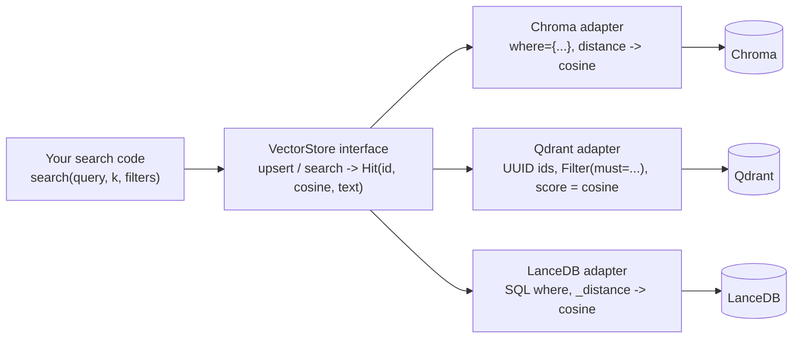

# Lab: Same search in three vector DBs

> 📚 **Before you start**
>
> - [Chroma](chroma.md), [Qdrant](qdrant.md) and [LanceDB](lancedb.md): this lab uses all three APIs.
> - [Pinecone](pinecone.md), for the filter translator you will reuse.
> - [Embedding-Based Retrieval Pipelines](embedding-based-retrieval-pipelines.md), for deterministic ids and recall@k.

## What You'll Build

You will load the same help-centre FAQs into **Chroma**, **Qdrant** and **LanceDB**, run the same questions with the same filters against all three, and prove that they agree. Along the way you will build the piece every real project ends up needing: a thin **adapter layer** that hides each database's id rules, filter syntax and score convention behind one interface, so your application code does not care which database is underneath.



Each adapter comes in two forms:

- a **real** version that talks to the installed library (shown in blocks you run on your own machine after `pip install chromadb qdrant-client lancedb`);
- an **offline twin**: a small class that returns results in exactly the raw format the real database returns (Chroma's nested lists of distances, Qdrant's scored points, LanceDB's rows with `_distance`). Testing against fakes like this is standard practice, and it lets every step of this lab run anywhere.

> 💡 **Key Insight**
>
> Vector databases differ in **surface** (ids, filter syntax, distance or similarity, result shape), not in the **answer**. With the same embeddings, the same metric and exact search, they return the same ranking. An adapter that normalises the surface turns "which database?" into a deployment decision you can change later, and a comparison test proves the adapters are correct.

---

## Step 1: The shared data and model

The same eight FAQs and five-number toy model as in the tool lessons, plus a few metadata fields we will filter on:

```python
import re
import uuid
from dataclasses import dataclass
import numpy as np

LEXICON = {
    "upi": (0.9, 0, 0.4, 0, 0), "payment": (1, 0, 0.1, 0, 0), "bhugtan": (1, 0, 0.1, 0, 0),
    "paisa": (1, 0, 0, 0, 0), "money": (1, 0, 0, 0, 0), "debited": (0.9, 0, 0, 0, 0),
    "deducted": (0.9, 0, 0, 0, 0), "failed": (0.3, 0, 0.3, 0, 0), "fail": (0.3, 0, 0.3, 0, 0),
    "refund": (1, 0.1, 0, 0, 0), "wallet": (0.8, 0, 0.2, 0, 0), "bank": (0.9, 0, 0, 0, 0),
    "account": (0.6, 0, 0.3, 0, 0), "train": (0, 1, 0, 0, 0), "ticket": (0.3, 0.8, 0, 0, 0),
    "tatkal": (0.1, 0.9, 0, 0, 0), "journey": (0, 0.9, 0, 0, 0), "booking": (0.2, 0.7, 0.1, 0, 0),
    "cancelled": (0.2, 0.5, 0, 0, 0), "delayed": (0, 0.7, 0, 0, 0.2), "late": (0, 0.6, 0, 0, 0.1),
    "app": (0.1, 0, 1, 0, 0), "password": (0, 0, 1, 0, 0), "login": (0, 0, 1, 0, 0),
    "otp": (0.2, 0, 0.9, 0, 0), "phone": (0.1, 0, 1, 0, 0), "reset": (0, 0, 0.6, 0, 0),
    "biryani": (0, 0, 0, 1, 0), "chai": (0, 0, 0, 1, 0), "catering": (0, 0.2, 0, 0.9, 0),
    "rain": (0, 0.1, 0, 0, 0.9), "monsoon": (0, 0.1, 0, 0, 1), "flooding": (0, 0.2, 0, 0, 0.9),
}

def embed(text):
    """Toy embedding model from the Chroma lesson: normalised sum of word vectors."""
    vectors = [LEXICON[w] for w in re.findall(r"[a-z]+", text.lower()) if w in LEXICON]
    v = np.sum(vectors, axis=0) if vectors else np.zeros(5)
    return (v / np.linalg.norm(v) if np.linalg.norm(v) else v).round(4).tolist()

FAQS = [
    ("faq-01", "UPI payment failed but money was debited from my bank account", {"topic": "payments", "lang": "en"}),
    ("faq-02", "How to get a refund for a cancelled train ticket", {"topic": "travel", "lang": "en"}),
    ("faq-03", "Tatkal ticket booking opens one day before the journey", {"topic": "travel", "lang": "en"}),
    ("faq-04", "Reset your app password using the OTP sent to your phone", {"topic": "account", "lang": "en"}),
    ("faq-05", "UPI bhugtan fail ho gaya par paisa kat gaya", {"topic": "payments", "lang": "hi"}),
    ("faq-06", "Train delayed due to heavy rain and monsoon flooding", {"topic": "travel", "lang": "en"}),
    ("faq-07", "Order biryani and chai on your train journey with e-catering", {"topic": "food", "lang": "en"}),
    ("faq-08", "A wallet refund reaches your bank account in 5 to 7 days", {"topic": "payments", "lang": "en"}),
]
QUERIES = [
    ("refund for my train ticket", []),
    ("UPI payment failed and money deducted", [("lang", "eq", "en")]),
    ("is my train late because of rain", [("topic", "in", ["travel", "food"])]),
]
print(len(FAQS), "FAQs,", len(QUERIES), "queries")
```

Output:

```
8 FAQs, 3 queries
```

Filters are written once, in a neutral form: a list of `(field, op, value)` conditions, all of which must hold.

## Step 2: One interface for every database

The interface is small on purpose. `search` always returns `Hit` objects whose `score` is a **cosine similarity** (higher is better), whatever the database reports:

```python
@dataclass(frozen=True)
class Hit:
    id: str
    score: float
    text: str

class VectorStore:
    name = "base"

    def upsert(self, ids, vectors, texts, metadatas):
        raise NotImplementedError

    def search(self, vector, k, conds):
        raise NotImplementedError
```

Each adapter needs two translations, which are the whole point of this lab. Here they are side by side, using the translators from the [Pinecone](pinecone.md) lesson, extended with LanceDB's SQL:

```python
def to_chroma(conds):
    if not conds:
        return None
    parts = [{f: {f"${op}": v}} for f, op, v in conds]
    return parts[0] if len(parts) == 1 else {"$and": parts}

def to_qdrant(conds):
    must = []
    for f, op, v in conds:
        if op == "eq":
            must.append({"key": f, "match": {"value": v}})
        elif op == "in":
            must.append({"key": f, "match": {"any": v}})
        else:
            must.append({"key": f, "range": {op: v}})
    return {"must": must} if must else None

def sql_literal(v):
    return "'" + str(v).replace("'", "''") + "'" if isinstance(v, str) else str(v)

def to_lance_sql(conds):
    sql_ops = {"eq": "=", "gt": ">", "gte": ">=", "lt": "<", "lte": "<="}
    parts = []
    for f, op, v in conds:
        if op == "in":
            parts.append(f"{f} IN ({', '.join(sql_literal(x) for x in v)})")
        else:
            parts.append(f"{f} {sql_ops[op]} {sql_literal(v)}")
    return " AND ".join(parts) or None

conds = QUERIES[2][1] + [("lang", "eq", "en")]
print("Chroma: ", to_chroma(conds))
print("Qdrant: ", to_qdrant(conds))
print("LanceDB:", to_lance_sql(conds))
```

Output:

```
Chroma:  {'$and': [{'topic': {'$in': ['travel', 'food']}}, {'lang': {'$eq': 'en'}}]}
Qdrant:  {'must': [{'key': 'topic', 'match': {'any': ['travel', 'food']}}, {'key': 'lang', 'match': {'value': 'en'}}]}
LanceDB: topic IN ('travel', 'food') AND lang = 'en'
```

Notice `sql_literal` doubles single quotes inside strings. Building SQL from user input without escaping is how injection bugs happen, even in a vector database.

| | Chroma (`space: cosine`) | Qdrant (`Distance.COSINE`) | LanceDB (`distance_type("cosine")`) |
|---|---|---|---|
| Ids | any string | unsigned int or UUID | any value in an id column |
| Raw number | distance `1 - cos` | similarity `cos` | `_distance` = `1 - cos` |
| To cosine | `1 - distance` | as is | `1 - _distance` |
| Result shape | dict of lists, one inner list per query | list of points with `.id`, `.score`, `.payload` | list of row dicts |

## Step 3: The Chroma adapter

The real adapter, for your machine:

```python
# not-run: needs the chromadb package
import chromadb

class ChromaStore(VectorStore):
    name = "chroma"

    def __init__(self):
        client = chromadb.Client()
        self.col = client.get_or_create_collection("lab_faqs", configuration={"hnsw": {"space": "cosine"}})

    def upsert(self, ids, vectors, texts, metadatas):
        self.col.upsert(ids=ids, embeddings=vectors, documents=texts, metadatas=metadatas)

    def search(self, vector, k, conds):
        res = self.col.query(query_embeddings=[vector], n_results=k, where=to_chroma(conds))
        return [Hit(i, round(1 - d, 3), t)
                for i, d, t in zip(res["ids"][0], res["distances"][0], res["documents"][0])]
```

The offline twin returns the same nested, distance-based result, and the adapter logic on top of it is identical:

```python
def cosine_scores(matrix, vector):
    q = np.array(vector) / np.linalg.norm(vector)
    m = np.array(matrix)
    return m @ q / np.linalg.norm(m, axis=1)

def chroma_where_ok(meta, where):
    if where is None:
        return True
    if "$and" in where:
        return all(chroma_where_ok(meta, w) for w in where["$and"])
    (field, cond), = where.items()
    (op, value), = cond.items()
    return meta.get(field) == value if op == "$eq" else meta.get(field) in value

class FakeChromaCollection:
    """Returns query results shaped like Chroma's: nested lists, cosine distances."""

    def __init__(self):
        self.rows = {}

    def upsert(self, ids, embeddings, documents, metadatas):
        for i, e, d, m in zip(ids, embeddings, documents, metadatas):
            self.rows[i] = (e, d, m)

    def query(self, query_embeddings, n_results, where=None):
        ids = [i for i, (_, _, m) in self.rows.items() if chroma_where_ok(m, where)]
        dist = 1 - cosine_scores([self.rows[i][0] for i in ids], query_embeddings[0])
        order = sorted(range(len(ids)), key=lambda n: (dist[n], ids[n]))[:n_results]
        return {"ids": [[ids[n] for n in order]],
                "distances": [[float(dist[n]) for n in order]],
                "documents": [[self.rows[ids[n]][1] for n in order]]}

class OfflineChromaStore(VectorStore):
    name = "chroma"

    def __init__(self):
        self.col = FakeChromaCollection()

    def upsert(self, ids, vectors, texts, metadatas):
        self.col.upsert(ids=ids, embeddings=vectors, documents=texts, metadatas=metadatas)

    def search(self, vector, k, conds):                      # same body as the real adapter
        res = self.col.query(query_embeddings=[vector], n_results=k, where=to_chroma(conds))
        return [Hit(i, round(1 - d, 3), t)
                for i, d, t in zip(res["ids"][0], res["distances"][0], res["documents"][0])]

chroma = OfflineChromaStore()
chroma.upsert([f[0] for f in FAQS], [embed(f[1]) for f in FAQS], [f[1] for f in FAQS], [f[2] for f in FAQS])
for hit in chroma.search(embed("refund for my train ticket"), 2, []):
    print(hit)
```

Output:

```
Hit(id='faq-02', score=0.999, text='How to get a refund for a cancelled train ticket')
Hit(id='faq-03', score=0.913, text='Tatkal ticket booking opens one day before the journey')
```

## Step 4: The Qdrant adapter

Qdrant needs UUID ids, so the adapter converts deterministically and keeps the original id in the payload. Its scores are already cosine similarities.

```python
# not-run: needs the qdrant-client package
from qdrant_client import QdrantClient, models

class QdrantStore(VectorStore):
    name = "qdrant"
    NS = uuid.UUID("12345678-1234-5678-1234-567812345678")

    def __init__(self):
        self.client = QdrantClient(":memory:")
        self.client.create_collection("lab_faqs", vectors_config=models.VectorParams(size=5, distance=models.Distance.COSINE))

    def upsert(self, ids, vectors, texts, metadatas):
        points = [models.PointStruct(id=str(uuid.uuid5(self.NS, i)), vector=v,
                                     payload={"source_id": i, "text": t, **m})
                  for i, v, t, m in zip(ids, vectors, texts, metadatas)]
        self.client.upsert("lab_faqs", points=points)

    def search(self, vector, k, conds):
        flt = to_qdrant(conds)
        res = self.client.query_points("lab_faqs", query=vector, limit=k, with_payload=True,
                                       query_filter=models.Filter(**flt) if flt else None).points
        return [Hit(p.payload["source_id"], round(p.score, 3), p.payload["text"]) for p in res]
```

The offline twin returns objects with `.id`, `.score` and `.payload`, like the client's scored points:

```python
@dataclass
class FakeScoredPoint:
    id: str
    score: float
    payload: dict

def qdrant_filter_ok(payload, flt):
    if flt is None:
        return True
    for c in flt["must"]:
        value = payload.get(c["key"])
        if "match" in c and "value" in c["match"] and value != c["match"]["value"]:
            return False
        if "match" in c and "any" in c["match"] and value not in c["match"]["any"]:
            return False
    return True

class FakeQdrantCollection:
    def __init__(self):
        self.points = {}

    def upsert(self, points):
        for p in points:
            self.points[p["id"]] = p

    def query_points(self, query, limit, query_filter=None):
        pts = [p for p in self.points.values() if qdrant_filter_ok(p["payload"], query_filter)]
        sims = cosine_scores([p["vector"] for p in pts], query)
        ranked = sorted(zip(sims, pts), key=lambda sp: (-sp[0], sp[1]["payload"]["source_id"]))[:limit]
        return [FakeScoredPoint(p["id"], float(s), p["payload"]) for s, p in ranked]

class OfflineQdrantStore(VectorStore):
    name = "qdrant"
    NS = uuid.UUID("12345678-1234-5678-1234-567812345678")

    def __init__(self):
        self.col = FakeQdrantCollection()

    def upsert(self, ids, vectors, texts, metadatas):
        self.col.upsert([{"id": str(uuid.uuid5(self.NS, i)), "vector": v,
                          "payload": {"source_id": i, "text": t, **m}}
                         for i, v, t, m in zip(ids, vectors, texts, metadatas)])

    def search(self, vector, k, conds):
        res = self.col.query_points(query=vector, limit=k, query_filter=to_qdrant(conds))
        return [Hit(p.payload["source_id"], round(p.score, 3), p.payload["text"]) for p in res]

qdrant = OfflineQdrantStore()
qdrant.upsert([f[0] for f in FAQS], [embed(f[1]) for f in FAQS], [f[1] for f in FAQS], [f[2] for f in FAQS])
first = qdrant.col.query_points(query=embed("refund for my train ticket"), limit=1)[0]
print("raw point id:", first.id, "score:", round(first.score, 3))
print("adapter hit: ", qdrant.search(embed("refund for my train ticket"), 1, [])[0])
```

Output:

```
raw point id: b9f96ded-1600-5828-a24a-e1f9df80f7e5 score: 0.999
adapter hit:  Hit(id='faq-02', score=0.999, text='How to get a refund for a cancelled train ticket')
```

The raw result carries the UUID; the adapter turns it back into `faq-02` using the payload.

## Step 5: The LanceDB adapter

LanceDB stores rows in a table and filters with SQL. Its `_distance` for `cosine` is `1 - cos`.

```python
# not-run: needs the lancedb package
import lancedb
import tempfile

class LanceStore(VectorStore):
    name = "lancedb"

    def __init__(self):
        self.db = lancedb.connect(tempfile.mkdtemp())
        self.tbl = None

    def upsert(self, ids, vectors, texts, metadatas):
        rows = [{"id": i, "vector": v, "text": t, **m} for i, v, t, m in zip(ids, vectors, texts, metadatas)]
        if self.tbl is None:
            self.tbl = self.db.create_table("lab_faqs", data=rows)
        else:
            self.tbl.merge_insert("id").when_matched_update_all().when_not_matched_insert_all().execute(rows)

    def search(self, vector, k, conds):
        q = self.tbl.search(vector).distance_type("cosine").limit(k)
        where = to_lance_sql(conds)
        if where:
            q = q.where(where)
        return [Hit(r["id"], round(1 - r["_distance"], 3), r["text"]) for r in q.to_list()]
```

Its offline twin evaluates the SQL `where` clause with SQLite, so the SQL our translator writes is really executed:

```python
import sqlite3

class FakeLanceTable:
    def __init__(self, rows):
        self.rows = {r["id"]: r for r in rows}
        self.sql = sqlite3.connect(":memory:")
        self.sql.execute("CREATE TABLE t (id TEXT PRIMARY KEY, topic TEXT, lang TEXT)")
        self.sql.executemany("INSERT INTO t VALUES (?, ?, ?)", [(r["id"], r["topic"], r["lang"]) for r in rows])

    def search(self, vector, k, where=None):
        sql = "SELECT id FROM t" + (f" WHERE {where}" if where else "")
        ids = [row[0] for row in self.sql.execute(sql)]
        dist = 1 - cosine_scores([self.rows[i]["vector"] for i in ids], vector)
        order = sorted(range(len(ids)), key=lambda n: (dist[n], ids[n]))[:k]
        return [dict(self.rows[ids[n]], _distance=float(dist[n])) for n in order]

class OfflineLanceStore(VectorStore):
    name = "lancedb"

    def upsert(self, ids, vectors, texts, metadatas):
        self.tbl = FakeLanceTable([{"id": i, "vector": v, "text": t, **m}
                                   for i, v, t, m in zip(ids, vectors, texts, metadatas)])

    def search(self, vector, k, conds):
        rows = self.tbl.search(vector, k, where=to_lance_sql(conds))
        return [Hit(r["id"], round(1 - r["_distance"], 3), r["text"]) for r in rows]

lance = OfflineLanceStore()
lance.upsert([f[0] for f in FAQS], [embed(f[1]) for f in FAQS], [f[1] for f in FAQS], [f[2] for f in FAQS])
print(lance.search(embed("is my train late because of rain"), 2, [("topic", "in", ["travel", "food"])]))
```

Output:

```
[Hit(id='faq-06', score=0.91, text='Train delayed due to heavy rain and monsoon flooding'), Hit(id='faq-03', score=0.848, text='Tatkal ticket booking opens one day before the journey')]
```

## Step 6: Run the same searches everywhere and compare

Now the payoff. Every store gets the same queries through the same interface, and a comparison checks that ids **and** cosine scores agree:

```python
def compare(stores, queries, k=3, tol=0.002):
    all_agree = True
    for text, conds in queries:
        results = {s.name: s.search(embed(text), k, conds) for s in stores}
        print(f"\nQuery: {text!r}  filters: {conds or 'none'}")
        for name, hits in results.items():
            print(f"  {name:<12}", "  ".join(f"{h.id} {h.score:.3f}" for h in hits))
        reference = results[stores[0].name]
        for name, hits in results.items():
            same_ids = [h.id for h in hits] == [h.id for h in reference]
            close = all(abs(a.score - b.score) <= tol for a, b in zip(hits, reference))
            if not (same_ids and close):
                all_agree = False
                print(f"  MISMATCH in {name}")
    return all_agree

stores = [chroma, qdrant, lance]
print("\nAll three agree:", compare(stores, QUERIES))
```

Output:

```

Query: 'refund for my train ticket'  filters: none
  chroma       faq-02 0.999  faq-03 0.913  faq-08 0.583
  qdrant       faq-02 0.999  faq-03 0.913  faq-08 0.583
  lancedb      faq-02 0.999  faq-03 0.913  faq-08 0.583

Query: 'UPI payment failed and money deducted'  filters: [('lang', 'eq', 'en')]
  chroma       faq-01 1.000  faq-08 0.999  faq-02 0.520
  qdrant       faq-01 1.000  faq-08 0.999  faq-02 0.520
  lancedb      faq-01 1.000  faq-08 0.999  faq-02 0.520

Query: 'is my train late because of rain'  filters: [('topic', 'in', ['travel', 'food'])]
  chroma       faq-06 0.910  faq-03 0.848  faq-02 0.731
  qdrant       faq-06 0.910  faq-03 0.848  faq-02 0.731
  lancedb      faq-06 0.910  faq-03 0.848  faq-02 0.731

All three agree: True
```

Same ids, same order, same cosine scores, three different databases. When you run the real adapters, small differences can appear in the third decimal place (the databases store `float32` vectors and Qdrant normalises cosine vectors on insert), which is why `compare` allows a small tolerance.

## Step 7: Break it on purpose

A comparison test earns its keep when something is subtly wrong. Here is a classic mistake: an adapter that forgets Chroma reports **distances** and passes them through as scores.

```python
class BuggyChromaStore(OfflineChromaStore):
    name = "chroma-buggy"

    def search(self, vector, k, conds):
        res = self.col.query(query_embeddings=[vector], n_results=k, where=to_chroma(conds))
        return [Hit(i, round(d, 3), t)          # bug: distance used as a similarity
                for i, d, t in zip(res["ids"][0], res["distances"][0], res["documents"][0])]

buggy = BuggyChromaStore()
buggy.upsert([f[0] for f in FAQS], [embed(f[1]) for f in FAQS], [f[1] for f in FAQS], [f[2] for f in FAQS])
print("\nAll agree:", compare([qdrant, buggy], QUERIES[:1]))

threshold = 0.3
kept = [h.id for h in buggy.search(embed("refund for my train ticket"), 3, []) if h.score >= threshold]
print("buggy adapter keeps for 'score >= 0.3':", kept)
```

Output:

```

Query: 'refund for my train ticket'  filters: none
  qdrant       faq-02 0.999  faq-03 0.913  faq-08 0.583
  chroma-buggy faq-02 0.001  faq-03 0.087  faq-08 0.417
  MISMATCH in chroma-buggy

All agree: False
buggy adapter keeps for 'score >= 0.3': ['faq-08']
```

The ranking is still right, so a quick eyeball test would pass, but every score is upside down. Any threshold now keeps the *worst* matches and drops the best: here the only hit kept is the weakest one. The comparison test catches it at once.

## Step 8: Run it for real

On your own machine, install the three libraries and swap the offline classes for the real ones. Nothing else changes:

```bash
pip install chromadb qdrant-client lancedb
```

```python
# not-run: needs chromadb, qdrant-client and lancedb
real_stores = [ChromaStore(), QdrantStore(), LanceStore()]
for s in real_stores:
    s.upsert([f[0] for f in FAQS], [embed(f[1]) for f in FAQS], [f[1] for f in FAQS], [f[2] for f in FAQS])
print("\nAll three agree:", compare(real_stores, QUERIES))
```

Example output: the same three tables as in Step 6, and `All three agree: True`. With eight items, every database searches exactly. On large collections their **approximate** indexes can return slightly different top-k lists; measure each one's recall@k against exact search (the method from [Storage and Indexing](../03-embeddings-and-vector-databases/storage-and-indexing-hnsw-ivf.md)) instead of expecting identical lists.

---

## Try It Yourself

1. **Add a range filter.** Add a `views` number to each FAQ's metadata (any values you like), extend the offline twins to store it, and run a query with `[("views", "gte", 5000)]` in all three stores. Which translator already supports ranges, and which twins needed changes?
2. **Add a fourth store.** Write an `OfflineFaissStore` that uses a NumPy matrix like FAISS's `IndexFlatIP` on normalised vectors, keeps string ids in a side list and post-filters with an over-fetch. Add it to `compare`. Does it agree?
3. **Escape check.** What SQL does `to_lance_sql([("topic", "eq", "chai' OR '1'='1")])` produce, and why is it safe?

<details>
<summary>Show answers</summary>

**1.** The Qdrant and LanceDB translators already handle `gte` (Qdrant as a `range`, LanceDB as `>=`), and `to_chroma` produces `{"views": {"$gte": 5000}}`, which real Chroma understands. The offline twins only implement equality and `in`, so their filter functions (and the SQLite table columns for LanceDB) would need a `views` field and range checks. That is exactly the kind of gap a comparison test across real databases exposes.

**2.**

```python
class OfflineFaissStore(VectorStore):
    name = "faiss"

    def upsert(self, ids, vectors, texts, metadatas):
        m = np.array(vectors, dtype=np.float32)
        self.xb = m / np.linalg.norm(m, axis=1, keepdims=True)
        self.ids, self.texts, self.metas = list(ids), list(texts), list(metadatas)

    def search(self, vector, k, conds):
        q = np.array(vector, dtype=np.float32)
        scores = self.xb @ (q / np.linalg.norm(q))
        order = sorted(range(len(self.ids)), key=lambda n: (-scores[n], self.ids[n]))
        hits = []
        for n in order:                                   # post-filter over everything (tiny data)
            ok = all(self.metas[n].get(f) == v if op == "eq" else self.metas[n].get(f) in v
                     for f, op, v in conds)
            if ok:
                hits.append(Hit(self.ids[n], round(float(scores[n]), 3), self.texts[n]))
        return hits[:k]

faiss_like = OfflineFaissStore()
faiss_like.upsert([f[0] for f in FAQS], [embed(f[1]) for f in FAQS], [f[1] for f in FAQS], [f[2] for f in FAQS])
print("\nAll four agree:", compare([chroma, qdrant, lance, faiss_like], QUERIES))
```

Output:

```

Query: 'refund for my train ticket'  filters: none
  chroma       faq-02 0.999  faq-03 0.913  faq-08 0.583
  qdrant       faq-02 0.999  faq-03 0.913  faq-08 0.583
  lancedb      faq-02 0.999  faq-03 0.913  faq-08 0.583
  faiss        faq-02 0.999  faq-03 0.913  faq-08 0.583

Query: 'UPI payment failed and money deducted'  filters: [('lang', 'eq', 'en')]
  chroma       faq-01 1.000  faq-08 0.999  faq-02 0.520
  qdrant       faq-01 1.000  faq-08 0.999  faq-02 0.520
  lancedb      faq-01 1.000  faq-08 0.999  faq-02 0.520
  faiss        faq-01 1.000  faq-08 0.999  faq-02 0.520

Query: 'is my train late because of rain'  filters: [('topic', 'in', ['travel', 'food'])]
  chroma       faq-06 0.910  faq-03 0.848  faq-02 0.731
  qdrant       faq-06 0.910  faq-03 0.848  faq-02 0.731
  lancedb      faq-06 0.910  faq-03 0.848  faq-02 0.731
  faiss        faq-06 0.910  faq-03 0.848  faq-02 0.731

All four agree: True
```

**3.**

```python
print(to_lance_sql([("topic", "eq", "chai' OR '1'='1")]))
```

Output:

```
topic = 'chai'' OR ''1''=''1'
```

The single quotes inside the value are doubled, so the whole thing stays one string literal compared with `topic`; it cannot close the string and add `OR '1'='1'` as SQL.

</details>

---

## What You've Learned

- **Three databases, one answer**: with the same embeddings, metric and exact search, Chroma, Qdrant and LanceDB return the same ranking and the same cosine scores.
- **The differences are surface**: id rules (Qdrant's UUIDs), filter syntax (Mongo-style dicts, `must` lists, SQL) and score conventions (distance vs similarity).
- **An adapter layer** normalises those differences behind `upsert` and `search -> Hit(id, cosine, text)`, so switching databases is a configuration change.
- **Comparison tests catch subtle bugs** such as upside-down scores or wrong filters, which a quick look at rankings can miss.
- **Escape values** when you build filter strings, especially SQL.

---

**Up next:** [Lab: Semantic search over your notes](lab-semantic-search-over-your-notes.md)
