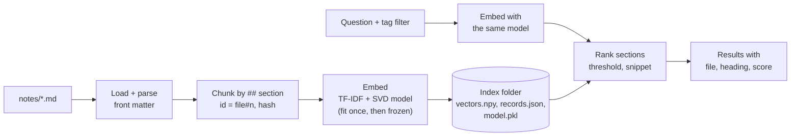

# Lab: Semantic search over your notes

> 📚 **Before you start**
>
> - [Embedding-Based Retrieval Pipelines](embedding-based-retrieval-pipelines.md), for chunk ids, content hashes, incremental sync and recall@k.
> - [In-Memory, On-Disk and Cloud Vector DBs](../03-embeddings-and-vector-databases/in-memory-on-disk-and-cloud-vector-dbs.md), for the tiny embedded store that saves to a folder.
> - [Chroma](chroma.md), for the persistent client used in the upgrade step.

## What You'll Build

Most of us keep notes: Markdown files in a folder, exported from Obsidian, Notion or a notes app. Finding things in them with Ctrl+F only works when you remember the exact words. In this lab you build a small **semantic search tool for a folder of notes** that:

- reads Markdown notes with simple front matter (title and tags);
- splits each note into sections and indexes them with a **learned** embedding model that runs offline;
- saves the index to disk and updates it incrementally when notes change;
- answers questions with ranked sections, tag filters and highlighted snippets;
- is checked with a small evaluation set, and can be upgraded to a neural embedding model and Chroma with a few lines.



> 💡 **Key Insight**
>
> A personal search tool needs the same three things as a production RAG retriever: **stable chunk ids with content hashes** so updates are cheap, **one frozen embedding model** shared by indexing and querying, and **a few real questions** to tell you whether it works. Build those right on your laptop and the same design scales to a company wiki.

---

## Step 1: A folder of notes

On your machine you would point the tool at your own notes folder. Here we write eight sample notes into a temporary folder so the lab runs anywhere. Each note has a small front-matter header between `---` lines, then Markdown sections:

```python
import hashlib
import json
import os
import pickle
import re
import tempfile
import numpy as np

NOTES = {
    "upi-payments.md": """---
title: UPI and digital payments
tags: [money, howto]
---
## When a UPI payment fails
If a UPI payment fails but money is debited from the bank account, do not pay again. The bank
reverses the failed debit automatically, usually within a day or two. Keep the transaction reference.

## Setting a UPI PIN
Open the payments app, choose the bank account, and set a four or six digit UPI PIN using the debit card details.
""",
    "train-travel.md": """---
title: Train travel tips
tags: [travel]
---
## Tatkal booking
Tatkal booking opens one day before the journey. AC classes open at ten in the morning. Save passenger
details in advance and keep the payment method ready.

## Refund after cancelling a ticket
Cancelling a confirmed ticket before the chart is prepared gives a refund minus cancellation charges.
The refund goes back to the original payment method in a few working days.
""",
    "chai.md": """---
title: Masala chai recipe
tags: [cooking]
---
## Ingredients
Water, milk, tea leaves, sugar, crushed ginger, cardamom and a pinch of black pepper for a spicy masala chai.

## Method
Boil water with ginger and cardamom, add tea leaves, then milk and sugar. Simmer until the colour is deep, then strain.
""",
    "sip-investing.md": """---
title: SIP and mutual funds
tags: [money, investing]
---
## What a SIP is
A systematic investment plan invests a fixed amount in a mutual fund every month. Regular investing
averages out the purchase price over market ups and downs.

## Index funds
Index funds track a market index with low fees. They suit long term investing for goals like retirement.
""",
    "monsoon-garden.md": """---
title: Monsoon balcony garden
tags: [gardening]
---
## Plants for the rainy season
In the monsoon, grow tulsi, mint and curry leaves on the balcony. Heavy rain can waterlog pots,
so use pots with drainage holes.

## Pests
Damp weather brings fungus and snails. Remove affected leaves and keep the soil from staying soggy.
""",
    "python-tips.md": """---
title: Python tips
tags: [coding]
---
## Virtual environments
Create a virtual environment for every project so package versions do not clash. Activate it before installing packages.

## List comprehensions
A list comprehension builds a list in one line, for example squares of numbers. Keep them short and readable.
""",
    "cricket.md": """---
title: Cricket notes
tags: [sport]
---
## Strike rate
Strike rate in batting is runs scored per hundred balls faced. In bowling it is balls bowled per wicket taken.

## Powerplay
The powerplay restricts fielders outside the circle in the first overs, so batters attack early.
""",
    "vector-db-notes.md": """---
title: Vector database notes
tags: [coding, ai]
---
## Choosing a vector database
Chroma is easy for prototypes, Qdrant has rich payload filters, Pinecone is fully managed and LanceDB stores tables in files.

## Embeddings
An embedding model turns text into a vector of numbers so that similar meanings are close together, measured by cosine similarity.
""",
}

notes_dir = tempfile.mkdtemp()
for name, text in NOTES.items():
    with open(os.path.join(notes_dir, name), "w") as f:
        f.write(text)
print(sorted(os.listdir(notes_dir)))
```

Output:

```
['chai.md', 'cricket.md', 'monsoon-garden.md', 'python-tips.md', 'sip-investing.md', 'train-travel.md', 'upi-payments.md', 'vector-db-notes.md']
```

## Step 2: Load notes and split them into sections

Front matter gives us a title and tags for filtering. Each `##` section becomes one chunk, prefixed with the note title and the section heading so it makes sense on its own. The id is `file#section-number` and the hash detects edits:

```python
def parse_note(path):
    raw = open(path).read()
    meta, body = {}, raw
    match = re.match(r"^---\n(.*?)\n---\n(.*)$", raw, re.S)
    if match:
        for line in match.group(1).splitlines():
            key, _, value = line.partition(":")
            value = value.strip()
            meta[key.strip()] = [t.strip() for t in value.strip("[]").split(",")] if value.startswith("[") else value
        body = match.group(2)
    return meta, body

def chunk_note(file_name, meta, body):
    sections = re.split(r"^## ", body, flags=re.M)
    chunks = []
    for n, section in enumerate(s for s in sections if s.strip()):
        heading, _, content = section.partition("\n")
        text = f"{meta.get('title', file_name)} > {heading.strip()}: {' '.join(content.split())}"
        chunks.append({"id": f"{file_name}#{n}", "file": file_name, "heading": heading.strip(),
                       "tags": meta.get("tags", []), "text": text,
                       "hash": hashlib.sha256(text.encode()).hexdigest()[:12]})
    return chunks

def load_chunks(folder):
    chunks = []
    for name in sorted(os.listdir(folder)):
        if name.endswith(".md"):
            meta, body = parse_note(os.path.join(folder, name))
            chunks.extend(chunk_note(name, meta, body))
    return chunks

chunks = load_chunks(notes_dir)
print(len(chunks), "sections")
print(json.dumps(chunks[0], indent=1)[:400])
```

Output:

```
16 sections
{
 "id": "chai.md#0",
 "file": "chai.md",
 "heading": "Ingredients",
 "tags": [
  "cooking"
 ],
 "text": "Masala chai recipe > Ingredients: Water, milk, tea leaves, sugar, crushed ginger, cardamom and a pinch of black pepper for a spicy masala chai.",
 "hash": "32db086b6b4a"
}
```

## Step 3: A learned embedding model that runs offline

Real projects use a neural embedding model (Step 8 shows how). To keep this lab offline, we **learn** a small embedding model from the notes themselves with a classic technique called **Latent Semantic Analysis (LSA)**:

1. **TF-IDF** turns each section into a long, sparse vector of word weights (you met it in [Semantic Search Explained](../03-embeddings-and-vector-databases/semantic-search-explained.md)).
2. **Truncated SVD**, a matrix factorisation from linear algebra, compresses those thousands of word dimensions into a few dozen dense dimensions. Words that keep appearing together (UPI, bank, debited, payment) end up pointing in similar directions, so a section can match a question that uses related words rather than the same ones.

That is much weaker than a neural model, but it is a real learned embedding: fixed-length, dense, normalised vectors, fitted from data.

```python
from sklearn.decomposition import TruncatedSVD
from sklearn.feature_extraction.text import TfidfVectorizer
from sklearn.pipeline import make_pipeline
from sklearn.preprocessing import Normalizer

def fit_model(texts, dims=12):
    model = make_pipeline(TfidfVectorizer(stop_words="english", sublinear_tf=True),
                          TruncatedSVD(n_components=dims, random_state=0),
                          Normalizer())
    model.fit(texts)
    return model

model = fit_model([c["text"] for c in chunks])
vectors = model.transform([c["text"] for c in chunks])
print(vectors.shape, "norm of first vector:", round(float(np.linalg.norm(vectors[0])), 3))
```

Output:

```
(16, 12) norm of first vector: 1.0
```

One rule from the pipeline lesson matters a lot here: **fit once, then freeze**. If you re-fit the model every time a note changes, every vector in the index shifts and the old vectors no longer match new queries. So we save the fitted model with the index and use it for all later updates, and we only re-fit (and re-embed everything) on purpose, as a new index version.

## Step 4: Save the index to a folder

The index is an embedded store like the one from [In-Memory, On-Disk and Cloud Vector DBs](../03-embeddings-and-vector-databases/in-memory-on-disk-and-cloud-vector-dbs.md): vectors in a NumPy file, records in JSON, plus the frozen model.

```python
class NotesIndex:
    def __init__(self, folder):
        self.folder = folder
        os.makedirs(folder, exist_ok=True)
        if os.path.exists(self._p("records.json")):
            self.vectors = np.load(self._p("vectors.npy"))
            self.records = json.load(open(self._p("records.json")))
            self.model = pickle.load(open(self._p("model.pkl"), "rb"))
        else:
            self.vectors, self.records, self.model = np.zeros((0, 0)), [], None

    def _p(self, name):
        return os.path.join(self.folder, name)

    def save(self):
        np.save(self._p("vectors.npy"), self.vectors)
        json.dump(self.records, open(self._p("records.json"), "w"))
        pickle.dump(self.model, open(self._p("model.pkl"), "wb"))

    def build(self, chunks):
        self.model = fit_model([c["text"] for c in chunks])
        self.records = chunks
        self.vectors = self.model.transform([c["text"] for c in chunks])
        self.save()

index_dir = os.path.join(notes_dir, ".index")
index = NotesIndex(index_dir)
index.build(chunks)
print(sorted(os.listdir(index_dir)), len(NotesIndex(index_dir).records), "records after reopening")
```

Output:

```
['model.pkl', 'records.json', 'vectors.npy'] 16 records after reopening
```

The `.index` folder sits next to the notes. (Pickle files can run code when loaded, so only load index files you created yourself.)

## Step 5: Search with filters and snippets

The search function embeds the question with the **saved** model, ranks sections by cosine similarity, applies an optional tag filter and a minimum score, and shows a snippet with the matching words highlighted:

```python
STOP = {"the", "a", "an", "is", "do", "i", "my", "to", "of", "and", "for", "in", "on", "at", "with",
        "how", "what", "if", "it", "but"}

def snippet(text, question, width=90):
    words = [w for w in re.findall(r"[a-z]+", question.lower()) if w not in STOP]
    body = text.split(": ", 1)[-1]
    short = body[:width] + ("..." if len(body) > width else "")      # cut first, then highlight
    for w in words:
        short = re.sub(rf"\b({w}\w*)", r"**\1**", short, flags=re.I)
    return short

def search(idx, question, k=3, tag=None, min_score=0.2):
    q = idx.model.transform([question])[0]
    scores = idx.vectors @ q
    order = sorted(range(len(idx.records)), key=lambda n: (-scores[n], idx.records[n]["id"]))
    results = []
    for n in order:
        r = idx.records[n]
        if tag and tag not in r["tags"]:
            continue
        if scores[n] < min_score:
            break
        results.append((round(float(scores[n]), 2), r["id"], r["heading"], snippet(r["text"], question)))
        if len(results) == k:
            break
    return results

for question, tag in [("money debited but payment failed", None),
                      ("how do I book a train ticket quickly", None),
                      ("long term investing", "money"),
                      ("a hot drink for a cold morning", None)]:
    print(f"\n{question!r}" + (f" [tag={tag}]" if tag else ""))
    for hit in search(index, question):
        print("  ", hit)
```

Output:

```

'money debited but payment failed'
   (0.97, 'upi-payments.md#0', 'When a UPI payment fails', 'If a UPI **payment** fails but **money** is **debited** from the bank account, do not pay again. The b...')
   (0.93, 'upi-payments.md#1', 'Setting a UPI PIN', 'Open the **payments** app, choose the bank account, and set a four or six digit UPI PIN using ...')
   (0.33, 'train-travel.md#1', 'Refund after cancelling a ticket', 'Cancelling a confirmed ticket before the chart is prepared gives a refund minus cancellati...')

'how do I book a train ticket quickly'
   (0.98, 'train-travel.md#1', 'Refund after cancelling a ticket', 'Cancelling a confirmed **ticket** before the chart is prepared gives a refund minus cancellati...')
   (0.33, 'train-travel.md#0', 'Tatkal booking', 'Tatkal **booking** opens one day before the journey. AC classes open at ten in the morning. Sa...')

'long term investing' [tag=money]
   (1.0, 'sip-investing.md#0', 'What a SIP is', 'A systematic investment plan invests a fixed amount in a mutual fund every month. Regular ...')
   (1.0, 'sip-investing.md#1', 'Index funds', 'Index funds track a market index with low fees. They suit **long** **term** **investing** for goals li...')

'a hot drink for a cold morning'
   (0.98, 'train-travel.md#0', 'Tatkal booking', 'Tatkal booking opens one day before the journey. AC classes open at ten in the **morning**. Sa...')
```

Read the four results closely, because each teaches something:

- **"money debited but payment failed"** finds the right section first, and also pulls in the UPI PIN section from the same note. LSA learned that "UPI", "bank" and "payments" go together, so sections of one note end up close to each other.
- **"how do I book a train ticket quickly"** ranks the *refund* section above the *Tatkal* section: the question shares the word "ticket" with the refund section, while the Tatkal section says "booking", which the model treats as a different word. The right note, the wrong section.
- **"long term investing"** with `tag="money"` returns only notes tagged `money`, and both SIP sections score 1.0. With sixteen sections and twelve dimensions, LSA has roughly one direction per note, so it separates notes well and sections within a note poorly.
- **"a hot drink for a cold morning"** goes wrong entirely: it shares only "morning" with the Tatkal section ("AC classes open at ten in the morning"). Our model has seen sixteen sections and knows nothing about the world; a neural model trained on billions of sentences knows that chai is a hot drink.

## Step 6: Keep the index fresh

Notes change. The update step reuses the sync idea from [Embedding-Based Retrieval Pipelines](embedding-based-retrieval-pipelines.md): compare ids and hashes, embed only what is new or changed with the **frozen** model, and drop what is gone.

```python
def update(idx, folder):
    fresh = {c["id"]: c for c in load_chunks(folder)}
    old = {r["id"]: (r, idx.vectors[n]) for n, r in enumerate(idx.records)}
    changed = [c for i, c in fresh.items() if i not in old or old[i][0]["hash"] != c["hash"]]
    new_vectors = dict(zip([c["id"] for c in changed], idx.model.transform([c["text"] for c in changed]))) if changed else {}
    records, vectors = [], []
    for i, c in fresh.items():
        records.append(c)
        vectors.append(new_vectors[i] if i in new_vectors else old[i][1])
    idx.records, idx.vectors = records, np.array(vectors)
    idx.save()
    return {"embedded": len(changed), "kept": len(fresh) - len(changed),
            "removed": len([i for i in old if i not in fresh])}

with open(os.path.join(notes_dir, "chai.md"), "a") as f:
    f.write("\n## Cutting chai\nA cutting chai is half a glass of strong sweet tea, sold at stalls near railway stations.\n")
os.remove(os.path.join(notes_dir, "cricket.md"))
print(update(index, notes_dir))
print(search(NotesIndex(index_dir), "tea at the railway station", k=2))
```

Output:

```
{'embedded': 1, 'kept': 14, 'removed': 2}
[(1.0, 'chai.md#2', 'Cutting chai', 'A cutting chai is half a glass of strong sweet **tea**, sold at stalls near **railway** **stations**.'), (1.0, 'chai.md#0', 'Ingredients', 'Water, milk, **tea** leaves, sugar, crushed ginger, cardamom and a pinch of black pepper for a...')]
```

Only the new section was embedded; the two cricket sections were removed. Because the model is frozen, words it never saw while fitting (for example "cutting" or "glass", if they were absent from the original notes) simply contribute nothing. When enough new vocabulary piles up, rebuild the index with a re-fitted model as a new version, exactly like switching embedding models.

## Step 7: Check it with real questions

Write down a handful of questions you actually ask your notes, with the section that answers each. With only two sections per note, recall@3 (from the pipeline lesson) would almost always look perfect, so measure the stricter **hit@1**: is the right section the very first result?

```python
EVAL = [
    ("money debited but payment failed", "upi-payments.md#0"),
    ("set up my upi pin", "upi-payments.md#1"),
    ("when does tatkal open", "train-travel.md#0"),
    ("how do I book a train ticket quickly", "train-travel.md#0"),
    ("what is a systematic investment plan", "sip-investing.md#0"),
    ("low cost funds that follow the market", "sip-investing.md#1"),
    ("plants to grow in the rainy season", "monsoon-garden.md#0"),
    ("snails eating my plants", "monsoon-garden.md#1"),
    ("which vector database for a prototype", "vector-db-notes.md#0"),
    ("how do I stop package version clashes", "python-tips.md#0"),
    ("a hot drink for a cold morning", "chai.md#0"),
]

def hit_at_1(idx, verbose=True):
    hits = 0
    for question, answer_id in EVAL:
        top = search(idx, question, k=1, min_score=-1)[0][1]
        hits += top == answer_id
        if verbose and top != answer_id:
            print(f"  missed: {question!r} -> {top} (wanted {answer_id})")
    return hits / len(EVAL)

print("hit@1:", round(hit_at_1(index), 2))
```

Output:

```
  missed: 'how do I book a train ticket quickly' -> train-travel.md#1 (wanted train-travel.md#0)
  missed: 'low cost funds that follow the market' -> sip-investing.md#0 (wanted sip-investing.md#1)
  missed: 'a hot drink for a cold morning' -> train-travel.md#0 (wanted chai.md#0)
hit@1: 0.73
```

The misses are the useful part: each one is a question phrased in words your notes do not use, or a section that loses to its neighbour in the same note. That is the signal to move to a neural embedding model, add a keyword search alongside (hybrid search), or simply write better headings in your notes.

## Step 8: Upgrade to a neural model and Chroma

Everything above maps directly onto real tools. Replace the LSA model with a sentence-embedding model and the folder store with a Chroma persistent collection; the loading, chunking, ids, hashes and evaluation stay the same:

```bash
pip install chromadb sentence-transformers
```

```python
# not-run: needs chromadb and sentence-transformers, and downloads a model on first use
import chromadb
from sentence_transformers import SentenceTransformer

encoder = SentenceTransformer("all-MiniLM-L6-v2")
client = chromadb.PersistentClient(path=os.path.join(notes_dir, ".chroma"))
col = client.get_or_create_collection("notes", configuration={"hnsw": {"space": "cosine"}})

chunks = load_chunks(notes_dir)
col.upsert(
    ids=[c["id"] for c in chunks],
    embeddings=encoder.encode([c["text"] for c in chunks], normalize_embeddings=True).tolist(),
    documents=[c["text"] for c in chunks],
    metadatas=[{"file": c["file"], "heading": c["heading"], "hash": c["hash"], "tags": c["tags"]} for c in chunks],
)
res = col.query(query_embeddings=encoder.encode(["a hot drink for a cold morning"], normalize_embeddings=True).tolist(),
                n_results=2)
print(res["ids"][0])
```

Example output:

```
['chai.md#0', 'chai.md#1']
```

(Illustrative: the exact order depends on the model.) With a neural model, "a hot drink for a cold morning" finds the chai recipe, which our LSA model could not. Two details carried over deliberately: the content `hash` is stored as metadata, so the update step can compare hashes straight from the collection, and `tags` is stored as a list, so a filter such as `where={"tags": {"$contains": "cooking"}}` works on it.

---

## Try It Yourself

1. **Search by tag only.** Use `search` with `tag="coding"` and the question "tips". Which sections appear, and why might a tag filter alone be a useful "browse" mode?
2. **More dimensions.** Rebuild the index with `fit_model(..., dims=4)` and with `dims=15`, and compare hit@1. What happens at each extreme?
3. **Rename a heading.** Change the heading "Setting a UPI PIN" to "Creating your UPI PIN" in the notes file and run `update`. How many sections are re-embedded, and does the old section id stay the same?

<details>
<summary>Show answers</summary>

**1.**

```python
for hit in search(index, "tips", k=4, tag="coding", min_score=-1):
    print(hit)
```

Output:

```
(0.6, 'python-tips.md#0', 'Virtual environments', 'Create a virtual environment for every project so package versions do not clash. Activate ...')
(0.59, 'python-tips.md#1', 'List comprehensions', 'A list comprehension builds a list in one line, for example squares of numbers. Keep them ...')
(0.05, 'vector-db-notes.md#1', 'Embeddings', 'An embedding model turns text into a vector of numbers so that similar meanings are close ...')
(-0.05, 'vector-db-notes.md#0', 'Choosing a vector database', 'Chroma is easy for prototypes, Qdrant has rich payload filters, Pinecone is fully managed ...')
```

Only sections from notes tagged `coding` appear, ranked by how well they match. With a vague question, the filter does most of the work, which is a handy way to browse one area of your notes.

**2.**

```python
for dims in (4, 15):
    trial = NotesIndex(os.path.join(notes_dir, f".index-{dims}"))
    trial.model = fit_model([c["text"] for c in load_chunks(notes_dir)], dims=dims)
    trial.records = load_chunks(notes_dir)
    trial.vectors = trial.model.transform([c["text"] for c in trial.records])
    print(f"dims={dims}: hit@1 = {hit_at_1(trial, verbose=False):.2f}")
```

Output:

```
dims=4: hit@1 = 0.73
dims=15: hit@1 = 0.82
```

With 4 dimensions, unrelated topics are squeezed together and get confused. With 15 (as many dimensions as there are sections), LSA keeps almost everything TF-IDF had and scores best here, because most of our questions share at least one word with their answer. On a larger collection with more paraphrased questions, TF-IDF's blindness to related words shows up and a middle value usually wins. Either way, you find the setting with the evaluation set, not by guessing.

**3.**

```python
path = os.path.join(notes_dir, "upi-payments.md")
text = open(path).read().replace("## Setting a UPI PIN", "## Creating your UPI PIN")
open(path, "w").write(text)
print(update(index, notes_dir))
print([r["id"] for r in index.records if r["file"] == "upi-payments.md"])
```

Output:

```
{'embedded': 1, 'kept': 14, 'removed': 0}
['upi-payments.md#0', 'upi-payments.md#1']
```

One section is re-embedded, because its text (which includes the heading) changed; its id `upi-payments.md#1` stays the same because ids come from the position, so the index updates the record in place instead of adding a duplicate.

</details>

---

## What You've Learned

- **A notes search tool is a full retrieval pipeline**: load, parse front matter, chunk by section, embed, store, search, update and evaluate.
- **Stable ids plus content hashes** make updates cheap: only new or edited sections are embedded, and deleted notes disappear from results.
- **Fit the embedding model once and freeze it**; re-fitting means a new index version, just like switching models.
- **Tag filters, thresholds and highlighted snippets** turn raw scores into results a person can use.
- **An evaluation set shows where the model fails**, and the same design upgrades to a neural model and Chroma with a few changed lines.

---

**Up next:** [Document Loaders](../course.md#m5)
