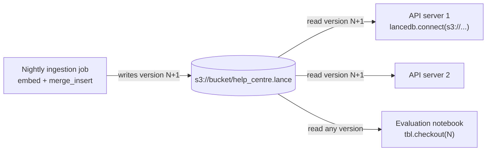

# LanceDB: The Complete Guide

> 📚 **Before you start**
>
> - [Pinecone](pinecone.md) and [Chroma](chroma.md), for collections, filters and the toy help-centre data used again here.
> - [In-Memory, On-Disk and Cloud Vector DBs](../03-embeddings-and-vector-databases/in-memory-on-disk-and-cloud-vector-dbs.md), for embedded databases and object storage.
> - [Data Analysis and Visualisation with Python](../../data-analysis-and-visualisation-with-python/course.md), for pandas DataFrames, which LanceDB reads and returns.

## Introduction

A school keeps its records in a big register: one row per student, with columns for name, class, roll number, marks and a photo. When the principal asks "show me class 8 students with marks above 90", nobody reads the photos; they run a finger down two columns. And at the end of every term, the school keeps a copy of the register, so it can always answer "what did the records say in March?"

**LanceDB** is a vector database built like that register. Your data is a **table**: rows with ordinary columns (id, text, topic, language) plus a **vector column**. It is **embedded**, so it runs inside your Python process with no server, and stores the table as files in a folder on your disk or in object storage such as Amazon S3. The files use **Lance**, an open columnar format built on Apache Arrow, so a query reads only the columns it needs. Every change creates a new **version** of the table that you can go back to.

By the end of this lesson you will be able to:

- create LanceDB tables from lists of dicts or pandas DataFrames, and search them with SQL-style filters;
- explain why columnar storage and object storage make LanceDB good for large and multimodal data;
- update, delete and upsert rows, and travel back to earlier versions;
- build vector, full-text and scalar indexes, and run hybrid search;
- decide when LanceDB fits better than the databases from the previous lessons.

> 💡 **Key Insight**
>
> LanceDB treats vector search as **one more operation on a table**, not as a separate kind of database. Vectors live in a column next to your text, numbers and even images; filters are SQL expressions over the other columns; and because tables are append-only files with versions, the same data can be served from a laptop folder or an S3 bucket without running a server.

---

## Core Explanation

### 1. A table, concretely


*A LanceDB table is a folder of immutable files plus a list of versions. Where that folder lives decides how you deploy it.*

Here is our help-centre data as a table. We keep the five-number toy model from the [Chroma](chroma.md) lesson and put everything in a pandas DataFrame, which is one of the formats LanceDB accepts directly:

```python
import re
import numpy as np
import pandas as pd

LEXICON = {
    "upi": (0.9, 0, 0.4, 0, 0), "payment": (1, 0, 0.1, 0, 0), "bhugtan": (1, 0, 0.1, 0, 0),
    "paisa": (1, 0, 0, 0, 0), "money": (1, 0, 0, 0, 0), "debited": (0.9, 0, 0, 0, 0),
    "deducted": (0.9, 0, 0, 0, 0), "failed": (0.3, 0, 0.3, 0, 0), "fail": (0.3, 0, 0.3, 0, 0),
    "refund": (1, 0.1, 0, 0, 0), "wallet": (0.8, 0, 0.2, 0, 0), "bank": (0.9, 0, 0, 0, 0),
    "account": (0.6, 0, 0.3, 0, 0), "train": (0, 1, 0, 0, 0), "ticket": (0.3, 0.8, 0, 0, 0),
    "tatkal": (0.1, 0.9, 0, 0, 0), "journey": (0, 0.9, 0, 0, 0), "booking": (0.2, 0.7, 0.1, 0, 0),
    "cancelled": (0.2, 0.5, 0, 0, 0), "delayed": (0, 0.7, 0, 0, 0.2), "late": (0, 0.6, 0, 0, 0.1),
    "app": (0.1, 0, 1, 0, 0), "password": (0, 0, 1, 0, 0), "login": (0, 0, 1, 0, 0),
    "otp": (0.2, 0, 0.9, 0, 0), "phone": (0.1, 0, 1, 0, 0), "reset": (0, 0, 0.6, 0, 0),
    "biryani": (0, 0, 0, 1, 0), "chai": (0, 0, 0, 1, 0), "catering": (0, 0.2, 0, 0.9, 0),
    "rain": (0, 0.1, 0, 0, 0.9), "monsoon": (0, 0.1, 0, 0, 1), "flooding": (0, 0.2, 0, 0, 0.9),
}

def embed(text):
    """Toy embedding model from the Chroma lesson: normalised sum of word vectors."""
    vectors = [LEXICON[w] for w in re.findall(r"[a-z]+", text.lower()) if w in LEXICON]
    v = np.sum(vectors, axis=0) if vectors else np.zeros(5)
    return (v / np.linalg.norm(v) if np.linalg.norm(v) else v).round(4).tolist()

rows = [
    ("faq-01", "UPI payment failed but money was debited from my bank account", "payments", "en", 9120),
    ("faq-02", "How to get a refund for a cancelled train ticket", "travel", "en", 15400),
    ("faq-03", "Tatkal ticket booking opens one day before the journey", "travel", "en", 22050),
    ("faq-04", "Reset your app password using the OTP sent to your phone", "account", "en", 4300),
    ("faq-05", "UPI bhugtan fail ho gaya par paisa kat gaya", "payments", "hi", 6100),
    ("faq-06", "Train delayed due to heavy rain and monsoon flooding", "travel", "en", 3900),
    ("faq-07", "Order biryani and chai on your train journey with e-catering", "food", "en", 2750),
    ("faq-08", "A wallet refund reaches your bank account in 5 to 7 days", "payments", "en", 11800),
]
df = pd.DataFrame(rows, columns=["id", "text", "topic", "lang", "views"])
df["vector"] = df["text"].map(embed)
print(df[["id", "topic", "lang", "views", "vector"]].head(3).to_string(index=False))
```

Output:

```
    id    topic lang  views                             vector
faq-01 payments   en   9120    [0.9812, 0.0, 0.1927, 0.0, 0.0]
faq-02   travel   en  15400       [0.53, 0.848, 0.0, 0.0, 0.0]
faq-03   travel   en  22050 [0.1788, 0.9834, 0.0298, 0.0, 0.0]
```

With LanceDB installed, that DataFrame becomes a table in one call, and a search is a chain of small methods:

```bash
pip install lancedb
```

```python
# not-run: needs the lancedb package
import lancedb

db = lancedb.connect("./lancedb_data")                  # a folder; created if missing
tbl = db.create_table("help_centre", data=df, mode="overwrite")
print(db.table_names(), tbl.count_rows())

hits = (tbl.search(embed("refund for my train ticket"))
           .distance_type("cosine")
           .where("lang = 'en' AND views > 5000")
           .select(["id", "text"])
           .limit(3)
           .to_list())
for h in hits:
    print(f"{h['_distance']:.3f}  {h['id']}  {h['text']}")
```

Example output (computed from the toy vectors):

```
['help_centre'] 8
0.001  faq-02  How to get a refund for a cancelled train ticket
0.087  faq-03  Tatkal ticket booking opens one day before the journey
0.417  faq-08  A wallet refund reaches your bank account in 5 to 7 days
```

Read the chain like a sentence: *search near this vector, measure by cosine, keep English rows with more than 5,000 views, return only id and text, top 3, as a list of dicts.* The column LanceDB adds is `_distance`, and like Chroma, **smaller is better** (with `cosine`, it is `1 - cos`). The default metric is `l2`, so set `distance_type("cosine")` for most text models, or use `.to_pandas()` instead of `.to_list()` to get a DataFrame back.

### 2. Why columnar storage matters

A row-oriented store keeps each record together; a **columnar** store keeps each column together. For vector search that difference is large, because the vector column dwarfs the others, and most queries touch only a few columns:

```python
n_rows, dims = 1_000_000, 768
avg_bytes = {"id": 10, "text": 600, "topic": 8, "lang": 2, "views": 8, "vector": dims * 4}
total = sum(avg_bytes.values()) * n_rows

def read_fraction(columns):
    return sum(avg_bytes[c] for c in columns) * n_rows / total

print(f"whole table: {total / 1e9:.2f} GB")
print(f"filter on lang, return id + text: {read_fraction(['lang', 'id', 'text']):.1%} of the bytes")
print(f"analytics: count rows per topic:  {read_fraction(['topic']):.2%} of the bytes")
```

Output:

```
whole table: 3.70 GB
filter on lang, return id + text: 16.5% of the bytes
analytics: count rows per topic:  0.22% of the bytes
```

A query that filters on `lang` and returns `id` and `text` touches about a sixth of the data; counting topics touches almost none of it. The same table therefore serves vector search, keyword search and ordinary analytics (it reads and writes Arrow, so it works directly with pandas, Polars and DuckDB). This is also why LanceDB is popular for **multimodal** data: you can keep images, audio or video bytes in a column next to their embeddings, and a search that does not ask for that column never reads it.

### 3. Filters are SQL, and pre-filtering is the default

The `.where()` string is a SQL expression over the table's columns: `=`, `!=`, `<`, `>=`, `AND`, `OR`, `NOT`, `IN ('a', 'b')`, `LIKE 'UPI%'`, `IS NULL` and so on. By default LanceDB **pre-filters**: it applies the filter first and searches only matching rows, so you get a full `limit` of results whenever enough rows match. Passing `prefilter=False` filters *after* the vector search, which is faster but can return fewer rows, the trade-off you met in [Storage and Indexing](../03-embeddings-and-vector-databases/storage-and-indexing-hnsw-ivf.md).

Here is the difference, with SQLite (from the standard library) evaluating the same SQL `where` clause:

```python
import sqlite3

sql = sqlite3.connect(":memory:")
df[["id", "topic", "lang", "views"]].to_sql("help_centre", sql, index=False)
matrix = np.array(df["vector"].tolist())

def search(query_text, where, limit=3, prefilter=True):
    allowed = {r[0] for r in sql.execute(f"SELECT id FROM help_centre WHERE {where}")}
    distance = 1 - matrix @ np.array(embed(query_text))
    order = list(np.argsort(distance, kind="stable"))
    if prefilter:                                      # filter first, then take the nearest
        hits = [n for n in order if df.id[n] in allowed][:limit]
    else:                                              # take the nearest, then filter
        hits = [n for n in order[:limit] if df.id[n] in allowed]
    return [(df.id[n], round(float(distance[n]), 3)) for n in hits]

where = "lang = 'hi' OR topic = 'food'"
print("prefilter: ", search("refund for my train ticket", where))
print("postfilter:", search("refund for my train ticket", where, prefilter=False))
```

Output:

```
prefilter:  [('faq-05', 0.452), ('faq-07', 0.516)]
postfilter: []
```

Post-filtering looked only at the three nearest rows overall, none of which is Hindi or food, so it returned nothing. Keep the default unless you have measured a reason not to.

### 4. Changing data: add, update, delete, upsert

```python
# not-run: needs the lancedb package
tbl.add([{"id": "faq-09", "text": "Tatkal ticket refund rules", "topic": "travel",
          "lang": "en", "views": 800, "vector": embed("Tatkal ticket refund rules")}])
tbl.update(where="id = 'faq-04'", values={"views": 4400})
tbl.delete("id = 'faq-07'")

new_rows = df[df.id.isin(["faq-02", "faq-08"])].assign(views=[16000, 12000])
(tbl.merge_insert("id")                    # upsert keyed on the id column
    .when_matched_update_all()
    .when_not_matched_insert_all()
    .execute(new_rows))
print(tbl.count_rows())
```

Example output:

```
8
```

`merge_insert` is LanceDB's upsert: rows whose `id` already exists are updated, new ones are inserted. Use it, keyed on a deterministic id, for ingestion jobs that may run more than once, for the same reason you used `upsert` in Chroma, Qdrant and Pinecone.

### 5. Versions and time travel

Lance files are never edited in place. Each `add`, `update`, `delete` or `merge_insert` writes new files and records a new **version** of the table that lists which files make it up. Old versions stay readable until you clean them up. Here is the idea in miniature:

```python
class VersionedTable:
    """Each write creates a new version; old versions stay readable."""

    def __init__(self, frame):
        self.versions = [frame.copy()]

    @property
    def version(self):
        return len(self.versions)

    def add(self, new_rows):
        self.versions.append(pd.concat([self.versions[-1], new_rows], ignore_index=True))

    def delete(self, mask_fn):
        current = self.versions[-1]
        self.versions.append(current[~mask_fn(current)].reset_index(drop=True))

    def checkout(self, version):
        return self.versions[version - 1]

vt = VersionedTable(df)
vt.add(pd.DataFrame([{"id": "faq-09", "text": "Tatkal ticket refund rules", "topic": "travel",
                      "lang": "en", "views": 800, "vector": embed("Tatkal ticket refund rules")}]))
vt.delete(lambda t: t.topic == "food")
for v in range(1, vt.version + 1):
    print(f"version {v}: {len(vt.checkout(v))} rows, ids end with {vt.checkout(v).id.iloc[-1]}")
```

Output:

```
version 1: 8 rows, ids end with faq-08
version 2: 9 rows, ids end with faq-09
version 3: 8 rows, ids end with faq-09
```

In LanceDB the same operations look like this:

```python
# not-run: needs the lancedb package
print(tbl.version)                 # the current version number
print(tbl.list_versions()[:2])     # version numbers with timestamps
tbl.checkout(1)                    # read the table as it was at version 1
print(tbl.count_rows())
tbl.checkout_latest()              # back to the newest version before writing again
```

Versions make three things easy: **reproducible experiments** (record which version an evaluation ran against), **safe re-indexing** (build the new data, compare, and roll back with `tbl.restore()` if it is worse), and **concurrent readers** (a reader keeps using the version it opened while a writer creates the next one). Old versions take disk space; clean them up periodically with the table's optimise and cleanup operations.

### 6. Indexes: vector, full text and scalar

Small tables are searched by brute force, which is exact and fast up to roughly a hundred thousand rows. Beyond that, build an ANN index. LanceDB's vector indexes are IVF-based, the family from the previous module:

```python
# not-run: needs the lancedb package and enough rows to train the index (thousands or more)
tbl.create_index(metric="cosine", vector_column_name="vector", index_type="IVF_PQ")
# or: tbl.create_index(metric="cosine", index_type="IVF_HNSW_SQ")

hits = (tbl.search(embed("refund for my train ticket"))
           .distance_type("cosine")
           .limit(10)
           .refine_factor(20)            # re-rank 20x more candidates with full vectors
           .to_pandas())

tbl.create_scalar_index("lang", index_type="BITMAP")   # few distinct values
tbl.create_scalar_index("views")                       # BTREE by default, for ranges
tbl.create_fts_index("text")                           # full-text search on words
```

| Index | What it speeds up | Notes |
|---|---|---|
| `IVF_PQ` | Vector search on large tables | Compressed vectors; `num_partitions` is `nlist`, `num_sub_vectors` is PQ's `m`; use `refine_factor` to re-rank |
| `IVF_HNSW_SQ` | Vector search with higher recall | An HNSW graph inside each partition, with 8-bit scalar quantization |
| Scalar `BTREE` | `where` filters on columns with many values | ids, numbers, dates |
| Scalar `BITMAP` | `where` filters on columns with few values | language, topic, status |
| Full-text | Keyword search on a text column | Enables hybrid search |

With a full-text index on `text` and an embedding function attached to the table, `tbl.search("refund", query_type="hybrid")` runs both searches and merges them with a reranker (RRF by default), the same fusion you used in the Pinecone lesson. Attaching an embedding function means LanceDB embeds text for you on insert and query, much like Chroma's collections.

### 7. Where LanceDB runs

| Connect to | Code | Good for |
|---|---|---|
| Local folder | `lancedb.connect("./lancedb_data")` | Notebooks, desktop apps, single-service apps |
| Object storage | `lancedb.connect("s3://my-bucket/help-centre")` | Large data, many readers, batch pipelines, cheap storage |
| LanceDB Cloud | `lancedb.connect("db://my-database", api_key=..., region=...)` | A managed service with the same table API |

Because the table is just files, a nightly batch job (say on Spark or a single big machine) can write a new version to S3 and any number of API servers can read it, with no database server in between. The limits come from the same fact: with many processes **writing** to the same table at once, you need care (or the managed service) to coordinate commits.



### 8. When to choose LanceDB

| Choose LanceDB when | Prefer something else when |
|---|---|
| You want embedded simplicity but data is large (millions to billions of rows) | Many services write to the same data all day (a server database such as Qdrant fits better) |
| Your data is multimodal, with images or audio next to embeddings | You need a fully managed service with no files to think about (Pinecone, or LanceDB's own cloud) |
| You already work with pandas, Arrow, Polars or DuckDB | Your team will not touch Python or Arrow-based tooling |
| You need versioned, reproducible datasets for evaluation and training | You need rich JSON payload filters on nested documents |

---

## Try It Yourself

1. **Write SQL filters.** Using `search` with pre-filtering, find the top 2 FAQs for "money deducted" among rows that are travel **or** have fewer than 5,000 views. What does post-filtering return for the same query?
2. **Columnar budget.** Change `avg_bytes` to 1,536-dimension vectors and 2,000-character chunks. What fraction of the bytes does "filter on lang, return id and text" read now?
3. **Version check.** Using `VersionedTable`, upsert `faq-02` with a new view count (delete the old row, then add the new one). How many versions exist afterwards, and which version still shows the old count?

<details>
<summary>Show answers</summary>

**1.**

```python
where = "topic = 'travel' OR views < 5000"
print("prefilter: ", search("money deducted", where, limit=2))
print("postfilter:", search("money deducted", where, limit=2, prefilter=False))
```

Output:

```
prefilter:  [('faq-02', 0.47), ('faq-03', 0.821)]
postfilter: []
```

The nearest rows overall are payments FAQs with many views, so post-filtering throws them all away and returns nothing.

**2.**

```python
avg_bytes = {"id": 10, "text": 2000, "topic": 8, "lang": 2, "views": 8, "vector": 1536 * 4}
total = sum(avg_bytes.values()) * n_rows
print(f"{read_fraction(['lang', 'id', 'text']):.1%}")
```

Output:

```
24.6%
```

Still under a quarter: the vector column remains the biggest by far.

**3.**

```python
start = vt.version
updated = vt.checkout(vt.version)[vt.checkout(vt.version).id == "faq-02"].assign(views=16000)
vt.delete(lambda t: t.id == "faq-02")
vt.add(updated)
print("versions:", vt.version)
for v in (start, vt.version):
    row = vt.checkout(v)[vt.checkout(v).id == "faq-02"]
    print(f"version {v}: faq-02 views = {int(row.views.iloc[0])}")
```

Output:

```
versions: 5
version 3: faq-02 views = 15400
version 5: faq-02 views = 16000
```

Two more versions were written (one for the delete, one for the add). LanceDB's `merge_insert` does the same change as a single new version, which is one reason to prefer it over delete-then-add.

</details>

---

## Real-World Examples

- **AI training-data teams** store images, captions and embeddings in one Lance table on object storage, search it to find near-duplicates or examples of a concept, and pin dataset versions for reproducible training runs.
- **Local-first assistants** embed a user's notes and files into a LanceDB folder on the device, with no server process to manage.
- **Batch RAG pipelines** write a new table version to S3 every night while API servers keep reading the previous one until the new version is ready.
- **Analytics plus search**: teams query the same table with DuckDB for counts and trends and with LanceDB for semantic search.

---

## Common Misconceptions

### "Embedded means small"

LanceDB is embedded *and* designed for very large tables, because data lives in columnar files that can sit on object storage. Embedded describes where the code runs, not how much data it handles.

### "_distance is a similarity"

It is a distance: smaller is better. With `cosine`, similarity is `1 - _distance`.

### "Deleting a row frees disk space immediately"

Deletes create a new version; the old files remain for earlier versions until you run the table's cleanup operations.

### "LanceDB filters are Python expressions"

They are SQL strings, such as `"lang = 'en' AND views > 5000"`. Quote string values with single quotes.

---

## Interview Relevance

*"What is LanceDB and how is it different from Chroma or Qdrant?"* An embedded vector database whose tables are columnar Lance files (on Arrow), stored locally or on object storage, with SQL-style filters, versioning and multimodal columns. It has no server to run, which makes it simple and cheap for large, read-heavy and batch workloads, while server databases handle many concurrent writers more naturally.

*"Pre-filtering vs post-filtering?"* Pre-filtering restricts the search to matching rows and returns a full result set; post-filtering searches first and drops non-matching rows, which can leave too few results. LanceDB pre-filters by default.

*"How would you make a RAG evaluation reproducible?"* Pin the embedding model, the chunking settings and the table version (`tbl.version`), and record them with the results.

---

## Key Takeaways

- **LanceDB is an embedded, table-shaped vector database**: rows with ordinary columns plus a vector column, stored as Lance columnar files.
- **Search chains read like SQL**: `tbl.search(vec).distance_type("cosine").where("...").limit(k)`, returning `_distance` (smaller is better).
- **Pre-filtering is the default**, so filtered searches still return a full set of results.
- **Every write creates a version**: `checkout`, `checkout_latest` and `restore` give you time travel; `merge_insert` is the upsert.
- **Runs from a folder, an S3 bucket or LanceDB Cloud**, with IVF_PQ and IVF_HNSW_SQ vector indexes, scalar indexes and full-text search for hybrid queries.

---

**Up next:** [Vector Search in MongoDB and Cassandra](vector-search-in-mongodb-and-cassandra.md)
