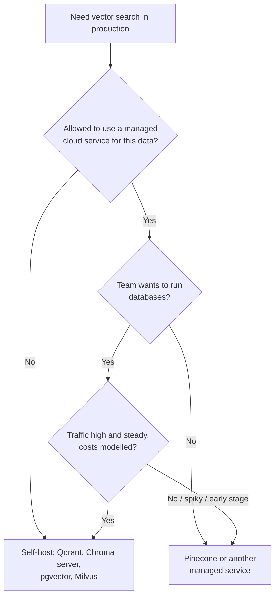

# Pinecone: The Complete Guide

> 📚 **Before you start**
>
> - [Qdrant](qdrant.md), for points, payload filters, multitenancy and hybrid search, which this lesson compares against.
> - [In-Memory, On-Disk and Cloud Vector DBs](../03-embeddings-and-vector-databases/in-memory-on-disk-and-cloud-vector-dbs.md), for managed and serverless designs that separate storage from compute.
> - [Semantic Search Explained](../03-embeddings-and-vector-databases/semantic-search-explained.md), for hybrid search and Reciprocal Rank Fusion (RRF).

## Introduction

When you send a parcel through India Post, you do not buy a van, hire a driver or plan the route. You fill in the address, pay by weight, and the system handles the rest. You give up some control (you cannot pick the route), and in return you get a service that works the same for one parcel or ten thousand.

**Pinecone** is the India Post of vector databases: a **fully managed**, cloud-only service. There is no version you install or run yourself. You create an index through an API call, send it records, and query it over HTTPS; Pinecone handles servers, scaling, replication and backups, and bills you for what you store and how much you read and write. It was one of the first dedicated vector databases and is widely used by teams that want vector search without running infrastructure.

By the end of this lesson you will be able to:

- explain Pinecone's hierarchy: project, index, namespace, record or document;
- create an index, upsert documents in correct batches and search with metadata filters, using the current SDK;
- recognise the older vector API you will see in many tutorials, and know when it still applies;
- use namespaces for multi-tenant apps;
- combine dense and full-text results, and decide when a managed service is the right call.

> 💡 **Key Insight**
>
> With Pinecone you trade control for **zero operations**. The design decisions you still own are the ones that cannot be outsourced: the **index schema** (dimension, metric, which fields are text-searchable), the **namespace layout** (usually one per tenant), **ids and batching** for ingestion, and **filters**. Get those right and the rest is a pay-per-use API.

---

## Core Explanation

### 1. The hierarchy

![Left: what you create. A project with an API key contains an index called help-centre, which has a schema (dense vector with dimension and metric, plus text fields), a cloud and region, and its own host URL. The index holds namespaces such as acme, zomato and __default__, and each namespace holds documents with an id, an embedding, text and metadata up to 40 KB. Right: what Pinecone runs for you. An API endpoint per index, query compute that scales with traffic and caches hot data, object storage as the durable home of every namespace, and usage-based billing for storage, reads and writes](/img/diagrams/retrieval-augmented-generation-rag/vdb-pinecone-model.svg)
*Everything on the left is your design. Everything on the right is Pinecone's job.*

| Level | What it is | You choose |
|---|---|---|
| **Project** | A container for indexes, with its own API keys | Usually one per environment (dev, prod) |
| **Index** | One searchable store with one vector configuration | Dimension, metric (`cosine`, `dotproduct`, `euclidean`), cloud and region, text fields |
| **Namespace** | A partition inside an index; every write and search targets one namespace | One per tenant, or one per data source |
| **Record / document** | One item: an id, a vector, optional text and metadata | Id scheme, which metadata to store |

Two practical consequences. A search **never crosses namespaces**, so namespaces are the natural wall between customers. And Pinecone's serverless indexes keep namespaces in object storage and load what queries need into compute, the storage and compute split you met in the previous module: cheap when idle, scaling with traffic.

### 2. Two API generations: know which one you are reading

In 2026 Pinecone introduced a new way of defining and using indexes, and its Python SDK version 10 is built around it. You will meet both styles, so it is worth knowing them apart:

| | **Documents API** (SDK v10+, for new indexes) | **Vector API** (older, still works on existing indexes) |
|---|---|---|
| Create an index | `pc.indexes.create(name=..., schema=...)` with a `SchemaBuilder` | `pc.create_index(name=..., dimension=..., metric=..., spec=ServerlessSpec(...))` |
| What an item looks like | a **document**: `{"_id": ..., "embedding": [...], "text": ..., "topic": ...}` | a **record**: `{"id": ..., "values": [...], "metadata": {...}}` |
| Write | `index.documents.upsert(namespace=..., documents=[...])` | `index.upsert(vectors=[...], namespace=...)` |
| Search | `index.documents.search(namespace=..., top_k=..., score_by=[...], filter=...)` | `index.query(vector=..., top_k=..., filter=..., namespace=...)` |

Most blog posts and many framework integrations still show the vector API. It is not deprecated for indexes created that way, but new indexes created with the current API use documents, and an index with a document schema refuses vector-API writes. This lesson teaches the documents style first and shows the vector style afterwards, so you can read both.

### 3. Create an index

```bash
pip install --upgrade pinecone
export PINECONE_API_KEY="..."       # from the Pinecone console; never hard-code it
```

```python
# not-run: needs the pinecone package (v10+) and an API key
import os
import time
from pinecone import Pinecone, SchemaBuilder

pc = Pinecone(api_key=os.environ["PINECONE_API_KEY"])

schema = (
    SchemaBuilder()
    .add_string_field("text", full_text_search={"language": "en"})        # searchable by words too
    .add_dense_vector_field("embedding", dimension=384, metric="cosine")  # must match your model
    .build()
)
pc.indexes.create(
    name="help-centre",
    schema=schema,
    deployment={"deployment_type": "managed", "cloud": "aws", "region": "us-east-1"},
)
while not pc.indexes.describe(name="help-centre").status.ready:
    time.sleep(2)
index = pc.Index(name="help-centre")
```

The schema declares the dense vector field (with the dimension of your embedding model and the metric) and any text fields you want full-text search on. Other fields you send, such as `topic` or `lang`, are stored as **metadata** and can be filtered on; Pinecone infers their type from the values (strings, numbers, booleans and lists of strings). An index has at most one dense vector field. Pick a region close to your app (and, for Indian user data, consider data-residency rules before choosing).

### 4. Upsert documents, in batches

We reuse the toy help-centre data from the earlier lessons, with five-number toy embeddings standing in for a real 384-dimension model:

```python
import json
import re
import numpy as np

LEXICON = {
    "upi": (0.9, 0, 0.4, 0, 0), "payment": (1, 0, 0.1, 0, 0), "bhugtan": (1, 0, 0.1, 0, 0),
    "paisa": (1, 0, 0, 0, 0), "money": (1, 0, 0, 0, 0), "debited": (0.9, 0, 0, 0, 0),
    "deducted": (0.9, 0, 0, 0, 0), "failed": (0.3, 0, 0.3, 0, 0), "fail": (0.3, 0, 0.3, 0, 0),
    "refund": (1, 0.1, 0, 0, 0), "wallet": (0.8, 0, 0.2, 0, 0), "bank": (0.9, 0, 0, 0, 0),
    "account": (0.6, 0, 0.3, 0, 0), "train": (0, 1, 0, 0, 0), "ticket": (0.3, 0.8, 0, 0, 0),
    "tatkal": (0.1, 0.9, 0, 0, 0), "journey": (0, 0.9, 0, 0, 0), "booking": (0.2, 0.7, 0.1, 0, 0),
    "cancelled": (0.2, 0.5, 0, 0, 0), "delayed": (0, 0.7, 0, 0, 0.2), "late": (0, 0.6, 0, 0, 0.1),
    "app": (0.1, 0, 1, 0, 0), "password": (0, 0, 1, 0, 0), "login": (0, 0, 1, 0, 0),
    "otp": (0.2, 0, 0.9, 0, 0), "phone": (0.1, 0, 1, 0, 0), "reset": (0, 0, 0.6, 0, 0),
    "biryani": (0, 0, 0, 1, 0), "chai": (0, 0, 0, 1, 0), "catering": (0, 0.2, 0, 0.9, 0),
    "rain": (0, 0.1, 0, 0, 0.9), "monsoon": (0, 0.1, 0, 0, 1), "flooding": (0, 0.2, 0, 0, 0.9),
}

def embed(text):
    """Toy embedding model from the Chroma lesson: normalised sum of word vectors."""
    vectors = [LEXICON[w] for w in re.findall(r"[a-z]+", text.lower()) if w in LEXICON]
    v = np.sum(vectors, axis=0) if vectors else np.zeros(5)
    return (v / np.linalg.norm(v) if np.linalg.norm(v) else v).round(4).tolist()

DOCS = [
    ("faq-01", "UPI payment failed but money was debited from my bank account", {"topic": "payments", "lang": "en"}),
    ("faq-02", "How to get a refund for a cancelled train ticket", {"topic": "travel", "lang": "en"}),
    ("faq-03", "Tatkal ticket booking opens one day before the journey", {"topic": "travel", "lang": "en"}),
    ("faq-04", "Reset your app password using the OTP sent to your phone", {"topic": "account", "lang": "en"}),
    ("faq-05", "UPI bhugtan fail ho gaya par paisa kat gaya", {"topic": "payments", "lang": "hi"}),
    ("faq-06", "Train delayed due to heavy rain and monsoon flooding", {"topic": "travel", "lang": "en"}),
    ("faq-07", "Order biryani and chai on your train journey with e-catering", {"topic": "food", "lang": "en"}),
    ("faq-08", "A wallet refund reaches your bank account in 5 to 7 days", {"topic": "payments", "lang": "en"}),
]

documents = [{"_id": doc_id, "embedding": embed(text), "text": text, **meta} for doc_id, text, meta in DOCS]
print(json.dumps(documents[4], ensure_ascii=False))
```

Output:

```
{"_id": "faq-05", "embedding": [0.9701, 0.0, 0.2425, 0.0, 0.0], "text": "UPI bhugtan fail ho gaya par paisa kat gaya", "topic": "payments", "lang": "hi"}
```

```python
# not-run: needs the pinecone package (v10+) and an API key
index.documents.upsert(namespace="acme", documents=documents)
```

An upsert request is limited to **1,000 documents and 2 MB**, and each document's filterable metadata to **40 KB** (full-text fields do not count towards that 40 KB). Real ingestion jobs send thousands of chunks, so they need a batcher that respects both the count and the size. Here is one, checked against a synthetic load of 2,500 chunks of varying length:

```python
MAX_DOCS, MAX_BYTES, MAX_META_BYTES = 1000, 2_000_000, 40_000

def metadata_bytes(doc):
    meta = {k: v for k, v in doc.items() if k not in ("_id", "embedding", "text")}
    return len(json.dumps(meta).encode())

def batches(docs):
    batch, size = [], 0
    for doc in docs:
        if metadata_bytes(doc) > MAX_META_BYTES:
            raise ValueError(f"{doc['_id']}: metadata too large, move it into a text field or drop it")
        doc_size = len(json.dumps(doc).encode())
        if batch and (len(batch) == MAX_DOCS or size + doc_size > MAX_BYTES):
            yield batch
            batch, size = [], 0
        batch.append(doc)
        size += doc_size
    if batch:
        yield batch

rng = np.random.default_rng(7)
synthetic = [{"_id": f"chunk-{n}", "embedding": rng.random(384).round(6).tolist(),
              "text": "x" * int(rng.integers(200, 3000)), "topic": "payments"} for n in range(2500)]
for n, b in enumerate(batches(synthetic), start=1):
    print(f"request {n}: {len(b):>4} docs, {len(json.dumps(b).encode()) / 1e6:.2f} MB")
```

Output:

```
request 1:  363 docs, 2.00 MB
request 2:  363 docs, 2.00 MB
request 3:  370 docs, 2.00 MB
request 4:  363 docs, 2.00 MB
request 5:  366 docs, 2.00 MB
request 6:  364 docs, 2.00 MB
request 7:  311 docs, 1.69 MB
```

The batches are cut by **size** long before they reach 1,000 documents, because each 384-number vector plus its text is several kilobytes as JSON. That is normal: bigger embeddings and longer chunks mean smaller batches. Writes are also **eventually consistent**: a document you just upserted may take a few seconds to appear in search results, so tests that write and immediately search should wait or retry.

### 5. Search with filters

```python
# not-run: needs the pinecone package (v10+) and an API key
resp = index.documents.search(
    namespace="acme",
    top_k=3,
    score_by=[{"type": "dense_vector", "fields": ["embedding"], "values": embed("refund for my train ticket")}],
    filter={"topic": {"$in": ["travel", "payments"]}, "lang": {"$eq": "en"}},
    include_fields=["text", "topic"],
)
for m in resp.matches:
    print(f"{m._score:.3f}  {m._id}  {m.topic:<9} {m.text}")
```

Example output (computed from the toy vectors):

```
0.999  faq-02  travel    How to get a refund for a cancelled train ticket
0.913  faq-03  travel    Tatkal ticket booking opens one day before the journey
0.583  faq-08  payments  A wallet refund reaches your bank account in 5 to 7 days
```

With the `cosine` metric, scores are similarities: **higher is better**, as in Qdrant. Metadata filters use MongoDB-style operators, the same family as Chroma's `where`: `$eq`, `$ne`, `$gt`, `$gte`, `$lt`, `$lte`, `$in`, `$nin`, `$exists`, `$and` and `$or`, with several fields in one dict meaning "all of these". Filters are applied **before** scoring, so you get the best `top_k` among matching documents. `$in` and `$nin` accept up to 10,000 values each, and `top_k` can be at most 10,000.

Because every tool writes filters a little differently, it is worth keeping your application's filters in one neutral form and translating at the edge. Here is a tiny translator from a list of `(field, op, value)` conditions to Pinecone, Chroma and Qdrant syntax:

```python
def to_pinecone(conds):
    return {f: {f"${op}": v} for f, op, v in conds}

def to_chroma(conds):
    parts = [{f: {f"${op}": v}} for f, op, v in conds]
    return parts[0] if len(parts) == 1 else {"$and": parts}

def to_qdrant(conds):
    must = []
    for f, op, v in conds:
        if op == "eq":
            must.append({"key": f, "match": {"value": v}})
        elif op == "in":
            must.append({"key": f, "match": {"any": v}})
        else:                                   # gt, gte, lt, lte
            must.append({"key": f, "range": {op: v}})
    return {"must": must}

conds = [("topic", "in", ["travel", "payments"]), ("lang", "eq", "en")]
print("Pinecone:", to_pinecone(conds))
print("Chroma:  ", to_chroma(conds))
print("Qdrant:  ", to_qdrant(conds))
```

Output:

```
Pinecone: {'topic': {'$in': ['travel', 'payments']}, 'lang': {'$eq': 'en'}}
Chroma:   {'$and': [{'topic': {'$in': ['travel', 'payments']}}, {'lang': {'$eq': 'en'}}]}
Qdrant:   {'must': [{'key': 'topic', 'match': {'any': ['travel', 'payments']}}, {'key': 'lang', 'match': {'value': 'en'}}]}
```

(Pinecone treats several fields in one dict as an implicit AND; Chroma needs an explicit `$and` when there is more than one condition. You will use this translator again in the three-database lab at the end of this module.)

### 6. Namespaces for many tenants

If you build a help-desk product for many companies, put each company in its own namespace:

```python
class NamespacedIndex:
    """Mimics how a Pinecone index keeps namespaces apart: every call names one."""

    def __init__(self):
        self.namespaces = {}

    def upsert(self, namespace, docs):
        store = self.namespaces.setdefault(namespace, {})
        for d in docs:
            store[d["_id"]] = d

    def search(self, namespace, vector, top_k=2):
        store = self.namespaces.get(namespace, {})
        q = np.array(vector)
        scored = sorted(((float(np.array(d["embedding"]) @ q), i) for i, d in store.items()), reverse=True)
        return [(i, round(s, 3)) for s, i in scored[:top_k]]

    def stats(self):
        return {ns: len(store) for ns, store in sorted(self.namespaces.items())}

idx = NamespacedIndex()
idx.upsert("acme", documents[:4])
idx.upsert("zomato", [d for d in documents if d["topic"] in ("food", "payments")])
query = embed("money deducted")
print(idx.stats())
print("acme:  ", idx.search("acme", query))
print("zomato:", idx.search("zomato", query))
print("typo:  ", idx.search("acmee", query))
```

Output:

```
{'acme': 4, 'zomato': 4}
acme:   [('faq-01', 0.981), ('faq-02', 0.53)]
zomato: [('faq-08', 0.988), ('faq-01', 0.981)]
typo:   []
```

Three properties to notice. Each tenant sees only its own documents, with no filter to forget. Deleting a customer is deleting one namespace. And a mistyped namespace silently returns **nothing**, not an error, so validate tenant names in your code. Use metadata filters for slicing *within* a tenant (by topic or language); use namespaces for the hard walls *between* tenants.

### 7. The vector API you will see in tutorials

Many examples online use the older API. On an index created this way, it works as shown:

```python
# not-run: needs the pinecone package and an API key; for indexes created with the vector API
from pinecone import ServerlessSpec

pc.create_index(name="help-centre-classic", dimension=384, metric="cosine",
                spec=ServerlessSpec(cloud="aws", region="us-east-1"))
classic = pc.Index(name="help-centre-classic")
classic.upsert(
    vectors=[{"id": doc_id, "values": embed(text), "metadata": {"text": text, **meta}}
             for doc_id, text, meta in DOCS],
    namespace="acme",
)
res = classic.query(vector=embed("refund for my train ticket"), top_k=3,
                    filter={"lang": {"$eq": "en"}}, include_metadata=True, namespace="acme")
for match in res.matches:
    print(match.id, round(match.score, 3))
print(classic.describe_index_stats())
```

The mapping is direct: `id` became `_id`, `values` became the named vector field, and `metadata` fields moved to the top level of a document. In SDK v10 `pc.create_index` with `spec=` still works but is marked deprecated in favour of `pc.indexes.create`.

### 8. Hybrid search: dense plus full text

Because the schema declared `text` as a full-text field, the same index can also rank by **words** (BM25-style scoring), which catches exact codes such as train numbers and error ids that embeddings blur. A search request ranks by **one** scoring type, so hybrid search means two requests and a client-side fusion with RRF, the method from [Semantic Search Explained](../03-embeddings-and-vector-databases/semantic-search-explained.md):

```python
# not-run: needs the pinecone package (v10+) and an API key
dense = index.documents.search(namespace="acme", top_k=20,
                               score_by=[{"type": "dense_vector", "fields": ["embedding"], "values": embed(q_text)}])
words = index.documents.search(namespace="acme", top_k=20,
                               score_by=[{"type": "text", "fields": ["text"], "query": q_text}])
```

```python
def rrf(result_lists, k=60):
    fused = {}
    for results in result_lists:
        for rank, doc_id in enumerate(results, start=1):
            fused[doc_id] = fused.get(doc_id, 0) + 1 / (k + rank)
    return sorted(fused.items(), key=lambda kv: (-kv[1], kv[0]))

dense_ids = ["faq-02", "faq-03", "faq-08"]       # e.g. [m._id for m in dense.matches]
word_ids = ["faq-03", "faq-02"]                  # e.g. [m._id for m in words.matches]
for doc_id, score in rrf([dense_ids, word_ids]):
    print(doc_id, round(score, 4))
```

Output:

```
faq-02 0.0325
faq-03 0.0325
faq-08 0.0159
```

`faq-02` and `faq-03` tie: each is first in one list and second in the other. `faq-08` appears in only one list, so it falls behind both, even though dense search liked it.

Pinecone also offers hosted embedding and reranking models, so an index can embed text for you and a search can rerank its results in one call; check the current model list in the docs when you design for it.

### 9. When Pinecone is the right choice



| Strengths | Trade-offs |
|---|---|
| Nothing to install, patch, scale or back up | Cloud only: your data lives with the provider, in the region you choose |
| Scales from a prototype to billions of vectors with the same API | Usage-based bills need modelling at high, steady traffic |
| Namespaces make multi-tenancy simple | Fewer low-level knobs (no HNSW parameters to tune) |
| Hosted embedding, reranking and full-text search in one place | Eventual consistency: fresh writes appear after a short delay |

---

## Try It Yourself

1. **Batch sizes.** Change the synthetic chunks to 1,536-dimension embeddings with text between 200 and 600 characters. How many requests does `batches` make for 2,500 chunks, and roughly how many documents fit in each?
2. **Translate a filter.** Add support for `"nin"` to `to_qdrant` (hint: Qdrant's `match` has an `except` form) and translate `[("topic", "nin", ["food"]), ("lang", "eq", "en")]` for all three databases.
3. **Namespace or filter?** A school app stores notes for 300 schools; teachers search only their own school's notes, and sometimes filter by class and subject. Which fields become namespaces and which become metadata filters?

<details>
<summary>Show answers</summary>

**1.**

```python
synthetic = [{"_id": f"chunk-{n}", "embedding": rng.random(1536).round(6).tolist(),
              "text": "x" * int(rng.integers(200, 600)), "topic": "payments"} for n in range(2500)]
sizes = [len(b) for b in batches(synthetic)]
print(len(sizes), "requests; documents per request:", sizes[:3], "...")
```

Output:

```
20 requests; documents per request: [127, 127, 127] ...
```

Each document is now about 15 KB of JSON, almost all of it the 1,536 numbers written out as text, so only 127 documents fit under 2 MB per request. Vector size, not text, dominates. (Sending vectors as JSON is wasteful; the SDK can use gRPC, a binary format, for faster bulk loading.)

**2.**

```python
def to_qdrant(conds):
    must = []
    for f, op, v in conds:
        if op == "eq":
            must.append({"key": f, "match": {"value": v}})
        elif op == "in":
            must.append({"key": f, "match": {"any": v}})
        elif op == "nin":
            must.append({"key": f, "match": {"except": v}})
        else:
            must.append({"key": f, "range": {op: v}})
    return {"must": must}

conds = [("topic", "nin", ["food"]), ("lang", "eq", "en")]
print(to_pinecone(conds))
print(to_chroma(conds))
print(to_qdrant(conds))
```

Output:

```
{'topic': {'$nin': ['food']}, 'lang': {'$eq': 'en'}}
{'$and': [{'topic': {'$nin': ['food']}}, {'lang': {'$eq': 'en'}}]}
{'must': [{'key': 'topic', 'match': {'except': ['food']}}, {'key': 'lang', 'match': {'value': 'en'}}]}
```

**3.** The school is the tenant: one namespace per school, which isolates schools and makes "delete this school's data" one call. Class and subject are metadata filters inside the namespace, because a teacher searches across them and only sometimes narrows down.

</details>

---

## Real-World Examples

- **SaaS assistants** keep one namespace per customer workspace in a single index, so onboarding a customer is just writing to a new namespace.
- **Early-stage startups** pick Pinecone to launch RAG features without anyone on the team running a database, and revisit the choice once traffic is large and steady.
- **E-commerce and media recommendations** use metadata filters (category, price band, language) on top of similarity search over product or article embeddings.
- **Enterprise search over documents** combines dense search with full-text scoring for codes, names and ids, fused with RRF.

---

## Common Misconceptions

### "I can run Pinecone on my own servers"

There is no self-hosted Pinecone. If data must stay on your own infrastructure, choose a self-hostable database such as Qdrant, Chroma, Milvus or pgvector.

### "Every tutorial's code works on every index"

Indexes created with the newer document schema use `index.documents.*` calls; the older `index.upsert(vectors=...)` and `index.query(...)` belong to indexes created with the vector API. Check which kind of index you have.

### "Namespaces are just a metadata field"

A namespace is a hard partition: searches never cross it, and it is the unit you delete or move. Metadata filters slice within a namespace.

### "I can search immediately after upserting"

Writes are eventually consistent. Allow a short delay, or retry, before asserting that a new document is searchable.

---

## Interview Relevance

*"Why would you choose a managed vector database like Pinecone?"* No infrastructure to run, elastic scaling, built-in replication and backups, quick start for a small team; trade-offs are cloud-only data location, usage-based cost at high steady traffic, fewer low-level knobs and eventual consistency.

*"How do you implement multi-tenancy in Pinecone?"* A namespace per tenant for isolation and easy deletion, metadata filters within a tenant, and validation of the namespace name in code because a wrong name returns empty results.

*"How would you load 10 million chunks into Pinecone?"* Deterministic ids, batches capped by both count (1,000) and size (2 MB), metadata under 40 KB per document, parallel requests with retries and backoff, and a final count check per namespace.

---

## Key Takeaways

- **Pinecone is managed and cloud-only**: project, index, namespace, document; Pinecone runs everything else.
- **Two API styles exist**: the current documents API (`pc.indexes.create`, `index.documents.upsert/search`) and the older vector API (`create_index`, `upsert`, `query`) that most tutorials show.
- **Batch writes by count and size** (1,000 documents, 2 MB) and keep metadata under 40 KB per document.
- **Cosine scores are similarities** (higher is better); filters use MongoDB-style operators and run before scoring.
- **Namespaces are tenant walls**; hybrid search runs a dense and a full-text search and fuses them with RRF.

---

**Up next:** [LanceDB](lancedb.md)
