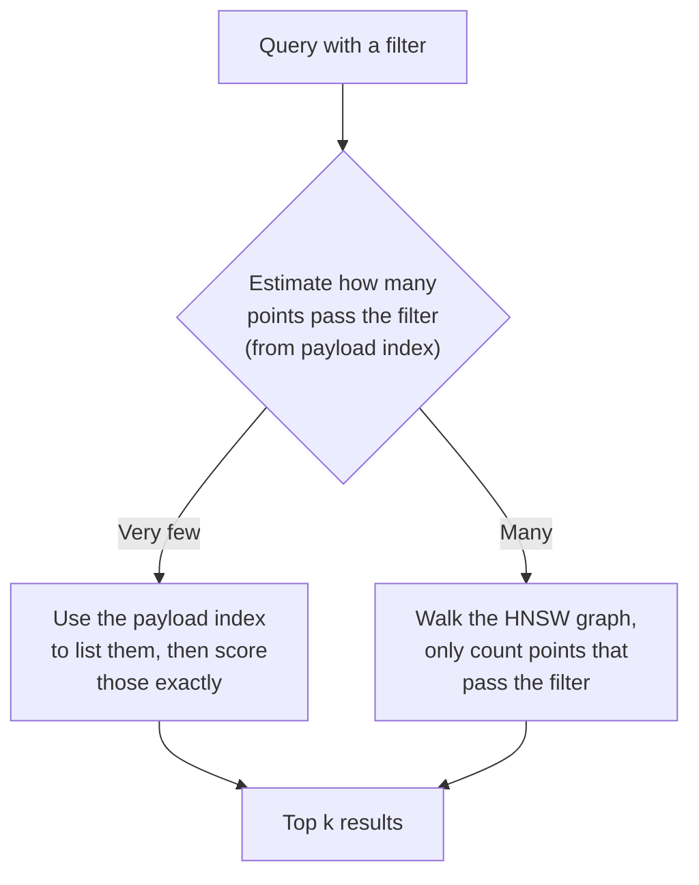

# Qdrant: The Complete Guide

> 📚 **Before you start**
>
> - [Chroma](chroma.md), for collections, metadata filters and the toy help-centre data used again here.
> - [FAISS](faiss.md), for what an index library does and what it leaves to you (ids, metadata, filters, deletes).
> - [Storage and Indexing (HNSW, IVF)](../03-embeddings-and-vector-databases/storage-and-indexing-hnsw-ivf.md), for HNSW, quantization, segments, the write-ahead log and why filtering is hard.

## Introduction

Picture the parcel sorting hub of a courier company in Bhiwandi. Thousands of parcels arrive every hour. Each one has a barcode (its id), a size and weight (its shape), and a label full of details: destination pin code, cash on delivery or prepaid, fragile or not. Sorters do not only ask "which parcels look like this one?" They ask "which parcels going to pin code 560001, prepaid, under 2 kg, are in this bay?" The labels matter as much as the parcels.

**Qdrant** (pronounced "quadrant") is a vector database built around exactly that combination: vectors **plus** rich JSON labels, which it calls **payloads**, with filters that are applied **while** it searches the vector index. It is open source, written in Rust, and runs as a server (usually in Docker), as a managed service (Qdrant Cloud), or inside your Python process in **local mode** for development.

By the end of this lesson you will be able to:

- explain Qdrant's data model: collections, points, ids, vectors and payloads;
- create collections, upsert points and run `query_points`, in Python and as REST JSON;
- write `must`, `should` and `must_not` filters with match and range conditions, and know why payload indexes matter;
- tune HNSW, quantization and on-disk storage, and design for many tenants;
- run hybrid (dense plus sparse) search with fusion in one request.

> 💡 **Key Insight**
>
> Qdrant treats the **payload as a first-class citizen**. Every point is a vector plus a JSON document, filters can express real business rules (`must`, `should`, `must_not`, ranges, nested fields), and indexed payload fields are woven into the HNSW search so filtered queries stay fast and still return `k` results. If your searches always come with conditions, that design is the reason to pick Qdrant.

---

## Core Explanation

### 1. The data model

| Concept | What it is | Example |
|---|---|---|
| **Collection** | A named set of points that share vector settings | `help_centre`, 384 dimensions, cosine |
| **Point** | One record | an FAQ chunk |
| **Id** | Unsigned 64-bit integer **or** a UUID | `42` or `"5f2b6a3c-..."` |
| **Vector** | One vector, or several **named** vectors per point | `"text": [...]`, `"title": [...]` |
| **Payload** | Any JSON object | `{"topic": "payments", "lang": "en", "tags": ["upi"]}` |

Two details differ from Chroma. First, **ids cannot be arbitrary strings**: if your ids look like `"faq-01"`, convert them to a UUID. A **deterministic** conversion (the same string always gives the same UUID) keeps upserts idempotent:

```python
import uuid

NAMESPACE = uuid.UUID("12345678-1234-5678-1234-567812345678")   # any fixed UUID for your project

def point_id(source_id):
    return str(uuid.uuid5(NAMESPACE, source_id))

print(point_id("faq-01"))
print(point_id("faq-01") == point_id("faq-01"), point_id("faq-01") == point_id("faq-02"))
```

Output:

```
ede746e4-dd00-54ab-949a-5efdbb949fee
True False
```

Keep the original id in the payload as well (`"source_id": "faq-01"`), so results are readable.

Second, **scores are similarities for `Cosine` and `Dot`: higher is better**. (For `Euclid` and `Manhattan` distances, lower is better.) After a Chroma lesson where smaller distances won, this is a common source of upside-down thresholds.


*Qdrant's building blocks. Writes go to the write-ahead log first, points live in segments inside shards, and every query fans out across shards and merges the top k.*

### 2. Run it: local mode, Docker, cloud

```bash
pip install qdrant-client
docker run -p 6333:6333 -p 6334:6334 -v "$(pwd)/qdrant_storage:/qdrant/storage" qdrant/qdrant
```

```python
# not-run: needs the qdrant-client package
from qdrant_client import QdrantClient, models

client = QdrantClient(":memory:")                         # local mode, in RAM: tests and notebooks
# client = QdrantClient(path="./qdrant_local")            # local mode, saved to a folder
# client = QdrantClient(url="http://localhost:6333")      # the Docker server
# client = QdrantClient(url="https://<cluster>.cloud.qdrant.io", api_key="...")   # Qdrant Cloud
```

**Local mode** runs a pure-Python implementation of the same API inside your process. It is ideal for notebooks and unit tests, but it is not built for large data or speed; move to the server for anything real. The server also gives you a web dashboard at `http://localhost:6333/dashboard`.

### 3. Create a collection and upsert points

We reuse the toy help-centre data and the five-dimension toy model from the [Chroma](chroma.md) lesson:

```python
import re
import numpy as np

DIMS = ["money", "travel", "tech", "food", "weather"]
LEXICON = {
    "upi": (0.9, 0, 0.4, 0, 0), "payment": (1, 0, 0.1, 0, 0), "bhugtan": (1, 0, 0.1, 0, 0),
    "paisa": (1, 0, 0, 0, 0), "money": (1, 0, 0, 0, 0), "debited": (0.9, 0, 0, 0, 0),
    "deducted": (0.9, 0, 0, 0, 0), "failed": (0.3, 0, 0.3, 0, 0), "fail": (0.3, 0, 0.3, 0, 0),
    "refund": (1, 0.1, 0, 0, 0), "wallet": (0.8, 0, 0.2, 0, 0), "bank": (0.9, 0, 0, 0, 0),
    "account": (0.6, 0, 0.3, 0, 0), "train": (0, 1, 0, 0, 0), "ticket": (0.3, 0.8, 0, 0, 0),
    "tatkal": (0.1, 0.9, 0, 0, 0), "journey": (0, 0.9, 0, 0, 0), "booking": (0.2, 0.7, 0.1, 0, 0),
    "cancelled": (0.2, 0.5, 0, 0, 0), "delayed": (0, 0.7, 0, 0, 0.2), "late": (0, 0.6, 0, 0, 0.1),
    "app": (0.1, 0, 1, 0, 0), "password": (0, 0, 1, 0, 0), "login": (0, 0, 1, 0, 0),
    "otp": (0.2, 0, 0.9, 0, 0), "phone": (0.1, 0, 1, 0, 0), "reset": (0, 0, 0.6, 0, 0),
    "biryani": (0, 0, 0, 1, 0), "chai": (0, 0, 0, 1, 0), "catering": (0, 0.2, 0, 0.9, 0),
    "rain": (0, 0.1, 0, 0, 0.9), "monsoon": (0, 0.1, 0, 0, 1), "flooding": (0, 0.2, 0, 0, 0.9),
}

def embed(text):
    """Toy embedding model from the Chroma lesson: normalised sum of word vectors."""
    vectors = [LEXICON[w] for w in re.findall(r"[a-z]+", text.lower()) if w in LEXICON]
    v = np.sum(vectors, axis=0) if vectors else np.zeros(len(DIMS))
    return (v / np.linalg.norm(v) if np.linalg.norm(v) else v).round(4).tolist()

DOCS = [
    ("faq-01", "UPI payment failed but money was debited from my bank account", {"topic": "payments", "lang": "en", "views": 9120}),
    ("faq-02", "How to get a refund for a cancelled train ticket", {"topic": "travel", "lang": "en", "views": 15400}),
    ("faq-03", "Tatkal ticket booking opens one day before the journey", {"topic": "travel", "lang": "en", "views": 22050}),
    ("faq-04", "Reset your app password using the OTP sent to your phone", {"topic": "account", "lang": "en", "views": 4300}),
    ("faq-05", "UPI bhugtan fail ho gaya par paisa kat gaya", {"topic": "payments", "lang": "hi", "views": 6100}),
    ("faq-06", "Train delayed due to heavy rain and monsoon flooding", {"topic": "travel", "lang": "en", "views": 3900}),
    ("faq-07", "Order biryani and chai on your train journey with e-catering", {"topic": "food", "lang": "en", "views": 2750}),
    ("faq-08", "A wallet refund reaches your bank account in 5 to 7 days", {"topic": "payments", "lang": "en", "views": 11800}),
]

points = [{"id": point_id(source_id), "vector": embed(text),
           "payload": {"source_id": source_id, "text": text, **meta}}
          for source_id, text, meta in DOCS]
print(points[0]["payload"])
```

Output:

```
{'source_id': 'faq-01', 'text': 'UPI payment failed but money was debited from my bank account', 'topic': 'payments', 'lang': 'en', 'views': 9120}
```

This time the payload carries a numeric `views` field too, so we can show range filters. With the client:

```python
# not-run: needs the qdrant-client package
client.create_collection(
    collection_name="help_centre",
    vectors_config=models.VectorParams(size=5, distance=models.Distance.COSINE),
)
client.upsert(
    collection_name="help_centre",
    points=[models.PointStruct(id=p["id"], vector=p["vector"], payload=p["payload"]) for p in points],
    wait=True,     # return only after the write is applied
)
print(client.count(collection_name="help_centre").count)
```

Example output:

```
8
```

The available distances are `COSINE`, `DOT`, `EUCLID` and `MANHATTAN`. With `COSINE`, Qdrant normalises vectors when you store them, so you do not have to (but normalising yourself does no harm). `upsert` is the only write call you need: new ids are inserted and existing ids are overwritten, so re-running ingestion is safe.

### 4. Query, in Python and as REST JSON

```python
# not-run: needs the qdrant-client package
hits = client.query_points(
    collection_name="help_centre",
    query=embed("refund for my train ticket"),
    limit=3,
    with_payload=True,
).points
for hit in hits:
    print(f"{hit.score:.3f}  {hit.payload['source_id']}  {hit.payload['text']}")
```

Example output:

```
0.999  faq-02  How to get a refund for a cancelled train ticket
0.913  faq-03  Tatkal ticket booking opens one day before the journey
0.583  faq-08  A wallet refund reaches your bank account in 5 to 7 days
```

`query_points` is Qdrant's universal search call (older tutorials use a `search` method, which it replaced). Payload is returned only if you ask with `with_payload=True`, and vectors only with `with_vectors=True`.

Every client call maps to a REST request, which is handy for debugging with `curl` and for languages without a client. The same search is a `POST` to `/collections/help_centre/points/query` with this body:

```json
{
  "query": [0.5647, 0.8253, 0.0, 0.0, 0.0],
  "limit": 3,
  "with_payload": true
}
```

### 5. Filters: must, should, must_not

A Qdrant filter has three lists of conditions:

| Clause | Meaning | Like SQL |
|---|---|---|
| `must` | every condition must hold | `AND` |
| `should` | at least one condition must hold | `OR` |
| `must_not` | no condition may hold | `NOT (... OR ...)` |

and the common condition types are:

| Condition | JSON | Matches when |
|---|---|---|
| Match a value | `{"key": "lang", "match": {"value": "en"}}` | field equals the value (for a list field: contains it) |
| Match any | `{"key": "topic", "match": {"any": ["travel", "food"]}}` | field equals one of the values |
| Match except | `{"key": "topic", "match": {"except": ["payments"]}}` | field equals none of them |
| Range | `{"key": "views", "range": {"gte": 5000, "lt": 20000}}` | number is in the range |
| Is empty | `{"is_empty": {"key": "tags"}}` | field missing, null or `[]` |

Clauses nest: a condition can itself be a whole filter, so you can write `(A and B) or (C and not D)`. Here is a small evaluator for this JSON form, so you can run real filter bodies against our points and see exactly what each one keeps. It is a teaching copy of the semantics, not Qdrant's code:

```python
def check(payload, cond):
    if "must" in cond or "should" in cond or "must_not" in cond:          # a nested filter
        return passes(payload, cond)
    if "is_empty" in cond:
        return payload.get(cond["is_empty"]["key"]) in (None, [])
    value = payload.get(cond["key"])
    if value is None:
        return False
    values = value if isinstance(value, list) else [value]
    if "match" in cond:
        m = cond["match"]
        if "value" in m:
            return m["value"] in values
        if "any" in m:
            return any(v in m["any"] for v in values)
        if "except" in m:
            return all(v not in m["except"] for v in values)
    if "range" in cond:
        r = cond["range"]
        return all([value > r["gt"] if "gt" in r else True, value >= r["gte"] if "gte" in r else True,
                    value < r["lt"] if "lt" in r else True, value <= r["lte"] if "lte" in r else True])
    raise ValueError(cond)

def passes(payload, flt):
    return (all(check(payload, c) for c in flt.get("must", []))
            and (not flt.get("should") or any(check(payload, c) for c in flt["should"]))
            and not any(check(payload, c) for c in flt.get("must_not", [])))

def query_points(query_text, query_filter=None, limit=3):
    """Exact cosine search with an in-search filter: what the server returns, minus the speed."""
    q = np.array(embed(query_text))
    q = q / np.linalg.norm(q)
    scored = []
    for p in points:
        if query_filter and not passes(p["payload"], query_filter):
            continue
        v = np.array(p["vector"])
        scored.append((float(v @ q / np.linalg.norm(v)), p["payload"]["source_id"]))
    return [(f"{s:.3f}", i) for s, i in sorted(scored, key=lambda t: (-t[0], t[1]))[:limit]]

less_viewed_english = {"must": [{"key": "lang", "match": {"value": "en"}},
                                {"key": "views", "range": {"lt": 10000}}]}
travel_or_food_not_tatkal = {"should": [{"key": "topic", "match": {"value": "travel"}},
                                        {"key": "topic", "match": {"value": "food"}}],
                             "must_not": [{"key": "source_id", "match": {"value": "faq-03"}}]}

print("no filter:           ", query_points("refund for my train ticket"))
print("English, <10k views: ", query_points("refund for my train ticket", less_viewed_english))
print("travel/food, no 03:  ", query_points("refund for my train ticket", travel_or_food_not_tatkal))
```

Output:

```
no filter:            [('0.999', 'faq-02'), ('0.913', 'faq-03'), ('0.583', 'faq-08')]
English, <10k views:  [('0.554', 'faq-01'), ('0.484', 'faq-07'), ('0.473', 'faq-06')]
travel/food, no 03:   [('0.999', 'faq-02'), ('0.484', 'faq-07'), ('0.473', 'faq-06')]
```

Compare the three lines: the filter changes **which** points compete, and the search still returns the best `limit` among those that pass. That is filtering **during** search, not after it.

In the Python client the same filter is built from model classes:

```python
# not-run: needs the qdrant-client package
hits = client.query_points(
    collection_name="help_centre",
    query=embed("refund for my train ticket"),
    query_filter=models.Filter(
        must=[
            models.FieldCondition(key="lang", match=models.MatchValue(value="en")),
            models.FieldCondition(key="views", range=models.Range(lt=10000)),
        ]
    ),
    limit=3,
    with_payload=True,
).points
print([(round(h.score, 3), h.payload["source_id"]) for h in hits])
```

Example output:

```
[(0.554, 'faq-01'), (0.484, 'faq-07'), (0.473, 'faq-06')]
```

`MatchAny(any=[...])`, `MatchExcept(**{"except": [...]})` and `Range(gt=..., lte=...)` cover the other rows of the table, and `models.Filter(should=[...], must_not=[...])` gives the other clauses.

### 6. Payload indexes: make filters fast

Without an index, Qdrant must read each candidate's payload to test a condition. For any field you filter on regularly, create a **payload index**:

```python
# not-run: needs the qdrant-client package
client.create_payload_index("help_centre", field_name="lang", field_schema=models.PayloadSchemaType.KEYWORD)
client.create_payload_index("help_centre", field_name="views", field_schema=models.PayloadSchemaType.INTEGER)
```

Payload indexes do two jobs. They answer "which points have `lang = en`?" quickly, and they let Qdrant's **query planner** pick a strategy per query, which is the filtering trade-off from the previous module made automatic:



Qdrant also adds extra links to the HNSW graph for indexed payload values, so a graph search restricted to, say, one language does not get stranded in a region full of other languages. Create payload indexes **before** loading large data, so the graph is built with them in mind. The schema types include `KEYWORD` (exact strings), `INTEGER`, `FLOAT`, `BOOL`, `DATETIME`, `UUID`, `GEO` and `TEXT` (full-text matching on words).

### 7. Tuning memory and speed

Collection settings decide how much RAM each point costs and how accurate search is:

```python
# not-run: needs the qdrant-client package
client.create_collection(
    collection_name="help_centre_large",
    vectors_config=models.VectorParams(size=1024, distance=models.Distance.COSINE, on_disk=True),
    hnsw_config=models.HnswConfigDiff(m=16, ef_construct=200),
    quantization_config=models.ScalarQuantization(
        scalar=models.ScalarQuantizationConfig(type=models.ScalarType.INT8, always_ram=True),
    ),
)
hits = client.query_points(
    collection_name="help_centre_large",
    query=[0.0] * 1024,
    limit=10,
    search_params=models.SearchParams(hnsw_ef=128, quantization=models.QuantizationSearchParams(rescore=True)),
).points
```

| Setting | Effect |
|---|---|
| `on_disk=True` on vectors | Full-precision vectors stay on disk (memory-mapped); RAM holds the index |
| Scalar quantization, `always_ram=True` | int8 copies of every vector in RAM for fast scoring: about 4x less memory than float32 |
| `rescore=True` | Re-scores the best candidates with full-precision vectors from disk, recovering accuracy |
| `hnsw_config` `m`, `ef_construct` | Graph density and build quality |
| `hnsw_ef` at query time | Search beam width: higher is more accurate and slower |

This combination (quantized vectors in RAM, originals on disk, rescoring the top candidates) is the "compress, then re-rank" pattern from the previous module, configured in a few lines. Qdrant also offers product and binary quantization for larger savings.

### 8. Many customers in one collection

A SaaS help-desk product may serve thousands of companies. Two designs:

| Design | How | Good for |
|---|---|---|
| **Collection per tenant** | `help_centre_acme`, `help_centre_zomato`, ... | A handful of large tenants that need different settings |
| **One collection, tenant field** | Every point has `"tenant_id"`; every query filters on it | Many tenants, mostly small. Qdrant's recommended default |

For the second design, index the field and mark it as the tenant key, so Qdrant organises storage and the graph around it:

```python
# not-run: needs the qdrant-client package
client.create_payload_index(
    collection_name="help_centre",
    field_name="tenant_id",
    field_schema=models.KeywordIndexParams(type="keyword", is_tenant=True),
)
```

**Every** query must then include the tenant filter. Put it in one helper function that all your search code goes through, so no request can forget it and leak another customer's data.

### 9. Hybrid search in one request

Qdrant stores **sparse vectors** too: long vectors that are mostly zeros, where each non-zero position stands for a word, like the keyword scores you met in [Semantic Search Explained](../03-embeddings-and-vector-databases/semantic-search-explained.md). A collection can hold a dense and a sparse vector per point under different names, and one query can search both and fuse the lists with Reciprocal Rank Fusion:

```python
# not-run: needs the qdrant-client package; dense_query and sparse_query come from your two models
client.create_collection(
    collection_name="help_centre_hybrid",
    vectors_config={"dense": models.VectorParams(size=384, distance=models.Distance.COSINE)},
    sparse_vectors_config={"sparse": models.SparseVectorParams()},
)
hits = client.query_points(
    collection_name="help_centre_hybrid",
    prefetch=[
        models.Prefetch(query=dense_query, using="dense", limit=20),
        models.Prefetch(query=models.SparseVector(indices=[17, 2051], values=[0.8, 1.3]), using="sparse", limit=20),
    ],
    query=models.FusionQuery(fusion=models.Fusion.RRF),
    limit=5,
).points
```

The `prefetch` list runs the two searches; the outer `query` fuses them. The [Hybrid Search](../course.md#m6) lesson builds this into a full RAG pipeline.

### 10. Operations: snapshots and clusters

- **Snapshots** capture a collection's data and settings into a file you can download, store and restore elsewhere: the basis of backups and of moving collections between servers.
- **Distributed mode** runs several Qdrant nodes as one cluster. A collection is split into **shards** (`shard_number`) spread over nodes, and each shard can have copies (`replication_factor`) for availability, the sharding and replication from the previous module.
- **Security**: set an API key on the server, put it behind TLS, and never expose port 6333 to the internet without them.

---

## Try It Yourself

1. **Write the filter.** Using `passes` and `query_points`, find the best match for "money deducted" among points that are **not** payments **or** have fewer than 5,000 views. (Hint: nest a `should` inside the filter.)
2. **Score direction.** A teammate ports a threshold from Chroma (`distance < 0.3` means relevant) to Qdrant with `COSINE`. What should the Qdrant condition be?
3. **Id safety.** What goes wrong if you use `uuid.uuid4()` (a random UUID) as the point id in an ingestion job that runs every night?

<details>
<summary>Show answers</summary>

**1.**

```python
not_payments_or_unpopular = {"should": [
    {"must_not": [{"key": "topic", "match": {"value": "payments"}}]},
    {"key": "views", "range": {"lt": 5000}},
]}
print(query_points("money deducted", not_payments_or_unpopular, limit=3))
```

Output:

```
[('0.530', 'faq-02'), ('0.179', 'faq-03'), ('0.088', 'faq-04')]
```

All three payments FAQs have at least 5,000 views, so every payments point is excluded, and the best remaining matches are the two travel FAQs that mention tickets (money-flavoured words in our toy model) and the account FAQ.

**2.** Chroma's cosine distance is `1 - cos`, and Qdrant's `COSINE` score is `cos`. So `distance < 0.3` becomes `score > 0.7`. Qdrant can also apply it for you with the `score_threshold` argument of `query_points`.

**3.** Every run creates new ids for the same FAQs, so `upsert` never overwrites anything: the collection fills with duplicates and searches return the same FAQ several times. Use deterministic ids, such as `uuid5` of the source id (or of the content hash, if you want a new point whenever the text changes, together with deleting the old one).

</details>

---

## Real-World Examples

- **E-commerce search** combines a product embedding with payload filters for price range, brand, size and stock, which is exactly the filtered-search case Qdrant is designed around.
- **Multi-tenant SaaS assistants** keep all customers in one collection with a `tenant_id` tenant index and enforce the filter in one search helper.
- **Recommendation and "more like this"** features query with an existing item's vector, excluding that item and items the user has already seen with `must_not`.
- **On-premise deployments** in banks and government projects run Qdrant in their own Kubernetes clusters for data-residency reasons.

---

## Common Misconceptions

### "Point ids can be any string"

They must be unsigned integers or UUIDs. Map your string ids to UUIDs deterministically and keep the original in the payload.

### "Lower scores are better"

For `COSINE` and `DOT`, Qdrant returns similarities, so higher is better. Only `EUCLID` and `MANHATTAN` scores are distances.

### "Filters work the same with or without payload indexes"

They return the same results, but without an index Qdrant cannot plan well, and filtered searches over large collections slow down sharply. Index every field you filter on.

### "Local mode is a small Qdrant server"

Local mode is a Python implementation of the API for development and tests. Performance and features at scale come from the real server.

---

## Interview Relevance

*"How does Qdrant handle filtered vector search?"* A strong answer explains payloads, `must`/`should`/`must_not`, payload indexes, the query planner switching between exact search over a small filtered set and filter-aware HNSW traversal, and the extra graph links Qdrant builds for indexed payload values, so filtered queries still return `k` results quickly.

*"Design multi-tenant RAG on Qdrant."* One collection with a `tenant_id` keyword index marked `is_tenant`, a mandatory filter added in one place in the code, per-tenant collections only for very large or special tenants, plus API keys and TLS.

*"How do you fit 100 million vectors on fewer machines?"* Scalar or binary quantization kept in RAM, original vectors `on_disk`, rescoring of top candidates, sharding with replication for availability.

---

## Key Takeaways

- **Points = id + vector(s) + JSON payload.** Ids are integers or UUIDs; use deterministic UUIDs for string ids.
- **`query_points` is the search call**; scores for `COSINE` and `DOT` are similarities, higher is better.
- **Filters use `must`, `should` and `must_not`** with match, range and nested conditions, applied during the search.
- **Index every filtered field** with `create_payload_index`; mark the tenant field `is_tenant` for multi-tenant collections.
- **Quantization, on-disk vectors, rescoring and named dense plus sparse vectors** cover scale and hybrid search in one database.

---

**Up next:** [Pinecone](pinecone.md)
