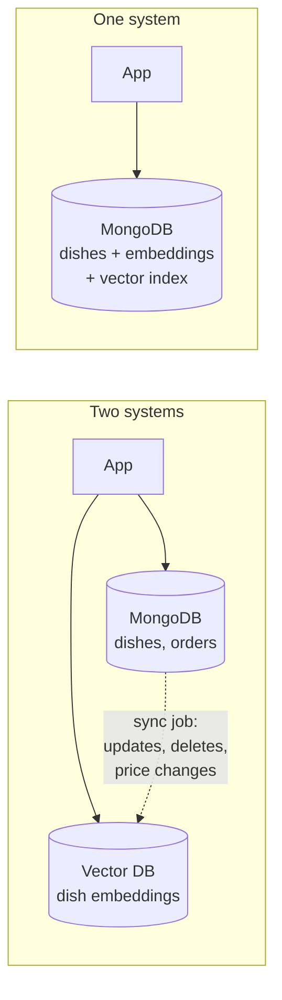
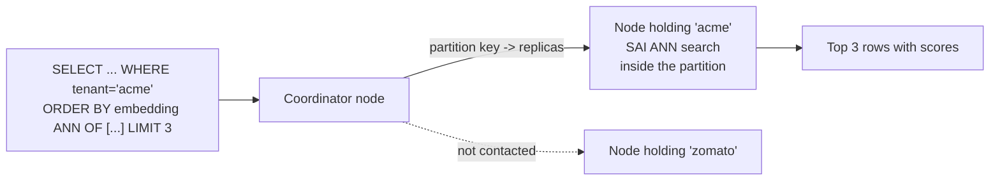

# Vector Search in MongoDB and Cassandra: The Complete Guide

> 📚 **Before you start**
>
> - [Databases: SQL and NoSQL › NoSQL with MongoDB Atlas](../../databases-sql-and-nosql/course.md#m4), for documents, collections and aggregation pipelines.
> - [Vector vs SQL vs NoSQL Databases](../03-embeddings-and-vector-databases/vector-vs-sql-vs-nosql-databases.md), for the "dedicated vector database or vector search in the database you already run?" question.
> - [LanceDB](lancedb.md), [Qdrant](qdrant.md) and [Chroma](chroma.md), for filters, score directions and the toy help-centre data used again here.

## Introduction

A Bengaluru food-delivery company already keeps its restaurants, menus and orders in MongoDB. Now it wants "search dishes by meaning": typing *something light and spicy for a rainy evening* should find hot soups and pakoras. One option is to add a new vector database, copy every dish into it, and keep the two in sync forever. The other is to store each dish's embedding **in the same document** that already holds its name, price and restaurant, and ask the existing database to search by vector.

That second option is now available in most popular databases. You saw PostgreSQL's `pgvector` in the previous module. This lesson covers two very different NoSQL databases that the syllabus names explicitly:

- **MongoDB**, the document database, through **MongoDB Vector Search** (on Atlas, MongoDB's managed cloud, and increasingly on self-managed deployments): a `$vectorSearch` stage inside an ordinary aggregation pipeline.
- **Apache Cassandra 5.0**, the wide-column database built for huge write volumes across many machines: a `VECTOR` column type, a **Storage-Attached Index (SAI)** and an `ORDER BY ... ANN OF` clause in CQL, its SQL-like query language.

By the end of this lesson you will be able to:

- store embeddings in MongoDB documents, define a vector search index and write `$vectorSearch` pipelines with filters;
- create a Cassandra table with a vector column, index it and run ANN queries inside a partition;
- interpret the 0-to-1 scores both databases return;
- decide when built-in vector search is enough and when a dedicated vector database earns its place.

> 💡 **Key Insight**
>
> Built-in vector search wins when **the vectors belong to data you already store there**. The embedding sits next to the price, stock and permissions it must be filtered by, it is written in the same operation, and it can never drift out of sync. You give up some of the specialised tuning and features of a dedicated vector database, so the deciding questions are scale, filter needs and how much you value one system over two.

---

## Core Explanation

### 1. One system instead of two



| | Separate vector database | Vector search in your existing database |
|---|---|---|
| Consistency | A sync job can lag or fail; deleted items may still be found | Embedding is written with the record; deletes are immediate |
| Filters on business data | Must copy every filter field into the vector DB | Filter on any indexed field already there |
| Joins | In application code | In the query (MongoDB `$lookup` after the search) |
| Operations | Two systems to secure, back up and monitor | One |
| Vector-specific features and tuning | Usually deeper | Usually fewer knobs |

### 2. The toy data, as MongoDB documents

We reuse the help-centre FAQs and the five-number toy model from the [Chroma](chroma.md) lesson. In MongoDB, each FAQ is a document and the embedding is just an array field:

```python
import json
import re
import numpy as np

LEXICON = {
    "upi": (0.9, 0, 0.4, 0, 0), "payment": (1, 0, 0.1, 0, 0), "bhugtan": (1, 0, 0.1, 0, 0),
    "paisa": (1, 0, 0, 0, 0), "money": (1, 0, 0, 0, 0), "debited": (0.9, 0, 0, 0, 0),
    "deducted": (0.9, 0, 0, 0, 0), "failed": (0.3, 0, 0.3, 0, 0), "fail": (0.3, 0, 0.3, 0, 0),
    "refund": (1, 0.1, 0, 0, 0), "wallet": (0.8, 0, 0.2, 0, 0), "bank": (0.9, 0, 0, 0, 0),
    "account": (0.6, 0, 0.3, 0, 0), "train": (0, 1, 0, 0, 0), "ticket": (0.3, 0.8, 0, 0, 0),
    "tatkal": (0.1, 0.9, 0, 0, 0), "journey": (0, 0.9, 0, 0, 0), "booking": (0.2, 0.7, 0.1, 0, 0),
    "cancelled": (0.2, 0.5, 0, 0, 0), "delayed": (0, 0.7, 0, 0, 0.2), "late": (0, 0.6, 0, 0, 0.1),
    "app": (0.1, 0, 1, 0, 0), "password": (0, 0, 1, 0, 0), "login": (0, 0, 1, 0, 0),
    "otp": (0.2, 0, 0.9, 0, 0), "phone": (0.1, 0, 1, 0, 0), "reset": (0, 0, 0.6, 0, 0),
    "biryani": (0, 0, 0, 1, 0), "chai": (0, 0, 0, 1, 0), "catering": (0, 0.2, 0, 0.9, 0),
    "rain": (0, 0.1, 0, 0, 0.9), "monsoon": (0, 0.1, 0, 0, 1), "flooding": (0, 0.2, 0, 0, 0.9),
}

def embed(text):
    """Toy embedding model from the Chroma lesson: normalised sum of word vectors."""
    vectors = [LEXICON[w] for w in re.findall(r"[a-z]+", text.lower()) if w in LEXICON]
    v = np.sum(vectors, axis=0) if vectors else np.zeros(5)
    return (v / np.linalg.norm(v) if np.linalg.norm(v) else v).round(4).tolist()

rows = [
    ("faq-01", "UPI payment failed but money was debited from my bank account", "payments", "en", "acme"),
    ("faq-02", "How to get a refund for a cancelled train ticket", "travel", "en", "acme"),
    ("faq-03", "Tatkal ticket booking opens one day before the journey", "travel", "en", "acme"),
    ("faq-04", "Reset your app password using the OTP sent to your phone", "account", "en", "acme"),
    ("faq-05", "UPI bhugtan fail ho gaya par paisa kat gaya", "payments", "hi", "zomato"),
    ("faq-06", "Train delayed due to heavy rain and monsoon flooding", "travel", "en", "acme"),
    ("faq-07", "Order biryani and chai on your train journey with e-catering", "food", "en", "zomato"),
    ("faq-08", "A wallet refund reaches your bank account in 5 to 7 days", "payments", "en", "zomato"),
]
faqs = [{"_id": i, "text": t, "topic": topic, "lang": lang, "tenant": tenant, "embedding": embed(t)}
        for i, t, topic, lang, tenant in rows]
print(json.dumps(faqs[1]))
```

Output:

```
{"_id": "faq-02", "text": "How to get a refund for a cancelled train ticket", "topic": "travel", "lang": "en", "tenant": "acme", "embedding": [0.53, 0.848, 0.0, 0.0, 0.0]}
```

This time each FAQ also has a `tenant` field (which customer's help centre it belongs to), which we will use for filtering and, in Cassandra, for partitioning.

### 3. MongoDB: the vector search index

Vector search needs a special index, defined as JSON. It names the vector field (`path`), its number of dimensions, the similarity function, and every field you want to **filter** on during the search:

```json
{
  "fields": [
    {"type": "vector", "path": "embedding", "numDimensions": 5, "similarity": "cosine"},
    {"type": "filter", "path": "tenant"},
    {"type": "filter", "path": "lang"}
  ]
}
```

`similarity` can be `cosine`, `dotProduct` or `euclidean`. Real models have hundreds or thousands of dimensions; ours has five. You can create the index in the Atlas UI, with the Atlas CLI, or from Python with PyMongo:

```python
# not-run: needs the pymongo package and a MongoDB deployment with Vector Search
from pymongo import MongoClient
from pymongo.operations import SearchIndexModel

client = MongoClient("mongodb+srv://<user>:<password>@<cluster>.mongodb.net")
coll = client["support"]["faqs"]
coll.insert_many(faqs)

coll.create_search_index(SearchIndexModel(
    name="faq_vector_index",
    type="vectorSearch",
    definition={"fields": [
        {"type": "vector", "path": "embedding", "numDimensions": 5, "similarity": "cosine"},
        {"type": "filter", "path": "tenant"},
        {"type": "filter", "path": "lang"},
    ]},
))
```

The index builds in the background (in a separate search process, not the main database engine), and new or changed documents are indexed shortly after they are written. Under the hood it is an HNSW graph, the structure from the previous module.

### 4. MongoDB: the `$vectorSearch` stage

A vector query is an **aggregation pipeline** whose first stage is `$vectorSearch`:

```python
# not-run: needs the pymongo package and the index above
pipeline = [
    {"$vectorSearch": {
        "index": "faq_vector_index",
        "path": "embedding",
        "queryVector": embed("refund for my train ticket"),
        "numCandidates": 100,                       # how many neighbours HNSW considers
        "limit": 3,                                 # how many documents to return
        "filter": {"tenant": "acme", "lang": {"$in": ["en", "hi"]}},
    }},
    {"$project": {"_id": 1, "text": 1, "score": {"$meta": "vectorSearchScore"}}},
]
for doc in coll.aggregate(pipeline):
    print(f"{doc['score']:.3f}  {doc['_id']}  {doc['text']}")
```

Example output (computed from the toy vectors):

```
1.000  faq-02  How to get a refund for a cancelled train ticket
0.956  faq-03  Tatkal ticket booking opens one day before the journey
0.777  faq-01  UPI payment failed but money was debited from my bank account
```

The fields to know:

| Field | Meaning | Guidance |
|---|---|---|
| `index`, `path` | Which vector index and field | Must match the index definition |
| `queryVector` | The query embedding | Same model and dimension as the stored vectors |
| `numCandidates` | Neighbours the ANN search explores | Start at 10 to 20 times `limit`; raise it if recall is low |
| `limit` | Documents returned | |
| `filter` | MQL conditions on fields indexed as `filter` | `$eq`, `$ne`, `$gt`, `$lt`, `$in`, `$nin`, `$and`, `$or` and similar; applied **during** the search |
| `exact` | `true` for exact (brute-force) search instead of ANN | Small collections, or ground truth for measuring recall |

Two rules follow from "it is a pipeline stage". `$vectorSearch` must be the **first** stage, and everything you know about aggregation pipelines works **after** it: `$project` to shape results, `$match` for extra conditions, `$lookup` to join the restaurant or order details, `$group` to count hits per category.

**The score.** `{"$meta": "vectorSearchScore"}` returns a number from 0 to 1, higher is better. For `cosine` it is the cosine similarity rescaled as `(1 + cos) / 2`, so a cosine of 0 (unrelated) shows as 0.5, not 0. Keep that in mind when you port a threshold from another tool:

```python
def mongo_cosine_score(cos):
    return (1 + cos) / 2

for cos in [1.0, 0.8, 0.5, 0.0, -0.2]:
    print(f"cosine {cos:>5}  ->  vectorSearchScore {mongo_cosine_score(cos):.2f}")
```

Output:

```
cosine   1.0  ->  vectorSearchScore 1.00
cosine   0.8  ->  vectorSearchScore 0.90
cosine   0.5  ->  vectorSearchScore 0.75
cosine   0.0  ->  vectorSearchScore 0.50
cosine  -0.2  ->  vectorSearchScore 0.40
```

So "cosine at least 0.8" becomes "score at least 0.9".

### 5. Running a pipeline yourself

To make the stage's behaviour concrete, here is a small exact-search implementation of the pipeline above that runs on our list of documents. It supports `$vectorSearch` (with an equality and `$in` filter) followed by `$project` with the score:

```python
def vector_search(docs, stage):
    q = np.array(stage["queryVector"])
    q = q / np.linalg.norm(q)

    def passes(doc):
        for field, cond in stage.get("filter", {}).items():
            if isinstance(cond, dict) and "$in" in cond:
                if doc.get(field) not in cond["$in"]:
                    return False
            elif doc.get(field) != cond:
                return False
        return True

    scored = []
    for doc in filter(passes, docs):
        v = np.array(doc[stage["path"]])
        cos = float(v @ q / np.linalg.norm(v))
        scored.append(dict(doc, _score=(1 + cos) / 2))
    return sorted(scored, key=lambda d: -d["_score"])[: stage["limit"]]

def aggregate(docs, pipeline):
    out = docs
    for stage in pipeline:
        (name, spec), = stage.items()
        if name == "$vectorSearch":
            out = vector_search(out, spec)
        elif name == "$project":
            out = [{k: (round(d["_score"], 3) if v == {"$meta": "vectorSearchScore"} else d[k])
                    for k, v in spec.items()} for d in out]
    return out

pipeline = [
    {"$vectorSearch": {"index": "faq_vector_index", "path": "embedding",
                       "queryVector": embed("refund for my train ticket"), "numCandidates": 100,
                       "limit": 3, "filter": {"tenant": "acme", "lang": {"$in": ["en", "hi"]}}}},
    {"$project": {"_id": 1, "score": {"$meta": "vectorSearchScore"}}},
]
for doc in aggregate(faqs, pipeline):
    print(doc)
```

Output:

```
{'_id': 'faq-02', 'score': 1.0}
{'_id': 'faq-03', 'score': 0.956}
{'_id': 'faq-01', 'score': 0.777}
```

Notice that `faq-08` (the wallet refund, a strong match) is missing: it belongs to the `zomato` tenant, and the filter runs inside the search. In a multi-tenant app, that filter is your security boundary, so add it in one shared function that every query goes through.

### 6. Cassandra: vectors in a wide-column database

Cassandra stores data in **partitions** spread across many machines. Every table has a **partition key** that decides which machine holds a row, and the fastest queries name one partition. Cassandra 5.0 added three things for vector search:

- a column type `VECTOR<FLOAT, n>` with a fixed dimension;
- a **Storage-Attached Index (SAI)** on that column, which builds an ANN graph per data file, using a chosen similarity function (`COSINE`, `DOT_PRODUCT` or `EUCLIDEAN`);
- the clause `ORDER BY <vector column> ANN OF <query vector> LIMIT n`, plus functions such as `similarity_cosine(column, vector)` to return the score.

```sql
CREATE KEYSPACE IF NOT EXISTS support
  WITH REPLICATION = {'class': 'SimpleStrategy', 'replication_factor': 1};

CREATE TABLE IF NOT EXISTS support.faqs (
    tenant    text,
    faq_id    text,
    body      text,
    topic     text,
    lang      text,
    embedding VECTOR<FLOAT, 5>,
    PRIMARY KEY ((tenant), faq_id)
);

CREATE INDEX IF NOT EXISTS faqs_ann ON support.faqs (embedding) USING 'sai'
  WITH OPTIONS = {'similarity_function': 'COSINE'};
CREATE INDEX IF NOT EXISTS faqs_lang ON support.faqs (lang) USING 'sai';

INSERT INTO support.faqs (tenant, faq_id, body, topic, lang, embedding)
VALUES ('acme', 'faq-02', 'How to get a refund for a cancelled train ticket', 'travel', 'en',
        [0.53, 0.848, 0.0, 0.0, 0.0]);

SELECT faq_id, body, similarity_cosine(embedding, [0.5647, 0.8253, 0.0, 0.0, 0.0]) AS score
FROM support.faqs
WHERE tenant = 'acme' AND lang = 'en'
ORDER BY embedding ANN OF [0.5647, 0.8253, 0.0, 0.0, 0.0]
LIMIT 3;
```

Example output (computed from the toy vectors):

```
 faq_id | body                                                           | score
--------+----------------------------------------------------------------+-------
 faq-02 | How to get a refund for a cancelled train ticket               | 1.000
 faq-03 | Tatkal ticket booking opens one day before the journey         | 0.956
 faq-01 | UPI payment failed but money was debited from my bank account  | 0.777
```

Points to remember:

- **`LIMIT` is required** for ANN queries and can be at most 1,000.
- `similarity_cosine` also returns a score from 0 to 1, higher is better, with the same `(1 + cos) / 2` scaling as MongoDB.
- **Put the tenant in the partition key** and always restrict to it (`WHERE tenant = 'acme'`): the search then runs inside one partition on the machines that hold it, instead of asking every node in the cluster. Other SAI-indexed columns (`lang` above) can be combined in the `WHERE` clause.
- Vector search works best when vectors are written once; frequently overwriting the vector column makes searches slower until the data is compacted.
- You cannot ask for the **least** similar rows; ANN ordering is always "nearest first".



From Python, the DataStax `cassandra-driver` sends the query with the vector as a parameter:

```python
# not-run: needs the cassandra-driver package and a running Cassandra 5.0 node
from cassandra.cluster import Cluster

session = Cluster(["127.0.0.1"]).connect("support")
query_vec = embed("refund for my train ticket")
rows = session.execute(
    "SELECT faq_id, similarity_cosine(embedding, %s) AS score FROM faqs "
    "WHERE tenant = %s ORDER BY embedding ANN OF %s LIMIT 3",
    (query_vec, "acme", query_vec),
)
for row in rows:
    print(row.faq_id, round(row.score, 3))
```

### 7. Partition-first search, simulated

The partition key is the main design decision in Cassandra, so let us see its effect. Here is a tiny model of a cluster where each tenant's partition lives on one node, and a query that names the tenant touches only that node:

```python
from collections import defaultdict

nodes = defaultdict(list)                       # node name -> rows stored there
placement = {"acme": "node-A", "zomato": "node-B"}
for doc in faqs:
    nodes[placement[doc["tenant"]]].append(doc)

def cql_ann(query_text, limit, tenant=None):
    targets = [placement[tenant]] if tenant else sorted(nodes)
    q = np.array(embed(query_text))
    q = q / np.linalg.norm(q)
    rows = []
    for node in targets:
        for doc in nodes[node]:
            if tenant and doc["tenant"] != tenant:
                continue
            v = np.array(doc["embedding"])
            rows.append((round((1 + float(v @ q / np.linalg.norm(v))) / 2, 3), doc["_id"], doc["tenant"]))
    return targets, sorted(rows, reverse=True)[:limit]

for tenant in ["acme", None]:
    touched, hits = cql_ann("UPI payment failed", limit=3, tenant=tenant)
    print(f"tenant={tenant!s:<6} nodes contacted={touched}  hits={hits}")
```

Output:

```
tenant=acme   nodes contacted=['node-A']  hits=[(0.994, 'faq-01', 'acme'), (0.749, 'faq-02', 'acme'), (0.712, 'faq-04', 'acme')]
tenant=None   nodes contacted=['node-A', 'node-B']  hits=[(0.997, 'faq-05', 'zomato'), (0.994, 'faq-01', 'acme'), (0.99, 'faq-08', 'zomato')]
```

Naming the partition keeps each query on one node and keeps tenants apart. Searching without it fans out to every node (Cassandra allows ANN without a partition restriction, but on a big cluster it is far more work) and, as the second line shows, mixes tenants unless you filter.

### 8. Managed options and other databases

- **MongoDB Atlas** is the most common way to use MongoDB Vector Search; MongoDB has also been bringing search and vector search to self-managed Community and Enterprise deployments, so check the current docs for your version.
- **DataStax Astra DB** is a managed, serverless database built on Cassandra with vector search and its own document-style API.
- The same pattern exists elsewhere: PostgreSQL with `pgvector` (previous module), Redis, Elasticsearch and OpenSearch, and several cloud data warehouses all offer vector types and ANN search.

### 9. Built-in or dedicated?

| Prefer built-in vector search when | Prefer a dedicated vector database when |
|---|---|
| The records already live in that database | Vectors come from many sources and have no "home" record |
| Filters use business fields that change often (price, stock, permissions) | You need advanced vector features: multi-vector points, quantization control, sparse + dense in one index |
| Consistency matters: deletes must disappear from search at once | Vector traffic is very high and must scale separately from transactions |
| Your team knows this database well and wants one system to run | You want the deepest tuning of index and memory settings |

Many teams start with built-in search and move only the hot, vector-heavy workload to a dedicated system when measurements say so.

---

## Try It Yourself

1. **Threshold porting.** A Qdrant threshold says "keep hits with cosine score above 0.6". What is the equivalent MongoDB `vectorSearchScore` threshold? Check it with `mongo_cosine_score`.
2. **Extend the pipeline.** Add support for a `$match` stage to `aggregate` (equality only) and run: vector search over **all** tenants for "UPI payment failed", `limit` 4, then `$match` on `lang: "en"`. How many documents come out, and why is `$match` after the search different from `filter` inside it?
3. **Design a partition key.** A railway app stores 50 million passenger complaints with embeddings. Agents search complaints for one train on one date. What partition key would you choose, and why not partition only by train number?

<details>
<summary>Show answers</summary>

**1.**

```python
print(mongo_cosine_score(0.6))
```

Output:

```
0.8
```

**2.**

```python
def aggregate_with_match(docs, pipeline):
    out = docs
    for stage in pipeline:
        (name, spec), = stage.items()
        if name == "$match":
            out = [d for d in out if all(d.get(k) == v for k, v in spec.items())]
        else:
            out = aggregate(out, [stage])
    return out

pipeline = [
    {"$vectorSearch": {"index": "faq_vector_index", "path": "embedding",
                       "queryVector": embed("UPI payment failed"), "numCandidates": 100, "limit": 4}},
    {"$project": {"_id": 1, "lang": 1, "score": {"$meta": "vectorSearchScore"}}},
    {"$match": {"lang": "en"}},
]
for doc in aggregate_with_match(faqs, pipeline):
    print(doc)
```

Output:

```
{'_id': 'faq-01', 'lang': 'en', 'score': 0.994}
{'_id': 'faq-08', 'lang': 'en', 'score': 0.99}
{'_id': 'faq-02', 'lang': 'en', 'score': 0.749}
```

The search returned 4 documents and `$match` then removed the Hindi one, leaving 3. A `filter` inside `$vectorSearch` would have searched only English documents and still returned 4. Use `filter` for conditions that must hold for every result; use later stages for reshaping and joining.

**3.** Partition by `(train_number, journey_date)`. Each search then targets one modest partition. Partitioning only by train number would create enormous partitions for busy trains that keep growing every day, which Cassandra handles badly; adding the date keeps partitions bounded.

</details>

---

## Real-World Examples

- **E-commerce and food delivery** apps search product or dish embeddings in MongoDB and filter by stock, city and price in the same `$vectorSearch` stage, then `$lookup` restaurant details.
- **Customer-support platforms** keep tickets and their embeddings together, so a "similar past tickets" panel always respects the tenant and permission fields.
- **High-write telemetry and messaging systems** on Cassandra add a vector column to find similar events or messages within a customer's partition, without a separate system.
- **Agent memory stores** use MongoDB documents with an embedding field for long-term memories, filtered by `user_id`.

---

## Common Misconceptions

### "You need a vector database to do vector search"

Many general-purpose databases, including MongoDB, Cassandra and PostgreSQL, now include ANN indexes. A dedicated vector database is a choice, not a requirement.

### "A vectorSearchScore of 0.5 means half relevant"

For cosine, 0.5 means a cosine similarity of 0, which is unrelated. The scale is `(1 + cos) / 2`.

### "$match after $vectorSearch is the same as filter"

`$match` runs after the top results are chosen and can leave you with fewer. `filter` restricts the search itself. Fields used in `filter` must be indexed as `filter` fields.

### "Cassandra ANN queries can return everything"

ANN queries need a `LIMIT` of at most 1,000, and they work best inside a partition.

---

## Interview Relevance

*"How do you do vector search in MongoDB?"* Store embeddings as an array field, create a `vectorSearch` index with the vector path, `numDimensions`, `similarity` and filter fields, and query with a `$vectorSearch` first stage (`index`, `path`, `queryVector`, `numCandidates`, `limit`, `filter`), projecting `{"$meta": "vectorSearchScore"}`. Mention `numCandidates` around 10 to 20 times `limit`, `exact: true` for ENN, and joins with `$lookup` afterwards.

*"How does Cassandra support vector search?"* Since 5.0: the `VECTOR<FLOAT, n>` type, an SAI index with a similarity function, `ORDER BY col ANN OF [...] LIMIT n` (max 1,000), and `similarity_*` functions for scores. Design the partition key so searches stay inside one partition.

*"When would you not add a separate vector database?"* When the data already lives in a database that supports vector search, filters depend on fresh business fields, and one system is easier to secure and operate.

---

## Key Takeaways

- **Built-in vector search keeps embeddings next to the data they describe**, so filters use live business fields and deletes take effect at once.
- **MongoDB**: a `vectorSearch` index (vector field plus `filter` fields) and a `$vectorSearch` first stage; scores are `(1 + cos) / 2` for cosine.
- **Cassandra 5.0**: `VECTOR<FLOAT, n>`, an SAI index with a similarity function, and `ORDER BY ... ANN OF ... LIMIT n`.
- **Partition and tenant design matter**: filter inside the search (MongoDB `filter`, Cassandra partition key), not after it.
- **Choose built-in or dedicated by data location, filter needs, scale and team skills**, and measure before splitting into two systems.

---

**Up next:** [Embedding-Based Retrieval Pipelines](embedding-based-retrieval-pipelines.md)
