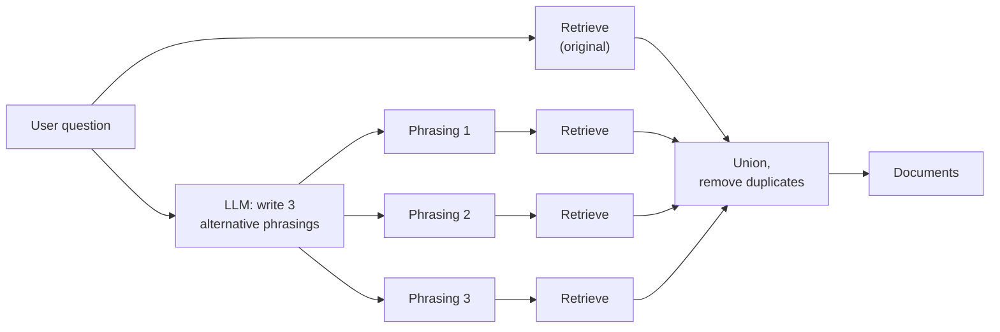
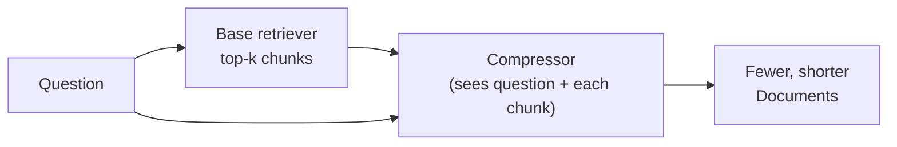
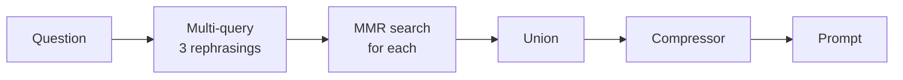

# MMR, Multi-Query and Contextual Compression Retrievers: The Complete Guide

> 📚 **Before you start**
>
> - [Retrievers](retrievers.md), for `as_retriever`, `search_kwargs` and writing a `BaseRetriever` subclass.
> - [Vector Stores in LangChain](vector-stores-in-langchain.md), for similarity scores.
> - [Chains and Runnables](../../langchain-complete-guide/course.md#m6), for prompts, chat models and output parsers.

## Introduction

You ask three friends to recommend places to eat in Old Delhi. The first says *"Karim's"*. The second says *"Karim's, definitely"*. The third says *"Karim's, near Jama Masjid"*. Three answers, one piece of information. You'd have learned far more if the second friend had said *"Paranthe Wali Gali"* and the third *"Jalebi Wala"*. And if you'd phrased your question three different ways (*"street food"*, *"sweets"*, *"a sit-down dinner"*) you'd have reached different parts of their memory. Finally, if each friend had told you only the useful sentence instead of a ten-minute story, you'd have saved time.

Plain top-k similarity search has the same three problems:

1. **Redundancy.** The top results are often near-duplicates of each other, wasting the few slots you have.
2. **Phrasing sensitivity.** The user's one wording may not match how the documents say it, so relevant chunks rank too low.
3. **Noise inside chunks.** A retrieved chunk can be 90% irrelevant text around one useful sentence.

LangChain has a standard fix for each: **MMR** for diversity, **multi-query** for phrasing, and **contextual compression** for noise. In this lesson you'll implement each one yourself, see it work on the Tarang handbook, and then see the ready-made LangChain classes.

> 💡 **Key Insight**
>
> Each of these retrievers improves a different side of the result list: **MMR changes which chunks are picked** (relevant but not repetitive), **multi-query changes what is searched** (several phrasings of the question), and **compression changes what is kept** (only the parts of chunks that matter). They stack, but each one adds cost, so add them when you've measured the problem they solve.

---

## Core Explanation

### 1. Setup, with some near-duplicates

Real knowledge bases repeat themselves: the handbook says something, the FAQ says it again, a policy update says it a third time. We add two FAQ entries that repeat the meal allowance, which is exactly the situation that hurts plain similarity search.

```python
import re, zlib
import numpy as np
from langchain_core.documents import Document
from langchain_core.embeddings import Embeddings
from langchain_core.vectorstores import InMemoryVectorStore

STOP = {"a", "an", "the", "is", "are", "of", "to", "in", "on", "for", "and", "or", "i", "my", "can",
        "do", "how", "many", "much", "what", "be", "it", "by", "with", "per", "up", "get", "if"}
CONCEPTS = {"vacation": "leave", "pto": "leave", "food": "meal", "lunch": "meal", "dinner": "meal",
            "budget": "allowance", "trip": "travel", "visit": "travel", "customer": "travel", "client": "travel",
            "notebook": "laptop", "computer": "laptop", "stolen": "lost", "resign": "notice", "quit": "notice",
            "expense": "claim", "reimbursement": "claim", "refund": "claim", "bill": "claim", "hotel": "stay",
            "room": "stay", "lodging": "stay", "baby": "parental", "maternity": "parental",
            "paternity": "parental", "doctor": "medical", "insurance": "medical", "hospital": "medical"}

def normalise(w):
    if w.endswith("ied"):
        return w[:-3] + "y"
    if w.endswith("s") and not w.endswith("ss") and len(w) > 3:
        return w[:-1]
    return w

def words(text):
    return {normalise(w) for w in re.findall(r"[a-z0-9]+", text.lower())} - STOP

class ToyEmbeddings(Embeddings):
    def __init__(self, dim=256):
        self.dim = dim
    def _embed(self, text):
        vec = np.zeros(self.dim)
        for w in words(text):
            vec[zlib.crc32(CONCEPTS.get(w, w).encode()) % self.dim] += 1.0
        norm = np.linalg.norm(vec)
        return [round(float(x), 6) for x in (vec / norm if norm else vec)]
    def embed_documents(self, texts):
        return [self._embed(t) for t in texts]
    def embed_query(self, text):
        return self._embed(text)

SECTIONS = [
    ("2.1", "Annual leave", 3, "Every employee gets 24 days of paid leave per calendar year. Up to 8 unused days can be carried forward to the next year."),
    ("2.2", "Sick leave", 3, "Employees get 10 days of sick leave per year. A doctor's note is required for more than 2 sick days in a row."),
    ("2.3", "Parental leave", 4, "Mothers get 26 weeks of paid maternity leave. Fathers get 2 weeks of paid paternity leave within 6 months of the birth."),
    ("3.1", "Work from home", 5, "Employees may work from home up to 2 days a week with their manager's approval."),
    ("4.1", "Health insurance", 6, "Medical insurance covers the employee, spouse and two children up to Rs 5 lakh a year."),
    ("5.1", "Travel claims", 8, "Submit bills on the Kharcha portal within 30 days of the trip. Approved claims are reimbursed within 15 days."),
    ("5.2", "Meal allowance", 8, "On client travel the daily meal allowance is Rs 1,200 in metro cities and Rs 800 in other cities."),
    ("5.3", "Hotel stay", 9, "Hotel stays are covered up to Rs 6,000 a night in metro cities and Rs 3,500 a night elsewhere."),
    ("6.1", "Laptops", 11, "A lost or stolen laptop must be reported to IT within 24 hours. The employee pays 10% of the replacement cost."),
    ("7.1", "Public holidays", 12, "The office is closed on 10 public holidays, including Diwali, Holi and Independence Day."),
    ("8.1", "Notice period", 14, "The notice period is 60 days. It can be shortened by paying basic salary for the remaining days."),
]

def handbook_docs():
    return [Document(page_content=f"{sec} {title}: {body}", id=f"handbook-{sec}",
                     metadata={"source": "hr/handbook-2026.pdf", "page": page, "section": sec})
            for sec, title, page, body in SECTIONS]

emb = ToyEmbeddings()
store = InMemoryVectorStore.from_documents(handbook_docs(), embedding=emb)
print(len(handbook_docs()), "chunks indexed")
```

Output:

```
11 chunks indexed
```

```python
FAQ = [
    Document(page_content="Travel FAQ: What is the meal allowance on client travel? Rs 1,200 a day in metro cities, Rs 800 in other cities.",
             id="faq-1", metadata={"source": "faq/travel.md", "page": 1, "section": "faq-1"}),
    Document(page_content="Travel FAQ: Is the daily meal allowance different in metro cities? Yes: Rs 1,200 in metros and Rs 800 elsewhere.",
             id="faq-2", metadata={"source": "faq/travel.md", "page": 1, "section": "faq-2"}),
]
store.add_documents(FAQ)

question = "What can I claim for meals and a hotel on a client trip to Mumbai?"
for doc, score in store.similarity_search_with_score(question, k=4):
    print(f"{score:.2f}  {doc.metadata['section']:<6} {doc.page_content[:60]}")
```

Output:

```
0.49  faq-1  Travel FAQ: What is the meal allowance on client travel? Rs 
0.45  5.2    5.2 Meal allowance: On client travel the daily meal allowanc
0.44  5.1    5.1 Travel claims: Submit bills on the Kharcha portal within
0.34  faq-2  Travel FAQ: Is the daily meal allowance different in metro c
```

The question asks about **meals and a hotel**. The top three results are two copies of the meal allowance and the travel-claims section. The hotel section (5.3) doesn't make the top 3 at all.

### 2. MMR: relevant, but not repetitive

**Maximal Marginal Relevance** (MMR), introduced by Carbonell and Goldstein in 1998 for search and summarisation, picks results one at a time. At each step it chooses the candidate that best balances two things:

- **Relevance**: similarity to the query (high is good).
- **Redundancy**: the highest similarity to anything already picked (high is bad).

```
MMR score = λ × sim(query, doc) − (1 − λ) × max sim(doc, already picked)
```

`λ` (`lambda_mult` in LangChain) runs from 0 to 1. At `λ = 1` MMR is plain similarity search; at `λ = 0` it only cares about being different. The usual default is 0.5.

MMR works on a candidate pool: first fetch the `fetch_k` most similar chunks (say 20), then pick `k` of them (say 4) with the formula. Here's the whole algorithm in NumPy:

```python
def mmr(query_vec, cand_vecs, k, lambda_mult=0.5):
    query_vec, cand_vecs = np.array(query_vec), np.array(cand_vecs)
    relevance = cand_vecs @ query_vec                     # cosine, since vectors are unit length
    picked = [int(np.argmax(relevance))]                  # the most relevant always goes first
    while len(picked) < min(k, len(cand_vecs)):
        best, best_score = None, -np.inf
        for i in range(len(cand_vecs)):
            if i in picked:
                continue
            redundancy = max(cand_vecs[i] @ cand_vecs[j] for j in picked)
            score = lambda_mult * relevance[i] - (1 - lambda_mult) * redundancy
            if score > best_score:
                best, best_score = i, score
        picked.append(best)
    return picked

pool = store.similarity_search(question, k=8)                          # fetch_k = 8
pool_vecs = emb.embed_documents([d.page_content for d in pool])
for lam in (1.0, 0.5, 0.25):
    chosen = mmr(emb.embed_query(question), pool_vecs, k=3, lambda_mult=lam)
    print(f"lambda={lam}: {[pool[i].metadata['section'] for i in chosen]}")
```

Output:

```
lambda=1.0: ['faq-1', '5.2', '5.1']
lambda=0.5: ['faq-1', '5.1', '5.3']
lambda=0.25: ['faq-1', '6.1', '5.1']
```

- `λ = 1.0` reproduces plain similarity (two meal chunks and the claims section).
- `λ = 0.5` notices that `5.2` repeats `faq-1`, skips it, and makes room for the **hotel** section. Now the context covers both halves of the question.
- `λ = 0.25` pushes diversity too far and pulls in something barely related. Tune λ on your test set; 0.5 to 0.7 is a common range.

The built-in version gives the same picks:

```python
for lam in (1.0, 0.5, 0.25):
    found = store.max_marginal_relevance_search(question, k=3, fetch_k=8, lambda_mult=lam)
    print(f"lambda={lam}: {[d.metadata['section'] for d in found]}")

mmr_retriever = store.as_retriever(search_type="mmr", search_kwargs={"k": 3, "fetch_k": 8, "lambda_mult": 0.5})
print("retriever:", [d.metadata["section"] for d in mmr_retriever.invoke(question)])
```

Output:

```
lambda=1.0: ['faq-1', '5.2', '5.1']
lambda=0.5: ['faq-1', '5.1', '5.3']
lambda=0.25: ['faq-1', '6.1', '5.1']
retriever: ['faq-1', '5.1', '5.3']
```

**When MMR helps:** knowledge bases with duplicates (FAQ plus handbook, many versions of a page, overlapping chunks), and questions with several parts. **When it hurts:** when the answer genuinely needs two very similar chunks (for example two consecutive chunks of the same table). It also costs a little extra: `fetch_k` candidates and their vectors instead of `k`.

### 3. Multi-query: search several phrasings

Embedding search compares the **wording** of the question with the wording of the chunk, through the lens of the embedding model. A user who writes *"What happens if my computer gets nicked?"* may not match a section that says *"A lost or stolen laptop must be reported to IT"*.

The **multi-query** retriever asks an LLM to rewrite the question in several different ways, runs a search for each, and returns the **union** of the results with duplicates removed.



First, the plain search on a slangy question:

```python
slang = "What happens if my notebook gets nicked on a work trip?"
print([(d.metadata["section"], round(s, 2)) for d, s in store.similarity_search_with_score(slang, k=2)])
```

Output:

```
[('faq-1', 0.23), ('5.2', 0.21)]
```

Our toy embedding knows "notebook" means "laptop", but "nicked" (British and Indian slang for stolen) is unknown, and "work trip" pulls the search towards travel. The laptop section 6.1, the one that actually answers the question, isn't even in the top 2. Real embedding models fail the same way, just less often. Now let an LLM rephrase. We use LangChain's `FakeListChatModel` to stand in for a real model: it returns the canned reply you give it, which lets the chain run offline. The reply is exactly the kind of text a real model returns for this prompt.

```python
from langchain_core.language_models.fake_chat_models import FakeListChatModel
from langchain_core.prompts import ChatPromptTemplate
from langchain_core.output_parsers import StrOutputParser

rewrite_prompt = ChatPromptTemplate.from_template(
    "You help search an HR handbook. Write 3 different versions of the user's question, "
    "using formal policy wording. One per line, no numbering.\n\nQuestion: {question}")

fake_llm = FakeListChatModel(responses=[
    "What is the policy for a lost or stolen laptop?\n"
    "Who must I inform if my company laptop is stolen?\n"
    "Do I have to pay for a replacement laptop?"])

rephrase = rewrite_prompt | fake_llm | StrOutputParser() | (lambda text: [l.strip() for l in text.splitlines() if l.strip()])

def multi_query_retrieve(question, retriever):
    queries = [question] + rephrase.invoke({"question": question})
    seen, results = set(), []
    for q in queries:
        for doc in retriever.invoke(q):
            if doc.id not in seen:
                seen.add(doc.id)
                results.append(doc)
    return queries, results

queries, found = multi_query_retrieve(slang, store.as_retriever(search_kwargs={"k": 1}))
print("\n".join(queries))
print([d.metadata["section"] for d in found])
```

Output:

```
What happens if my notebook gets nicked on a work trip?
What is the policy for a lost or stolen laptop?
Who must I inform if my company laptop is stolen?
Do I have to pay for a replacement laptop?
['faq-1', '6.1']
```

We took just the top result per query (k=1) to keep the output short. The original wording found the travel FAQ, but every rewritten query found section 6.1, so the union now contains the right answer. A neat side effect: if you count how many queries returned each chunk, you get a free relevance signal (6.1 was found by 3 of the 4 queries; see exercise 2). That idea, combining several ranked lists, is the heart of **Reciprocal Rank Fusion**, which you'll use in [Hybrid Search](../course.md#m6).

The ready-made class does the same thing:

```python
# not-run: needs langchain-classic, langchain-anthropic and an ANTHROPIC_API_KEY
from langchain_classic.retrievers.multi_query import MultiQueryRetriever
from langchain_anthropic import ChatAnthropic

llm = ChatAnthropic(model="claude-opus-5-5", temperature=0)
multi = MultiQueryRetriever.from_llm(retriever=store.as_retriever(search_kwargs={"k": 2}), llm=llm)
docs = multi.invoke("What happens if my notebook gets nicked on a work trip?")
```

`MultiQueryRetriever` uses its own default prompt (asking for alternative versions of the question) unless you pass `prompt=`. Set `include_original=True` to also search with the user's own wording, as our version does.

**Costs and cautions.** Multi-query adds one LLM call and N extra searches to every question, which can add several hundred milliseconds. It helps most with short, vague or slangy questions and with mismatched vocabulary (users say "salary slip", documents say "payslip"). It can also *hurt*: a rewrite that drifts from the user's intent drags in irrelevant chunks. Measure it.

Related query transformations, covered in [Retrieval Methods](../course.md#m6), include **HyDE** (embed a hypothetical answer instead of the question), **step-back prompting** (search for the general principle first) and **query decomposition** (split a multi-part question into separate searches).

### 4. Contextual compression: keep only what matters

Even a perfectly retrieved chunk carries text the question doesn't need. With long chunks (500 to 1,000 tokens) that's a lot of wasted prompt space and a lot of distraction. **Contextual compression** post-processes retrieved documents **in the context of the question**: it can drop whole documents that turn out to be irrelevant, or cut each document down to its relevant sentences.



LangChain splits this into a **base retriever** plus a **document compressor**, combined by `ContextualCompressionRetriever`. Compressors include:

| Compressor | What it does | Cost |
|---|---|---|
| `EmbeddingsFilter` | Drops documents whose embedding similarity to the query is below a threshold | Cheap (embeddings only) |
| `LLMChainFilter` | Asks an LLM "is this document relevant? yes/no" for each document | One LLM call per document |
| `LLMChainExtractor` | Asks an LLM to copy out only the relevant parts of each document | One LLM call per document, longer outputs |
| `LLMListwiseRerank` | Asks an LLM to rank all documents at once and keep the top n | One LLM call |
| Cross-encoder rerankers | Re-score with a reranking model and keep the top n ([Reranking](../course.md#m6)) | One reranker call |
| `DocumentCompressorPipeline` | Chains several of the above (for example split into sentences, then filter) | Sum of the parts |

Let's build two compressors ourselves. First, a big chunk to work with: imagine the loader produced the whole travel chapter as one chunk.

```python
travel_chapter = Document(
    page_content=("Chapter 5 covers travel. Submit bills on the Kharcha portal within 30 days of the trip. "
                  "Approved claims are reimbursed within 15 days. On client travel the daily meal allowance is "
                  "Rs 1,200 in metro cities and Rs 800 in other cities. Hotel stays are covered up to Rs 6,000 a "
                  "night in metro cities. Economy class is used for flights under 4 hours. Cabs to and from the "
                  "airport can be claimed with a receipt."),
    id="chapter-5", metadata={"source": "hr/handbook-2026.pdf", "page": 8, "section": "5"})
print(len(travel_chapter.page_content.split()), "words")
```

Output:

```
76 words
```

**Compressor 1: an embeddings filter at sentence level.** Split the document into sentences, keep sentences whose similarity to the question clears a threshold. This is what a `DocumentCompressorPipeline` of a sentence splitter plus an `EmbeddingsFilter` does.

```python
from langchain_core.documents import BaseDocumentCompressor

class SentenceEmbeddingsFilter(BaseDocumentCompressor):
    """Keep only the sentences of each document that are similar enough to the query."""
    model_config = {"arbitrary_types_allowed": True}   # lets Pydantic accept the Embeddings object
    embeddings: Embeddings
    threshold: float = 0.3

    def compress_documents(self, documents, query, callbacks=None):
        q = np.array(self.embeddings.embed_query(query))
        out = []
        for doc in documents:
            sentences = re.split(r"(?<=\.) ", doc.page_content)
            vecs = np.array(self.embeddings.embed_documents(sentences))
            kept = [s for s, v in zip(sentences, vecs) if v @ q >= self.threshold]
            if kept:
                out.append(doc.model_copy(update={"page_content": " ".join(kept)}))
        return out

compressor = SentenceEmbeddingsFilter(embeddings=emb)
short = compressor.compress_documents([travel_chapter], "What is the meal allowance in a metro city?")
print(short[0].page_content)
print(len(short[0].page_content.split()), "words kept")
```

Output:

```
On client travel the daily meal allowance is Rs 1,200 in metro cities and Rs 800 in other cities. Hotel stays are covered up to Rs 6,000 a night in metro cities.
32 words kept
```

From 76 words down to 32: the sentence that answers the question, plus the hotel sentence, which slipped through because it also talks about "metro cities". Flights, cabs and claim deadlines are gone, and the metadata (source, page) is intact for citations. A real embedding model would separate meals from hotels more sharply; a threshold is always a trade-off, as exercise 3 shows.

**Compressor 2: an LLM extractor.** An LLM reads the question and the document and copies out only the relevant text, or replies `NO_OUTPUT` if nothing is relevant. Our fake model plays the LLM.

```python
extract_prompt = ChatPromptTemplate.from_template(
    "Copy, word for word, only the parts of the context that help answer the question. "
    "If nothing helps, reply NO_OUTPUT.\n\nQuestion: {question}\n\nContext:\n{context}")

class LLMExtractor(BaseDocumentCompressor):
    llm: FakeListChatModel

    def compress_documents(self, documents, query, callbacks=None):
        chain = extract_prompt | self.llm | StrOutputParser()
        out = []
        for doc in documents:
            text = chain.invoke({"question": query, "context": doc.page_content}).strip()
            if text != "NO_OUTPUT":
                out.append(doc.model_copy(update={"page_content": text}))
        return out

extractor = LLMExtractor(llm=FakeListChatModel(responses=[
    "Hotel stays are covered up to Rs 6,000 a night in metro cities.", "NO_OUTPUT"]))
laptop_section = store.get_by_ids(["handbook-6.1"])[0]
result = extractor.compress_documents([travel_chapter, laptop_section], "How much is covered for a hotel in Mumbai?")
print([(d.metadata["section"], d.page_content) for d in result])
```

Output:

```
[('5', 'Hotel stays are covered up to Rs 6,000 a night in metro cities.')]
```

The irrelevant laptop section was dropped entirely; the chapter was cut to one sentence.

**Wiring a compressor to a retriever.** In LangChain the combination is one class:

```python
# not-run: needs langchain-classic (and langchain-anthropic for the LLM extractor)
from langchain_classic.retrievers import ContextualCompressionRetriever
from langchain_classic.retrievers.document_compressors import (
    DocumentCompressorPipeline, EmbeddingsFilter, LLMChainExtractor)
from langchain_text_splitters import CharacterTextSplitter

cheap = DocumentCompressorPipeline(transformers=[
    CharacterTextSplitter(chunk_size=200, chunk_overlap=0, separator=". "),
    EmbeddingsFilter(embeddings=emb, similarity_threshold=0.5),
])
compressed = ContextualCompressionRetriever(base_compressor=cheap,
                                            base_retriever=store.as_retriever(search_kwargs={"k": 6}))

smart = ContextualCompressionRetriever(base_compressor=LLMChainExtractor.from_llm(llm),
                                       base_retriever=store.as_retriever(search_kwargs={"k": 6}))
```

Our compressor classes subclass the same `BaseDocumentCompressor` from `langchain-core`, so they drop straight into `ContextualCompressionRetriever` too. Without `langchain-classic`, the same wiring is a one-line chain:

```python
from langchain_core.runnables import RunnableLambda

base = store.as_retriever(search_kwargs={"k": 4})
compressing_retriever = RunnableLambda(lambda q: compressor.compress_documents(base.invoke(q), q))
for d in compressing_retriever.invoke("What is the daily meal allowance in metro cities?"):
    print(d.metadata["section"], "|", d.page_content)
```

Output:

```
faq-2 | Travel FAQ: Is the daily meal allowance different in metro cities? Yes: Rs 1,200 in metros and Rs 800 elsewhere.
5.2 | 5.2 Meal allowance: On client travel the daily meal allowance is Rs 1,200 in metro cities and Rs 800 in other cities.
faq-1 | Travel FAQ: What is the meal allowance on client travel? Rs 1,200 a day in metro cities, Rs 800 in other cities.
5.3 | 5.3 Hotel stay: Hotel stays are covered up to Rs 6,000 a night in metro cities and Rs 3,500 a night elsewhere.
```

Every document survived here, mostly unchanged: our handbook chunks are one or two sentences, so there is little to cut, and each one mentions metro cities. Compression earns its keep on **long** chunks like `travel_chapter`, not on chunks that are already small. Notice also that the result list is still full of near-duplicates, because compression doesn't deduplicate. That is MMR's job, which is why these techniques are often stacked.

**When compression helps:** long chunks, small context budgets, many retrieved documents, and models that get distracted by noise. **Cautions:** LLM extractors cost one call per document and add latency; an over-strict filter can delete the sentence that gives the answer its context (for example the heading that says *which* policy a number belongs to). Always keep the metadata so citations still work.

### 5. Stacking them, and what each costs

These techniques combine naturally: multi-query to widen recall, MMR to diversify the pool, compression to shrink what reaches the model.



| Technique | Fixes | Extra cost per question | Typical setting |
|---|---|---|---|
| **MMR** | Redundant results | Tiny (vector maths on `fetch_k` candidates) | `k=4`, `fetch_k=20`, `lambda_mult=0.5` |
| **Multi-query** | Vocabulary mismatch, vague questions | 1 LLM call + N searches | 3 rephrasings |
| **Embeddings filter** | Irrelevant documents or sentences | Embedding calls | Threshold tuned on a test set |
| **LLM extractor** | Noisy long chunks | 1 LLM call per document | Small, fast model |

Add one at a time and check your evaluation numbers after each, exactly as you did in the [from-scratch lab](../02-introduction-to-rag/lab-rag-from-scratch-no-framework.md).

---

## Try It Yourself

1. **λ sweep.** Using `store.max_marginal_relevance_search`, find the largest `lambda_mult` (try 0.9, 0.8, 0.7, 0.6) at which section 5.3 appears in the top 3 for `question`.
2. **Count the votes.** Modify `multi_query_retrieve` so it also returns how many of the queries found each document, sorted by that count.
3. **Threshold trade-off.** Run `SentenceEmbeddingsFilter` with thresholds 0.1 and 0.6 on `travel_chapter` for *"What is the meal allowance in a metro city?"*. What goes wrong at each end?

<details>
<summary>Show answers</summary>

**1.**

```python
for lam in (0.9, 0.8, 0.7, 0.6):
    found = [d.metadata["section"] for d in store.max_marginal_relevance_search(question, k=3, fetch_k=8, lambda_mult=lam)]
    print(lam, found, "5.3" in found)
```

Output:

```
0.9 ['faq-1', '5.1', '5.2'] False
0.8 ['faq-1', '5.1', '5.3'] True
0.7 ['faq-1', '5.1', '5.3'] True
0.6 ['faq-1', '5.1', '5.3'] True
```

**2.**

```python
from collections import Counter

def multi_query_votes(question, retriever):
    queries = [question] + rephrase.invoke({"question": question})
    votes, docs = Counter(), {}
    for q in queries:
        for doc in retriever.invoke(q):
            votes[doc.id] += 1
            docs[doc.id] = doc
    return [(docs[i].metadata["section"], n) for i, n in votes.most_common()]

print(multi_query_votes(slang, store.as_retriever(search_kwargs={"k": 1})))
```

Output:

```
[('6.1', 3), ('faq-1', 1)]
```

**3.**

```python
for t in (0.1, 0.6):
    kept = SentenceEmbeddingsFilter(embeddings=emb, threshold=t).compress_documents(
        [travel_chapter], "What is the meal allowance in a metro city?")
    print(t, kept[0].page_content if kept else "(nothing kept)")
```

Output:

```
0.1 On client travel the daily meal allowance is Rs 1,200 in metro cities and Rs 800 in other cities. Hotel stays are covered up to Rs 6,000 a night in metro cities. Economy class is used for flights under 4 hours. Cabs to and from the airport can be claimed with a receipt.
0.6 (nothing kept)
```

At 0.1 the flight and cab sentences survive too, so the compressor is barely compressing. At 0.6 even the answer sentence is cut and the model would get nothing. The right threshold depends on the embedding model; tune it on real questions.

</details>

---

## Real-World Examples

- **E-commerce search** uses MMR-style diversification so the first results show different products rather than five colours of the same shirt; RAG over product catalogues does the same.
- **Internal help desks** use multi-query because employees write "PF", "provident fund" or "EPF" for the same thing, and the policy uses only one of them.
- **Legal and compliance assistants** retrieve long clauses and compress them to the relevant sentences, so a 200,000-token contract set fits a modest prompt.
- **Customer support bots** with large FAQ sets enable MMR because many FAQ entries are near-duplicates written by different teams.

---

## Common Misconceptions

### "MMR returns less relevant results"

It returns slightly less *similar* results by design, but usually more *useful* ones, because each slot adds new information. With `lambda_mult` near 1 it's identical to plain search.

### "Multi-query always improves recall"

It improves recall when the problem is phrasing. If the right chunk isn't in the index, or the rewrites drift off topic, it adds cost and noise.

### "Compression is free accuracy"

LLM-based compressors cost a model call per document and can delete context that made a sentence meaningful. Start with the cheap embeddings filter, measure, then decide.

### "These need langchain-classic"

The ready-made classes do, in LangChain 1.x. The ideas need only a retriever, a model and a few lines of code, as you've just seen.

---

## Interview Relevance

*"How do you reduce redundant chunks in retrieval?"* MMR: explain the formula (λ × relevance − (1 − λ) × max similarity to already selected), `fetch_k` vs `k`, and tuning λ. Mention deduplication at indexing time as a complementary fix.

*"The retriever misses relevant chunks when users phrase things differently. What do you do?"* Multi-query or other query rewriting (HyDE, synonyms, step-back), hybrid search with keywords, a better or fine-tuned embedding model; measure recall@k before and after.

*"How do you fit more useful context into the prompt?"* Contextual compression (embedding filters, LLM extraction), reranking to fewer chunks, smaller chunks with parent expansion. Discuss the cost and latency of LLM-based compressors.

---

## Key Takeaways

- **MMR** picks results that are relevant and different from each other; `lambda_mult` sets the balance and `fetch_k` the candidate pool.
- **Multi-query** has an LLM rewrite the question several ways and unions the results, fixing vocabulary mismatch at the cost of an LLM call.
- **Contextual compression** = base retriever + document compressor; filters drop documents, extractors cut them down to relevant sentences.
- **In LangChain 1.x** the wrapper classes live in `langchain-classic`; all of them are easy to rebuild with `langchain-core`.
- **Each adds cost**: add one at a time and measure.

---

**Up next:** [RAG with LangChain and a Vector DB](../course.md#m6)
