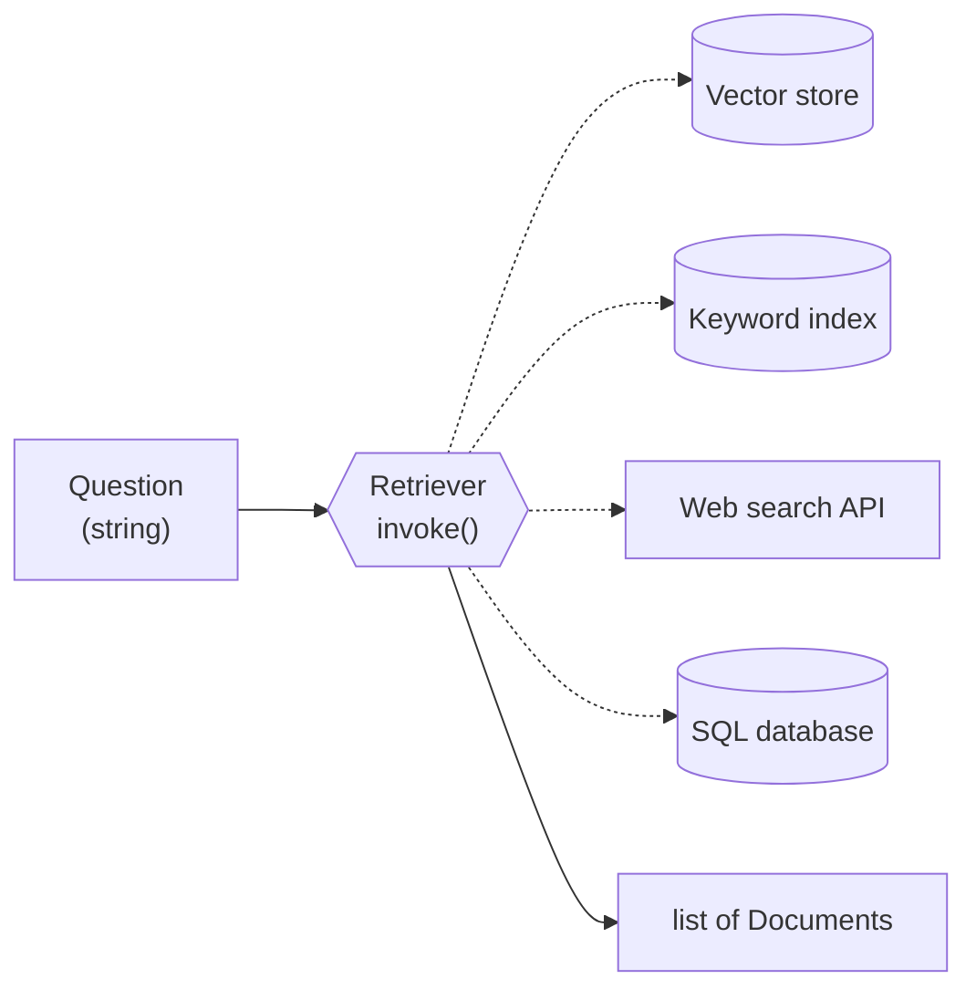

# Retrievers: The Complete Guide

> 📚 **Before you start**
>
> - [Vector Stores in LangChain](vector-stores-in-langchain.md), for `InMemoryVectorStore`, scores and metadata filters.
> - [Chains and Runnables](../../langchain-complete-guide/course.md#m6), for `invoke`, `batch` and the `|` pipe.

## Introduction

At a railway enquiry counter you don't care *how* the clerk finds your train. Maybe they search the computer, maybe they flip through the printed timetable, maybe they shout to a colleague who knows every train to Howrah by heart. You hand over a question, *"When does the next train to Howrah leave?"*, and you get back an answer slip. The counter is the interface; what happens behind it can change without you noticing.

A LangChain **retriever** is that counter for documents. It takes a **question string** and returns a **list of `Document`s**. Behind it there might be a vector store, a keyword index, a web search API, a SQL query, or a combination of all of them. The rest of your RAG chain only sees "string in, documents out", so you can swap and stack retrieval strategies freely. Every advanced technique in the rest of this course (MMR, multi-query, compression, hybrid search, reranking) arrives as a retriever.

By the end of this lesson you'll be able to turn any vector store into a retriever, configure how many results and which search type it uses, filter results per request, write your own retriever class from scratch, and plug a retriever into a chain that builds the context for an LLM.

> 💡 **Key Insight**
>
> A vector store is a **database**; a retriever is a **question-answering contract**: `invoke(question) -> list[Document]`. Because a retriever is a Runnable, it composes with prompts and models using `|`, runs in `batch` and `async`, and shows up in traces. Anything that honours the contract can be a retriever.

---

## Core Explanation

### 1. Vector store vs retriever

| | Vector store | Retriever |
|---|---|---|
| **What it is** | A database of embedded `Document`s | Anything that maps a query to `Document`s |
| **Main methods** | `add_documents`, `similarity_search`, `delete`, ... | `invoke`, `batch`, `ainvoke` (it's a Runnable) |
| **Can it write?** | Yes | No, read only |
| **Examples** | `InMemoryVectorStore`, `Chroma`, `FAISS` | `VectorStoreRetriever`, BM25 retriever, web search retriever, your own class |

Every vector store can produce a retriever with `.as_retriever()`. But not every retriever needs a vector store, as you'll see in section 5.



### 2. Setup

We use the toy embedding and the Tarang handbook from [Vector Stores in LangChain](vector-stores-in-langchain.md). Each chunk now carries its ID on the `Document` itself (`id="handbook-5.2"`), which the store picks up automatically.

```python
import re, zlib
import numpy as np
from langchain_core.documents import Document
from langchain_core.embeddings import Embeddings
from langchain_core.vectorstores import InMemoryVectorStore

STOP = {"a", "an", "the", "is", "are", "of", "to", "in", "on", "for", "and", "or", "i", "my", "can",
        "do", "how", "many", "much", "what", "be", "it", "by", "with", "per", "up", "get", "if"}
CONCEPTS = {"vacation": "leave", "pto": "leave", "food": "meal", "lunch": "meal", "dinner": "meal",
            "budget": "allowance", "trip": "travel", "visit": "travel", "customer": "travel", "client": "travel",
            "notebook": "laptop", "computer": "laptop", "stolen": "lost", "resign": "notice", "quit": "notice",
            "expense": "claim", "reimbursement": "claim", "refund": "claim", "bill": "claim", "hotel": "stay",
            "room": "stay", "lodging": "stay", "baby": "parental", "maternity": "parental",
            "paternity": "parental", "doctor": "medical", "insurance": "medical", "hospital": "medical"}

def normalise(w):
    if w.endswith("ied"):
        return w[:-3] + "y"
    if w.endswith("s") and not w.endswith("ss") and len(w) > 3:
        return w[:-1]
    return w

def words(text):
    return {normalise(w) for w in re.findall(r"[a-z0-9]+", text.lower())} - STOP

class ToyEmbeddings(Embeddings):
    def __init__(self, dim=256):
        self.dim = dim
    def _embed(self, text):
        vec = np.zeros(self.dim)
        for w in words(text):
            vec[zlib.crc32(CONCEPTS.get(w, w).encode()) % self.dim] += 1.0
        norm = np.linalg.norm(vec)
        return [round(float(x), 6) for x in (vec / norm if norm else vec)]
    def embed_documents(self, texts):
        return [self._embed(t) for t in texts]
    def embed_query(self, text):
        return self._embed(text)

SECTIONS = [
    ("2.1", "Annual leave", 3, "Every employee gets 24 days of paid leave per calendar year. Up to 8 unused days can be carried forward to the next year."),
    ("2.2", "Sick leave", 3, "Employees get 10 days of sick leave per year. A doctor's note is required for more than 2 sick days in a row."),
    ("2.3", "Parental leave", 4, "Mothers get 26 weeks of paid maternity leave. Fathers get 2 weeks of paid paternity leave within 6 months of the birth."),
    ("3.1", "Work from home", 5, "Employees may work from home up to 2 days a week with their manager's approval."),
    ("4.1", "Health insurance", 6, "Medical insurance covers the employee, spouse and two children up to Rs 5 lakh a year."),
    ("5.1", "Travel claims", 8, "Submit bills on the Kharcha portal within 30 days of the trip. Approved claims are reimbursed within 15 days."),
    ("5.2", "Meal allowance", 8, "On client travel the daily meal allowance is Rs 1,200 in metro cities and Rs 800 in other cities."),
    ("5.3", "Hotel stay", 9, "Hotel stays are covered up to Rs 6,000 a night in metro cities and Rs 3,500 a night elsewhere."),
    ("6.1", "Laptops", 11, "A lost or stolen laptop must be reported to IT within 24 hours. The employee pays 10% of the replacement cost."),
    ("7.1", "Public holidays", 12, "The office is closed on 10 public holidays, including Diwali, Holi and Independence Day."),
    ("8.1", "Notice period", 14, "The notice period is 60 days. It can be shortened by paying basic salary for the remaining days."),
]

def handbook_docs():
    return [Document(page_content=f"{sec} {title}: {body}", id=f"handbook-{sec}",
                     metadata={"source": "hr/handbook-2026.pdf", "page": page, "section": sec})
            for sec, title, page, body in SECTIONS]

emb = ToyEmbeddings()
store = InMemoryVectorStore.from_documents(handbook_docs(), embedding=emb)
print(len(handbook_docs()), "chunks indexed")
```

Output:

```
11 chunks indexed
```

### 3. `as_retriever()`: the everyday retriever

```python
retriever = store.as_retriever(search_kwargs={"k": 2})
print(type(retriever).__name__)

docs = retriever.invoke("What food budget do I get when I visit customers?")
for d in docs:
    print(d.metadata["section"], "|", d.page_content[:55])
```

Output:

```
VectorStoreRetriever
5.2 | 5.2 Meal allowance: On client travel the daily meal all
5.1 | 5.1 Travel claims: Submit bills on the Kharcha portal w
```

`as_retriever` returns a `VectorStoreRetriever` that holds two settings:

| Setting | Values | Meaning |
|---|---|---|
| `search_type` | `"similarity"` (default) | Plain top-k by similarity |
| | `"similarity_score_threshold"` | Top-k, but drop anything below `score_threshold` (uses the store's relevance scores) |
| | `"mmr"` | Maximal marginal relevance: relevant **and** diverse results ([next lesson](mmr-multi-query-and-contextual-compression-retrievers.md)) |
| `search_kwargs` | `k`, `filter`, `score_threshold`, `fetch_k`, `lambda_mult` | Passed through to the store's search method |

Because it's a Runnable, you get batching (and async, with `ainvoke` / `abatch`) for free:

```python
questions = ["How long is the notice period?", "Do I need a doctor's note?", "Hotel limit in Delhi?"]
for q, found in zip(questions, retriever.batch(questions)):
    print(f"{q:<32} -> {[d.metadata['section'] for d in found]}")
```

Output:

```
How long is the notice period?   -> ['8.1', '5.2']
Do I need a doctor's note?       -> ['2.2', '4.1']
Hotel limit in Delhi?            -> ['5.3', '7.1']
```

### 4. Per-request settings and filters

Search settings fixed at construction are fine for a demo, but real apps need per-request choices: this user can only see some documents, that screen only cares about travel. Keyword arguments passed to `invoke` are merged over the retriever's `search_kwargs`:

```python
q = "What is the limit in metro cities?"
print("default k=2:     ", [d.metadata["section"] for d in retriever.invoke(q)])
print("k=4 this time:   ", [d.metadata["section"] for d in retriever.invoke(q, k=4)])
hotel_page = lambda doc: doc.metadata["page"] == 9
print("only page 9:     ", [d.metadata["section"] for d in retriever.invoke(q, filter=hotel_page)])
```

Output:

```
default k=2:      ['5.3', '5.2']
k=4 this time:    ['5.3', '5.2', '7.1', '2.2']
only page 9:      ['5.3']
```

A clean pattern for access control is a small function that builds the filter from the **authenticated user**, never from anything the user typed:

```python
USER_GROUPS = {"asha": {"all-staff"}, "vikram": {"all-staff", "hr-team"}}
SECTION_GROUP = {"4.1": "hr-team"}          # pretend insurance details are HR-only

def retrieve_for(user, question, k=2):
    allowed = USER_GROUPS[user]
    can_see = lambda doc: SECTION_GROUP.get(doc.metadata["section"], "all-staff") in allowed
    return retriever.invoke(question, k=k, filter=can_see)

print("asha:  ", [d.metadata["section"] for d in retrieve_for("asha", "Who does medical insurance cover?")])
print("vikram:", [d.metadata["section"] for d in retrieve_for("vikram", "Who does medical insurance cover?")])
```

Output:

```
asha:   ['2.2', '3.1']
vikram: ['4.1', '2.2']
```

Asha never sees section 4.1, so the model can't leak it to her, however the question is phrased.

### 5. Writing your own retriever

To build a retriever, subclass `BaseRetriever` and implement one method, `_get_relevant_documents(query, *, run_manager)`. Fields are declared like Pydantic model fields. You get `invoke`, `batch`, async, callbacks and tracing for free.

#### Example 1: a score-threshold retriever

`as_retriever(search_type="similarity_score_threshold")` relies on the store's **relevance score** conversion. Chroma, FAISS and Qdrant implement it; `InMemoryVectorStore` in current `langchain-core` does not (calling it raises `NotImplementedError`). That's a perfect excuse to write our own, and to fix the "always returns k results" problem from the last lesson. It also records the score in each document's metadata, which helps debugging.

```python
from langchain_core.retrievers import BaseRetriever
from langchain_core.vectorstores import VectorStore

class ThresholdRetriever(BaseRetriever):
    """Top-k similarity search that drops results scoring below min_score."""
    vectorstore: VectorStore
    k: int = 4
    min_score: float = 0.25

    def _get_relevant_documents(self, query, *, run_manager):
        kept = []
        for doc, score in self.vectorstore.similarity_search_with_score(query, k=self.k):
            if score >= self.min_score:
                kept.append(doc.model_copy(update={"metadata": {**doc.metadata, "score": round(score, 2)}}))
        return kept

guarded = ThresholdRetriever(vectorstore=store, k=3)
for q in ["How much can I spend on a hotel?", "Is there a gym in the office?"]:
    print(q, "->", [(d.metadata["section"], d.metadata["score"]) for d in guarded.invoke(q)])
```

Output:

```
How much can I spend on a hotel? -> [('5.3', 0.37)]
Is there a gym in the office? -> []
```

The gym question now returns **nothing**, which your chain can turn into an honest "I couldn't find that in the handbook". (We copy each document with `model_copy` rather than editing its metadata in place, so the stored original stays clean.)

#### Example 2: a keyword retriever with no vectors at all

Embeddings are great at meaning and weak at exact tokens: policy codes, product SKUs, error numbers. A keyword retriever that scores documents by shared words is a few lines:

```python
class KeywordRetriever(BaseRetriever):
    """Ranks documents by how many query words they contain. No embeddings involved."""
    documents: list[Document]
    k: int = 2

    def _get_relevant_documents(self, query, *, run_manager):
        q = words(query)
        scored = [(len(q & words(d.page_content)), d) for d in self.documents]
        scored = [(s, d) for s, d in scored if s > 0]
        scored.sort(key=lambda pair: -pair[0])
        return [d for _, d in scored[: self.k]]

kw = KeywordRetriever(documents=handbook_docs())
print([d.metadata["section"] for d in kw.invoke("Kharcha portal deadline")])
print([d.metadata["section"] for d in store.as_retriever(search_kwargs={"k": 2}).invoke("Kharcha portal deadline")])
```

Output:

```
['5.1']
['5.1', '7.1']
```

Both find 5.1 here because "Kharcha" happens to be a word our toy embedding also hashes. With a real embedding model, rare words and codes often get lost; that is exactly why [Hybrid Search](../06-implementing-rag/hybrid-search.md) runs a proper keyword retriever (BM25) alongside the vector one. In LangChain, `BM25Retriever` lives in `langchain-community`:

```python
# not-run: needs langchain-community and rank-bm25
from langchain_community.retrievers import BM25Retriever

bm25 = BM25Retriever.from_documents(handbook_docs(), k=2)
bm25.invoke("Kharcha portal deadline")
```

#### Example 3: any function can be a retriever

You don't even need a class. Inside a chain, any function from string to `Document`s works, wrapped with `RunnableLambda`:

```python
from langchain_core.runnables import RunnableLambda

FAQ = {"wifi": Document(page_content="Office Wi-Fi password is on the notice board near reception.",
                        metadata={"source": "faq/it.md"})}

def faq_lookup(question):
    return [doc for key, doc in FAQ.items() if key in question.lower().replace("-", "")]

faq_retriever = RunnableLambda(faq_lookup)
print(faq_retriever.invoke("What is the Wi-Fi password?"))
```

Output:

```
[Document(metadata={'source': 'faq/it.md'}, page_content='Office Wi-Fi password is on the notice board near reception.')]
```

Use a `BaseRetriever` subclass when you want the retriever to be reusable and to appear as a "retriever" run in tracing tools such as LangSmith; use a function for quick glue.

### 6. The retriever family

LangChain's ecosystem has retrievers for far more than vector stores. A few you'll meet:

| Retriever | Package | What it searches |
|---|---|---|
| `VectorStoreRetriever` | `langchain-core` | Any vector store, via `as_retriever()` |
| `BM25Retriever` | `langchain-community` | In-memory keyword index |
| `WikipediaRetriever`, `ArxivRetriever` | `langchain-community` | Public knowledge sources |
| Web search retrievers and tools (Tavily, Exa, and others) | Their own integration packages | The live web |
| `MultiQueryRetriever`, `ContextualCompressionRetriever`, `EnsembleRetriever`, `ParentDocumentRetriever` | `langchain-classic` | Wrap other retrievers to improve them |

The last row is important: in LangChain 1.x the "smart" wrapper retrievers moved from `langchain` to the `langchain-classic` package. They still work, and you'll use (and rebuild) several of them in the next lesson and in [Implementing RAG](../course.md#m6).

### 7. Retrievers inside a chain

A retriever's output is a list of `Document`s, but a prompt needs **text**. The usual glue is a small formatting function that numbers each chunk and keeps its source so the model can cite it:

```python
from langchain_core.prompts import ChatPromptTemplate
from langchain_core.runnables import RunnablePassthrough

def format_docs(docs):
    if not docs:
        return "(no relevant handbook sections found)"
    return "\n".join(f"[{d.metadata['section']}, p.{d.metadata['page']}] {d.page_content}" for d in docs)

prompt = ChatPromptTemplate.from_messages([
    ("system", "Answer only from the context. Cite sections in brackets. If the context is empty, say you don't know."),
    ("human", "Context:\n{context}\n\nQuestion: {question}"),
])

build_prompt = {"context": guarded | format_docs, "question": RunnablePassthrough()} | prompt
messages = build_prompt.invoke("What food budget do I get when I visit customers?").to_messages()
print(messages[1].content)
```

Output:

```
Context:
[5.2, p.8] 5.2 Meal allowance: On client travel the daily meal allowance is Rs 1,200 in metro cities and Rs 800 in other cities.
[5.1, p.8] 5.1 Travel claims: Submit bills on the Kharcha portal within 30 days of the trip. Approved claims are reimbursed within 15 days.

Question: What food budget do I get when I visit customers?
```

Read the first line of the chain carefully, because you'll write it many times:

- `{"context": ..., "question": ...}` is a **parallel** step: both branches receive the same input string.
- `guarded | format_docs` retrieves and formats.
- `RunnablePassthrough()` passes the question through unchanged.
- The resulting dictionary fills the prompt template.

Add a chat model and an output parser at the end and you have a complete RAG chain. That's the first lesson of the next module, [RAG with LangChain and a Vector DB](../06-implementing-rag/rag-with-langchain-and-a-vector-db.md).

### 8. Choosing k

`k` is the most important retriever setting and the easiest to get wrong.

| k too small | k too large |
|---|---|
| The right chunk ranks 3rd but you only take 2: the answer is missed | Irrelevant chunks distract the model and cost tokens |
| Questions that need two sections (*"leave plus holidays"*) get half an answer | Latency and price rise with every chunk |

A practical approach: measure **recall@k** on a test set (as in the [from-scratch lab](../02-introduction-to-rag/lab-rag-from-scratch-no-framework.md)) for k = 1, 3, 5, 10, choose the smallest k where recall levels off, then consider retrieving more and **reranking** down to a few ([Reranking](../06-implementing-rag/reranking.md)).

```python
TESTS = [("How many vacation days carry over?", "2.1"), ("Doctor's note for sick days?", "2.2"),
         ("Leave for new fathers?", "2.3"), ("Hotel budget in Mumbai?", "5.3"),
         ("My computer was stolen", "6.1"), ("Is the office closed on Holi?", "7.1"),
         ("How do I get my trip expenses refunded?", "5.1"), ("If I quit, how long must I stay?", "8.1")]

for k in (1, 2, 3, 5):
    r = store.as_retriever(search_kwargs={"k": k})
    hits = sum(expected in [d.metadata["section"] for d in r.invoke(q)] for q, expected in TESTS)
    print(f"k={k}: recall@{k} = {hits}/{len(TESTS)}")
```

Output:

```
k=1: recall@1 = 7/8
k=2: recall@2 = 8/8
k=3: recall@3 = 8/8
k=5: recall@5 = 8/8
```

---

## Try It Yourself

1. **Per-request k.** Using `retriever` (k=2), get 5 results for *"travel"* without creating a new retriever.
2. **A section-prefix retriever.** Write a `ChapterRetriever(BaseRetriever)` that takes a `chapter` field (like `"5"`) and returns the top 3 similarity results from that chapter only.
3. **Empty context.** Run `build_prompt` with *"Is there a gym in the office?"*. What context does the prompt contain, and why is that better than passing three unrelated sections?

<details>
<summary>Show answers</summary>

**1.**

```python
print([d.metadata["section"] for d in retriever.invoke("travel", k=5)])
```

Output:

```
['5.2', '5.1', '8.1', '6.1', '7.1']
```

**2.**

```python
class ChapterRetriever(BaseRetriever):
    vectorstore: VectorStore
    chapter: str

    def _get_relevant_documents(self, query, *, run_manager):
        in_chapter = lambda doc: doc.metadata["section"].split(".")[0] == self.chapter
        return self.vectorstore.similarity_search(query, k=3, filter=in_chapter)

print([d.metadata["section"] for d in ChapterRetriever(vectorstore=store, chapter="5").invoke("limit in metro cities")])
```

Output:

```
['5.3', '5.2', '5.1']
```

**3.**

```python
print(build_prompt.invoke("Is there a gym in the office?").to_messages()[1].content)
```

Output:

```
Context:
(no relevant handbook sections found)

Question: Is there a gym in the office?
```

The context says plainly that nothing relevant was found, and the system prompt tells the model to say it doesn't know. Passing three unrelated sections instead invites the model to stretch them into an answer.

</details>

---

## Real-World Examples

- **Enterprise search assistants** build a retriever per request with the user's permission filter, so the same index safely serves the whole company.
- **Support bots** often chain a tiny FAQ retriever (exact matches for top questions) in front of a vector retriever, because the FAQ answer is curated and should win when it applies.
- **Coding assistants** combine a keyword retriever over symbol names with an embedding retriever over docstrings, since function names are exact tokens.
- **Research tools** expose web search as a retriever, so the same chain can answer from internal documents or the internet.

---

## Common Misconceptions

### "A retriever is just another name for a vector store"

A vector store is one possible back end. A retriever is the read-only, query-to-documents interface, and many retrievers use no vectors at all.

### "The similarity_score_threshold search type works with every store"

It depends on the store implementing relevance scores. Test it with your store, or write a small threshold retriever like the one above.

### "More retrieved chunks always help the model"

Beyond the point where recall levels off, extra chunks add noise, cost and latency. Measure recall@k and stop there, or rerank.

### "Access control can be done in the prompt"

Anything that reaches the prompt can leak. Filter in the retriever, using the authenticated user's identity.

---

## Interview Relevance

*"What is a retriever in LangChain and how is it different from a vector store?"* Retriever = Runnable with `invoke(str) -> list[Document]`, read-only, back-end agnostic; vector store = database with add/search/delete; `as_retriever()` bridges them with `search_type` and `search_kwargs`.

*"How would you implement a custom retriever?"* Subclass `BaseRetriever`, declare fields, implement `_get_relevant_documents` (and optionally the async version). Mention thresholds, per-user filters, and that wrapper retrievers (multi-query, compression, ensemble) are built the same way.

*"How do you pick k?"* Measure recall@k on a labelled set, pick where it plateaus, retrieve wider and rerank if precision matters.

---

## Key Takeaways

- **A retriever is a Runnable contract**: question string in, `list[Document]` out, with batch, async and tracing for free.
- **`as_retriever()`** configures `search_type` (similarity, score threshold, MMR) and `search_kwargs` (k, filter, ...); per-request kwargs override them.
- **Custom retrievers** are a subclass of `BaseRetriever` with one method; use them for thresholds, keyword search, routing or anything else.
- **Filters from the authenticated user** are how you do access control in RAG.
- **Choose k by measuring recall@k**, not by habit.

---

**Up next:** [MMR, Multi-Query and Contextual Compression Retrievers](mmr-multi-query-and-contextual-compression-retrievers.md)
