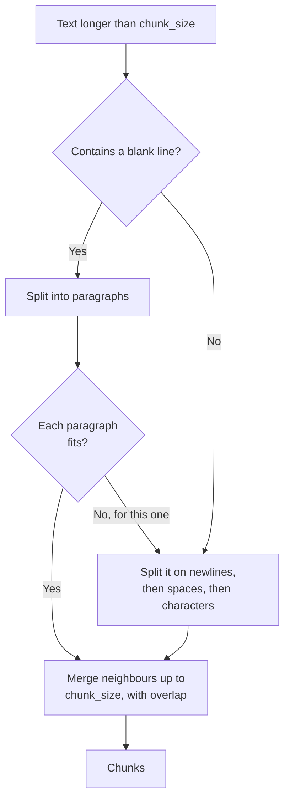

# Text Splitters: The Complete Guide

> 📚 **Before you start**
>
> - [Document Loaders](document-loaders.md), for `Document` objects and metadata.
> - [Lab: RAG from scratch, no framework](../02-introduction-to-rag/lab-rag-from-scratch-no-framework.md), where you wrote a sentence-based chunker with overlap.
> - [How LLMs Work](../../generative-ai-and-llm-foundations/course.md#m3), for what a token is.

## Introduction

When your mother packs a tiffin for a long train journey, she doesn't put the whole meal in one huge box, and she doesn't put each grain of rice in its own container either. She packs **sensible portions**: rotis together, sabzi in one compartment, dal in a sealed dabba, so you can open exactly what you want without spilling everything else.

A **text splitter** packs documents into portions for retrieval. Loaders give you whole pages or whole files; a 40-page policy PDF might be 20,000 tokens. You can't embed that as one vector (the meaning gets averaged into mush), you can't fit many of them in a prompt, and when someone asks about the meal allowance you want to retrieve the meal allowance paragraph, not the whole document. Split too coarsely and retrieval is imprecise; split too finely and each piece loses its context. Splitting well is one of the cheapest, highest-impact improvements in any RAG system.

By the end of this lesson you'll understand exactly how LangChain's splitters work (including the recursive algorithm, which you'll implement yourself), choose chunk size and overlap sensibly, measure length in tokens, split Markdown, HTML and code along their structure, and keep metadata intact through splitting.

> 💡 **Key Insight**
>
> A good chunk is **small enough to be about one thing** and **big enough to make sense on its own**. Recursive splitting gets there by trying the most natural boundaries first (paragraphs, then lines, then words) and only cutting finer when a piece is still too big.

---

## Core Explanation

### 1. The three knobs every splitter has

All LangChain splitters inherit from `TextSplitter` (in the `langchain-text-splitters` package) and share these settings:

| Setting | Default | Meaning |
|---|---|---|
| `chunk_size` | 4000 | Maximum length of a chunk, measured by `length_function` |
| `chunk_overlap` | 200 | How much of the end of one chunk is repeated at the start of the next |
| `length_function` | `len` (characters) | How length is measured; swap in a token counter to measure tokens |
| `add_start_index` | `False` | If `True`, each chunk's metadata gets `start_index`, its character offset in the original document |
| `strip_whitespace` | `True` | Trim whitespace from the start and end of each chunk |

And three ways to call them:

| Method | Input | Output |
|---|---|---|
| `split_text(text)` | A string | A list of strings |
| `create_documents(texts, metadatas=None)` | Strings and optional metadata dicts | A list of `Document`s |
| `split_documents(documents)` | `Document`s | A list of smaller `Document`s, **each keeping its parent's metadata** |

`split_documents` is what you'll use most, because it carries `source`, `page` and every other metadata field into each chunk, so citations still work after splitting.

### 2. Why overlap exists

Suppose a chunk boundary lands like this:

```text
...chunk 7 ends:   "...The notice period is 60 days."
   chunk 8 starts: "It can be shortened by paying basic salary for the remaining days..."
```

Chunk 8 says "It can be shortened" but never says *what* can be shortened. A question like *"Can I shorten my notice period?"* may not match it. With overlap, chunk 8 starts with the tail of chunk 7, so the sentence about the notice period is repeated and chunk 8 is self-explanatory.

Overlap costs storage and can produce near-duplicate retrieval results, so keep it modest: **10 to 20% of the chunk size** is the usual starting point.

### 3. The simplest splitter: `CharacterTextSplitter`

`CharacterTextSplitter` splits on **one** separator (default `"\n\n"`, a blank line) and then merges pieces back together up to `chunk_size`. It's predictable, but if a single paragraph is longer than `chunk_size` it can't break it further, and you get an oversized chunk (LangChain logs a warning).

```python
# not-run: needs the langchain-text-splitters package
from langchain_text_splitters import CharacterTextSplitter

splitter = CharacterTextSplitter(separator="\n\n", chunk_size=300, chunk_overlap=0)
chunks = splitter.split_text(handbook_text)
```

### 4. The workhorse: `RecursiveCharacterTextSplitter`

This is the splitter most RAG tutorials (and most production systems) start with. It holds a **list** of separators, by default:

```python
DEFAULT_SEPARATORS = ["\n\n", "\n", " ", ""]   # paragraphs, lines, words, characters
```

The algorithm:

1. Find the **first** separator in the list that occurs in the text, and split on it.
2. Any piece that fits within `chunk_size` is kept; neighbouring small pieces are **merged** back together (with overlap) until the next one would overflow.
3. Any piece still **too big** is split again, **recursively**, with the remaining (finer) separators.

So it splits on paragraphs when it can, on lines when a paragraph is too long, on spaces when a line is too long, and on individual characters only as a last resort. Natural boundaries are preserved as much as possible.



Here's the real one (not run, since this course runs offline without the splitters package):

```python
# not-run: needs the langchain-text-splitters package
from langchain_text_splitters import RecursiveCharacterTextSplitter

splitter = RecursiveCharacterTextSplitter(chunk_size=200, chunk_overlap=40, add_start_index=True)
chunks = splitter.split_documents(docs)          # docs from any loader
print(len(chunks), chunks[0].metadata)
```

Example output:

```
14 {'source': 'hr/handbook-2026.pdf', 'page': 0, 'start_index': 0}
```

### 5. Build it yourself

To really understand recursive splitting, let's implement a compact version with the same separators, merging and overlap behaviour. (LangChain's has more options, such as regex separators and where to keep the separator, but the core is this.)

```python
def merge_pieces(pieces, sep, chunk_size, overlap, length=len):
    """Greedily join pieces with `sep` up to chunk_size, carrying `overlap` worth of tail forward."""
    chunks, current, total = [], [], 0
    for piece in pieces:
        extra = length(piece) + (length(sep) if current else 0)
        if current and total + extra > chunk_size:
            chunks.append(sep.join(current).strip())
            while current and (total > overlap or total + extra > chunk_size):   # drop from the front
                total -= length(current[0]) + (length(sep) if len(current) > 1 else 0)
                current.pop(0)
            extra = length(piece) + (length(sep) if current else 0)
        current.append(piece)
        total += extra
    if current:
        chunks.append(sep.join(current).strip())
    return [c for c in chunks if c]

def recursive_split(text, chunk_size, overlap=0, separators=("\n\n", "\n", " ", ""), length=len):
    sep = next((s for s in separators if s == "" or s in text), "")
    finer = separators[separators.index(sep) + 1:]
    pieces = list(text) if sep == "" else text.split(sep)
    good, out = [], []
    for piece in pieces:
        if length(piece) <= chunk_size:
            good.append(piece)
        else:
            if good:
                out.extend(merge_pieces(good, sep, chunk_size, overlap, length))
                good = []
            out.extend(recursive_split(piece, chunk_size, overlap, finer, length) if finer else [piece])
    if good:
        out.extend(merge_pieces(good, sep, chunk_size, overlap, length))
    return out
```

Now a realistic piece of the handbook: three short paragraphs and one long one.

```python
HANDBOOK = """2.1 Annual leave
Every employee gets 24 days of paid leave per calendar year. Up to 8 unused days can be carried forward.

2.2 Sick leave
Employees get 10 days of sick leave per year. A doctor's note is required for more than 2 sick days in a row.

5.1 Travel claims
Submit bills on the Kharcha portal within 30 days of the trip. Claims are reimbursed within 15 days. Bills must show the GST number of the vendor. Claims without original bills are rejected. For trips abroad, convert amounts to rupees at the exchange rate on the date of travel.

8.1 Notice period
The notice period is 60 days. It can be shortened by paying basic salary for the remaining days."""

for i, chunk in enumerate(recursive_split(HANDBOOK, chunk_size=160, overlap=0)):
    print(f"--- chunk {i} ({len(chunk)} chars)\n{chunk}")
```

Output:

```
--- chunk 0 (121 chars)
2.1 Annual leave
Every employee gets 24 days of paid leave per calendar year. Up to 8 unused days can be carried forward.
--- chunk 1 (124 chars)
2.2 Sick leave
Employees get 10 days of sick leave per year. A doctor's note is required for more than 2 sick days in a row.
--- chunk 2 (17 chars)
5.1 Travel claims
--- chunk 3 (153 chars)
Submit bills on the Kharcha portal within 30 days of the trip. Claims are reimbursed within 15 days. Bills must show the GST number of the vendor. Claims
--- chunk 4 (124 chars)
without original bills are rejected. For trips abroad, convert amounts to rupees at the exchange rate on the date of travel.
--- chunk 5 (114 chars)
8.1 Notice period
The notice period is 60 days. It can be shortened by paying basic salary for the remaining days.
```

Look at what happened:

- Sections 2.1 and 2.2 each fit in 160 characters, so each paragraph became one chunk. They weren't merged together because the two would exceed 160.
- Section 5.1 is about 300 characters, too big. The splitter went one level finer (newlines). That separated the heading line from the body line. The body line was still too big, so it went finer again (spaces) and packed words into chunks of up to 160 characters.
- Notice chunk 2: the heading `5.1 Travel claims` ended up **alone**, a 17-character chunk that says nothing useful, while chunks 3 and 4 lost their heading. That is the classic weakness of size-based splitting, and you'll fix it later in this lesson by putting headings back into chunks.
- Section 8.1 fits, so it's one chunk.

Now with overlap. Watch the start of the second travel-claims chunk:

```python
for i, chunk in enumerate(recursive_split(HANDBOOK, chunk_size=160, overlap=40)):
    if "Kharcha" in chunk or "GST" in chunk or "abroad" in chunk:
        print(f"--- chunk {i}\n{chunk}")
```

Output:

```
--- chunk 3
Submit bills on the Kharcha portal within 30 days of the trip. Claims are reimbursed within 15 days. Bills must show the GST number of the vendor. Claims
--- chunk 4
the GST number of the vendor. Claims without original bills are rejected. For trips abroad, convert amounts to rupees at the exchange rate on the date of
```

Each continuation chunk now begins with the last few words of the previous one, so a sentence cut at a boundary appears whole in at least one chunk (or nearly so). Notice, though, that the *later* travel chunks still don't say "Travel claims" anywhere. That's the limit of plain splitting, and it's why [Chunking Strategies](../06-implementing-rag/chunking-strategies.md) adds headings and context to chunks.

### 6. Seeing chunk boundaries

When tuning a splitter, it helps to see where boundaries fall in the original text. With `add_start_index=True`, each chunk records its offset; here's the same idea with our splitter:

```python
def show_boundaries(text, chunks):
    marks, pos = [], 0
    for chunk in chunks:
        start = text.find(chunk[:20], pos)
        marks.append(start)
        pos = start + 1
    return marks

chunks = recursive_split(HANDBOOK, chunk_size=160, overlap=0)
print("chunk start offsets:", show_boundaries(HANDBOOK, chunks))
print("sizes:", [len(c) for c in chunks])
```

Output:

```
chunk start offsets: [0, 123, 249, 267, 421, 547]
sizes: [121, 124, 17, 153, 124, 114]
```

### 7. Measuring length in tokens

Models and embedding APIs have limits in **tokens**, not characters. A token is roughly 4 characters of English on average, but Hindi, Tamil and other scripts often use more tokens per character, and numbers and code tokenize differently too. If you set `chunk_size=1000` characters you don't know how many tokens that is.

The fix is to pass a token-counting `length_function`. In LangChain:

```python
# not-run: needs langchain-text-splitters and tiktoken
from langchain_text_splitters import RecursiveCharacterTextSplitter

splitter = RecursiveCharacterTextSplitter.from_tiktoken_encoder(
    encoding_name="cl100k_base", chunk_size=400, chunk_overlap=50,
)
```

`from_tiktoken_encoder` uses OpenAI's open-source `tiktoken` tokenizer to count; `from_huggingface_tokenizer` uses any Hugging Face tokenizer, which is the better choice when it matches your embedding model's own tokenizer. Exact counts differ between models' tokenizers, but any reasonable tokenizer is far closer than characters.

Our splitter takes a `length` argument too. Here's a crude word-based "token" counter to show the effect:

```python
def approx_tokens(text):
    return max(1, round(len(text.split()) * 1.3))

token_chunks = recursive_split(HANDBOOK, chunk_size=40, overlap=0, length=approx_tokens)
print([approx_tokens(c) for c in token_chunks])
```

Output:

```
[30, 34, 4, 26, 26, 12, 27]
```

Every chunk now respects a budget of 40 (approximate) tokens.

### 8. Structure-aware splitters

Plain text has paragraphs. Many documents have **richer structure**, and splitting along it gives better chunks plus useful metadata.

#### Markdown: split on headings

`MarkdownHeaderTextSplitter` splits a Markdown document at the headings you name and records the heading path in each chunk's metadata:

```python
# not-run: needs the langchain-text-splitters package
from langchain_text_splitters import MarkdownHeaderTextSplitter

splitter = MarkdownHeaderTextSplitter(headers_to_split_on=[("#", "chapter"), ("##", "section")])
chunks = splitter.split_text(markdown_handbook)
print(chunks[1])
```

Example output:

```
page_content='Employees get 10 days of sick leave per year. A doctor's note is required for more than 2 sick days in a row.' metadata={'chapter': 'Leave', 'section': '2.2 Sick leave'}
```

By default the headings are removed from the text (`strip_headers=True`) and kept in metadata. That's tidy, but remember embeddings only see `page_content`; set `strip_headers=False` or prepend the headings yourself if you want them to influence retrieval. A common pipeline is: Markdown header splitter first (for structure), then a recursive splitter on any section that's still too long.

The same idea, offline:

```python
import re
from langchain_core.documents import Document

MARKDOWN = """# Leave
## 2.1 Annual leave
Every employee gets 24 days of paid leave per calendar year.
## 2.2 Sick leave
Employees get 10 days of sick leave per year.
# Travel
## 5.2 Meal allowance
On client travel the daily meal allowance is Rs 1,200 in metro cities and Rs 800 elsewhere."""

def split_markdown_headers(md):
    chunks, path, body = [], {}, []
    def flush():
        if body:
            chunks.append(Document(page_content="\n".join(body).strip(), metadata=dict(path)))
            body.clear()
    for line in md.splitlines():
        m = re.match(r"(#{1,2}) (.+)", line)
        if m:
            flush()
            level = "chapter" if m.group(1) == "#" else "section"
            path[level] = m.group(2)
            if level == "chapter":
                path.pop("section", None)
        else:
            body.append(line)
    flush()
    return chunks

for d in split_markdown_headers(MARKDOWN):
    print(d.metadata, "|", d.page_content[:45])
```

Output:

```
{'chapter': 'Leave', 'section': '2.1 Annual leave'} | Every employee gets 24 days of paid leave per
{'chapter': 'Leave', 'section': '2.2 Sick leave'} | Employees get 10 days of sick leave per year.
{'chapter': 'Travel', 'section': '5.2 Meal allowance'} | On client travel the daily meal allowance is
```

#### Code: split on functions and classes

`RecursiveCharacterTextSplitter.from_language(Language.PYTHON, chunk_size=..., chunk_overlap=...)` uses separators such as `"\nclass "` and `"\ndef "` before blank lines, so functions and classes stay together. Language presets exist for many languages (Python, JavaScript, TypeScript, Java, Go, Markdown, HTML, LaTeX and more).

#### HTML, JSON and others

| Splitter | Splits along |
|---|---|
| `HTMLHeaderTextSplitter` | `<h1>`, `<h2>`, ... headings, recording them as metadata |
| `RecursiveJsonSplitter` | Nested JSON objects, keeping each chunk valid JSON |
| `TokenTextSplitter` | Raw token counts, ignoring structure |
| `SemanticChunker` (in `langchain-experimental`) | Places where the meaning shifts, using embeddings of consecutive sentences |

Semantic and other advanced strategies are compared with measurements in [Chunking Strategies](../06-implementing-rag/chunking-strategies.md).

### 9. Splitting documents and keeping metadata

`split_documents` copies each parent's metadata into every child chunk. Here's the behaviour with our splitter, including `start_index`:

```python
def split_documents(docs, chunk_size, overlap=0, add_start_index=True):
    out = []
    for doc in docs:
        cursor = 0
        for chunk in recursive_split(doc.page_content, chunk_size, overlap):
            meta = dict(doc.metadata)
            if add_start_index:
                cursor = doc.page_content.find(chunk, max(0, cursor - overlap - 1))
                meta["start_index"] = cursor
            out.append(Document(page_content=chunk, metadata=meta))
    return out

page = Document(page_content=HANDBOOK, metadata={"source": "hr/handbook-2026.pdf", "page_label": "3"})
for c in split_documents([page], chunk_size=160)[:3]:
    print(c.metadata, "|", c.page_content[:40].replace("\n", " / "))
```

Output:

```
{'source': 'hr/handbook-2026.pdf', 'page_label': '3', 'start_index': 0} | 2.1 Annual leave / Every employee gets 24 
{'source': 'hr/handbook-2026.pdf', 'page_label': '3', 'start_index': 123} | 2.2 Sick leave / Employees get 10 days of 
{'source': 'hr/handbook-2026.pdf', 'page_label': '3', 'start_index': 249} | 5.1 Travel claims
```

Every chunk still knows its source and page, and `start_index` lets a UI highlight the exact passage in the original document.

### 10. Choosing chunk size and overlap

There's no universal best size; it depends on your documents, questions and embedding model. Reasonable starting points:

| Content | Starting chunk size | Overlap | Why |
|---|---|---|---|
| FAQs, short policies | One entry or section (often 100 to 300 tokens) | 0 | Natural units already exist |
| Manuals, reports, articles | 300 to 800 tokens | 10 to 15% | Paragraph-level ideas |
| Legal contracts | Clause by clause, 200 to 600 tokens | Small | People cite clauses |
| Transcripts, chat logs | 1 to 3 minutes of speech, or 300 to 500 tokens | 10 to 20% | Topics drift continuously |
| Code | Function or class | 0 | Logical units |

Then **measure**: build a small test set and compare recall at a few sizes, exactly as you did in the from-scratch lab. Keep in mind:

- **Embedding model limits.** Each model has a maximum input length; text beyond it is truncated (silently, in some APIs). Keep chunks well under it.
- **Small chunks** retrieve precisely but lose context; **large chunks** carry context but dilute the embedding and cost more prompt space. The "small-to-big" pattern (search small chunks, return their bigger parent) gets both; see [Chunking Strategies](../06-implementing-rag/chunking-strategies.md).

---

## Try It Yourself

1. **No overlap vs overlap.** Split `HANDBOOK` with `chunk_size=100` and `overlap=0`, then `overlap=30`. How many chunks do you get each time, and why does overlap increase the count?
2. **The last resort.** What does `recursive_split("ABCDEFGHIJ", chunk_size=4)` return, and which separator did it end up using?
3. **Headings into the text.** Change `split_markdown_headers` so each chunk's `page_content` starts with `"<chapter> > <section>: "`. Why is this useful for retrieval?

<details>
<summary>Show answers</summary>

**1.**

```python
print(len(recursive_split(HANDBOOK, 100, 0)), len(recursive_split(HANDBOOK, 100, 30)))
```

Output:

```
12 13
```

Overlap repeats text, so the same total content needs more chunks to carry it.

**2.**

```python
print(recursive_split("ABCDEFGHIJ", chunk_size=4))
```

Output:

```
['ABCD', 'EFGH', 'IJ']
```

There are no blank lines, newlines or spaces, so it fell all the way through to the empty-string separator, which splits into single characters and merges them back up to 4.

**3.**

```python
def split_markdown_with_context(md):
    docs = split_markdown_headers(md)
    for d in docs:
        prefix = " > ".join(d.metadata[k] for k in ("chapter", "section") if k in d.metadata)
        d.page_content = f"{prefix}: {d.page_content}"
    return docs

print(split_markdown_with_context(MARKDOWN)[2].page_content)
```

Output:

```
Travel > 5.2 Meal allowance: On client travel the daily meal allowance is Rs 1,200 in metro cities and Rs 800 elsewhere.
```

Embeddings only see `page_content`. With the heading path in the text, a question like *"travel meal limit"* has more to match, and the chunk is self-explanatory when shown to the model.

</details>

---

## Real-World Examples

- **Documentation assistants** split Markdown docs on headings first, then recursively split long sections, and show the heading path in citations ("Install > Linux > Troubleshooting").
- **Code assistants** split source files by function and class, so a retrieved chunk is a complete, compilable unit.
- **Contract review tools** split by clause numbers rather than by size, because users ask about "clause 14.2".
- **Meeting and video assistants** split transcripts into time windows (for example 2 minutes) with overlap and keep the timestamps in metadata so answers can link to the exact moment.

---

## Common Misconceptions

### "Bigger chunks give the model more context, so they're better"

Bigger chunks make the embedding an average of several topics, so the right chunk ranks lower. Context is better added deliberately (headings, parent sections, neighbouring chunks) than by making every chunk huge.

### "chunk_size is in tokens"

By default it's in **characters** (`length_function=len`). Use `from_tiktoken_encoder`, `from_huggingface_tokenizer` or your own `length_function` for tokens.

### "Overlap fixes all boundary problems"

Overlap helps sentences that straddle a boundary. It doesn't tell a chunk which section it belongs to; adding headings or context does.

### "Splitting loses the metadata"

`split_documents` copies the parent's metadata to every chunk, and `add_start_index=True` adds the position.

---

## Interview Relevance

*"How do you chunk documents for RAG?"* A strong answer explains the size trade-off (precision vs context), recursive splitting on natural boundaries (paragraphs, lines, words), overlap of about 10 to 20%, measuring in tokens against the embedding model's limit, structure-aware splitting (Markdown headings, HTML, code by function), keeping metadata and start offsets, and **evaluating** sizes on a test set rather than picking a number from a blog. Bonus: mention small-to-big retrieval and contextual chunk headers.

*"How does RecursiveCharacterTextSplitter work?"* Separators `["\n\n", "\n", " ", ""]` in order; split on the first one present; merge small pieces up to `chunk_size` with overlap; recursively split oversized pieces with finer separators.

---

## Key Takeaways

- **Splitters turn documents into retrievable chunks**; `split_documents` keeps metadata, and `add_start_index` records positions.
- **`RecursiveCharacterTextSplitter`** tries paragraphs, then lines, then words, then characters, merging pieces up to `chunk_size` with `chunk_overlap`.
- **Measure length in tokens** for real systems with `from_tiktoken_encoder` or a model tokenizer.
- **Use structure** when it exists: Markdown and HTML headings, code functions, clauses, time windows.
- **Start with 300 to 800 tokens and 10 to 20% overlap, then measure** on your own test questions.

---

**Up next:** [Vector Stores in LangChain](vector-stores-in-langchain.md)
