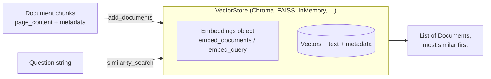

# Vector Stores in LangChain: The Complete Guide

> 📚 **Before you start**
>
> - [Text Splitters](text-splitters.md), which produced the chunks we're about to store.
> - [Embeddings and Similarity Search](../course.md#m3), for what a vector is and why cosine similarity finds related text.
> - [Vector Database Tools](../course.md#m4), where you used Chroma, FAISS, Qdrant and Pinecone directly. This lesson puts one common interface over all of them.

## Introduction

Think of the dabbawalas of Mumbai. Thousands of tiffins move across the city every day, through many hands, trains and handcarts, and yet each one reaches the right desk. The trick is a **shared code** painted on every lid: whoever is carrying the box, they all read the same marks the same way. A new dabbawala can join any route on day one because the system, not the person, defines how boxes are handled.

LangChain's **vector store** interface is that shared code for your chunks. Chroma, FAISS, Qdrant, Pinecone, pgvector, MongoDB Atlas, Elasticsearch and dozens more each have their own client library and their own quirks. LangChain wraps every one of them in the same small set of methods: `add_documents`, `similarity_search`, `delete`, `as_retriever`. Your RAG code talks to that interface, so you can start with an in-memory store on your laptop and switch to a managed database in production by changing two lines.

By the end of this lesson you'll know the two interfaces that make this work (**`Embeddings`** and **`VectorStore`**), be able to wrap any embedding function as a LangChain embedding model, store and search the Tarang handbook with scores and metadata filters, update and delete chunks by ID, save an index to disk, and swap in Chroma, FAISS or Qdrant when you're ready.

> 💡 **Key Insight**
>
> A LangChain vector store is **a database of `Document`s that searches by meaning**. You give it an `Embeddings` object once; from then on you add `Document`s and search with plain strings, and the store embeds both sides for you with the same model. Everything else (which database, which index) is a detail behind the interface.

---

## Core Explanation

### 1. Two interfaces, one job

A vector store needs two things: something that turns text into vectors, and somewhere to keep the vectors and search them. LangChain splits those into two interfaces from `langchain_core`.



| Interface | Methods you'll use | Implemented by |
|---|---|---|
| **`Embeddings`** | `embed_documents(list_of_texts)` returns a list of vectors; `embed_query(text)` returns one vector | `VoyageAIEmbeddings`, `OpenAIEmbeddings`, `HuggingFaceEmbeddings`, `CohereEmbeddings`, ... |
| **`VectorStore`** | `add_documents`, `similarity_search`, `similarity_search_with_score`, `max_marginal_relevance_search`, `delete`, `get_by_ids`, `as_retriever`, plus the class method `from_documents` | `InMemoryVectorStore`, `Chroma`, `FAISS`, `QdrantVectorStore`, `PineconeVectorStore`, `PGVector`, ... |

Why two methods for embedding? Some models embed a **question** differently from a **passage** (Voyage's `input_type="query"` vs `"document"`, for example). Splitting the methods lets each integration do the right thing; for models that don't care, both do the same.

### 2. Wrapping your own embedding model

Any function that maps text to a list of floats can become a LangChain embedding model: subclass `Embeddings` and implement the two methods. Here's the concept-aware toy embedding from [What is RAG?](../02-introduction-to-rag/what-is-rag.md), now behind the real interface so every LangChain component can use it. We'll use it throughout Modules 5 to 7, because it runs offline and, unlike a random test embedding, it actually understands that "food" and "meal" are related.

```python
import re, zlib
import numpy as np
from langchain_core.documents import Document
from langchain_core.embeddings import Embeddings

STOP = {"a", "an", "the", "is", "are", "of", "to", "in", "on", "for", "and", "or", "i", "my", "can",
        "do", "how", "many", "much", "what", "be", "it", "by", "with", "per", "up", "get", "if"}
CONCEPTS = {"vacation": "leave", "pto": "leave", "food": "meal", "lunch": "meal", "dinner": "meal",
            "budget": "allowance", "trip": "travel", "visit": "travel", "customer": "travel", "client": "travel",
            "notebook": "laptop", "computer": "laptop", "stolen": "lost", "resign": "notice", "quit": "notice",
            "expense": "claim", "reimbursement": "claim", "refund": "claim", "bill": "claim", "hotel": "stay",
            "room": "stay", "lodging": "stay", "baby": "parental", "maternity": "parental",
            "paternity": "parental", "doctor": "medical", "insurance": "medical", "hospital": "medical"}

def normalise(w):
    if w.endswith("ied"):
        return w[:-3] + "y"
    if w.endswith("s") and not w.endswith("ss") and len(w) > 3:
        return w[:-1]
    return w

def words(text):
    return {normalise(w) for w in re.findall(r"[a-z0-9]+", text.lower())} - STOP

class ToyEmbeddings(Embeddings):
    """Module 2's concept-hashing embedding behind LangChain's Embeddings interface."""
    def __init__(self, dim=256):
        self.dim = dim

    def _embed(self, text):
        vec = np.zeros(self.dim)
        for w in words(text):
            vec[zlib.crc32(CONCEPTS.get(w, w).encode()) % self.dim] += 1.0
        norm = np.linalg.norm(vec)
        return [round(float(x), 6) for x in (vec / norm if norm else vec)]

    def embed_documents(self, texts):
        return [self._embed(t) for t in texts]

    def embed_query(self, text):
        return self._embed(text)

emb = ToyEmbeddings()
v = emb.embed_query("What food budget do I get?")
print(len(v), "numbers;", sum(x != 0 for x in v), "non-zero")
```

Output:

```
256 numbers; 2 non-zero
```

Only two content words survive the stop list, "food" and "budget", and they are mapped to the concepts "meal" and "allowance", so each lights up one slot. That's the whole trick of this toy: related words land in the same slot. A real model learns millions of such relationships instead of our thirty.

Now the handbook. Each section becomes one `Document` with the metadata a loader would have produced:

```python
SECTIONS = [
    ("2.1", "Annual leave", 3, "Every employee gets 24 days of paid leave per calendar year. Up to 8 unused days can be carried forward to the next year."),
    ("2.2", "Sick leave", 3, "Employees get 10 days of sick leave per year. A doctor's note is required for more than 2 sick days in a row."),
    ("2.3", "Parental leave", 4, "Mothers get 26 weeks of paid maternity leave. Fathers get 2 weeks of paid paternity leave within 6 months of the birth."),
    ("3.1", "Work from home", 5, "Employees may work from home up to 2 days a week with their manager's approval."),
    ("4.1", "Health insurance", 6, "Medical insurance covers the employee, spouse and two children up to Rs 5 lakh a year."),
    ("5.1", "Travel claims", 8, "Submit bills on the Kharcha portal within 30 days of the trip. Approved claims are reimbursed within 15 days."),
    ("5.2", "Meal allowance", 8, "On client travel the daily meal allowance is Rs 1,200 in metro cities and Rs 800 in other cities."),
    ("5.3", "Hotel stay", 9, "Hotel stays are covered up to Rs 6,000 a night in metro cities and Rs 3,500 a night elsewhere."),
    ("6.1", "Laptops", 11, "A lost or stolen laptop must be reported to IT within 24 hours. The employee pays 10% of the replacement cost."),
    ("7.1", "Public holidays", 12, "The office is closed on 10 public holidays, including Diwali, Holi and Independence Day."),
    ("8.1", "Notice period", 14, "The notice period is 60 days. It can be shortened by paying basic salary for the remaining days."),
]

def handbook_docs():
    return [Document(page_content=f"{sec} {title}: {body}",
                     metadata={"source": "hr/handbook-2026.pdf", "page": page, "section": sec})
            for sec, title, page, body in SECTIONS]

docs = handbook_docs()
print(len(docs), "documents;", docs[6])
```

Output:

```
11 documents; page_content='5.2 Meal allowance: On client travel the daily meal allowance is Rs 1,200 in metro cities and Rs 800 in other cities.' metadata={'source': 'hr/handbook-2026.pdf', 'page': 8, 'section': '5.2'}
```

### 3. Your first vector store: `InMemoryVectorStore`

`langchain_core` ships `InMemoryVectorStore`: it keeps everything in a Python dictionary and compares the query with every vector (exact search with cosine similarity). It has no dependencies, which makes it perfect for learning, tests and small prototypes.

```python
from langchain_core.vectorstores import InMemoryVectorStore

store = InMemoryVectorStore(embedding=emb)
ids = store.add_documents(docs, ids=[f"handbook-{d.metadata['section']}" for d in docs])
print(ids[:3])

for doc in store.similarity_search("What food budget do I get when I visit customers?", k=2):
    print(doc.metadata["section"], "|", doc.page_content[:60])
```

Output:

```
['handbook-2.1', 'handbook-2.2', 'handbook-2.3']
5.2 | 5.2 Meal allowance: On client travel the daily meal allowanc
5.1 | 5.1 Travel claims: Submit bills on the Kharcha portal within
```

What just happened, step by step:

1. `add_documents` called `emb.embed_documents([...11 texts...])` once, then stored each vector next to its text, metadata and **ID**.
2. `similarity_search` called `emb.embed_query(question)`, scored every stored vector against it, and returned the top `k` as `Document`s.

You never handled a vector yourself. That's the point of the interface.

Giving IDs explicitly is a good habit. Without them the store invents random UUIDs, and you lose the ability to update or delete a specific chunk later. A stable ID built from the source and position (here, the section number) means re-adding the same chunk **overwrites** it instead of duplicating it.

The shortcut `InMemoryVectorStore.from_documents(docs, embedding=emb)` creates the store and adds the documents in one call. Every vector store class has `from_documents` and `from_texts`.

### 4. Seeing the scores

`similarity_search_with_score` returns `(Document, score)` pairs. Scores are what you'll use for thresholds and debugging.

```python
for q in ["How much can I spend on a hotel in Delhi?", "Is there a gym in the office?"]:
    print(q)
    for doc, score in store.similarity_search_with_score(q, k=3):
        print(f"   {score:.2f}  {doc.metadata['section']}  {doc.page_content[:45]}")
```

Output:

```
How much can I spend on a hotel in Delhi?
   0.30  5.3  5.3 Hotel stay: Hotel stays are covered up to
   0.17  7.1  7.1 Public holidays: The office is closed on 
   0.14  4.1  4.1 Health insurance: Medical insurance cover
Is there a gym in the office?
   0.17  7.1  7.1 Public holidays: The office is closed on 
   0.00  8.1  8.1 Notice period: The notice period is 60 da
   0.00  6.1  6.1 Laptops: A lost or stolen laptop must be
```

The hotel question has a clear winner. The gym question has nothing relevant in the handbook, yet the store still returned three results, because similarity search **always** returns the k nearest vectors, however far away they are. The low scores are the warning sign: the best match (0.17) only shares the word "office" with the question. In [Retrievers](retrievers.md) you'll turn that into a rule with a score threshold.

**What a score means depends on the store.** This is one of the most common sources of confusion:

| Store | Default score from `similarity_search_with_score` | Better is |
|---|---|---|
| `InMemoryVectorStore` | Cosine similarity | **Higher** |
| `FAISS` (default index) | L2 (Euclidean) distance | **Lower** |
| `Chroma` | Distance under the collection's metric (L2 by default) | **Lower** |
| `QdrantVectorStore` | Similarity under the collection's metric (cosine is common) | **Higher** |

When you need a comparable number across stores, most stores also offer `similarity_search_with_relevance_scores`, which converts the native score to a **0 to 1 relevance score where higher is better**. (`InMemoryVectorStore` doesn't implement that conversion in current `langchain-core`, and doesn't need to: its cosine similarity is already higher-is-better.) Thresholds should be tuned on your own data either way.

### 5. Filtering by metadata

Metadata becomes powerful at query time. Suppose the HR bot should only search the travel chapter (pages 8 and 9) because the user opened the travel help page. `InMemoryVectorStore` accepts a **Python function** as the filter: it receives each `Document` and returns `True` to keep it.

```python
q = "What is the daily limit in metro cities?"
print("no filter:   ", [d.metadata["section"] for d in store.similarity_search(q, k=3)])
travel_only = lambda doc: doc.metadata["page"] in (8, 9)
print("travel pages:", [d.metadata["section"] for d in store.similarity_search(q, k=3, filter=travel_only)])
```

Output:

```
no filter:    ['5.2', '5.3', '7.1']
travel pages: ['5.2', '5.3', '5.1']
```

The filter syntax is the one thing that differs from store to store, because each database has its own query language. The same "only pages 8 and 9" filter looks like this elsewhere:

| Store | Filter |
|---|---|
| `InMemoryVectorStore` | `filter=lambda doc: doc.metadata["page"] in (8, 9)` |
| `Chroma` | `filter={"page": {"$in": [8, 9]}}` |
| `PineconeVectorStore` | `filter={"page": {"$in": [8, 9]}}` |
| `QdrantVectorStore` | a `qdrant_client.models.Filter` object with a `FieldCondition` on `metadata.page` |
| `FAISS` | `filter={"page": {"$in": [8, 9]}}` (applied after the search, so ask for a larger `fetch_k`) |

Filters are also how you enforce **access control**: store a `access_group` field in every chunk and always filter by the groups the current user belongs to. Never rely on the prompt to hide documents the user shouldn't see.

### 6. Updating and deleting

Documents change. The meal allowance goes up; a policy is withdrawn. Because our chunks have stable IDs, updates are simple:

```python
updated = Document(page_content="5.2 Meal allowance: On client travel the daily meal allowance is Rs 1,500 in metro cities and Rs 900 in other cities.",
                   metadata={"source": "hr/handbook-2026.pdf", "page": 8, "section": "5.2"})
store.add_documents([updated], ids=["handbook-5.2"])          # same ID: overwrite
store.delete(ids=["handbook-7.1"])                             # policy withdrawn

print(store.get_by_ids(["handbook-5.2"])[0].page_content[-50:])
print(store.get_by_ids(["handbook-7.1"]))
print(store.similarity_search("Is the office closed on Diwali?", k=1)[0].metadata["section"])
```

Output:

```
 1,500 in metro cities and Rs 900 in other cities.
[]
4.1
```

After the delete, the Diwali question can only find the nearest *remaining* chunk, which is not about holidays at all. That's correct behaviour for the store, and a reminder of why your application needs a "not found" path.

For a whole knowledge base, track changes automatically with the indexing API you met in [load() vs lazy_load()](load-vs-lazy-load.md#7-incremental-re-indexing-with-the-indexing-api), which uses exactly these IDs and deletes under the hood.

### 7. Saving and loading

An in-memory store disappears when the program ends. `InMemoryVectorStore` can write itself to a JSON file and read it back, which is handy for demos and tests:

```python
import os, tempfile

path = os.path.join(tempfile.mkdtemp(), "handbook-index.json")
store.dump(path)
restored = InMemoryVectorStore.load(path, embedding=emb)
print(os.path.getsize(path) > 0, len(restored.similarity_search("notice period", k=1)))
print(restored.similarity_search("notice period", k=1)[0].metadata)
```

Output:

```
True 1
{'source': 'hr/handbook-2026.pdf', 'page': 14, 'section': '8.1'}
```

Note that you pass the embedding model again when loading: the file holds vectors, not the model. Load with a **different** model and every query would be embedded into a different space from the stored vectors, and results would be nonsense. Production databases persist automatically; the same rule about using one model for both sides applies to all of them.

### 8. The same code against real databases

Here's the pay-off of the interface. The calls you just learned work unchanged against real stores; only construction differs. With a real embedding model:

```python
# not-run: needs langchain-voyageai and a VOYAGE_API_KEY
from langchain_voyageai import VoyageAIEmbeddings

emb = VoyageAIEmbeddings(model="voyage-4")
```

**Chroma**, an embedded database that saves to a local folder:

```python
# not-run: needs the langchain-chroma package
from langchain_chroma import Chroma

store = Chroma(collection_name="tarang-handbook", embedding_function=emb,
               persist_directory="./chroma-handbook")
store.add_documents(docs, ids=[f"handbook-{d.metadata['section']}" for d in docs])
store.similarity_search("hotel limit in Delhi", k=2, filter={"page": {"$in": [8, 9]}})
```

**FAISS**, a fast library you save and load yourself:

```python
# not-run: needs langchain-community and faiss-cpu
from langchain_community.vectorstores import FAISS

store = FAISS.from_documents(docs, emb)
store.save_local("faiss-handbook")
store = FAISS.load_local("faiss-handbook", emb, allow_dangerous_deserialization=True)
```

`allow_dangerous_deserialization=True` is required because the saved file includes a pickle, which can run code when loaded. Only load indexes you created yourself.

**Qdrant**, a vector database server (or Qdrant Cloud):

```python
# not-run: needs langchain-qdrant and a running Qdrant server
from langchain_qdrant import QdrantVectorStore

store = QdrantVectorStore.from_documents(docs, embedding=emb, url="http://localhost:6333",
                                         collection_name="tarang-handbook")
store.similarity_search_with_score("hotel limit in Delhi", k=2)
```

Example output:

```
[(Document(id='...', metadata={'source': 'hr/handbook-2026.pdf', 'page': 9, 'section': '5.3', ...}, page_content='5.3 Hotel stay: Hotel stays are covered up to Rs 6,000 ...'), 0.71), ...]
```

The comparison of these databases (speed, persistence, filtering, hosting, cost) is in [Vector Database Tools](../course.md#m4). For this course, the rule of thumb is: **InMemory for learning and tests, Chroma or FAISS for a local app, a server or managed database (Qdrant, Pinecone, pgvector, MongoDB Atlas, and so on) once several processes or users share the index.**

### 9. Async and batching

Every method has an async twin with an `a` prefix (`aadd_documents`, `asimilarity_search`, ...). In a web server answering many users at once, use the async versions so one slow database call doesn't block the others. When indexing thousands of chunks, add them in batches (a few hundred at a time) so a network error costs you one batch, not the whole run; [load() vs lazy_load()](load-vs-lazy-load.md) showed the batching pattern.

```python
import asyncio

async def main():
    results = await store.asimilarity_search("How long is the notice period?", k=1)
    return results[0].metadata["section"]

print(asyncio.run(main()))
```

Output:

```
8.1
```

---

## Try It Yourself

1. **Score the gap.** For the question *"Who is covered by medical insurance?"*, print the top 3 sections with scores. How big is the gap between first and second place, and what would a gap near zero tell you?
2. **Filter by section prefix.** Write a filter that keeps only chapter 2 (sections starting with `"2."`) and ask *"How many days do I get?"*.
3. **Spot the mistake.** A teammate builds a store with `ToyEmbeddings(dim=256)` and later loads it with `ToyEmbeddings(dim=128)`. What goes wrong, and how would you prevent it in production?

<details>
<summary>Show answers</summary>

**1.**

```python
for doc, score in store.similarity_search_with_score("Who is covered by medical insurance?", k=3):
    print(f"{score:.2f}  {doc.metadata['section']}")
```

Output:

```
0.51  4.1
0.33  2.2
0.19  6.1
```

Section 4.1 wins by a wide margin. A gap near zero would mean the store can't tell two chunks apart for this question: either both are relevant (fine) or the question is too vague and you should rerank, ask a clarifying question, or show both.

**2.**

```python
chapter_2 = lambda doc: doc.metadata["section"].startswith("2.")
for doc in store.similarity_search("How many days do I get?", k=3, filter=chapter_2):
    print(doc.metadata["section"], doc.page_content[:40])
```

Output:

```
2.2 2.2 Sick leave: Employees get 10 days of
2.1 2.1 Annual leave: Every employee gets 24
2.3 2.3 Parental leave: Mothers get 26 weeks
```

**3.** The stored vectors have 256 numbers and the query vectors have 128, so the comparison fails or (in stores that don't check) silently returns garbage. Even with the same size, a different model or model version produces vectors in a different space. In production, store the embedding model name, version and dimension alongside the index (in metadata or the collection's configuration) and check it at start-up; re-embed everything when the model changes.

</details>

---

## Real-World Examples

- **Prototypes to production**: teams commonly build with `InMemoryVectorStore` or Chroma on a laptop, then move to pgvector, Qdrant or a managed service without changing their retrieval code, because both sides implement `VectorStore`.
- **Multi-tenant SaaS assistants** store a `tenant_id` in every chunk's metadata and pass it as a filter on every query, so one index serves thousands of customers without leaking data between them.
- **Documentation sites** re-index nightly using stable IDs (page URL plus chunk number), so edited pages overwrite their old chunks and deleted pages are removed.
- **Test suites** for RAG apps use the in-memory store with a fake or toy embedding so retrieval logic can be tested in milliseconds without network calls.

---

## Common Misconceptions

### "The vector store creates the embeddings"

The store calls the `Embeddings` object you gave it. Change the embedding model and you must re-embed every stored chunk; the store can't convert vectors between models.

### "A higher score is always better"

Only for similarity scores. Several stores return **distances**, where lower is better. Check the store's documentation, or use `similarity_search_with_relevance_scores` (where the store supports it) for a normalised 0 to 1 score.

### "If search returns results, they're relevant"

Similarity search returns the k nearest chunks even when none is relevant. Look at the scores, and add a threshold or a reranker.

### "Metadata filters are the same everywhere"

The `filter` argument exists everywhere, but its format is each database's own. Keep filter-building code in one function so switching stores means changing one place.

---

## Interview Relevance

*"How does LangChain abstract vector databases?"* A strong answer names the two interfaces (`Embeddings` with `embed_documents`/`embed_query`, and `VectorStore` with `add_documents`, `similarity_search`, `delete`, `as_retriever`), explains that the store embeds both documents and queries with the same model, and notes what doesn't abstract cleanly: score semantics (similarity vs distance) and filter syntax.

*"How do you keep a vector index in sync with changing documents?"* Stable, deterministic IDs per chunk; upsert by ID; delete chunks of removed documents; or LangChain's indexing API with a record manager that hashes content and skips unchanged chunks. Store the embedding model version with the index and rebuild when it changes.

*"How would you implement per-user access control in RAG?"* Permissions in chunk metadata, filters applied by the server on every query based on the authenticated user, never left to the prompt.

---

## Key Takeaways

- **`Embeddings` + `VectorStore`** are the two interfaces; any embedding function can be wrapped by implementing `embed_documents` and `embed_query`.
- **`add_documents` and `similarity_search`** handle embedding for you; always pass **stable IDs** so you can update and delete.
- **Scores differ by store** (similarity vs distance); use relevance scores or check the docs before setting thresholds.
- **Metadata filters** narrow the search and enforce access control, but their syntax is store-specific.
- **Swap stores freely**: InMemory for learning and tests, Chroma or FAISS locally, a server or managed database in production.

---

**Up next:** [Retrievers](retrievers.md)
