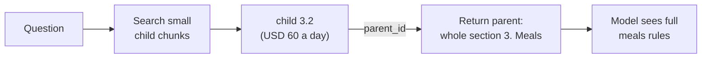
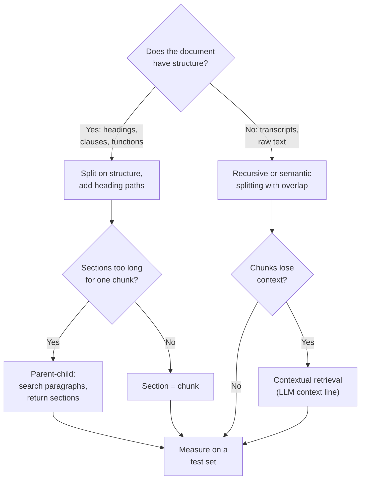

# Chunking Strategies: The Complete Guide

> 📚 **Before you start**
>
> - [Text Splitters](../05-rag-building-blocks-in-langchain/text-splitters.md), for chunk size, overlap and the recursive algorithm.
> - [RAG with LangChain and a Vector DB](rag-with-langchain-and-a-vector-db.md), for the chain these chunks feed.
> - [Lab: RAG from scratch, no framework](../02-introduction-to-rag/lab-rag-from-scratch-no-framework.md), for recall@k and MRR.

## Introduction

Imagine cutting a newspaper into pieces to file in a cabinet. One clerk cuts every 10 centimetres with a ruler, slicing through the middle of headlines and sentences. Another cuts along the column borders, one article per piece. A third does the same but writes the section name ("Sports", "City", "Business") on the back of each piece. A month later, someone asks for "the cricket score from the Ranji match". Whose cabinet would you rather search?

That's chunking. In [Text Splitters](../05-rag-building-blocks-in-langchain/text-splitters.md) you learned the mechanics: chunk size, overlap and recursive splitting. This lesson is about **strategy**: which way of cutting gives the best retrieval for *your* documents, and how to prove it with numbers rather than guess. We'll take one realistic document, chunk it eight different ways, and measure each one on the same test questions.

By the end you'll know the main chunking families (fixed, sentence, structure-based, semantic), the context-adding techniques (chunk headers, contextual retrieval) and the two-level techniques (parent-child, small-to-big), when each fits, and how to run a chunking experiment on your own data.

> 💡 **Key Insight**
>
> A chunk must stand on its own: **about one thing, and carrying enough context to be recognised** as about that thing. Cutting along the document's own structure gets you the first; adding the heading path (or an LLM-written context line) gets you the second. Then **measure**, because the best size and method depend on your documents and questions.

---

## Core Explanation

### 1. The test bench

A good experiment needs three things: a document, questions with known answers, and a scoring function. Here is the Tarang travel policy (a longer document than the handbook, with sections and paragraphs, the way real policies look), twelve questions, and an `evaluate` function. Because each strategy cuts the text differently, we can't label the right *chunk* in advance; instead each question has a **key fact** (a short string from the answer), and a retrieved chunk counts as a hit if it contains that fact.

```python
import re, zlib
import numpy as np
from langchain_core.documents import Document
from langchain_core.embeddings import Embeddings
from langchain_core.vectorstores import InMemoryVectorStore

STOP = {"a", "an", "the", "is", "are", "of", "to", "in", "on", "for", "and", "or", "i", "my", "can",
        "do", "how", "many", "much", "what", "be", "it", "by", "with", "per", "up", "get", "if"}
CONCEPTS = {"vacation": "leave", "pto": "leave", "food": "meal", "lunch": "meal", "dinner": "meal",
            "budget": "allowance", "trip": "travel", "visit": "travel", "customer": "travel", "client": "travel",
            "notebook": "laptop", "computer": "laptop", "stolen": "lost", "resign": "notice", "quit": "notice",
            "expense": "claim", "reimbursement": "claim", "refund": "claim", "bill": "claim", "hotel": "stay",
            "room": "stay", "lodging": "stay", "baby": "parental", "maternity": "parental",
            "paternity": "parental", "doctor": "medical", "insurance": "medical", "hospital": "medical",
            "abroad": "international", "overseas": "international", "foreign": "international"}

def normalise(w):
    if w.endswith("ied"):
        return w[:-3] + "y"
    if w.endswith("s") and not w.endswith("ss") and len(w) > 3:
        return w[:-1]
    return w

def words(text):
    return {normalise(w) for w in re.findall(r"[a-z0-9]+", text.lower())} - STOP

class ToyEmbeddings(Embeddings):
    def __init__(self, dim=256):
        self.dim = dim
    def _embed(self, text):
        vec = np.zeros(self.dim)
        for w in words(text):
            vec[zlib.crc32(CONCEPTS.get(w, w).encode()) % self.dim] += 1.0
        norm = np.linalg.norm(vec)
        return [round(float(x), 6) for x in (vec / norm if norm else vec)]
    def embed_documents(self, texts):
        return [self._embed(t) for t in texts]
    def embed_query(self, text):
        return self._embed(text)

emb = ToyEmbeddings()
```

(The toy embedding now also knows that "abroad", "overseas" and "foreign" mean "international", as any real model would.)

```python
POLICY = """# Tarang Software Travel Policy 2026

## 1. Booking travel
All trips are booked through the TravelDesk portal at least 7 days before departure. Flights under 4 hours are booked in economy class. Directors may fly business class on flights longer than 6 hours.

Trains are booked in AC 2-tier. Tatkal tickets are allowed only when the trip is confirmed less than 3 days ahead.

## 2. Hotels
Hotel stays are covered up to Rs 6,000 a night in metro cities and Rs 3,500 a night elsewhere. Book through TravelDesk so the company rate applies.

For international trips the limit is USD 180 a night. Breakfast is included in these limits.

## 3. Meals
The daily meal allowance is Rs 1,200 in metro cities and Rs 800 in other cities. No bills are needed for the allowance.

For international trips the limit is USD 60 a day. Alcohol is never reimbursed.

## 4. Local transport
Cabs to and from the airport can be claimed with a receipt. Using your own car is paid at Rs 12 a kilometre.

Auto-rickshaw fares under Rs 300 can be claimed without a receipt.

## 5. Claims
Submit bills on the Kharcha portal within 30 days of the trip. Approved claims are reimbursed within 15 days.

Bills must show the GST number of the vendor. Claims without original bills are rejected. Convert foreign currency at the exchange rate on the date of travel.

## 6. Advances
You can take a travel advance of up to Rs 25,000. It must be settled within 10 days of your return.

## 7. Approvals
Domestic trips need your manager's approval. International trips need VP approval at least 21 days before departure."""

TESTS = [  # (question, key fact that the right chunk must contain)
    ("What is the food limit per day abroad?", "USD 60"),
    ("How much can I spend on a hotel abroad?", "USD 180"),
    ("Which class do I fly for a 2 hour flight?", "economy"),
    ("Can I book Tatkal train tickets?", "Tatkal"),
    ("How much is paid per km if I drive my own car?", "Rs 12"),
    ("Do I need a receipt for an auto rickshaw?", "Rs 300"),
    ("How do I convert foreign currency on claims?", "exchange rate"),
    ("How soon must I settle a travel advance?", "10 days"),
    ("Who approves an international trip?", "VP approval"),
    ("Is breakfast covered in the hotel limit?", "Breakfast"),
    ("Is alcohol reimbursed with meals?", "Alcohol"),
    ("Do I need bills for the daily meal allowance?", "No bills"),
]

def evaluate(name, chunks, k=3):
    store = InMemoryVectorStore(embedding=emb)
    store.add_documents([Document(page_content=c) for c in chunks])
    hit1 = hitk = rr = 0
    for q, fact in TESTS:
        found = [d.page_content for d in store.similarity_search(q, k=k)]
        ranks = [i for i, c in enumerate(found) if fact in c]
        if ranks:
            hitk += 1
            rr += 1 / (ranks[0] + 1)
            hit1 += ranks[0] == 0
    n, avg = len(TESTS), sum(len(c) for c in chunks) / len(chunks)
    print(f"{name:<22}{len(chunks):>3} chunks, avg {avg:>4.0f} chars | "
          f"recall@1 {hit1/n:.2f}  recall@{k} {hitk/n:.2f}  MRR {rr/n:.2f}")
```

Recall@1 asks "was the right chunk ranked first?"; recall@3 asks "was it anywhere in the top 3?"; MRR rewards ranking it higher. Let's run the experiment.

### 2. Strategy 1: fixed-size chunks

The simplest possible approach: cut every N characters, ignoring structure. Optionally overlap consecutive chunks.

```python
def fixed_chunks(text, size, overlap=0):
    out, start = [], 0
    while start < len(text):
        out.append(text[start:start + size])
        start += size - overlap
    return out

print(fixed_chunks(POLICY, 200)[2])
print("---")
evaluate("fixed 200", fixed_chunks(POLICY, 200))
evaluate("fixed 200, overlap 50", fixed_chunks(POLICY, 200, overlap=50))
```

Output:

```
s are covered up to Rs 6,000 a night in metro cities and Rs 3,500 a night elsewhere. Book through TravelDesk so the company rate applies.

For international trips the limit is USD 180 a night. Breakfa
---
fixed 200               8 chunks, avg  197 chars | recall@1 0.50  recall@3 0.75  MRR 0.61
fixed 200, overlap 50  11 chunks, avg  189 chars | recall@1 0.67  recall@3 0.92  MRR 0.79
```

Look at that sample chunk: it starts mid-word ("s are covered") and ends mid-word ("Breakfa"), and the heading that says these are *hotel* rules landed in the previous chunk. That's the ruler-cut newspaper. Overlap helps (sentences cut at one boundary appear whole in the next chunk), but fixed-size chunking is the baseline to beat, not a strategy to ship. `CharacterTextSplitter` with a separator of `""` and `TokenTextSplitter` behave like this.

### 3. Strategy 2: sentence-based chunks

Split into sentences, then group a fixed number of sentences per chunk. Chunks never cut a sentence in half.

```python
def sentences(text):
    out = []
    for para in text.split("\n\n"):
        lines = [l for l in para.strip().split("\n") if not l.startswith("#")]
        body = " ".join(lines).strip()
        if body:
            out += re.split(r"(?<=\.) ", body)
    return out

def sentence_chunks(text, per_chunk):
    s = sentences(text)
    return [" ".join(s[i:i + per_chunk]) for i in range(0, len(s), per_chunk)]

print(len(sentences(POLICY)), "sentences; first chunk:", sentence_chunks(POLICY, 2)[0])
evaluate("2 sentences", sentence_chunks(POLICY, 2))
```

Output:

```
25 sentences; first chunk: All trips are booked through the TravelDesk portal at least 7 days before departure. Flights under 4 hours are booked in economy class.
2 sentences            13 chunks, avg  108 chars | recall@1 0.67  recall@3 0.92  MRR 0.79
```

Cleaner, but sentences are grouped by count, not by topic, so a chunk can still straddle two sections. Real sentence splitters (spaCy, NLTK, or LangChain's wrappers for them) handle abbreviations like "Rs." and "Dr." better than our regular expression.

### 4. Strategy 3: structure-based chunks

Documents already tell you where topics begin and end: headings, paragraphs, list items, table rows, clauses, functions. Cutting along that structure is usually the single biggest improvement over fixed-size chunks. This is what the recursive splitter approximates (paragraphs first) and what Markdown and HTML header splitters do exactly.

```python
def paragraph_chunks(text):
    return [p.strip() for p in text.split("\n\n") if p.strip() and not p.strip().startswith("# ")]

def section_chunks(text):
    return [block.strip() for block in text.split("\n## ")[1:]]

print(paragraph_chunks(POLICY)[5])
print("---")
evaluate("paragraphs", paragraph_chunks(POLICY))
evaluate("whole sections", section_chunks(POLICY))
```

Output:

```
For international trips the limit is USD 60 a day. Alcohol is never reimbursed.
---
paragraphs             12 chunks, avg  127 chars | recall@1 0.83  recall@3 0.92  MRR 0.86
whole sections          7 chunks, avg  215 chars | recall@1 0.92  recall@3 1.00  MRR 0.96
```

Both structure-based strategies beat every earlier one. But look at the sample paragraph: *"For international trips the limit is USD 60 a day. Alcohol is never reimbursed."* The limit on **what**? The word "meals" lives only in the heading, which went to a different chunk. A question about food abroad has to match this chunk through "international" alone, and it competes with the hotel paragraph that says almost the same thing. Whole sections avoid the problem here because each section is short, but in a real 80-page policy a "section" can run to several pages, far too big for one chunk.

### 5. Strategy 4: add context to every chunk

Two ways to give an orphaned paragraph back its context.

**Contextual chunk headers.** Prepend the document title and heading path to each chunk's text before embedding. It costs nothing but a few tokens.

```python
def paragraphs_with_headers(text, title="Travel Policy"):
    out = []
    for block in text.split("\n## ")[1:]:
        heading, rest = block.split("\n", 1)
        for para in [p.strip() for p in rest.split("\n\n") if p.strip()]:
            out.append(f"{title} > {heading}: {para}")
    return out

print(paragraphs_with_headers(POLICY)[5])
evaluate("paragraphs + headers", paragraphs_with_headers(POLICY))
```

Output:

```
Travel Policy > 3. Meals: For international trips the limit is USD 60 a day. Alcohol is never reimbursed.
paragraphs + headers   12 chunks, avg  147 chars | recall@1 0.92  recall@3 1.00  MRR 0.94
```

Same chunks, same sizes, better retrieval, because the meals paragraph now *says* it's about meals.

**Contextual retrieval.** Anthropic described this technique in September 2024: before indexing, an LLM reads the whole document plus one chunk and writes a short sentence or two situating the chunk ("This chunk is from the Meals section of Tarang's 2026 travel policy and gives the international meal limit."). That context is prepended to the chunk for **both** the embedding index and a BM25 keyword index. Anthropic reported that contextual embeddings alone cut failed retrievals by 35%, contextual embeddings plus contextual BM25 by 49%, and adding reranking by 67%, on their test sets.

It's more flexible than headers because the LLM can add information headings don't contain (which product, which year, what "it" refers to), at the cost of one LLM call per chunk at indexing time. Prompt caching makes this affordable: the whole document is the same prefix for every chunk's call, so it's cached and only the chunk changes.

```python
# not-run: needs the anthropic package and an API key
import anthropic

client = anthropic.Anthropic()

def situate(document, chunk):
    response = client.messages.create(
        model="claude-opus-5-5", max_tokens=150,
        system=[{"type": "text", "text": f"<document>\n{document}\n</document>",
                 "cache_control": {"type": "ephemeral"}}],          # same document every call: cache it
        messages=[{"role": "user", "content":
                   f"Here is a chunk from the document:\n<chunk>\n{chunk}\n</chunk>\n"
                   "Write one or two short sentences that situate this chunk within the whole document, "
                   "to improve search retrieval of the chunk. Answer with only those sentences."}],
    )
    return response.content[0].text + "\n" + chunk
```

Example output:

```
This chunk is from section 3 (Meals) of Tarang Software's 2026 travel policy and states the daily meal limit for international trips.
For international trips the limit is USD 60 a day. Alcohol is never reimbursed.
```

### 6. Strategy 5: semantic chunking

Instead of trusting the document's layout, **semantic chunking** looks at meaning: embed each sentence, compare each sentence with the next, and start a new chunk wherever similarity drops sharply (a topic shift). It's useful for text with little structure, such as transcripts, chat logs and long unformatted reports. LangChain's `SemanticChunker` (in `langchain-experimental`) implements it with several ways of choosing the breakpoint threshold.

```python
def semantic_chunks(text, threshold):
    s = sentences(text)
    vecs = np.array(emb.embed_documents(s))
    chunks, current = [], [s[0]]
    for i in range(1, len(s)):
        if vecs[i] @ vecs[i - 1] < threshold:      # meaning shifted: close the chunk
            chunks.append(" ".join(current))
            current = []
        current.append(s[i])
    chunks.append(" ".join(current))
    return chunks

for th in (0.05, 0.2):
    evaluate(f"semantic, cut < {th}", semantic_chunks(POLICY, th))
print(semantic_chunks(POLICY, 0.05)[:3])
```

Output:

```
semantic, cut < 0.05   11 chunks, avg  128 chars | recall@1 0.75  recall@3 0.92  MRR 0.82
semantic, cut < 0.2    19 chunks, avg   74 chars | recall@1 0.58  recall@3 0.75  MRR 0.67
['All trips are booked through the TravelDesk portal at least 7 days before departure. Flights under 4 hours are booked in economy class. Directors may fly business class on flights longer than 6 hours.', 'Trains are booked in AC 2-tier. Tatkal tickets are allowed only when the trip is confirmed less than 3 days ahead. Hotel stays are covered up to Rs 6,000 a night in metro cities and Rs 3,500 a night elsewhere.', 'Book through TravelDesk so the company rate applies.']
```

Semantic chunking beats fixed-size chunks without knowing anything about the layout, and a stricter threshold makes chunks smaller and worse. Its mistakes are instructive too: the second chunk glues the Tatkal rule to the first hotel sentence, because the similarity between those two neighbouring sentences happened not to drop below the threshold. Semantic boundaries are only as good as the embedding that draws them. But on a well-structured document it doesn't beat simply using the structure, and it costs an embedding call per sentence at indexing time. Use it where structure is missing, and tune the threshold.

### 7. Strategy 6: two levels, parent-child (small-to-big)

There's a tension in chunk size: **small chunks retrieve precisely** (one topic, sharp embedding), but **big chunks answer better** (the model sees the surrounding context). Parent-child retrieval refuses to choose:

1. Split the document into **parents** (here: whole sections).
2. Split each parent into small **children** (here: paragraphs with headers). Each child stores its parent's ID.
3. **Search** the children; **return** their parents (deduplicated) to the model.



```python
parents = {}
children = []
for block in POLICY.split("\n## ")[1:]:
    heading, rest = block.split("\n", 1)
    pid = heading.split(".")[0]
    parents[pid] = block.strip()
    for para in [p.strip() for p in rest.split("\n\n") if p.strip()]:
        children.append(Document(page_content=f"Travel Policy > {heading}: {para}", metadata={"parent_id": pid}))

child_store = InMemoryVectorStore(embedding=emb)
child_store.add_documents(children)

def small_to_big(question, k=2):
    seen, result = [], []
    for child in child_store.similarity_search(question, k=k):
        pid = child.metadata["parent_id"]
        if pid not in seen:
            seen.append(pid)
            result.append(parents[pid])
    return result

for text in small_to_big("What is the food limit per day abroad?"):
    print(text, "\n...")
```

Output:

```
3. Meals
The daily meal allowance is Rs 1,200 in metro cities and Rs 800 in other cities. No bills are needed for the allowance.

For international trips the limit is USD 60 a day. Alcohol is never reimbursed. 
...
2. Hotels
Hotel stays are covered up to Rs 6,000 a night in metro cities and Rs 3,500 a night elsewhere. Book through TravelDesk so the company rate applies.

For international trips the limit is USD 180 a night. Breakfast is included in these limits. 
...
```

The search matched a small, precise child, and the model receives the whole Meals section, including the domestic rates and the alcohol rule, which a follow-up question will probably need. LangChain packages this as `ParentDocumentRetriever` in `langchain-classic`:

```python
# not-run: needs langchain-classic and langchain-text-splitters
from langchain_classic.retrievers import ParentDocumentRetriever
from langchain_core.stores import InMemoryStore
from langchain_text_splitters import RecursiveCharacterTextSplitter

retriever = ParentDocumentRetriever(
    vectorstore=InMemoryVectorStore(embedding=emb),          # holds the small children
    docstore=InMemoryStore(),                                # holds the parents by ID
    child_splitter=RecursiveCharacterTextSplitter(chunk_size=300),
    parent_splitter=RecursiveCharacterTextSplitter(chunk_size=2000),
)
retriever.add_documents(policy_docs)
```

A close cousin, **sentence window retrieval**, indexes single sentences and returns each hit with a few sentences on either side.

### 8. More strategies worth knowing

| Strategy | Idea | Good for |
|---|---|---|
| **Multi-vector** | Index several representations per chunk (a summary, hypothetical questions it answers) that all point back to the original | Tables, code, dense text whose wording differs from questions |
| **Proposition chunking** | An LLM rewrites text into small self-contained factual statements ("Tarang's international meal limit is USD 60 a day") and those are indexed | Fact lookup, high precision; expensive to index |
| **Late chunking** | Run a long-context embedding model over the whole document first, then pool token embeddings per chunk, so each chunk's vector "saw" the whole document | Documents full of pronouns and references; needs a model that supports it |
| **Document-specific** | Contracts by clause, code by function or class, chat by conversation turn, transcripts by time window, spreadsheets by row with column names | Matching the unit people ask about |
| **Agentic or LLM-guided** | An LLM decides where to split | Messy, high-value documents; slow and costly |

And when documents have a reliable table of contents, you may not need chunks at all: [Vectorless RAG](../course.md#m8) navigates the document tree instead.

### 9. The scoreboard, and how to choose

Here are all the strategies side by side:

```python
evaluate("fixed 200", fixed_chunks(POLICY, 200))
evaluate("fixed 200, overlap 50", fixed_chunks(POLICY, 200, overlap=50))
evaluate("2 sentences", sentence_chunks(POLICY, 2))
evaluate("semantic, cut < 0.05", semantic_chunks(POLICY, 0.05))
evaluate("paragraphs", paragraph_chunks(POLICY))
evaluate("paragraphs + headers", paragraphs_with_headers(POLICY))
evaluate("whole sections", section_chunks(POLICY))
```

Output:

```
fixed 200               8 chunks, avg  197 chars | recall@1 0.50  recall@3 0.75  MRR 0.61
fixed 200, overlap 50  11 chunks, avg  189 chars | recall@1 0.67  recall@3 0.92  MRR 0.79
2 sentences            13 chunks, avg  108 chars | recall@1 0.67  recall@3 0.92  MRR 0.79
semantic, cut < 0.05   11 chunks, avg  128 chars | recall@1 0.75  recall@3 0.92  MRR 0.82
paragraphs             12 chunks, avg  127 chars | recall@1 0.83  recall@3 0.92  MRR 0.86
paragraphs + headers   12 chunks, avg  147 chars | recall@1 0.92  recall@3 1.00  MRR 0.94
whole sections          7 chunks, avg  215 chars | recall@1 0.92  recall@3 1.00  MRR 0.96
```

On this document, structure plus context wins, and whole sections do best because every section is short. Your documents will produce a different ranking, which is the whole point: **run this experiment on your own data**. A practical recipe:

1. Start with **structure-based** splitting (Markdown/HTML headers, or the recursive splitter) at 300 to 800 tokens, 10 to 15% overlap.
2. Add **heading paths** to every chunk. It's nearly free.
3. Build a **test set** of 30 to 100 real questions with key facts or expected sources.
4. Compare two or three variants (sizes, headers, parent-child, contextual retrieval) on recall@k and MRR, and on answer quality with the methods in [RAG Evaluation](../course.md#m9).
5. Re-check when the document types change.



---

## Try It Yourself

1. **Size sweep.** Run `evaluate` for fixed chunks of 100, 300 and 500 characters (no overlap). Which size is best here, and why do very small and very large chunks both lose?
2. **Headers on sentences.** Write `sentences_with_headers` that groups 2 sentences per chunk **within** each section and prefixes the heading. Does it beat plain `2 sentences`?
3. **Parent-child recall.** Measure recall@1 for `small_to_big` on `TESTS` (a hit if the first returned parent contains the key fact).

<details>
<summary>Show answers</summary>

**1.**

```python
for size in (100, 300, 500):
    evaluate(f"fixed {size}", fixed_chunks(POLICY, size))
```

Output:

```
fixed 100              16 chunks, avg   99 chars | recall@1 0.33  recall@3 0.50  MRR 0.40
fixed 300               6 chunks, avg  263 chars | recall@1 0.83  recall@3 0.92  MRR 0.88
fixed 500               4 chunks, avg  395 chars | recall@1 0.67  recall@3 1.00  MRR 0.79
```

Small chunks cut facts in half and lose context; big chunks blur several topics into one vector so the right one ranks lower (and recall@1 falls). The best size sits in between and depends on the document.

**2.**

```python
def sentences_with_headers(text, per_chunk=2):
    out = []
    for block in text.split("\n## ")[1:]:
        heading, rest = block.split("\n", 1)
        s = sentences(rest)
        out += [f"Travel Policy > {heading}: " + " ".join(s[i:i + per_chunk]) for i in range(0, len(s), per_chunk)]
    return out

evaluate("2 sentences", sentence_chunks(POLICY, 2))
evaluate("2 sentences + headers", sentences_with_headers(POLICY))
```

Output:

```
2 sentences            13 chunks, avg  108 chars | recall@1 0.67  recall@3 0.92  MRR 0.79
2 sentences + headers  14 chunks, avg  131 chars | recall@1 0.83  recall@3 1.00  MRR 0.90
```

Yes: keeping sentence groups inside one section and adding the heading fixes both problems of plain sentence grouping.

**3.**

```python
hits = sum(fact in small_to_big(q)[0] for q, fact in TESTS)
print(f"parent-child recall@1 = {hits / len(TESTS):.2f}")
```

Output:

```
parent-child recall@1 = 0.92
```

</details>

---

## Real-World Examples

- **Anthropic's contextual retrieval** write-up is widely used as a recipe: chunk, add an LLM-written context line per chunk using prompt caching, index in both embeddings and BM25, then rerank.
- **Documentation platforms** split on Markdown headings and keep the heading path ("Install > Linux > Troubleshooting") in each chunk, both for retrieval and for showing breadcrumbs in citations.
- **Legal tech** chunks contracts by clause number, because lawyers ask about "clause 14.2" and need the whole clause.
- **Meeting and video tools** chunk transcripts into overlapping time windows and keep timestamps, which you'll do in [Project: Chat with Any YouTube Video](project-chat-with-any-youtube-video.md).

---

## Common Misconceptions

### "There's a best chunk size"

There's a best chunk size *for your documents, questions and embedding model*. Popular defaults are starting points; the experiment decides.

### "Semantic chunking is always better"

It shines on unstructured text. On structured documents, the author's own headings and paragraphs usually mark topic boundaries better and for free.

### "Bigger chunks mean more context for the model"

Bigger chunks blur the embedding and rank worse. If the model needs more context, retrieve small and return big (parent-child) or add context lines.

### "Chunking is a one-time decision"

New document types (scanned forms, slide decks, spreadsheets) often need their own strategy. Keep the evaluation harness and re-run it.

---

## Interview Relevance

*"What chunking strategy would you use for X?"* Name the families (fixed, recursive/structure-based, sentence, semantic, document-specific), choose based on structure, add heading context, consider parent-child for long sections, and say you'd pick sizes by measuring recall@k/MRR on a labelled set.

*"What is contextual retrieval?"* LLM-generated context per chunk prepended before embedding and BM25 indexing; reduces retrieval failures; uses prompt caching to keep indexing cost down.

*"How does a parent document retriever work?"* Index small child chunks with a parent ID, search children, return deduplicated parents; trades a bigger prompt for precise matching plus full context.

---

## Key Takeaways

- **Cut along the document's structure** (headings, paragraphs, clauses, functions) rather than at fixed sizes.
- **Give every chunk its context**: heading paths for free, or LLM-written context lines (contextual retrieval) for a modest indexing cost.
- **Semantic chunking** helps when there's no structure; tune its threshold.
- **Parent-child** retrieval searches small and returns big, getting precision and context together.
- **Measure** every strategy on your own questions; the ranking changes with the data.

---

**Up next:** [Retrieval Methods](retrieval-methods.md)
