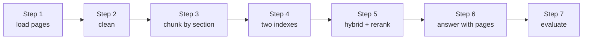

# Lab: Chat with a PDF

> 📚 **Before you start**
>
> - [PDF, Web, CSV and Directory Loaders](../05-rag-building-blocks-in-langchain/pdf-web-csv-and-directory-loaders.md), for what `PyPDFLoader` returns and how to clean PDF text.
> - [RAG with LangChain and a Vector DB](rag-with-langchain-and-a-vector-db.md), for the chain that returns sources.
> - [Chunking Strategies](chunking-strategies.md), [Hybrid Search](hybrid-search.md) and [Reranking](reranking.md), the three techniques you'll combine here.

## What You'll Build

"Chat with your PDF" is the classic first RAG product: upload a document, ask questions, get answers that point to the page. You'll build one for the **Tarang Mediclaim Policy**, a five-page health insurance document of the kind every Indian employee receives and nobody reads, until they're standing at a hospital admission desk.

Your app will:

- load the PDF page by page, keeping page numbers;
- clean the usual PDF mess (repeated footers, words hyphenated across lines);
- chunk by section, with the heading path in each chunk and the page where it starts;
- index chunks for both vector and keyword search;
- answer through hybrid search, a reranker and a grounded prompt, **citing pages**;
- refuse when the policy doesn't cover the question;
- evaluate itself on a small test set.

![Chat with a PDF architecture. Ingest band: a five-page mediclaim policy PDF is loaded into one Document per page with the page number kept, cleaned to drop footers and re-join hyphens, chunked by section with heading path and start page, and stored in two indexes, vectors and BM25. Ask band: a question such as room rent limit goes to hybrid search with RRF fusion returning the top 6, a reranker that keeps 2 and refuses if evidence is weak, an LLM that answers only from context, and an answer with page citations](/img/diagrams/retrieval-augmented-generation-rag/rag-chat-with-pdf.svg)
*Everything in the top band runs once per uploaded PDF; everything in the bottom band runs per question.*



> 💡 **Key Insight**
>
> In a PDF app, **page numbers are part of the product**. Users trust an answer they can check ("see page 2"), so carry the page through every stage: loader metadata, cleaning, chunking, retrieval and the prompt. Lose it anywhere and citations become guesses.

---

## Step 1: Load the PDF, one Document per page

With a real file you'd use `PyPDFLoader`, which returns one `Document` per page:

```python
# not-run: needs langchain-community and pypdf
from langchain_community.document_loaders import PyPDFLoader

pages = PyPDFLoader("tarang-mediclaim-2026.pdf").load()
print(len(pages), pages[1].metadata)
```

Example output:

```
5 {'source': 'tarang-mediclaim-2026.pdf', 'page': 1, 'page_label': '2', 'total_pages': 5, ...}
```

Note that `page` counts from **0** and `page_label` holds the printed page number. To keep this lab runnable offline, here are the five pages exactly as a PDF loader would extract them, including the usual artefacts: a footer on every page, a word hyphenated at a line break, and a section that runs across a page boundary.

```python
from langchain_core.documents import Document

RAW_PAGES = [
"""Tarang Mediclaim Policy 2026
1. Who is covered
The policy covers the employee, spouse and up to two children. Dependent parents can be added for a premium share of Rs 8,000 a year per parent.
2. Sum insured
The sum insured is Rs 5 lakh per family per year. A top-up of Rs 10 lakh is available for Rs 4,500 a year.
Tarang Mediclaim Policy 2026 | Page 1 of 5""",
"""3. Hospitalisation
Treatment is cashless at network hospitals listed on the Arogya portal. A minimum of 24 hours of admission is required, except for day-care procedures such as cataract surgery and dialysis.
Room rent is covered up to 1% of the sum insured per day (Rs 5,000). ICU charges are covered up to 2% of the sum insured per day (Rs 10,000).
Tarang Mediclaim Policy 2026 | Page 2 of 5""",
"""4. Maternity
Maternity expenses are covered up to Rs 75,000 for a normal delivery and Rs 1,00,000 for a caesarean delivery. A newborn baby is covered from the first day.
5. Pre- and post-hospitalisation
Medical expenses 30 days before admission and 60 days after discharge are covered when they relate to the same illness.
Tarang Mediclaim Policy 2026 | Page 3 of 5""",
"""6. Exclusions
Cosmetic surgery, dental treatment (unless needed after an accident) and spectacles are not covered.
7. Claims
For a planned admission, get pre-authorisation at the hospital's insurance desk at least 48 hours before admission. For an emergency admission, inform the insurer within 24 hours.
For reimbursement, submit original bills on the Arogya portal within 30 days of dis-
Tarang Mediclaim Policy 2026 | Page 4 of 5""",
"""charge. Claims are settled within 21 days of receiving complete documents.
8. Co-payment
Claims for dependent parents carry a 10% co-payment. There is no co-payment for the employee, spouse or children.
9. Helpline
Call 1800-209-0000, available 24 hours a day, for claim status and network hospitals.
Tarang Mediclaim Policy 2026 | Page 5 of 5""",
]

SOURCE = "tarang-mediclaim-2026.pdf"
pages = [Document(page_content=text, metadata={"source": SOURCE, "page": i, "page_label": str(i + 1)})
         for i, text in enumerate(RAW_PAGES)]
print(len(pages), "pages;", pages[3].metadata)
print(pages[3].page_content[-80:])
```

Output:

```
5 pages; {'source': 'tarang-mediclaim-2026.pdf', 'page': 3, 'page_label': '4'}
 Arogya portal within 30 days of dis-
Tarang Mediclaim Policy 2026 | Page 4 of 5
```

The end of page 4 shows two problems at once: the word "discharge" is split as "dis-" / "charge" across pages, and the footer sits in the middle of the text.

## Step 2: Clean the pages

Two fixes: remove the footer and title lines, and re-join a word hyphenated across a line break. We join the pages into one text with **page markers**, so that a sentence crossing a page boundary can be repaired while still knowing which page each part came from.

```python
import re

FOOTER = re.compile(r"^Tarang Mediclaim Policy 2026( \| Page \d+ of \d+)?$")

def clean_and_join(pages):
    parts = []
    for p in pages:
        lines = [l for l in p.page_content.splitlines() if not FOOTER.match(l.strip())]
        parts.append(f"<<page {p.metadata['page_label']}>>\n" + "\n".join(lines))
    text = "\n".join(parts)
    # "dis-\n<<page 5>>\ncharge. Claims" -> "discharge.\n<<page 5>>\nClaims": re-join the word, keep the marker
    return re.sub(r"(\w+)-\n(<<page \d+>>)\n(\w+[.,;:]?) ?", r"\1\3\n\2\n", text)

clean_text = clean_and_join(pages)
print(clean_text[clean_text.index("For reimbursement"):][:150])
```

Output:

```
For reimbursement, submit original bills on the Arogya portal within 30 days of discharge.
<<page 5>>
Claims are settled within 21 days of receiving c
```

"discharge." is whole again and stays on page 4 with the rest of its sentence, where a reader would find it. The page marker now sits right after it, so the next sentence ("Claims are settled...") is correctly on page 5.

## Step 3: Chunk by section, with heading paths and pages

The policy has numbered sections, so we cut there (structure-based chunking), prepend the document title and heading to every chunk (contextual headers), and record the **page where each section starts** and the pages it spans.

```python
def chunk_by_section(text, title="Tarang Mediclaim Policy"):
    chunks, page, current = [], "1", None
    for line in text.splitlines():
        marker = re.match(r"<<page (\d+)>>", line)
        if marker:
            page = marker.group(1)
            continue
        heading = re.match(r"(\d+)\. (.+)", line)
        if heading:
            current = {"section": heading.group(1), "heading": heading.group(2), "pages": [page], "lines": []}
            chunks.append(current)
        elif current and line.strip():
            current["lines"].append(line.strip())
            if page not in current["pages"]:          # this section's text continues on a new page
                current["pages"].append(page)
    return [Document(page_content=f"{title} > {c['section']}. {c['heading']}: " + " ".join(c["lines"]),
                     id=f"sec-{c['section']}",
                     metadata={"source": SOURCE, "section": c["section"], "heading": c["heading"],
                               "page": c["pages"][0], "pages": "-".join([c["pages"][0], c["pages"][-1]])
                               if len(c["pages"]) > 1 else c["pages"][0]})
            for c in chunks]

chunks = chunk_by_section(clean_text)
for c in chunks:
    print(f"sec {c.metadata['section']}  pages {c.metadata['pages']:<4} {len(c.page_content):>4} chars  {c.metadata['heading']}")
```

Output:

```
sec 1  pages 1     189 chars  Who is covered
sec 2  pages 1     148 chars  Sum insured
sec 3  pages 2     377 chars  Hospitalisation
sec 4  pages 3     196 chars  Maternity
sec 5  pages 3     179 chars  Pre- and post-hospitalisation
sec 6  pages 4     141 chars  Exclusions
sec 7  pages 4-5   374 chars  Claims
sec 8  pages 5     154 chars  Co-payment
sec 9  pages 5     124 chars  Helpline
```

Nine chunks, one per section, each a few hundred characters. Section 7 (Claims) spans pages 4 and 5, and its metadata says so. For a longer PDF you'd split long sections further with the recursive splitter and keep the same metadata on every piece.

## Step 4: Build two indexes

The toy embedding from earlier lessons, extended with a few insurance words (a real embedding model knows these already), and the BM25 index from [Retrieval Methods](retrieval-methods.md).

```python
import math, zlib
from collections import Counter
import numpy as np
from langchain_core.embeddings import Embeddings
from langchain_core.vectorstores import InMemoryVectorStore

STOP = {"a", "an", "the", "is", "are", "of", "to", "in", "on", "for", "and", "or", "i", "my", "can",
        "do", "how", "many", "much", "what", "be", "it", "by", "with", "per", "up", "get", "if", "does",
        "have", "long", "after", "must", "when", "policy"}
CONCEPTS = {"wife": "spouse", "husband": "spouse", "kid": "child", "children": "child", "son": "child",
            "daughter": "child", "mother": "parent", "father": "parent", "baby": "newborn", "pregnancy": "maternity",
            "delivery": "maternity", "c": "caesarean", "section": "caesarean", "teeth": "dental", "dentist": "dental",
            "glasses": "spectacles", "hospital": "hospitalisation", "admitted": "admission", "phone": "call",
            "number": "call", "cap": "limit", "maximum": "limit", "added": "add"}

def normalise(w):
    if w.endswith("ies"):
        return w[:-3] + "y"
    if w.endswith("s") and not w.endswith("ss") and len(w) > 3:
        return w[:-1]
    return w

def words(text):
    return {normalise(w) for w in re.findall(r"[a-z0-9]+", text.lower())} - STOP

def concepts(text):
    return {CONCEPTS.get(w, w) for w in words(text)}

class ToyEmbeddings(Embeddings):
    def _embed(self, text, dim=256):
        vec = np.zeros(dim)
        for c in concepts(text):
            vec[zlib.crc32(c.encode()) % dim] += 1.0
        norm = np.linalg.norm(vec)
        return [round(float(x), 6) for x in (vec / norm if norm else vec)]
    def embed_documents(self, texts):
        return [self._embed(t) for t in texts]
    def embed_query(self, text):
        return self._embed(text)

class BM25:
    def __init__(self, docs, k1=1.5, b=0.75):
        self.docs, self.k1, self.b = docs, k1, b
        self.tfs = [Counter(normalise(w) for w in re.findall(r"[a-z0-9]+", d.page_content.lower()) if w not in STOP)
                    for d in docs]
        self.lengths = [sum(tf.values()) for tf in self.tfs]
        self.avg = sum(self.lengths) / len(self.lengths)
        df = Counter(t for tf in self.tfs for t in tf)
        self.idf = {t: math.log(1 + (len(docs) - n + 0.5) / (n + 0.5)) for t, n in df.items()}

    def search(self, query, k=6):
        q = [normalise(w) for w in re.findall(r"[a-z0-9]+", query.lower()) if w not in STOP]
        scored = []
        for doc, tf, length in zip(self.docs, self.tfs, self.lengths):
            s = sum(self.idf[t] * tf[t] * (self.k1 + 1) / (tf[t] + self.k1 * (1 - self.b + self.b * length / self.avg))
                    for t in q if t in tf)
            if s > 0:
                scored.append((doc, s))
        return sorted(scored, key=lambda p: -p[1])[:k]

vector_store = InMemoryVectorStore(embedding=ToyEmbeddings())
vector_store.add_documents(chunks)
keyword_index = BM25(chunks)
print("indexed", len(chunks), "chunks in both indexes")
```

Output:

```
indexed 9 chunks in both indexes
```

## Step 5: Hybrid retrieval and reranking

Fuse the two rankings with Reciprocal Rank Fusion, then rerank the fused candidates with a scorer that reads the question and each chunk together, keep the best two, and drop anything that scores too low. As in [Reranking](reranking.md), our reranker is a stand-in: it scores the fraction of the question's concepts that a chunk covers, where a real cross-encoder would use a trained model.

```python
def hybrid_search(question, k=6):
    vec = [d for d, s in vector_store.similarity_search_with_score(question, k=k) if s > 0]
    kw = [d for d, _ in keyword_index.search(question, k)]
    scores, by_id = {}, {}
    for ranking in (vec, kw):
        for rank, d in enumerate(ranking, start=1):
            scores[d.id] = scores.get(d.id, 0) + 1 / (60 + rank)
            by_id[d.id] = d
    return [by_id[i] for i in sorted(scores, key=lambda i: -scores[i])]

def rerank(question, docs, keep=2, min_score=0.6):
    wanted = concepts(question)
    scored = [(d, len(wanted & concepts(d.page_content)) / max(1, len(wanted))) for d in docs]
    scored.sort(key=lambda p: -p[1])
    return [(d, round(s, 2)) for d, s in scored[:keep] if s >= min_score]

q = "What is the room rent limit?"
print("hybrid: ", [d.metadata["section"] for d in hybrid_search(q)])
print("rerank: ", [(d.metadata["section"], s) for d, s in rerank(q, hybrid_search(q))])
```

Output:

```
hybrid:  ['3']
rerank:  [('3', 0.67)]
```

## Step 6: Answer with page citations

The prompt labels each chunk with its pages so the model can cite them. The model slot holds our pretend model from [RAG with LangChain and a Vector DB](rag-with-langchain-and-a-vector-db.md), adapted to cite pages: it picks the context sentence that best matches the question.

```python
from langchain_core.messages import AIMessage
from langchain_core.prompts import ChatPromptTemplate
from langchain_core.output_parsers import StrOutputParser
from langchain_core.runnables import RunnableLambda

prompt = ChatPromptTemplate.from_messages([
    ("system", "You answer questions about the Tarang Mediclaim Policy using only the context. "
               "After each fact, cite the page in the form (p. N). If the context doesn't answer, say so."),
    ("human", "Context:\n{context}\n\nQuestion: {question}"),
])

def pretend_model(prompt_value):
    text = prompt_value.to_string()
    context = text.split("Context:\n")[1].split("\n\nQuestion:")[0]
    wanted = concepts(text.split("Question:")[-1])
    best, best_score = "The policy document doesn't say.", 0
    for line in context.splitlines():
        page, body = re.match(r"\[p\. ([\d-]+)\] (.*)", line).groups()
        for sentence in re.split(r"(?<=\.) ", body.split(": ", 1)[1]):
            score = len(wanted & concepts(sentence))
            if score > best_score:
                best, best_score = f"{sentence} (p. {page})", score
    return AIMessage(content=best)

answer_chain = prompt | RunnableLambda(pretend_model) | StrOutputParser()

def ask(question):
    evidence = rerank(question, hybrid_search(question))
    if not evidence:
        return {"answer": "I couldn't find this in the Mediclaim policy. Please call the helpline (p. 5).", "sources": []}
    context = "\n".join(f"[p. {d.metadata['pages']}] {d.page_content}" for d, _ in evidence)
    return {"answer": answer_chain.invoke({"context": context, "question": question}),
            "sources": [f"section {d.metadata['section']}, p. {d.metadata['pages']} (score {s})" for d, s in evidence]}

for q in ["What is the room rent limit?", "Can I add my mother to the policy?",
          "How long do I have to submit bills after discharge?", "Is LASIK eye surgery covered?"]:
    r = ask(q)
    print(f"Q: {q}\nA: {r['answer']}\n   {r['sources']}\n")
```

Output:

```
Q: What is the room rent limit?
A: Room rent is covered up to 1% of the sum insured per day (Rs 5,000). (p. 2)
   ['section 3, p. 2 (score 0.67)']

Q: Can I add my mother to the policy?
A: Dependent parents can be added for a premium share of Rs 8,000 a year per parent. (p. 1)
   ['section 1, p. 1 (score 1.0)']

Q: How long do I have to submit bills after discharge?
A: For reimbursement, submit original bills on the Arogya portal within 30 days of discharge. (p. 4-5)
   ['section 7, p. 4-5 (score 1.0)']

Q: Is LASIK eye surgery covered?
A: I couldn't find this in the Mediclaim policy. Please call the helpline (p. 5).
   []
```

Every answer carries a page you can check, the claim deadline is answered from the section that crosses pages 4 and 5, and the LASIK question is refused because no chunk covers it (the policy only mentions cosmetic surgery and spectacles, which a real model might wrongly stretch to cover LASIK).

## Step 7: Evaluate

Eight questions, each with the section that answers it. We measure retrieval (is the right section the top piece of evidence?) and a crude faithfulness check (does the answer's sentence appear word for word in the policy?).

```python
TESTS = [
    ("How much is the premium to add my father?", "1"), ("What is the total sum insured?", "2"),
    ("Is cataract surgery covered without 24 hours admission?", "3"), ("Maternity cover for a C section?", "4"),
    ("Are medicines after discharge covered?", "5"), ("Does the policy pay for the dentist?", "6"),
    ("Emergency admission: when must I inform the insurer?", "7"), ("Is there a co-payment for parents?", "8"),
]

full_text = " ".join(c.page_content for c in chunks)
hits = faithful = 0
for q, gold in TESTS:
    evidence = rerank(q, hybrid_search(q))
    top = evidence[0][0].metadata["section"] if evidence else None
    answer = ask(q)["answer"]
    hits += top == gold
    faithful += answer.rsplit(" (p.", 1)[0] in full_text
    print(f"{'OK  ' if top == gold else 'MISS'} sec {gold} <- {q[:48]:<48} | {answer[:55]}")
print(f"\nretrieval accuracy@1 = {hits}/{len(TESTS)}   answers quoted from the policy = {faithful}/{len(TESTS)}")
```

Output:

```
OK   sec 1 <- How much is the premium to add my father?        | Dependent parents can be added for a premium share of R
OK   sec 2 <- What is the total sum insured?                   | The sum insured is Rs 5 lakh per family per year. (p. 1
OK   sec 3 <- Is cataract surgery covered without 24 hours adm | A minimum of 24 hours of admission is required, except 
OK   sec 4 <- Maternity cover for a C section?                 | Maternity expenses are covered up to Rs 75,000 for a no
OK   sec 5 <- Are medicines after discharge covered?           | Medical expenses 30 days before admission and 60 days a
MISS sec 6 <- Does the policy pay for the dentist?             | I couldn't find this in the Mediclaim policy. Please ca
OK   sec 7 <- Emergency admission: when must I inform the insu | For an emergency admission, inform the insurer within 2
OK   sec 8 <- Is there a co-payment for parents?               | Claims for dependent parents carry a 10% co-payment. (p

retrieval accuracy@1 = 7/8   answers quoted from the policy = 7/8
```

One miss, and it's an instructive one: the dentist question was **refused**, although section 6 answers it. Our crude reranker found only half of the question's concepts in that section ("dental" yes, "pay" no), which is below the 0.6 threshold. That's the cost side of a refusal threshold: some answerable questions get turned away. A real cross-encoder understands that "does the policy pay for" means "is it covered"; with our stand-in, you could lower the threshold or teach it that "pay" relates to "covered".

When a question misses, the per-question line tells you which stage to blame: wrong section on top means retrieval (try adding the words users use to `CONCEPTS`, or a better embedding model); right section but a poor answer means the prompt or model. In [RAG Evaluation](../course.md#m9) you'll replace these crude checks with proper metrics.

## Step 8: The production version

Everything above maps onto real components one to one. Here is the complete app with real libraries; the structure is identical.

```python
# not-run: needs langchain-community, pypdf, langchain-text-splitters, langchain-chroma, langchain-voyageai,
#          langchain-classic, rank-bm25, langchain-anthropic and API keys
from langchain_anthropic import ChatAnthropic
from langchain_chroma import Chroma
from langchain_classic.retrievers import ContextualCompressionRetriever, EnsembleRetriever
from langchain_community.document_loaders import PyPDFLoader
from langchain_community.retrievers import BM25Retriever
from langchain_text_splitters import RecursiveCharacterTextSplitter
from langchain_voyageai import VoyageAIEmbeddings, VoyageAIRerank

pages = PyPDFLoader("tarang-mediclaim-2026.pdf").load()
pages = [p for p in pages if p.page_content.strip()]                  # skip blank pages
splitter = RecursiveCharacterTextSplitter(chunk_size=1000, chunk_overlap=150, add_start_index=True)
chunks = splitter.split_documents(pages)                              # page metadata is copied to each chunk

vector = Chroma.from_documents(chunks, VoyageAIEmbeddings(model="voyage-4"), persist_directory="./pdf-index")
hybrid = EnsembleRetriever(retrievers=[vector.as_retriever(search_kwargs={"k": 10}),
                                       BM25Retriever.from_documents(chunks, k=10)], weights=[0.5, 0.5])
retriever = ContextualCompressionRetriever(base_compressor=VoyageAIRerank(model="rerank-3", top_k=4),
                                           base_retriever=hybrid)

model = ChatAnthropic(model="claude-opus-5-5", temperature=0)
answer_chain = prompt | model | StrOutputParser()

def ask(question):
    docs = retriever.invoke(question)
    context = "\n\n".join(f"[p. {d.metadata['page'] + 1}] {d.page_content}" for d in docs)
    return answer_chain.invoke({"context": context, "question": question}), docs

while (q := input("Ask about the policy (blank to quit): ").strip()):
    answer, docs = ask(q)
    print(answer, "\nSources:", sorted({d.metadata["page"] + 1 for d in docs}))
```

Two things change for real PDFs:

- **Scanned PDFs** have no text layer; `PyPDFLoader` returns empty pages. Run OCR first, or use a layout-aware parser (for example `UnstructuredPDFLoader`, or a document AI service), or send the page images to a vision model ([Multimodal RAG](../course.md#m7)).
- **Tables** often come out as jumbled text. Layout-aware parsers that output tables as Markdown or HTML, and chunking each table as one unit with its caption, help a lot.

**When you don't need RAG at all:** a single PDF of a few dozen pages fits in a modern model's context window. Claude can read a PDF directly as a `document` content block and cite pages with citations enabled, which is the simplest "chat with a PDF" of all. RAG earns its place when there are many PDFs, very long ones, or many users asking questions, because sending the whole document with every question costs time and money.

```python
# not-run: needs the anthropic package and an API key
import base64, pathlib, anthropic

client = anthropic.Anthropic()
pdf = base64.standard_b64encode(pathlib.Path("tarang-mediclaim-2026.pdf").read_bytes()).decode()
response = client.messages.create(
    model="claude-opus-5-5", max_tokens=1024,
    messages=[{"role": "user", "content": [
        {"type": "document", "source": {"type": "base64", "media_type": "application/pdf", "data": pdf},
         "title": "Tarang Mediclaim Policy 2026", "citations": {"enabled": True}},
        {"type": "text", "text": "What is the room rent limit?"},
    ]}],
)
for block in response.content:
    if block.type == "text":
        print(block.text, [(c.start_page_number, c.end_page_number) for c in (block.citations or [])])
```

Example output:

```
Room rent is covered up to 1% of the sum insured per day, which is Rs 5,000. [(2, 3)]
```

Citations for PDFs come back with `start_page_number` (counting from 1) and an exclusive `end_page_number`, so `(2, 3)` means page 2.

---

## Try It Yourself

1. **A vocabulary miss.** Ask `ask("Who is eligible?")`. Which section should answer it, and what happens? Fix it by adding one entry to `CONCEPTS` and rebuilding the indexes.
2. **Spans in citations.** Make the claims answer cite `p. 4-5` explicitly by asking *"How quickly are claims settled?"*. Which page does that sentence actually sit on, and how would you make the citation page-exact?
3. **Remove the reranker.** Change `ask` to use the top 2 hybrid results directly with no threshold. Re-run the evaluation and the LASIK question. What changes?

<details>
<summary>Show answers</summary>

**1.**

```python
print(ask("Who is eligible?"))
CONCEPTS["eligible"] = "cover"
vector_store = InMemoryVectorStore(embedding=ToyEmbeddings())
vector_store.add_documents(chunks)
print(ask("Who is eligible?"))
```

Output:

```
{'answer': "I couldn't find this in the Mediclaim policy. Please call the helpline (p. 5).", 'sources': []}
{'answer': 'The policy covers the employee, spouse and up to two children. (p. 1)', 'sources': ['section 1, p. 1 (score 1.0)']}
```

Section 1 ("Who is covered") should answer it, but "eligible" means nothing to the toy model, so the question was refused. After teaching it that "eligible" is about cover, the right section is found. With a real embedding model you'd test such vocabulary on your users' actual questions; hybrid search plus query rewriting covers most gaps.

**2.**

```python
print(ask("How quickly are claims settled?"))
```

Output:

```
{'answer': 'Claims are settled within 21 days of receiving complete documents. (p. 4-5)', 'sources': ['section 7, p. 4-5 (score 0.67)']}
```

The settlement sentence is on page 5, but our chunk spans pages 4 and 5, so the best we can cite is the range. For page-exact citations, keep sentence-level page offsets in metadata (for example the `start_index` of each page within the cleaned text) and look up the page of the quoted sentence. Module 8's [Deterministic Page Referencing](../course.md#m8) builds exactly this.

**3.**

```python
def ask_without_rerank(question):
    docs = hybrid_search(question)[:2]
    context = "\n".join(f"[p. {d.metadata['pages']}] {d.page_content}" for d in docs)
    return answer_chain.invoke({"context": context, "question": question})

print(ask_without_rerank("Is LASIK eye surgery covered?"))
```

Output:

```
Cosmetic surgery, dental treatment (unless needed after an accident) and spectacles are not covered. (p. 4)
```

Without the threshold, the LASIK question gets whatever chunks came back, and our pretend model grabs the exclusions sentence: it sounds relevant, cites a real page, and doesn't actually say anything about LASIK. A real model given unrelated context is tempted the same way, and might even conclude "not covered" or "covered" with false confidence. The reranker's score threshold is what turns weak evidence into an honest refusal before the model is even called.

</details>

---

## What You've Learned

- **Carry page numbers end to end**: loader metadata, cleaning with page markers, chunk metadata, labelled context, and citations in the answer.
- **PDF cleaning** removes footers and re-joins hyphenated words, including across page boundaries.
- **Section-based chunks with heading paths** match how people ask about policies.
- **Hybrid search plus reranking with a threshold** finds the right section and refuses when nothing fits.
- **A small evaluation loop** with per-question output tells you which stage to fix.
- **For a single short PDF**, a model's native PDF support may be all you need; RAG pays off with many or long documents and many users.

---

**Up next:** [Project: Chat with Any YouTube Video](project-chat-with-any-youtube-video.md)
