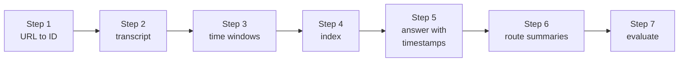

# Project: Chat with Any YouTube Video

> 📚 **Before you start**
>
> - [Lab: Chat with a PDF](lab-chat-with-a-pdf.md), whose pipeline you'll adapt from pages to timestamps.
> - [Chunking Strategies](chunking-strategies.md), for overlap and why transcripts need it.
> - [RAG with LangChain and a Vector DB](rag-with-langchain-and-a-vector-db.md), for the answer chain.

## What You'll Build

A 40-minute lecture, a two-hour podcast, a cricket match analysis: video is full of knowledge that's painful to search. You can't Ctrl+F a video. In this project you'll build an assistant that takes **any YouTube URL**, fetches its transcript, and answers questions with **clickable timestamps** that jump straight to the moment the answer is spoken.

You'll work with a 9-minute explainer, *"How UPI Actually Works"*, from a made-up channel. The finished app will:

- extract the video ID from every common YouTube URL format;
- fetch the transcript (shown with the real `youtube-transcript-api` package, run here on a saved copy);
- chunk the transcript into **overlapping time windows** that remember their start and end times;
- answer specific questions with timestamp links like `https://www.youtube.com/watch?v=...&t=95s`;
- **route** whole-video questions ("summarise this video") to a summary chain instead of retrieval;
- check itself on a small test set.

![Chat with any YouTube video architecture. Ingest band: a video URL in any format becomes an 11-character video ID, then a transcript of snippets with text, start and duration, then 60-second time windows with 15 seconds of overlap, then an index of vectors with start, end and URL. Ask band: a question goes to a router that decides between a specific fact and a whole-video question; specific questions retrieve the top windows, whole-video questions go to a map-reduce summary over all windows; the LLM answers from the transcript only and returns an answer with clickable timestamp links](/img/diagrams/retrieval-augmented-generation-rag/rag-youtube-chat.svg)
*Compared with the PDF lab, two things are new: time windows instead of pages, and a router for questions that need the whole video.*



> 💡 **Key Insight**
>
> A transcript is a **stream with a clock**, not a document with pages. Chunk it by **time with overlap**, keep each chunk's start time, and turn that start time into a link: the timestamp is both the citation and the best user experience. And remember that some questions ("what's this video about?") aren't retrieval questions at all.

---

## Step 1: From any URL to a video ID

Users paste URLs in many shapes. Every one contains the same **11-character video ID** (letters, digits, `-` and `_`), which is all the transcript API needs.

```python
import re
from urllib.parse import urlparse, parse_qs

def video_id(url):
    """Return the 11-character YouTube video ID from any common URL format, or raise ValueError."""
    parsed = urlparse(url.strip())
    host = parsed.netloc.lower().removeprefix("www.").removeprefix("m.")
    candidate = None
    if host == "youtu.be":
        candidate = parsed.path.lstrip("/").split("/")[0]
    elif host in ("youtube.com", "music.youtube.com"):
        if parsed.path == "/watch":
            candidate = parse_qs(parsed.query).get("v", [None])[0]
        else:
            parts = parsed.path.strip("/").split("/")
            if len(parts) >= 2 and parts[0] in ("shorts", "embed", "live", "v"):
                candidate = parts[1]
    if candidate and re.fullmatch(r"[A-Za-z0-9_-]{11}", candidate):
        return candidate
    raise ValueError(f"Not a YouTube video URL: {url}")

for url in ["https://www.youtube.com/watch?v=UPIdemo2026&t=42s",
            "https://youtu.be/UPIdemo2026?si=abc123",
            "https://www.youtube.com/shorts/UPIdemo2026",
            "https://m.youtube.com/watch?feature=share&v=UPIdemo2026",
            "https://www.youtube.com/embed/UPIdemo2026"]:
    print(video_id(url), "<-", url)

try:
    video_id("https://example.com/watch?v=UPIdemo2026")
except ValueError as e:
    print("rejected:", e)
```

Output:

```
UPIdemo2026 <- https://www.youtube.com/watch?v=UPIdemo2026&t=42s
UPIdemo2026 <- https://youtu.be/UPIdemo2026?si=abc123
UPIdemo2026 <- https://www.youtube.com/shorts/UPIdemo2026
UPIdemo2026 <- https://m.youtube.com/watch?feature=share&v=UPIdemo2026
UPIdemo2026 <- https://www.youtube.com/embed/UPIdemo2026
rejected: Not a YouTube video URL: https://example.com/watch?v=UPIdemo2026
```

Validating the host and the ID format matters: this function is the front door of your app, and it should never pass arbitrary user input on to other services.

## Step 2: Fetch the transcript

The `youtube-transcript-api` package downloads the captions YouTube already has for a video (uploaded by the creator, or generated automatically). In version 1.x you create an instance and call `fetch`, listing languages in order of preference:

```python
# not-run: needs youtube-transcript-api and network access
from youtube_transcript_api import YouTubeTranscriptApi

ytt = YouTubeTranscriptApi()
transcript = ytt.fetch("UPIdemo2026", languages=["en", "hi"])
print(transcript.language, transcript.is_generated)
snippets = transcript.to_raw_data()            # list of {"text", "start", "duration"} dicts
print(snippets[:2])
```

Example output:

```
English False
[{'text': 'Namaste, and welcome back to Paisa Simplified.', 'start': 0.0, 'duration': 3.2}, ...]
```

Three practical warnings before you deploy:

- **Not every video has captions.** If none exist, the API raises an error; the fallback is to download the audio and run speech-to-text (for example an open-source Whisper model, or a hosted transcription API).
- **YouTube blocks many cloud-server IP addresses** from fetching transcripts. The package's documentation describes using rotating residential proxies (`WebshareProxyConfig` or `GenericProxyConfig`) when you run it from a server. Your laptop usually works without one.
- **Respect the platform's terms and creators' rights.** Use transcripts to help viewers navigate a video, link back to it, and don't republish full transcripts.

Here is the saved transcript we'll use offline. It has exactly the shape `to_raw_data()` returns.

```python
SNIPPETS = [
    (0.0, "Namaste, and welcome back to Paisa Simplified."),
    (3.2, "Today we look at what really happens when you scan a QR code and pay with UPI."),
    (9.0, "By the end you will understand how the money moves and how to stay safe."),
    (31.0, "UPI stands for Unified Payments Interface."),
    (35.5, "It was launched in 2016 by NPCI, the National Payments Corporation of India."),
    (42.0, "It lets you send money between bank accounts instantly, any time, even on holidays."),
    (58.0, "Every user gets a UPI ID, which looks like an email address, for example asha@okbank."),
    (66.5, "The UPI ID is linked to your bank account, so you never share your account number."),
    (75.0, "You can create several UPI IDs in different apps for the same bank account."),
    (95.0, "So what happens when you pay? Your app sends the request to your bank."),
    (102.0, "Your bank passes it to the NPCI switch, which finds the receiver's bank."),
    (110.0, "The receiver's bank credits the money and confirms, all in a few seconds."),
    (118.0, "The app itself never holds your money. The banks do."),
    (140.0, "To approve a payment you enter your UPI PIN, a four or six digit secret."),
    (148.5, "The PIN is set with your debit card details and is never shared with anyone."),
    (156.0, "Changing your phone does not change your PIN, but you must verify your SIM again."),
    (190.0, "Now, limits. The usual limit is one lakh rupees per transaction."),
    (197.0, "Some categories like tax payments and hospital bills allow higher amounts."),
    (204.5, "Your own bank may also set a lower daily limit, so check your app."),
    (240.0, "For very small payments there is UPI Lite, a small wallet inside the UPI app."),
    (247.0, "UPI Lite payments do not need a PIN, which makes paying for chai super quick."),
    (285.0, "Let us talk about fraud, because this is where people lose money."),
    (291.0, "Remember one rule: you never need to enter your PIN to receive money."),
    (298.0, "If someone sends a collect request and says you will get a refund, it is a scam."),
    (306.5, "Scammers also send fake QR codes. Scanning a QR code is only for paying, not receiving."),
    (330.0, "If you are cheated, call the national cyber crime helpline, 1930, immediately."),
    (337.0, "Also report it in your bank app and at cybercrime.gov.in as soon as possible."),
    (380.0, "UPI is also growing outside India, and some countries now accept it for tourists."),
    (420.0, "To sum up: UPI moves money bank to bank through NPCI in seconds."),
    (428.0, "Protect your PIN, never enter it to receive money, and report fraud quickly on 1930."),
    (436.0, "Thanks for watching Paisa Simplified. Like and subscribe for more money explainers."),
]
VIDEO_ID = "UPIdemo2026"
snippets = [{"text": t, "start": s, "duration": 4.0} for s, t in SNIPPETS]
print(len(snippets), "snippets, last one starts at", snippets[-1]["start"], "seconds")
```

Output:

```
31 snippets, last one starts at 436.0 seconds
```

## Step 3: Chunk the transcript into time windows

Snippets are too short to retrieve on their own (a few words each), and they split sentences arbitrarily. Topics in speech drift gradually, with no headings, so we use **fixed time windows with overlap**: a new window every 45 seconds, each 60 seconds long, so any 15 seconds of speech near a boundary appears in two windows. Each window keeps its start and end time and a link.

```python
from langchain_core.documents import Document

def fmt(seconds):
    m, s = divmod(int(seconds), 60)
    return f"{m}:{s:02d}"

def time_windows(snippets, video, window=60, step=45):
    end_of_video = snippets[-1]["start"] + snippets[-1]["duration"]
    docs, start = [], 0.0
    while start < end_of_video:
        inside = [s for s in snippets if start <= s["start"] < start + window]
        if inside:
            first = inside[0]["start"]
            docs.append(Document(
                page_content=" ".join(s["text"] for s in inside),
                metadata={"video_id": video, "start": first, "end": inside[-1]["start"] + inside[-1]["duration"],
                          "url": f"https://www.youtube.com/watch?v={video}&t={int(first)}s"}))
        start += step
    return docs

windows = time_windows(snippets, VIDEO_ID)
print(len(windows), "windows")
for w in windows[:3]:
    print(f"[{fmt(w.metadata['start'])}-{fmt(w.metadata['end'])}] {w.page_content[:70]}...")
```

Output:

```
10 windows
[0:00-1:02] Namaste, and welcome back to Paisa Simplified. Today we look at what r...
[0:58-1:46] Every user gets a UPI ID, which looks like an email address, for examp...
[1:35-2:32] So what happens when you pay? Your app sends the request to your bank....
```

A few choices worth knowing about:

- **Window size**: 30 to 120 seconds is typical. Fast talkers and dense lectures suit shorter windows; conversational podcasts suit longer ones.
- **Silence gaps** (the jumps from 9 s to 31 s, 118 s to 140 s) are often topic changes, as they are here. Splitting on long gaps, or on chapter markers when the creator added them, is a smart refinement.
- **Auto-generated captions** usually have no punctuation and some misheard words ("NPCI" may come out as "and PCI"). Cleaning with a small LLM pass, or adding the video title and chapter name to each window (contextual headers again), helps retrieval.

## Step 4: Index the windows

The toy embedding again, with a few concepts for this video's vocabulary.

```python
import zlib
import numpy as np
from langchain_core.embeddings import Embeddings
from langchain_core.vectorstores import InMemoryVectorStore

STOP = {"a", "an", "the", "is", "are", "of", "to", "in", "on", "for", "and", "or", "i", "my", "can", "you",
        "do", "how", "many", "much", "what", "be", "it", "by", "with", "per", "up", "get", "if", "does",
        "your", "this", "video", "they", "say", "about", "which", "who", "when", "there", "should",
        "upi"}   # the whole video is about UPI, so the word carries no signal (low IDF, in BM25 terms)
CONCEPTS = {"cheated": "fraud", "scam": "fraud", "scammer": "fraud", "fraudster": "fraud", "conned": "fraud",
            "maximum": "limit", "cap": "limit", "lakh": "limit", "launched": "launch", "started": "launch",
            "secret": "pin", "password": "pin", "address": "id", "handle": "id", "complain": "report",
            "number": "helpline", "call": "helpline", "pay": "payment", "send": "payment"}

def normalise(w):
    if w.endswith("ies"):
        return w[:-3] + "y"
    if w.endswith("s") and not w.endswith("ss") and len(w) > 3:
        return w[:-1]
    return w

def concepts(text):
    return {CONCEPTS.get(normalise(w), normalise(w)) for w in re.findall(r"[a-z0-9]+", text.lower()) if w not in STOP}

class ToyEmbeddings(Embeddings):
    def _embed(self, text, dim=512):
        vec = np.zeros(dim)
        for c in concepts(text):
            vec[zlib.crc32(c.encode()) % dim] += 1.0
        norm = np.linalg.norm(vec)
        return [round(float(x), 6) for x in (vec / norm if norm else vec)]
    def embed_documents(self, texts):
        return [self._embed(t) for t in texts]
    def embed_query(self, text):
        return self._embed(text)

store = InMemoryVectorStore(embedding=ToyEmbeddings())
store.add_documents(windows)
for d, s in store.similarity_search_with_score("What should I do if I get cheated?", k=2):
    print(round(s, 2), fmt(d.metadata["start"]), d.page_content[:60])
```

Output:

```
0.24 5:30 If you are cheated, call the national cyber crime helpline, 
0.2 7:00 To sum up: UPI moves money bank to bank through NPCI in seco
```

## Step 5: Answer with timestamp links

The answer chain is the PDF lab's, with timestamps in place of page numbers. Our pretend model picks the best-matching **snippet** inside the retrieved windows, so it can cite the exact second the answer is spoken rather than the start of the window. (A real model cites the window label you give it; for second-level precision you can match its quoted words back to the snippet they came from.)

```python
from langchain_core.messages import AIMessage
from langchain_core.prompts import ChatPromptTemplate
from langchain_core.output_parsers import StrOutputParser
from langchain_core.runnables import RunnableLambda

prompt = ChatPromptTemplate.from_messages([
    ("system", "Answer questions about a YouTube video using only its transcript excerpts. "
               "Cite the timestamp of the excerpt you used, like [1:35]. If the excerpts don't answer, say so."),
    ("human", "Transcript excerpts:\n{context}\n\nQuestion: {question}"),
])

def pretend_model(prompt_value):
    text = prompt_value.to_string()
    wanted = concepts(text.split("Question:")[-1])
    best, best_score = "The video doesn't seem to cover that.", 0
    for s in snippets:                                     # only snippets that were in the context count
        if f"[{fmt(s['start'])}]" in text or s["text"] in text:
            score = len(wanted & concepts(s["text"]))
            if score > best_score:
                best, best_score = f"{s['text']} [{fmt(s['start'])}]", score
    return AIMessage(content=best)

answer_chain = prompt | RunnableLambda(pretend_model) | StrOutputParser()

def ask(question, k=2, min_score=0.1):
    hits = [(d, s) for d, s in store.similarity_search_with_score(question, k=k) if s >= min_score]
    if not hits:
        return "I couldn't find that in this video.", None
    context = "\n".join(f"[{fmt(d.metadata['start'])}] {d.page_content}" for d, _ in hits)
    answer = answer_chain.invoke({"context": context, "question": question})
    stamp = re.search(r"\[(\d+):(\d+)\]$", answer)
    link = None
    if stamp:
        seconds = int(stamp.group(1)) * 60 + int(stamp.group(2))
        link = f"https://www.youtube.com/watch?v={VIDEO_ID}&t={seconds}s"
    return answer, link

for q in ["Who launched UPI and when?", "What is the limit per transaction?",
          "Do I need my PIN to receive money?", "What should I do if I get cheated?",
          "Can I buy shares on the stock market with it?"]:
    answer, link = ask(q)
    print(f"Q: {q}\nA: {answer}\n   {link}\n")
```

Output:

```
Q: Who launched UPI and when?
A: It was launched in 2016 by NPCI, the National Payments Corporation of India. [0:35]
   https://www.youtube.com/watch?v=UPIdemo2026&t=35s

Q: What is the limit per transaction?
A: Now, limits. The usual limit is one lakh rupees per transaction. [3:10]
   https://www.youtube.com/watch?v=UPIdemo2026&t=190s

Q: Do I need my PIN to receive money?
A: Remember one rule: you never need to enter your PIN to receive money. [4:51]
   https://www.youtube.com/watch?v=UPIdemo2026&t=291s

Q: What should I do if I get cheated?
A: If you are cheated, call the national cyber crime helpline, 1930, immediately. [5:30]
   https://www.youtube.com/watch?v=UPIdemo2026&t=330s

Q: Can I buy shares on the stock market with it?
A: The video doesn't seem to cover that.
   None
```

The links jump to the exact second each answer is spoken, which is a far better experience than "somewhere in the video". The stock-market question isn't covered by the video: retrieval still returns a weak match (similarity search always returns something), but nothing in it answers the question, so the model says so and no link is offered. A stricter score threshold, or a reranker as in the PDF lab, would stop it even earlier.

## Step 6: Route whole-video questions to a summary

Try asking *"What is this video about?"* through retrieval: you get two random-ish windows, because the question isn't about any one moment. Questions about the **whole** video (summaries, main points, "is it worth watching?") need every window. The standard pattern is **map-reduce**: summarise each window (map), then combine the summaries (reduce). Since that's expensive, add a small **router** that sends each question to the right path.

```python
SUMMARY_WORDS = {"summarise", "summarize", "summary", "overview", "main", "points", "about", "takeaways", "tldr"}

def route(question):
    q = set(re.findall(r"[a-z]+", question.lower()))
    return "summary" if q & SUMMARY_WORDS else "retrieve"

def summarise_window(doc):                     # map step: a real LLM would write one line per window
    first_sentence = doc.page_content.split(". ")[0].rstrip(".")
    return f"[{fmt(doc.metadata['start'])}] {first_sentence}."

def summarise_video(docs):                     # reduce step: combine the window summaries
    seen, lines = set(), []
    for d in docs:
        line = summarise_window(d)
        if line.split("] ", 1)[1] not in seen:
            seen.add(line.split("] ", 1)[1])
            lines.append(line)
    return "Main points of the video:\n" + "\n".join(lines)

def chat(question):
    if route(question) == "summary":
        return summarise_video(windows)
    answer, link = ask(question)
    return f"{answer}\n{link or ''}".strip()

print(route("What is this video about?"), "|", route("What is the UPI limit?"))
print(chat("Give me the main points of this video"))
```

Output:

```
summary | retrieve
Main points of the video:
[0:00] Namaste, and welcome back to Paisa Simplified.
[0:58] Every user gets a UPI ID, which looks like an email address, for example asha@okbank.
[1:35] So what happens when you pay? Your app sends the request to your bank.
[2:20] To approve a payment you enter your UPI PIN, a four or six digit secret.
[3:10] Now, limits.
[4:00] For very small payments there is UPI Lite, a small wallet inside the UPI app.
[4:45] Let us talk about fraud, because this is where people lose money.
[5:30] If you are cheated, call the national cyber crime helpline, 1930, immediately.
[6:20] UPI is also growing outside India, and some countries now accept it for tourists.
[7:00] To sum up: UPI moves money bank to bank through NPCI in seconds.
```

Our map step just takes each window's first sentence, so some lines are thin ("Now, limits.") and the opening window's line is the greeting rather than "UPI stands for Unified Payments Interface". The *shape* is right: one timestamped line per part of the video. With a real model, the map step runs one cheap LLM call per window (in parallel, with `.batch()`), and the reduce step runs one call over the window summaries. For long videos, cache the summary: it's the same for every user. The keyword router here is deliberately simple; a production router is usually a small LLM call with structured output (`{"route": "summary" | "retrieve"}`), a pattern you will meet again in [Agentic AI Fundamentals](../../agentic-ai-fundamentals/course.md).

## Step 7: Evaluate

A handful of questions with the timestamp where the answer is spoken. A hit means the cited time is within 10 seconds of it.

```python
TESTS = [
    ("What does UPI stand for?", 31), ("What does a UPI ID look like?", 58),
    ("Does the app hold my money?", 118), ("How many digits is the UPI PIN?", 140),
    ("Is there a higher limit for hospital bills?", 197), ("What is UPI Lite?", 240),
    ("Is a collect request for a refund genuine?", 298), ("Which number do I call for cyber fraud?", 330),
]

hits = 0
for q, true_start in TESTS:
    answer, link = ask(q)
    cited = int(link.split("t=")[1][:-1]) if link else None
    ok = cited is not None and abs(cited - true_start) <= 10
    hits += ok
    print(f"{'OK  ' if ok else 'MISS'} {q:<45} cited={cited} expected={true_start}")
print(f"\ntimestamp accuracy: {hits}/{len(TESTS)}")
```

Output:

```
OK   What does UPI stand for?                      cited=31 expected=31
OK   What does a UPI ID look like?                 cited=58 expected=58
OK   Does the app hold my money?                   cited=118 expected=118
OK   How many digits is the UPI PIN?               cited=140 expected=140
OK   Is there a higher limit for hospital bills?   cited=197 expected=197
OK   What is UPI Lite?                             cited=240 expected=240
OK   Is a collect request for a refund genuine?    cited=298 expected=298
OK   Which number do I call for cyber fraud?       cited=330 expected=330

timestamp accuracy: 8/8
```

## Step 8: The production version

```python
# not-run: needs youtube-transcript-api, langchain-chroma, langchain-voyageai, langchain-anthropic and API keys
from langchain_anthropic import ChatAnthropic
from langchain_chroma import Chroma
from langchain_voyageai import VoyageAIEmbeddings
from youtube_transcript_api import YouTubeTranscriptApi

def index_video(url, store):
    vid = video_id(url)
    if store.get(where={"video_id": vid}, limit=1)["ids"]:        # already indexed: skip
        return vid
    snippets = YouTubeTranscriptApi().fetch(vid, languages=["en", "hi"]).to_raw_data()
    store.add_documents(time_windows(snippets, vid))
    return vid

store = Chroma(collection_name="videos", embedding_function=VoyageAIEmbeddings(model="voyage-4"),
               persist_directory="./video-index")
model = ChatAnthropic(model="claude-opus-5-5", temperature=0)
answer_chain = prompt | model | StrOutputParser()

def ask(url, question):
    vid = index_video(url, store)
    docs = store.similarity_search(question, k=4, filter={"video_id": vid})     # only this video
    context = "\n".join(f"[{fmt(d.metadata['start'])}] {d.page_content}" for d in docs)
    return answer_chain.invoke({"context": context, "question": question}), docs
```

Note the `filter={"video_id": vid}`: with many videos in one collection, every question must search only the video the user is watching (or the playlist they chose). Extensions worth building next:

- **Multiple videos or a whole playlist**, with the video title in each window and citations that name the video.
- **Hindi and Hinglish videos**: fetch the `hi` transcript and use a multilingual embedding model; answer in the user's language.
- **Chapters**: when the description has chapter timestamps, use them as chunk boundaries and headers.
- **A UI**: a text box for the URL, the embedded player, and answers whose timestamps seek the player. You'll build interfaces like this in [APIs and Apps: FastAPI, Streamlit and Docker](../../apis-and-apps-fastapi-streamlit-and-docker/course.md).
- **Follow-up questions** ("and what about UPI Lite?") need conversation memory, which is the first lesson of the next module.

---

## Try It Yourself

1. **Window size.** Rebuild the index with 30-second windows (step 20) and with 120-second windows (step 90) and run the Step 7 evaluation for each. What changes?
2. **Split on silence.** Write `gap_windows(snippets, gap=15)` that starts a new chunk whenever the time between consecutive snippets is more than 15 seconds. How many chunks do you get, and do they line up with the video's topics?
3. **Reject bad input.** What does `video_id` do with `"https://www.youtube.com/watch?v=short"` and `"https://youtu.be/../../etc/passwd"`? Why is that the right behaviour?

<details>
<summary>Show answers</summary>

**1.**

```python
def evaluate():
    hits = 0
    for q, true_start in TESTS:
        _, link = ask(q)
        hits += link is not None and abs(int(link.split("t=")[1][:-1]) - true_start) <= 10
    return f"{hits}/{len(TESTS)}"

for window, step in ((30, 20), (60, 45), (120, 90)):
    windows = time_windows(snippets, VIDEO_ID, window, step)
    store = InMemoryVectorStore(embedding=ToyEmbeddings())
    store.add_documents(windows)
    print(f"{window:>3} s windows: {len(windows):>2} chunks, timestamp accuracy {evaluate()}")

windows = time_windows(snippets, VIDEO_ID)                 # restore the default index
store = InMemoryVectorStore(embedding=ToyEmbeddings())
store.add_documents(windows)
```

Output:

```
 30 s windows: 20 chunks, timestamp accuracy 8/8
 60 s windows: 10 chunks, timestamp accuracy 8/8
120 s windows:  5 chunks, timestamp accuracy 8/8
```

Shorter windows are more focused, longer windows carry more context into the prompt. On this short, well-separated video, all three sizes work; on long, rambling talks, the differences grow, so measure on your own videos.

**2.**

```python
def gap_windows(snippets, gap=15):
    groups, current = [], [snippets[0]]
    for prev, s in zip(snippets, snippets[1:]):
        if s["start"] - prev["start"] > gap:
            groups.append(current)
            current = []
        current.append(s)
    groups.append(current)
    return groups

for g in gap_windows(snippets):
    print(f"{fmt(g[0]['start']):>5}  {g[0]['text'][:60]}")
```

Output:

```
 0:00  Namaste, and welcome back to Paisa Simplified.
 0:31  UPI stands for Unified Payments Interface.
 0:58  Every user gets a UPI ID, which looks like an email address,
 1:35  So what happens when you pay? Your app sends the request to 
 2:20  To approve a payment you enter your UPI PIN, a four or six d
 3:10  Now, limits. The usual limit is one lakh rupees per transact
 4:00  For very small payments there is UPI Lite, a small wallet in
 4:45  Let us talk about fraud, because this is where people lose m
 5:30  If you are cheated, call the national cyber crime helpline, 
 6:20  UPI is also growing outside India, and some countries now ac
 7:00  To sum up: UPI moves money bank to bank through NPCI in seco
```

Each gap-separated chunk starts a new topic of the talk (what UPI is, UPI IDs, the payment flow, PINs, limits, UPI Lite, fraud...). Pauses are a cheap, surprisingly good topic signal in scripted videos; for unscripted conversation, combine them with a maximum window length.

**3.**

```python
for bad in ["https://www.youtube.com/watch?v=short", "https://youtu.be/../../etc/passwd"]:
    try:
        video_id(bad)
    except ValueError as e:
        print("rejected:", e)
```

Output:

```
rejected: Not a YouTube video URL: https://www.youtube.com/watch?v=short
rejected: Not a YouTube video URL: https://youtu.be/../../etc/passwd
```

Both are rejected because the ID must be exactly 11 characters from a fixed alphabet. Validating input at the edge keeps malformed or malicious strings away from file paths, caches, APIs and logs.

</details>

---

## What You've Learned

- **Normalise input first**: every YouTube URL format reduces to an 11-character ID, which you validate strictly.
- **Transcripts are timed snippets**; fetch them with `youtube-transcript-api` (with fallbacks for missing captions and blocked server IPs).
- **Chunk by time with overlap**, keep start and end times, and turn the start time into a `&t=...s` link: citation and navigation in one.
- **Route** whole-video questions to a map-reduce summary instead of retrieval.
- **Filter by video ID** when many videos share one index, and evaluate with timestamp accuracy.

---

**Up next:** [Memory in RAG Systems](../07-advanced-rag/memory-in-rag-systems.md)
