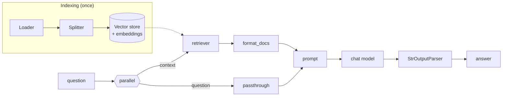

# RAG with LangChain and a Vector DB: The Complete Guide

> 📚 **Before you start**
>
> - [Retrievers](../05-rag-building-blocks-in-langchain/retrievers.md), where you built the prompt-building half of this chain.
> - [MMR, Multi-Query and Contextual Compression Retrievers](../05-rag-building-blocks-in-langchain/mmr-multi-query-and-contextual-compression-retrievers.md), for the retriever variants you can drop in.
> - [Chains and Runnables](../../langchain-complete-guide/course.md#m6), for `RunnablePassthrough`, `RunnableParallel` and `.assign()`.
> - [Vector Database Tools](../course.md#m4), for running Chroma or Qdrant.

## Introduction

A good chai stall runs like a production line. One person boils the milk, one adds tea leaves and ginger, one strains, one pours into kulhads and hands them over. Each step is simple, and the whole thing works because every step hands the next one exactly what it expects. Swap the ginger for elaichi and nothing else needs to change.

Module 5 gave you the individual workers: loaders, splitters, embeddings, vector stores and retrievers. This lesson puts them on one line: a **LangChain RAG chain** that takes a question, retrieves from a vector database, builds a grounded prompt, calls a chat model and returns an answer **with its sources**. You'll build it offline first, then see the exact same chain running on Chroma and Claude.

By the end you'll be able to write the standard RAG chain from memory, return sources alongside the answer, stream tokens to a user, refuse gracefully when nothing relevant is found, and know when to let an agent decide when to retrieve instead.

> 💡 **Key Insight**
>
> A LangChain RAG chain is **four Runnables in a row**: `{context: retriever | format, question: passthrough} | prompt | model | parser`. Every improvement in this module (better chunks, hybrid search, reranking) changes only the **retriever** slot; the rest of the chain stays the same.

---

## Core Explanation

### 1. The chain in one picture



| Slot | Runnable | Input | Output |
|---|---|---|---|
| Retrieve | `retriever` | question string | `list[Document]` |
| Format | `format_docs` (a function) | `list[Document]` | one string with labelled chunks |
| Prompt | `ChatPromptTemplate` | `{"context", "question"}` | chat messages |
| Generate | chat model | messages | `AIMessage` |
| Parse | `StrOutputParser` | `AIMessage` | string |

### 2. Indexing

We start from raw handbook text, as a loader would deliver it, split it on section headings, and index the chunks. (For this short handbook each section is already a good chunk; for long documents you'd use the recursive splitter from [Text Splitters](../05-rag-building-blocks-in-langchain/text-splitters.md).)

```python
import re, zlib
import numpy as np
from langchain_core.documents import Document
from langchain_core.embeddings import Embeddings
from langchain_core.vectorstores import InMemoryVectorStore

STOP = {"a", "an", "the", "is", "are", "of", "to", "in", "on", "for", "and", "or", "i", "my", "can",
        "do", "how", "many", "much", "what", "be", "it", "by", "with", "per", "up", "get", "if"}
CONCEPTS = {"vacation": "leave", "pto": "leave", "food": "meal", "lunch": "meal", "dinner": "meal",
            "budget": "allowance", "trip": "travel", "visit": "travel", "customer": "travel", "client": "travel",
            "notebook": "laptop", "computer": "laptop", "stolen": "lost", "resign": "notice", "quit": "notice",
            "expense": "claim", "reimbursement": "claim", "refund": "claim", "bill": "claim", "hotel": "stay",
            "room": "stay", "lodging": "stay", "baby": "parental", "maternity": "parental",
            "paternity": "parental", "doctor": "medical", "insurance": "medical", "hospital": "medical"}

def normalise(w):
    if w.endswith("ied"):
        return w[:-3] + "y"
    if w.endswith("s") and not w.endswith("ss") and len(w) > 3:
        return w[:-1]
    return w

def words(text):
    return {normalise(w) for w in re.findall(r"[a-z0-9]+", text.lower())} - STOP

class ToyEmbeddings(Embeddings):
    def __init__(self, dim=256):
        self.dim = dim
    def _embed(self, text):
        vec = np.zeros(self.dim)
        for w in words(text):
            vec[zlib.crc32(CONCEPTS.get(w, w).encode()) % self.dim] += 1.0
        norm = np.linalg.norm(vec)
        return [round(float(x), 6) for x in (vec / norm if norm else vec)]
    def embed_documents(self, texts):
        return [self._embed(t) for t in texts]
    def embed_query(self, text):
        return self._embed(text)

RAW = """## 2.1 Annual leave (page 3)
Every employee gets 24 days of paid leave per calendar year. Up to 8 unused days can be carried forward to the next year.
## 2.2 Sick leave (page 3)
Employees get 10 days of sick leave per year. A doctor's note is required for more than 2 sick days in a row.
## 3.1 Work from home (page 5)
Employees may work from home up to 2 days a week with their manager's approval.
## 5.1 Travel claims (page 8)
Submit bills on the Kharcha portal within 30 days of the trip. Approved claims are reimbursed within 15 days.
## 5.2 Meal allowance (page 8)
On client travel the daily meal allowance is Rs 1,200 in metro cities and Rs 800 in other cities.
## 5.3 Hotel stay (page 9)
Hotel stays are covered up to Rs 6,000 a night in metro cities and Rs 3,500 a night elsewhere.
## 6.1 Laptops (page 11)
A lost or stolen laptop must be reported to IT within 24 hours. The employee pays 10% of the replacement cost.
## 8.1 Notice period (page 14)
The notice period is 60 days. It can be shortened by paying basic salary for the remaining days."""

def split_on_headings(raw, source):
    chunks = []
    for block in raw.split("## ")[1:]:
        heading, body = block.split("\n", 1)
        m = re.match(r"(\S+) (.+) \(page (\d+)\)", heading)
        section, title, page = m.group(1), m.group(2), int(m.group(3))
        chunks.append(Document(page_content=f"{section} {title}: {body.strip()}", id=f"handbook-{section}",
                               metadata={"source": source, "page": page, "section": section}))
    return chunks

chunks = split_on_headings(RAW, "hr/handbook-2026.pdf")
vector_store = InMemoryVectorStore(embedding=ToyEmbeddings())
vector_store.add_documents(chunks)
retriever = vector_store.as_retriever(search_kwargs={"k": 2})
print(len(chunks), "chunks;", chunks[4].metadata)
```

Output:

```
8 chunks; {'source': 'hr/handbook-2026.pdf', 'page': 8, 'section': '5.2'}
```

### 3. A pretend chat model that reads its context

To run offline we need something in the model slot. `FakeListChatModel` returns canned replies, which is fine for plumbing but can't show you grounding. So here's a tiny stand-in that behaves the way we want a real model to behave: it reads the prompt, finds the context sentence that best matches the question, and cites its section, or says it doesn't know. It's wrapped in `RunnableLambda` so it slots into the chain exactly where a chat model goes.

```python
from langchain_core.messages import AIMessage
from langchain_core.runnables import RunnableLambda

def pretend_chat_model(prompt_value):
    text = prompt_value.to_string()
    context = text.split("Context:\n")[1].split("\n\nQuestion:")[0]
    q = words(text.split("Question:")[-1])
    q |= {CONCEPTS.get(w, w) for w in q}
    best, best_score = "I don't know based on the handbook.", 1
    for line in context.splitlines():
        if not line.startswith("["):
            continue
        label, body = line[1:].split("] ", 1)
        for sentence in re.split(r"(?<=\.) ", body.split(": ", 1)[1]):
            s_words = words(sentence)
            score = len(q & (s_words | {CONCEPTS.get(w, w) for w in s_words}))
            if score > best_score:
                best, best_score = f"{sentence} [{label.split(',')[0]}]", score
    return AIMessage(content=best)

model = RunnableLambda(pretend_chat_model)
```

When you switch to a real model, this is the only line that changes.

### 4. The standard RAG chain

```python
from langchain_core.prompts import ChatPromptTemplate
from langchain_core.output_parsers import StrOutputParser
from langchain_core.runnables import RunnablePassthrough

prompt = ChatPromptTemplate.from_messages([
    ("system", "You answer questions about the Tarang Software employee handbook. "
               "Use only the context. Cite the section in square brackets after each fact. "
               "If the context does not contain the answer, say you don't know."),
    ("human", "Context:\n{context}\n\nQuestion: {question}"),
])

def format_docs(docs):
    return "\n".join(f"[{d.metadata['section']}, p.{d.metadata['page']}] {d.page_content}" for d in docs)

rag_chain = (
    {"context": retriever | format_docs, "question": RunnablePassthrough()}
    | prompt
    | model
    | StrOutputParser()
)

print(rag_chain.invoke("What food budget do I get when I visit customers?"))
print(rag_chain.invoke("How many unused leave days carry forward?"))
```

Output:

```
On client travel the daily meal allowance is Rs 1,200 in metro cities and Rs 800 in other cities. [5.2]
Up to 8 unused days can be carried forward to the next year. [2.1]
```

That's a complete RAG application in four lines of chain. You can call any prefix of the chain on its own to see exactly what the next step receives. That's the best way to debug:

```python
prefix = {"context": retriever | format_docs, "question": RunnablePassthrough()} | prompt
print(prefix.invoke("How long is the notice period?").to_string())
```

Output:

```
System: You answer questions about the Tarang Software employee handbook. Use only the context. Cite the section in square brackets after each fact. If the context does not contain the answer, say you don't know.
Human: Context:
[8.1, p.14] 8.1 Notice period: The notice period is 60 days. It can be shortened by paying basic salary for the remaining days.
[5.2, p.8] 5.2 Meal allowance: On client travel the daily meal allowance is Rs 1,200 in metro cities and Rs 800 in other cities.

Question: How long is the notice period?
```

Whenever an answer looks wrong, print this prompt first. If the right chunk isn't in it, the problem is retrieval; if it is, the problem is the prompt or the model.

### 5. Returning the sources too

Users (and auditors) want to see where an answer came from, and a UI wants to show clickable sources. The trick is to keep the retrieved `Document`s in the output instead of throwing them away after formatting. `RunnablePassthrough.assign` adds a new key to a dictionary while keeping the old ones:

```python
answer_chain = (
    RunnablePassthrough.assign(context=lambda x: format_docs(x["docs"]))
    | prompt
    | model
    | StrOutputParser()
)

rag_with_sources = (
    {"docs": retriever, "question": RunnablePassthrough()}
    | RunnablePassthrough.assign(answer=answer_chain)
)

result = rag_with_sources.invoke("Who do I report a stolen laptop to?")
print(result["answer"])
for d in result["docs"]:
    print("  source:", d.metadata["source"], "page", d.metadata["page"], "section", d.metadata["section"])
```

Output:

```
A lost or stolen laptop must be reported to IT within 24 hours. [6.1]
  source: hr/handbook-2026.pdf page 11 section 6.1
  source: hr/handbook-2026.pdf page 3 section 2.1
```

The output is a dictionary with `question`, `docs` and `answer`, so the caller can render the answer, list the sources, and log everything for evaluation later. This is the shape you'll feed into [RAG Evaluation](../course.md#m9).

### 6. Saying "I don't know" properly

Plain similarity search always returns k chunks, so the chain above always gives the model *something*. Combine the score-threshold idea from [Retrievers](../05-rag-building-blocks-in-langchain/retrievers.md) with a short-circuit: if nothing clears the bar, skip the model entirely.

```python
def retrieve_with_threshold(question, k=2, min_score=0.25):
    pairs = vector_store.similarity_search_with_score(question, k=k)
    return [doc for doc, score in pairs if score >= min_score]

def answer_or_refuse(inputs):
    if not inputs["docs"]:
        return "I couldn't find that in the handbook. Please check with HR."
    return answer_chain.invoke(inputs)

safe_rag = (
    {"docs": RunnableLambda(retrieve_with_threshold), "question": RunnablePassthrough()}
    | RunnablePassthrough.assign(answer=RunnableLambda(answer_or_refuse))
)

for q in ["Is there a gym in the office?", "What is the hotel limit in metro cities?"]:
    r = safe_rag.invoke(q)
    print(f"{q}\n  -> {r['answer']}  (sources: {[d.metadata['section'] for d in r['docs']]})")
```

Output:

```
Is there a gym in the office?
  -> I couldn't find that in the handbook. Please check with HR.  (sources: [])
What is the hotel limit in metro cities?
  -> Hotel stays are covered up to Rs 6,000 a night in metro cities and Rs 3,500 a night elsewhere. [5.3]  (sources: ['5.3', '5.2'])
```

Skipping the model when retrieval is empty is cheaper **and** safer: the model never gets the chance to improvise. A real model with a good prompt would usually also refuse, but "usually" isn't a guarantee.

### 7. Streaming the answer

Users perceive a streamed answer as much faster, because the first words appear within a few hundred milliseconds instead of after the whole answer is generated. Every LangChain chain has `.stream()`; the parser at the end passes text chunks through as the model produces them. Here a `FakeListChatModel` (which streams its canned reply one character at a time) stands in for the real model:

```python
from langchain_core.language_models.fake_chat_models import FakeListChatModel

streaming_model = FakeListChatModel(responses=["The notice period is 60 days [8.1]."])
streaming_chain = {"context": retriever | format_docs, "question": RunnablePassthrough()} | prompt | streaming_model | StrOutputParser()

pieces = list(streaming_chain.stream("How long is the notice period?"))
print(len(pieces), "pieces:", pieces[:6], "...")
print("".join(pieces))
```

Output:

```
35 pieces: ['T', 'h', 'e', ' ', 'n', 'o'] ...
The notice period is 60 days [8.1].
```

A real model streams a few tokens per chunk rather than single characters. In a web app you'd forward each piece to the browser (server-sent events or a WebSocket); with `astream` you can do it without blocking other users. To stream the answer *and* still return the sources, use `rag_with_sources.stream(...)`: it emits the `docs` key first, then the `answer` in pieces.

### 8. The same chain on a real vector database and model

Only construction changes. Here is the production version with Chroma, Voyage embeddings and Claude:

```python
# not-run: needs langchain-chroma, langchain-voyageai, langchain-anthropic, langchain-community, pypdf and API keys
from langchain_anthropic import ChatAnthropic
from langchain_chroma import Chroma
from langchain_community.document_loaders import PyPDFLoader
from langchain_text_splitters import RecursiveCharacterTextSplitter
from langchain_voyageai import VoyageAIEmbeddings

# Indexing (run once, or when the handbook changes)
pages = PyPDFLoader("hr/handbook-2026.pdf").load()
chunks = RecursiveCharacterTextSplitter(chunk_size=800, chunk_overlap=100, add_start_index=True).split_documents(pages)
vector_store = Chroma(collection_name="tarang-handbook", persist_directory="./chroma",
                      embedding_function=VoyageAIEmbeddings(model="voyage-4"))
vector_store.add_documents(chunks)

# Answering
retriever = vector_store.as_retriever(search_type="mmr", search_kwargs={"k": 4, "fetch_k": 20})
model = ChatAnthropic(model="claude-opus-5-5", temperature=0)

def format_docs(docs):
    return "\n\n".join(f"[p.{d.metadata['page'] + 1}] {d.page_content}" for d in docs)

rag_chain = ({"context": retriever | format_docs, "question": RunnablePassthrough()}
             | prompt | model | StrOutputParser())
print(rag_chain.invoke("What food budget do I get when I visit customers in Mumbai?"))
```

Example output:

```
Mumbai is a metro city, so on client travel your daily meal allowance is Rs 1,200 [p.8].
```

Two details worth noticing. `PyPDFLoader` numbers pages from 0 in `metadata["page"]`, so the label adds 1 (or use `page_label`, which holds the printed page number when the PDF defines one). And the real model makes the small inference our pretend model can't ("Mumbai is a metro city").

### 9. Chain or agent?

The chain above **always** retrieves exactly once. That's predictable, cheap and easy to evaluate, and it's the right default for a question-answering bot over one knowledge base. Some questions need more: "Compare the meal and hotel limits for Pune and Mumbai" may need two searches; "Hi!" needs none. For those, LangChain 1.x lets you expose the retriever as a **tool** and let an agent decide when (and how often) to call it:

```python
# not-run: needs langchain and langchain-anthropic
from langchain.agents import create_agent
from langchain.tools import tool

@tool
def search_handbook(query: str) -> str:
    """Search the Tarang employee handbook. Use for any question about HR policies."""
    return format_docs(retriever.invoke(query))

agent = create_agent(model="anthropic:claude-opus-5-5", tools=[search_handbook],
                     system_prompt="Answer HR questions using search_handbook. Cite pages.")
agent.invoke({"messages": [{"role": "user", "content": "Compare meal and hotel limits for Pune and Mumbai."}]})
```

| | RAG chain | Agent with a retrieval tool |
|---|---|---|
| Retrieval calls | Exactly one per question | Zero, one or many, chosen by the model |
| Latency and cost | Low, predictable | Higher, variable |
| Good for | Direct questions over one corpus | Multi-part questions, several sources, conversation |
| Evaluation | Straightforward | Needs trajectory checks too |

Start with the chain. Move to an agent when you can point at questions the chain fails on. That road leads to [Agentic RAG Systems](../../agentic-rag-systems/course.md).

---

## Try It Yourself

1. **Swap the retriever.** Replace `retriever` in `rag_chain` with an MMR retriever (`search_type="mmr"`, `k=2`, `fetch_k=6`) and ask *"What can I claim for meals on a client trip?"*. Did the chain need any other change?
2. **Sources as a string.** Extend `rag_with_sources` so the output also has a `citations` key: a list of strings like `"hr/handbook-2026.pdf p.8"`, without duplicates.
3. **Tune the refusal.** With `min_score=0.25`, find a real handbook question (one whose answer *is* in the handbook) that gets refused. What does that tell you about thresholds?

<details>
<summary>Show answers</summary>

**1.**

```python
mmr_retriever = vector_store.as_retriever(search_type="mmr", search_kwargs={"k": 2, "fetch_k": 6})
mmr_chain = {"context": mmr_retriever | format_docs, "question": RunnablePassthrough()} | prompt | model | StrOutputParser()
q = "What can I claim for meals on a client trip?"
print([d.metadata["section"] for d in mmr_retriever.invoke(q)])
print(mmr_chain.invoke(q))
```

Output:

```
['5.1', '5.2']
Submit bills on the Kharcha portal within 30 days of the trip. [5.1]
```

No other change was needed: the retriever slot is independent of the rest of the chain. Notice the answer, though. The meal-allowance chunk (5.2) *was* retrieved, but our pretend model answered from 5.1 because the question's word "claim" matches "claims". The evidence was in the prompt, so this is a **generation** failure, not a retrieval one. A real model would combine both sections. This is exactly the kind of diagnosis section 4 taught: print the prompt, then decide which stage to blame.

**2.**

```python
def citations(x):
    seen = []
    for d in x["docs"]:
        label = f"{d.metadata['source']} p.{d.metadata['page']}"
        if label not in seen:
            seen.append(label)
    return seen

rag_with_citations = rag_with_sources | RunnablePassthrough.assign(citations=citations)
print(rag_with_citations.invoke("What is the meal allowance in metro cities?")["citations"])
```

Output:

```
['hr/handbook-2026.pdf p.9', 'hr/handbook-2026.pdf p.8']
```

**3.**

```python
for q in ["WFH rule?", "Can I work from home?", "Leave carry forward?"]:
    print(q, "->", safe_rag.invoke(q)["answer"][:60])
```

Output:

```
WFH rule? -> I couldn't find that in the handbook. Please check with HR.
Can I work from home? -> Employees may work from home up to 2 days a week with their 
Leave carry forward? -> Up to 8 unused days can be carried forward to the next year.
```

"WFH rule?" is refused even though section 3.1 answers it: the abbreviation means nothing to our toy embedding, so its score stays below the bar. "Leave carry forward?" is just as short but passes, because its words appear in the chunk. A threshold trades wrong answers for unhelpful refusals; set it from a labelled test set, and add query rewriting or hybrid search so good questions score higher.

</details>

---

## Real-World Examples

- **HR and IT help bots** inside companies are very often exactly this chain: a loader job feeding a vector store, a retriever with a permission filter, and a chat model with a "cite or say you don't know" prompt.
- **Documentation assistants** return the answer and the source links together, as in `rag_with_sources`, so readers can click through to the full page.
- **Customer-facing bots** short-circuit to a human hand-off message when retrieval finds nothing, instead of letting the model guess.
- **Products that start simple** (one chain, one corpus) usually add an agent layer only when they integrate several tools or sources.

---

## Common Misconceptions

### "LangChain RAG needs a special RAG class"

Older tutorials used helper constructors that bundled everything. The modern approach is plain Runnables you can read and change: a dictionary, a prompt, a model, a parser.

### "Formatting the context doesn't matter"

Labels (section, page, source) are what the model cites. Without them you can't verify answers, and the model can't point to evidence.

### "The model will refuse if the context is irrelevant"

Often, not always. An explicit empty-retrieval path in code is a guarantee; the prompt is a strong hint.

### "Switching vector databases means rewriting the chain"

Only the construction of the store changes. The retriever interface, and therefore the chain, stays the same.

---

## Interview Relevance

*"Build a RAG pipeline with LangChain."* Expect to write: indexing (loader, splitter, embeddings, vector store with IDs), the LCEL chain (`{"context": retriever | format, "question": RunnablePassthrough()} | prompt | model | parser`), a prompt with grounding and citation rules, returning sources with `RunnablePassthrough.assign`, streaming, and a not-found path. Mention async, batching for indexing, and how you'd evaluate it.

*"When would you use an agent instead of a chain for RAG?"* When questions need zero or several retrievals, multiple sources or tools, or conversation; trade-off is cost, latency and harder evaluation.

---

## Key Takeaways

- **The standard chain** is `{"context": retriever | format_docs, "question": RunnablePassthrough()} | prompt | model | StrOutputParser()`.
- **Return sources** by keeping the documents in the output with `RunnablePassthrough.assign(answer=...)`.
- **Refuse in code** when retrieval finds nothing above a threshold; don't rely on the prompt alone.
- **Stream** with `.stream()` / `.astream()`; the chain shape doesn't change.
- **Only the retriever slot changes** as you improve retrieval, and only construction changes when you move to a real vector DB and model.

---

**Up next:** [Chunking Strategies](chunking-strategies.md)
