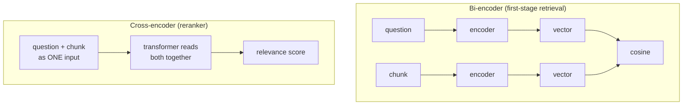

# Reranking: The Complete Guide

> 📚 **Before you start**
>
> - [Hybrid Search](hybrid-search.md), which produces the candidate list we'll rerank, and the question it couldn't fix.
> - [MMR, Multi-Query and Contextual Compression Retrievers](../05-rag-building-blocks-in-langchain/mmr-multi-query-and-contextual-compression-retrievers.md), for `BaseDocumentCompressor` and `ContextualCompressionRetriever`.

## Introduction

A company advertises one job and receives 2,000 applications. Nobody reads all 2,000 carefully. First, an automated filter keeps the 50 CVs that mention the right skills: fast, a little crude, but it rarely throws away a strong candidate. Then a hiring manager reads those 50 **properly**, each one against the job description, and picks the best 5 for interviews. Two stages: a cheap wide net, then an expensive careful look.

Retrieval works best the same way. Vector and hybrid search are the automated filter: they compare **precomputed** vectors and terms, so they can scan millions of chunks in milliseconds, but they never read the question and a chunk **together**. A **reranker** is the hiring manager: a model that takes the question and one candidate chunk as a single input and judges how well that chunk answers *this* question. It's far too slow to run over the whole index, but it's perfect for re-ordering the top 20 to 100 candidates.

In [Hybrid Search](hybrid-search.md) one question beat both retrievers: *"If I quit, how long must I stay?"* Both matched the word "stay" to the **hotel stay** section. In this lesson you'll see why a reranker gets it right, build a two-stage retriever with a relevance threshold, compare cross-encoder and LLM rerankers, and wire real rerankers (Voyage, Cohere, open-source cross-encoders) into LangChain.

> 💡 **Key Insight**
>
> First-stage retrievers encode the question and each chunk **separately**, so every word's meaning is fixed before they meet. A cross-encoder reranker reads them **together**, so "stay" next to "quit" can mean "remain employed" rather than "hotel". Use cheap retrieval for **recall** (get the answer into the top 50) and a reranker for **precision** (put it first).

---

## Core Explanation

### 1. Bi-encoders vs cross-encoders



| | Bi-encoder (embedding model) | Cross-encoder (reranker) |
|---|---|---|
| **Input** | Question and chunk encoded separately | Question and chunk concatenated, encoded together |
| **Precompute document side?** | Yes: embed every chunk once at indexing time | No: every (question, chunk) pair is a fresh model run |
| **Cost per query** | One embedding + a fast vector search over millions | One model run **per candidate** |
| **Accuracy** | Good | Better: every question word can attend to every chunk word |
| **Use** | Retrieve the top 20 to 100 from the whole index | Re-order those candidates, keep the best few |

The key word is **attention**. Inside a transformer, each token's representation is updated by looking at all other tokens in the same input. In a cross-encoder, the question's tokens can look at the chunk's tokens and vice versa, so the model can notice that "how long must I stay" after "quit" is asking about a notice period.

### 2. Setup: the knowledge base and a first-stage retriever

```python
import re, zlib
import numpy as np
from langchain_core.documents import Document
from langchain_core.embeddings import Embeddings
from langchain_core.vectorstores import InMemoryVectorStore

STOP = {"a", "an", "the", "is", "are", "of", "to", "in", "on", "for", "and", "or", "i", "my", "can",
        "do", "how", "many", "much", "what", "be", "it", "by", "with", "per", "up", "get", "if"}
CONCEPTS = {"vacation": "leave", "pto": "leave", "food": "meal", "lunch": "meal", "dinner": "meal",
            "budget": "allowance", "trip": "travel", "visit": "travel", "customer": "travel", "client": "travel",
            "notebook": "laptop", "computer": "laptop", "stolen": "lost", "resign": "notice", "quit": "notice",
            "expense": "claim", "reimbursement": "claim", "refund": "claim", "bill": "claim", "hotel": "stay",
            "room": "stay", "lodging": "stay", "baby": "parental", "maternity": "parental",
            "paternity": "parental", "doctor": "medical", "insurance": "medical", "hospital": "medical"}

def normalise(w):
    if w.endswith("ied"):
        return w[:-3] + "y"
    if w.endswith("s") and not w.endswith("ss") and len(w) > 3:
        return w[:-1]
    return w

def words(text):
    return {normalise(w) for w in re.findall(r"[a-z0-9]+", text.lower())} - STOP

class ToyEmbeddings(Embeddings):
    def __init__(self, dim=256):
        self.dim = dim
    def _embed(self, text):
        vec = np.zeros(self.dim)
        for w in words(text):
            vec[zlib.crc32(CONCEPTS.get(w, w).encode()) % self.dim] += 1.0
        norm = np.linalg.norm(vec)
        return [round(float(x), 6) for x in (vec / norm if norm else vec)]
    def embed_documents(self, texts):
        return [self._embed(t) for t in texts]
    def embed_query(self, text):
        return self._embed(text)

SECTIONS = [
    ("2.1", "Annual leave", 3, "Every employee gets 24 days of paid leave per calendar year. Up to 8 unused days can be carried forward to the next year."),
    ("2.2", "Sick leave", 3, "Employees get 10 days of sick leave per year. A doctor's note is required for more than 2 sick days in a row."),
    ("2.3", "Parental leave", 4, "Mothers get 26 weeks of paid maternity leave. Fathers get 2 weeks of paid paternity leave within 6 months of the birth."),
    ("3.1", "Work from home", 5, "Employees may work from home up to 2 days a week with their manager's approval."),
    ("4.1", "Health insurance", 6, "Medical insurance covers the employee, spouse and two children up to Rs 5 lakh a year."),
    ("5.1", "Travel claims", 8, "Submit bills on the Kharcha portal within 30 days of the trip. Approved claims are reimbursed within 15 days."),
    ("5.2", "Meal allowance", 8, "On client travel the daily meal allowance is Rs 1,200 in metro cities and Rs 800 in other cities."),
    ("5.3", "Hotel stay", 9, "Hotel stays are covered up to Rs 6,000 a night in metro cities and Rs 3,500 a night elsewhere."),
    ("6.1", "Laptops", 11, "A lost or stolen laptop must be reported to IT within 24 hours. The employee pays 10% of the replacement cost."),
    ("7.1", "Public holidays", 12, "The office is closed on 10 public holidays, including Diwali, Holi and Independence Day."),
    ("8.1", "Notice period", 14, "The notice period is 60 days. It can be shortened by paying basic salary for the remaining days."),
]

def handbook_docs():
    return [Document(page_content=f"{sec} {title}: {body}", id=f"handbook-{sec}",
                     metadata={"source": "hr/handbook-2026.pdf", "page": page, "section": sec})
            for sec, title, page, body in SECTIONS]

emb = ToyEmbeddings()
store = InMemoryVectorStore.from_documents(handbook_docs(), embedding=emb)
print(len(handbook_docs()), "chunks indexed")
```

Output:

```
11 chunks indexed
```

```python
IT_KB = [
    ("it-1", "VPN error 809: the office firewall is blocking the connection. Switch to the Tarang-Secure Wi-Fi and reconnect."),
    ("it-2", "VPN error 720: your VPN client is out of date. Install version 6.2 from the Software Centre."),
    ("it-3", "Outlook error 0x800CCC0E: the mail server cannot be reached. Check that you are on the VPN."),
    ("it-4", "Forgot your password? Reset it at passwords.tarang.in using the OTP sent to your registered mobile."),
]
store.add_documents([Document(page_content=t, id=i, metadata={"source": "it/kb.md", "page": 1, "section": i})
                     for i, t in IT_KB])

question = "If I quit, how long must I stay?"
candidates = store.similarity_search(question, k=8)          # stage 1: retrieve wide
print([d.metadata["section"] for d in candidates])
```

Output:

```
['5.3', '8.1', '5.2', '6.1', 'it-3', 'it-2', 'it-4', '7.1']
```

The right section (8.1) is in the candidate list, just not first. That's the situation rerankers are built for: **good recall, poor ranking**. (If the right chunk isn't among the candidates at all, no reranker can help; fix retrieval first.)

### 3. A toy cross-encoder

A real cross-encoder is a transformer fine-tuned on millions of (question, passage, relevant?) examples. We can't train one here, but we can build a stand-in that has the one property that matters: **it interprets each question word in the context of the other question words**, which a bi-encoder can't do. `CONTEXTUAL` is a tiny hand-written table of the kind of knowledge a real cross-encoder learns from data.

LangChain has an interface for this in `langchain-core`: `BaseCrossEncoder`, with one method, `score(list_of_(query, passage)_pairs)`.

```python
from langchain_core.cross_encoders import BaseCrossEncoder

CONTEXTUAL = {   # (word, another word in the same question) -> meaning in that context
    ("stay", "quit"): "notice", ("stay", "resign"): "notice", ("long", "quit"): "notice",
    ("long", "resign"): "notice", ("long", "notice"): "period", ("note", "doctor"): "medical",
}
FILLER = {"must", "should", "will", "need", "there", "bring", "long"}   # carry no topic on their own

def interpret(question):
    q = words(question)
    meanings = set()
    for w in q:
        contextual = [CONTEXTUAL[(w, other)] for other in q if (w, other) in CONTEXTUAL]
        if contextual:
            meanings |= set(contextual)
        elif w not in FILLER:
            meanings.add(CONCEPTS.get(w, w))
    return meanings

def chunk_concepts(text):
    return {CONCEPTS.get(w, w) for w in words(text)}

class ToyCrossEncoder(BaseCrossEncoder):
    """Scores (question, passage) pairs by how many of the question's in-context meanings the passage covers."""
    def score(self, text_pairs):
        scores = []
        for question, passage in text_pairs:
            wanted = interpret(question)
            covered = wanted & chunk_concepts(passage)
            scores.append(round(len(covered) / len(wanted), 2) if wanted else 0.0)
        return scores

print("bi-encoder view: ", sorted(CONCEPTS.get(w, w) for w in words(question)))
print("cross-encoder view:", sorted(interpret(question)))
```

Output:

```
bi-encoder view:  ['long', 'must', 'notice', 'stay']
cross-encoder view: ['notice']
```

Same words, different reading. The first-stage embedding sees "stay" and maps it to the hotel concept; the cross-encoder sees "stay" next to "quit" and reads "notice".

### 4. Reranking the candidates

```python
reranker = ToyCrossEncoder()

def rerank(question, docs, top_n=3):
    scores = reranker.score([(question, d.page_content) for d in docs])
    ranked = sorted(zip(docs, scores), key=lambda pair: -pair[1])
    return ranked[:top_n]

print("before:", [d.metadata["section"] for d in candidates[:3]])
for doc, score in rerank(question, candidates):
    print(f"after:  {score:.2f}  {doc.metadata['section']}  {doc.page_content[:50]}")
```

Output:

```
before: ['5.3', '8.1', '5.2']
after:  1.00  8.1  8.1 Notice period: The notice period is 60 days. I
after:  0.00  5.3  5.3 Hotel stay: Hotel stays are covered up to Rs 6
after:  0.00  5.2  5.2 Meal allowance: On client travel the daily mea
```

The notice-period section jumps to first place, and the hotel section drops, because the reranker read the question as a whole.

### 5. Measuring it: two stages vs one

The same mixed test set as [Hybrid Search](hybrid-search.md), measured with and without the reranker:

```python
TESTS = [
    ("VPN error 720", "it-2"), ("error 809 when connecting", "it-1"), ("0x800CCC0E in Outlook", "it-3"),
    ("reset password with OTP", "it-4"), ("What food budget do I get when I visit customers?", "5.2"),
    ("My notebook was stolen", "6.1"), ("How many vacation days carry over?", "2.1"),
    ("Leave for new fathers?", "2.3"), ("Hotel budget in Mumbai?", "5.3"), ("If I quit, how long must I stay?", "8.1"),
    ("Is the office closed on Holi?", "7.1"), ("Who is covered by medical insurance?", "4.1"),
    ("Doctor's note for sick days?", "2.2"), ("Kharcha portal deadline", "5.1"),
]

def evaluate(name, rank_fn):
    hit1 = rr = 0
    for q, gold in TESTS:
        ranked = rank_fn(q)
        if gold in ranked:
            pos = ranked.index(gold)
            hit1, rr = hit1 + (pos == 0), rr + 1 / (pos + 1)
    print(f"{name:<26} recall@1 {hit1 / len(TESTS):.2f}   MRR {rr / len(TESTS):.2f}")

evaluate("vector only (top 3)", lambda q: [d.metadata["section"] for d in store.similarity_search(q, k=3)])
evaluate("vector top 8 + rerank", lambda q: [d.metadata["section"] for d, _ in rerank(q, store.similarity_search(q, k=8))])
```

Output:

```
vector only (top 3)        recall@1 0.86   MRR 0.93
vector top 8 + rerank      recall@1 1.00   MRR 1.00
```

Recall@1 measures what users experience most directly: whether the best evidence is first. In a real system you'd also measure end-to-end answer quality with the methods in [RAG Evaluation](../course.md#m9), because the point of reranking is better answers, not better numbers.

### 6. Reranker scores enable a "not found" threshold

First-stage similarity scores are hard to threshold: they depend on the embedding model and on query length, and irrelevant chunks can still score moderately. Reranker scores are trained to mean **relevance to this question**, which makes them much better for deciding "nothing here answers the question":

```python
def answerable(question, min_score=0.6):
    best_doc, best_score = rerank(question, store.similarity_search(question, k=8), top_n=1)[0]
    return best_score >= min_score, best_doc.metadata["section"], best_score

for q in ["If I quit, how long must I stay?", "Is there a gym in the office?", "Can I bring my pet to work?"]:
    print(q, "->", answerable(q))
```

Output:

```
If I quit, how long must I stay? -> (True, '8.1', 1.0)
Is there a gym in the office? -> (False, '7.1', 0.5)
Can I bring my pet to work? -> (False, '3.1', 0.5)
```

The gym and pet questions get low best scores and can be routed to a polite "I couldn't find that" (or to a human). Calibrate the threshold on your test set: real rerankers return scores on their own scales (Voyage and Cohere return relevance scores between 0 and 1; raw cross-encoder outputs are often logits that you pass through a sigmoid).

### 7. Rerankers in LangChain

A reranker is a **document compressor**: it takes documents plus the query and returns fewer, re-ordered documents. So it plugs into the same `ContextualCompressionRetriever` you met in Module 5. Here's ours as a compressor, used through a plain chain:

```python
from langchain_core.documents import BaseDocumentCompressor
from langchain_core.runnables import RunnableLambda

class CrossEncoderRerank(BaseDocumentCompressor):
    model_config = {"arbitrary_types_allowed": True}
    model: BaseCrossEncoder
    top_n: int = 3
    min_score: float = 0.0

    def compress_documents(self, documents, query, callbacks=None):
        scores = self.model.score([(query, d.page_content) for d in documents])
        ranked = sorted(zip(documents, scores), key=lambda pair: -pair[1])
        return [d.model_copy(update={"metadata": {**d.metadata, "relevance_score": s}})
                for d, s in ranked[: self.top_n] if s >= self.min_score]

first_stage = store.as_retriever(search_kwargs={"k": 8})
compressor = CrossEncoderRerank(model=ToyCrossEncoder(), top_n=2, min_score=0.6)
two_stage = RunnableLambda(lambda q: compressor.compress_documents(first_stage.invoke(q), q))

for d in two_stage.invoke("If I resign, how long do I stay?"):
    print(d.metadata["section"], d.metadata["relevance_score"])
print(two_stage.invoke("Is there a gym in the office?"))
```

Output:

```
8.1 1.0
[]
```

The production versions swap in a real model. With an open-source cross-encoder from Hugging Face:

```python
# not-run: needs langchain-classic, langchain-community and sentence-transformers (downloads a model)
from langchain_classic.retrievers import ContextualCompressionRetriever
from langchain_classic.retrievers.document_compressors import CrossEncoderReranker
from langchain_community.cross_encoders import HuggingFaceCrossEncoder

model = HuggingFaceCrossEncoder(model_name="BAAI/bge-reranker-v2-m3")
retriever = ContextualCompressionRetriever(
    base_compressor=CrossEncoderReranker(model=model, top_n=3),
    base_retriever=hybrid_retriever,                # from the Hybrid Search lesson
)
retriever.invoke("If I quit, how long must I stay?")
```

With a hosted reranker API (Voyage AI shown; Cohere's `CohereRerank` in `langchain-cohere` works the same way):

```python
# not-run: needs langchain-voyageai and a VOYAGE_API_KEY
from langchain_voyageai import VoyageAIRerank

reranker = VoyageAIRerank(model="rerank-3", top_k=3)
retriever = ContextualCompressionRetriever(base_compressor=reranker, base_retriever=hybrid_retriever)
for doc in retriever.invoke("If I quit, how long must I stay?"):
    print(doc.metadata["relevance_score"], doc.page_content[:60])
```

Example output:

```
0.83 8.1 Notice period: The notice period is 60 days. It can be ...
0.21 5.3 Hotel stay: Hotel stays are covered up to Rs 6,000 a nig...
0.12 2.1 Annual leave: Every employee gets 24 days of paid leave ...
```

Or call the reranking API directly, without LangChain:

```python
# not-run: needs the voyageai package and a VOYAGE_API_KEY
import voyageai

vo = voyageai.Client()
result = vo.rerank("If I quit, how long must I stay?", [d.page_content for d in candidates], model="rerank-3", top_k=3)
for r in result.results:
    print(r.index, round(r.relevance_score, 2), r.document[:50])
```

### 8. LLM rerankers

A general LLM can also rerank: show it the question and a numbered list of candidates, and ask for the most relevant numbers in order (**listwise** reranking), or ask it to grade each candidate separately (**pointwise**). LangChain's `LLMListwiseRerank` (in `langchain-classic`) does the listwise version with structured output.

```python
from langchain_core.language_models.fake_chat_models import FakeListChatModel
from langchain_core.prompts import ChatPromptTemplate
from langchain_core.output_parsers import JsonOutputParser

listwise_prompt = ChatPromptTemplate.from_template(
    "Question: {question}\n\nPassages:\n{passages}\n\n"
    "Return a JSON list of the passage numbers that help answer the question, most relevant first.")
llm = FakeListChatModel(responses=["[1]"])     # what a real model returns for the passages below
llm_rerank = listwise_prompt | llm | JsonOutputParser()

top4 = candidates[:4]
passages = "\n".join(f"{i}. {d.page_content}" for i, d in enumerate(top4))
order = llm_rerank.invoke({"question": question, "passages": passages})
print(passages)
print("LLM order:", [top4[i].metadata["section"] for i in order])
```

Output:

```
0. 5.3 Hotel stay: Hotel stays are covered up to Rs 6,000 a night in metro cities and Rs 3,500 a night elsewhere.
1. 8.1 Notice period: The notice period is 60 days. It can be shortened by paying basic salary for the remaining days.
2. 5.2 Meal allowance: On client travel the daily meal allowance is Rs 1,200 in metro cities and Rs 800 in other cities.
3. 6.1 Laptops: A lost or stolen laptop must be reported to IT within 24 hours. The employee pays 10% of the replacement cost.
LLM order: ['8.1']
```

| Reranker type | Examples | Latency for 50 candidates | Strengths | Weaknesses |
|---|---|---|---|---|
| **Cross-encoder (open-source)** | BGE rerankers, ms-marco MiniLM cross-encoders | Tens to a few hundred ms on a GPU | Cheap at scale, private, fine-tunable | You host it; CPU-only is slow |
| **Reranking API** | Voyage AI rerank models, Cohere Rerank | Typically a few hundred ms | High quality, multilingual, no hosting | Per-call cost, data leaves your network |
| **LLM (listwise or pointwise)** | Any capable chat model | Seconds | Follows instructions ("prefer 2026 policies"), reasons about the question | Slow, costly, output must be validated |
| **Late interaction** | ColBERT-style models | Fast | Precomputed token vectors | Large index |

### 9. Practical settings

- **How many to retrieve:** enough that the right chunk is almost always among the candidates. Measure recall@k of the first stage at 20, 50, 100; rerank the smallest pool where it levels off.
- **How many to keep:** 3 to 8 chunks into the prompt is common. Fewer, better chunks often beat many mediocre ones.
- **Latency budget:** reranking cost grows linearly with candidates. Long chunks are also slower; many reranking APIs truncate passages beyond their context length.
- **Order in the prompt:** put the highest-scored chunk first (models use the start and end of the context most reliably).
- **Keep the scores:** log reranker scores with every answer. They're the best signal you have for "the system wasn't confident".

---

## Try It Yourself

1. **Teach the reranker.** Our toy reranker doesn't know that "Holi" and "Diwali" are public holidays. Ask `rerank("Is Diwali a day off?", store.similarity_search("Is Diwali a day off?", k=8))` and see where 7.1 lands. Then add `("off", "diwali"): "holiday"` to `CONTEXTUAL` and run it again.
2. **Pool size.** For `question`, how small can the first-stage `k` be while the reranker still puts 8.1 first?
3. **Threshold sweep.** Count how many of the 14 `TESTS` questions pass `answerable` at thresholds 0.3, 0.6 and 0.9. What's the trade-off?

<details>
<summary>Show answers</summary>

**1.**

```python
q = "Is Diwali a day off?"
print([(d.metadata["section"], s) for d, s in rerank(q, store.similarity_search(q, k=8))])
CONTEXTUAL[("off", "diwali")] = "holiday"
print([(d.metadata["section"], s) for d, s in rerank(q, store.similarity_search(q, k=8))])
```

Output:

```
[('7.1', 0.67), ('5.1', 0.33), ('8.1', 0.33)]
[('7.1', 1.0), ('5.1', 0.33), ('8.1', 0.33)]
```

Section 7.1 already wins (the word "Diwali" matches), but with only 0.67. After the change, the question's meaning includes "holiday", which section 7.1 contains, so its score rises to a confident 1.0, well clear of the 0.6 threshold. Real cross-encoders learn thousands of such associations from training data; fine-tuning on your own (question, relevant chunk) pairs teaches them your jargon.

**2.**

```python
for k in (1, 2, 3, 4):
    top = rerank(question, store.similarity_search(question, k=k), top_n=1)[0][0]
    print(k, top.metadata["section"])
```

Output:

```
1 5.3
2 8.1
3 8.1
4 8.1
```

The reranker can only promote what retrieval hands it. Once 8.1 is in the pool, it wins.

**3.**

```python
for t in (0.3, 0.6, 0.9):
    passed = sum(answerable(q, t)[0] for q, _ in TESTS)
    print(f"threshold {t}: {passed}/{len(TESTS)} answered")
```

Output:

```
threshold 0.3: 14/14 answered
threshold 0.6: 11/14 answered
threshold 0.9: 6/14 answered
```

A higher threshold refuses more: safer against wrong answers, but more real questions get "I couldn't find that". Pick the threshold where wrong answers on unanswerable questions and refusals on answerable ones are both acceptable for your users.

</details>

---

## Real-World Examples

- **Enterprise search and RAG platforms** commonly retrieve 50 to 100 hybrid candidates and rerank to 5 to 10 before generation; Anthropic's contextual retrieval experiments reported their best results with reranking added on top of hybrid search.
- **Customer support bots** use reranker scores as the trigger for human hand-off when no article is confidently relevant.
- **Legal research tools** use LLM rerankers that follow instructions such as "prefer binding judgments over commentary" or "prefer the latest amendment".
- **Multilingual products** in India rerank with multilingual models so a Hindi or Hinglish question can be matched to English policy text.

---

## Common Misconceptions

### "A reranker can fix bad retrieval"

It can only reorder candidates it receives. If the right chunk isn't in the top 50, increase the pool or fix retrieval.

### "Rerankers are too slow for production"

On 20 to 100 candidates, dedicated rerankers typically add tens to a few hundred milliseconds, which is small compared with generation. LLM rerankers are the slow ones.

### "Reranker scores are probabilities"

They're relevance scores on the model's own scale. Some APIs return 0 to 1 values, others raw logits. Calibrate thresholds on your own data.

### "If I rerank, I don't need hybrid search"

Hybrid search raises recall (the right chunk gets into the pool); reranking raises precision (it gets to the top). They solve different problems and work best together.

---

## Interview Relevance

*"What is reranking and why use it?"* Two-stage retrieval: fast bi-encoder/hybrid recall, then a cross-encoder that reads query and passage jointly for precision. Explain why joint encoding is more accurate (attention across both texts) and why it can't be used for first-stage search (no precomputation, cost per pair).

*"How would you design retrieval latency?"* Retrieve top 50 hybrid in ~50 ms, rerank in ~100 to 300 ms, keep 5; mention batching, GPU hosting or APIs, truncation, and that LLM rerankers trade latency for instruction-following.

*"How do you decide when the system should say 'I don't know'?"* Threshold on reranker scores calibrated on a labelled set; log scores; route low-confidence questions to fallback or humans.

---

## Key Takeaways

- **Bi-encoders** embed question and chunk separately (fast, precomputable); **cross-encoders** read them together (slower, more accurate).
- **Two-stage retrieval**: retrieve wide for recall, rerank to a few for precision.
- **Reranker scores** make good relevance thresholds for "not found" answers, once calibrated.
- **In LangChain** a reranker is a document compressor used with `ContextualCompressionRetriever`; options include open-source cross-encoders, Voyage and Cohere APIs, and LLM listwise rerankers.
- **Measure** recall of the first stage and precision after reranking separately.

---

**Up next:** [Lab: Chat with a PDF](lab-chat-with-a-pdf.md)
