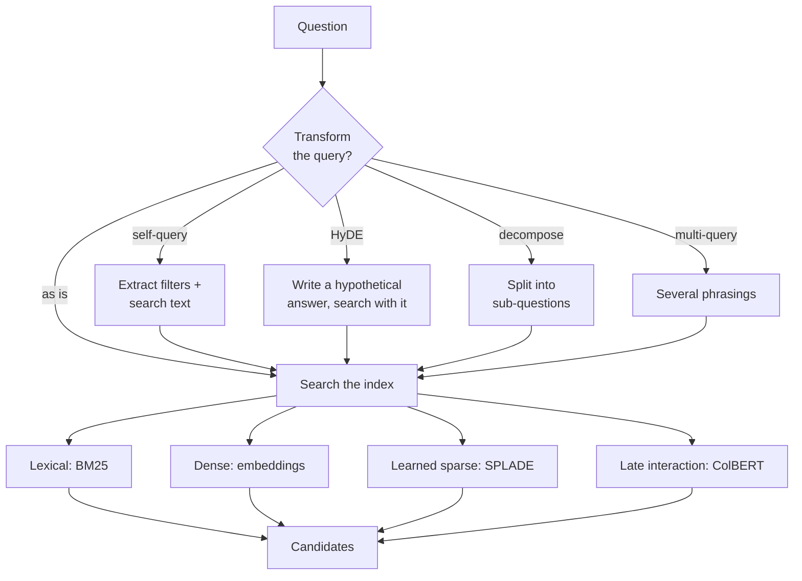
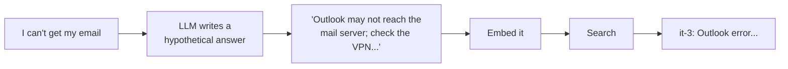

# Retrieval Methods: The Complete Guide

> 📚 **Before you start**
>
> - [Chunking Strategies](chunking-strategies.md), for how the index is built.
> - [MMR, Multi-Query and Contextual Compression Retrievers](../05-rag-building-blocks-in-langchain/mmr-multi-query-and-contextual-compression-retrievers.md), for multi-query rewriting.
> - [Semantic Search Explained](../course.md#m3), for dense (embedding) search.

## Introduction

Think about how you find a contact on your phone. If you remember the name, you type "Ravi" and the exact match pops up. If you only remember he's "the plumber from Kothrud", you search your messages for "plumber". If you remember nothing but that he fixed the geyser last Diwali, you scroll through call history around that date. Three different **retrieval methods**, each best for a different kind of memory.

A RAG system faces the same variety. Some questions contain exact identifiers (*"VPN error 720"*), some are paraphrases of the document's wording (*"food budget when visiting customers"*), some hide a filter inside the sentence (*"leave rules on page 3"*), and some are phrased so differently from the documents that no direct search will match. No single method handles all of them well.

This lesson is a map of the main retrieval methods: **lexical (BM25)**, **dense**, **learned sparse** and **late interaction** at the core, then **self-query filters**, **HyDE**, **query decomposition** and **multi-vector indexing** around them. You'll implement BM25 from scratch, see exactly where it beats embeddings and where it loses, and build each query transformation offline. The next two lessons, [Hybrid Search](hybrid-search.md) and [Reranking](reranking.md), combine these pieces.

> 💡 **Key Insight**
>
> Every retrieval method makes a bet about **how the question's words relate to the document's words**. Lexical search bets they share exact terms; dense search bets they share meaning; query transformations bet that a *rewritten* question will match better than the original. Know which bet each question type needs, and you'll know which method (or combination) to use.

---

## Core Explanation

### 1. The map



| Family | How it matches | Strong at | Weak at |
|---|---|---|---|
| **Lexical (BM25)** | Shared exact terms, weighted by rarity | Codes, names, numbers, jargon | Synonyms, paraphrases, other languages |
| **Dense (bi-encoder)** | Closeness of embedding vectors | Paraphrases, meaning, multilingual | Rare exact tokens, negation, numbers |
| **Learned sparse (SPLADE and similar)** | A model expands text into weighted terms, searched like BM25 | Exact terms *plus* learned synonyms | Needs a special model and index support |
| **Late interaction (ColBERT)** | One vector **per token**; each query token finds its best match in the document | High accuracy, fine-grained matching | Much larger index, heavier search |

### 2. Setup: the handbook plus an IT knowledge base

We add four IT help articles full of error codes, the kind of content where methods differ most.

```python
import re, zlib
import numpy as np
from langchain_core.documents import Document
from langchain_core.embeddings import Embeddings
from langchain_core.vectorstores import InMemoryVectorStore

STOP = {"a", "an", "the", "is", "are", "of", "to", "in", "on", "for", "and", "or", "i", "my", "can",
        "do", "how", "many", "much", "what", "be", "it", "by", "with", "per", "up", "get", "if"}
CONCEPTS = {"vacation": "leave", "pto": "leave", "food": "meal", "lunch": "meal", "dinner": "meal",
            "budget": "allowance", "trip": "travel", "visit": "travel", "customer": "travel", "client": "travel",
            "notebook": "laptop", "computer": "laptop", "stolen": "lost", "resign": "notice", "quit": "notice",
            "expense": "claim", "reimbursement": "claim", "refund": "claim", "bill": "claim", "hotel": "stay",
            "room": "stay", "lodging": "stay", "baby": "parental", "maternity": "parental",
            "paternity": "parental", "doctor": "medical", "insurance": "medical", "hospital": "medical"}

def normalise(w):
    if w.endswith("ied"):
        return w[:-3] + "y"
    if w.endswith("s") and not w.endswith("ss") and len(w) > 3:
        return w[:-1]
    return w

def words(text):
    return {normalise(w) for w in re.findall(r"[a-z0-9]+", text.lower())} - STOP

class ToyEmbeddings(Embeddings):
    def __init__(self, dim=256):
        self.dim = dim
    def _embed(self, text):
        vec = np.zeros(self.dim)
        for w in words(text):
            vec[zlib.crc32(CONCEPTS.get(w, w).encode()) % self.dim] += 1.0
        norm = np.linalg.norm(vec)
        return [round(float(x), 6) for x in (vec / norm if norm else vec)]
    def embed_documents(self, texts):
        return [self._embed(t) for t in texts]
    def embed_query(self, text):
        return self._embed(text)

SECTIONS = [
    ("2.1", "Annual leave", 3, "Every employee gets 24 days of paid leave per calendar year. Up to 8 unused days can be carried forward to the next year."),
    ("2.2", "Sick leave", 3, "Employees get 10 days of sick leave per year. A doctor's note is required for more than 2 sick days in a row."),
    ("2.3", "Parental leave", 4, "Mothers get 26 weeks of paid maternity leave. Fathers get 2 weeks of paid paternity leave within 6 months of the birth."),
    ("3.1", "Work from home", 5, "Employees may work from home up to 2 days a week with their manager's approval."),
    ("4.1", "Health insurance", 6, "Medical insurance covers the employee, spouse and two children up to Rs 5 lakh a year."),
    ("5.1", "Travel claims", 8, "Submit bills on the Kharcha portal within 30 days of the trip. Approved claims are reimbursed within 15 days."),
    ("5.2", "Meal allowance", 8, "On client travel the daily meal allowance is Rs 1,200 in metro cities and Rs 800 in other cities."),
    ("5.3", "Hotel stay", 9, "Hotel stays are covered up to Rs 6,000 a night in metro cities and Rs 3,500 a night elsewhere."),
    ("6.1", "Laptops", 11, "A lost or stolen laptop must be reported to IT within 24 hours. The employee pays 10% of the replacement cost."),
    ("7.1", "Public holidays", 12, "The office is closed on 10 public holidays, including Diwali, Holi and Independence Day."),
    ("8.1", "Notice period", 14, "The notice period is 60 days. It can be shortened by paying basic salary for the remaining days."),
]

def handbook_docs():
    return [Document(page_content=f"{sec} {title}: {body}", id=f"handbook-{sec}",
                     metadata={"source": "hr/handbook-2026.pdf", "page": page, "section": sec})
            for sec, title, page, body in SECTIONS]

emb = ToyEmbeddings()
store = InMemoryVectorStore.from_documents(handbook_docs(), embedding=emb)
print(len(handbook_docs()), "chunks indexed")
```

Output:

```
11 chunks indexed
```

```python
IT_KB = [
    ("it-1", "VPN error 809: the office firewall is blocking the connection. Switch to the Tarang-Secure Wi-Fi and reconnect."),
    ("it-2", "VPN error 720: your VPN client is out of date. Install version 6.2 from the Software Centre."),
    ("it-3", "Outlook error 0x800CCC0E: the mail server cannot be reached. Check that you are on the VPN."),
    ("it-4", "Forgot your password? Reset it at passwords.tarang.in using the OTP sent to your registered mobile."),
]
it_docs = [Document(page_content=text, id=i, metadata={"source": "it/kb.md", "page": 1, "section": i}) for i, text in IT_KB]
all_docs = handbook_docs() + it_docs
store.add_documents(it_docs)
print(len(all_docs), "documents in the store")
```

Output:

```
15 documents in the store
```

### 3. Lexical search: BM25 from scratch

**BM25** ("Best Matching 25", from the Okapi research system of the 1990s) is still the default ranking function of Elasticsearch, OpenSearch and Lucene. It scores a document for a query by adding up, for each query term that appears in the document:

```
score(term) = IDF(term) × tf × (k1 + 1) / (tf + k1 × (1 − b + b × doc_length / avg_length))
```

Three ideas are packed into it:

| Part | Idea | Everyday version |
|---|---|---|
| **IDF** (inverse document frequency) | Rare terms matter more: `ln(1 + (N − n + 0.5) / (n + 0.5))` for a term in n of N documents | "Tatkal" tells you more than "ticket" |
| **tf saturation** with `k1` (about 1.2 to 2) | The 10th occurrence of a word adds much less than the 1st | Saying "VPN" five times doesn't make a page five times more about VPNs |
| **Length normalisation** with `b` (about 0.75) | A match in a short document counts more than in a long one | One mention in a tweet beats one mention in a book |

```python
import math
from collections import Counter

def tokens(text):
    return [normalise(w) for w in re.findall(r"[a-z0-9]+", text.lower()) if w not in STOP]

class BM25:
    def __init__(self, docs, k1=1.5, b=0.75):
        self.docs, self.k1, self.b = docs, k1, b
        self.tfs = [Counter(tokens(d.page_content)) for d in docs]
        self.lengths = [sum(tf.values()) for tf in self.tfs]
        self.avg_length = sum(self.lengths) / len(self.lengths)
        df = Counter(term for tf in self.tfs for term in tf)          # documents containing each term
        n_docs = len(docs)
        self.idf = {t: math.log(1 + (n_docs - n + 0.5) / (n + 0.5)) for t, n in df.items()}

    def score(self, query, i):
        tf, length = self.tfs[i], self.lengths[i]
        total = 0.0
        for term in tokens(query):
            if term in tf:
                f = tf[term]
                total += self.idf[term] * f * (self.k1 + 1) / (f + self.k1 * (1 - self.b + self.b * length / self.avg_length))
        return total

    def search(self, query, k=3):
        ranked = sorted(range(len(self.docs)), key=lambda i: -self.score(query, i))[:k]
        return [(self.docs[i], self.score(query, i)) for i in ranked]

bm25 = BM25(all_docs)
print("idf('vpn') =", round(bm25.idf["vpn"], 2), "  idf('720') =", round(bm25.idf["720"], 2))
for doc, s in bm25.search("VPN error 720"):
    print(f"  {s:.2f}  {doc.metadata['section']}  {doc.page_content[:50]}")
```

Output:

```
idf('vpn') = 1.52   idf('720') = 2.37
  6.24  it-2  VPN error 720: your VPN client is out of date. Ins
  3.55  it-3  Outlook error 0x800CCC0E: the mail server cannot b
  3.33  it-1  VPN error 809: the office firewall is blocking the
```

"VPN" appears in three articles, so it's worth less than "720", which appears in one. The article with both wins clearly.

In LangChain, `BM25Retriever` from `langchain-community` (built on the `rank-bm25` package) gives you this as a retriever; Elasticsearch and OpenSearch do it at scale; and several vector databases (Qdrant, Weaviate, Milvus, MongoDB Atlas and others) now index sparse or full-text fields next to vectors.

### 4. Lexical vs dense, head to head

Now the same questions through both methods:

```python
def compare(question):
    lex = [(d.metadata["section"], round(s, 2)) for d, s in bm25.search(question)]
    den = [(d.metadata["section"], round(s, 2)) for d, s in store.similarity_search_with_score(question, k=3)]
    print(f"{question}\n   BM25:  {lex}\n   dense: {den}")

compare("error 809 when connecting")
compare("What food budget do I get when I visit customers?")
compare("I can't get my email")
```

Output:

```
error 809 when connecting
   BM25:  [('it-1', 4.26), ('it-3', 1.77), ('it-2', 1.57)]
   dense: [('8.1', 0.3), ('it-1', 0.28), ('it-4', 0.15)]
What food budget do I get when I visit customers?
   BM25:  [('2.1', 0.0), ('2.2', 0.0), ('2.3', 0.0)]
   dense: [('5.2', 0.53), ('5.1', 0.35), ('8.1', 0.23)]
I can't get my email
   BM25:  [('2.1', 0.0), ('2.2', 0.0), ('2.3', 0.0)]
   dense: [('it-4', 0.0), ('it-3', 0.0), ('it-2', 0.0)]
```

Three lessons in three questions:

- **Codes favour lexical search.** BM25 ranks the error-809 article first with a big margin. The dense search puts the *notice period* section (8.1) on top: our toy embedding hashes the token "809" into the same slot as something in that section, a crude version of a real failure mode. Real embedding models represent rare codes and numbers fuzzily, so "error 809" lands near "error 720" or near anything with similar digits.
- **Paraphrases favour dense search.** "Food budget" and "visit customers" share no words with "meal allowance on client travel", so BM25 scores every document 0. The embedding knows these words are related.
- **Some questions defeat both.** "Email" never appears in the KB (the article says "mail server" and "Outlook"), so BM25 finds nothing, and our embedding doesn't link "email" to "mail" either. Section 7 fixes this one with a query transformation.

This complementarity is the reason [Hybrid Search](hybrid-search.md) exists.

### 5. Learned sparse and late interaction, briefly

Two newer families try to get the best of both worlds:

- **Learned sparse retrieval** (SPLADE is the best-known model) runs a transformer over the text and outputs a weight for many vocabulary terms, including terms that *aren't in the text* but are related. "Email" might get weight on "mail", "outlook" and "inbox". The result is a sparse vector you can search with an inverted index, like BM25, but with synonyms built in.
- **Late interaction** (ColBERT and its successors) keeps one embedding **per token** instead of one per chunk. At query time, each query token finds its most similar document token, and the scores are summed ("MaxSim"). It catches fine-grained matches that single-vector embeddings blur, at the cost of a much bigger index. ColPali applies the same idea to images of document pages, which matters for [Multimodal RAG](../07-advanced-rag/multimodal-rag.md).

Here's MaxSim in miniature, with each word as a "token" embedded by our toy model:

```python
def maxsim(query, doc_text):
    q_vecs = [np.array(emb.embed_query(w)) for w in tokens(query)]
    d_vecs = [np.array(emb.embed_query(w)) for w in tokens(doc_text)]
    return sum(max(float(q @ d) for d in d_vecs) for q in q_vecs)

q = "food budget for customer visits"
for sec in ("5.2", "5.1", "2.1"):
    text = store.get_by_ids([f"handbook-{sec}"])[0].page_content
    print(sec, round(maxsim(q, text), 2))
```

Output:

```
5.2 4.0
5.1 2.0
2.1 0.0
```

Each query word found its best partner ("food" matched "meal", "budget" matched "allowance", "customer" matched "client"), and the meal-allowance section collects the most matches. A real ColBERT model does this with contextual token embeddings from a transformer.

### 6. Self-query: pull filters out of the question

Users often put filters in plain language: *"What do the **IT articles** say about the VPN?"*, *"leave rules on **page 3**"*. Embedding the whole sentence wastes that structure. **Self-query retrieval** asks an LLM to split the question into a **search string** and a **structured filter**, using a description of the metadata fields:

```python
from langchain_core.language_models.fake_chat_models import FakeListChatModel
from langchain_core.prompts import ChatPromptTemplate
from langchain_core.output_parsers import JsonOutputParser

self_query_prompt = ChatPromptTemplate.from_template(
    "Metadata fields: source (one of 'hr/handbook-2026.pdf', 'it/kb.md'), page (integer).\n"
    "Split the question into a search string and a filter. Reply as JSON with keys "
    "'query' and 'filter' (a dict of field: value, or {{}}).\n\nQuestion: {question}")

fake_llm = FakeListChatModel(responses=['{"query": "connection problems", "filter": {"source": "it/kb.md"}}'])
self_query = self_query_prompt | fake_llm | JsonOutputParser()

parsed = self_query.invoke({"question": "What do the IT articles say about connection problems?"})
print(parsed)

match = lambda doc: all(doc.metadata.get(k) == v for k, v in parsed["filter"].items())
print([d.metadata["section"] for d in store.similarity_search(parsed["query"], k=3, filter=match)])
print([d.metadata["section"] for d in store.similarity_search("What do the IT articles say about connection problems?", k=3)])
```

Output:

```
{'query': 'connection problems', 'filter': {'source': 'it/kb.md'}}
['it-1', 'it-4', 'it-3']
['it-1', '4.1', '5.2']
```

With the filter, every result is an IT article; without it, the raw sentence pulls in handbook sections. Always **validate** the LLM's filter (known fields, allowed values) before using it: it's model output, and a wrong filter silently hides the right documents. LangChain's `SelfQueryRetriever` (in `langchain-classic`) packages this pattern and translates the filter into each vector store's own syntax; with modern models, structured output into a Pydantic schema is an equally good way to build it yourself.

### 7. HyDE: search with a hypothetical answer

**HyDE** (Hypothetical Document Embeddings, Gao et al., 2022) flips the problem around. Questions and answers are written differently ("I can't get my email" vs "the mail server cannot be reached"). So ask an LLM to write a **fake answer** first, without any retrieval, and embed *that*. Even if the fake answer's facts are wrong, its *vocabulary* looks like the documents.



```python
hyde_llm = FakeListChatModel(responses=[
    "If Outlook cannot receive mail, the mail server may be unreachable. Check your VPN connection and try again."])
hyde_prompt = ChatPromptTemplate.from_template(
    "Write a short passage from an IT help article that answers: {question}")
hyde = hyde_prompt | hyde_llm

question = "I can't get my email"
fake_answer = hyde.invoke({"question": question}).content
print("hypothetical:", fake_answer)
print("plain:", [(d.metadata["section"], round(s, 2)) for d, s in store.similarity_search_with_score(question, k=2)])
print("HyDE: ", [(d.metadata["section"], round(s, 2)) for d, s in store.similarity_search_with_score(fake_answer, k=2)])
```

Output:

```
hypothetical: If Outlook cannot receive mail, the mail server may be unreachable. Check your VPN connection and try again.
plain: [('it-4', 0.0), ('it-3', 0.0)]
HyDE:  [('it-3', 0.5), ('it-1', 0.15)]
```

The plain question scored zero against everything; the hypothetical answer goes straight to the Outlook article. HyDE helps most when questions are short, vague or informal and documents are formal. The risks: an extra LLM call per question, and a model that confidently writes about the wrong topic will steer the search there. It's also important that the hypothetical answer **is never shown to the user**; it's only a search key.

### 8. Query decomposition and step-back

**Decomposition** handles questions with several parts. *"I am quitting: how long is my notice and can I carry forward leave?"* needs two sections (notice period and annual leave), and one embedding of the combined question may land between them, or closer to one part than the other. Ask an LLM to split it, retrieve for each part, and merge:

```python
decomposer = FakeListChatModel(responses=["How long is the notice period?\nHow many unused leave days can be carried forward?"])
split_prompt = ChatPromptTemplate.from_template("Split into independent sub-questions, one per line:\n{question}")

compound = "I am quitting: how long is my notice and can I carry forward leave?"
subs = (split_prompt | decomposer).invoke({"question": compound}).content.splitlines()
print("as one query:", [d.metadata["section"] for d in store.similarity_search(compound, k=2)])
merged = []
for sub in subs:
    top = store.similarity_search(sub, k=1)[0].metadata["section"]
    print(f"  {sub} -> {top}")
    merged.append(top)
print("decomposed:  ", merged)
```

Output:

```
as one query: ['2.1', '3.1']
  How long is the notice period? -> 8.1
  How many unused leave days can be carried forward? -> 2.1
decomposed:   ['8.1', '2.1']
```

As one query, the notice-period section (8.1) doesn't even make the top 2: "leave" and "carry forward" dominate the vector, and "quitting" alone isn't enough. Each sub-question finds its section first.

**Step-back prompting** goes the other direction: for a very specific question (*"Can I claim the Rs 450 auto fare from my Pune client visit on 12 March?"*) it first asks a more general one (*"What are the rules for claiming local transport?"*), retrieves for both, and lets the model apply the general rule to the specifics.

Decomposition is also the first step towards agents: once sub-questions can depend on earlier answers (*"Who is my manager, and what is their approval limit?"*), you need a loop rather than a fixed pipeline. That's [Agentic RAG Systems](../../agentic-rag-systems/course.md).

### 9. Multi-vector indexing: many keys, one document

Instead of transforming the **query** at search time, you can enrich the **index** at indexing time. **Multi-vector retrieval** stores several vectors per chunk, each a different "key", all pointing to the same chunk:

- an LLM-written **summary** of the chunk (good for long or noisy chunks and tables);
- **hypothetical questions** the chunk answers (the indexing-time mirror of HyDE);
- the chunk text itself.

```python
QUESTIONS = {   # what an LLM might generate for each chunk at indexing time
    "it-3": ["Why is my email not working?", "Outlook will not connect", "I am not receiving emails"],
    "it-4": ["How do I reset my password?", "I forgot my login"],
}
key_store = InMemoryVectorStore(embedding=emb)
key_store.add_documents([Document(page_content=q, metadata={"doc_id": doc_id})
                         for doc_id, qs in QUESTIONS.items() for q in qs])

def multi_vector_search(question, k=1):
    hits = key_store.similarity_search(question, k=k)
    return [store.get_by_ids([h.metadata["doc_id"]])[0] for h in hits]

print([d.metadata["section"] for d in multi_vector_search("I can't get my email")])
```

Output:

```
['it-3']
```

The question matched a stored hypothetical question, and the system returned the real article it belongs to. The cost moves from query time (HyDE's LLM call on every question) to indexing time (one LLM call per chunk, once). LangChain's `MultiVectorRetriever` in `langchain-classic` implements this with a vector store for the keys and a document store for the originals.

### 10. Choosing methods

| Your questions look like | Start with | Add |
|---|---|---|
| Exact identifiers: error codes, SKUs, names, legal citations | BM25 | Dense, in a hybrid |
| Natural-language paraphrases of document content | Dense | BM25 hybrid, reranking |
| Mixed (most real systems) | **Hybrid** BM25 + dense | Reranking |
| Contain filters ("in 2025", "IT docs only", "for Pune") | Self-query or a filter form in the UI | |
| Short, vague, informal; formal documents | HyDE or multi-vector questions | Multi-query |
| Multi-part | Decomposition | An agent, if parts depend on each other |
| Very long, structured documents with a good table of contents | [Vectorless RAG](../course.md#m8) tree search | |

Whatever you choose, measure it on your test set; every transformation adds latency and cost, and some will not help your data.

---

## Try It Yourself

1. **Tune BM25.** Create `BM25(all_docs, b=0)` (no length normalisation) and compare the top 3 for *"VPN"* with the default. Why does the order change?
2. **A rare token.** Run `compare("OTP on registered mobile")`. Do the two methods agree? Would you expect them to with a real embedding model?
3. **Validate a self-query filter.** Write `safe_filter(parsed)` that drops any filter key that isn't `source` or `page`, and any `source` value not in the two known sources.

<details>
<summary>Show answers</summary>

**1.**

```python
for name, model in (("default b=0.75", bm25), ("b=0", BM25(all_docs, b=0))):
    print(name, [(d.metadata["section"], round(s, 2)) for d, s in model.search("VPN")])
```

Output:

```
default b=0.75 [('it-2', 2.22), ('it-3', 1.77), ('it-1', 1.67)]
b=0 [('it-2', 2.17), ('it-1', 1.52), ('it-3', 1.52)]
```

With `b=0` every document is treated as the same length, so the scores depend only on how often "VPN" appears. With the default, a mention in a **shorter** article counts for more, which reorders documents with the same number of mentions.

**2.**

```python
compare("OTP on registered mobile")
```

Output:

```
OTP on registered mobile
   BM25:  [('it-4', 7.78), ('2.1', 0.0), ('2.2', 0.0)]
   dense: [('it-4', 0.52), ('8.1', 0.17), ('it-1', 0.16)]
```

Here both methods agree, because our toy embedding is itself word-based. With a real embedding model the gap appears more often on rare tokens like "OTP", product codes and error numbers; build your own head-to-head on real questions to see it.

**3.**

```python
ALLOWED = {"source": {"hr/handbook-2026.pdf", "it/kb.md"}, "page": None}   # None = any value

def safe_filter(parsed):
    clean = {}
    for key, value in parsed.get("filter", {}).items():
        if key in ALLOWED and (ALLOWED[key] is None or value in ALLOWED[key]):
            clean[key] = value
    return clean

print(safe_filter({"query": "x", "filter": {"source": "it/kb.md", "salary": 10, "page": 3}}))
print(safe_filter({"query": "x", "filter": {"source": "secret/plans.md"}}))
```

Output:

```
{'source': 'it/kb.md', 'page': 3}
{}
```

</details>

---

## Real-World Examples

- **Developer documentation search** combines BM25 (for exact function and error names) with embeddings (for "how do I..." questions).
- **E-commerce** search engines use learned sparse models and late-interaction rerankers to match "running shoes for flat feet" to product titles that never use those words.
- **Analytics and finance assistants** use self-query style extraction so "revenue in Q2 2025 for the South region" becomes a filtered search, not a fuzzy one.
- **Help desks** pre-generate hypothetical questions for every article (multi-vector), because users write like users and articles are written like manuals.

---

## Common Misconceptions

### "Embeddings made keyword search obsolete"

BM25 remains hard to beat on exact terms and is a strong baseline on many benchmarks. Modern systems combine both.

### "HyDE puts made-up facts into the answer"

The hypothetical answer is only used as a search key. The final answer is still generated from the real retrieved documents.

### "Self-query is always safe"

It's model output. Validate field names and values, and log the filters so you can spot when a wrong filter hid the right document.

### "More query transformations are always better"

Each adds an LLM call, latency and a chance to drift from the user's intent. Add them where your evaluation shows a specific failure they fix.

---

## Interview Relevance

*"Explain BM25."* TF-IDF family; IDF rewards rare terms; term frequency saturates via k1; length normalisation via b; default in Lucene-based engines; strong on exact terms.

*"Dense vs sparse retrieval, when to use which?"* Dense for meaning and paraphrase, sparse for exact tokens; hybrid for mixed workloads; mention learned sparse (SPLADE) and late interaction (ColBERT) as middle grounds.

*"What query transformations do you know?"* Multi-query, HyDE, decomposition, step-back, self-query; explain the failure each fixes and its cost. Mention indexing-time alternatives such as multi-vector hypothetical questions.

---

## Key Takeaways

- **BM25** matches exact terms, weighting rare ones higher, with saturation (k1) and length normalisation (b); it wins on codes and names.
- **Dense retrieval** matches meaning; it wins on paraphrases and loses on rare exact tokens.
- **Learned sparse** and **late interaction** models blend the two at extra cost.
- **Query transformations** (self-query, HyDE, decomposition, step-back, multi-query) rewrite the question so it matches better; **multi-vector** indexing enriches the documents instead.
- **Match the method to the question type**, combine methods, and measure.

---

**Up next:** [Hybrid Search](hybrid-search.md)
