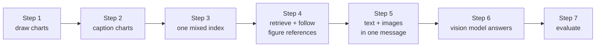

# Lab: RAG over images and text

> 📚 **Before you start**
>
> - [Multimodal RAG](multimodal-rag.md), for the three retrieval approaches and how to send images to a vision model. This lab builds approach A end to end.
> - [Lab: Chat with a PDF](../06-implementing-rag/lab-chat-with-a-pdf.md), for page-level citations and a small evaluation set.

## What You'll Build

**Swaad Express** (a made-up cloud-kitchen chain) has a half-yearly review: four pages of text and three charts. Half of what managers ask about it (*"Which city ordered the most?"*, *"Which month was delivery slowest?"*) is answered **only** by the charts. You'll build a RAG app that handles both:

- draw the three charts as real PNG files, the way they'd sit inside the report;
- caption each chart for search, with numbers and labels written out;
- index text pages and captions together, with page numbers and image paths in metadata;
- retrieve, and pull in any figure that a retrieved page refers to;
- build a message for a vision model with the text context **and the chart images**;
- measure how many questions a text-only app could answer versus yours.



> 💡 **Key Insight**
>
> The caption is for **finding** the chart, the image is for **reading** it. Index captions with the image path in metadata, and at answer time send the original image to the model, so even details the caption missed can still be answered.

---

## Step 1: The report and its charts

The text pages are plain strings. The charts are drawn with matplotlib from the numbers below and saved as PNG files in a temporary folder.

```python
import os, re, struct, tempfile, zlib
import numpy as np
import matplotlib
matplotlib.use("Agg")
import matplotlib.pyplot as plt

PAGES = {
    1: "Swaad Express review, April to September 2026. Total orders grew 22% to 1.76 lakh across five cities. Figure 1 breaks orders down by city.",
    2: "Delivery times improved over the half, though heavy monsoon rain slowed riders, as Figure 2 shows. Riders get a rain bonus of Rs 30 per order when rainfall exceeds 20 mm.",
    3: "The menu was simplified from 140 to 96 dishes. Figure 3 shows each cuisine's share of orders. Biryani is now cooked in the Hyderabad kitchen only.",
    4: "Customer ratings averaged 4.3 stars. The top complaint was cold food on long deliveries, so insulated bags were rolled out in August.",
}

CHARTS = {
    1: {"page": 1, "kind": "bar", "title": "Orders by city, April to September 2026", "unit": "orders",
        "data": {"Bengaluru": 48200, "Mumbai": 41500, "Delhi": 39800, "Hyderabad": 27300, "Pune": 18900}},
    2: {"page": 2, "kind": "line", "title": "Average delivery time by month (minutes)", "unit": "minutes",
        "data": {"April": 34, "May": 33, "June": 31, "July": 38, "August": 36, "September": 29}},
    3: {"page": 3, "kind": "pie", "title": "Share of orders by cuisine", "unit": "%",
        "data": {"North Indian": 38, "South Indian": 27, "Chinese": 19, "Biryani": 16}},
}

folder = tempfile.mkdtemp()

def draw(n, chart):
    fig, ax = plt.subplots(figsize=(5, 3.2), dpi=100)
    labels, values = list(chart["data"]), list(chart["data"].values())
    if chart["kind"] == "bar":
        ax.bar(labels, values)
    elif chart["kind"] == "line":
        ax.plot(labels, values, marker="o")
    else:
        ax.pie(values, labels=[f"{k} {v}%" for k, v in chart["data"].items()])
    ax.set_title(chart["title"], fontsize=10)
    fig.tight_layout()
    path = os.path.join(folder, f"figure-{n}.png")
    fig.savefig(path)
    plt.close(fig)
    return path

def png_size(path):
    with open(path, "rb") as f:
        header = f.read(24)
    return struct.unpack(">II", header[16:24])          # width and height live in the PNG header

for n, chart in CHARTS.items():
    chart["path"] = draw(n, chart)
    print(f"Figure {n}: {os.path.basename(chart['path'])}, {png_size(chart['path'])} pixels, page {chart['page']}")
```

Output:

```
Figure 1: figure-1.png, (500, 320) pixels, page 1
Figure 2: figure-2.png, (500, 320) pixels, page 2
Figure 3: figure-3.png, (500, 320) pixels, page 3
```

These are genuine image files. A PDF loader run on the full report would give you the four text pages and nothing from these three files.

## Step 2: Caption each chart for search

In production, each image goes to a vision model with a captioning prompt. The prompt matters more than the model: ask for every number and label, and for the extremes and trend in plain words, because those are what people ask about.

```python
# not-run: needs langchain-anthropic and an API key
import base64
from langchain_anthropic import ChatAnthropic
from langchain_core.messages import HumanMessage

CAPTION_PROMPT = ("Describe this figure so it can be found by search. Start with the figure type and title. "
                  "List every label with its exact value. Then say in plain words which value is highest "
                  "and which is lowest. Do not guess anything you cannot read.")
vision = ChatAnthropic(model="claude-opus-5-5", temperature=0)

def caption_with_model(path):
    data = base64.b64encode(open(path, "rb").read()).decode()
    message = HumanMessage(content=[{"type": "text", "text": CAPTION_PROMPT},
                                    {"type": "image", "base64": data, "mime_type": "image/png"}])
    return vision.invoke([message]).content
```

So the lab runs offline, `caption_offline` below plays the vision model. It writes the caption from the same numbers the chart was drawn from, following the prompt's rules, so it is the caption a careful model *should* produce (a real one can misread small text, which is why Step 5 still sends the image).

```python
def caption_offline(n, chart):
    data = chart["data"]
    hi, lo = max(data, key=data.get), min(data, key=data.get)
    items = ", ".join(f"{k} {v:,}" + ("%" if chart["unit"] == "%" else "") for k, v in data.items())
    extremes = {"bar": f"{hi} placed the most orders and {lo} the fewest.",
                "line": f"Delivery was slowest in {hi} and fastest in {lo}.",
                "pie": f"{hi} is the largest share and {lo} the smallest."}[chart["kind"]]
    return f"Figure {n}, {chart['kind']} chart: {chart['title']}. Values: {items}. {extremes}"

for n, chart in CHARTS.items():
    chart["caption"] = caption_offline(n, chart)
    print(chart["caption"], "\n")
```

Output:

```
Figure 1, bar chart: Orders by city, April to September 2026. Values: Bengaluru 48,200, Mumbai 41,500, Delhi 39,800, Hyderabad 27,300, Pune 18,900. Bengaluru placed the most orders and Pune the fewest. 

Figure 2, line chart: Average delivery time by month (minutes). Values: April 34, May 33, June 31, July 38, August 36, September 29. Delivery was slowest in July and fastest in September. 

Figure 3, pie chart: Share of orders by cuisine. Values: North Indian 38%, South Indian 27%, Chinese 19%, Biryani 16%. North Indian is the largest share and Biryani the smallest.
```

## Step 3: One index for text and images

Text pages and captions go into the same vector store. Each document says what it is (`type`), where it came from (`page`), and, for images, where the original file lives (`path`). The toy embedding hashes words (with a few synonyms merged) so everything runs offline.

```python
from langchain_core.documents import Document
from langchain_core.embeddings import Embeddings
from langchain_core.vectorstores import InMemoryVectorStore

STOP = {"a", "an", "the", "is", "are", "was", "of", "to", "in", "on", "for", "and", "or", "by", "with",
        "what", "which", "how", "many", "much", "did", "do", "does", "at", "from", "now", "get", "so"}
SAME = {"order": "orders", "ordered": "orders", "cities": "city", "deliveries": "delivery",
        "slow": "slowest", "slowed": "slowest", "month": "monthly", "months": "monthly",
        "rating": "ratings", "rated": "ratings", "dish": "dishes", "cuisines": "cuisine", "share": "shares"}

def words(text):
    return {SAME.get(w, w) for w in re.findall(r"[a-z0-9]+", text.lower()) if w not in STOP}

class WordEmbeddings(Embeddings):
    def _embed(self, text):
        v = np.zeros(512)
        for w in words(text):
            v[zlib.crc32(w.encode()) % 512] += 1
        n = np.linalg.norm(v)
        return list(v / n) if n else list(v)
    def embed_documents(self, texts):
        return [self._embed(t) for t in texts]
    def embed_query(self, text):
        return self._embed(text)

text_docs = [Document(t, id=f"page-{p}", metadata={"type": "text", "page": p}) for p, t in PAGES.items()]
image_docs = [Document(c["caption"], id=f"figure-{n}",
                       metadata={"type": "image", "page": c["page"], "figure": n, "path": c["path"]})
              for n, c in CHARTS.items()]

store = InMemoryVectorStore(WordEmbeddings())
store.add_documents(text_docs + image_docs)
text_only = InMemoryVectorStore(WordEmbeddings())          # the baseline: what a text-only loader gives you
text_only.add_documents(text_docs)
print(len(text_docs), "text pages +", len(image_docs), "figure captions indexed")
```

Output:

```
4 text pages + 3 figure captions indexed
```

## Step 4: Retrieve, then follow figure references

Retrieve the top two documents, then add any figure that a retrieved page mentions. Documents keep their retrieval order, with referenced figures inserted right after the page that cites them.

```python
BY_ID = {d.id: d for d in text_docs + image_docs}

def retrieve(question, index=None, k=2, follow_refs=True):
    hits, out = (index or store).similarity_search(question, k=k), []
    for d in hits:
        refs = [f"figure-{n}" for n in re.findall(r"Figure (\d+)", d.page_content)] if follow_refs else []
        for doc_id in [d.id] + refs:
            if doc_id not in [o.id for o in out]:
                out.append(BY_ID[doc_id])
    return out

for q in ["Which city placed the most orders?", "Was delivery slowed by the monsoon rain?",
          "How many dishes are on the menu?"]:
    print(f"{q:<42}", [d.id for d in retrieve(q)])
```

Output:

```
Which city placed the most orders?         ['page-3', 'figure-3', 'figure-1']
Was delivery slowed by the monsoon rain?   ['page-2', 'figure-2']
How many dishes are on the menu?           ['page-3', 'figure-3', 'figure-2']
```

The reference trick is doing real work here. The monsoon question matched page 2 strongly and Figure 2 only weakly (the caption shares just "delivery" and "slowest" with it), but page 2 points at Figure 2, so the chart is guaranteed to come along. The menu question only really matches page 3 (the second hit, Figure 2, scored zero and is noise), and page 3's reference brings in the cuisine chart. The city question shows both sides of it: page 3 ranks first (it mentions "orders"), drags in Figure 3, which is irrelevant, and Figure 1 still makes it as the second hit. An extra chart is cheap insurance, but as you'll see in Step 5 and exercise 2, the **order** of the evidence starts to matter once you cap how many images you send.

## Step 5: Text and images in one message

Now build what the vision model receives: one text block with the retrieved text **and captions**, each labelled for citation, followed by the original images. Cap the number of images, since each one costs tokens.

```python
import base64
from langchain_core.messages import HumanMessage, SystemMessage

SYSTEM = ("Answer only from the report extracts and figures provided. Cite pages as (p. N) and figures as "
          "(Figure N). If they don't contain the answer, say you don't know.")

def build_messages(question, docs, max_images=2):
    lines, images = [], []
    for d in docs:
        label = f"Figure {d.metadata['figure']}, p. {d.metadata['page']}" if d.metadata["type"] == "image" else f"p. {d.metadata['page']}"
        lines.append(f"[{label}] {d.page_content}")
        if d.metadata["type"] == "image" and len(images) < max_images:
            data = base64.b64encode(open(d.metadata["path"], "rb").read()).decode()
            images.append({"type": "image", "base64": data, "mime_type": "image/png"})
    text = "Report extracts:\n" + "\n".join(lines) + f"\n\nQuestion: {question}"
    return [SystemMessage(SYSTEM), HumanMessage(content=[{"type": "text", "text": text}] + images)]

def image_tokens(messages):
    total = 0
    for block in messages[-1].content:
        if block["type"] == "image":
            path = os.path.join(folder, "probe.png")
            open(path, "wb").write(base64.b64decode(block["base64"]))
            w, h = png_size(path)
            total += round(w * h / 750)
    return total

msgs = build_messages("Which month was delivery slowest?", retrieve("Which month was delivery slowest?"))
print(msgs[-1].content[0]["text"])
print([b["type"] for b in msgs[-1].content], "| approx. image tokens:", image_tokens(msgs))
```

Output:

```
Report extracts:
[Figure 2, p. 2] Figure 2, line chart: Average delivery time by month (minutes). Values: April 34, May 33, June 31, July 38, August 36, September 29. Delivery was slowest in July and fastest in September.
[p. 2] Delivery times improved over the half, though heavy monsoon rain slowed riders, as Figure 2 shows. Riders get a rain bonus of Rs 30 per order when rainfall exceeds 20 mm.

Question: Which month was delivery slowest?
['text', 'image'] | approx. image tokens: 213
```

Both retrieved documents point at the same chart, so one image is attached: a 500 × 320 PNG at roughly 213 tokens. A full-page screenshot would cost several times more, so crop figures to the chart itself where you can.

## Step 6: The vision model answers

With a real model, the messages go straight in. Here are two answers you'd see; note that the second one reads a value only the **image** shows (the line chart's points), which works even if the caption had left that month out.

```python
# not-run: needs langchain-anthropic and an API key
from langchain_anthropic import ChatAnthropic

llm = ChatAnthropic(model="claude-opus-5-5", temperature=0)
for q in ["Which month was delivery slowest?", "What was the average delivery time in June?"]:
    print(q, "->", llm.invoke(build_messages(q, retrieve(q))).content)
```

Example output:

```
Which month was delivery slowest? -> July, at 38 minutes on average (Figure 2, p. 2), when monsoon rain slowed riders (p. 2).
What was the average delivery time in June? -> 31 minutes (Figure 2, p. 2).
```

## Step 7: Evaluate against a text-only app

A fair test set needs questions answered by text **and** questions answered only by figures. For each one we record where the answer lives and a string the evidence must contain. We check two things for both apps: did retrieval return the right source, and does the evidence sent to the model contain the answer? (Module 9 calls these context precision and context recall and shows how to score answers too.)

```python
TESTS = [
    ("Which city placed the most orders?",          "figure-1", "Bengaluru"),
    ("How many orders came from Pune?",             "figure-1", "18,900"),
    ("Which month was delivery slowest?",           "figure-2", "July"),
    ("What was the delivery time in September?",    "figure-2", "29"),
    ("What share of orders was South Indian food?", "figure-3", "27"),
    ("What is the rain bonus per order?",           "page-2",   "Rs 30"),
    ("How many dishes are on the menu?",            "page-3",   "96"),
    ("What were the average customer ratings?",     "page-4",   "4.3"),
]

def evaluate(index, follow_refs=True, show=False):
    found = answerable = 0
    for q, source, answer in TESTS:
        docs = retrieve(q, index, follow_refs=follow_refs)
        hit = source in [d.id for d in docs]
        has = any(answer in d.page_content for d in docs)
        found, answerable = found + hit, answerable + has
        if show and not has:
            print("   missing:", q)
    return found, answerable

for name, index, refs in [("text only", text_only, False), ("text + figures", store, True)]:
    found, answerable = evaluate(index, refs, show=True)
    print(f"{name:<15} source retrieved {found}/{len(TESTS)}, answer in evidence {answerable}/{len(TESTS)}")
```

Output:

```
   missing: Which city placed the most orders?
   missing: How many orders came from Pune?
   missing: Which month was delivery slowest?
   missing: What was the delivery time in September?
   missing: What share of orders was South Indian food?
text only       source retrieved 3/8, answer in evidence 3/8
text + figures  source retrieved 8/8, answer in evidence 8/8
```

The text-only app can at best answer the three text questions: every figure question fails, not because retrieval was weak but because the numbers were never indexed. With captions in the same index and the images attached, all eight questions reach the model with their evidence.

---

## Try It Yourself

1. **A lazy caption.** Replace Figure 1's caption with just *"Bar chart of orders by city."*, rebuild the index and rerun the evaluation. Which questions break, and which would a vision model still answer from the attached image?
2. **One image only.** Call `build_messages` for *"Which city placed the most orders?"* with `max_images=1`. Which figure is kept? Is it the right one, and how would you fix that?
3. **A figure-only question with new words.** Ask *"Which kitchen cuisine is least popular?"*. Check whether retrieval finds Figure 3, and explain the result using `words()`.

<details>
<summary>Show answers</summary>

**1.**

```python
lazy = [Document("Bar chart of orders by city.", id="figure-1", metadata=image_docs[0].metadata)] + image_docs[1:]
BY_ID.update({d.id: d for d in lazy})
store = InMemoryVectorStore(WordEmbeddings())
store.add_documents(text_docs + lazy)
print(evaluate(store, show=True))
BY_ID.update({d.id: d for d in image_docs})           # restore the good captions
store = InMemoryVectorStore(WordEmbeddings())
store.add_documents(text_docs + image_docs)
```

Output:

```
   missing: Which city placed the most orders?
   missing: How many orders came from Pune?
(8, 6)
```

Both city questions still retrieve Figure 1 (the lazy caption shares "orders" and "city" with them, and page 1 points at the figure), but the evidence text no longer contains the numbers. A vision model looking at the attached bar chart could still answer them, which is exactly why the image travels with the caption. The lazy caption only hurts badly when a question's words appear nowhere except the figure's values.

**2.**

```python
q = "Which city placed the most orders?"
docs = retrieve(q)
one = build_messages(q, docs, max_images=1)
kept = [d.metadata["figure"] for d in docs if d.metadata["type"] == "image"][:1]
print("kept Figure", kept, "| image tokens:", image_tokens(one), "vs", image_tokens(build_messages(q, docs)))

direct_first = sorted(docs, key=lambda d: d.metadata["type"] == "image" and d.id not in
                      [h.id for h in store.similarity_search(q, k=2)])   # referenced-only figures go last
print([d.id for d in direct_first])
```

Output:

```
kept Figure [3] | image tokens: 213 vs 426
['page-3', 'figure-1', 'figure-3']
```

The cap keeps the first image in order, which here is Figure 3, the pie chart dragged in by page 3's reference: the wrong chart. A simple fix is to rank figures that retrieval found **directly** ahead of figures that were only pulled in by a reference; after that re-sort Figure 1 comes first and survives the cap. Capping saves tokens, but only if the right image is the one you keep.

**3.**

```python
q = "Which kitchen cuisine is least popular?"
print([d.id for d in retrieve(q)], sorted(words(q)))
```

Output:

```
['page-3', 'figure-3', 'page-4'] ['cuisine', 'kitchen', 'least', 'popular']
```

Figure 3 arrives, but only through the back door: page 3 ranks first because it shares "kitchen" and "cuisine" with the question, and its "Figure 3" reference pulls the chart in. Searched directly, the caption scores just 0.11, because it says "smallest", not "least popular". A real embedding model (which knows these phrases mean similar things) would do better than our word hasher, and it's a good reason to ask the captioning prompt to describe extremes in a few common phrasings.

</details>

---

## What You've Learned

- **Charts hold answers that text extraction drops**, so a text-only app fails figure questions no matter how good its retrieval is.
- **A captioning prompt that demands every value plus the extremes** turns charts into searchable text.
- **One mixed index** with `type`, `page`, `figure` and `path` metadata lets the same retriever return pages and figures.
- **Following figure references** from retrieved text is a cheap, reliable way to fetch the right chart.
- **The message to the vision model carries labelled text and the original images**, capped to control image tokens.
- **Evaluate with figure-only questions**, comparing against a text-only baseline.

---

**Up next:** [Limits of Vector RAG](../course.md#m8)
