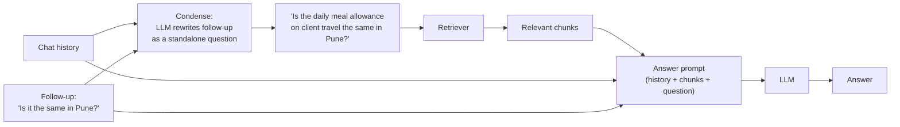

# Memory in RAG Systems: The Complete Guide

> 📚 **Before you start**
>
> - [RAG with LangChain and a Vector DB](../06-implementing-rag/rag-with-langchain-and-a-vector-db.md), for the chain we'll make conversational.
> - [Retrieval Methods](../06-implementing-rag/retrieval-methods.md), for query transformations (rewriting the question before searching).
> - [LangChain Complete Guide](../../langchain-complete-guide/course.md), for chat messages and `MessagesPlaceholder`.

## Introduction

You call a bank's helpline. *"What's the interest rate on a fixed deposit?"* The agent tells you. *"And for senior citizens?"* A good agent answers immediately, because they remember you're asking about fixed deposits. A bad one says *"Senior citizens? For which product, sir?"*, and you have to start again.

Every RAG system you've built so far is the bad agent. Each question is handled alone, so a follow-up like *"And in Pune?"* is searched exactly as typed: three words with no topic. The retriever has nothing to go on, returns something random, and the answer is wrong or confused. Real users talk in conversations, and roughly every other message in a chat assistant is a follow-up that only makes sense with what came before.

This lesson adds **memory** to RAG at three levels: the **conversation history** within one chat, **query condensing** so follow-ups retrieve the right documents, and **long-term memory** of facts about a user across chats. You'll also learn how to keep history from growing without limit, and how to keep one user's memory out of another's answers.

> 💡 **Key Insight**
>
> In conversational RAG, memory matters in **two places**: the **retriever** needs a standalone version of the question (so rewrite follow-ups using the history before searching), and the **model** needs the recent conversation (so it answers in context). Get the first one wrong and no amount of history in the prompt will fix the missing documents.

---

## Core Explanation

### 1. Watch a follow-up fail

```python
import re, zlib
import numpy as np
from langchain_core.documents import Document
from langchain_core.embeddings import Embeddings
from langchain_core.vectorstores import InMemoryVectorStore

STOP = {"a", "an", "the", "is", "are", "of", "to", "in", "on", "for", "and", "or", "i", "my", "can",
        "do", "how", "many", "much", "what", "be", "it", "by", "with", "per", "up", "get", "if"}
CONCEPTS = {"vacation": "leave", "pto": "leave", "food": "meal", "lunch": "meal", "dinner": "meal",
            "budget": "allowance", "trip": "travel", "visit": "travel", "customer": "travel", "client": "travel",
            "notebook": "laptop", "computer": "laptop", "stolen": "lost", "resign": "notice", "quit": "notice",
            "expense": "claim", "reimbursement": "claim", "refund": "claim", "bill": "claim", "hotel": "stay",
            "room": "stay", "lodging": "stay", "baby": "parental", "maternity": "parental",
            "paternity": "parental", "doctor": "medical", "insurance": "medical", "hospital": "medical"}

def normalise(w):
    if w.endswith("ied"):
        return w[:-3] + "y"
    if w.endswith("s") and not w.endswith("ss") and len(w) > 3:
        return w[:-1]
    return w

def words(text):
    return {normalise(w) for w in re.findall(r"[a-z0-9]+", text.lower())} - STOP

class ToyEmbeddings(Embeddings):
    def __init__(self, dim=256):
        self.dim = dim
    def _embed(self, text):
        vec = np.zeros(self.dim)
        for w in words(text):
            vec[zlib.crc32(CONCEPTS.get(w, w).encode()) % self.dim] += 1.0
        norm = np.linalg.norm(vec)
        return [round(float(x), 6) for x in (vec / norm if norm else vec)]
    def embed_documents(self, texts):
        return [self._embed(t) for t in texts]
    def embed_query(self, text):
        return self._embed(text)

SECTIONS = [
    ("2.1", "Annual leave", 3, "Every employee gets 24 days of paid leave per calendar year. Up to 8 unused days can be carried forward to the next year."),
    ("2.2", "Sick leave", 3, "Employees get 10 days of sick leave per year. A doctor's note is required for more than 2 sick days in a row."),
    ("2.3", "Parental leave", 4, "Mothers get 26 weeks of paid maternity leave. Fathers get 2 weeks of paid paternity leave within 6 months of the birth."),
    ("3.1", "Work from home", 5, "Employees may work from home up to 2 days a week with their manager's approval."),
    ("4.1", "Health insurance", 6, "Medical insurance covers the employee, spouse and two children up to Rs 5 lakh a year."),
    ("5.1", "Travel claims", 8, "Submit bills on the Kharcha portal within 30 days of the trip. Approved claims are reimbursed within 15 days."),
    ("5.2", "Meal allowance", 8, "On client travel the daily meal allowance is Rs 1,200 in metro cities and Rs 800 in other cities."),
    ("5.3", "Hotel stay", 9, "Hotel stays are covered up to Rs 6,000 a night in metro cities and Rs 3,500 a night elsewhere."),
    ("6.1", "Laptops", 11, "A lost or stolen laptop must be reported to IT within 24 hours. The employee pays 10% of the replacement cost."),
    ("7.1", "Public holidays", 12, "The office is closed on 10 public holidays, including Diwali, Holi and Independence Day."),
    ("8.1", "Notice period", 14, "The notice period is 60 days. It can be shortened by paying basic salary for the remaining days."),
]

def handbook_docs():
    return [Document(page_content=f"{sec} {title}: {body}", id=f"handbook-{sec}",
                     metadata={"source": "hr/handbook-2026.pdf", "page": page, "section": sec})
            for sec, title, page, body in SECTIONS]

emb = ToyEmbeddings()
store = InMemoryVectorStore.from_documents(handbook_docs(), embedding=emb)
print(len(handbook_docs()), "chunks indexed")
```

Output:

```
11 chunks indexed
```

```python
def search(q, k=2):
    return [(d.metadata["section"], round(s, 2)) for d, s in store.similarity_search_with_score(q, k=k)]

print("turn 1:", search("What is the daily meal allowance on client travel?"))
print("turn 2:", search("Is it the same in Pune?"))
```

Output:

```
turn 1: [('5.2', 0.62), ('5.1', 0.35)]
turn 2: [('4.1', 0.18), ('7.1', 0.0)]
```

Turn 1 finds the meal-allowance section. Turn 2, as typed, has almost no content words: "same" and "Pune" appear nowhere in the handbook, and "it" could be anything. The retriever returns whatever happens to score highest, and the meal-allowance section isn't among it.

### 2. Storing the conversation

A conversation is just a list of messages. In LangChain, a user's turn is a `HumanMessage` and the model's reply is an `AIMessage`. Keep one list per conversation, keyed by a **session ID** (production apps keep these lists in Redis, Postgres or a document database rather than in memory).

```python
from langchain_core.messages import HumanMessage, AIMessage

history = [
    HumanMessage("What is the daily meal allowance on client travel?"),
    AIMessage("Rs 1,200 a day in metro cities and Rs 800 in other cities [5.2]."),
]
for m in history:
    print(f"{m.type:>5}: {m.content}")
```

Output:

```
human: What is the daily meal allowance on client travel?
   ai: Rs 1,200 a day in metro cities and Rs 800 in other cities [5.2].
```

You may see older tutorials use LangChain's `InMemoryChatMessageHistory` and `RunnableWithMessageHistory` for this. Both are **deprecated** in current `langchain-core` (1.6.4 and later) in favour of LangGraph's built-in persistence, which section 5 shows. A plain list per session is all the mechanics you need to understand it.

### 3. Query condensing: make the follow-up standalone

The fix for retrieval is a query transformation, like those in [Retrieval Methods](../06-implementing-rag/retrieval-methods.md): before searching, ask an LLM to **rewrite the latest question as a standalone question** using the history. This step is called query condensing, contextualising or history-aware retrieval.



```python
from langchain_core.language_models.fake_chat_models import FakeListChatModel
from langchain_core.prompts import ChatPromptTemplate, MessagesPlaceholder
from langchain_core.output_parsers import StrOutputParser

condense_prompt = ChatPromptTemplate.from_messages([
    ("system", "Given the chat history and the latest user question, rewrite the question so it can be "
               "understood without the history. Do NOT answer it. If it is already standalone, return it unchanged."),
    MessagesPlaceholder("history"),
    ("human", "{question}"),
])
condense_llm = FakeListChatModel(responses=["Is the daily meal allowance on client travel the same in Pune?"])
condense = condense_prompt | condense_llm | StrOutputParser()

standalone = condense.invoke({"history": history, "question": "Is it the same in Pune?"})
print("standalone:", standalone)
print("retrieved: ", search(standalone))
```

Output:

```
standalone: Is the daily meal allowance on client travel the same in Pune?
retrieved:  [('5.2', 0.55), ('5.1', 0.31)]
```

The rewritten question carries the topic from turn 1, so retrieval finds section 5.2 again. (The fake model returns the rewrite a real model produces for this prompt; with a real model you'd use a small, fast one here, since this call adds latency to every follow-up.)

Look at the condensing prompt's two instructions. **"Do NOT answer it"** matters because models love to be helpful and will otherwise answer the question inside the rewrite. **"If it is already standalone, return it unchanged"** stops the model from bending a brand-new question towards the old topic.

### 4. The answer step also gets the history

Retrieval needs the standalone question; the **answer** prompt benefits from the actual conversation, so the model can resolve "it", keep a consistent tone and avoid repeating itself. Our pretend model from Module 6 stands in for the real one:

```python
from langchain_core.messages import AIMessage
from langchain_core.runnables import RunnableLambda

answer_prompt = ChatPromptTemplate.from_messages([
    ("system", "Answer HR questions using only the context. Cite sections in brackets. "
               "Use the chat history to understand the question.\n\nContext:\n{context}"),
    MessagesPlaceholder("history"),
    ("human", "{question}"),
])

def pretend_model(prompt_value):
    messages = prompt_value.to_messages()
    context = messages[0].content.split("Context:\n")[1]
    humans = [m.content for m in messages[1:] if m.type == "human"]
    latest, earlier = words(humans[-1]), words(" ".join(humans[:-1]))   # the latest question counts double
    best, best_score = "I don't know based on the handbook.", 0
    for line in context.splitlines():
        label, body = line[1:].split("] ", 1)
        for sentence in re.split(r"(?<=\.) ", body.split(": ", 1)[1]):
            score = 2 * len(latest & words(sentence)) + len(earlier & words(sentence))
            if score > best_score:
                best, best_score = f"{sentence} [{label}]", score
    return AIMessage(content=best)

answer = answer_prompt | RunnableLambda(pretend_model) | StrOutputParser()

def format_docs(docs):
    return "\n".join(f"[{d.metadata['section']}] {d.page_content}" for d in docs)

def conversational_rag(question, history):
    standalone = condense.invoke({"history": history, "question": question}) if history else question
    docs = store.similarity_search(standalone, k=2)
    return answer.invoke({"context": format_docs(docs), "history": history, "question": question})

print(conversational_rag("Is it the same in Pune?", history))
```

Output:

```
On client travel the daily meal allowance is Rs 1,200 in metro cities and Rs 800 in other cities. [5.2]
```

Two design details:

- **Skip condensing on the first turn.** With no history there's nothing to resolve, so don't pay for the extra call.
- **Pass the original question to the answer step**, not the rewrite. The user's own wording keeps the answer natural ("Pune isn't a metro city, so...").

### 5. Sessions: one history per conversation

Many users talk to the same app at once, and each conversation needs its own history. The pattern: look up the history for the session, run the chain, then append the new question and answer.

```python
SESSIONS = {}

def chat(session_id, question):
    history = SESSIONS.setdefault(session_id, [])
    reply = conversational_rag(question, history)
    history += [HumanMessage(question), AIMessage(reply)]
    return reply

condense_llm.i = 0          # rewind the fake model's canned replies for this demo
condense_llm.responses = ["How many days of sick leave do I get per year?",
                          "Do I need a doctor's note for 3 sick days in a row?"]

for session, question in [("asha", "How much annual leave do I get?"),
                          ("ravi", "What is the sick leave policy?"),
                          ("ravi", "How many days?"),
                          ("ravi", "Do I need a note for 3 days?")]:
    print(f"{session:>4}: {question:<34} -> {chat(session, question)}")

print({sid: len(h) for sid, h in SESSIONS.items()})
```

Output:

```
asha: How much annual leave do I get?    -> Every employee gets 24 days of paid leave per calendar year. [2.1]
ravi: What is the sick leave policy?     -> Employees get 10 days of sick leave per year. [2.2]
ravi: How many days?                     -> Employees get 10 days of sick leave per year. [2.2]
ravi: Do I need a note for 3 days?       -> A doctor's note is required for more than 2 sick days in a row. [2.2]
{'asha': 2, 'ravi': 6}
```

Asha's and Ravi's conversations are stored separately (2 and 6 messages), and Ravi's follow-ups were condensed using **his** history only. In a web app the session ID comes from the logged-in user and chat thread, never from anything the user can type, so one person can never load another's conversation.

In current LangChain, the supported way to get this behaviour without writing it yourself is a **checkpointer**: an agent built with `create_agent` (or any LangGraph graph) saves its message state after every step under a `thread_id`, and reloads it when the same `thread_id` comes back. The `thread_id` plays exactly the role of our session ID:

```python
# not-run: needs langchain, langgraph, langchain-anthropic and an API key
from langchain.agents import create_agent
from langgraph.checkpoint.memory import InMemorySaver

agent = create_agent(model="anthropic:claude-opus-5-5", tools=[search_handbook],   # the retrieval tool from Module 6
                     checkpointer=InMemorySaver())                              # use a database-backed saver in production
ravi = {"configurable": {"thread_id": "ravi-chat-1"}}
agent.invoke({"messages": [{"role": "user", "content": "What is the sick leave policy?"}]}, ravi)
agent.invoke({"messages": [{"role": "user", "content": "How many days?"}]}, ravi)   # remembers the topic
```

You'll study checkpointers properly in the [LangGraph Complete Guide](../../langgraph-complete-guide/course.md); everything in this lesson (condensing, windows, summaries, long-term memory) carries over unchanged.

### 6. Keeping history short

History grows with every turn, and you pay for every token of it on every call. Long histories also distract the model. Three standard strategies:

| Strategy | How | Trade-off |
|---|---|---|
| **Window** | Keep only the last N messages (or last N tokens) | Simple; forgets older context completely |
| **Summary** | Replace older messages with an LLM-written summary, keep recent ones verbatim | Keeps the gist; costs summarisation calls; details can be lost |
| **Retrieval over history** | Store past turns in a vector store and retrieve only the relevant ones | Scales to very long chats; adds a retrieval step |

`trim_messages` in `langchain-core` implements windowing. Here it keeps the last 4 messages, starting on a human message so the window never begins with an orphaned answer:

```python
from langchain_core.messages import trim_messages

long_history = SESSIONS["ravi"]
window = trim_messages(long_history, max_tokens=4, token_counter=len, strategy="last", start_on="human")
print(len(long_history), "->", len(window))
for m in window:
    print(f"{m.type:>5}: {m.content[:60]}")
```

Output:

```
6 -> 4
human: How many days?
   ai: Employees get 10 days of sick leave per year. [2.2]
human: Do I need a note for 3 days?
   ai: A doctor's note is required for more than 2 sick days in a r
```

With `token_counter=len`, each **message** counts as one "token", so `max_tokens=4` means "4 messages". Pass the chat model itself as `token_counter` to trim by real token count.

A summary memory keeps a running summary in the system prompt plus the last few turns:

```python
summariser = FakeListChatModel(responses=["The user asked about sick leave: 10 days a year; a doctor's note is needed for more than 2 days in a row."])
summary_prompt = ChatPromptTemplate.from_messages([
    ("system", "Summarise this conversation in one or two sentences, keeping facts the user may refer back to."),
    MessagesPlaceholder("history"),
])
summary = (summary_prompt | summariser | StrOutputParser()).invoke({"history": long_history[:-2]})
compact = [("system", f"Earlier in this conversation: {summary}")] + long_history[-2:]
print(summary)
print(len(compact), "messages instead of", len(long_history))
```

Output:

```
The user asked about sick leave: 10 days a year; a doctor's note is needed for more than 2 days in a row.
3 messages instead of 6
```

### 7. Long-term memory: facts about the user

Conversation history lasts one chat. Some facts deserve to last longer: the user works from the **Pune** office, is a **manager**, prefers answers in **Hindi**. With those, *"What's my meal allowance on a client visit?"* can be answered for **this** user instead of generically.

Long-term memory in RAG is usually a **second store**, separate from the knowledge base, holding short facts per user. It's retrieved alongside the documents and filtered by user ID:

```python
memory_store = InMemoryVectorStore(embedding=emb)
memory_store.add_documents([
    Document(page_content="Asha is based in the Pune office.", metadata={"user": "asha"}),
    Document(page_content="Asha manages a team of 6 people.", metadata={"user": "asha"}),
    Document(page_content="Ravi is based in the Mumbai office.", metadata={"user": "ravi"}),
])

def recall(user, question, k=2):
    mine = lambda doc: doc.metadata["user"] == user                # never search other users' memories
    return [d.page_content for d in memory_store.similarity_search(question + " office based", k=k, filter=mine)]

def personalised_context(user, question):
    facts = recall(user, question)
    docs = store.similarity_search(question, k=1)
    return "About the user:\n- " + "\n- ".join(facts) + "\n\nHandbook:\n" + format_docs(docs)

print(personalised_context("asha", "What is my meal allowance on a client visit?"))
```

Output:

```
About the user:
- Asha is based in the Pune office.
- Asha manages a team of 6 people.

Handbook:
[5.2] 5.2 Meal allowance: On client travel the daily meal allowance is Rs 1,200 in metro cities and Rs 800 in other cities.
```

With "Asha is based in Pune" and the meal-allowance rule side by side, a real model answers *"Pune is not one of the metro cities in the policy, so your allowance is Rs 800 a day"*. (Whether Pune counts as a metro would itself be defined somewhere in a real handbook; the model should cite that too.)

How do facts get **into** long-term memory? Common approaches:

- **Explicit**: the user says "remember that I'm in Pune", or sets it in a profile.
- **Extracted**: after each conversation, an LLM extracts durable facts ("based in Pune") and you store them, deduplicating and updating old ones (if Asha moves to Bengaluru, the Pune fact must be replaced, not kept alongside).
- **From systems of record**: the HR database already knows the office location. Prefer authoritative data over facts guessed from chat.

Agent frameworks treat this as a full topic of its own (what to remember, how to update and forget, memory types such as semantic, episodic and procedural), covered in [Context Engineering and Agent Memory](../../context-engineering-and-agent-memory/course.md). LangGraph, which you'll meet in [LangGraph Complete Guide](../../langgraph-complete-guide/course.md), saves conversation state per thread with **checkpointers** and offers a separate long-term **store** for cross-thread memory; the ideas map one to one onto what you've built here.

### 8. Memory pitfalls

| Pitfall | What goes wrong | Prevention |
|---|---|---|
| **Condensing drift** | The rewrite changes the user's meaning ("Is it the same in Pune?" becomes a question about hotels) | Clear prompt, a small reliable model, log rewrites, include rewritten queries in your test set |
| **Topic switch** | A brand-new question is forced into the old topic | "Return it unchanged if standalone"; test topic switches explicitly |
| **Leaking across users** | One user's history or memories appear in another's answer | Session IDs and memory filters from authentication, never from user input |
| **Stale memory** | "Based in Pune" stays after the user moves | Update and delete memories; prefer systems of record; add timestamps |
| **Sensitive data** | Health or salary details stored forever | Store only what's needed, let users see and delete memories, follow your data-protection rules (in India, the Digital Personal Data Protection Act, 2023) |
| **Cost creep** | Ever-growing history in every prompt | Windowing or summaries |

---

## Try It Yourself

1. **Without condensing.** Call `conversational_rag` for *"Is it the same in Pune?"* but bypass condensing (search with the raw follow-up). Which sections reach the prompt, and what does the answer become?
2. **A topic switch.** With `history` still about meal allowances, what should the condensing step return for *"How long is the notice period?"*? Check what retrieval returns for that question as-is.
3. **Window by tokens.** Write a `token_counter` that counts words in each message's content and trim Ravi's history to at most 25 words, keeping the latest messages.

<details>
<summary>Show answers</summary>

**1.**

```python
docs = store.similarity_search("Is it the same in Pune?", k=2)
print([d.metadata["section"] for d in docs])
print(answer.invoke({"context": format_docs(docs), "history": history, "question": "Is it the same in Pune?"}))
```

Output:

```
['4.1', '7.1']
I don't know based on the handbook.
```

The meal-allowance section never reaches the prompt, so the model can only say it doesn't know, even though the conversation history in the same prompt makes the topic obvious. History in the answer prompt can't make up for documents retrieval never fetched.

**2.** It should return the question unchanged, because it's already standalone. Retrieval then works directly:

```python
print(search("How long is the notice period?"))
```

Output:

```
[('8.1', 0.35), ('5.2', 0.27)]
```

**3.**

```python
def count_words(messages):
    return sum(len(m.content.split()) for m in messages)

trimmed = trim_messages(SESSIONS["ravi"], max_tokens=25, token_counter=count_words,
                        strategy="last", start_on="human")
print(count_words(trimmed), "words in", len(trimmed), "messages")
```

Output:

```
23 words in 2 messages
```

</details>

---

## Real-World Examples

- **Customer support assistants** condense every follow-up and log both the original and the rewritten question, because rewrite errors are a top cause of wrong answers in chat.
- **Enterprise "ask HR" bots** combine the knowledge base with facts from the HR system (location, grade, team) so answers are specific to the employee.
- **Chat products** with long conversations summarise older turns and keep only recent messages verbatim to control cost.
- **Consumer assistants** that remember user preferences show users their stored memories and let them edit or delete them.

---

## Common Misconceptions

### "Putting the chat history in the prompt is enough"

The retriever still searches with the raw follow-up and fetches the wrong chunks. Condense the question for retrieval; pass history to the answer step.

### "Memory means the model remembers"

Models are stateless between calls. "Memory" is your application storing messages and facts and putting the relevant ones back into each prompt.

### "Longer history always helps"

Past a few turns, extra history mostly adds cost and distraction. Window or summarise.

### "Long-term memory is just a bigger chat history"

It's a separate, curated store of durable facts, scoped per user, with updates and deletions. Raw transcripts of every chat are not memory; they're a liability.

---

## Interview Relevance

*"How do you handle follow-up questions in a RAG chatbot?"* History-aware retrieval: condense the follow-up into a standalone query with an LLM using the history, retrieve with it, answer with history plus context plus the original question; skip condensing on the first turn; evaluate rewrites.

*"How would you manage memory for a chat assistant used by thousands of users?"* Per-session message stores keyed by authenticated session IDs, persistent backend, windowing or summarisation for cost, a separate long-term memory store per user with update and delete, privacy controls.

---

## Key Takeaways

- **Follow-ups break naive RAG** because the retriever searches the raw, context-free question.
- **Condense** the latest question with the history into a standalone query for retrieval; give the **answer** step the real history and original question.
- **Store history per session**, keyed by an ID from authentication (in current LangChain, a checkpointer with a `thread_id`).
- **Bound the history** with windowing (`trim_messages`) or summaries.
- **Long-term memory** is a separate per-user fact store, retrieved alongside documents and kept up to date.

---

**Up next:** [Multimodal RAG](multimodal-rag.md)
