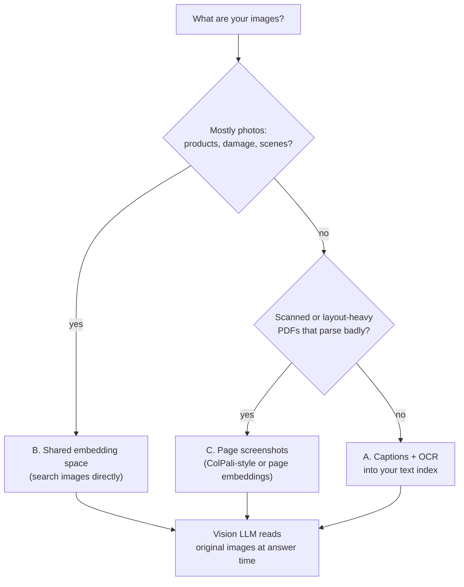

# Multimodal RAG: The Complete Guide

> 📚 **Before you start**
>
> - [Chunking Strategies](../06-implementing-rag/chunking-strategies.md), for how documents become retrievable pieces with metadata.
> - [Retrieval Methods](../06-implementing-rag/retrieval-methods.md), for multi-vector indexing and late interaction (MaxSim), both of which return here.
> - [Embeddings and Similarity Search](../course.md#m3), for what an embedding space is and why cosine similarity works.

## Introduction

Open any company's annual report. The text says *"digital payments kept rising, as Figure 2 shows"*, and the actual number (64% of payments through UPI) lives only inside the pie chart. Insurance claim files hold photos of the damaged car. Product catalogues are mostly photos. Scanned government forms are images of text. Engineering manuals explain the wiring in a diagram, not in words.

Every RAG system you've built so far reads **text only**. A PDF loader pulls out the words and silently drops the charts, photos and diagrams, or turns a scanned page into an empty string. When a user asks *"What share of payments came through UPI?"*, the retriever can only find the sentence that *points at* the chart, and the model, never shown the chart, either says it doesn't know or guesses.

**Multimodal RAG** makes images first-class citizens: they can be retrieved by a text question, and the model that writes the answer can look at them. This lesson covers the three main ways to make images retrievable, how to hand the retrieved images to a vision-capable model, and how to choose between the approaches.

> 💡 **Key Insight**
>
> Multimodal RAG has two separate problems. **Retrieval**: an image has to land somewhere a text question can find it, either by turning it into text (a caption), by embedding images and text into one shared vector space, or by embedding whole page screenshots. **Generation**: once found, pass the **original image** to a vision model, not just its caption, because the caption only holds what someone thought to write down.

---

## Core Explanation

### 1. What a text-only pipeline loses

Here's a tiny version of *Kirana Mart's* 2026 annual report (a made-up retail chain). The PDF loader extracted three paragraphs. The report also has two charts and a photo, which the loader dropped. We'll use a small word-hashing embedding so everything runs offline; it behaves like the toy embeddings from earlier lessons.

```python
import re, zlib
import numpy as np
from langchain_core.documents import Document
from langchain_core.embeddings import Embeddings
from langchain_core.vectorstores import InMemoryVectorStore

STOP = {"a", "an", "the", "is", "are", "of", "to", "in", "on", "for", "and", "or", "by", "with", "what",
        "which", "how", "did", "do", "came", "through", "our", "we", "it", "its", "this", "that", "show", "shows"}
SAME = {"payments": "payment", "paid": "payment", "pay": "payment", "transactions": "payment",
        "stores": "store", "outlets": "store", "outlet": "store", "regions": "region", "zone": "region",
        "sales": "revenue", "sold": "revenue", "crore": "revenue"}

def words(text):
    return {SAME.get(w, w) for w in re.findall(r"[a-z0-9]+", text.lower()) if w not in STOP}

class WordEmbeddings(Embeddings):
    def _embed(self, text):
        v = np.zeros(512)
        for w in words(text):
            v[zlib.crc32(w.encode()) % 512] += 1
        n = np.linalg.norm(v)
        return list(v / n) if n else list(v)
    def embed_documents(self, texts):
        return [self._embed(t) for t in texts]
    def embed_query(self, text):
        return self._embed(text)

TEXT = [
    ("p2", 2, "Kirana Mart grew revenue 18% in 2026 to Rs 412 crore, helped by 23 new stores."),
    ("p3", 3, "Digital payment adoption kept rising across all stores, as Figure 2 shows."),
    ("p4", 4, "The new Pune flagship opened in August with a redesigned layout, pictured in Figure 3."),
]
text_docs = [Document(t, id=i, metadata={"type": "text", "page": p}) for i, p, t in TEXT]

store = InMemoryVectorStore(WordEmbeddings())
store.add_documents(text_docs)
for d, s in store.similarity_search_with_score("What share of payments came through UPI?", k=2):
    print(round(s, 2), d.id, d.page_content)
```

Output:

```
0.48 p3 Digital payment adoption kept rising across all stores, as Figure 2 shows.
0.0 p4 The new Pune flagship opened in August with a redesigned layout, pictured in Figure 3.
```

Retrieval did its job: page 3 is the right place. But the chunk only says the answer is *in Figure 2*. No amount of prompt engineering gets "64%" out of a sentence that doesn't contain it. The information was lost at **ingestion**, before retrieval ever ran.


*The three retrieval approaches (A, B, C) differ in where the image becomes searchable; all of them end at a vision model that sees the original image.*

### 2. Approach A: turn every image into text

The simplest approach, and the one most production systems start with: during ingestion, send each image to a **vision model** (any modern multimodal LLM, such as Claude) with a prompt like *"Describe this figure for search. Include every number, label and axis title."* The resulting **caption** is embedded like any text chunk, and the image's file path goes into metadata so you can fetch the original later.

Below, the captions are written out by hand as a stand-in for what the vision model would return:

```python
CAPTIONS = [
    ("fig1", 2, "charts/fig1-revenue-by-region.png",
     "Bar chart of 2026 revenue by region: South Rs 151 crore, West Rs 118 crore, North Rs 92 crore, East Rs 51 crore."),
    ("fig2", 3, "charts/fig2-payment-mix.png",
     "Pie chart of payment methods in 2026: UPI 64%, cash 21%, debit and credit card 15%."),
    ("fig3", 4, "photos/fig3-pune-flagship.jpg",
     "Photo of the Pune flagship store interior: wide aisles, self-checkout kiosks near the entrance, fresh produce on the left."),
]
img_docs = [Document(c, id=i, metadata={"type": "image", "page": p, "path": path})
            for i, p, path, c in CAPTIONS]
store.add_documents(img_docs)

for q in ["What share of payments came through UPI?",
          "Which region earned the most revenue?",
          "Does the Pune store have self-checkout?"]:
    hits = store.similarity_search(q, k=2)
    print(f"{q:<42}", [(d.id, d.metadata["type"]) for d in hits])
```

Output:

```
What share of payments came through UPI?   [('p3', 'text'), ('fig2', 'image')]
Which region earned the most revenue?      [('fig1', 'image'), ('p2', 'text')]
Does the Pune store have self-checkout?    [('fig3', 'image'), ('p2', 'text')]
```

All three questions now reach the right figure in the top two. The UPI question still ranks the page-3 sentence first, because it shares the word "payment" with the question. That's fine: we retrieve both and let the model read them.

A useful extra trick: when a text chunk **refers** to a figure, pull that figure in too, even if it ranked low. The reference is a strong signal that the two belong together.

```python
FIGURES = {d.id: d for d in img_docs}

def with_referenced_figures(docs):
    out, seen = [], set()
    for d in docs:
        for doc in [d] + [FIGURES[f"fig{n}"] for n in re.findall(r"Figure (\d+)", d.page_content)]:
            if doc.id not in seen:
                seen.add(doc.id)
                out.append(doc)
    return out

hits = store.similarity_search("Is digital adoption rising?", k=1)
print([d.id for d in hits], "->", [d.id for d in with_referenced_figures(hits)])
```

Output:

```
['p3'] -> ['p3', 'fig2']
```

Approach A has real strengths: it works with **any text vector store and any text embedding model** you already run, captions are easy to inspect and debug, and BM25 and hybrid search from Module 6 work on them unchanged. Its weakness is that retrieval can only find what the caption says. If the captioning prompt didn't ask for the axis labels, a question about them will miss.

### 3. Approach B: one embedding space for images and text

A **multimodal embedding model** has two encoders, one for images and one for text, trained together so that a photo of a dog and the sentence *"a dog"* land close to each other. CLIP was the classic example; current ones include Voyage's `voyage-multimodal-3.5`, Cohere's multimodal Embed models and Google's multimodal embeddings. Training uses millions of image-caption pairs and pulls each image towards its own caption and away from everyone else's (the same contrastive idea behind text embeddings).

The result: you embed images **directly**, no captions, and search them with plain text. Here's a toy version you can run. Our "space" has just three dimensions, red, green and blue (centred so mid-grey is the origin). The image encoder averages a photo's pixels; the text encoder knows what colour words *mean*, including words like *"haldi"* (turmeric yellow) and *"peacock"* (deep blue-green). A real model learns millions of such associations instead of 15.

```python
rng = np.random.default_rng(7)
PALETTE = [(0.50, 0.05, 0.10), (0.85, 0.65, 0.10), (0.00, 0.45, 0.55),
           (0.65, 0.95, 0.75), (0.97, 0.97, 0.95), (0.07, 0.07, 0.08)]
photos = {f"kurta-{i:02d}.jpg": np.clip(np.array(rgb) + rng.normal(0, 0.06, (32, 32, 3)), 0, 1)
          for i, rgb in enumerate(PALETTE, start=1)}          # 32x32 "photos", no captions, no tags

def embed_image(pixels):
    v = pixels.reshape(-1, 3).mean(axis=0) - 0.5
    return v / np.linalg.norm(v)

COLOUR_WORDS = {"red": (0.9, 0.1, 0.1), "maroon": (0.5, 0.0, 0.1), "wine": (0.45, 0.05, 0.15),
                "yellow": (0.95, 0.85, 0.1), "haldi": (0.95, 0.8, 0.1), "golden": (0.85, 0.65, 0.15),
                "blue": (0.1, 0.2, 0.9), "peacock": (0.0, 0.45, 0.6), "teal": (0.0, 0.5, 0.5),
                "green": (0.1, 0.7, 0.2), "mint": (0.6, 0.95, 0.75), "pista": (0.6, 0.85, 0.5),
                "white": (1, 1, 1), "black": (0, 0, 0), "night": (0.05, 0.05, 0.1)}

def embed_text(text):
    hits = [COLOUR_WORDS[w] for w in re.findall(r"[a-z]+", text.lower()) if w in COLOUR_WORDS]
    v = np.mean(hits, axis=0) - 0.5
    return v / np.linalg.norm(v)

names = list(photos)
image_matrix = np.array([embed_image(photos[n]) for n in names])
for q in ["a maroon kurta for a wedding", "kurta for a haldi ceremony", "peacock coloured festive kurta",
          "a light pista shade for summer", "something for a night party"]:
    scores = image_matrix @ embed_text(q)
    best = np.argsort(-scores)[:2]
    print(f"{q:<32}", [(names[j], round(float(scores[j]), 2)) for j in best])
```

Output:

```
a maroon kurta for a wedding     [('kurta-01.jpg', 1.0), ('kurta-06.jpg', 0.81)]
kurta for a haldi ceremony       [('kurta-02.jpg', 0.98), ('kurta-05.jpg', 0.32)]
peacock coloured festive kurta   [('kurta-03.jpg', 1.0), ('kurta-06.jpg', 0.51)]
a light pista shade for summer   [('kurta-04.jpg', 0.88), ('kurta-05.jpg', 0.72)]
something for a night party      [('kurta-06.jpg', 1.0), ('kurta-01.jpg', 0.8)]
```

None of these photos has a caption or a tag, and *"haldi ceremony"* never mentions a colour, yet the yellow kurta comes first. That's the promise of a shared space: **text queries find images directly**, and you can also search with an image (*"more like this photo"*), because both sides produce vectors in the same space.

The catch is precision on detailed content. Shared-space models are great at *what a picture is about* (a red kurta, a crowded store, a bar chart) and weak at *what it says in detail* (that South earned Rs 151 crore). For number-heavy charts and tables, approach A's captions or approach C's page embeddings usually retrieve better.

Here is how the same idea looks with a real multimodal embedding model, where each input is a list that can mix text and images:

```python
# not-run: needs the voyageai package, Pillow and a Voyage API key
import voyageai
from PIL import Image

vo = voyageai.Client()
paths = ["catalogue/kurta-01.jpg", "catalogue/kurta-02.jpg", "catalogue/kurta-03.jpg"]
docs = vo.multimodal_embed([[Image.open(p)] for p in paths], model="voyage-multimodal-3.5",
                           input_type="document").embeddings
query = vo.multimodal_embed([["kurta for a haldi ceremony"]], model="voyage-multimodal-3.5",
                            input_type="query").embeddings[0]
scores = np.array(docs) @ np.array(query)
print(paths[int(scores.argmax())])
```

Example output:

```
catalogue/kurta-02.jpg
```

### 4. Approach C: embed whole pages as images

Approaches A and B both assume you can cut a document into clean pieces: this paragraph, that figure. Real PDFs fight back with multi-column layouts, tables split across pages, text baked into images, and scanned pages with no text layer at all. **Page-image retrieval** skips parsing entirely: render every page as a screenshot and embed the screenshot.

The best-known design is **ColPali** (2024). It splits each page image into a grid of small patches and keeps **one vector per patch**, then scores a question with the same **late-interaction MaxSim** you met in [Retrieval Methods](../06-implementing-rag/retrieval-methods.md): each query token finds its best-matching patch, and those best matches are summed. A query about "UPI share" can match exactly the patch where the pie chart's UPI slice is labelled. Single-vector models trained on screenshots (such as `voyage-multimodal-3.5`) give a simpler alternative: one vector per page, stored in any vector database.

```python
# not-run: needs pdf2image (and the poppler tools), voyageai and an API key
from pdf2image import convert_from_path

pages = convert_from_path("kirana-mart-annual-report-2026.pdf", dpi=100)      # list of PIL images
page_vecs = vo.multimodal_embed([[p] for p in pages], model="voyage-multimodal-3.5",
                                input_type="document").embeddings
q = vo.multimodal_embed([["What share of payments came through UPI?"]],
                        model="voyage-multimodal-3.5", input_type="query").embeddings[0]
best_page = int(np.argmax(np.array(page_vecs) @ np.array(q)))
print("page", best_page + 1)
```

Example output:

```
page 3
```

The retrieved unit is a whole page, which is exactly what you then show the vision model. You lose fine-grained chunks and keyword search, and page images cost far more tokens than the same page's text, so this approach pays off most on visually rich or scanned documents.

### 5. Generation: show the model the image

Retrieval gives you documents with an image `path` in metadata. The answer step should load that file and send the **image itself** alongside any retrieved text. The caption helped you *find* the chart; the model should *read* the chart, because it may need a detail the caption left out.

In LangChain, a message's content can be a list of blocks, mixing text and images:

```python
import base64, os, tempfile
import matplotlib
matplotlib.use("Agg")
import matplotlib.pyplot as plt
from langchain_core.messages import HumanMessage

chart_path = os.path.join(tempfile.mkdtemp(), "fig2-payment-mix.png")
fig, ax = plt.subplots(figsize=(4, 3), dpi=100)
ax.pie([64, 21, 15], labels=["UPI 64%", "Cash 21%", "Card 15%"])
ax.set_title("Payment methods, 2026")
fig.savefig(chart_path)
plt.close(fig)

def image_block(path):
    data = base64.b64encode(open(path, "rb").read()).decode()
    return {"type": "image", "base64": data, "mime_type": "image/png"}

hits = with_referenced_figures(store.similarity_search("What share of payments came through UPI?", k=1))
context = "\n".join(f"[p.{d.metadata['page']}] {d.page_content}" for d in hits if d.metadata["type"] == "text")
message = HumanMessage(content=[
    {"type": "text", "text": f"Answer from the report extract and the figure.\n{context}\n\nQuestion: What share of payments came through UPI?"},
    image_block(chart_path),
])
for block in message.content:
    if block["type"] == "text":
        print("text", len(block["text"]), "characters")
    else:  # the exact size depends on the PNG encoder, so show what identifies the image instead
        print("image", block["mime_type"], "base64 starting", block["base64"][:11])

width, height = 400, 300
print("approx. image tokens:", round(width * height / 750))
```

Output:

```
text 179 characters
image image/png base64 starting iVBORw0KGgo
approx. image tokens: 160
```

With a real model you'd pass `message` to `ChatAnthropic(model="claude-opus-5-5").invoke([message])`. The last line estimates the cost: Claude counts an image as roughly *width × height / 750* tokens (large images are scaled down first, so a full-page screenshot lands around 1,500 to 1,600 tokens). Five retrieved page images can cost more than the rest of the prompt put together, which is why you retrieve few images and resize them to the smallest size that keeps the text legible.

The same call through Anthropic's own SDK, where the image block carries a `source`:

```python
# not-run: needs the anthropic package and an API key
import anthropic

client = anthropic.Anthropic()
response = client.messages.create(
    model="claude-opus-5-5", max_tokens=300,
    messages=[{"role": "user", "content": [
        {"type": "image", "source": {"type": "base64", "media_type": "image/png",
                                     "data": image_block(chart_path)["base64"]}},
        {"type": "text", "text": "Using only this figure, what share of payments came through UPI? Cite the figure."},
    ]}],
)
print(response.content[0].text)
```

Example output:

```
According to Figure 2, 64% of payments in 2026 came through UPI.
```

### 6. Choosing an approach



| | A. Captions | B. Shared space | C. Page images |
|---|---|---|---|
| Best for | Charts, diagrams, tables in parseable docs | Photo collections, catalogues, "find similar" | Scans, slides, complex layouts |
| Index cost | One vision-model call per image | One embedding per image | One embedding per page (many vectors for ColPali) |
| Works with keyword/hybrid search | Yes | No | No |
| Weak spot | Misses anything the caption omits | Fine detail and numbers | Token cost of whole pages; no small chunks |

These combine well. A common production setup captions charts into the text index (A) **and** keeps a page-image index (C) as a fallback, then sends the original images of whatever wins to the vision model.

### 7. Practical pitfalls

- **Tables are not images.** If the PDF has a real text layer, extract tables as Markdown or HTML so rows and columns survive; use vision only for tables that exist as pictures.
- **Captions can hallucinate.** A vision model may misread a small number or invent a trend. Ask it to transcribe labels verbatim, spot-check a sample, and always show the original image at answer time.
- **Keep the link back.** Store the source file, page and figure number in metadata so answers can cite *"Figure 2, p. 3"* and the UI can display the image.
- **Mind size limits.** APIs cap image size and count per request; resize before sending and store originals separately.
- **Evaluate with image questions.** Your test set needs questions whose answers live only in figures, or you'll never notice when image retrieval breaks. Module 9 shows how to measure this.

---

## Try It Yourself

1. **A missing detail.** Ask the caption index *"Which region earned the least revenue?"*. Does retrieval still find Figure 1? What does that tell you about where the detail must live?
2. **Search by image.** Using the kurta demo, find the two photos most similar to `kurta-04.jpg` by comparing image vectors with each other (no text at all).
3. **Image token budget.** A 1,000 × 1,400 pixel page screenshot is sent with four others. Estimate the image tokens. What happens if you shrink each to 700 × 980?

<details>
<summary>Show answers</summary>

**1.**

```python
print([d.id for d in store.similarity_search("Which region earned the least revenue?", k=2)])
```

Output:

```
['fig1', 'p2']
```

Retrieval still finds Figure 1, because "region" and "revenue" are in the caption. The answer (East, Rs 51 crore) is only there because the caption listed **every** bar. A lazy caption like *"Revenue by region, South leading"* would retrieve the same chart but leave the model unable to answer from text alone, which is exactly why the original image goes to the model too.

**2.**

```python
scores = image_matrix @ embed_image(photos["kurta-04.jpg"])
best = [names[j] for j in np.argsort(-scores)[1:3]]      # skip position 0, the photo itself
print(best)
```

Output:

```
['kurta-05.jpg', 'kurta-02.jpg']
```

The mint kurta is closest to the white and the mustard ones, the other two light colours. Image-to-image search uses the same index: embed the photo, then search. That's the "more like this" button in shopping apps.

**3.** Each page is about 1,000 × 1,400 / 750 ≈ 1,867 tokens before any resizing, so five pages are roughly 9,300 tokens (in practice the API downscales very large images first, so check the current limits). At 700 × 980 each is about 915 tokens, about 4,600 for five: half the cost, and usually still legible for printed text.

</details>

---

## Real-World Examples

- **Insurance claims**: assistants retrieve policy clauses as text and the claimant's damage photos as images, then a vision model checks whether the damage matches the claim description.
- **E-commerce search**: fashion and furniture apps embed product photos in a shared space so *"a mustard kurta for a haldi"* or a customer's uploaded photo finds visually matching items.
- **Financial research**: analysts' tools caption every chart in annual reports and investor presentations so questions about numbers in figures can be answered and cited by page.

---

## Common Misconceptions

### "OCR solves multimodal RAG"

OCR recovers text that's *drawn* on an image. It doesn't tell you that the tallest bar is South, or what a photo shows. Use it as one input to captions, not as a replacement.

### "Once I have a caption, I can throw the image away"

The caption is a lossy index entry. Keep the original and show it to the model at answer time.

### "A multimodal embedding model reads charts as well as a vision LLM"

Embeddings compress a whole image into one vector (or a few hundred); they capture topic and layout far better than precise values. Reading exact numbers is a generation-time job.

### "Just send every page as an image"

It works on small documents, but image tokens add up fast and retrieval still has to choose pages. Page images complement text retrieval; they rarely replace it.

---

## Interview Relevance

*"How would you build RAG over PDFs that contain charts and scanned pages?"* Parse text where possible; caption charts with a vision model (numbers and labels verbatim) into the text index with image paths in metadata; add page-screenshot retrieval (ColPali-style or a multimodal embedding) for scans and complex layouts; send original images of the top hits to a vision model; cite page and figure; evaluate with figure-only questions.

*"What's the difference between captioning and multimodal embeddings?"* Captioning converts images to text at index time (works with existing text search, inspectable, but only as good as the caption). Multimodal embeddings put images and text in one vector space (no captioning cost, supports image-to-image search, weaker on fine detail).

---

## Key Takeaways

- **Text-only pipelines lose whatever lives in images**, and the loss happens at ingestion, before retrieval.
- **Three ways to make images retrievable**: captions into a text index (A), a shared image-text embedding space (B), and whole-page screenshots (C).
- **Store the image path, page and figure in metadata**, and pull in figures that retrieved text refers to.
- **Show the vision model the original image**, not just its caption, and budget for image tokens.
- **Combine approaches** and test with questions whose answers exist only in figures.

---

**Up next:** [Lab: RAG over images and text](lab-rag-over-images-and-text.md)
