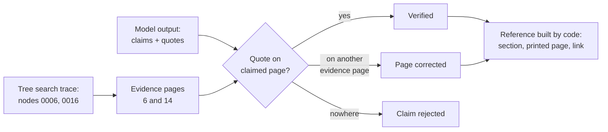

# Deterministic Page Referencing: The Complete Guide

> 📚 **Before you start**
>
> - [The Iterative Search Loop](the-iterative-search-loop.md), for how evidence is gathered page by page with labels.
> - [Lab: Chat with a PDF](../06-implementing-rag/lab-chat-with-a-pdf.md), where you first carried page numbers through a pipeline and asked the model to cite them.

## Introduction

A chartered accountant signing off on a loan note in Bengaluru writes *"Contingent liabilities of ₹508 crore relate to tax disputes (Annual Report 2025-26, Note 31, p. 14)"*. Her reviewer will open page 14. If the number isn't there, her credibility is gone, whatever else the note gets right.

RAG answers face the same test. A citation is a promise that the reader can check the claim. Yet most RAG systems let the **model** write the page numbers, copying them from labels in the prompt. Usually that works. Sometimes the model cites the page that mentioned the topic instead of the page with the figure, merges two pages, or cites a page it never saw. In legal, financial and medical settings, *usually* isn't good enough.

**Deterministic page referencing** means the page numbers in an answer come from **code**, from the retrieval trace and the document itself, never from the model's memory or its copying. The model's job shrinks to saying *which evidence* supports each claim; the code works out, and checks, *where* that evidence is.

> 💡 **Key Insight**
>
> Don't ask the model *where* something is; ask it *what* it relied on (a short verbatim quote), and let code find that quote in the pages you fetched. A quote that's on the cited page is a verified citation; a quote on a different page gets its page corrected; a quote on no page is a fabrication, and the claim is rejected.

---

## Core Explanation

### 1. Setup

The same report and tree, plus the evidence a search for the tax-disputes question gathered (nodes 0006 and 0016, from the last lesson):

```python
import json, re, zlib
import numpy as np

# The text layer of a 16-page annual report, one string per page. Headings sit on their own lines.
REPORT = {
    1: "Bharat Grid Power Limited\nAnnual Report 2025-26\nContents: Chairman's message 2, Business review 3, Risk management 6, Financial statements 8, Notes to the accounts 11, Corporate governance 15.",
    2: "1 Chairman's message\nDear shareholders, 2025-26 was our most profitable year yet. Net profit grew 16.5% and our net profit margin improved for the third year in a row. I thank our employees for this result.",
    3: "2 Business review\n2.1 Generation\nOur plants generated 41,300 million units of electricity. Coal plants ran at a plant load factor of 71%.",
    4: "2.2 Transmission\nWe added 1,150 circuit km of transmission lines. Line availability stayed above 99.6%.",
    5: "2.3 Renewable projects\nWe commissioned 640 MW of solar capacity in Rajasthan and Gujarat. A 300 MW wind project in Tamil Nadu is due in 2027.",
    6: "3 Risk management\n3.1 Financial risks\nInterest rate risk is managed by keeping 60% of borrowings at fixed rates. The company is contesting several tax disputes with the authorities, and the amounts involved are disclosed in Note 31.",
    7: "3.2 Operational risks\nCoal supply disruptions during the monsoon and heat waves that push up peak demand are the main operational risks.",
    8: "4 Financial statements\n4.1 Statement of profit and loss\nRevenue from operations Rs 18,420 crore. Total expenses Rs 16,710 crore. Profit after tax Rs 1,284 crore (previous year Rs 1,102 crore).",
    9: "4.2 Balance sheet\nTotal assets Rs 52,600 crore. Total equity Rs 19,900 crore. Borrowings are detailed in Note 12.",
    10: "4.3 Cash flow statement\nCash from operating activities Rs 3,870 crore. Capital expenditure Rs 4,950 crore, mostly on solar projects.",
    11: "5 Notes to the accounts\nNote 12 Borrowings\nLong-term loans Rs 21,300 crore and short-term loans Rs 2,900 crore. Rs 3,450 crore of the long-term loans is repayable within one year.",
    12: "Note 18 Revenue from operations\nSale of power Rs 16,980 crore, transmission charges Rs 1,210 crore and other operating income Rs 230 crore.",
    13: "Note 27 Employee benefits\nGratuity and provident fund contributions were Rs 312 crore. The company had 9,400 employees at the year end.",
    14: "Note 31 Contingent liabilities\nClaims not acknowledged as debts: income tax demands Rs 412 crore, GST demands Rs 96 crore and land compensation cases Rs 58 crore.",
    15: "6 Corporate governance\n6.1 Board of directors\nThe board has 11 directors, 6 of them independent. It met 8 times during the year.",
    16: "6.2 Independent auditor's report\nIn our opinion the financial statements give a true and fair view. Auditors: Mehta Iyer and Co, Chartered Accountants.",
}
print(len(REPORT), "pages,", sum(len(t.split()) for t in REPORT.values()), "words")
```

Output:

```
16 pages, 407 words
```

The tree from [The Document Tree Model](the-document-tree-model.md), rebuilt in one block (same functions, condensed):

```python
from typing import List
from pydantic import BaseModel, Field

class TreeNode(BaseModel):
    title: str
    node_id: str
    start_index: int
    end_index: int
    summary: str = ""
    nodes: List["TreeNode"] = Field(default_factory=list)

HEADING = re.compile(r"^(?:(\d+(?:\.\d+)*)|Note (\d+)) ([A-Z][^.\n]*)$")

def build_tree(pages):
    heads = [{"title": line, "page": p, "level": (m.group(1).count(".") + 1) if m.group(1) else 2}
             for p, text in pages.items() for line in text.splitlines() if (m := HEADING.match(line))]
    root, last = TreeNode(title="root", node_id="root", start_index=1, end_index=max(pages)), max(pages)
    stack = [(0, root)]
    for i, h in enumerate(heads):
        end = next((max(h["page"], l["page"] - 1) for l in heads[i + 1:] if l["level"] <= h["level"]), last)
        node = TreeNode(title=h["title"], node_id=f"{i:04d}", start_index=h["page"], end_index=end)
        while stack[-1][0] >= h["level"]:
            stack.pop()
        stack[-1][1].nodes.append(node)
        stack.append((h["level"], node))
    return root.nodes

def find_node(nodes, node_id):
    for n in nodes:
        if n.node_id == node_id:
            return n
        if (found := find_node(n.nodes, node_id)):
            return found
    return None

def node_text(node, pages=REPORT):
    return "\n".join(f"[p. {p}] {pages[p]}" for p in range(node.start_index, node.end_index + 1))

def add_summaries(nodes):
    for n in nodes:
        add_summaries(n.nodes)
        text = " ".join(REPORT[p] for p in range(n.start_index, n.end_index + 1)).split(n.title, 1)[-1]
        body = " ".join(l for l in text.splitlines() if not HEADING.match(l)).strip()
        refs = sorted(set(re.findall(r"Note \d+", body)))
        n.summary = ("Contains: " + "; ".join(c.title for c in n.nodes) + ".") if n.nodes else \
                    re.split(r"(?<=\.) ", body)[0] + (f" Refers to {', '.join(refs)}." if refs else "")

def tree_view(nodes):
    return [{"node_id": n.node_id, "title": n.title, "pages": f"{n.start_index}-{n.end_index}",
             "summary": n.summary, **({"nodes": tree_view(n.nodes)} if n.nodes else {})} for n in nodes]

tree = build_tree(REPORT)
add_summaries(tree)
print(len(tree), "top-level nodes; node 0016 is", find_node(tree, "0016").title)
```

Output:

```
6 top-level nodes; node 0016 is Note 31 Contingent liabilities
```

```python
read = [find_node(tree, "0006"), find_node(tree, "0016")]
evidence_pages = sorted({p for n in read for p in range(n.start_index, n.end_index + 1)})
print("evidence pages:", evidence_pages)
```

Output:

```
evidence pages: [6, 14]
```

### 2. Where page numbers go wrong

Three ways a model-written citation can be wrong, even with page labels in the prompt:

- **The pointer page instead of the source page.** Page 6 *talks about* the tax disputes; page 14 *has the numbers*. Models often cite the first relevant page they read.
- **Pages it didn't read.** The model knows annual reports and "remembers" that notes are near the back; it may cite a plausible page that was never in the evidence.
- **Printed vs physical numbers.** The prompt says `[p. 14]` (physical), the report's footer says 12 (printed). A reader with the paper copy turns to the wrong page.

So we change the contract with the model.

### 3. Ask for quotes, not pages

The model returns its answer plus, for each claim, a **short verbatim quote** from the evidence and the page it thinks the quote is on. Here are three claims of the kind models produce; the second has the pointer-page mistake and the third quotes something that isn't in the report at all:

```python
claims = [
    {"claim": "Disputed income tax demands total Rs 412 crore.",
     "quote": "income tax demands Rs 412 crore", "page": 14},
    {"claim": "Disputed GST demands total Rs 96 crore.",
     "quote": "GST demands Rs 96 crore", "page": 6},
    {"claim": "The company expects to win most of these cases.",
     "quote": "expects a favourable outcome in most cases", "page": 14},
]
```

With a real model you'd get this shape through structured output, the same way the navigator returned its decisions in the last lesson.

### 4. Verify every quote against the pages

Now code checks each quote on the claimed page. If it isn't there, it searches the other evidence pages; if it's on none of them, the claim fails. Normalising whitespace and case makes the match robust to line breaks without allowing paraphrase.

```python
def norm(text):
    return re.sub(r"\s+", " ", text).strip().lower()

def verify(claims, pages, allowed):
    checked = []
    for c in claims:
        quote = norm(c["quote"])
        if c["page"] in allowed and quote in norm(pages[c["page"]]):
            checked.append({**c, "status": "verified"})
            continue
        found = [p for p in allowed if quote in norm(pages[p])]
        if found:
            checked.append({**c, "page": found[0], "status": f"corrected from p. {c['page']}"})
        else:
            checked.append({**c, "page": None, "status": "REJECTED: quote not in evidence"})
    return checked

for c in verify(claims, REPORT, evidence_pages):
    print(f"{str(c['page']):>4}  {c['status']:<34} {c['claim']}")
```

Output:

```
  14  verified                           Disputed income tax demands total Rs 412 crore.
  14  corrected from p. 6                Disputed GST demands total Rs 96 crore.
None  REJECTED: quote not in evidence    The company expects to win most of these cases.
```

The first citation is verified, the second is quietly fixed to page 14, and the third claim, which sounds reasonable and has a confident page number, is rejected because the report never says it. Only claims that survive go into the answer.

Searching only `allowed` pages (the evidence) matters: a quote found elsewhere in the document wasn't something the model actually read, so the claim was a guess even if it happens to be true.

### 5. Build the reference from the tree

Once each claim has a verified physical page, code builds the human-readable reference: the section path from the tree, the page as the reader sees it, and a link that opens the PDF at that page. Most PDF viewers support `#page=N` at the end of a PDF URL.

```python
def node_for_page(nodes, page):
    best = None
    for n in nodes:
        if n.start_index <= page <= n.end_index:
            best = n
            deeper = node_for_page(n.nodes, page)
            best = deeper or best
    return best

PRINTED_OFFSET = 0          # physical page minus printed page; 2 if the PDF had two unnumbered cover pages

def reference(page, url="https://example.com/bharat-grid-ar-2025-26.pdf"):
    node = node_for_page(tree, page)
    return f"{node.title}, p. {page - PRINTED_OFFSET} ({url}#page={page})"

verified = [c for c in verify(claims, REPORT, evidence_pages) if c["page"]]
for i, c in enumerate(verified, start=1):
    print(f"{c['claim']} [{i}]")
print()
for i, c in enumerate(verified, start=1):
    print(f"[{i}] {reference(c['page'])}")
```

Output:

```
Disputed income tax demands total Rs 412 crore. [1]
Disputed GST demands total Rs 96 crore. [2]

[1] Note 31 Contingent liabilities, p. 14 (https://example.com/bharat-grid-ar-2025-26.pdf#page=14)
[2] Note 31 Contingent liabilities, p. 14 (https://example.com/bharat-grid-ar-2025-26.pdf#page=14)
```

Every part of those references (section title, page, link) was computed, so the same answer always cites the same place, and the reader lands on exactly the page that contains the quoted words. Notice the link uses the **physical** page (that's what a PDF viewer counts), while the text shows the **printed** page (that's what a reader with a paper copy looks for).

### 6. Why tree search makes this easy

In vector RAG, a chunk's page number is metadata attached at chunking time, and it's often wrong: a chunk that crosses a page break gets only its first page, and cleaning steps can shift text between pages. In tree search, evidence is fetched **by page range** from the node, each page with its own label, so the mapping from text to page is exact by construction. PageIndex's open-source version gives page-level references this way; its hosted version adds finer, block-level references within pages.



### 7. Letting the model API do the citing

Some model APIs can return verified citations themselves. With Claude, you can send a PDF as a `document` block with citations enabled; the response then carries, for each cited passage, the quoted text and its page range (`start_page_number` counts from 1, and `end_page_number` is exclusive, so a single page 14 shows as 14 to 15). The API guarantees the quoted text comes from the document.

```python
# not-run: needs the anthropic package, an API key and the PDF file
import base64, anthropic

client = anthropic.Anthropic()
pdf = base64.b64encode(open("bharat-grid-ar-2025-26.pdf", "rb").read()).decode()
response = client.messages.create(
    model="claude-opus-5-5", max_tokens=500,
    messages=[{"role": "user", "content": [
        {"type": "document", "source": {"type": "base64", "media_type": "application/pdf", "data": pdf},
         "title": "Annual Report 2025-26", "citations": {"enabled": True}},
        {"type": "text", "text": "How much money is at stake in the company's tax disputes?"},
    ]}],
)
for block in response.content:
    for cite in getattr(block, "citations", None) or []:
        print(cite.type, cite.start_page_number, cite.end_page_number, repr(cite.cited_text[:50]))
```

Example output:

```
page_location 14 15 'Claims not acknowledged as debts: income tax deman'
```

This combines nicely with tree search: send only the pages of the chosen nodes (as a smaller PDF, or as text documents with their own citation support), and you get model-produced, API-guaranteed quotes, which you can still map to sections and printed page numbers with the code above.

### 8. Module wrap-up: when to go vectorless

You now have the whole vectorless pipeline: find a document's structure, build a tree of sections with page ranges and summaries, navigate it with an LLM in a guarded loop, and answer with references that code verifies. Reach for it when:

- the documents are **long and structured** (contents, numbered sections, notes, clauses);
- questions need **expert navigation** (audited figures, cross-references, definitions);
- answers must be **cited and checkable** at page level;
- a few seconds and several LLM calls per question are acceptable.

Stay with vector or hybrid RAG for large collections of short or loosely structured text, and combine the two when you have many long documents: search to choose the documents, tree navigation to find the pages.

---

## Try It Yourself

1. **A paraphrased quote.** Verify a claim whose quote is *"Rs 412 crore of income tax demands"* (a reordering of the real words). What happens, and is that the behaviour you want?
2. **Printed pages.** Suppose the PDF has two unnumbered cover pages, so physical page 14 is printed page 12. Set `PRINTED_OFFSET = 2` and print the reference for page 14.
3. **Quote outside the evidence.** Claim *"Profit after tax was Rs 1,284 crore"* with quote `"Profit after tax Rs 1,284 crore"` and page 8, using the tax-disputes evidence pages. What does `verify` do, and why?

<details>
<summary>Show answers</summary>

**1.**

```python
print(verify([{"claim": "Income tax demands are Rs 412 crore.",
               "quote": "Rs 412 crore of income tax demands", "page": 14}], REPORT, evidence_pages)[0]["status"])
```

Output:

```
REJECTED: quote not in evidence
```

It's rejected, because the words aren't on the page in that form. That strictness is the point: a quote must be checkable by the reader with Ctrl+F. Tell the model in the prompt to copy quotes exactly; if you need tolerance, allow small differences in whitespace and punctuation, not reordering.

**2.**

```python
PRINTED_OFFSET = 2
print(reference(14))
PRINTED_OFFSET = 0
```

Output:

```
Note 31 Contingent liabilities, p. 12 (https://example.com/bharat-grid-ar-2025-26.pdf#page=14)
```

The text says p. 12 for someone holding the printed report; the link still opens the PDF's 14th page.

**3.**

```python
print(verify([{"claim": "Profit after tax was Rs 1,284 crore.",
               "quote": "Profit after tax Rs 1,284 crore", "page": 8}], REPORT, evidence_pages)[0]["status"])
```

Output:

```
REJECTED: quote not in evidence
```

The quote is real (it's on page 8), but page 8 wasn't in the evidence for this question, so the model couldn't have read it there. The claim is rejected as unsupported by this search, even though it's true. If the claim matters, the search should have fetched that node.

</details>

---

## Real-World Examples

- **Credit and equity research tools** show every figure with a clickable page reference into the filing, and refuse figures they can't locate.
- **Legal assistants** cite clause numbers and pages, verified against the document text, because an incorrect pin-cite is a professional failure.
- **Clinical guideline assistants** link each recommendation to the guideline page so clinicians can check the original wording.
- **Audit and compliance reviews** keep the search trace and the verified quotes as the evidence file behind each conclusion.

---

## Common Misconceptions

### "Page labels in the prompt guarantee correct citations"

They make correct citations likely, not certain. Models still cite pointer pages, merge pages, or invent plausible ones.

### "If the fact is true, the citation is fine"

A true fact with the wrong page sends the reader to the wrong place, and a true fact not in the evidence wasn't grounded in what the system read.

### "Fuzzy matching makes verification more useful"

Loose matching lets paraphrases through, which is exactly what verification exists to stop. Allow only whitespace and case differences.

### "Printed and PDF page numbers are the same"

Front matter, cover pages and separately numbered sections make them differ. Show printed numbers to readers and use physical numbers for links.

---

## Interview Relevance

*"How do you make RAG citations trustworthy?"* Have the model return verbatim quotes per claim; verify each quote against the fetched pages in code; correct pages when the quote is on another evidence page; reject claims whose quotes aren't in the evidence; build references (section, printed page, deep link) from the trace and the tree, not from model text. Alternatively use an API with built-in, guaranteed citations.

*"Why is page referencing easier with tree-based retrieval than with chunks?"* Evidence is fetched by page range with per-page labels, so the text-to-page mapping is exact, whereas chunk metadata can lose pages at chunk and cleaning boundaries.

---

## Key Takeaways

- **Page numbers should come from code**, not from the model's writing.
- **Ask for verbatim quotes per claim** and verify each against the evidence pages: verified, corrected or rejected.
- **Build references from the tree**: section path, printed page for readers, physical page in `#page=N` links.
- **Tree search makes text-to-page mapping exact**, because pages are fetched by range with labels.
- **API-level citations** (such as Claude's PDF citations) give guaranteed quotes with page ranges and combine well with tree search.

---

**Up next:** [The RAG Triad Metrics](../09-rag-evaluation/the-rag-triad-metrics.md)
