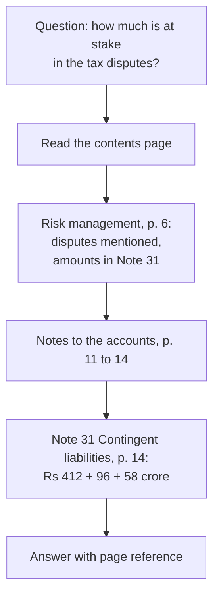

# Limits of Vector RAG: The Complete Guide

> 📚 **Before you start**
>
> - [Chunking Strategies](../06-implementing-rag/chunking-strategies.md), for how chunk boundaries change what retrieval can find.
> - [Hybrid Search](../06-implementing-rag/hybrid-search.md) and [Reranking](../06-implementing-rag/reranking.md), the usual fixes for weak retrieval, and why they don't reach every failure in this lesson.
> - [Embeddings and Similarity Search](../course.md#m3), for what "similar" means to an embedding model.

## Introduction

Priya is a credit analyst at a bank in Mumbai. A company has applied for a ₹500 crore loan, and she has its 300-page annual report. Her manager asks: *"How much is at stake in their tax disputes?"*

Priya doesn't read the report from page 1, and she doesn't search for the words "tax disputes" either. She knows how annual reports are built. She opens the contents, goes to the risk section, sees *"amounts are disclosed in Note 31"*, jumps to the notes to the accounts, finds Note 31 (Contingent liabilities), and reads the number. Four moves, each guided by the **structure** of the document.

A vector RAG system does something very different. It cuts the report into chunks, embeds them, and returns the chunks whose embeddings are closest to the question. For many questions that works well, and you've spent two modules making it work better. But on long, structured, professional documents (annual reports, regulatory filings, legal contracts, technical manuals), it has failure modes that better embeddings, hybrid search and reranking can't fully fix, because the problem isn't the ranking. It's the idea that **the answer looks like the question**.

This lesson shows those failures on a small annual report, and sets up this module's alternative: **vectorless, reasoning-based retrieval**, which navigates a document's structure the way Priya does.

> 💡 **Key Insight**
>
> Vector search retrieves what is **similar** to the question. In long expert documents, the answer is often somewhere that **isn't** similar: a statement table with different vocabulary, a note the text only refers to, a section whose meaning depends on where it sits. Experts find those places by **reasoning over structure**, not by similarity.

---

## Core Explanation

### 1. The document

Every lesson in this module uses the same document: the text layer of a 16-page annual report for a made-up power company. Real reports run to hundreds of pages, but the shape is the same: a contents page, narrative sections, financial statements and numbered notes that the narrative refers to.

```python
import json, re, zlib
import numpy as np

# The text layer of a 16-page annual report, one string per page. Headings sit on their own lines.
REPORT = {
    1: "Bharat Grid Power Limited\nAnnual Report 2025-26\nContents: Chairman's message 2, Business review 3, Risk management 6, Financial statements 8, Notes to the accounts 11, Corporate governance 15.",
    2: "1 Chairman's message\nDear shareholders, 2025-26 was our most profitable year yet. Net profit grew 16.5% and our net profit margin improved for the third year in a row. I thank our employees for this result.",
    3: "2 Business review\n2.1 Generation\nOur plants generated 41,300 million units of electricity. Coal plants ran at a plant load factor of 71%.",
    4: "2.2 Transmission\nWe added 1,150 circuit km of transmission lines. Line availability stayed above 99.6%.",
    5: "2.3 Renewable projects\nWe commissioned 640 MW of solar capacity in Rajasthan and Gujarat. A 300 MW wind project in Tamil Nadu is due in 2027.",
    6: "3 Risk management\n3.1 Financial risks\nInterest rate risk is managed by keeping 60% of borrowings at fixed rates. The company is contesting several tax disputes with the authorities, and the amounts involved are disclosed in Note 31.",
    7: "3.2 Operational risks\nCoal supply disruptions during the monsoon and heat waves that push up peak demand are the main operational risks.",
    8: "4 Financial statements\n4.1 Statement of profit and loss\nRevenue from operations Rs 18,420 crore. Total expenses Rs 16,710 crore. Profit after tax Rs 1,284 crore (previous year Rs 1,102 crore).",
    9: "4.2 Balance sheet\nTotal assets Rs 52,600 crore. Total equity Rs 19,900 crore. Borrowings are detailed in Note 12.",
    10: "4.3 Cash flow statement\nCash from operating activities Rs 3,870 crore. Capital expenditure Rs 4,950 crore, mostly on solar projects.",
    11: "5 Notes to the accounts\nNote 12 Borrowings\nLong-term loans Rs 21,300 crore and short-term loans Rs 2,900 crore. Rs 3,450 crore of the long-term loans is repayable within one year.",
    12: "Note 18 Revenue from operations\nSale of power Rs 16,980 crore, transmission charges Rs 1,210 crore and other operating income Rs 230 crore.",
    13: "Note 27 Employee benefits\nGratuity and provident fund contributions were Rs 312 crore. The company had 9,400 employees at the year end.",
    14: "Note 31 Contingent liabilities\nClaims not acknowledged as debts: income tax demands Rs 412 crore, GST demands Rs 96 crore and land compensation cases Rs 58 crore.",
    15: "6 Corporate governance\n6.1 Board of directors\nThe board has 11 directors, 6 of them independent. It met 8 times during the year.",
    16: "6.2 Independent auditor's report\nIn our opinion the financial statements give a true and fair view. Auditors: Mehta Iyer and Co, Chartered Accountants.",
}
print(len(REPORT), "pages,", sum(len(t.split()) for t in REPORT.values()), "words")
```

Output:

```
16 pages, 407 words
```

### 2. A standard vector RAG over it

Here's the baseline you already know: fixed-size chunks (30 words, no overlap, ignoring structure), a word-hashing embedding that runs offline, and cosine similarity for the top 3 chunks.

```python
STOP = {"a", "an", "the", "is", "are", "was", "were", "of", "to", "in", "on", "for", "and", "or", "by", "with",
        "what", "which", "how", "much", "many", "did", "do", "does", "at", "our", "its", "it", "this", "that", "be", "has", "had"}

def words(text):
    return {w for w in re.findall(r"[a-z0-9]+", text.lower()) if w not in STOP}

def embed(text):
    v = np.zeros(512)
    for w in words(text):
        v[zlib.crc32(w.encode()) % 512] += 1
    n = np.linalg.norm(v)
    return v / n if n else v

chunks = []                                       # (page, text) pairs
for page, text in REPORT.items():
    tokens = text.split()
    for i in range(0, len(tokens), 30):
        chunks.append((page, " ".join(tokens[i:i + 30])))
matrix = np.array([embed(c) for _, c in chunks])

def vector_search(question, k=3):
    scores = matrix @ embed(question)
    return [(chunks[i][0], round(float(scores[i]), 2)) for i in np.argsort(-scores)[:k]]

QUESTIONS = {
    "What was the net profit for 2025-26?": 8,
    "How much money is at stake in the company's tax disputes?": 14,
    "How much of the borrowings must be repaid within a year?": 11,
    "How many employees does the company have?": 13,
}
print(len(chunks), "chunks")
for q, answer_page in QUESTIONS.items():
    hits = vector_search(q)
    status = "found" if answer_page in [p for p, _ in hits] else "MISSED"
    print(f"{q:<58} top pages {hits}  answer on p. {answer_page}: {status}")
```

Output:

```
20 chunks
What was the net profit for 2025-26?                       top pages [(2, 0.43), (1, 0.17), (10, 0.11)]  answer on p. 8: MISSED
How much money is at stake in the company's tax disputes?  top pages [(6, 0.35), (1, 0.14), (7, 0.1)]  answer on p. 14: MISSED
How much of the borrowings must be repaid within a year?   top pages [(11, 0.45), (11, 0.2), (12, 0.2)]  answer on p. 11: found
How many employees does the company have?                  top pages [(2, 0.33), (13, 0.26), (6, 0.25)]  answer on p. 13: found
```

Two of four questions miss the page that holds the answer entirely. Our toy embedding is cruder than a real model, but the two misses are not about crudeness. Let's look at each.

### 3. Failure one: similar is not the same as relevant

*"What was the net profit for 2025-26?"* The chairman's letter (page 2) talks about "net profit" twice, "profitable", the year "2025-26". It is the most similar text in the report. It doesn't contain the number.

The number lives on page 8, in the statement of profit and loss, as *"Profit after tax Rs 1,284 crore"*. Accountants write "profit after tax", not "net profit"; statements are tables of line items, not sentences about profit. A good embedding model knows the two phrases are related, but the chairman's letter is related **and** wordy **and** on topic, so it keeps winning. In real reports there are dozens of such pages: the MD&A, the directors' report, the highlights spread, each "about" profit, each without the audited figure.

An expert never confuses them, because they know **where** audited numbers live. That knowledge is about structure, not wording.

### 4. Failure two: references the text points at

*"How much money is at stake in the company's tax disputes?"* Vector search does find page 6, which mentions the disputes. Here is what that page actually says:

```python
print(REPORT[6])
```

Output:

```
3 Risk management
3.1 Financial risks
Interest rate risk is managed by keeping 60% of borrowings at fixed rates. The company is contesting several tax disputes with the authorities, and the amounts involved are disclosed in Note 31.
```

The answer is *"disclosed in Note 31"*. Page 14 holds the numbers, under the title "Contingent liabilities", with the phrase "claims not acknowledged as debts". It shares almost no words with the question. Vector retrieval treats each chunk independently, so it can't **follow** the pointer. Professional documents are full of these: *"see Note 12"*, *"as defined in Clause 4.2"*, *"refer to Schedule III"*, *"details in Appendix B"*.

Query rewriting and multi-query (Module 5) don't help much here, because no reasonable rephrasing of "tax disputes" contains "claims not acknowledged as debts" unless you already know accounting.

### 5. Failure three: chunks cut through structure

Fixed-size chunks don't know where sections begin and end. Look at what happened to the notes:

```python
for page, text in chunks:
    if page in (11, 12):
        print(page, "|", text)
```

Output:

```
11 | 5 Notes to the accounts Note 12 Borrowings Long-term loans Rs 21,300 crore and short-term loans Rs 2,900 crore. Rs 3,450 crore of the long-term loans is repayable within one
11 | year.
12 | Note 18 Revenue from operations Sale of power Rs 16,980 crore, transmission charges Rs 1,210 crore and other operating income Rs 230 crore.
```

The first chunk of page 11 starts with the heading of a whole section ("5 Notes to the accounts") and then a sub-heading, both glued to the numbers, and the 30-word limit cut the last sentence, leaving a chunk that says only "year.". If a note ran longer, the line items would land in a chunk with no title at all, and the heading "Note 12 Borrowings" would sit in a different chunk from the figures it describes. You saw this in [Chunking Strategies](../06-implementing-rag/chunking-strategies.md): structure-aware chunking softens it, but any chunk is still a fragment cut out of its place in the document.

### 6. Failure four: questions about the document itself

Some questions aren't about a fact at all:

- *"Summarise the risk management section."* The answer is all of pages 6 and 7, in order. Top-k returns some chunks from it, plus chunks from elsewhere that mention "risk".
- *"What notes does the report contain?"* That's a question about the document's **outline**, which no chunk contains.
- *"Compare revenue in the business review with Note 18."* That needs two specific places, chosen by meaning.

Vector RAG has no view of the document as a whole: it sees a bag of fragments.

### 7. How an expert navigates



Each step uses a different kind of knowledge: what the sections of an annual report are for, that "amounts disclosed in" is a pointer worth following, that tax demands under dispute are *contingent liabilities*. None of the steps needs an embedding. An LLM has exactly this kind of knowledge, and it can read a contents page.

That's the idea behind **vectorless RAG** (also called reasoning-based or tree-search RAG): turn the document into a **tree of sections** with titles, summaries and page ranges, and let an LLM **navigate** it, reading, choosing, following references, until it has the evidence. The best-known open-source implementation is PageIndex, which the next lesson introduces.

### 8. Vector RAG is still the right tool, often

This module is not saying "vectors are dead". The two approaches suit different jobs:

| | Vector RAG | Vectorless, tree-search RAG |
|---|---|---|
| Best on | Many short or loosely structured documents: FAQs, tickets, chat logs, product pages | A few long, structured documents: reports, filings, contracts, manuals |
| Retrieval cost | One embedding plus a fast index lookup | Several LLM calls per question |
| Latency | Milliseconds | Seconds |
| Scales to | Millions of chunks | A tree per document; across many documents you first need to choose which tree |
| Explainability | A similarity score | A readable reasoning trail through named sections |
| Needs | Good chunks and embeddings | Recoverable structure (contents, headings) |

Many production systems combine them: vector or keyword search to pick the right **documents** out of thousands, and tree search to find the right **pages** inside each. You'll see that combination again at the end of the module.

---

## Try It Yourself

1. **Bigger k.** Re-run `vector_search` for the tax-disputes question with `k=8`. Does page 14 appear, and at what rank? What does that cost you in the prompt?
2. **Vocabulary rescue.** Search with *"What are the contingent liabilities, the claims not acknowledged as debts?"*. Why does it work, and why can't you rely on users asking like this?
3. **Pages with several headings.** Which pages hold more than one heading line (a line that starts with a section number or "Note")? What does that mean for those pages' first chunks?

<details>
<summary>Show answers</summary>

**1.**

```python
print(vector_search("How much money is at stake in the company's tax disputes?", k=8))
```

Output:

```
[(6, 0.35), (1, 0.14), (7, 0.1), (5, 0.09), (16, 0.09), (13, 0.09), (14, 0.09), (2, 0.09)]
```

Page 14 finally appears at rank 7, with a score of 0.09, tied with pages about the auditor, employees and renewables. The note shares a single word, "tax", with the question. To be sure of getting it you'd send eight chunks, most of them irrelevant, and the model would have to spot the one that matters among them. A real embedding model would rank it higher, but it would still compete with every page that mentions tax or disputes.

**2.**

```python
print(vector_search("What are the contingent liabilities, the claims not acknowledged as debts?"))
```

Output:

```
[(14, 0.58), (7, 0.09), (10, 0.09)]
```

It works because the question now uses the note's own vocabulary. Users ask in their words, not the document's; translating between them requires knowing the domain, which is what reasoning-based retrieval brings.

**3.**

```python
heading = re.compile(r"^(\d+(\.\d+)*|Note \d+) [A-Z]", re.M)
print([p for p, text in REPORT.items() if len(heading.findall(text)) > 1])
```

Output:

```
[3, 6, 8, 11, 15]
```

On each of these pages a new top-level section starts, so the first chunk mixes a parent heading, a sub-heading and body text with no boundaries, and the chunk's metadata says only "page N". A tree keeps each heading as its own node with its own page range.

</details>

---

## Real-World Examples

- **Financial analysis**: the FinanceBench study (Patronus AI, 2023) found that a strong LLM with a standard vector-store retrieval setup answered most questions about public company filings incorrectly or refused, largely because retrieval brought back the wrong passages.
- **Legal review**: contracts define terms in one clause and use them in fifty others; answers depend on following those definitions and cross-references.
- **Regulatory compliance**: circulars amend earlier circulars, so the right answer is often "paragraph 4 of the 2023 direction, as amended by paragraph 2 of the 2025 one".
- **Technical manuals**: troubleshooting steps refer to diagrams and tables in other chapters by number.

---

## Common Misconceptions

### "A better embedding model will fix all of this"

Better models narrow the vocabulary gap but don't follow references, don't see the outline, and still rank wordy on-topic text above terse tables.

### "Just retrieve more chunks"

More chunks raise cost and noise, and as exercise 1 shows, may still not reach the answer.

### "Vectorless means no retrieval"

It means no **vector** retrieval. Retrieval still happens; it is done by an LLM reasoning over a structured index instead of a similarity search over embeddings.

### "Vectorless RAG replaces vector RAG"

They're suited to different document collections, and the strongest systems often use both.

---

## Interview Relevance

*"When does vector RAG fail, and what would you do about it?"* Similarity isn't relevance (wordy narrative beats terse tables), cross-references can't be followed, chunking breaks structure, and outline-level questions have no matching chunk. Fixes range from structure-aware chunking and hybrid search to tree-based, reasoning-driven retrieval for long structured documents, often combined with vector search for document selection.

*"What are the trade-offs of reasoning-based retrieval?"* Better accuracy and explainability on long structured documents; more LLM calls, higher latency and cost, and it needs the document's structure to be recoverable.

---

## Key Takeaways

- **Vector search finds what looks like the question**; in expert documents the answer often doesn't.
- **Four failure modes**: similar-but-not-relevant passages, unfollowed references, chunks that cut through structure, and questions about the outline.
- **Experts navigate by structure**: contents, sections, notes, cross-references.
- **Vectorless RAG** turns a document into a tree of sections and lets an LLM navigate it.
- **Use each where it fits**: vectors for many short documents, tree search for few long structured ones, often both together.

---

**Up next:** [PageIndex and Chunk-Free Segmentation](pageindex-and-chunk-free-segmentation.md)
