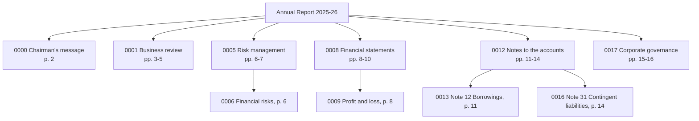

# The Document Tree Model: The Complete Guide

> 📚 **Before you start**
>
> - [PageIndex and Chunk-Free Segmentation](pageindex-and-chunk-free-segmentation.md), for how headings and the contents page become sections.
> - Python basics: recursion and dictionaries. A function that calls itself on each child is all the tree code here needs.

## Introduction

Open the Indian Railways timetable book for your zone. You don't scan every train. You go to the section for your route, then the table for your direction, then the column for your train. The book is a **tree**: zone, route, direction, train. Each level has a label that tells you whether to go deeper.

A vectorless RAG index is the same kind of tree, built for an LLM instead of a passenger. Every node is a section of the document with a **title**, a short **summary**, the **pages** it covers and its **children**. The LLM never sees all the text at once. It sees this map, decides where to go, and only then reads pages.

In this lesson you'll build that tree for our annual report: the node model, the build algorithm, node IDs, summaries, the compact "tree view" the LLM reads, and the functions that go from a chosen node back to its text.

> 💡 **Key Insight**
>
> The tree separates **what the LLM navigates** (titles, summaries and page ranges, small enough to fit in one prompt) from **what it reads** (the full text of the pages under a chosen node, fetched on demand). Good summaries make navigation work; exact page ranges make reading and citing exact.

---

## Core Explanation

### 1. Anatomy of a node

PageIndex's tree uses a handful of fields per node, and so will we:

| Field | Meaning |
|---|---|
| `title` | The section's heading, as in the document |
| `node_id` | A short stable ID such as `"0009"`, so the LLM can name a node unambiguously |
| `start_index`, `end_index` | First and last page of the section |
| `summary` | A sentence or two on what the section contains |
| `nodes` | Child nodes (empty for a leaf) |

A Pydantic model makes the shape explicit and validates it:

```python
import json, re, zlib
import numpy as np

# The text layer of a 16-page annual report, one string per page. Headings sit on their own lines.
REPORT = {
    1: "Bharat Grid Power Limited\nAnnual Report 2025-26\nContents: Chairman's message 2, Business review 3, Risk management 6, Financial statements 8, Notes to the accounts 11, Corporate governance 15.",
    2: "1 Chairman's message\nDear shareholders, 2025-26 was our most profitable year yet. Net profit grew 16.5% and our net profit margin improved for the third year in a row. I thank our employees for this result.",
    3: "2 Business review\n2.1 Generation\nOur plants generated 41,300 million units of electricity. Coal plants ran at a plant load factor of 71%.",
    4: "2.2 Transmission\nWe added 1,150 circuit km of transmission lines. Line availability stayed above 99.6%.",
    5: "2.3 Renewable projects\nWe commissioned 640 MW of solar capacity in Rajasthan and Gujarat. A 300 MW wind project in Tamil Nadu is due in 2027.",
    6: "3 Risk management\n3.1 Financial risks\nInterest rate risk is managed by keeping 60% of borrowings at fixed rates. The company is contesting several tax disputes with the authorities, and the amounts involved are disclosed in Note 31.",
    7: "3.2 Operational risks\nCoal supply disruptions during the monsoon and heat waves that push up peak demand are the main operational risks.",
    8: "4 Financial statements\n4.1 Statement of profit and loss\nRevenue from operations Rs 18,420 crore. Total expenses Rs 16,710 crore. Profit after tax Rs 1,284 crore (previous year Rs 1,102 crore).",
    9: "4.2 Balance sheet\nTotal assets Rs 52,600 crore. Total equity Rs 19,900 crore. Borrowings are detailed in Note 12.",
    10: "4.3 Cash flow statement\nCash from operating activities Rs 3,870 crore. Capital expenditure Rs 4,950 crore, mostly on solar projects.",
    11: "5 Notes to the accounts\nNote 12 Borrowings\nLong-term loans Rs 21,300 crore and short-term loans Rs 2,900 crore. Rs 3,450 crore of the long-term loans is repayable within one year.",
    12: "Note 18 Revenue from operations\nSale of power Rs 16,980 crore, transmission charges Rs 1,210 crore and other operating income Rs 230 crore.",
    13: "Note 27 Employee benefits\nGratuity and provident fund contributions were Rs 312 crore. The company had 9,400 employees at the year end.",
    14: "Note 31 Contingent liabilities\nClaims not acknowledged as debts: income tax demands Rs 412 crore, GST demands Rs 96 crore and land compensation cases Rs 58 crore.",
    15: "6 Corporate governance\n6.1 Board of directors\nThe board has 11 directors, 6 of them independent. It met 8 times during the year.",
    16: "6.2 Independent auditor's report\nIn our opinion the financial statements give a true and fair view. Auditors: Mehta Iyer and Co, Chartered Accountants.",
}
print(len(REPORT), "pages,", sum(len(t.split()) for t in REPORT.values()), "words")
```

Output:

```
16 pages, 407 words
```

```python
from typing import List
from pydantic import BaseModel, Field

class TreeNode(BaseModel):
    title: str
    node_id: str
    start_index: int
    end_index: int
    summary: str = ""
    nodes: List["TreeNode"] = Field(default_factory=list)

leaf = TreeNode(title="Note 31 Contingent liabilities", node_id="0016", start_index=14, end_index=14)
print(leaf.model_dump())
```

Output:

```
{'title': 'Note 31 Contingent liabilities', 'node_id': '0016', 'start_index': 14, 'end_index': 14, 'summary': '', 'nodes': []}
```

### 2. From headings to a tree

From the last lesson, headings give us a flat list: title, level and start page. Turning that into a tree is a classic **stack** algorithm. Walk the headings in order; keep a stack of open sections; pop until the top of the stack is shallower than the new heading; attach the new node as its child; push it.

The end page of a section is where the next heading at the **same or a higher** level begins (minus one page, when that heading starts on a later page), or the last page of the document.

```python
HEADING = re.compile(r"^(?:(\d+(?:\.\d+)*)|Note (\d+)) ([A-Z][^.\n]*)$")

def find_headings(pages):
    found = []
    for page, text in pages.items():
        for line in text.splitlines():
            m = HEADING.match(line)
            if m:
                number, note, _ = m.groups()
                level = number.count(".") + 1 if number else 2      # notes sit under section 5
                found.append({"title": line, "level": level, "page": page})
    return found

def build_tree(headings, last_page):
    root = TreeNode(title="root", node_id="root", start_index=1, end_index=last_page)
    stack = [(0, root)]
    for i, h in enumerate(headings):
        end = last_page
        for later in headings[i + 1:]:
            if later["level"] <= h["level"]:
                end = max(h["page"], later["page"] - 1)
                break
        node = TreeNode(title=h["title"], node_id=f"{i:04d}", start_index=h["page"], end_index=end)
        while stack[-1][0] >= h["level"]:
            stack.pop()
        stack[-1][1].nodes.append(node)
        stack.append((h["level"], node))
    return root.nodes

tree = build_tree(find_headings(REPORT), max(REPORT))

def show(nodes, depth=0):
    for n in nodes:
        print("    " * depth + f"[{n.node_id}] {n.title}  (pp. {n.start_index}-{n.end_index})")
        show(n.nodes, depth + 1)

show(tree)
```

Output:

```
[0000] 1 Chairman's message  (pp. 2-2)
[0001] 2 Business review  (pp. 3-5)
    [0002] 2.1 Generation  (pp. 3-3)
    [0003] 2.2 Transmission  (pp. 4-4)
    [0004] 2.3 Renewable projects  (pp. 5-5)
[0005] 3 Risk management  (pp. 6-7)
    [0006] 3.1 Financial risks  (pp. 6-6)
    [0007] 3.2 Operational risks  (pp. 7-7)
[0008] 4 Financial statements  (pp. 8-10)
    [0009] 4.1 Statement of profit and loss  (pp. 8-8)
    [0010] 4.2 Balance sheet  (pp. 9-9)
    [0011] 4.3 Cash flow statement  (pp. 10-10)
[0012] 5 Notes to the accounts  (pp. 11-14)
    [0013] Note 12 Borrowings  (pp. 11-11)
    [0014] Note 18 Revenue from operations  (pp. 12-12)
    [0015] Note 27 Employee benefits  (pp. 13-13)
    [0016] Note 31 Contingent liabilities  (pp. 14-14)
[0017] 6 Corporate governance  (pp. 15-16)
    [0018] 6.1 Board of directors  (pp. 15-15)
    [0019] 6.2 Independent auditor's report  (pp. 16-16)
```

Node IDs are assigned in **reading order** (depth first), so `0009` comes after `0008` in the document, which also helps the LLM reason ("the notes come after the statements").

One subtlety: the `max(...)` rule assumes the next section starts at the top of its page. When a section ends halfway down a page and the next begins below it, that page belongs to **both** nodes. PageIndex's page ranges can overlap by a page for the same reason. Overlap is harmless: fetching a node may include a few lines of its neighbour, and citations stay correct at page level.



### 3. Getting a node's text back

The tree stores pages, not text. Two small functions take you from an ID to the words: find the node, then read its page range from the document.

```python
def find_node(nodes, node_id):
    for n in nodes:
        if n.node_id == node_id:
            return n
        found = find_node(n.nodes, node_id)
        if found:
            return found
    return None

def node_text(node, pages=REPORT):
    return "\n".join(f"[p. {p}] {pages[p]}" for p in range(node.start_index, node.end_index + 1))

print(node_text(find_node(tree, "0016")))
print(node_text(find_node(tree, "0005")).count("[p."), "pages under Risk management")
```

Output:

```
[p. 14] Note 31 Contingent liabilities
Claims not acknowledged as debts: income tax demands Rs 412 crore, GST demands Rs 96 crore and land compensation cases Rs 58 crore.
2 pages under Risk management
```

Because the text is fetched by page, each page arrives **labelled with its number**. That's what makes the page references in the last lesson of this module exact rather than guessed.

### 4. Summaries: what makes navigation work

Titles alone are often enough ("Balance sheet"), but not always. "Note 31 Contingent liabilities" means nothing to a model that doesn't connect contingent liabilities with tax disputes, and "Financial risks" doesn't say that it points to Note 31. A **summary** per node fixes that. In PageIndex, the LLM writes one for every node during indexing (`--if-add-node-summary yes`), with a prompt along these lines:

```python
# not-run: needs langchain-anthropic and an API key
from langchain_anthropic import ChatAnthropic

llm = ChatAnthropic(model="claude-opus-5-5", temperature=0)
SUMMARY_PROMPT = ("Summarise this section of a document in one or two sentences for someone deciding whether "
                  "to read it. Mention the kinds of facts and figures it contains and any other sections it "
                  "refers to.\n\nTitle: {title}\n\n{text}")

def summarise(node):
    return llm.invoke(SUMMARY_PROMPT.format(title=node.title, text=node_text(node))).content
```

Offline, we'll use a rule that follows the same brief: a leaf gets its first sentence plus any references it makes; a parent gets the list of what's under it.

```python
def body(node):
    text = " ".join(REPORT[p] for p in range(node.start_index, node.end_index + 1))
    after = text.split(node.title, 1)[1] if node.title in text else text
    return " ".join(line for line in after.splitlines() if not HEADING.match(line)).strip()

def add_summaries(nodes):
    for n in nodes:
        add_summaries(n.nodes)
        if n.nodes:
            n.summary = "Contains: " + "; ".join(c.title for c in n.nodes) + "."
        else:
            sentences = re.split(r"(?<=\.) ", body(n))
            refs = sorted(set(re.findall(r"Note \d+", body(n))))
            n.summary = sentences[0] + (f" Refers to {', '.join(refs)}." if refs else "")

add_summaries(tree)
for node_id in ["0005", "0006", "0016"]:
    n = find_node(tree, node_id)
    print(f"[{node_id}] {n.title}: {n.summary}")
```

Output:

```
[0005] 3 Risk management: Contains: 3.1 Financial risks; 3.2 Operational risks.
[0006] 3.1 Financial risks: Interest rate risk is managed by keeping 60% of borrowings at fixed rates. Refers to Note 31.
[0016] Note 31 Contingent liabilities: Claims not acknowledged as debts: income tax demands Rs 412 crore, GST demands Rs 96 crore and land compensation cases Rs 58 crore.
```

Notice the stand-in's limits: node 0016's summary is accurate, but it doesn't say "this is where disputed tax demands are quantified", which a good LLM summary would. Summary quality is the biggest lever on navigation quality, so it's worth spending a strong model on it at indexing time.

### 5. The tree view: what the LLM actually reads

At search time the LLM gets a **compact view** of the tree: IDs, titles, pages and summaries, with no body text. Keep it small and regular; JSON is a common choice because the model will answer with node IDs anyway.

```python
def tree_view(nodes):
    return [{"node_id": n.node_id, "title": n.title, "pages": f"{n.start_index}-{n.end_index}",
             "summary": n.summary, **({"nodes": tree_view(n.nodes)} if n.nodes else {})}
            for n in nodes]

view = json.dumps(tree_view(tree), indent=1)
print(view[:330], "...")
doc_words = sum(len(t.split()) for t in REPORT.values())
print(f"\ntree view: {len(view.split())} words, document: {doc_words} words")
```

Output:

```
[
 {
  "node_id": "0000",
  "title": "1 Chairman's message",
  "pages": "2-2",
  "summary": "Dear shareholders, 2025-26 was our most profitable year yet."
 },
 {
  "node_id": "0001",
  "title": "2 Business review",
  "pages": "3-5",
  "summary": "Contains: 2.1 Generation; 2.2 Transmission; 2.3 Renewable projects.",
  "nodes": [
 ...

tree view: 478 words, document: 407 words
```

In our tiny report the tree view is about as long as the document itself, because every section is only a sentence or two. In a real 300-page report (around 150,000 words) with 200 nodes and two-sentence summaries, the tree view is roughly 6,000 to 8,000 words, about 5% of the document, small enough for every navigation step to see the whole map.

When even that is too big (a 2,000-page filing), show the tree **level by level**: top-level nodes first, then the children of whichever node the model chooses.

### 6. Design choices that matter

- **Depth.** Two or three levels is usually right. Deeper trees mean more navigation steps; flatter ones mean bigger nodes to read.
- **Node size.** Leaves should be readable in one call: a few pages, well under the model's context window. That's what the size limits from the last lesson enforce.
- **Summaries for parents.** A list of child titles is a decent parent summary; an LLM-written overview is better for broad questions ("summarise the risks").
- **Stable IDs.** Keep IDs stable across re-indexing when the document hasn't changed, so logs and cached answers still point to the right node.
- **Document description.** For a collection of documents, add a one-paragraph description per document (PageIndex's `--if-add-doc-description`), so the system can first pick the right **document**, then navigate its tree.

---

## Try It Yourself

1. **Count the leaves.** Write `leaves(nodes)` that returns all nodes with no children. How many are there, and what's the largest page range among them?
2. **The path to a node.** Write `path_to(nodes, node_id)` returning the titles from the top level down to that node. What's the path to `0013`?
3. **Level-by-level view.** Print only the top-level nodes (ID and title) as the first navigation step would see them, and count the words.

<details>
<summary>Show answers</summary>

**1.**

```python
def leaves(nodes):
    out = []
    for n in nodes:
        out += leaves(n.nodes) if n.nodes else [n]
    return out

ls = leaves(tree)
print(len(ls), "leaves; largest range:", max(n.end_index - n.start_index + 1 for n in ls), "page(s)")
```

Output:

```
15 leaves; largest range: 1 page(s)
```

**2.**

```python
def path_to(nodes, node_id, trail=()):
    for n in nodes:
        here = trail + (n.title,)
        if n.node_id == node_id:
            return list(here)
        found = path_to(n.nodes, node_id, here)
        if found:
            return found
    return None

print(" > ".join(path_to(tree, "0013")))
```

Output:

```
5 Notes to the accounts > Note 12 Borrowings
```

A path like this is a useful extra in a citation: *"Notes to the accounts > Note 12 Borrowings, p. 11"*.

**3.**

```python
top = "\n".join(f"{n.node_id} {n.title} (pp. {n.start_index}-{n.end_index})" for n in tree)
print(top)
print(len(top.split()), "words")
```

Output:

```
0000 1 Chairman's message (pp. 2-2)
0001 2 Business review (pp. 3-5)
0005 3 Risk management (pp. 6-7)
0008 4 Financial statements (pp. 8-10)
0012 5 Notes to the accounts (pp. 11-14)
0017 6 Corporate governance (pp. 15-16)
38 words
```

The first step sees a 38-word map. If the model picks `0012`, the next prompt adds only the four notes under it, so the prompt grows with the depth of the search, not with the size of the document.

</details>

---

## Real-World Examples

- **Annual-report and filing assistants** keep one tree per filing, with the financial statements and notes as separate branches, so number questions go straight to audited tables.
- **Contract review tools** index clauses and schedules as nodes, with definitions as their own branch the model can always consult.
- **Technical documentation bots** build trees from Markdown headings, which costs nothing but the summary calls.
- **Agents with document tools** expose "get tree" and "get pages" as two tools and let the agent navigate itself.

---

## Common Misconceptions

### "The tree holds the text"

It holds titles, summaries and page ranges. Text is fetched by page only for the nodes the model chooses.

### "Titles are enough for navigation"

They often are for well-named sections, but references and domain vocabulary ("contingent liabilities" for tax disputes) need summaries.

### "Overlapping page ranges are a bug"

A page shared by two sections belongs to both. Page-level fetching and citing stay correct.

### "Deeper trees are always better"

Each level adds a navigation step. Aim for leaves that are small enough to read, and stop there.

---

## Interview Relevance

*"Describe the index structure used by tree-based RAG."* A hierarchy of document sections; each node has an ID, title, summary, start and end page, and children. The LLM navigates a compact view (no text), then fetches the page range of chosen nodes.

*"How do you keep the navigation prompt small for very long documents?"* Short summaries, limited depth, and level-by-level expansion so the model only sees the children of nodes it chooses.

---

## Key Takeaways

- **A node** is a section with `title`, `node_id`, `start_index`, `end_index`, `summary` and child `nodes`.
- **Build the tree** from headings with a stack; end pages come from the next heading at the same or higher level.
- **The LLM navigates a compact tree view** and reads text only for chosen nodes, fetched by page with page labels.
- **Summaries drive navigation quality**, especially for references and domain vocabulary.
- **Keep trees shallow, leaves readable, IDs stable**, and expand level by level for very large documents.

---

**Up next:** [The Iterative Search Loop](the-iterative-search-loop.md)
