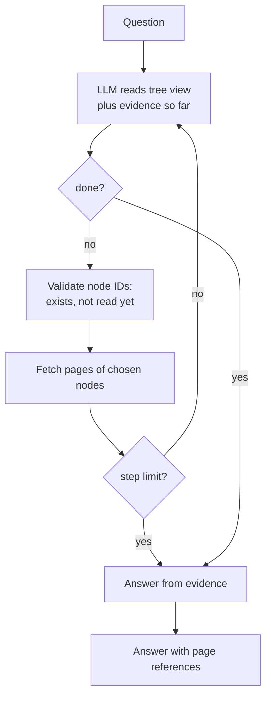

# The Iterative Search Loop: The Complete Guide

> 📚 **Before you start**
>
> - [The Document Tree Model](the-document-tree-model.md), for nodes, the tree view and fetching a node's pages.
> - [Retrieval Methods](../06-implementing-rag/retrieval-methods.md), for query decomposition, a cousin of what the loop does.
> - [LangChain Complete Guide](../../langchain-complete-guide/course.md), for chat models and structured output.

## Introduction

Ask an experienced auditor in Chennai where a company's disputed tax demands are, and watch what they do. They glance at the contents and pick a section ("risk, probably"). They read it. It says *"amounts disclosed in Note 31"*. They don't stop to rank every page in the report by similarity; they **follow the pointer**, read Note 31, see the numbers, and stop, because now they have enough.

That is the retrieval step of vectorless RAG: a **loop** in which an LLM looks at the document tree, chooses where to look, reads, and decides whether to keep going. Each turn of the loop uses everything read so far, which is how it follows references and recovers from a wrong first guess, things a one-shot similarity search can't do.

In this lesson you'll build the loop: the navigation prompt, the JSON decisions, the fetch step, the stopping rule and the guards that keep it from wandering, then the answer step that turns gathered pages into a response.

> 💡 **Key Insight**
>
> Tree search is **retrieval as a sequence of decisions**. At each step the model sees the map (the tree view), the question and the evidence so far, and either names nodes to open or declares it's done. Keep each decision small and checkable (JSON with node IDs), and put hard limits around it in code: a maximum number of steps, no revisiting, and only real node IDs.

---

## Core Explanation

### 1. Setup

The same report, and the tree:

```python
import json, re, zlib
import numpy as np

# The text layer of a 16-page annual report, one string per page. Headings sit on their own lines.
REPORT = {
    1: "Bharat Grid Power Limited\nAnnual Report 2025-26\nContents: Chairman's message 2, Business review 3, Risk management 6, Financial statements 8, Notes to the accounts 11, Corporate governance 15.",
    2: "1 Chairman's message\nDear shareholders, 2025-26 was our most profitable year yet. Net profit grew 16.5% and our net profit margin improved for the third year in a row. I thank our employees for this result.",
    3: "2 Business review\n2.1 Generation\nOur plants generated 41,300 million units of electricity. Coal plants ran at a plant load factor of 71%.",
    4: "2.2 Transmission\nWe added 1,150 circuit km of transmission lines. Line availability stayed above 99.6%.",
    5: "2.3 Renewable projects\nWe commissioned 640 MW of solar capacity in Rajasthan and Gujarat. A 300 MW wind project in Tamil Nadu is due in 2027.",
    6: "3 Risk management\n3.1 Financial risks\nInterest rate risk is managed by keeping 60% of borrowings at fixed rates. The company is contesting several tax disputes with the authorities, and the amounts involved are disclosed in Note 31.",
    7: "3.2 Operational risks\nCoal supply disruptions during the monsoon and heat waves that push up peak demand are the main operational risks.",
    8: "4 Financial statements\n4.1 Statement of profit and loss\nRevenue from operations Rs 18,420 crore. Total expenses Rs 16,710 crore. Profit after tax Rs 1,284 crore (previous year Rs 1,102 crore).",
    9: "4.2 Balance sheet\nTotal assets Rs 52,600 crore. Total equity Rs 19,900 crore. Borrowings are detailed in Note 12.",
    10: "4.3 Cash flow statement\nCash from operating activities Rs 3,870 crore. Capital expenditure Rs 4,950 crore, mostly on solar projects.",
    11: "5 Notes to the accounts\nNote 12 Borrowings\nLong-term loans Rs 21,300 crore and short-term loans Rs 2,900 crore. Rs 3,450 crore of the long-term loans is repayable within one year.",
    12: "Note 18 Revenue from operations\nSale of power Rs 16,980 crore, transmission charges Rs 1,210 crore and other operating income Rs 230 crore.",
    13: "Note 27 Employee benefits\nGratuity and provident fund contributions were Rs 312 crore. The company had 9,400 employees at the year end.",
    14: "Note 31 Contingent liabilities\nClaims not acknowledged as debts: income tax demands Rs 412 crore, GST demands Rs 96 crore and land compensation cases Rs 58 crore.",
    15: "6 Corporate governance\n6.1 Board of directors\nThe board has 11 directors, 6 of them independent. It met 8 times during the year.",
    16: "6.2 Independent auditor's report\nIn our opinion the financial statements give a true and fair view. Auditors: Mehta Iyer and Co, Chartered Accountants.",
}
print(len(REPORT), "pages,", sum(len(t.split()) for t in REPORT.values()), "words")
```

Output:

```
16 pages, 407 words
```

The tree from [The Document Tree Model](the-document-tree-model.md), rebuilt in one block (same functions, condensed):

```python
from typing import List
from pydantic import BaseModel, Field

class TreeNode(BaseModel):
    title: str
    node_id: str
    start_index: int
    end_index: int
    summary: str = ""
    nodes: List["TreeNode"] = Field(default_factory=list)

HEADING = re.compile(r"^(?:(\d+(?:\.\d+)*)|Note (\d+)) ([A-Z][^.\n]*)$")

def build_tree(pages):
    heads = [{"title": line, "page": p, "level": (m.group(1).count(".") + 1) if m.group(1) else 2}
             for p, text in pages.items() for line in text.splitlines() if (m := HEADING.match(line))]
    root, last = TreeNode(title="root", node_id="root", start_index=1, end_index=max(pages)), max(pages)
    stack = [(0, root)]
    for i, h in enumerate(heads):
        end = next((max(h["page"], l["page"] - 1) for l in heads[i + 1:] if l["level"] <= h["level"]), last)
        node = TreeNode(title=h["title"], node_id=f"{i:04d}", start_index=h["page"], end_index=end)
        while stack[-1][0] >= h["level"]:
            stack.pop()
        stack[-1][1].nodes.append(node)
        stack.append((h["level"], node))
    return root.nodes

def find_node(nodes, node_id):
    for n in nodes:
        if n.node_id == node_id:
            return n
        if (found := find_node(n.nodes, node_id)):
            return found
    return None

def node_text(node, pages=REPORT):
    return "\n".join(f"[p. {p}] {pages[p]}" for p in range(node.start_index, node.end_index + 1))

def add_summaries(nodes):
    for n in nodes:
        add_summaries(n.nodes)
        text = " ".join(REPORT[p] for p in range(n.start_index, n.end_index + 1)).split(n.title, 1)[-1]
        body = " ".join(l for l in text.splitlines() if not HEADING.match(l)).strip()
        refs = sorted(set(re.findall(r"Note \d+", body)))
        n.summary = ("Contains: " + "; ".join(c.title for c in n.nodes) + ".") if n.nodes else \
                    re.split(r"(?<=\.) ", body)[0] + (f" Refers to {', '.join(refs)}." if refs else "")

def tree_view(nodes):
    return [{"node_id": n.node_id, "title": n.title, "pages": f"{n.start_index}-{n.end_index}",
             "summary": n.summary, **({"nodes": tree_view(n.nodes)} if n.nodes else {})} for n in nodes]

tree = build_tree(REPORT)
add_summaries(tree)
print(len(tree), "top-level nodes; node 0016 is", find_node(tree, "0016").title)
```

Output:

```
6 top-level nodes; node 0016 is Note 31 Contingent liabilities
```

### 2. The navigation prompt

At each step the model receives the tree view, the question, and a record of what it has read. It replies with a small JSON object: its reasoning, the node IDs to open next, and whether it's done. PageIndex's own retrieval prompt follows the same pattern (a `thinking` field and a `node_list`).

```python
NAVIGATE = """You are finding the parts of a document that answer a question.
Document tree (titles, page ranges, summaries):
{tree}

Question: {question}

Already read:
{read}

Reply with JSON only:
{{"thinking": "<why>", "node_list": ["<node_id>", ...], "done": false}}
Choose at most 2 nodes you have not read. If what you have read already answers the question,
reply {{"thinking": "<why>", "node_list": [], "done": true}}."""

VIEW = json.dumps(tree_view(tree))
prompt = NAVIGATE.format(tree=VIEW, question="What was the net profit for 2025-26?", read="(nothing yet)")
print(len(prompt.split()), "words in the first navigation prompt")
print("Question:" + prompt.split("Question:")[1])
```

Output:

```
492 words in the first navigation prompt
Question: What was the net profit for 2025-26?

Already read:
(nothing yet)

Reply with JSON only:
{"thinking": "<why>", "node_list": ["<node_id>", ...], "done": false}
Choose at most 2 nodes you have not read. If what you have read already answers the question,
reply {"thinking": "<why>", "node_list": [], "done": true}.
```

Three design choices are packed into that prompt. **Node IDs** instead of titles, so the reply is unambiguous to parse. A **cap** on nodes per step, so the model reads in small bites. And an explicit **done** signal, so stopping is the model's decision but a visible one.

### 3. The loop

The loop asks for a decision, validates it, fetches the chosen nodes' pages, and repeats. The code around the model does three jobs the model shouldn't be trusted with: rejecting IDs that don't exist, refusing to re-read a node, and stopping after `max_steps` no matter what.

```python
def tree_search(question, llm, max_steps=4, verbose=True):
    read, evidence = [], []
    for step in range(1, max_steps + 1):
        notes = "\n".join(f"- {n.node_id} {n.title}: {node_text(n)}" for n in read) or "(nothing yet)"
        reply = json.loads(llm.invoke(NAVIGATE.format(tree=VIEW, question=question, read=notes)).content)
        if verbose:
            print(f"step {step}: {reply['thinking']}  -> {reply['node_list'] or 'DONE'}")
        if reply["done"]:
            return read, evidence
        for node_id in reply["node_list"][:2]:
            node = find_node(tree, node_id)
            if node is None:
                print(f"   ignored {node_id}: no such node")
            elif node in read:
                print(f"   ignored {node_id}: already read")
            else:
                read.append(node)
                evidence.append(node_text(node))
    print("   stopped: step limit reached")
    return read, evidence
```

To run offline, we need something that plays the LLM. `FakeListChatModel` returns canned replies in order; we load it with the decisions a capable model makes on these questions (you'll see the same decisions from a real model in section 6). The decisions are scripted, but **everything else, the prompts, parsing, validation, fetching and stopping, is the real loop**.

```python
from langchain_core.language_models.fake_chat_models import FakeListChatModel

def scripted(*decisions):
    return FakeListChatModel(responses=[json.dumps(d) for d in decisions])

llm = scripted(
    {"thinking": "Net profit is an audited figure, so it is in the statement of profit and loss, not the chairman's letter.",
     "node_list": ["0009"], "done": False},
    {"thinking": "Page 8 gives profit after tax, which is net profit: Rs 1,284 crore.", "node_list": [], "done": True},
)
read, evidence = tree_search("What was the net profit for 2025-26?", llm)
print([n.node_id for n in read])
print(evidence[0])
```

Output:

```
step 1: Net profit is an audited figure, so it is in the statement of profit and loss, not the chairman's letter.  -> ['0009']
step 2: Page 8 gives profit after tax, which is net profit: Rs 1,284 crore.  -> DONE
['0009']
[p. 8] 4 Financial statements
4.1 Statement of profit and loss
Revenue from operations Rs 18,420 crore. Total expenses Rs 16,710 crore. Profit after tax Rs 1,284 crore (previous year Rs 1,102 crore).
```

One step, straight to the statement of profit and loss. The chairman's letter, which beat every other page on similarity in [Limits of Vector RAG](limits-of-vector-rag.md), was never opened: the model knew from the **title** "Statement of profit and loss" where audited profit lives.

### 4. Following a reference

The tax-disputes question needs two hops. The first read reveals the pointer; the second follows it.

```python
llm = scripted(
    {"thinking": "Tax disputes are a financial risk; section 3.1's summary mentions Note 31.",
     "node_list": ["0006"], "done": False},
    {"thinking": "Page 6 says the amounts are disclosed in Note 31. Open it.", "node_list": ["0016"], "done": False},
    {"thinking": "Note 31 lists the disputed amounts: income tax Rs 412 crore and GST Rs 96 crore.",
     "node_list": [], "done": True},
)
read, evidence = tree_search("How much money is at stake in the company's tax disputes?", llm)
print([f"{n.node_id} {n.title} (p. {n.start_index})" for n in read])
```

Output:

```
step 1: Tax disputes are a financial risk; section 3.1's summary mentions Note 31.  -> ['0006']
step 2: Page 6 says the amounts are disclosed in Note 31. Open it.  -> ['0016']
step 3: Note 31 lists the disputed amounts: income tax Rs 412 crore and GST Rs 96 crore.  -> DONE
['0006 3.1 Financial risks (p. 6)', '0016 Note 31 Contingent liabilities (p. 14)']
```

This is the move vector search couldn't make: page 14 shares almost no words with the question, but page 6 **named** it. A sharper model may even skip the first hop, because a good summary of Note 31 ("disputed income tax and GST demands") or plain accounting knowledge ("disputed demands are contingent liabilities") points straight there.

### 5. The guards earn their keep

Models make mistakes in loops: they invent IDs, revisit nodes, or never declare done. Here's a model that does all three:

```python
llm = scripted(
    {"thinking": "Maybe there is a note on employees.", "node_list": ["0099", "0015"], "done": False},
    {"thinking": "Let me check that note again.", "node_list": ["0015"], "done": False},
    {"thinking": "And the chairman's letter.", "node_list": ["0000"], "done": False},
)
read, _ = tree_search("How many employees does the company have?", llm, max_steps=3)
print([n.node_id for n in read])
```

Output:

```
step 1: Maybe there is a note on employees.  -> ['0099', '0015']
   ignored 0099: no such node
step 2: Let me check that note again.  -> ['0015']
   ignored 0015: already read
step 3: And the chairman's letter.  -> ['0000']
   stopped: step limit reached
['0015', '0000']
```

The invented ID is ignored, the re-read is refused, and the step limit ends the search with whatever was gathered; the answer step can still use Note 27. In production, also log each step (question, thinking, node IDs) so you can see where searches go wrong.

### 6. With a real model

With a real model, ask for structured output instead of parsing JSON by hand. The schema documents the decision format and the model is constrained to follow it:

```python
# not-run: needs langchain-anthropic and an API key
from pydantic import BaseModel
from langchain_anthropic import ChatAnthropic

class Decision(BaseModel):
    thinking: str
    node_list: list[str]
    done: bool

navigator = ChatAnthropic(model="claude-opus-5-5", temperature=0).with_structured_output(Decision)
decision = navigator.invoke(NAVIGATE.format(tree=VIEW, read="(nothing yet)",
                                            question="How much money is at stake in the company's tax disputes?"))
print(decision)
```

Example output:

```
thinking='Disputed tax demands are usually disclosed as contingent liabilities. Note 31 is titled Contingent liabilities, and section 3.1 refers to Note 31.' node_list=['0016', '0006'] done=False
```

A capable model often opens both the note and the referring section in one step, which is why we allow two nodes per step.

### 7. The answer step

Once the loop ends, the gathered page text goes to the model with the question, exactly like the generation step in Module 6, except the context is whole sections with page labels rather than top-k chunks.

```python
ANSWER = """Answer the question using only these pages. Cite pages as (p. N).
{evidence}

Question: {question}"""

question = "How much money is at stake in the company's tax disputes?"
read, evidence = tree_search(question, scripted(
    {"thinking": "Go to Note 31.", "node_list": ["0016"], "done": False},
    {"thinking": "Enough.", "node_list": [], "done": True}), verbose=False)
answer_llm = FakeListChatModel(responses=[
    "Rs 508 crore of tax demands are under dispute: income tax Rs 412 crore and GST Rs 96 crore (p. 14)."])
print(answer_llm.invoke(ANSWER.format(evidence="\n".join(evidence), question=question)).content)
```

Output:

```
Rs 508 crore of tax demands are under dispute: income tax Rs 412 crore and GST Rs 96 crore (p. 14).
```

(The total is 412 + 96 = 508; the land compensation cases are not tax.) The answer's page reference comes straight from the `[p. 14]` label on the evidence; the next lesson shows how to make such references **verifiable** rather than trusting the model to copy them.



### 8. Cost, speed and variations

Every step is an LLM call whose prompt contains the tree view plus all evidence so far, so a three-step search on a big report can use 20,000 to 40,000 input tokens and several seconds. Ways to keep that in check:

- **Level-by-level views**: show top-level nodes first and expand only the chosen branch (previous lesson).
- **Prompt caching**: the tree view is identical across steps and across questions on the same document, so it caches well.
- **Vector hints**: run a cheap similarity search first and tell the navigator which nodes the hits fall in, as suggestions it may ignore.
- **A cheaper model for navigation** and a stronger one for the final answer, if your evaluation shows navigation quality holds up.
- **Agent frameworks**: the loop is a natural fit for a graph with "navigate", "fetch" and "answer" nodes, or for an agent with `get_tree` and `get_pages` tools. You'll build loops like this as graphs in the [LangGraph Complete Guide](../../langgraph-complete-guide/course.md), later in the curriculum.

---

## Try It Yourself

1. **One step only.** Run the tax-disputes search with the first scripted model from section 4 but `max_steps=1`. What evidence do you end up with, and could the answer step answer correctly?
2. **Prompt growth.** For the section 4 search, compute the number of words in the navigation prompt at each step. Why does it grow?
3. **Your own script.** Write the decisions for *"How much of the borrowings must be repaid within a year?"*, run `tree_search`, and print the evidence.

<details>
<summary>Show answers</summary>

**1.**

```python
llm = scripted(
    {"thinking": "Tax disputes are a financial risk.", "node_list": ["0006"], "done": False},
    {"thinking": "Open Note 31.", "node_list": ["0016"], "done": False})
read, evidence = tree_search("How much money is at stake in the company's tax disputes?", llm, max_steps=1)
print(evidence)
```

Output:

```
step 1: Tax disputes are a financial risk.  -> ['0006']
   stopped: step limit reached
['[p. 6] 3 Risk management\n3.1 Financial risks\nInterest rate risk is managed by keeping 60% of borrowings at fixed rates. The company is contesting several tax disputes with the authorities, and the amounts involved are disclosed in Note 31.']
```

Only page 6 was read, and it contains no amounts. A well-behaved answer step should say the amounts are in Note 31 but weren't retrieved, rather than guess. Too tight a step limit cuts off multi-hop questions; too loose wastes calls. Two to four steps suits most documents.

**2.**

```python
read_so_far = []
for node_id in [None, "0006", "0016"]:
    if node_id:
        read_so_far.append(find_node(tree, node_id))
    notes = "\n".join(f"- {n.node_id} {n.title}: {node_text(n)}" for n in read_so_far) or "(nothing yet)"
    print(len(NAVIGATE.format(tree=VIEW, question="tax disputes?", read=notes).split()), "words")
```

Output:

```
487 words
530 words
565 words
```

Each step repeats the tree view and adds everything read so far. That's why caching the tree view and keeping nodes small both matter.

**3.**

```python
llm = scripted(
    {"thinking": "Borrowings and repayment terms are in Note 12.", "node_list": ["0013"], "done": False},
    {"thinking": "Note 12 says Rs 3,450 crore is repayable within one year.", "node_list": [], "done": True})
read, evidence = tree_search("How much of the borrowings must be repaid within a year?", llm)
print(evidence[0])
```

Output:

```
step 1: Borrowings and repayment terms are in Note 12.  -> ['0013']
step 2: Note 12 says Rs 3,450 crore is repayable within one year.  -> DONE
[p. 11] 5 Notes to the accounts
Note 12 Borrowings
Long-term loans Rs 21,300 crore and short-term loans Rs 2,900 crore. Rs 3,450 crore of the long-term loans is repayable within one year.
```

</details>

---

## Real-World Examples

- **Financial research assistants** navigate filings section by section and follow note references, producing a visible search trail that analysts can audit.
- **Legal research tools** jump from a clause to the definitions section and back, the classic multi-hop pattern.
- **Coding agents** do the same thing over a repository: list the directory tree, open a file, follow an import, open another file. Tree search over documents is the same idea.
- **Customer support over long manuals** uses tree navigation for procedures, where the right answer is a whole numbered section, not a fragment.

---

## Common Misconceptions

### "The LLM searches the whole document each step"

It reads a compact tree view and only the pages of nodes it chose. The full text never goes in at once.

### "More steps means better answers"

After the evidence is found, extra steps add cost and noise. The `done` signal and a step limit matter as much as the navigation.

### "You can trust the IDs the model returns"

Validate them. Invented and repeated IDs are common failure modes.

### "Tree search doesn't need evaluation"

Navigation can go wrong in new ways (wrong branch, early stop). Log traces and evaluate retrieval, as Module 9 shows.

---

## Interview Relevance

*"Walk me through reasoning-based retrieval over a document tree."* Give the LLM the tree view and the question; it returns node IDs with reasoning in JSON; code validates the IDs, fetches the nodes' pages, appends them to the evidence, and repeats until the model says done or a step limit is hit; then answer from the gathered pages with page references.

*"What are the risks of an LLM-driven retrieval loop and how do you control them?"* Hallucinated IDs, loops, runaway cost and early stopping. Control with structured output, ID validation, a visited set, step and token limits, caching, and logged traces for evaluation.

---

## Key Takeaways

- **Tree search is a loop**: read the tree and evidence, choose nodes, fetch pages, decide whether you're done.
- **Decisions are small JSON objects** with reasoning and node IDs, ideally via structured output.
- **Code enforces the guards**: real IDs only, no re-reads, a hard step limit.
- **Following references** across steps is what lets it find answers that share no words with the question.
- **Control cost** with level-by-level views, caching, vector hints and model choice.

---

**Up next:** [Deterministic Page Referencing](deterministic-page-referencing.md)
