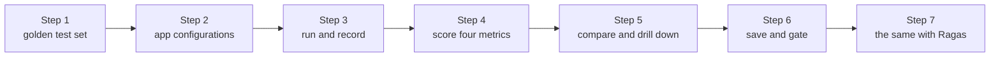

# Lab: Evaluate your RAG app with Ragas

> 📚 **Before you start**
>
> - [The RAG Triad Metrics](the-rag-triad-metrics.md), for faithfulness, answer relevance, context precision and context recall.
> - [LLM-as-a-Judge](llm-as-a-judge.md), for why judge scores need checking against human labels.
> - [RAG with LangChain and a Vector DB](../06-implementing-rag/rag-with-langchain-and-a-vector-db.md), for the answer-plus-sources chain that we put under test.

## What You'll Build

The HR team wants to change the handbook assistant: retrieve three sections instead of one, and add a friendly closing line to every answer. Is that better or worse? Opinions differ, so you'll settle it with numbers. You'll build an **evaluation harness** that:

- holds a **golden test set** of questions with reference answers, including one the handbook can't answer;
- runs any configuration of the RAG app over it and records question, contexts and answer;
- scores every record with the four standard Ragas metrics (computed offline here with the stand-in judge, then with real Ragas);
- compares configurations side by side, drills into the worst examples, and saves results;
- acts as a **regression gate** that fails when a change makes quality drop.



> 💡 **Key Insight**
>
> An evaluation is only as good as its **test set** and only as useful as its **comparisons**. Freeze a golden set, run every candidate configuration over the same questions, compare per metric and per question, and turn the result into an automatic gate so that quality can't silently regress.

---

## Step 1: The golden test set

Start with the handbook and the metric functions from the earlier lessons:

```python
import re, zlib
import numpy as np
from langchain_core.documents import Document
from langchain_core.embeddings import Embeddings
from langchain_core.vectorstores import InMemoryVectorStore

STOP = {"a", "an", "the", "is", "are", "of", "to", "in", "on", "for", "and", "or", "i", "my", "can",
        "do", "how", "many", "much", "what", "be", "it", "by", "with", "per", "up", "get", "if"}
CONCEPTS = {"vacation": "leave", "pto": "leave", "food": "meal", "lunch": "meal", "dinner": "meal",
            "budget": "allowance", "trip": "travel", "visit": "travel", "customer": "travel", "client": "travel",
            "notebook": "laptop", "computer": "laptop", "stolen": "lost", "resign": "notice", "quit": "notice",
            "expense": "claim", "reimbursement": "claim", "refund": "claim", "bill": "claim", "hotel": "stay",
            "room": "stay", "lodging": "stay", "baby": "parental", "maternity": "parental",
            "paternity": "parental", "doctor": "medical", "insurance": "medical", "hospital": "medical"}

def normalise(w):
    if w.endswith("ied"):
        return w[:-3] + "y"
    if w.endswith("s") and not w.endswith("ss") and len(w) > 3:
        return w[:-1]
    return w

def words(text):
    return {normalise(w) for w in re.findall(r"[a-z0-9]+", text.lower())} - STOP

class ToyEmbeddings(Embeddings):
    def __init__(self, dim=256):
        self.dim = dim
    def _embed(self, text):
        vec = np.zeros(self.dim)
        for w in words(text):
            vec[zlib.crc32(CONCEPTS.get(w, w).encode()) % self.dim] += 1.0
        norm = np.linalg.norm(vec)
        return [round(float(x), 6) for x in (vec / norm if norm else vec)]
    def embed_documents(self, texts):
        return [self._embed(t) for t in texts]
    def embed_query(self, text):
        return self._embed(text)

SECTIONS = [
    ("2.1", "Annual leave", 3, "Every employee gets 24 days of paid leave per calendar year. Up to 8 unused days can be carried forward to the next year."),
    ("2.2", "Sick leave", 3, "Employees get 10 days of sick leave per year. A doctor's note is required for more than 2 sick days in a row."),
    ("2.3", "Parental leave", 4, "Mothers get 26 weeks of paid maternity leave. Fathers get 2 weeks of paid paternity leave within 6 months of the birth."),
    ("3.1", "Work from home", 5, "Employees may work from home up to 2 days a week with their manager's approval."),
    ("4.1", "Health insurance", 6, "Medical insurance covers the employee, spouse and two children up to Rs 5 lakh a year."),
    ("5.1", "Travel claims", 8, "Submit bills on the Kharcha portal within 30 days of the trip. Approved claims are reimbursed within 15 days."),
    ("5.2", "Meal allowance", 8, "On client travel the daily meal allowance is Rs 1,200 in metro cities and Rs 800 in other cities."),
    ("5.3", "Hotel stay", 9, "Hotel stays are covered up to Rs 6,000 a night in metro cities and Rs 3,500 a night elsewhere."),
    ("6.1", "Laptops", 11, "A lost or stolen laptop must be reported to IT within 24 hours. The employee pays 10% of the replacement cost."),
    ("7.1", "Public holidays", 12, "The office is closed on 10 public holidays, including Diwali, Holi and Independence Day."),
    ("8.1", "Notice period", 14, "The notice period is 60 days. It can be shortened by paying basic salary for the remaining days."),
]

def handbook_docs():
    return [Document(page_content=f"{sec} {title}: {body}", id=f"handbook-{sec}",
                     metadata={"source": "hr/handbook-2026.pdf", "page": page, "section": sec})
            for sec, title, page, body in SECTIONS]

emb = ToyEmbeddings()
store = InMemoryVectorStore.from_documents(handbook_docs(), embedding=emb)
print(len(handbook_docs()), "chunks indexed")
```

Output:

```
11 chunks indexed
```

The stand-in judge and metric functions from [The RAG Triad Metrics](the-rag-triad-metrics.md), in one block:

```python
SECTION = {d.metadata["section"]: d.page_content for d in handbook_docs()}
JUDGE_STOP = {"you", "your", "it", "every", "long", "happen", "there"}

def key_terms(text):
    return {CONCEPTS.get(w, w) for w in words(text)} - JUDGE_STOP

def numbers(text):
    return set(re.findall(r"\d[\d,]*(?:\.\d+)?", text))

def supports(context_text, statement):
    terms = key_terms(statement)
    if not terms or not numbers(statement) <= numbers(context_text):
        return False
    return len(terms & key_terms(context_text)) / len(terms) >= 0.75

def relevant(question, context):
    terms = key_terms(question)
    return len(terms & key_terms(context)) / len(terms) >= 0.75

def claims(text):
    return [s for s in re.split(r"(?<=[.!?])\s+", text.strip()) if s]

def context_relevance(question, contexts):
    return sum(relevant(question, c) for c in contexts) / len(contexts)

def faithfulness(answer, contexts):
    cs = claims(answer)
    return sum(supports(" ".join(contexts), c) for c in cs) / len(cs)

def answer_relevance(question, answer):
    return float(np.dot(emb.embed_query(question), emb.embed_query(answer)))

def context_recall(reference, contexts):
    rc = claims(reference)
    return sum(supports(" ".join(contexts), c) for c in rc) / len(rc)

def context_precision(reference, contexts):
    useful = [any(supports(c, rc) for rc in claims(reference)) for c in contexts]
    hits, total = 0, 0.0
    for k, u in enumerate(useful, start=1):
        if u:
            hits += 1
            total += hits / k
    return total / hits if hits else 0.0

print("metrics ready:", faithfulness(SECTION["2.2"], [SECTION["2.2"]]))
```

Output:

```
metrics ready: 1.0
```

A golden set is a list of questions real users ask, each with a **reference answer** written by someone who knows the source. Ten is enough to learn the workflow; real projects aim for 50 to a few hundred, grown from production questions and past failures. Include questions the documents **can't** answer, so you also test refusals.

```python
GOLDEN = [
    ("How many days of paid leave do I get each year?", "Every employee gets 24 days of paid leave per calendar year."),
    ("Can I carry over leave I did not take?", "Up to 8 unused days can be carried forward to the next year."),
    ("Is a doctor's note needed for 3 sick days in a row?", "A doctor's note is required for more than 2 sick days in a row."),
    ("How much time off do new fathers get?", "Fathers get 2 weeks of paid paternity leave within 6 months of the birth."),
    ("How many days a week can I work from home?", "Employees may work from home up to 2 days a week with their manager's approval."),
    ("What is the meal allowance on client visits in metro cities?", "On client travel the daily meal allowance is Rs 1,200 in metro cities."),
    ("When do I get my money back for a trip?", "Approved claims are reimbursed within 15 days."),
    ("What should I do if my laptop is stolen?", "A lost or stolen laptop must be reported to IT within 24 hours."),
    ("Is the office closed on Holi?", "The office is closed on 10 public holidays, including Diwali, Holi and Independence Day."),
    ("What is the dress code?", None),                          # not in the handbook: the right answer is a refusal
]
print(len(GOLDEN), "questions,", sum(r is None for _, r in GOLDEN), "unanswerable")
```

Output:

```
10 questions, 1 unanswerable
```

## Step 2: The app, in configurations

The app under test retrieves `k` sections and generates an answer. The stand-in generator picks the context sentence that best matches the question, the way our pretend models have throughout the course, and refuses when nothing matches. A `closing` option adds the friendly line HR asked for.

```python
REFUSAL = "I don't know based on the handbook."

def generate(question, docs, closing=False):
    q = key_terms(question)
    best, best_score = REFUSAL, 0
    for d in docs:
        for sentence in claims(d.page_content.split(": ", 1)[1]):
            score = len(q & key_terms(sentence))
            if score > best_score:
                best, best_score = sentence, score
    if closing and best != REFUSAL:
        best += " Hope this helps, and enjoy your day!"
    return best

def make_app(k=1, closing=False):
    def app(question):
        docs = store.similarity_search(question, k=k)
        return {"answer": generate(question, docs, closing), "contexts": [d.page_content for d in docs]}
    return app

CONFIGS = {"baseline k=1": make_app(k=1), "k=3": make_app(k=3), "k=3 + closing": make_app(k=3, closing=True)}
print(CONFIGS["baseline k=1"]("How many days a week can I work from home?"))
```

Output:

```
{'answer': "Employees may work from home up to 2 days a week with their manager's approval.", 'contexts': ["3.1 Work from home: Employees may work from home up to 2 days a week with their manager's approval."]}
```

The output shape (`answer` plus `contexts`) is what every evaluation tool needs. If your production chain only returns the answer, change it to return its sources too, as you did in Module 6.

## Step 3: Run and record

Run a configuration over the whole golden set and keep everything in a DataFrame: one row per question.

```python
import pandas as pd

def run(app):
    rows = []
    for question, reference in GOLDEN:
        out = app(question)
        rows.append({"question": question, "reference": reference, "answer": out["answer"], "contexts": out["contexts"]})
    return pd.DataFrame(rows)

records = {name: run(app) for name, app in CONFIGS.items()}
print(records["baseline k=1"][["question", "answer"]].to_string(index=False, max_colwidth=60))
```

Output:

```
                                                    question                                                       answer
             How many days of paid leave do I get each year? Every employee gets 24 days of paid leave per calendar year.
                      Can I carry over leave I did not take?                Employees get 10 days of sick leave per year.
         Is a doctor's note needed for 3 sick days in a row? A doctor's note is required for more than 2 sick days in ...
                       How much time off do new fathers get?                          I don't know based on the handbook.
                  How many days a week can I work from home? Employees may work from home up to 2 days a week with the...
What is the meal allowance on client visits in metro cities? On client travel the daily meal allowance is Rs 1,200 in ...
                     When do I get my money back for a trip? On client travel the daily meal allowance is Rs 1,200 in ...
                    What should I do if my laptop is stolen? A lost or stolen laptop must be reported to IT within 24 ...
                               Is the office closed on Holi? The office is closed on 10 public holidays, including Diw...
                                     What is the dress code?                          I don't know based on the handbook.
```

## Step 4: Score four metrics

Now score each answerable row with the four metrics Ragas reports by default for RAG: **faithfulness** and **answer relevance** (no reference needed), **context precision** and **context recall** (against the reference). The unanswerable question gets its own check: did the app refuse?

```python
def score(df):
    rows = []
    for r in df.itertuples():
        if not isinstance(r.reference, str):          # pandas stores the missing reference as NaN
            rows.append({"refused_correctly": r.answer == REFUSAL})
            continue
        rows.append({
            "faithfulness": faithfulness(r.answer, r.contexts) if r.answer != REFUSAL else 0.0,
            "answer_relevance": answer_relevance(r.question, r.answer),
            "context_precision": context_precision(r.reference, r.contexts),
            "context_recall": context_recall(r.reference, r.contexts),
        })
    return df.join(pd.DataFrame(rows))

scored = {name: score(df) for name, df in records.items()}
cols = ["faithfulness", "answer_relevance", "context_precision", "context_recall"]
print(scored["baseline k=1"][["question"] + cols].round(2).to_string(index=False, max_colwidth=40))
```

Output:

```
                                question  faithfulness  answer_relevance  context_precision  context_recall
How many days of paid leave do I get ...           1.0              0.63                1.0             1.0
  Can I carry over leave I did not take?           1.0              0.33                0.0             0.0
Is a doctor's note needed for 3 sick ...           1.0              0.67                1.0             1.0
   How much time off do new fathers get?           0.0              0.00                0.0             0.0
How many days a week can I work from ...           1.0              0.65                1.0             1.0
What is the meal allowance on client ...           1.0              0.76                1.0             1.0
 When do I get my money back for a trip?           1.0              0.27                0.0             0.0
What should I do if my laptop is stolen?           1.0              0.67                1.0             1.0
           Is the office closed on Holi?           1.0              0.55                1.0             1.0
                 What is the dress code?           NaN               NaN                NaN             NaN
```

## Step 5: Compare configurations, then drill down

Averages per configuration give the headline; per-question views explain it.

```python
summary = pd.DataFrame({name: df[cols].mean() for name, df in scored.items()}).T.round(2)
summary["refusal_ok"] = [bool(df["refused_correctly"].dropna().all()) for df in scored.values()]
print(summary.to_string())
```

Output:

```
               faithfulness  answer_relevance  context_precision  context_recall  refusal_ok
baseline k=1           0.89              0.50               0.67            0.67        True
k=3                    1.00              0.52               0.83            1.00        True
k=3 + closing          0.50              0.42               0.83            1.00        True
```

Read the table column by column. Going from `k=1` to `k=3` **raises context recall** from 0.67 to 1.00: for three questions the right section ranked second, so it only reached the model with a wider search. Precision rises too, but stays below 1, because in those three cases the useful section sits at rank 2. Faithfulness at `k=1` is 0.89 only because the fathers question was refused, which our harness scores as 0. Adding the closing line leaves retrieval untouched but **cuts faithfulness** to 0.50: "Hope this helps, and enjoy your day!" is a claim the handbook doesn't support, and an LLM judge would count it the same way. Whether that matters is a product decision; the evaluation makes it visible.

Now find which questions changed between the baseline and `k=3`:

```python
base, wide = scored["baseline k=1"], scored["k=3"]
diff = pd.DataFrame({"question": base["question"],
                     "recall k=1": base["context_recall"], "recall k=3": wide["context_recall"],
                     "answer k=1": base["answer"].str[:38], "answer k=3": wide["answer"].str[:38]})
changed = diff[diff["recall k=1"].fillna(-1) != diff["recall k=3"].fillna(-1)]     # NaN never equals NaN
print(changed.to_string(index=False))
```

Output:

```
                               question  recall k=1  recall k=3                             answer k=1                             answer k=3
 Can I carry over leave I did not take?         0.0         1.0 Employees get 10 days of sick leave pe Employees get 10 days of sick leave pe
  How much time off do new fathers get?         0.0         1.0    I don't know based on the handbook. Fathers get 2 weeks of paid paternity 
When do I get my money back for a trip?         0.0         1.0 On client travel the daily meal allowa On client travel the daily meal allowa
```

The drill-down tells a more sobering story than the averages. Wider retrieval put the right section in front of the model for all three questions, but only the fathers question got a better answer. The other two still quote the **first** section (sick leave, meal allowance), because our generator prefers whatever ranks first among equal matches; real models show the same pull towards the top of the context. Notice that faithfulness stays at 1.0 for those wrong answers: they are faithful to the wrong section. Only answer relevance hints at trouble (0.33 and 0.27 in step 4). Two lessons follow: a reranker (Module 6) that moves the useful section to the top would help more than a bigger `k`, and the four standard metrics need a **correctness** check against the reference to catch answers like these, which exercise 1 adds.

## Step 6: Save results and gate releases

Save every run with its configuration and date, so you can compare against history. Then write the **gate**: minimum scores a candidate must reach, checked automatically in CI before a deploy.

```python
import os, tempfile

out_dir = tempfile.mkdtemp()
for name, df in scored.items():
    df.drop(columns=["contexts"]).to_csv(os.path.join(out_dir, f"eval-{name.replace(' ', '_')}.csv"), index=False)
print(sorted(os.listdir(out_dir)))

GATE = {"faithfulness": 0.95, "context_recall": 0.8, "answer_relevance": 0.4}

def check_gate(name):
    row = summary.loc[name]
    failures = [f"{m} {row[m]:.2f} < {t}" for m, t in GATE.items() if row[m] < t]
    if not row["refusal_ok"]:
        failures.append("did not refuse the unanswerable question")
    return "PASS" if not failures else "FAIL: " + "; ".join(failures)

for name in scored:
    print(f"{name:<15} {check_gate(name)}")
```

Output:

```
['eval-baseline_k=1.csv', 'eval-k=3.csv', 'eval-k=3_+_closing.csv']
baseline k=1    FAIL: faithfulness 0.89 < 0.95; context_recall 0.67 < 0.8
k=3             PASS
k=3 + closing   FAIL: faithfulness 0.50 < 0.95
```

In a CI pipeline, `check_gate` would raise an exception on failure so the deploy stops. Set thresholds from your current baseline (slightly below it, to allow judge noise), and tighten them as the system improves. Compare against the baseline per question too, not just on averages: a change that fixes three questions and breaks two others deserves a look before it ships.

## Step 7: The same evaluation with real Ragas

With an API key, swap the stand-in judge for Ragas's LLM-judged metrics. Ragas 0.4's metric collections take the same fields you've been recording. `AnswerRelevancy` also needs an embedding model, because it compares the question with questions generated from the answer.

```python
# not-run: needs ragas 0.4, the anthropic and openai packages, and API keys
from anthropic import Anthropic
from openai import AsyncOpenAI
from ragas.llms import llm_factory
from ragas.embeddings.base import embedding_factory
from ragas.metrics.collections import Faithfulness, AnswerRelevancy, ContextPrecision, ContextRecall

llm = llm_factory("claude-opus-5-5", provider="anthropic", client=Anthropic())
embeddings = embedding_factory("openai", model="text-embedding-3-small", client=AsyncOpenAI())
metrics = {"faithfulness": Faithfulness(llm=llm), "answer_relevance": AnswerRelevancy(llm=llm, embeddings=embeddings),
           "context_precision": ContextPrecision(llm=llm), "context_recall": ContextRecall(llm=llm)}

def ragas_score(df):
    rows = []
    for r in df[df["reference"].notna()].itertuples():
        rows.append({
            "faithfulness": metrics["faithfulness"].score(user_input=r.question, response=r.answer,
                                                          retrieved_contexts=r.contexts).value,
            "answer_relevance": metrics["answer_relevance"].score(user_input=r.question, response=r.answer).value,
            "context_precision": metrics["context_precision"].score(user_input=r.question, reference=r.reference,
                                                                    retrieved_contexts=r.contexts).value,
            "context_recall": metrics["context_recall"].score(user_input=r.question, reference=r.reference,
                                                              retrieved_contexts=r.contexts).value,
        })
    return pd.DataFrame(rows).mean().round(2)

print(pd.DataFrame({name: ragas_score(df) for name, df in records.items()}).T)
```

Example output:

```
               faithfulness  answer_relevance  context_precision  context_recall
baseline k=1           0.89              0.71               0.67            0.67
k=3                    1.00              0.74               0.81            1.00
k=3 + closing          0.56              0.70               0.81            1.00
```

The real judge reads meaning, so the absolute numbers differ from our stand-in's, but the **story** is the same: wider retrieval lifts recall, the useful section often isn't first, and the closing line costs faithfulness. Before relying on Ragas's numbers for decisions, check a sample of its verdicts against your own labels, exactly as in [LLM-as-a-Judge](llm-as-a-judge.md). For larger runs use the async `ascore()` method to score many rows concurrently, and keep an eye on cost: four metrics on 200 questions is several hundred judge calls per configuration. If you'd like a ready-made project layout, `ragas quickstart rag_eval` generates a small evaluation project with an `evals.py` script and a folder for experiment results.

---

## Try It Yourself

1. **Answer correctness.** Add a fifth metric: the fraction of the reference's claims that the **answer** supports (hint: reuse `context_recall` with the answer as the only context). Which answerable questions score 0 for `k=3`, and would the gate still pass if you required a mean correctness of 0.8?
2. **A stricter refusal.** Make the generator refuse unless the best sentence matches at least **two** key terms (`best_score = 1`). Rerun the baseline and compare the summary. What did you gain and lose?
3. **Gate on regressions.** Write `regressions(base, candidate, metric)` that lists questions whose score dropped by more than 0.2 between two scored DataFrames, and run it for faithfulness from `k=3` to `k=3 + closing`.

<details>
<summary>Show answers</summary>

**1.**

```python
def answer_correctness(reference, answer):
    return context_recall(reference, [answer])

wide = scored["k=3"]
wide = wide.assign(correctness=[answer_correctness(r, a) if isinstance(r, str) else None
                                for r, a in zip(wide["reference"], wide["answer"])])
print(wide.loc[wide["correctness"] == 0, "question"].tolist())
print("mean correctness:", round(wide["correctness"].mean(), 2))
```

Output:

```
['Can I carry over leave I did not take?', 'When do I get my money back for a trip?']
mean correctness: 0.78
```

Two of nine answerable questions are wrong, so mean correctness is about 0.78 and a 0.8 gate would fail `k=3`, which the four standard metrics had passed. Ragas has reference-based answer metrics for exactly this (such as factual correctness); include one in any gate that decides releases.

**2.**

```python
def strict_generate(question, docs):
    q = key_terms(question)
    best, best_score = REFUSAL, 1
    for d in docs:
        for sentence in claims(d.page_content.split(": ", 1)[1]):
            if len(q & key_terms(sentence)) > best_score:
                best, best_score = sentence, len(q & key_terms(sentence))
    return best

strict = run(lambda q: {"answer": strict_generate(q, store.similarity_search(q, k=1)),
                        "contexts": [d.page_content for d in store.similarity_search(q, k=1)]})
print("refusals:", (strict["answer"] == REFUSAL).sum(), "of", len(strict))
print(score(strict)[cols].mean().round(2).to_string())
```

Output:

```
refusals: 4 of 10
faithfulness         0.67
answer_relevance     0.44
context_precision    0.67
context_recall       0.67
```

A stricter generator refuses more, including on questions it could have answered, which pulls down the averages because those refusals score 0 for faithfulness in our harness. Refusal rate on **answerable** questions is a metric worth tracking next to the four standard ones.

**3.**

```python
def regressions(base, candidate, metric, drop=0.2):
    joined = base[["question", metric]].merge(candidate[["question", metric]], on="question", suffixes=(" before", " after"))
    return joined[joined[f"{metric} before"] - joined[f"{metric} after"] > drop]

print(regressions(scored["k=3"], scored["k=3 + closing"], "faithfulness").round(2).to_string(index=False))
```

Output:

```
                                                    question  faithfulness before  faithfulness after
             How many days of paid leave do I get each year?                  1.0                 0.5
                      Can I carry over leave I did not take?                  1.0                 0.5
         Is a doctor's note needed for 3 sick days in a row?                  1.0                 0.5
                       How much time off do new fathers get?                  1.0                 0.5
                  How many days a week can I work from home?                  1.0                 0.5
What is the meal allowance on client visits in metro cities?                  1.0                 0.5
                     When do I get my money back for a trip?                  1.0                 0.5
                    What should I do if my laptop is stolen?                  1.0                 0.5
                               Is the office closed on Holi?                  1.0                 0.5
```

Every answered question regressed, which is the signature of a change to the prompt or output format rather than to retrieval.

</details>

---

## What You've Learned

- **A golden test set** with reference answers and unanswerable questions is the foundation of RAG evaluation.
- **Record question, contexts and answer** for every run, so retrieval and generation can be scored separately.
- **Four standard metrics** (faithfulness, answer relevance, context precision, context recall) plus a refusal check cover most failure modes.
- **Compare configurations** on the same set, then **drill down** per question to find causes.
- **Save results and gate releases** with thresholds set from your baseline.
- **Ragas** computes the same metrics with LLM judges through its metric collections; validate its judgements on a sample before trusting them.

---

**Up next:** You've finished the course. To take RAG further, you'll meet retrieval as a tool that an agent decides when to call in [Agentic RAG Systems](../../agentic-rag-systems/course.md), later in the curriculum.
