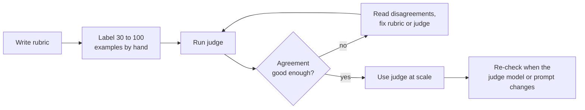

# LLM-as-a-Judge: The Complete Guide

> 📚 **Before you start**
>
> - [The RAG Triad Metrics](the-rag-triad-metrics.md), for the metrics a judge scores (faithfulness, relevance) and the keyword stand-in judge we now replace.
> - [LangChain Complete Guide](../../langchain-complete-guide/course.md), for prompt templates and structured output with Pydantic.

## Introduction

In board exams, a lakh answer sheets are marked by thousands of examiners. No machine can mark a long answer in physics by matching keywords, because students phrase the same idea in a hundred ways. So the board gives examiners a **marking scheme** (what earns each mark), trains them on sample answers, and then **moderates**: a head examiner re-marks a sample, and an examiner whose marks drift is corrected.

Evaluating RAG answers has the same problem. In the last lesson our stand-in judge matched key terms, and you'll see in this lesson how often that goes wrong: paraphrases fail, negations pass. Humans judge well but are slow and expensive. The practical answer is to use an **LLM as the examiner**: give it a clear rubric and the material, ask for a verdict with a reason, and then **moderate** it by checking its verdicts against a sample of human labels.

This lesson covers writing judge prompts, getting structured verdicts, measuring how far to trust a judge, and the known biases of LLM judges and how to counter them.

> 💡 **Key Insight**
>
> An LLM judge is a **measuring instrument**, and every instrument needs calibration. Write a narrow rubric, ask for reasoning before the verdict, prefer yes/no or small scales, and before trusting its numbers, measure its agreement with human labels on a few dozen examples.

---

## Core Explanation

### 1. Why keyword judges aren't enough

Here are twelve claim-and-context pairs from the HR handbook, each labelled by a person who read both carefully (`True` means the context supports the claim). We'll check how the keyword judge from the last lesson does on them.

```python
import re, zlib
import numpy as np
from langchain_core.documents import Document
from langchain_core.embeddings import Embeddings
from langchain_core.vectorstores import InMemoryVectorStore

STOP = {"a", "an", "the", "is", "are", "of", "to", "in", "on", "for", "and", "or", "i", "my", "can",
        "do", "how", "many", "much", "what", "be", "it", "by", "with", "per", "up", "get", "if"}
CONCEPTS = {"vacation": "leave", "pto": "leave", "food": "meal", "lunch": "meal", "dinner": "meal",
            "budget": "allowance", "trip": "travel", "visit": "travel", "customer": "travel", "client": "travel",
            "notebook": "laptop", "computer": "laptop", "stolen": "lost", "resign": "notice", "quit": "notice",
            "expense": "claim", "reimbursement": "claim", "refund": "claim", "bill": "claim", "hotel": "stay",
            "room": "stay", "lodging": "stay", "baby": "parental", "maternity": "parental",
            "paternity": "parental", "doctor": "medical", "insurance": "medical", "hospital": "medical"}

def normalise(w):
    if w.endswith("ied"):
        return w[:-3] + "y"
    if w.endswith("s") and not w.endswith("ss") and len(w) > 3:
        return w[:-1]
    return w

def words(text):
    return {normalise(w) for w in re.findall(r"[a-z0-9]+", text.lower())} - STOP

class ToyEmbeddings(Embeddings):
    def __init__(self, dim=256):
        self.dim = dim
    def _embed(self, text):
        vec = np.zeros(self.dim)
        for w in words(text):
            vec[zlib.crc32(CONCEPTS.get(w, w).encode()) % self.dim] += 1.0
        norm = np.linalg.norm(vec)
        return [round(float(x), 6) for x in (vec / norm if norm else vec)]
    def embed_documents(self, texts):
        return [self._embed(t) for t in texts]
    def embed_query(self, text):
        return self._embed(text)

SECTIONS = [
    ("2.1", "Annual leave", 3, "Every employee gets 24 days of paid leave per calendar year. Up to 8 unused days can be carried forward to the next year."),
    ("2.2", "Sick leave", 3, "Employees get 10 days of sick leave per year. A doctor's note is required for more than 2 sick days in a row."),
    ("2.3", "Parental leave", 4, "Mothers get 26 weeks of paid maternity leave. Fathers get 2 weeks of paid paternity leave within 6 months of the birth."),
    ("3.1", "Work from home", 5, "Employees may work from home up to 2 days a week with their manager's approval."),
    ("4.1", "Health insurance", 6, "Medical insurance covers the employee, spouse and two children up to Rs 5 lakh a year."),
    ("5.1", "Travel claims", 8, "Submit bills on the Kharcha portal within 30 days of the trip. Approved claims are reimbursed within 15 days."),
    ("5.2", "Meal allowance", 8, "On client travel the daily meal allowance is Rs 1,200 in metro cities and Rs 800 in other cities."),
    ("5.3", "Hotel stay", 9, "Hotel stays are covered up to Rs 6,000 a night in metro cities and Rs 3,500 a night elsewhere."),
    ("6.1", "Laptops", 11, "A lost or stolen laptop must be reported to IT within 24 hours. The employee pays 10% of the replacement cost."),
    ("7.1", "Public holidays", 12, "The office is closed on 10 public holidays, including Diwali, Holi and Independence Day."),
    ("8.1", "Notice period", 14, "The notice period is 60 days. It can be shortened by paying basic salary for the remaining days."),
]

def handbook_docs():
    return [Document(page_content=f"{sec} {title}: {body}", id=f"handbook-{sec}",
                     metadata={"source": "hr/handbook-2026.pdf", "page": page, "section": sec})
            for sec, title, page, body in SECTIONS]

emb = ToyEmbeddings()
store = InMemoryVectorStore.from_documents(handbook_docs(), embedding=emb)
print(len(handbook_docs()), "chunks indexed")
```

Output:

```
11 chunks indexed
```

```python
SECTION = {d.metadata["section"]: d.page_content for d in handbook_docs()}
JUDGE_STOP = {"you", "your", "it", "every", "long", "happen", "there"}

def key_terms(text):
    return {CONCEPTS.get(w, w) for w in words(text)} - JUDGE_STOP

def numbers(text):
    return set(re.findall(r"\d[\d,]*(?:\.\d+)?", text))

def keyword_judge(context, claim):
    terms = key_terms(claim)
    if not terms or not numbers(claim) <= numbers(context):
        return False
    return len(terms & key_terms(context)) / len(terms) >= 0.75

LABELLED = [
    ("2.2", "Sick leave is 10 days a year.", True),
    ("2.2", "You need a doctor's certificate if you are off sick for more than 2 days in a row.", True),
    ("8.1", "The notice period cannot be shortened.", False),
    ("5.2", "Meal allowance in metro cities is Rs 1,200 a day.", True),
    ("5.2", "Meal allowance in metro cities is Rs 1,500 a day.", False),
    ("2.1", "Unused leave cannot be carried forward.", False),
    ("2.3", "Fathers get two weeks of paternity leave.", True),
    ("6.1", "If you lose your laptop you must tell IT within a day.", True),
    ("4.1", "Medical insurance covers the employee's parents.", False),
    ("3.1", "Employees can work from home two days a week with manager approval.", True),
    ("7.1", "The office is closed on Diwali.", True),
    ("5.3", "Hotel stays in metro cities are covered up to Rs 6,000 a night.", True),
]
human = [label for _, _, label in LABELLED]
keyword = [keyword_judge(SECTION[sec], claim) for sec, claim, _ in LABELLED]
for (sec, claim, label), k in zip(LABELLED, keyword):
    if k != label:
        print(f"human {label!s:<5} keyword {k!s:<5} {claim}")
```

Output:

```
human True  keyword False You need a doctor's certificate if you are off sick for more than 2 days in a row.
human False keyword True  The notice period cannot be shortened.
human False keyword True  Unused leave cannot be carried forward.
human True  keyword False If you lose your laptop you must tell IT within a day.
```

Four mistakes out of twelve, and they're the two classic failures. **Paraphrases** fail ("certificate" for "note", "lose" for "lost", "within a day" for "within 24 hours"). **Negations** pass: "cannot be shortened" shares every key word with "can be shortened", and "cannot be carried forward" with "can be carried forward". Faithfulness scores built on this would be noise, and the negation errors are the dangerous kind, because they let contradictions of the source through.

### 2. Anatomy of a judge prompt

A good judge prompt has five parts:

- **Role and task**: one narrow job ("decide whether the context supports the claim").
- **Rubric**: what counts and what doesn't, including the hard cases (paraphrases count; contradictions and additions don't).
- **Inputs**, clearly delimited.
- **Reasoning first**: ask for a short explanation *before* the verdict, so the verdict follows from the reasoning rather than the other way round.
- **Output format**: a fixed structure that code can parse, with a **binary** or small-scale verdict.

```python
from pydantic import BaseModel
from langchain_core.prompts import ChatPromptTemplate

class Verdict(BaseModel):
    reasoning: str
    supported: bool

judge_prompt = ChatPromptTemplate.from_messages([
    ("system", "You are a strict fact-checker for an HR assistant. Decide whether the CONTEXT supports the CLAIM.\n"
               "Rules:\n- Supported means a careful reader of the context would agree the claim is true.\n"
               "- Paraphrases and equivalent units count (24 hours is a day; a note is a certificate).\n"
               "- Contradictions, extra facts or changed numbers are NOT supported.\n"
               "Reply with JSON: {{\"reasoning\": \"<one or two sentences>\", \"supported\": true|false}}"),
    ("human", "CONTEXT:\n{context}\n\nCLAIM:\n{claim}"),
])
messages = judge_prompt.invoke({"context": SECTION["8.1"], "claim": "The notice period cannot be shortened."})
print(messages.to_messages()[1].content)
```

Output:

```
CONTEXT:
8.1 Notice period: The notice period is 60 days. It can be shortened by paying basic salary for the remaining days.

CLAIM:
The notice period cannot be shortened.
```

Why binary? Ask a model (or a person) for a 1-to-10 score and you get scores that cluster around 7 and drift between runs. "Supported or not" is a decision a model makes consistently. When you need nuance, use a small scale (1 to 3 or 1 to 5) with each level **described** in the rubric.

### 3. Getting structured verdicts

With a real model, `with_structured_output` returns a `Verdict` object directly:

```python
# not-run: needs langchain-anthropic and an API key
from langchain_anthropic import ChatAnthropic

judge = judge_prompt | ChatAnthropic(model="claude-opus-5-5", temperature=0).with_structured_output(Verdict)
v = judge.invoke({"context": SECTION["8.1"], "claim": "The notice period cannot be shortened."})
print(v)
```

Example output:

```
reasoning='The context says the notice period can be shortened by paying basic salary for the remaining days, which contradicts the claim.' supported=False
```

To run offline, we parse JSON text from a fake model. These canned verdicts are what a careful judge returns for the twelve pairs (they match the human labels, which is the outcome you'd hope for and must still **check**, as the next section does):

```python
from langchain_core.language_models.fake_chat_models import FakeListChatModel

CANNED = [
    "Matches: 10 days of sick leave per year.",
    "A doctor's note is a certificate; required for more than 2 sick days in a row.",
    "The context says it can be shortened by paying salary; this contradicts it.",
    "Rs 1,200 a day in metro cities matches.",
    "The context says Rs 1,200, not Rs 1,500.",
    "Up to 8 unused days can be carried forward; the claim contradicts this.",
    "Two weeks of paid paternity leave matches.",
    "24 hours is a day; lost laptops must be reported to IT.",
    "Cover is for employee, spouse and two children; parents are not mentioned.",
    "Up to 2 days a week with the manager's approval matches.",
    "Diwali is listed among the public holidays when the office is closed.",
    "Up to Rs 6,000 a night in metro cities matches.",
]
fake_llm = FakeListChatModel(responses=[
    Verdict(reasoning=r, supported=label).model_dump_json() for r, (_, _, label) in zip(CANNED, LABELLED)])
offline_judge = judge_prompt | fake_llm

llm_verdicts = []
for sec, claim, _ in LABELLED:
    v = Verdict.model_validate_json(offline_judge.invoke({"context": SECTION[sec], "claim": claim}).content)
    llm_verdicts.append(v.supported)
print(llm_verdicts[:4], "...")
```

Output:

```
[True, True, False, True] ...
```

`model_validate_json` is the safety net: if a judge returns malformed JSON or a missing field, you get a clear error instead of a silently wrong score.

### 4. Moderation: measure agreement with humans

Before using a judge's numbers, compare its verdicts with human labels on a sample. Plain **accuracy** can flatter a judge when most labels are the same, so also report **Cohen's kappa**, which corrects for agreement you'd get by chance: 1 is perfect, 0 is no better than chance.

```python
from sklearn.metrics import accuracy_score, cohen_kappa_score, confusion_matrix

for name, verdicts in [("keyword judge", keyword), ("LLM judge", llm_verdicts)]:
    print(f"{name:<14} accuracy {accuracy_score(human, verdicts):.2f}  kappa {cohen_kappa_score(human, verdicts):.2f}")
print("keyword judge confusion matrix (rows: human False/True, columns: judge False/True):")
print(confusion_matrix(human, keyword))
```

Output:

```
keyword judge  accuracy 0.67  kappa 0.25
LLM judge      accuracy 1.00  kappa 1.00
keyword judge confusion matrix (rows: human False/True, columns: judge False/True):
[[2 2]
 [2 6]]
```

The confusion matrix shows **how** the keyword judge errs: two supported claims rejected (paraphrases) and two unsupported ones accepted (negations). For a faithfulness metric, the second kind is worse, because it hides hallucinations.

In a real project, label 30 to 100 examples yourself (or with a domain expert), run the judge, and look at every disagreement. Often the rubric is unclear, and fixing it helps both the judge and your human labellers. A kappa above about 0.8 is strong; between 0.6 and 0.8 is usable for comparing versions; below that, improve the rubric or the judge before trusting it. Repeat the check whenever you change the judge's model or prompt.

### 5. Known biases, and what to do about them

LLM judges have systematic biases, documented across many studies:

| Bias | What happens | Counter-measure |
|---|---|---|
| **Position** | In A-versus-B comparisons, prefers whichever comes first (or second) | Judge both orders; count a win only if they agree |
| **Verbosity** | Prefers longer, more detailed answers | Rubric that rewards concision; judge specific properties, not "quality" |
| **Self-preference** | Rates text from its own model family higher | Use a judge from a different family, or several judges |
| **Leniency** | Says "supported" for vague or partly supported claims | Strict rubric with hard examples; binary verdicts |
| **Inconsistency** | Different verdicts on reruns | Temperature 0; majority vote over 3 runs for close calls |

Here's a position check for pairwise comparison. The judge below is deliberately biased: it always prefers whichever answer it sees first.

```python
def biased_judge(question, first, second):
    return "first"                                  # a judge with pure position bias

def pairwise(judge, question, a, b):
    one = judge(question, a, b)                      # a shown first
    two = judge(question, b, a)                      # b shown first
    a_wins = (one == "first") + (two == "second")
    b_wins = (one == "second") + (two == "first")
    return "A" if a_wins == 2 else "B" if b_wins == 2 else "inconsistent: tie"

q = "How many sick days do I get?"
print(pairwise(biased_judge, q, "10 days a year.", "Employees get 10 days of sick leave per year [2.2]."))
```

Output:

```
inconsistent: tie
```

Asking twice with the order swapped turns a hidden bias into a visible "inconsistent" result, which you can count and investigate instead of silently trusting.



### 6. Costs and practicalities

- **Cost per metric per example.** Faithfulness needs one call to extract claims and one or more to verify them; five metrics on 200 test questions can be a thousand calls. Run full evaluations on releases, and a sample on daily traffic.
- **Cheaper judges.** A smaller model is often fine for narrow binary checks; validate it with the same agreement test.
- **Reference-free vs reference-based.** Judges can grade without a reference (faithfulness, relevance) or against one (correctness). Reference-based judging is usually more reliable, so build a labelled set for your most important questions.
- **Log the reasoning.** The judge's explanation is often the fastest way to understand a failure.

---

## Try It Yourself

1. **Your own pair.** Write a claim about the hotel section that a keyword judge wrongly accepts. Confirm with `keyword_judge`.
2. **A three-level rubric.** Write the rubric lines for a 1-to-3 answer-relevance scale (1 = off topic, 3 = fully answers). Then write a `Relevance` Pydantic model for its output.
3. **Kappa vs accuracy.** A judge that answers `True` for every one of the twelve claims: compute its accuracy and kappa. Why are they so different?

<details>
<summary>Show answers</summary>

**1.** A changed fact that keeps all the key words, such as a swapped city type:

```python
print(keyword_judge(SECTION["5.3"], "Hotel stays are covered up to Rs 3,500 a night in metro cities."))
```

Output:

```
True
```

Both numbers and all the words appear in the section, but Rs 3,500 is the limit **outside** metro cities. Only a judge that reads meaning catches it.

**2.**

```python
RELEVANCE_RUBRIC = """Score how well the ANSWER addresses the QUESTION:
1 = off topic, or about a different question.
2 = on topic but only partly answers (missing the specific thing asked).
3 = fully answers what was asked.
Judge relevance only, not correctness."""

class Relevance(BaseModel):
    reasoning: str
    score: int

print(Relevance(reasoning="Gives annual leave days, not whether they carry over.", score=1))
```

Output:

```
reasoning='Gives annual leave days, not whether they carry over.' score=1
```

**3.**

```python
always_true = [True] * len(human)
print(accuracy_score(human, always_true), cohen_kappa_score(human, always_true))
```

Output:

```
0.6666666666666666 0.0
```

It's right 8 times out of 12 just because most claims are supported, but it has learned nothing, so kappa is 0. Kappa exposes judges that ride on the majority label.

</details>

---

## Real-World Examples

- **Evaluation frameworks** (Ragas, DeepEval, TruLens, and LangSmith's evaluators) are built on LLM judges with carefully worded prompts per metric.
- **Model leaderboards** based on pairwise comparison by LLM judges swap answer order and check agreement with human votes.
- **Product teams** keep a "golden set" of human-labelled examples and re-validate their judge whenever they upgrade the judge model.
- **Safety and policy reviews** use binary judge checks ("does the answer give medical dosage advice?") on samples of production traffic.

---

## Common Misconceptions

### "The judge model is smart, so its scores are right"

It's an instrument with biases and blind spots. Agreement with human labels is the only evidence its scores mean anything.

### "Finer scales give more information"

A 1-to-10 score without anchored descriptions is mostly noise. Binary or small described scales are more consistent.

### "One judge call per example is enough"

For close calls, swapped orders and majority votes reduce bias and variance.

### "If two versions differ by 0.02, the better one wins"

With small test sets and noisy judges, small differences are often noise. Look at per-example changes and use enough examples.

---

## Interview Relevance

*"How do you know your LLM judge is reliable?"* Label a sample by hand, compute agreement (accuracy and Cohen's kappa), read disagreements, refine the rubric, and re-validate when the judge model or prompt changes.

*"What biases do LLM judges have?"* Position, verbosity, self-preference, leniency and run-to-run inconsistency; counter with swapped orders, specific rubrics, different model families, temperature 0 and majority votes.

---

## Key Takeaways

- **Keyword matching fails** on paraphrases and negations; an LLM judge reads meaning.
- **A good judge prompt** has a narrow task, an explicit rubric with hard cases, delimited inputs, reasoning before the verdict and a parseable output.
- **Prefer binary or small described scales**, and parse verdicts into a Pydantic model.
- **Calibrate against human labels** with accuracy and Cohen's kappa before trusting scores.
- **Counter known biases**: swap orders, use a different model family, keep temperature 0, vote on close calls.

---

**Up next:** [Turn-Based Evaluation with Ragas](turn-based-evaluation-with-ragas.md)
