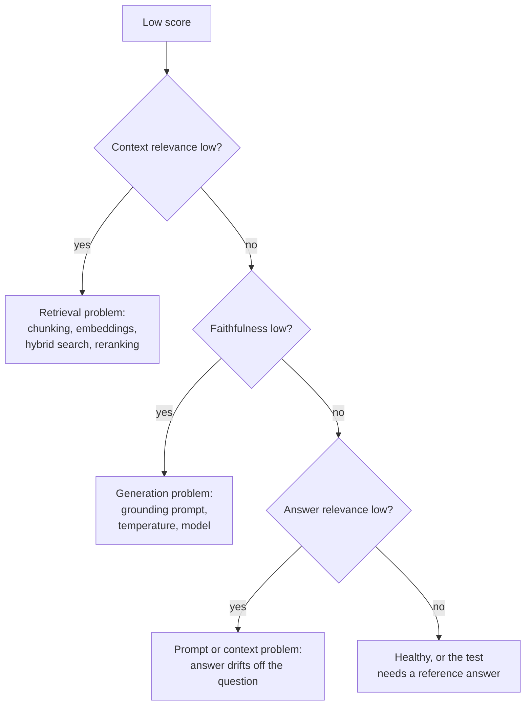

# The RAG Triad Metrics: The Complete Guide

> 📚 **Before you start**
>
> - [RAG with LangChain and a Vector DB](../06-implementing-rag/rag-with-langchain-and-a-vector-db.md), for a chain that returns the answer **and** the retrieved sources, which is exactly what evaluation needs.
> - [Retrievers](../05-rag-building-blocks-in-langchain/retrievers.md), for recall@k, the retrieval metric you've already used.
> - [The RAG Pipeline, End to End](../02-introduction-to-rag/the-rag-pipeline-end-to-end.md), for the two halves (retrieve, then generate) that we now score separately.

## Introduction

A coaching centre in Kota tests its students every week. A single score ("62%") tells the teacher something is wrong, but not what. A good test report breaks it down: physics fine, organic chemistry weak, calculus careless mistakes. Only then can the teacher do something about it.

A RAG app needs the same kind of report. Throughout this course you've checked answers by eye and, in the labs, with a small "did the answer contain the right fact" test. That tells you **whether** an answer is wrong. It doesn't tell you **why**: did the retriever fetch the wrong sections? Did the model ignore the right ones? Did it add facts that aren't in the documents? Did it answer a different question? Each has a different fix.

The **RAG triad** splits evaluation along the three connections in every RAG answer: question to context, context to answer, answer to question. With these three scores, a failure points at the component to fix. This lesson defines each metric, computes them on a small set of real-looking failures, and adds the reference-based metrics (context precision, context recall) that tools like Ragas report.

> 💡 **Key Insight**
>
> Every RAG answer has three parts, question, retrieved context and answer, and each **pair** can fail independently. **Context relevance** (question ↔ context) checks retrieval; **groundedness** (context ↔ answer) checks for hallucination; **answer relevance** (question ↔ answer) checks the answer addresses what was asked. Score all three and the weak link shows itself.

---

## Core Explanation

### 1. What we evaluate

An evaluation record needs the question, the contexts the retriever returned (in rank order) and the generated answer. This is why chains that return their sources matter: without the contexts, you can't tell a retrieval failure from a generation failure.

We'll use the HR handbook from earlier modules:

```python
import re, zlib
import numpy as np
from langchain_core.documents import Document
from langchain_core.embeddings import Embeddings
from langchain_core.vectorstores import InMemoryVectorStore

STOP = {"a", "an", "the", "is", "are", "of", "to", "in", "on", "for", "and", "or", "i", "my", "can",
        "do", "how", "many", "much", "what", "be", "it", "by", "with", "per", "up", "get", "if"}
CONCEPTS = {"vacation": "leave", "pto": "leave", "food": "meal", "lunch": "meal", "dinner": "meal",
            "budget": "allowance", "trip": "travel", "visit": "travel", "customer": "travel", "client": "travel",
            "notebook": "laptop", "computer": "laptop", "stolen": "lost", "resign": "notice", "quit": "notice",
            "expense": "claim", "reimbursement": "claim", "refund": "claim", "bill": "claim", "hotel": "stay",
            "room": "stay", "lodging": "stay", "baby": "parental", "maternity": "parental",
            "paternity": "parental", "doctor": "medical", "insurance": "medical", "hospital": "medical"}

def normalise(w):
    if w.endswith("ied"):
        return w[:-3] + "y"
    if w.endswith("s") and not w.endswith("ss") and len(w) > 3:
        return w[:-1]
    return w

def words(text):
    return {normalise(w) for w in re.findall(r"[a-z0-9]+", text.lower())} - STOP

class ToyEmbeddings(Embeddings):
    def __init__(self, dim=256):
        self.dim = dim
    def _embed(self, text):
        vec = np.zeros(self.dim)
        for w in words(text):
            vec[zlib.crc32(CONCEPTS.get(w, w).encode()) % self.dim] += 1.0
        norm = np.linalg.norm(vec)
        return [round(float(x), 6) for x in (vec / norm if norm else vec)]
    def embed_documents(self, texts):
        return [self._embed(t) for t in texts]
    def embed_query(self, text):
        return self._embed(text)

SECTIONS = [
    ("2.1", "Annual leave", 3, "Every employee gets 24 days of paid leave per calendar year. Up to 8 unused days can be carried forward to the next year."),
    ("2.2", "Sick leave", 3, "Employees get 10 days of sick leave per year. A doctor's note is required for more than 2 sick days in a row."),
    ("2.3", "Parental leave", 4, "Mothers get 26 weeks of paid maternity leave. Fathers get 2 weeks of paid paternity leave within 6 months of the birth."),
    ("3.1", "Work from home", 5, "Employees may work from home up to 2 days a week with their manager's approval."),
    ("4.1", "Health insurance", 6, "Medical insurance covers the employee, spouse and two children up to Rs 5 lakh a year."),
    ("5.1", "Travel claims", 8, "Submit bills on the Kharcha portal within 30 days of the trip. Approved claims are reimbursed within 15 days."),
    ("5.2", "Meal allowance", 8, "On client travel the daily meal allowance is Rs 1,200 in metro cities and Rs 800 in other cities."),
    ("5.3", "Hotel stay", 9, "Hotel stays are covered up to Rs 6,000 a night in metro cities and Rs 3,500 a night elsewhere."),
    ("6.1", "Laptops", 11, "A lost or stolen laptop must be reported to IT within 24 hours. The employee pays 10% of the replacement cost."),
    ("7.1", "Public holidays", 12, "The office is closed on 10 public holidays, including Diwali, Holi and Independence Day."),
    ("8.1", "Notice period", 14, "The notice period is 60 days. It can be shortened by paying basic salary for the remaining days."),
]

def handbook_docs():
    return [Document(page_content=f"{sec} {title}: {body}", id=f"handbook-{sec}",
                     metadata={"source": "hr/handbook-2026.pdf", "page": page, "section": sec})
            for sec, title, page, body in SECTIONS]

emb = ToyEmbeddings()
store = InMemoryVectorStore.from_documents(handbook_docs(), embedding=emb)
print(len(handbook_docs()), "chunks indexed")
```

Output:

```
11 chunks indexed
```

Here are five records of the shape `rag_with_sources` returned in Module 6. Each one is realistic, and three of them are broken in different ways:

```python
SECTION = {d.metadata["section"]: d.page_content for d in handbook_docs()}

SAMPLES = [
    {"question": "How many days of sick leave do I get?", "contexts": [SECTION["2.2"], SECTION["2.1"]],
     "answer": "You get 10 days of sick leave per year."},
    {"question": "What is the meal allowance on client visits?", "contexts": [SECTION["5.3"], SECTION["5.1"]],
     "answer": "Hotel stays are covered up to Rs 6,000 a night in metro cities."},
    {"question": "How long is the notice period?", "contexts": [SECTION["8.1"]],
     "answer": "The notice period is 60 days. It cannot be shortened."},
    {"question": "Can I carry forward unused leave?", "contexts": [SECTION["2.1"]],
     "answer": "Every employee gets 24 days of paid leave per calendar year."},
    {"question": "What happens if my laptop is stolen?", "contexts": [SECTION["6.1"]],
     "answer": "A stolen laptop must be reported to IT within 24 hours. You pay 10% of the replacement cost."},
]
for s in SAMPLES:
    print(f"{s['question']:<46} {len(s['contexts'])} context(s)")
```

Output:

```
How many days of sick leave do I get?          2 context(s)
What is the meal allowance on client visits?   2 context(s)
How long is the notice period?                 1 context(s)
Can I carry forward unused leave?              1 context(s)
What happens if my laptop is stolen?           1 context(s)
```


*The three triad checks need no reference answer, so you can run them on live traffic. The reference-based checks on the right need a labelled test set, and are more precise.*

### 2. A stand-in judge

In practice each metric is scored by an LLM acting as a judge (the next lesson is all about that). So that this lesson runs offline and you can see every decision, we'll use a simple stand-in: two texts "agree" when most of the key terms of one appear in the other (using the handbook's concept mapping, so "client" counts as "travel"), and **every number must match exactly**. It's cruder than an LLM, but it makes the same kind of yes/no calls.

```python
JUDGE_STOP = {"you", "your", "it", "every", "long", "happen", "there"}

def key_terms(text):
    return {CONCEPTS.get(w, w) for w in words(text)} - JUDGE_STOP

def numbers(text):
    return set(re.findall(r"\d[\d,]*(?:\.\d+)?", text))

def supports(context_text, statement):
    terms = key_terms(statement)
    if not terms or not numbers(statement) <= numbers(context_text):
        return False
    return len(terms & key_terms(context_text)) / len(terms) >= 0.75

def relevant(question, context):
    terms = key_terms(question)
    return len(terms & key_terms(context)) / len(terms) >= 0.75

print(supports(SECTION["8.1"], "The notice period is 60 days."))
print(supports(SECTION["8.1"], "The notice period is 90 days."))
print(relevant("What is the meal allowance on client visits?", SECTION["5.2"]))
```

Output:

```
True
False
True
```

### 3. Context relevance: did retrieval fetch the right material?

**Context relevance** is the share of retrieved contexts that are relevant to the question. It needs only the question and the contexts, so it isolates the retriever.

```python
def context_relevance(question, contexts):
    return sum(relevant(question, c) for c in contexts) / len(contexts)

for s in SAMPLES:
    print(f"{s['question']:<46} {context_relevance(s['question'], s['contexts']):.2f}")
```

Output:

```
How many days of sick leave do I get?          0.50
What is the meal allowance on client visits?   0.00
How long is the notice period?                 1.00
Can I carry forward unused leave?              1.00
What happens if my laptop is stolen?           1.00
```

The meal-allowance question scores 0: the retriever returned hotel stays and travel claims, neighbours of the right section but not it. Nothing the model does afterwards can fix that. The sick-leave question scores 0.5 because one of its two contexts (annual leave) is off topic, which is harmless here but costs tokens and can distract the model.

### 4. Groundedness (faithfulness): is every claim backed by the context?

**Groundedness**, which Ragas calls **faithfulness**, asks whether the answer says only things the context supports. The standard recipe: break the answer into individual **claims**, check each against the context, and report the fraction supported.

`faithfulness = supported claims / total claims`

```python
def claims(answer):
    return [s for s in re.split(r"(?<=[.!?])\s+", answer.strip()) if s]

def faithfulness(answer, contexts):
    cs = claims(answer)
    return sum(supports(" ".join(contexts), c) for c in cs) / len(cs)

s = SAMPLES[2]
for c in claims(s["answer"]):
    print(supports(" ".join(s["contexts"]), c), "|", c)
print("faithfulness:", faithfulness(s["answer"], s["contexts"]))
```

Output:

```
True | The notice period is 60 days.
False | It cannot be shortened.
faithfulness: 0.5
```

The context says the notice period *"can be shortened by paying basic salary"*; the answer says it *cannot*. That's a hallucination, half the answer is unsupported, and an employee reading it would make a worse decision. Here we split claims at sentence ends; LLM judges split compound sentences further ("60 days, and it cannot be shortened" becomes two claims).

Notice what faithfulness does **not** measure: whether the answer is right. An answer can be perfectly faithful to the wrong context, as the meal-allowance answer is.

### 5. Answer relevance: does it address the question?

**Answer relevance** checks the answer is about what was asked. Ragas computes it by having an LLM generate a few questions the answer would fit, then averaging their embedding similarity to the real question: an answer to a different question produces different questions. Our simplified version compares the answer and question embeddings directly.

```python
def answer_relevance(question, answer):
    return float(np.dot(emb.embed_query(question), emb.embed_query(answer)))

for s in SAMPLES:
    print(f"{s['question']:<46} {answer_relevance(s['question'], s['answer']):.2f}")
```

Output:

```
How many days of sick leave do I get?          0.71
What is the meal allowance on client visits?   0.25
How long is the notice period?                 0.47
Can I carry forward unused leave?              0.18
What happens if my laptop is stolen?           0.46
```

The carry-forward question gets an answer about annual leave days: true, grounded, on the right page, and useless, because the user asked whether unused days carry over. Embedding scores are relative, so pick a threshold by looking at examples; here anything under about 0.4 deserves a look.

### 6. Reading the triad together

The power is in the combination:

```python
def triad(s):
    return (context_relevance(s["question"], s["contexts"]), faithfulness(s["answer"], s["contexts"]),
            answer_relevance(s["question"], s["answer"]))

def diagnose(cr, f, ar):
    if cr == 0:
        return "retrieval failed: fix chunking, search or query"
    if f < 1:
        return "hallucination: tighten the prompt, lower temperature"
    if ar < 0.4:
        return "answered something else: fix the prompt or context"
    return "ok"

print(f"{'question':<46} {'CR':>5} {'F':>5} {'AR':>5}  diagnosis")
for s in SAMPLES:
    cr, f, ar = triad(s)
    print(f"{s['question']:<46} {cr:>5.2f} {f:>5.2f} {ar:>5.2f}  {diagnose(cr, f, ar)}")
```

Output:

```
question                                          CR     F    AR  diagnosis
How many days of sick leave do I get?           0.50  1.00  0.71  ok
What is the meal allowance on client visits?    0.00  1.00  0.25  retrieval failed: fix chunking, search or query
How long is the notice period?                  1.00  0.50  0.47  hallucination: tighten the prompt, lower temperature
Can I carry forward unused leave?               1.00  1.00  0.18  answered something else: fix the prompt or context
What happens if my laptop is stolen?            1.00  1.00  0.46  ok
```



Check retrieval first: when the context is wrong, the other two scores describe a model doing its best with bad material.

### 7. When you have reference answers

The triad needs no labels, so you can run it on real traffic. With a **test set** of questions and reference answers written by someone who knows the documents, you can measure retrieval more precisely:

- **Context recall**: what fraction of the reference answer's claims can be found in the retrieved contexts? Low recall means retrieval missed needed information.
- **Context precision**: are the useful contexts ranked **at the top**? Ragas averages precision@k over the ranks k where a useful context appears.
- **Answer correctness**: does the answer agree with the reference?

```python
REFERENCES = [
    "Employees get 10 days of sick leave per year.",
    "The daily meal allowance on client travel is Rs 1,200 in metro cities and Rs 800 in other cities.",
    "The notice period is 60 days. It can be shortened by paying basic salary for the remaining days.",
    "Up to 8 unused days of annual leave can be carried forward to the next year.",
    "Report a lost or stolen laptop to IT within 24 hours. The employee pays 10% of the replacement cost.",
]

def context_recall(reference, contexts):
    ref_claims = claims(reference)
    return sum(supports(" ".join(contexts), c) for c in ref_claims) / len(ref_claims)

def context_precision(reference, contexts):
    useful = [any(supports(c, rc) for rc in claims(reference)) for c in contexts]
    hits, total = 0, 0.0
    for k, u in enumerate(useful, start=1):
        if u:
            hits += 1
            total += hits / k              # precision@k at each useful rank
    return total / hits if hits else 0.0

for s, ref in zip(SAMPLES, REFERENCES):
    print(f"{s['question']:<46} recall {context_recall(ref, s['contexts']):.2f}  "
          f"precision {context_precision(ref, s['contexts']):.2f}")

print("\nsick leave with the contexts swapped:",
      context_precision(REFERENCES[0], [SECTION["2.1"], SECTION["2.2"]]))
```

Output:

```
How many days of sick leave do I get?          recall 1.00  precision 1.00
What is the meal allowance on client visits?   recall 0.00  precision 0.00
How long is the notice period?                 recall 1.00  precision 1.00
Can I carry forward unused leave?              recall 1.00  precision 1.00
What happens if my laptop is stolen?           recall 1.00  precision 1.00

sick leave with the contexts swapped: 0.5
```

Context recall agrees with context relevance about the meal question, and adds something new for the carry-forward question: the context contained the needed fact (recall 1.0), so that failure was purely in generation. The swapped example shows what precision adds: the same two contexts score 1.0 when the useful one is first and 0.5 when it's second, which matters because models pay most attention to what comes first.

---

## Try It Yourself

1. **Fix the hallucination.** Change sample 3's answer to *"The notice period is 60 days. It can be shortened by paying basic salary for the remaining days."* and recompute its faithfulness.
2. **A refusal.** Score the answer *"I don't know based on the handbook."* for the meal-allowance question on all three triad metrics. How should a refusal after a retrieval failure be judged?
3. **Better retrieval.** Give the meal-allowance sample the right context (`SECTION["5.2"]`) and the answer *"On client travel the daily meal allowance is Rs 1,200 in metro cities and Rs 800 in other cities."*. Run `triad` and `diagnose`.

<details>
<summary>Show answers</summary>

**1.**

```python
fixed = "The notice period is 60 days. It can be shortened by paying basic salary for the remaining days."
print(faithfulness(fixed, SAMPLES[2]["contexts"]))
```

Output:

```
1.0
```

**2.**

```python
s = SAMPLES[1]
print(triad({**s, "answer": "I don't know based on the handbook."}))
```

Output:

```
(0.0, 0.0, 0.0)
```

The refusal has no supported claims (faithfulness 0 with our judge) and low answer relevance, yet it's the **right** behaviour given bad context. Real evaluation pipelines treat refusals as a separate category: count them, check whether the context really lacked the answer, and don't let them drag down faithfulness. An LLM judge can usually tell that a refusal makes no factual claims at all, which is different from making unsupported ones; decide explicitly how your pipeline scores that case.

**3.**

```python
good = {"question": "What is the meal allowance on client visits?", "contexts": [SECTION["5.2"]],
        "answer": "On client travel the daily meal allowance is Rs 1,200 in metro cities and Rs 800 in other cities."}
cr, f, ar = triad(good)
print(round(cr, 2), round(f, 2), round(ar, 2), diagnose(cr, f, ar))
```

Output:

```
1.0 1.0 0.65 ok
```

</details>

---

## Real-World Examples

- **Enterprise assistants** track faithfulness on sampled production traffic as a hallucination alarm; a drop after a prompt or model change blocks the release.
- **Search teams** use context recall and precision on a fixed test set to compare chunking strategies, embedding models and rerankers.
- **Customer support bots** watch answer relevance to catch answers that are correct but unhelpful, such as quoting policy text instead of answering yes or no.
- **Evaluation tools** such as Ragas, TruLens and DeepEval all implement variants of these metrics, with an LLM as the judge.

---

## Common Misconceptions

### "Faithfulness means correct"

It means supported by the retrieved context. A faithful answer to wrong context is still wrong; that's why you also need context relevance or recall.

### "One overall score is enough"

An average hides which component failed. Keep the three scores separate, and look at the worst examples, not just the mean.

### "The triad needs labelled data"

The triad doesn't; it compares the question, context and answer with each other. Reference-based metrics (recall, precision, correctness) do.

### "High answer relevance means the answer is good"

It means the answer is on topic. Combine it with faithfulness and, where you can, correctness.

---

## Interview Relevance

*"How do you evaluate a RAG system?"* Separate retrieval and generation. The triad: context relevance (retrieval), groundedness or faithfulness (claims supported by context), answer relevance (addresses the question). With a labelled set, add context recall and precision and answer correctness. Use an LLM judge, validate it against human labels, track per-example scores and failure categories.

*"Your RAG bot gives wrong answers. How do you find out why?"* Log question, contexts and answer; score context relevance first (retrieval), then faithfulness (hallucination), then answer relevance; fix the weakest link and re-run the same test set.

---

## Key Takeaways

- **Three pairs, three metrics**: context relevance (question ↔ context), groundedness or faithfulness (context ↔ answer), answer relevance (question ↔ answer).
- **Faithfulness = supported claims / total claims**, checked against the retrieved context, not against the truth.
- **Diagnose in order**: retrieval first, then hallucination, then whether the answer addresses the question.
- **With reference answers**, context recall shows missing information and context precision shows whether the useful context is ranked first.
- **Record contexts with every answer**; without them you can't tell which component failed.

---

**Up next:** [LLM-as-a-Judge](llm-as-a-judge.md)
