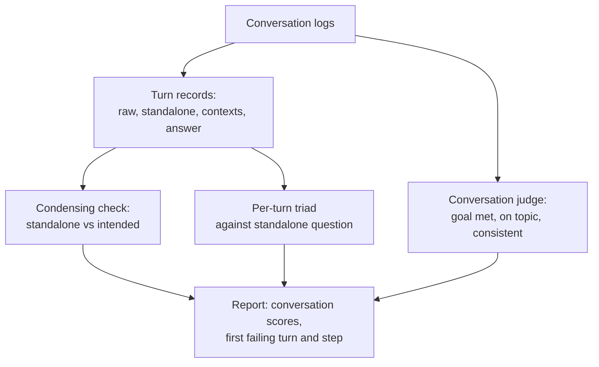

# Turn-Based Evaluation with Ragas: The Complete Guide

> 📚 **Before you start**
>
> - [Memory in RAG Systems](../07-advanced-rag/memory-in-rag-systems.md), for follow-up questions, query condensing and sessions, the things that make conversations hard to evaluate.
> - [The RAG Triad Metrics](the-rag-triad-metrics.md) and [LLM-as-a-Judge](llm-as-a-judge.md), for the metrics and the judges that score them.

## Introduction

A bank's quality team in Hyderabad listens to recorded customer calls. They don't only ask "was the final answer right?" They score each exchange: did the agent understand *"and for my wife's account?"* correctly, did they give accurate information at every step, did they contradict themselves, and did the customer get what they called for? A call can end well after a wrong turn in the middle, or go wrong on the third exchange after two good ones.

Conversational RAG needs the same two levels of scoring. **Per turn**: each answer, with the question as the system understood it (the condensed, standalone question) and the contexts retrieved for it. **Per conversation**: did the whole exchange achieve the user's goal, stay consistent and keep the topic? A single-question test set misses both the condensing step and the conversation-level failures.

This lesson builds turn-level records from conversation logs, scores each turn with the triad, adds a check on the condensing step, scores whole conversations with a judge, and shows how to do it all with **Ragas**, the most widely used open-source library for RAG evaluation.

> 💡 **Key Insight**
>
> In a conversation, a turn must be evaluated against the question **as the system understood it**, which is the condensed standalone question, and that understanding must be evaluated too. Score each turn with the triad, score the condensing step against what the user meant, and score the conversation as a whole for goal completion and consistency.

---

## Core Explanation

### 1. Setup

The HR handbook and the metric functions from the last two lessons:

```python
import re, zlib
import numpy as np
from langchain_core.documents import Document
from langchain_core.embeddings import Embeddings
from langchain_core.vectorstores import InMemoryVectorStore

STOP = {"a", "an", "the", "is", "are", "of", "to", "in", "on", "for", "and", "or", "i", "my", "can",
        "do", "how", "many", "much", "what", "be", "it", "by", "with", "per", "up", "get", "if"}
CONCEPTS = {"vacation": "leave", "pto": "leave", "food": "meal", "lunch": "meal", "dinner": "meal",
            "budget": "allowance", "trip": "travel", "visit": "travel", "customer": "travel", "client": "travel",
            "notebook": "laptop", "computer": "laptop", "stolen": "lost", "resign": "notice", "quit": "notice",
            "expense": "claim", "reimbursement": "claim", "refund": "claim", "bill": "claim", "hotel": "stay",
            "room": "stay", "lodging": "stay", "baby": "parental", "maternity": "parental",
            "paternity": "parental", "doctor": "medical", "insurance": "medical", "hospital": "medical"}

def normalise(w):
    if w.endswith("ied"):
        return w[:-3] + "y"
    if w.endswith("s") and not w.endswith("ss") and len(w) > 3:
        return w[:-1]
    return w

def words(text):
    return {normalise(w) for w in re.findall(r"[a-z0-9]+", text.lower())} - STOP

class ToyEmbeddings(Embeddings):
    def __init__(self, dim=256):
        self.dim = dim
    def _embed(self, text):
        vec = np.zeros(self.dim)
        for w in words(text):
            vec[zlib.crc32(CONCEPTS.get(w, w).encode()) % self.dim] += 1.0
        norm = np.linalg.norm(vec)
        return [round(float(x), 6) for x in (vec / norm if norm else vec)]
    def embed_documents(self, texts):
        return [self._embed(t) for t in texts]
    def embed_query(self, text):
        return self._embed(text)

SECTIONS = [
    ("2.1", "Annual leave", 3, "Every employee gets 24 days of paid leave per calendar year. Up to 8 unused days can be carried forward to the next year."),
    ("2.2", "Sick leave", 3, "Employees get 10 days of sick leave per year. A doctor's note is required for more than 2 sick days in a row."),
    ("2.3", "Parental leave", 4, "Mothers get 26 weeks of paid maternity leave. Fathers get 2 weeks of paid paternity leave within 6 months of the birth."),
    ("3.1", "Work from home", 5, "Employees may work from home up to 2 days a week with their manager's approval."),
    ("4.1", "Health insurance", 6, "Medical insurance covers the employee, spouse and two children up to Rs 5 lakh a year."),
    ("5.1", "Travel claims", 8, "Submit bills on the Kharcha portal within 30 days of the trip. Approved claims are reimbursed within 15 days."),
    ("5.2", "Meal allowance", 8, "On client travel the daily meal allowance is Rs 1,200 in metro cities and Rs 800 in other cities."),
    ("5.3", "Hotel stay", 9, "Hotel stays are covered up to Rs 6,000 a night in metro cities and Rs 3,500 a night elsewhere."),
    ("6.1", "Laptops", 11, "A lost or stolen laptop must be reported to IT within 24 hours. The employee pays 10% of the replacement cost."),
    ("7.1", "Public holidays", 12, "The office is closed on 10 public holidays, including Diwali, Holi and Independence Day."),
    ("8.1", "Notice period", 14, "The notice period is 60 days. It can be shortened by paying basic salary for the remaining days."),
]

def handbook_docs():
    return [Document(page_content=f"{sec} {title}: {body}", id=f"handbook-{sec}",
                     metadata={"source": "hr/handbook-2026.pdf", "page": page, "section": sec})
            for sec, title, page, body in SECTIONS]

emb = ToyEmbeddings()
store = InMemoryVectorStore.from_documents(handbook_docs(), embedding=emb)
print(len(handbook_docs()), "chunks indexed")
```

Output:

```
11 chunks indexed
```

The stand-in judge and metric functions from [The RAG Triad Metrics](the-rag-triad-metrics.md), in one block:

```python
SECTION = {d.metadata["section"]: d.page_content for d in handbook_docs()}
JUDGE_STOP = {"you", "your", "it", "every", "long", "happen", "there", "policy", "limit"}

def key_terms(text):
    return {CONCEPTS.get(w, w) for w in words(text)} - JUDGE_STOP

def numbers(text):
    return set(re.findall(r"\d[\d,]*(?:\.\d+)?", text))

def supports(context_text, statement):
    terms = key_terms(statement)
    if not terms or not numbers(statement) <= numbers(context_text):
        return False
    return len(terms & key_terms(context_text)) / len(terms) >= 0.75

def relevant(question, context):
    terms = key_terms(question)
    return len(terms & key_terms(context)) / len(terms) >= 0.75

def claims(text):
    return [s for s in re.split(r"(?<=[.!?])\s+", text.strip()) if s]

def context_relevance(question, contexts):
    return sum(relevant(question, c) for c in contexts) / len(contexts)

def faithfulness(answer, contexts):
    cs = claims(answer)
    return sum(supports(" ".join(contexts), c) for c in cs) / len(cs)

def answer_relevance(question, answer):
    return float(np.dot(emb.embed_query(question), emb.embed_query(answer)))

def context_recall(reference, contexts):
    rc = claims(reference)
    return sum(supports(" ".join(contexts), c) for c in rc) / len(rc)

def context_precision(reference, contexts):
    useful = [any(supports(c, rc) for rc in claims(reference)) for c in contexts]
    hits, total = 0, 0.0
    for k, u in enumerate(useful, start=1):
        if u:
            hits += 1
            total += hits / k
    return total / hits if hits else 0.0

print("metrics ready:", faithfulness(SECTION["2.2"], [SECTION["2.2"]]))
```

Output:

```
metrics ready: 1.0
```

### 2. Conversation logs as turn records

A conversational app should log, for every turn: the session, the turn number, the user's raw message, the standalone question it searched with, the retrieved contexts and the answer. Here are two logged conversations. Ravi's goes well. Asha's goes wrong on the third turn: she was asking about hotels, but the condensing step decided she meant meals.

```python
import pandas as pd

LOG = [
    ("ravi", 1, "What is the sick leave policy?", "What is the sick leave policy?", ["2.2"],
     "Employees get 10 days of sick leave per year. A doctor's note is required for more than 2 sick days in a row."),
    ("ravi", 2, "How many days?", "How many days of sick leave do I get per year?", ["2.2"],
     "You get 10 days of sick leave per year."),
    ("ravi", 3, "Do I need a note for 3 days?", "Do I need a doctor's note for 3 sick days in a row?", ["2.2"],
     "Yes, you need a doctor's note for more than 2 sick days in a row."),
    ("asha", 1, "What's the meal allowance on client trips?", "What's the meal allowance on client trips?", ["5.2"],
     "On client travel the daily meal allowance is Rs 1,200 in metro cities and Rs 800 in other cities."),
    ("asha", 2, "And the hotel limit?", "What is the hotel stay limit?", ["5.3"],
     "Hotel stays are covered up to Rs 6,000 a night in metro cities and Rs 3,500 a night elsewhere."),
    ("asha", 3, "Is it the same in Pune?", "Is the meal allowance the same in Pune?", ["5.2"],
     "Pune is not a metro city. The meal allowance in other cities is Rs 800 a day."),
]
turns = pd.DataFrame(LOG, columns=["session", "turn", "raw", "standalone", "sections", "answer"])
turns["contexts"] = turns["sections"].apply(lambda ids: [SECTION[i] for i in ids])
print(turns[["session", "turn", "raw", "standalone"]].to_string(index=False))
```

Output:

```
session  turn                                        raw                                          standalone
   ravi     1             What is the sick leave policy?                      What is the sick leave policy?
   ravi     2                             How many days?      How many days of sick leave do I get per year?
   ravi     3               Do I need a note for 3 days? Do I need a doctor's note for 3 sick days in a row?
   asha     1 What's the meal allowance on client trips?          What's the meal allowance on client trips?
   asha     2                       And the hotel limit?                       What is the hotel stay limit?
   asha     3                    Is it the same in Pune?             Is the meal allowance the same in Pune?
```

### 3. Score each turn against the standalone question

The triad scores need the question the turn actually answered. Evaluating a follow-up like *"How many days?"* on its own makes nonsense of answer relevance: the raw text has almost nothing to compare against. The standalone question is what retrieval used, so it's what retrieval and answer should be judged against.

```python
def score_turn(row, question_col="standalone"):
    q = row[question_col]
    return pd.Series({"CR": context_relevance(q, row["contexts"]),
                      "F": faithfulness(row["answer"], row["contexts"]),
                      "AR": round(answer_relevance(q, row["answer"]), 2)})

scored = turns.join(turns.apply(score_turn, axis=1))
print(scored[["session", "turn", "standalone", "CR", "F", "AR"]].to_string(index=False))

print("\nanswer relevance against the raw follow-up instead:")
print(turns.apply(score_turn, axis=1, question_col="raw")["AR"].tolist())
```

Output:

```
session  turn                                          standalone  CR   F   AR
   ravi     1                      What is the sick leave policy? 1.0 1.0 0.31
   ravi     2      How many days of sick leave do I get per year? 1.0 1.0 0.82
   ravi     3 Do I need a doctor's note for 3 sick days in a row? 1.0 1.0 0.71
   asha     1          What's the meal allowance on client trips? 1.0 1.0 0.61
   asha     2                       What is the hotel stay limit? 1.0 1.0 0.48
   asha     3             Is the meal allowance the same in Pune? 0.0 0.5 0.45

answer relevance against the raw follow-up instead:
[0.31, 0.41, 0.43, 0.61, 0.38, 0.21]
```

Against the standalone questions, Ravi's three turns and Asha's first two look healthy (Ravi's first turn has a modest answer relevance only because its two-sentence answer never uses the word "policy"; as the triad lesson said, embedding scores are relative). Asha's third turn is flagged twice: context relevance is 0, because the handbook never mentions Pune, and faithfulness drops to 0.5, because *"Pune is not a metro city"* came from the model's general knowledge, not the context. Against the raw messages, answer relevance drops for most follow-ups (Ravi's turn 2 falls from 0.82 to 0.41), which would flag good turns as failures.

But notice what the turn scores **don't** say. They describe Asha's turn 3 as a retrieval and grounding problem with the meal-allowance question, and on that question the system did roughly what it could. The real failure happened one step earlier: she never asked about meals.

### 4. Evaluate the condensing step

Condensing can be evaluated like any other step: write down what the user **meant** for a set of follow-ups (a reference standalone question) and compare. Here, a simple check is whether the condensed question kept the topic of the reference.

```python
INTENDED = {("ravi", 2): "How many days of sick leave do I get per year?",
            ("ravi", 3): "Do I need a doctor's note for 3 sick days in a row?",
            ("asha", 2): "What is the hotel stay limit?",
            ("asha", 3): "Is the hotel stay limit the same in Pune?"}

def same_topic(condensed, intended):
    a, b = key_terms(condensed), key_terms(intended)
    return len(a & b) / len(a | b) >= 0.5

for (session, turn), intended in INTENDED.items():
    condensed = turns[(turns.session == session) & (turns.turn == turn)]["standalone"].item()
    print(f"{session} turn {turn}: {'ok   ' if same_topic(condensed, intended) else 'WRONG'} {condensed}")
```

Output:

```
ravi turn 2: ok    How many days of sick leave do I get per year?
ravi turn 3: ok    Do I need a doctor's note for 3 sick days in a row?
asha turn 2: ok    What is the hotel stay limit?
asha turn 3: WRONG Is the meal allowance the same in Pune?
```

Now the diagnosis is precise: Asha's conversation failed at **condensing** on turn 3, not at retrieval or generation. In a real evaluation, an LLM judge compares the condensed and intended questions ("do these ask for the same information?"), since topic overlap is only a rough proxy.

### 5. Score the whole conversation

Some failures only exist at conversation level: did the user get what they came for, did the assistant contradict itself, did it stay on the user's topic? These are judged on the full transcript, usually as binary yes/no criteria:

```python
def transcript(session):
    rows = turns[turns.session == session].sort_values("turn")
    return "\n".join(f"User: {r.raw}\nAssistant: {r.answer}" for r in rows.itertuples())

CRITERIA = {
    "goal_met": "Did the assistant fully answer everything the user asked, as the user meant it?",
    "on_topic": "Did every answer follow the topic the user was actually asking about?",
    "consistent": "Are the assistant's answers free of contradictions with each other?",
}
print(transcript("asha"))
```

Output:

```
User: What's the meal allowance on client trips?
Assistant: On client travel the daily meal allowance is Rs 1,200 in metro cities and Rs 800 in other cities.
User: And the hotel limit?
Assistant: Hotel stays are covered up to Rs 6,000 a night in metro cities and Rs 3,500 a night elsewhere.
User: Is it the same in Pune?
Assistant: Pune is not a metro city. The meal allowance in other cities is Rs 800 a day.
```

A judge reading this transcript would answer `goal_met: no` and `on_topic: no` (the user asked about hotels in Pune and got meals), and `consistent: yes`. Conversation-level scores like these become the **headline** numbers for a chat product, with turn-level scores explaining them.



### 6. The same evaluation with Ragas

**Ragas** packages these metrics with LLM judges and well-tested prompts. In Ragas 0.4, the recommended way to score a single turn is the **metrics collections** API: build an evaluator LLM, create metric objects, and call `score()` (or `ascore()` in async code) with the turn's fields. Each turn is just a single-turn sample: `user_input` is the standalone question, `retrieved_contexts` the contexts and `response` the answer.

```python
# not-run: needs ragas 0.4, the anthropic package and an API key
from anthropic import Anthropic
from ragas.llms import llm_factory
from ragas.metrics.collections import Faithfulness, ContextUtilization

llm = llm_factory("claude-opus-5-5", provider="anthropic", client=Anthropic())
faithfulness_metric = Faithfulness(llm=llm)
utilization_metric = ContextUtilization(llm=llm)

for r in turns.itertuples():
    f = faithfulness_metric.score(user_input=r.standalone, response=r.answer, retrieved_contexts=r.contexts)
    u = utilization_metric.score(user_input=r.standalone, response=r.answer, retrieved_contexts=r.contexts)
    print(r.session, r.turn, round(f.value, 2), round(u.value, 2))
```

Example output:

```
ravi 1 1.0 1.0
ravi 2 1.0 1.0
ravi 3 1.0 1.0
asha 1 1.0 1.0
asha 2 1.0 1.0
asha 3 0.5 1.0
```

`ContextUtilization` is Ragas's reference-free cousin of context precision: it asks whether the retrieved contexts were useful for the response that was given. The scores tell the same story as our stand-in: only Asha's third turn has an unsupported claim.

For **whole conversations**, Ragas has a multi-turn sample type holding the message list, and judge metrics such as `AspectCritic` that score it against a plain-language definition. This lives in the older `evaluate()` API, which Ragas 0.4 still supports but marks as deprecated, so expect warnings and check the current docs for its replacement:

```python
# not-run: needs ragas 0.4, langchain-anthropic and an API key; this API is deprecated in 0.4
from ragas import evaluate
from ragas.dataset_schema import MultiTurnSample, EvaluationDataset
from ragas.messages import HumanMessage, AIMessage
from ragas.metrics import AspectCritic
from ragas.llms import LangchainLLMWrapper
from langchain_anthropic import ChatAnthropic

def to_sample(session):
    msgs = []
    for r in turns[turns.session == session].sort_values("turn").itertuples():
        msgs += [HumanMessage(content=r.raw), AIMessage(content=r.answer)]
    return MultiTurnSample(user_input=msgs)

judge_llm = LangchainLLMWrapper(ChatAnthropic(model="claude-opus-5-5", temperature=0))
on_topic = AspectCritic(name="on_topic", llm=judge_llm,
                        definition="Return 1 if every assistant answer follows the topic the user was asking about, otherwise 0.")
result = evaluate(dataset=EvaluationDataset(samples=[to_sample("ravi"), to_sample("asha")]), metrics=[on_topic])
print(result.to_pandas()[["on_topic"]])
```

Example output:

```
   on_topic
0         1
1         0
```

### 7. Building a conversational test set

Logs tell you what happened; a **test set** lets you compare versions. For conversations, a test case is a scripted sequence of user messages plus, for each follow-up, the intended standalone question and, where useful, a reference answer. Replay the script against each version of your app, then run the turn, condensing and conversation checks.

Good conversational test sets deliberately include:

- **Pronoun follow-ups** ("is it the same in Pune?") where the referent is two turns back;
- **Topic switches** ("ok, and how long is the notice period?") that should *not* inherit the old topic;
- **Corrections** ("no, I meant for hotels");
- **Long conversations** that push past your history window, to test trimming and summaries.

---

## Try It Yourself

1. **Fix Asha's turn.** Set the condensed question for Asha's turn 3 to the intended one, retrieve with `store.similarity_search(q, k=1)`, and check which section comes back.
2. **First failing turn.** Write `first_failure(scored)` that returns, for each session, the first turn where faithfulness is below 1 (or `None`).
3. **A topic switch.** Add a turn 4 to Ravi's conversation: raw *"How long is the notice period?"*, standalone unchanged. What should `same_topic` say when compared with the intended question, and what does it tell you about how to test topic switches?

<details>
<summary>Show answers</summary>

**1.**

```python
q = INTENDED[("asha", 3)]
print([d.metadata["section"] for d in store.similarity_search(q, k=1)])
```

Output:

```
['5.3']
```

With the right standalone question, retrieval brings back the hotel section, so the condensing fix alone repairs the turn.

**2.**

```python
def first_failure(df):
    out = {}
    for session, rows in df.sort_values("turn").groupby("session"):
        bad = rows[rows["F"] < 1]
        out[session] = int(bad["turn"].iloc[0]) if len(bad) else None
    return out

print(first_failure(scored))
```

Output:

```
{'asha': 3, 'ravi': None}
```

**3.**

```python
print(same_topic("How long is the notice period?", "How long is the notice period?"))
print(same_topic("How long is the notice period for sick leave?", "How long is the notice period?"))
```

Output:

```
True
True
```

The correct condensing leaves a standalone question unchanged, and the check passes. A condenser that wrongly drags the old topic in ("notice period for sick leave") still passes our rough overlap check, which is exactly why topic-switch cases need an LLM judge or an exact expected string in the test set.

</details>

---

## Real-World Examples

- **Banking and telecom chatbots** score full conversations for goal completion and escalate a sample of failed ones to human review, using turn-level scores to find the step that broke.
- **HR and IT help desks** keep scripted multi-turn test conversations (follow-ups, switches, corrections) and replay them before every release.
- **Product analytics** track conversation-level metrics like "resolved without human handoff" alongside the evaluation scores.
- **Ragas and similar tools** are wired into CI pipelines so that a drop in faithfulness or goal completion blocks a deployment.

---

## Common Misconceptions

### "Evaluating each question separately covers conversations"

It skips the condensing step and conversation-level failures such as topic drift and contradictions.

### "Score turns against the user's raw message"

Follow-ups are meaningless alone. Score against the standalone question, and separately check that the standalone question was right.

### "If every turn is faithful, the conversation succeeded"

Asha's turn 3 was nearly faithful to the wrong question. Goal completion has to be judged on the whole transcript.

### "Ragas metrics are ground truth"

They're LLM-judge scores. Validate them against human labels on your data, as in the last lesson.

---

## Interview Relevance

*"How would you evaluate a conversational RAG assistant?"* Log raw message, standalone question, contexts and answer per turn; score each turn's triad against the standalone question; evaluate condensing against intended questions; judge whole conversations for goal completion, topic and consistency; replay scripted multi-turn test cases including follow-ups, topic switches and corrections.

*"How does Ragas represent single-turn and multi-turn data?"* Single-turn: user input, retrieved contexts, response and optional reference, scored with metrics such as faithfulness and context precision. Multi-turn: a list of human and AI messages, scored with judge metrics like aspect critics.

---

## Key Takeaways

- **Conversations need two levels of evaluation**: per turn and per conversation.
- **Score each turn against the standalone question** the system searched with, not the raw follow-up.
- **Evaluate condensing** against intended questions; it's often where conversations break.
- **Judge whole conversations** for goal completion, topic and consistency.
- **Ragas** scores turns with its metric collections and conversations with multi-turn samples and judge metrics; validate its scores like any judge.

---

**Up next:** [Lab: Evaluate your RAG app with Ragas](lab-evaluate-your-rag-app-with-ragas.md)
