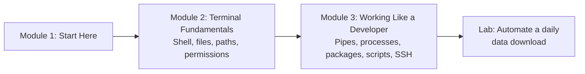

# How This Course Works

## Introduction

Watch an experienced developer for ten minutes and you will notice something: a lot of their work happens in a plain window full of text. They type a short command and a project appears. Another command and a server starts. Another and a thousand log lines shrink to the three that matter. It looks like magic the first time. It isn't. It is a small set of tools, used often, that anyone can learn in a few evenings.

That window is the **terminal**, and this course teaches you to be comfortable in it. Almost everything else on this site leans on these skills: installing Python packages, using Git, running a FastAPI server, connecting to a cloud machine, scheduling a data pipeline, letting a coding agent run commands for you. If the terminal feels scary today, by the end of this course it will feel like the fastest way to get things done.

This first article is short. It tells you what you will learn, how the lessons are built, what you need before you start, and how to get the most out of the course.

> 💡 **Key Insight**
>
> The command line is not a separate subject you learn once and forget. It is **the place developers work**. Every command you learn here, you will use again in every later course, often several times a day. A few hours invested now pays you back for the rest of your career.

---

## What You Will Learn

By the end of this course you will be able to:

- **Explain what a terminal, a shell and a command are**, and how they relate to each other on Linux, macOS and Windows.
- **Move around the file system** with confidence: absolute and relative paths, creating, copying, moving and deleting files and folders without fear.
- **Read and search files** from the terminal, and make quick edits with a terminal text editor.
- **Understand permissions and users**: why you get "Permission denied", what `chmod 755` means, and when (not) to use `sudo`.
- **Combine small commands into powerful pipelines** with pipes, redirection and `grep`.
- **Manage running programs**: find a process, stop it, free a busy port, and configure programs with environment variables.
- **Install software properly** with system package managers, and isolate Python projects with virtual environments and `uv`.
- **Write shell scripts** and schedule them with `cron`.
- **Work on a remote server** over SSH with keys, copy files to it, and keep jobs running after you disconnect.
- **Build a small automation** that downloads data every day, logs what it did and cleans up after itself.

### The course at a glance



Module 2 gives you the everyday basics: what the shell is, how to find your way around, how to look inside files and why some actions are allowed and others are not. Module 3 turns those basics into real developer habits: chaining commands, controlling programs, managing software, automating work and using remote machines. The lab at the end ties it all together.

---

## How Every Lesson Is Built

Every article on this platform follows the same shape, so you always know where to look:

| Section | What it gives you |
|---|---|
| **Before you start** | Links to the earlier lessons this one depends on. If a term is unfamiliar, follow the link. |
| **Introduction** | Why the topic matters, using situations you already know. |
| **Key Insight** | The one idea to remember if you remember nothing else. |
| **Core Explanation** | The topic, step by step, with analogies, diagrams, commands and their output. |
| **Try It Yourself** | Small tasks to do in your own terminal, with answers hidden in a fold. |
| **Real-World Examples** | How working developers, data engineers and ops teams use the idea. |
| **Common Misconceptions** | The mistakes almost everyone makes, corrected. |
| **Interview Relevance** | What interviewers ask about this topic and what a strong answer covers. |
| **Key Takeaways** | A one-minute summary to review later. |

**Labs** are different. A lab is a guided build: you start from an empty folder and finish with something that works. Please don't skip the lab. It is where the separate commands turn into a habit.

### How to read the command examples

Commands are shown in grey blocks like this one. You type the line into your terminal and press **Enter**:

```bash
echo "Namaste, terminal"
```

When a command prints something, the lesson shows it in a second block labelled **Example output**:

Example output:

```
Namaste, terminal
```

A few conventions you will see everywhere:

- **Lines starting with `#` are comments.** The shell ignores them. They are there to explain, and you can type them or leave them out.
- **The prompt is not shown.** Your terminal puts something like `sourabh@laptop:~$` before the cursor. Don't type that part; type only the command.
- **Your output will differ in the details.** Your user name, dates, file sizes and process numbers will not match the lesson exactly. The shape of the output will.
- **`<something>` means "replace this".** If a lesson says `cd <folder>`, you type `cd data`, not the angle brackets.
- **Python examples are real and tested.** Where Python helps (running commands from a script, reading environment variables, working with paths), the code is checked automatically and the output shown is the output it actually prints.

---

## What You Need Before Starting

Nothing except a computer and curiosity. This course is a starting point; it assumes no programming background.

You do need **access to a terminal running a Unix-style shell**. Here is how to get one on each system:

| Your computer | What to use | Notes |
|---|---|---|
| **Linux** (Ubuntu, Fedora, Debian and others) | The built-in **Terminal** app | Press `Ctrl + Alt + T` on Ubuntu. The default shell is usually **bash**. |
| **macOS** | The built-in **Terminal** app (Applications → Utilities), or iTerm2 | The default shell is **zsh** (since macOS Catalina in 2019). Almost every command in this course works the same. |
| **Windows 10 or 11** | **WSL** (Windows Subsystem for Linux) inside **Windows Terminal** | Open PowerShell as administrator and run `wsl --install`. It installs Ubuntu by default. Restart when asked, then open "Ubuntu" from the Start menu. |

> **Why WSL on Windows?** Windows has its own shells, Command Prompt and PowerShell, and the lessons point out PowerShell equivalents where they matter. But the servers you will deploy to, the Docker containers you will build and most developer documentation use Linux commands. WSL gives you a real Linux system inside Windows, so everything in this course works exactly as written.

You will also want **Python 3.10 or newer** for the lessons that use Python. Check with:

```bash
python3 --version
```

Example output:

```
Python 3.13.16
```

If you see "command not found", don't worry. [Package Managers and Virtual Environments](../03-working-like-a-developer/package-managers-and-virtual-environments.md) shows you how to install it properly. The [Python Fundamentals](../../python-fundamentals/course.md#m2) course also walks through it.

### Is it safe to practise?

Yes, as long as you follow one rule: **practise inside a folder made for practising.** The lessons create a folder called `projects` in your home directory and work inside it. The commands that can do real damage, such as deleting files or changing permissions, are always explained before you run them, along with how to use them safely.

---

## How to Get the Most Out of It

1. **Type the commands, don't paste them.** Your fingers learn the commands faster than your eyes do. Typing also makes you notice every space and dash, and in the shell, a space matters.
2. **Predict before you press Enter.** Say out loud what you think will happen. When you're wrong, you've found something worth understanding.
3. **Read error messages slowly.** The shell is usually very precise about what went wrong: "No such file or directory" means exactly that. Most beginner problems are solved by reading the error twice.
4. **Use `--help` and `man`.** Almost every command explains itself. You'll learn how in the first lesson.
5. **Do the Try It Yourself exercises.** They are small on purpose, and they are where the learning happens.
6. **Mark lessons complete.** The button at the bottom of each lesson saves your progress in your browser, and the course page shows how far you've got.

---

## Common Misconceptions

### Misconception 1: "The command line is old-fashioned. Nobody uses it any more."

The opposite. Cloud servers usually have no screen at all; you manage them through a terminal. Docker, Git, Python packaging, Kubernetes and AI coding agents are all driven from the command line. Even the newest tools, like coding agents that edit your project, work by running shell commands. Knowing what those commands do is how you stay in control.

### Misconception 2: "I need to memorise hundreds of commands"

You need about twenty for daily work, and you will learn them by using them. For everything else, you look things up with `--help`, `man`, or a quick search, like every professional does.

### Misconception 3: "One wrong command will destroy my computer"

Most commands only read things, and they cannot hurt anything. The few that change or delete files work only where your user is allowed to make changes, which is mostly your own home folder. The lessons show you exactly which commands deserve care, and the habits (like checking where you are before deleting) that keep you safe.

### Misconception 4: "Linux commands are useless on a Mac or Windows"

macOS is a Unix system, so its terminal speaks almost the same language as Linux. On Windows, WSL gives you a full Linux environment. The differences that do exist are pointed out in every lesson.

---

## Key Takeaways

- The terminal is **where developers work**, and every later course on this site depends on it.
- The course has two modules: **Terminal Fundamentals** (shell, files, viewing, permissions) and **Working Like a Developer** (pipes, processes, packages, scripts, SSH), then a lab.
- On **Linux** and **macOS**, use the built-in Terminal. On **Windows**, install **WSL** and use it inside Windows Terminal.
- Commands appear in code blocks; their output follows under **Example output**. Your details will differ, the shape won't.
- Type the commands, predict the result, read errors carefully, and practise inside your own `projects` folder.

---

**Up next:** [What is a Terminal and a Shell?](../02-terminal-fundamentals/what-is-a-terminal-and-a-shell.md)
