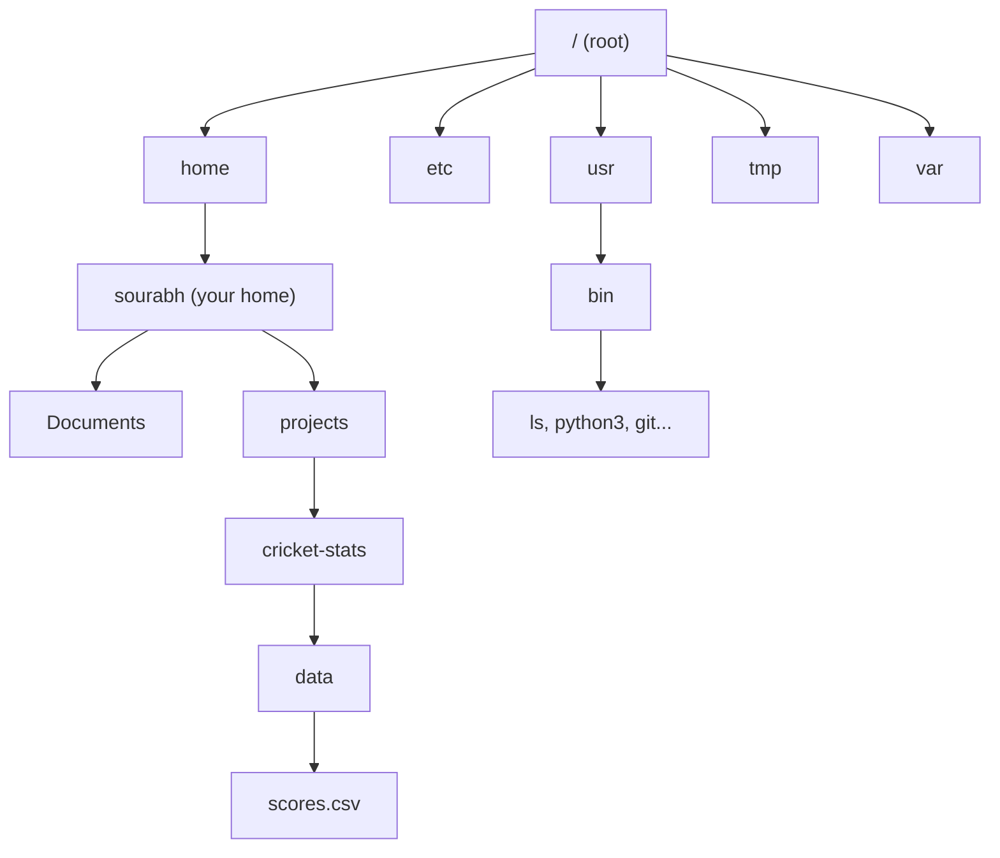
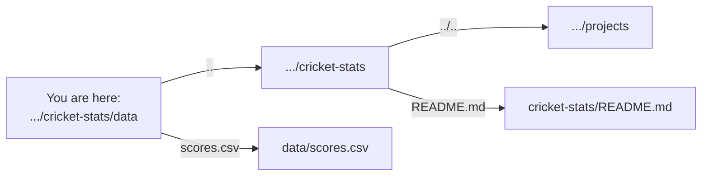

# Files, Folders and Paths: The Complete Guide

> 📚 **Before you start**
>
> - [What is a Terminal and a Shell?](what-is-a-terminal-and-a-shell.md): you should be able to open a terminal, run a command, and know what options and arguments are.

## Introduction

Imagine giving a friend directions to your flat. You could say "Flat 402, Sai Krupa Apartments, 3rd Cross, Indiranagar, Bengaluru". That works from anywhere in the world. Or, if they are already standing at your building's gate, you could just say "fourth floor, second door on the left". The first is a complete address; the second only makes sense from where they are standing.

Files on a computer work exactly the same way. Every file has a complete address, starting from the very top of the disk, and a shorter address that depends on where you currently are. Developers move between these two kinds of address hundreds of times a day, usually without thinking. Nearly every "file not found" error a beginner sees comes from mixing them up.

In a file manager like Finder or Explorer, you see folders as icons and double-click your way around. In the terminal, you do the same things with a handful of short commands. By the end of this article you'll know how the Linux and macOS file system is laid out, how to move around it, the difference between absolute and relative paths, and how to create, copy, move, rename and delete files and folders safely. You'll also learn wildcards, which let one command work on hundreds of files at once, and how to do the same things from Python.

> 💡 **Key Insight**
>
> The shell is always **standing in one folder**, called the **current working directory**. Every relative path you type is read **from that folder**. When a command can't find a file, the first question is always: *"where am I standing, and where is the file?"* Run `pwd` and you'll usually have your answer.

---

## Core Explanation

### 1. The File System Is an Upside-Down Tree

On Linux and macOS, every file and folder lives inside one big tree. The top of the tree is called the **root** and is written as a single forward slash: `/`. Everything else hangs below it. (Folders are also called **directories**; the two words mean the same thing.)



There are no drive letters. A USB stick or a second disk is attached ("mounted") somewhere inside the same tree, such as `/media/sourabh/USB` on Ubuntu or `/Volumes/USB` on a Mac.

Windows is different: each drive has its own tree (`C:\`, `D:\`), and paths use backslashes, like `C:\Users\Sourabh\Documents`. Inside WSL you're in a Linux tree, and your Windows drives appear under `/mnt`: `C:\Users\Sourabh` becomes `/mnt/c/Users/Sourabh`.

### 2. The Folders You'll Meet on Linux

You don't need to memorise these, but recognising them makes error messages and documentation much easier to read.

| Folder | What lives there |
|---|---|
| `/home` | One folder per user: `/home/sourabh`. Your files go here. (macOS: `/Users`) |
| `/root` | The home folder of the administrator account, **root** |
| `/bin`, `/usr/bin` | Programs everyone can run: `ls`, `cp`, `python3`, `git` |
| `/usr/local/bin` | Programs installed by you or by hand, not by the system |
| `/etc` | System-wide settings files ("et cetera"), such as `/etc/hosts` |
| `/var` | Data that changes as the system runs; logs live in `/var/log` |
| `/tmp` | Temporary files. Often wiped on reboot. Anyone can write here. |
| `/opt` | Optional, self-contained software packages |
| `/dev` | Devices shown as files: disks, terminals, and `/dev/null` (a bin that throws away whatever you write to it) |
| `/proc` | Live information about running programs and the kernel, shown as files |
| `/mnt`, `/media` | Where extra disks and drives get attached |

On a Mac you'll also see `/Applications` (apps), `/Library` and `~/Library` (app settings and caches), and `/opt/homebrew` (where Homebrew installs software on Apple Silicon Macs).

### 3. Your Home Folder and `~`

Your **home folder** is your personal space: `/home/sourabh` on Linux and WSL, `/Users/sourabh` on a Mac. You can create, change and delete anything inside it. Outside it, most places are read-only for normal users (the permissions lesson explains why).

The shell gives the home folder a shortcut: the **tilde**, `~`. Wherever you type `~` at the start of a path, the shell replaces it with your home folder before running the command. So `~/projects` means `/home/sourabh/projects`.

### 4. Where Am I? Moving Around with `pwd` and `cd`

`pwd` (print working directory) tells you where the shell is standing:

```bash
pwd
```

Example output:

```
/home/sourabh
```

`cd` (change directory) moves you. For this lesson, create a practice project first (the commands are explained in section 7):

```bash
mkdir -p ~/projects/cricket-stats/data ~/projects/cricket-stats/scripts
cd ~/projects/cricket-stats
pwd
```

Example output:

```
/home/sourabh/projects/cricket-stats
```

The useful forms of `cd`:

| Command | Where it takes you |
|---|---|
| `cd data` | Into the `data` folder inside the current folder |
| `cd ..` | Up one level, to the parent folder |
| `cd ../..` | Up two levels |
| `cd ~` or just `cd` | Home |
| `cd /` | The root of the whole tree |
| `cd -` | Back to the previous folder you were in (great for jumping between two places) |
| `cd /etc` | Straight to an exact location |

Try it:

```bash
cd data
pwd
cd ..
pwd
```

Example output:

```
/home/sourabh/projects/cricket-stats/data
/home/sourabh/projects/cricket-stats
```

If you ask for a folder that isn't there, the shell says so plainly:

```bash
cd nope
```

Example output:

```
bash: cd: nope: No such file or directory
```

### 5. Absolute and Relative Paths

A **path** is the address of a file or folder. There are two kinds:

- An **absolute path** starts with `/` (or `~`, which expands to one). It describes the full route from the root and works no matter where you're standing. Example: `/home/sourabh/projects/cricket-stats/data/scores.csv`.
- A **relative path** does **not** start with `/`. It is read starting from the current folder. Standing in `/home/sourabh/projects/cricket-stats`, the relative path `data/scores.csv` points to the same file.

Two special names exist in every folder:

- `.` (one dot) means **this folder**.
- `..` (two dots) means **the parent folder**.

So, standing in `/home/sourabh/projects/cricket-stats/data`:

| Path you type | Points to |
|---|---|
| `scores.csv` | `/home/sourabh/projects/cricket-stats/data/scores.csv` |
| `./scores.csv` | The same file (`./` just says "here") |
| `../README.md` | `/home/sourabh/projects/cricket-stats/README.md` |
| `../../chai-tracker` | `/home/sourabh/projects/chai-tracker` |
| `/etc/hosts` | `/etc/hosts`, regardless of where you are |



When to use which? **Relative paths** are shorter and make projects portable: a script that reads `data/scores.csv` works on anyone's machine. **Absolute paths** are safer in anything that might run from an unknown folder, such as a scheduled job (you'll see this matter in the cron lesson).

### 6. Listing Files with `ls`

`ls` lists what's in a folder. On its own it shows the current folder; give it a path to look elsewhere. Let's add a few files first:

```bash
cd ~/projects/cricket-stats
echo "# Cricket stats" > README.md
printf 'date,team,opponent,runs,wickets\n2026-09-01,India,Australia,287,6\n' > data/scores.csv
ls
```

(The `>` saves a command's output into a file. You'll learn it properly in the pipes lesson.)

Example output:

```
README.md  data  scripts
```

The options you'll use most:

| Option | Meaning |
|---|---|
| `-l` | **Long** format: permissions, owner, size, date |
| `-a` | **All** files, including hidden ones |
| `-h` | **Human-readable** sizes (`4.0K` instead of `4096`), used with `-l` |
| `-F` | Add a `/` after folders and `*` after programs |
| `-t` | Sort by time changed, newest first |
| `-R` | **Recursive**: list subfolders too |

```bash
ls -F
```

Example output:

```
README.md  data/  scripts/
```

```bash
ls -la
```

Example output:

```
total 20
drwxr-xr-x 4 sourabh sourabh 4096 Oct 11 05:29 .
drwxr-xr-x 3 sourabh sourabh 4096 Oct 11 05:29 ..
-rw-r--r-- 1 sourabh sourabh   16 Oct 11 05:29 README.md
drwxr-xr-x 2 sourabh sourabh 4096 Oct 11 05:29 data
drwxr-xr-x 2 sourabh sourabh 4096 Oct 11 05:29 scripts
```

Reading a long-format line from left to right: the type and permissions (`d` means directory, `-` a regular file; the rest is explained in *Permissions and Users*), the number of links, the **owner**, the **group**, the **size** in bytes, the **last-modified** time, and the **name**. Notice `.` and `..` appear here: they really are entries in every folder.

**Hidden files** are simply files whose names start with a dot, such as `.gitignore`, `.env` or `.bashrc`. `ls` hides them unless you add `-a`. Tools use dot-files for settings so they don't clutter your view. (In Finder, press **Cmd + Shift + .** to show them.)

A tool called `tree` (install it with your package manager) draws the whole structure:

```bash
tree
```

Example output:

```
.
├── README.md
├── data
│   └── scores.csv
└── scripts

3 directories, 2 files
```

### 7. Creating Folders and Files: `mkdir` and `touch`

`mkdir` (make directory) creates folders:

```bash
mkdir reports
mkdir -p reports/2026/september
ls -R reports
```

Example output:

```
reports:
2026

reports/2026:
september

reports/2026/september:
```

Without `-p`, `mkdir` refuses to create a folder whose parent doesn't exist yet, and complains if the folder already exists. With `-p` (parents) it creates every missing level and stays quiet if they already exist, which is why scripts nearly always use `mkdir -p`.

```bash
mkdir data
```

Example output:

```
mkdir: cannot create directory 'data': File exists
```

`touch` creates an empty file (or, if the file exists, just updates its "last modified" time):

```bash
touch notes.txt
ls
```

Example output:

```
README.md  data  notes.txt  reports  scripts
```

### 8. Copying, Moving and Renaming: `cp` and `mv`

`cp source destination` copies a file:

```bash
cp data/scores.csv data/scores_backup.csv
ls data
```

Example output:

```
scores.csv  scores_backup.csv
```

To copy a **folder** and everything in it, add `-r` (recursive). Without it, `cp` refuses with "-r not specified; omitting directory 'data'".

```bash
cp -r data data_copy
ls
```

Example output:

```
README.md  data  data_copy  notes.txt  reports  scripts
```

`mv` moves **and** renames. There is no separate rename command, because renaming is just moving a file to a new name in the same place:

```bash
mv notes.txt todo.txt          # rename
mv todo.txt reports/           # move into a folder (the trailing / makes the intent clear)
ls reports
```

Example output:

```
2026  todo.txt
```

`mv` works on folders without needing `-r`.

> ⚠️ **Overwriting is silent.** If the destination file already exists, `cp` and `mv` replace it **without asking**. Add `-i` (interactive) to be asked first, or `-n` (no-clobber) to never overwrite. Many people add `alias cp='cp -i'` and `alias mv='mv -i'` to their shell settings.

### 9. Deleting: `rm` and `rmdir`

```bash
rm data/scores_backup.csv        # delete a file
rm -r data_copy                  # delete a folder and everything inside it
rmdir reports/2026/september     # delete an EMPTY folder
```

`rmdir` is the cautious one: it only removes empty folders, and refuses otherwise.

```bash
rmdir reports
```

Example output:

```
rmdir: failed to remove 'reports': Directory not empty
```

`rm` without `-r` refuses to delete a folder at all:

```bash
rm reports
```

Example output:

```
rm: cannot remove 'reports': Is a directory
```

> ⚠️ **There is no Recycle Bin in the terminal.** `rm` deletes immediately and permanently. `rm -rf` (recursive, force) deletes a whole folder tree without a single question, even if files are write-protected. It is genuinely useful, and genuinely dangerous with the wrong path. Before any `rm -r`:
>
> 1. Run `pwd` to confirm where you're standing.
> 2. Run `ls` with the exact same path first, to see what would be deleted.
> 3. Prefer specific paths (`rm -r data_copy`) over broad ones.
> 4. Use `rm -ri` when unsure: it asks before each file.
> 5. Never run `rm -rf` with a variable or a path you haven't read carefully, and never on `/` or `~`.

### 10. Wildcards: One Command, Many Files

Wildcards (also called **glob patterns**) let you describe many file names at once:

| Pattern | Matches | Example |
|---|---|---|
| `*` | Any number of any characters (including none) | `*.csv` → every CSV file here |
| `?` | Exactly one character | `report_?.txt` → `report_1.txt`, `report_a.txt` |
| `[abc]` | One character from the set | `data_[12].csv` → `data_1.csv`, `data_2.csv` |
| `[0-9]` | One character in the range | `2026-0[1-9]*` → January to September files |

The key thing to understand: **the shell expands wildcards before the command runs.** `ls *.csv` doesn't send `*.csv` to `ls`. The shell replaces it with the list of matching names, and `ls` receives those names. That's why wildcards work with every command, and why `echo` is a safe way to preview what a pattern matches:

```bash
echo *.md
ls data/*.csv
ls */*.py
```

Example output:

```
README.md
data/scores.csv
scripts/summary.py
```

(The last line assumes you've created `scripts/summary.py`; any `.py` file one level down would match.) Use the preview habit before deleting: run `echo rm *.tmp` first, look at what it would do, then remove the `echo`.

A related feature is **brace expansion**, which generates names even if they don't exist yet:

```bash
mkdir -p reports/{jan,feb,mar}
ls reports
```

Example output:

```
2026  feb  jan  mar  todo.txt
```

Wildcards don't match hidden files by default, so `rm *` won't delete `.env`. And if nothing matches, bash passes the pattern through unchanged (so `ls *.xyz` complains that a file literally named `*.xyz` doesn't exist), while zsh stops with `zsh: no matches found: *.xyz`.

### 11. Names: Case, Spaces and Extensions

- **Case matters on Linux.** `Data.csv`, `data.csv` and `DATA.CSV` are three different files. macOS (by default) and Windows treat them as the same name while remembering the case you typed. A script that works on your Mac can fail on a Linux server because of a capital letter. Pick a style (lowercase with dashes or underscores is the convention) and stick to it.
- **Spaces need quotes.** The shell splits on spaces, so `ls match report.txt` looks for two files, `match` and `report.txt`. Write `ls "match report.txt"` or `ls match\ report.txt` (a backslash escapes the next character). Tab completion adds the backslashes for you. Better still, avoid spaces in names you create.
- **Extensions are just part of the name.** Linux doesn't care whether a file ends in `.csv`; programs look at the contents. The `file` command does the same:

```bash
file data/scores.csv README.md data
```

Example output:

```
data/scores.csv: CSV ASCII text
README.md:       ASCII text
data:            directory
```

### 12. How Much Space? `du` and `df`

Two quick commands answer "what's using my disk?":

```bash
du -sh data scripts      # disk usage of each folder, summarised, human-readable
df -h ~                  # free space on the disk that holds your home folder
```

Example output:

```
8.0K	data
4.0K	scripts
Filesystem      Size  Used Avail Use% Mounted on
/dev/sda2       234G  118G  105G  53% /
```

`du -h -d 1 . | sort -h` lists the folders inside the current one from smallest to largest, which is the fastest way to find what's eating your disk (often a forgotten `.venv` or `node_modules`).

### 13. The Same Commands in PowerShell

If you're on Windows without WSL, here is the translation. PowerShell accepts both `/` and `\` in paths, and many Linux names work as aliases, but with PowerShell's own options.

| Task | Linux / macOS / WSL | PowerShell |
|---|---|---|
| Where am I? | `pwd` | `Get-Location` (`pwd`) |
| Move | `cd ~/projects` | `Set-Location ~\projects` (`cd`) |
| List, including hidden | `ls -la` | `Get-ChildItem -Force` (`ls`, `dir`) |
| Make nested folders | `mkdir -p a/b/c` | `New-Item -ItemType Directory a\b\c` (creates parents automatically) |
| Empty file | `touch notes.txt` | `New-Item notes.txt` |
| Copy folder | `cp -r data backup` | `Copy-Item data backup -Recurse` |
| Move or rename | `mv a.txt b.txt` | `Move-Item a.txt b.txt` (`mv`) |
| Delete folder | `rm -r old` | `Remove-Item old -Recurse` |

### 14. Paths in Python

Python's `pathlib` module models paths as objects, using the same ideas you just learned. The `/` operator joins pieces, and properties give you the name, extension and parent. `PurePosixPath` is used here so the example behaves the same on every computer; in your own code you'll normally just use `Path`.

```python
from pathlib import PurePosixPath
import posixpath

home = PurePosixPath("/home/sourabh")
csv_path = home / "projects" / "cricket-stats" / "data" / "scores.csv"

print(csv_path)
print("name:", csv_path.name)
print("stem:", csv_path.stem, "| suffix:", csv_path.suffix)
print("parent:", csv_path.parent)
print("absolute?", csv_path.is_absolute())
print("relative to home:", csv_path.relative_to(home))
print("relative path absolute?", PurePosixPath("data/scores.csv").is_absolute())

# normpath resolves . and .. the way cd does
print(posixpath.normpath("/home/sourabh/projects/cricket-stats/data/../../chai-tracker"))
```

Output:

```
/home/sourabh/projects/cricket-stats/data/scores.csv
name: scores.csv
stem: scores | suffix: .csv
parent: /home/sourabh/projects/cricket-stats/data
absolute? True
relative to home: projects/cricket-stats/data/scores.csv
relative path absolute? False
/home/sourabh/projects/chai-tracker
```

`Path` objects can also create, list and delete files, mirroring `mkdir -p`, `touch` and wildcards. This example works inside a temporary folder that Python deletes afterwards:

```python
import tempfile
from pathlib import Path

with tempfile.TemporaryDirectory() as tmp:
    project = Path(tmp) / "cricket-stats"
    (project / "data").mkdir(parents=True)              # mkdir -p
    (project / "scripts").mkdir()
    (project / "README.md").touch()                     # touch
    (project / "data" / "scores.csv").write_text("date,runs\n2026-09-01,287\n")
    (project / "data" / "fixtures.csv").write_text("date,opponent\n")

    for path in sorted(project.rglob("*")):             # like ls -R
        kind = "dir " if path.is_dir() else "file"
        print(kind, path.relative_to(project))

    print("CSV files:", sorted(p.name for p in project.glob("data/*.csv")))  # wildcard

print("cleaned up:", not project.exists())
```

Output:

```
file README.md
dir  data
file data/fixtures.csv
file data/scores.csv
dir  scripts
CSV files: ['fixtures.csv', 'scores.csv']
cleaned up: True
```

One important connection: when a Python script opens `"data/scores.csv"`, that relative path is read from the **current working directory of the process**, which is the folder you were in when you ran `python`, *not* the folder the script lives in. Running `python scripts/summary.py` from the project folder works; running it from inside `scripts/` fails with `FileNotFoundError`. A robust script builds paths from its own location with `Path(__file__).parent`.

---

## Try It Yourself

1. **Paths on paper.** You're in `/home/sourabh/projects/cricket-stats/scripts`. Write the relative path to `/home/sourabh/projects/cricket-stats/data/scores.csv`, and the absolute path to the same file using `~`.
2. **Build a structure.** In one `mkdir` command, create `~/projects/sales/{raw,clean,reports}`, then create empty files `raw/jan.csv`, `raw/feb.csv` and `raw/notes.txt` with one `touch` command. List only the CSV files.
3. **Copy, rename, clean up.** Copy the whole `raw` folder to `raw_backup`, rename `raw_backup/notes.txt` to `README.txt`, then delete `raw_backup` safely (look before you delete).
4. **Python paths.** Using `PurePosixPath`, print the suffix and parent of `/var/log/nginx/access.log`, and resolve `/var/log/nginx/../../tmp` with `posixpath.normpath`.

<details>
<summary>Show answers</summary>

**1.** Relative: `../data/scores.csv` (up one level to `cricket-stats`, then into `data`). Absolute: `~/projects/cricket-stats/data/scores.csv`.

**2.**

```bash
mkdir -p ~/projects/sales/{raw,clean,reports}
cd ~/projects/sales
touch raw/jan.csv raw/feb.csv raw/notes.txt
ls raw/*.csv
```

Example output:

```
raw/feb.csv  raw/jan.csv
```

**3.**

```bash
cp -r raw raw_backup
mv raw_backup/notes.txt raw_backup/README.txt
pwd                 # confirm you're in ~/projects/sales
ls raw_backup       # see exactly what will go
rm -r raw_backup
```

**4.**

```python
from pathlib import PurePosixPath
import posixpath

log = PurePosixPath("/var/log/nginx/access.log")
print(log.suffix, log.parent)
print(posixpath.normpath("/var/log/nginx/../../tmp"))
```

Output:

```
.log /var/log/nginx
/var/tmp
```

</details>

---

## Real-World Examples

### Example 1: The Script That Worked Yesterday

A data analyst schedules `python report.py` to run every morning. It reads `data/sales.csv`. Run by hand from the project folder, it works. Run by the scheduler, it fails with "No such file or directory", because the scheduler starts it from the home folder, where `data/sales.csv` doesn't exist. The fix is either to `cd` into the project first or to build the path from the script's own location. Same file, different starting point.

### Example 2: Organising a Data Lake

Data engineers store files in predictable folder paths such as `raw/orders/date=2026-10-11/part-0001.parquet`. Because the paths follow a pattern, a single wildcard (`raw/orders/date=2026-10-*/*.parquet`) selects a whole month, and tools can skip folders they don't need. You'll meet this "partitioning" idea in [Data Engineering Foundations](../../data-engineering-foundations/course.md#m3).

### Example 3: The Case-Sensitivity Deploy Bug

A web developer on a Mac imports `./Components/Header.js`, but the folder on disk is `components`. macOS ignores the difference and everything works locally. The Linux build server doesn't, and the deploy fails with "module not found". Knowing that Linux paths are case-sensitive turns an hour of confusion into a one-minute fix.

---

## Common Misconceptions

### Misconception 1: "`/` and `~` are the same thing"

`/` is the root of the entire file system. `~` is your home folder, which is several levels below it (`/home/sourabh`). Creating or deleting things in `/` affects the whole machine; in `~`, only you.

### Misconception 2: "A relative path is relative to where the script file is"

It's relative to the **current working directory** of the running program, which is wherever you (or the scheduler) launched it from. This single misunderstanding causes a large share of beginner "file not found" errors.

### Misconception 3: "Deleted files go to the Trash"

Not from the terminal. `rm` removes them immediately. Recovering them is difficult or impossible. Look before you delete, and keep important work in Git.

### Misconception 4: "The extension decides the file type"

On Linux, a file called `data.csv` can contain anything. Programs and the `file` command look at the content. Extensions are a helpful naming convention, nothing more.

---

## Interview Relevance

File system questions appear in DevOps, backend and data engineering screens, and in practical tasks where you're handed a terminal.

- **"What's the difference between an absolute and a relative path?"** Absolute starts from `/`; relative starts from the current working directory. Mention `.`, `..` and `~`, and that relative paths in scripts depend on where the script is launched from.
- **"How do you copy a folder? Delete one?"** `cp -r`, `rm -r`; mention `rmdir` for empty folders and the danger of `rm -rf`.
- **"Where do logs and configuration files live on Linux?"** `/var/log` and `/etc`. Programs in `/usr/bin`, user files in `/home`.
- **"Who expands `*.csv`, the shell or the command?"** The shell, before the command runs. Strong candidates mention hidden files aren't matched and that quoting (`'*.csv'`) prevents expansion, which matters with `find -name`.

---

## Key Takeaways

- **Linux and macOS have one tree** starting at `/`; your files live in your **home folder**, `~`.
- **Absolute paths** start with `/` and work from anywhere; **relative paths** are read from the **current working directory** (`pwd`). `.` is here, `..` is the parent.
- The everyday commands: **`pwd`, `cd`, `ls`, `mkdir -p`, `touch`, `cp -r`, `mv`, `rm`, `rmdir`**.
- **`rm` is permanent**, and `cp`/`mv` overwrite silently. Check with `pwd` and `ls` first; use `-i` when unsure.
- **Wildcards are expanded by the shell** before the command runs; preview them with `echo`.
- **Linux is case-sensitive** and spaces need quotes. Name files in lowercase without spaces.

---

**Up next:** [Viewing, Searching and Editing Files](viewing-searching-and-editing-files.md)
