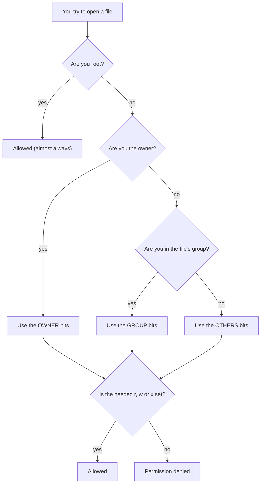

# Permissions and Users: The Complete Guide

> 📚 **Before you start**
>
> - [Files, Folders and Paths](files-folders-and-paths.md): especially reading `ls -l` output and the standard Linux folders.
> - [Viewing, Searching and Editing Files](viewing-searching-and-editing-files.md): creating and editing small files.

## Introduction

Think about a housing society in Pune. Every flat owner has a key to their own flat. Everyone in the society can use the garden and the gym. The building office, with the account books and the master keys, is open only to the secretary. Nobody finds this strange; it's just how a shared building stays safe and organised.

A Linux computer is a shared building too. Even your laptop has many "residents": you, plus dozens of background services like the web server, the database and the printer system, each running as its own user. Permissions decide who can read, change or run each file. That's why you see the famous message **Permission denied**: not because the computer is broken, but because the key you're holding doesn't open that door.

Beginners usually meet permissions in three moments: a script that won't run, a command that needs `sudo`, and an SSH key that is refused because it's "too open". This article explains all three. By the end you'll read a permission string like `-rwxr-x---` at a glance, know exactly what `chmod 755` and `chmod 600` mean, change ownership, understand root and `sudo` (and why to use them sparingly), and know how this works differently on macOS and Windows.

> 💡 **Key Insight**
>
> Every file has an **owner**, a **group**, and three sets of permissions: what the **owner** can do, what the **group** can do, and what **everyone else** can do. Each set is some combination of **read**, **write** and **execute**. "Permission denied" always means: *the user running this command isn't allowed this action on this file or one of the folders above it.*

---

## Core Explanation

### 1. Users, Groups and Root

Linux was built from the start for many people sharing one machine, so it tracks **who** is doing everything:

- A **user** is an account, with a name (`sourabh`) and a number called the **UID** (user ID). Every program runs as some user and gets that user's rights.
- A **group** is a named set of users, with a number called the **GID**. Groups let you give several people the same access at once, such as everyone in `developers`, or everyone allowed to use Docker.
- **root** (UID 0) is the administrator, the superuser. Root can read, change and delete anything, ignoring normal permissions. Its home folder is `/root`.

Ask who you are:

```bash
whoami
id
```

Example output:

```
sourabh
uid=1000(sourabh) gid=1000(sourabh) groups=1000(sourabh),4(adm),27(sudo),100(users)
```

You're UID 1000. Your main group has your own name (most Linux systems create one per user), and you're also in `sudo` (allowed to run commands as root) and `adm` (allowed to read system logs). On a Mac, your UID usually starts at 501 and admin users are in the `admin` group.

User accounts are listed in `/etc/passwd`, one per line. Despite the name it holds no passwords any more (those are hashed in `/etc/shadow`, which only root can read):

```bash
grep sourabh /etc/passwd
```

Example output:

```
sourabh:x:1000:1000:Sourabh,,,:/home/sourabh:/bin/bash
```

The fields, separated by `:`, are the user name, `x` (password stored elsewhere), UID, GID, a description, the home folder and the login shell.

Services get their own users too: `www-data` for the web server, `postgres` for the database. If the web server is ever hacked, the attacker gets only `www-data`'s limited rights, not yours and not root's. This idea, **least privilege**, is the whole point of permissions.

### 2. Reading a Permission String

Run `ls -l` on a few files:

```bash
ls -l
```

Example output:

```
-rw-r--r-- 1 sourabh sourabh   56 Oct 11 05:29 README.md
drwxr-xr-x 2 sourabh sourabh 4096 Oct 11 05:29 data
-rwxr-xr-x 1 sourabh sourabh   47 Oct 11 05:31 hello.sh
```

The first column, such as `-rwxr-xr-x`, is ten characters. The first says what kind of thing it is; the other nine are three groups of three:

```
-  rwx  r-x  r-x
│   │    │    └── others: everyone else
│   │    └─────── group: members of the file's group
│   └──────────── user: the file's owner
└──────────────── type: - file, d directory, l symbolic link
```

In each group of three, the positions are always **r**ead, **w**rite, e**x**ecute, and a `-` means "not allowed". So `-rwxr-xr-x` reads as: a regular file; the owner can read, write and run it; the group can read and run it; everyone else can read and run it.

The third and fourth columns of `ls -l` are the **owner** (`sourabh`) and the **group** (`sourabh`).



Notice only **one** set is checked: if you're the owner, the owner bits decide, even if "others" would have been more generous.

### 3. What r, w and x Mean for Files and Folders

The same letters mean slightly different things for files and for folders. The folder meanings surprise everyone at first:

| Permission | On a file | On a folder |
|---|---|---|
| **r** (read) | Read the contents | List the names inside (`ls`) |
| **w** (write) | Change the contents | Create, rename and **delete** files inside |
| **x** (execute) | Run it as a program | Enter it (`cd`) and reach files inside it |

Two consequences worth remembering:

- **Deleting a file depends on the folder, not the file.** If you can write to a folder, you can delete files in it even if the files themselves are read-only (`rm` asks first, `rm -f` doesn't).
- **To reach a file, you need `x` on every folder in its path.** If `/home/sourabh` is `drwx------`, nobody else can reach anything inside it, however open the files themselves are.

### 4. Numeric (Octal) Permissions

You'll constantly see permissions written as three digits, like `755` or `644`. Each digit is one group (user, group, others), made by adding:

| Permission | Value |
|---|---|
| r | 4 |
| w | 2 |
| x | 1 |
| none | 0 |

So `rwx` = 4+2+1 = **7**, `r-x` = 4+1 = **5**, `rw-` = 4+2 = **6**, `r--` = **4**. Read `755` as "7 for the owner, 5 for the group, 5 for others": `rwxr-xr-x`.

The handful you'll actually use:

| Number | String | Typical use |
|---|---|---|
| `644` | `rw-r--r--` | Normal files: you edit, everyone reads |
| `755` | `rwxr-xr-x` | Scripts, programs and folders: you edit, everyone runs or enters |
| `600` | `rw-------` | Private files: SSH keys, `.env` files with passwords |
| `700` | `rwx------` | Private folders, such as `~/.ssh` |
| `640` | `rw-r-----` | Config files a service group needs to read |
| `777` | `rwxrwxrwx` | Everyone can do everything. **Almost always a mistake.** |

`stat` shows both forms at once (on macOS, use `stat -f '%Lp %Sp %N' file`):

```bash
stat -c '%a %A %n' hello.sh data
```

Example output:

```
755 -rwxr-xr-x hello.sh
755 drwxr-xr-x data
```

### 5. Changing Permissions with `chmod`

`chmod` (change mode) changes permissions. You can only change files you own (or be root). It has two styles.

**Symbolic style**: who (`u` user/owner, `g` group, `o` others, `a` all), an operator (`+` add, `-` remove, `=` set exactly), and the permissions.

```bash
chmod +x hello.sh          # add execute for everyone (same as a+x)
chmod u+x hello.sh         # add execute for the owner only
chmod go-w notes.txt       # remove write from group and others
chmod u=rwx,g=rx,o= hello.sh   # set exactly: rwxr-x---
```

**Numeric style**: give all three digits at once.

```bash
chmod 644 README.md
chmod 600 .env
chmod 755 scripts
```

The classic first encounter is a script that won't run. Create one:

```bash
printf '#!/usr/bin/env bash\necho "Hello from a script"\n' > hello.sh
ls -l hello.sh
./hello.sh
```

Example output:

```
-rw-r--r-- 1 sourabh sourabh 47 Oct 11 05:31 hello.sh
bash: ./hello.sh: Permission denied
```

The file has no `x` anywhere, so the system refuses to run it as a program, even for its owner. Add execute permission and try again:

```bash
chmod +x hello.sh
ls -l hello.sh
./hello.sh
```

Example output:

```
-rwxr-xr-x 1 sourabh sourabh 47 Oct 11 05:31 hello.sh
Hello from a script
```

(The `./` matters: it says "the file in this folder". Without it, the shell searches the PATH folders and reports `command not found`. You'll write many more scripts in *Shell Scripts and cron*.)

To change a whole folder tree, add `-R` (recursive), but think first: `chmod -R 755 project` would make every file executable, which is wrong for data and text files. A precise approach uses `find`:

```bash
find project -type d -exec chmod 755 {} +     # folders: enterable
find project -type f -exec chmod 644 {} +     # files: readable, not executable
```

(`{} +` passes many file names to one `chmod`, which is faster than `{} \;`.)

### 6. Ownership: `chown` and `chgrp`

Every file belongs to one user and one group. `chown` (change owner) changes them. Giving files away needs root, so it's usually run with `sudo` (next section):

```bash
sudo chown www-data report.html             # change the owner
sudo chown www-data:www-data report.html    # owner and group together
sudo chown -R sourabh:sourabh ~/projects    # a whole tree back to you
chgrp developers shared.txt                 # change only the group (you must be in that group)
```

The last `chown -R` line is a common rescue: if you once ran a command with `sudo` inside your project, some files may now belong to root, and you'll get "Permission denied" editing your own project. Giving them back to yourself fixes it.

### 7. root and `sudo`

You can't do everything as yourself, and that's deliberate. Installing system software, editing files in `/etc`, or opening network ports below 1024 all need root. The safe way to get root's power for **one command** is `sudo` ("superuser do"):

```bash
sudo apt update
```

Example output:

```
[sudo] password for sourabh:
```

You type **your own** password (nothing appears as you type; that's normal), and the command runs as root. `sudo` remembers you for a few minutes, logs what you ran, and only works if you're allowed: on Ubuntu, members of the `sudo` group; on Fedora, `wheel`; on macOS, `admin`. If you're not allowed, you'll see a message that you're not in the sudoers file.

Handy forms:

| Command | What it does |
|---|---|
| `sudo command` | Run one command as root |
| `sudo !!` | Rerun the previous command with `sudo` (after a "Permission denied") |
| `sudo -u postgres psql` | Run a command as a different user, here the database user |
| `sudo -i` | Open a root shell. The prompt changes to `#`. Type `exit` when done. |
| `sudoedit /etc/hosts` | Edit a system file safely with your `EDITOR` |

**Use `sudo` sparingly.** It's not a magic "make it work" prefix. Running things as root means a typo can damage the whole system, and files you create become owned by root. Three rules:

1. **Never** use `sudo` inside your home folder or projects. If you need it there, something else is wrong (usually ownership; see section 6).
2. **Never** `sudo pip install` or `sudo npm install -g`. Use virtual environments instead (*Package Managers and Virtual Environments* shows how).
3. Read a command before putting `sudo` in front of it, especially one copied from the internet.

### 8. Default Permissions: `umask`

Why did `hello.sh` start as `rw-r--r--`? New files start from a maximum (`666` for files, `777` for folders) and the **umask** removes bits from it:

```bash
umask
```

Example output:

```
0022
```

A umask of `022` removes write permission for group and others, giving `644` for new files and `755` for new folders. That's the usual default. A stricter `077` would make everything you create private (`600`/`700`). New files never get execute permission automatically, which is why scripts always need `chmod +x`.

### 9. Special Permission Bits

Three extra bits appear occasionally. You don't need to set them, but you should recognise them:

```bash
ls -ld /tmp
ls -l /usr/bin/passwd
```

Example output:

```
drwxrwxrwt 10 root root 4096 Oct 11 05:31 /tmp
-rwsr-xr-x 1 root root 64152 May 30  2024 /usr/bin/passwd
```

- **Sticky bit** (`t` at the end, on `/tmp`): everyone can create files in the folder, but you can only delete **your own**. That's how a shared scratch folder stays safe.
- **setuid** (`s` in the owner's `x` position, on `passwd`): the program runs with its *owner's* rights (root), whoever starts it. That's how `passwd` can update `/etc/shadow` for you. setuid programs are carefully audited because they're a security risk.
- **setgid** on a folder (`s` in the group's position): new files inside inherit the folder's group, useful for shared team folders.

### 10. "Permission denied": A Troubleshooting Checklist

When you see it, work through these:

1. **Who am I?** `whoami`. Is the command running as the user you think? (Scheduled jobs and services often run as someone else.)
2. **What are the file's permissions and owner?** `ls -l file`.
3. **Can I get there?** `ls -ld` on each folder in the path. Every one needs `x` for you.
4. **Is it a script?** It needs `x`, and a correct first line (the `#!` "shebang", explained in the scripting lesson).
5. **Is it a system location?** Writing to `/etc`, `/usr` or `/var` needs `sudo`; ask yourself whether you really should be writing there.
6. **Did `sudo` create it?** Root-owned files in your home folder: fix with `sudo chown -R $USER:$USER <path>`.

A special case you'll meet in the SSH lesson: SSH **refuses** to use a private key that others can read, with a warning that the key's permissions are "too open". The fix is `chmod 600 ~/.ssh/id_ed25519` and `chmod 700 ~/.ssh`. Here, being *too* permissive is the error.

### 11. Managing Users on a Server

On your laptop you rarely create users. On a server you will, for example to give a teammate access or to run a service under its own account. These need `sudo`:

```bash
sudo adduser priya                 # create a user (Debian/Ubuntu; asks for a password and details)
sudo usermod -aG docker priya      # add priya to the docker group (-a appends: never forget it!)
sudo passwd priya                  # set or reset priya's password
groups priya                       # check which groups priya is in
sudo deluser priya                 # remove the user (Debian/Ubuntu)
```

`adduser` and `deluser` are friendly Debian/Ubuntu tools; the lower-level `useradd` and `userdel` exist on every Linux. Forgetting `-a` in `usermod -aG` replaces all of the user's groups with just the one you named, a classic way to lock someone out of `sudo`. Group changes take effect at the next login.

On macOS, users are managed in **System Settings → Users & Groups** (the command-line tool is `dscl`, rarely needed).

### 12. Windows and WSL

Windows doesn't use `rwx` bits. Its file system, NTFS, uses **access control lists (ACLs)**: each file has a list of entries such as "Users: Read" and "Sourabh: Full control". You see them under **Properties → Security**, and from the command line with `icacls`:

```powershell
icacls C:\Users\Sourabh\Documents\notes.txt
```

The administrator equivalent of `sudo` is **Run as administrator**, which triggers the User Account Control (UAC) prompt. Recent versions of Windows 11 also offer a `sudo` command that you can enable in Settings, but it's a Windows feature with its own behaviour, not Linux `sudo`.

**Inside WSL**, files in your Linux home (`~`) have normal Linux permissions, and everything in this lesson applies. Files on the Windows drives under `/mnt/c` are different: by default they usually show as fully open (`rwxrwxrwx`) and `chmod` doesn't stick, because NTFS has nowhere to store Linux bits unless WSL is configured with the `metadata` mount option. That's one more reason to keep your projects in the Linux side of WSL; for example, SSH keys stored under `/mnt/c` are often rejected as "too open".

### 13. Permissions from Python

Python's `os` and `stat` modules read and change the same bits. `stat.filemode` turns the number into the familiar string:

```python
import os
import stat
import tempfile
from pathlib import Path

with tempfile.TemporaryDirectory() as tmp:
    script = Path(tmp) / "hello.sh"
    script.write_text('#!/usr/bin/env bash\necho "Hello from a script"\n')

    def show(path):
        mode = path.stat().st_mode
        print(f"{oct(stat.S_IMODE(mode))[2:]} {stat.filemode(mode)} {path.name}")

    os.chmod(script, 0o644)        # same as: chmod 644 hello.sh
    show(script)

    os.chmod(script, 0o755)        # same as: chmod 755 hello.sh
    show(script)

    # chmod u-x: clear just the owner's execute bit, keep the rest
    os.chmod(script, script.stat().st_mode & ~stat.S_IXUSR)
    show(script)

    os.chmod(script, 0o600)        # private, like an SSH key
    show(script)
    print("owner can execute?", bool(script.stat().st_mode & stat.S_IXUSR))
```

Output:

```
644 -rw-r--r-- hello.sh
755 -rwxr-xr-x hello.sh
655 -rw-r-xr-x hello.sh
600 -rw------- hello.sh
owner can execute? False
```

Notice the octal literal `0o755` (Python needs the `0o` prefix to know it's octal), and how removing one bit turned `755` into `655`, an odd combination you'd rarely want, but a nice proof that each digit really is three independent switches.

---

## Try It Yourself

1. **Decode.** What do these mean, and what number is each? `-rw-r-----`, `drwx------`, `-rwxrwxr-x`.
2. **Encode.** Write the string for `640` and `711`. Which one would suit a folder that others may pass through but not list?
3. **Make it run.** Create `today.sh` containing `#!/usr/bin/env bash` and `date +%A` on two lines. Run it with `./today.sh`, fix the error, then make it runnable **only** by you, with no access at all for anyone else.
4. **Think it through.** A file `secret.txt` is `-rw-rw-rw-` and lives in a folder that is `drwx------`, owned by `priya`. Can user `rahul` read the file? Why?

<details>
<summary>Show answers</summary>

**1.** `-rw-r-----` = `640`: owner reads and writes, group reads, others nothing. `drwx------` = `700`: a private folder only the owner can list, change or enter. `-rwxrwxr-x` = `775`: owner and group can do everything, others can read and run.

**2.** `640` = `rw-r-----`; `711` = `rwx--x--x`. `711` suits the folder: `x` lets others enter and reach files whose names they already know, but without `r` they can't list what's inside.

**3.**

```bash
printf '#!/usr/bin/env bash\ndate +%%A\n' > today.sh
./today.sh            # bash: ./today.sh: Permission denied
chmod 700 today.sh    # rwx for you, nothing for group and others
./today.sh
```

Example output:

```
Sunday
```

(In `printf`, `%%` prints a single `%`, so the file contains `date +%A`.)

**4.** No. Even though the file allows everyone to read it, `rahul` can't get *to* it: the folder has no `x` for others, so he can't reach anything inside. Permissions are checked on every folder along the path.

</details>

---

## Real-World Examples

### Example 1: The Deploy Script That Wouldn't Run

A developer adds `deploy.sh` to a repository and the CI pipeline fails with "Permission denied". On their Mac the script ran fine after `chmod +x`, but the execute bit was never committed. Git stores the execute bit, so `chmod +x deploy.sh` followed by a commit (or `git update-index --chmod=+x deploy.sh` from Windows) fixes it for everyone. You'll set this up in the [Git course](../../git-and-github-zero-to-pro/course.md#m2).

### Example 2: Protecting Secrets on a Server

A team stores database passwords in `/etc/myapp/.env`. They set it to `640`, owned by `root` with group `myapp`, and run the app as the `myapp` user. The app can read the secrets; other users and services on the machine can't; and only an administrator can change them. Least privilege in three commands.

### Example 3: The "Just Use sudo" Trap

A student hits "Permission denied" running `pip install pandas` and reruns it with `sudo`. It works, but it has installed packages into the system Python that the operating system's own tools depend on, and some files in their home folder now belong to root. A week later, unrelated things break. The right fix was a virtual environment, which needs no `sudo` at all.

---

## Common Misconceptions

### Misconception 1: "`chmod 777` fixes permission problems"

It "fixes" them by letting every user and every program on the machine change or replace the file, including any compromised service. Find out *who* needs access and give exactly that: usually `644`, `755`, `600` or a group.

### Misconception 2: "If I can't edit a file, I can't delete it"

Deleting is controlled by the **folder's** write permission, not the file's. A read-only file in a folder you own can still be deleted.

### Misconception 3: "`sudo` means 'try harder'"

`sudo` runs the command as a completely different user, root, with unlimited power. It changes who owns the files it creates and bypasses safety checks. Use it only when the task genuinely needs administrator rights.

### Misconception 4: "Execute permission is only for programs"

On folders, `x` means "can enter". A folder without `x` can't be `cd`'d into or have its files opened, even if you can read the folder.

---

## Interview Relevance

Permissions questions are standard in Linux, DevOps, SRE and backend interviews, and appear in security-focused rounds.

- **"What does `chmod 755` mean?"** Owner `rwx`, group `r-x`, others `r-x`; explain r=4, w=2, x=1. Strong answers mention when you'd choose `644` or `600` instead.
- **"What do r, w and x mean on a directory?"** List, create/delete entries, enter/traverse. Mention that deleting a file depends on the directory's `w`.
- **"What's the difference between `su` and `sudo`?"** `su` switches to another user (by default root) using *that user's* password; `sudo` runs one command with elevated rights using *your* password, controlled and logged by the sudoers policy.
- **"Why does SSH refuse my key?"** The private key's permissions are too open; it must be readable only by the owner (`600`).
- **"What is least privilege?"** Give each user and service only the access it needs; running services as dedicated users limits the damage of a compromise.

---

## Key Takeaways

- Every file has an **owner**, a **group**, and **rwx** permissions for **user, group and others**; only one set is checked.
- **Octal**: r=4, w=2, x=1. Know **644** (files), **755** (scripts, folders), **600** (secrets) and **700** (private folders). **777** is almost always wrong.
- **`chmod`** changes permissions, **`chown`** changes ownership. Scripts need **`chmod +x`** before `./script.sh` works.
- On **folders**, `x` means "enter" and `w` means "create and delete inside".
- **`sudo`** runs one command as root: use it for system tasks, never inside your projects or with `pip`.
- **Windows uses ACLs**; inside WSL, keep files in your Linux home so Linux permissions work.

---

**Up next:** [Pipes, Redirection and grep](../03-working-like-a-developer/pipes-redirection-and-grep.md)
