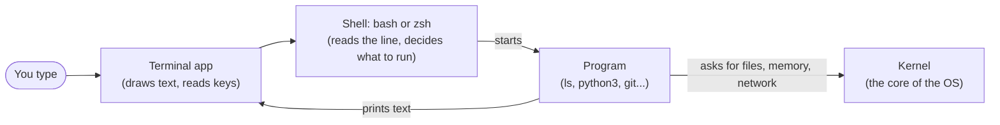
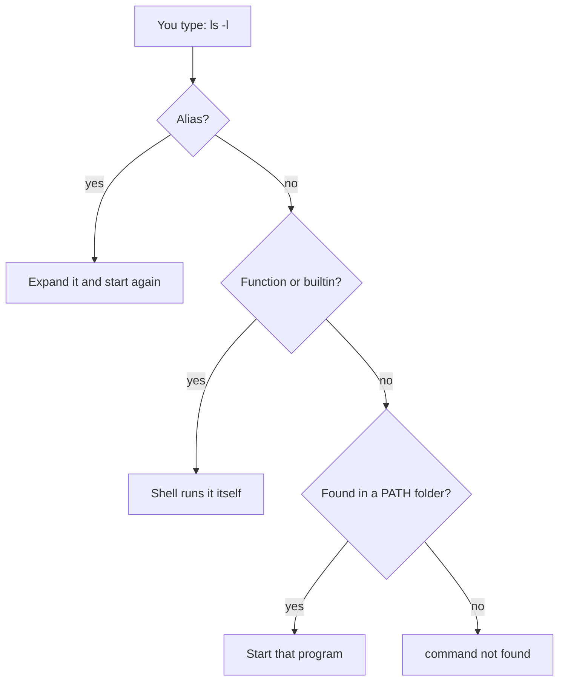

# What is a Terminal and a Shell? The Complete Guide

> 📚 **Before you start**
>
> No prior knowledge is needed. If you haven't opened a terminal yet, [How This Course Works](../01-start-here/how-this-course-works.md) shows you how to get one on Linux, macOS and Windows.

## Introduction

Think about two ways of ordering at a busy chai stall. In the first, you point at pictures on a menu board: one picture for masala chai, one for samosa, one for "less sugar". It is easy, but you can only order what has a picture. In the second, you just say what you want: "two cutting chai, one without sugar, and pack four samosas for later." It takes a moment to learn how to ask, but once you can, you can ask for anything, in any combination, in one breath.

The first way is a **graphical user interface (GUI)**: windows, icons, buttons, menus. The second is the **command line**: you type what you want, the computer does it, and it types back. Developers spend a lot of time in the command line for the same reason you'd rather speak at the chai stall: it is faster, it combines freely, and it can be written down and repeated.

The words around it confuse almost everyone at first. Terminal, shell, console, command line, bash, zsh, prompt, PowerShell: are these the same thing? (No.) Does it matter? (Yes, a little.) By the end of this article you will know exactly what each word means, you will have run your first commands, you will know how the shell finds the program you asked for, how to get help on any command, and the keyboard shortcuts that make the terminal pleasant to use. You will also know the differences between Linux, macOS and Windows that matter for the rest of the course.

> 💡 **Key Insight**
>
> The **terminal** is just a window that shows text. The **shell** is the program inside it that reads what you type and runs it. Most "commands" are **ordinary programs** sitting in folders on your disk. Once you see these three layers, everything about the command line makes sense.

---

## Core Explanation

### 1. Command Line vs Graphical Interface

Both are ways of telling a computer what to do. They have different strengths:

| | Graphical interface (GUI) | Command line (CLI) |
|---|---|---|
| **How you give instructions** | Click, drag, tap | Type a command, press Enter |
| **Easy to start?** | Very; you can explore by clicking | Takes a little learning |
| **Repeatable?** | You click the same things again | Save the commands in a file and rerun them |
| **Combinable?** | Only if the app's designer thought of it | Join any commands together |
| **Works over a slow network or with no screen?** | Poorly | Perfectly; servers usually have no screen |
| **Automatable?** | Hard | Built for it |

Renaming one photo? A GUI is fine. Renaming 4,000 photos to include the date they were taken? That is one command line. Doing it every night at 2 a.m. on a server in Mumbai? That is a command line plus a scheduler, which you'll build later in this course.

### 2. Terminal, Shell, Console: Untangling the Words

These words get used loosely, so here they are, precisely:

- **Terminal** (or **terminal emulator**): the app with the window. It draws text, takes your keystrokes, and handles colours, fonts, tabs and copy-paste. Examples: GNOME Terminal on Ubuntu, Terminal.app and iTerm2 on macOS, Windows Terminal on Windows. The name comes from the 1970s, when a "terminal" was a physical keyboard and screen wired to a big shared computer. Today's terminal apps imitate (emulate) those devices, hence "terminal emulator".
- **Shell**: the program running *inside* the terminal. It shows a prompt, reads the line you type, works out what you meant, runs it, and waits for the next line. Examples: **bash**, **zsh**, **fish**, **PowerShell**. It is called a shell because it is the outer layer around the core of the operating system (the **kernel**), the part you touch.
- **Command line**: the general idea of controlling a computer by typing commands. Also the single line you're typing right now.
- **Console**: historically the physical terminal attached directly to a machine. Today people use it to mean "terminal" too. You'll also hear "CLI" (command-line interface) for any program you control by typing, such as `git` or `docker`.
- **Prompt**: the text the shell prints to say "I'm ready, type something", like `sourabh@laptop:~$`.



*The terminal shows text. The shell interprets your commands. Programs do the work, asking the kernel for anything that touches hardware.*

A useful way to remember it: you can run a different shell in the same terminal (type `zsh` inside a bash session and you are now talking to zsh), and you can run the same shell in a different terminal. They are separate pieces.

### 3. The Shells You Will Meet

| Shell | Where you'll find it | Notes |
|---|---|---|
| **sh** | Every Unix-like system | The original Bourne shell standard. Scripts written for `sh` run almost anywhere. |
| **bash** | Default on most Linux systems, WSL, many servers and Docker images | "Bourne Again SHell". The one this course uses for scripts. |
| **zsh** | Default on macOS since Catalina (2019) | Very close to bash for everyday use, with nicer completion. Popular with the "Oh My Zsh" add-on. |
| **fish** | Installed by choice | Friendly, with suggestions as you type, but its scripting language differs from bash. |
| **PowerShell** | Windows (built in), also available on Linux and macOS | Works with objects rather than plain text. Commands look like `Get-ChildItem`. |
| **cmd.exe** (Command Prompt) | Windows | The old Windows shell. Fine for simple tasks, limited for anything else. |

Find out which shell you're using:

```bash
echo $SHELL
```

Example output (Linux):

```
/bin/bash
```

On a Mac, the same command typically prints `/bin/zsh`. `$SHELL` is your **login shell**, the one that starts when you open a terminal. You'll learn what the `$` means in the lesson on environment variables. For now, read it as "the value stored under the name SHELL".

> **bash or zsh: does it matter for this course?** For everything you type interactively, almost never. Where they differ, the lessons say so. Shell scripts in this course start with a line that says "run me with bash", so they behave the same on every system.

### 4. Reading the Prompt

When you open a terminal on Ubuntu, you see something like this:

```
sourabh@laptop:~$
```

Each part means something:

| Part | Meaning |
|---|---|
| `sourabh` | Your user name |
| `@laptop` | The machine's name (the **hostname**). Very useful once you're connected to several servers. |
| `:` | Just a separator |
| `~` | The folder you're currently in. `~` is short for your **home folder**. |
| `$` | You are a normal user. If it shows `#`, you are **root**, the all-powerful administrator. Be careful. |

On macOS with zsh, the default prompt looks like `sourabh@MacBook-Air ~ %`. The `%` plays the same role as `$`. Prompts are fully customisable, so yours may look fancier. Whatever it looks like, it always means "ready for a command".

### 5. Anatomy of a Command

Almost every command follows the same shape:

```
command   -options   arguments
```

- **Command**: the name of the program or built-in to run, such as `ls`.
- **Options** (also called **flags** or **switches**): change *how* it behaves. Short options are a dash and a letter (`-l`). Long options are two dashes and a word (`--all`). Several short options can usually be combined: `-l -a` is the same as `-la`.
- **Arguments**: *what* it should work on, usually file or folder names.

Spaces separate the parts. That is why spaces in file names cause trouble, and why you'll see quotes around such names later.

```bash
ls -l -a projects
```

Here `ls` (list) is the command, `-l` (long format) and `-a` (all, including hidden files) are options, and `projects` is the argument. Some options take their own value, such as `head -n 5 file.txt` ("show the first **5** lines"), where `5` belongs to `-n`.

### 6. Your First Commands

Open your terminal and try these. None of them changes anything, so experiment freely.

```bash
whoami          # which user am I?
pwd             # print working directory: where am I?
date            # what time is it?
echo "Hello, chai lovers"   # print some text back
```

Example output:

```
sourabh
/home/sourabh
Sun Oct 11 05:32:49 UTC 2026
Hello, chai lovers
```

On a Mac, `pwd` prints `/Users/sourabh` instead, because macOS keeps home folders under `/Users`. Next, look around:

```bash
ls
```

Example output:

```
Documents  Downloads  projects
```

And ask which operating system you're on:

```bash
uname -s
```

Example output:

```
Linux
```

On a Mac this prints `Darwin`, the name of the core of macOS. Inside WSL it prints `Linux`, because WSL really is Linux.

The shell can also do small sums, which is handy for quick checks:

```bash
echo $((7 * 24))
```

Example output:

```
168
```

That's the number of hours in a week, computed by the shell itself.

### 7. How the Shell Finds a Command

When you type `ls` and press Enter, how does the shell know what `ls` is? It checks, in order:

1. **Aliases**: nicknames you (or your system) defined, such as `ll` for `ls -l`.
2. **Functions**: small shell programs defined in your session.
3. **Builtins**: commands built into the shell itself, such as `cd`, `echo` and `export`.
4. **Programs on your PATH**: files in a list of folders stored in a variable called `PATH`. The shell looks through those folders in order and runs the first match.

The `type` command tells you which one a name is:

```bash
type cd
type ls
type python3
```

Example output:

```
cd is a shell builtin
ls is /usr/bin/ls
python3 is /usr/bin/python3
```

So `ls` is not magic: it is a program stored at `/usr/bin/ls`, just like any app. `cd` must be a builtin, because changing the folder of *the shell itself* can't be done by a separate program. (You may also see `ls is aliased to 'ls --color=auto'` on Ubuntu; that's an alias adding colour.)

`which` is a similar, older tool that only searches the PATH:

```bash
which python3
```

Example output:

```
/usr/bin/python3
```

If no match is found anywhere, you get the most common error in the terminal:

```bash
cal
```

Example output:

```
bash: cal: command not found
```

It means exactly what it says: there is no alias, function, builtin or program called `cal` on your PATH. Either you made a typo, or the program is not installed (on Ubuntu, `cal` lives in a package you can install; you'll learn how in *Package Managers and Virtual Environments*). zsh words it as `zsh: command not found: cal`.



### 8. Getting Help on Any Command

You never need to remember every option. Every serious developer looks things up all the time. Four ways to do it:

**`--help`**: most programs print a short summary of their options.

```bash
ls --help | head -n 3
```

Example output:

```
Usage: ls [OPTION]... [FILE]...
List information about the FILEs (the current directory by default).
Sort entries alphabetically if none of -cftuvSUX nor --sort is specified.
```

(The `| head -n 4` part shows just the first three lines. You'll learn how that works in the pipes lesson.) On macOS, `ls` doesn't support `--help`; use `man` instead.

**`man`**: the manual. `man ls` opens the full manual page for `ls`. It opens in a viewer: press **Space** to go down a page, **b** to go back, **/** then a word to search, **n** for the next match, and **q** to quit. Manual pages are dense but complete.

**`help`**: for bash builtins, which don't have their own manual pages. `help cd` explains `cd`.

**Community cheat sheets**: tools like `tldr` (installable separately) show practical examples instead of every option. Searching the web for "linux how to find large files" works too. Just read what a command does before you run it.

### 9. Keyboard Shortcuts That Save Hours

These work in bash and zsh on every system:

| Keys | What it does |
|---|---|
| **Tab** | Autocomplete a command or file name. Press twice to see all options. Use it constantly; it also prevents typos. |
| **↑ / ↓** | Scroll through commands you've typed before |
| **Ctrl + C** | Stop the program that's running right now (or abandon the line you're typing) |
| **Ctrl + D** | "End of input". On an empty line, it closes the shell. |
| **Ctrl + L** | Clear the screen (same as the `clear` command) |
| **Ctrl + A / Ctrl + E** | Jump to the start / end of the line |
| **Ctrl + R** | Search your command history: start typing any part of an old command |
| **Ctrl + U** | Delete everything before the cursor |

Two more you'll use a lot: `history` prints the commands you've run, and `!!` means "the previous command" (so `sudo !!` reruns the last command with administrator rights, which you'll meet in the permissions lesson).

**Copy and paste** are different in a terminal, because **Ctrl + C** already means "stop". On Linux terminals use **Ctrl + Shift + C** and **Ctrl + Shift + V**. On macOS use the usual **Cmd + C** and **Cmd + V**. In Windows Terminal, **Ctrl + C** copies if text is selected and stops the program otherwise, and **Ctrl + V** pastes.

### 10. Linux, macOS and Windows

All three can give you an excellent command line, but they come from different families:

- **Linux** is a Unix-like system. Its everyday commands (`ls`, `cp`, `grep`...) are mostly the **GNU** versions, which have long `--options`.
- **macOS** is a certified Unix. Its commands come from **BSD**, a cousin of GNU. They behave the same for daily use but differ in some options. For example, `sed -i` (edit a file in place) needs an extra `''` on a Mac, and `ls --help` doesn't exist. When a lesson hits one of these, it says so. Many Mac developers install the GNU versions with Homebrew to remove the differences.
- **Windows** has its own history. **Command Prompt** (`cmd.exe`) and **PowerShell** are native Windows shells with their own commands. PowerShell defines familiar aliases (`ls`, `cd`, `cat`, `pwd` all work), but they are PowerShell commands underneath, and options like `ls -la` do not work. **WSL** runs a real Linux system next to Windows, which is why this course recommends it.

Here are the commands from this lesson side by side:

| Task | Linux / macOS / WSL | PowerShell |
|---|---|---|
| Where am I? | `pwd` | `Get-Location` (alias `pwd`) |
| List files | `ls -la` | `Get-ChildItem -Force` (alias `ls`, `dir`) |
| Print text | `echo "hi"` | `Write-Output "hi"` (alias `echo`) |
| Who am I? | `whoami` | `whoami` |
| Which program is this? | `type ls`, `which ls` | `Get-Command ls` |
| Help | `man ls`, `ls --help` | `Get-Help Get-ChildItem` |
| Clear the screen | `clear` | `Clear-Host` (alias `clear`, `cls`) |

> **WSL tip:** your Windows drives appear inside WSL under `/mnt`, so `C:\Users\Sourabh\Downloads` is `/mnt/c/Users/Sourabh/Downloads`. Keep your project files inside the Linux side (your WSL home folder, `~`) for much better speed, and open them from Windows with `explorer.exe .` when needed.

### 11. Commands from Python

Everything the shell does, a program can do too. Python's standard library can start other programs and read what they print, using the `subprocess` module. This is exactly how build tools, test runners and AI coding agents "use the terminal".

```python
import shutil
import subprocess

# Start the echo program, wait for it, and capture what it prints.
result = subprocess.run(["echo", "Namaste from a child process"],
                        capture_output=True, text=True)

print("printed:", result.stdout.strip())
print("exit code:", result.returncode)

# shutil.which does what the `which` command does: search the PATH.
print("ls found on PATH:", shutil.which("ls") is not None)
print("cal-made-up found on PATH:", shutil.which("cal-made-up") is not None)
```

Output:

```
printed: Namaste from a child process
exit code: 0
ls found on PATH: True
cal-made-up found on PATH: False
```

Notice the command is passed as a **list** of words: `["echo", "Namaste from a child process"]`. That list is exactly what the shell builds when it splits your typed line at the spaces. The **exit code** `0` means "success"; you'll use exit codes a lot in later lessons.

---

## Try It Yourself

Open your terminal and do these. Predict the result before pressing Enter.

1. **Who and where.** Run `whoami`, `pwd` and `echo $SHELL`. Then explain your prompt, part by part, using the table in section 4.
2. **Builtin or program?** Run `type` on `echo`, `pwd`, `python3` and `git`. Which are builtins? Which are programs, and where do they live?
3. **Find a flag.** Using `man ls` (search with `/`), find the option that sorts files by modification time, newest first. Then try it.
4. **Shortcut drill.** Type `sleep 100` and press Enter. The terminal seems frozen. Get your prompt back without closing the window. Then use **Ctrl + R** to find the `sleep` command again without retyping it.

<details>
<summary>What you should see</summary>

1. Your user name, your home folder (`/home/<you>` on Linux and WSL, `/Users/<you>` on a Mac) and a shell path such as `/bin/bash` or `/bin/zsh`.
2. `echo is a shell builtin` and `pwd is a shell builtin` (both also exist as programs, but the builtin wins because the shell checks builtins first). `python3` and `git` are programs, typically in `/usr/bin` on Linux, or under `/opt/homebrew/bin` on an Apple Silicon Mac if you installed them with Homebrew. If `git` isn't installed, you'll see `not found`.
3. The option is `-t` (sort by time, newest first). `ls -lt` shows the long listing with the most recently changed file at the top.
4. `sleep 100` waits 100 seconds. **Ctrl + C** stops it and gives the prompt back. **Ctrl + R**, then typing `sle`, shows `sleep 100`; press Enter to run it again (and Ctrl + C again to stop it).

</details>

---

## Real-World Examples

### Example 1: A Developer's First Day

A new developer at a fintech startup gets a laptop and a setup guide. It reads like a list of commands: install the tools, clone the repository, create a virtual environment, start the database, run the tests. With a GUI, each step would be a different app with different buttons. With the terminal, the whole guide can even be a single script that runs every step, so every new joiner ends up with exactly the same setup.

### Example 2: Fixing a Server at Midnight

An online ticket-booking site slows down during a Tatkal rush. The on-call engineer connects to the server over SSH (no screen, no mouse) and, in a minute or two of typing, finds which program is using the most memory, reads the last hundred lines of its log, and restarts it. All of that is command-line work you'll learn in this course.

### Example 3: AI Coding Agents

When a coding agent "fixes a bug", it mostly runs shell commands: it lists files, searches with `grep`, runs the tests and reads their output. The agent's tools are wrappers around `subprocess.run`, much like the Python example above. Understanding the shell is how you read, review and safely approve what such an agent wants to do.

---

## Common Misconceptions

### Misconception 1: "The terminal and the shell are the same thing"

The terminal is the window; the shell is the interpreter inside it. You can swap either one independently. This matters when troubleshooting: a font or copy-paste problem is the terminal's; a "command not found" or a script error is the shell's.

### Misconception 2: "Commands are part of the terminal"

Most commands are separate programs stored on disk (`/usr/bin/ls`, `/usr/bin/python3`). That is why some commands exist on one machine and not another, and why installing software adds new commands.

### Misconception 3: "PowerShell is the same as bash"

PowerShell has aliases like `ls` and `cat` to feel familiar, but it is a different shell with a different language. Options and scripts written for bash won't work there. Use WSL for this course on Windows.

### Misconception 4: "A frozen terminal means I broke something"

Usually a program is simply running and waiting, perhaps for input, perhaps for time to pass. Press **Ctrl + C** to stop it. If a program is waiting for you to type and you're done, **Ctrl + D** signals the end of input.

---

## Interview Relevance

Terminal basics come up in screening rounds for backend, data, DevOps and ML engineering roles, often as warm-up questions or inside practical tasks.

- **"What's the difference between a terminal and a shell?"** The terminal is the program that displays text and takes keyboard input; the shell interprets commands and starts programs. Name examples of each.
- **"What happens when you type `ls` and press Enter?"** A strong answer walks through: the shell reads and splits the line, checks aliases, functions and builtins, searches the folders in `PATH`, starts the program as a new process, waits for it to finish, and shows the prompt again. Bonus: mention the exit code.
- **"Why is `cd` a builtin?"** Because a child program can't change its parent's current folder. It has to happen inside the shell process itself.
- **"bash vs zsh vs PowerShell?"** bash is the Linux default and the usual scripting target; zsh is the macOS default and nearly compatible for daily use; PowerShell passes objects between commands rather than text.

---

## Key Takeaways

- **The terminal** is the window, **the shell** (bash, zsh, PowerShell) interprets what you type, and **most commands are programs** on disk.
- A command is **name, options, arguments**, separated by spaces.
- The shell finds commands by checking **aliases, functions, builtins, then the folders in `PATH`**; "command not found" means none matched. Use `type` to see which one you got.
- **Help is always one command away**: `--help`, `man`, and `help` for builtins.
- **Tab, ↑, Ctrl + C and Ctrl + R** will save you more time than any other skill in this lesson.
- **macOS** is Unix with BSD-flavoured commands; on **Windows**, use **WSL** for a real Linux shell.

---

**Up next:** [Files, Folders and Paths](files-folders-and-paths.md)
