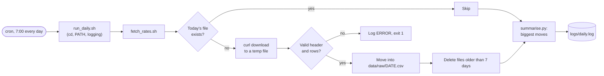

# Lab: Automate a Daily Data Download

> 📚 **Before you start**
>
> - [Pipes, Redirection and grep](pipes-redirection-and-grep.md): redirection, `tee`, exit codes.
> - [Processes, Ports and Environment Variables](processes-ports-and-environment-variables.md): background processes, ports and environment variables.
> - [Shell Scripts and cron](shell-scripts-and-cron.md): strict mode, functions, `trap` and crontab syntax.
> - [SSH and Remote Servers](ssh-and-remote-servers.md): optional, for the last step (running it on a server).

## What You'll Build

A small, reliable data pipeline that runs by itself every morning. It will:

1. **Download** today's currency exchange rates (rupees per dollar, euro, pound...) as a CSV file.
2. **Validate** the file before trusting it: the right columns, enough rows.
3. **Save** it as `data/raw/2026-10-11.csv`, named by date, without ever leaving a half-written file behind.
4. **Skip** the work if today's file already exists, so running it twice is harmless.
5. **Clean up** files older than a week.
6. **Summarise** the biggest moves since yesterday, in Python.
7. **Log** every step, with timestamps, to a file you can check later.
8. **Run on a schedule** with cron, and fail loudly (exit code `1`, an `ERROR` line) when something goes wrong.

So that the lab works offline and gives the same results for everyone, you'll first create a **pretend data provider**: a folder served by Python's built-in web server on your own machine. At the end you'll see how to point the pipeline at a real data source instead.



> 💡 **Key Insight**
>
> Reliable automation isn't about clever code. It's about a few boring habits: **download to a temporary file and move it into place only when it's valid**, make reruns **harmless** (idempotent), **log** every step, **exit non-zero** on failure, and run everything from a **predictable folder and PATH**. Every production data pipeline, from a two-line cron job to Airflow, is built on these same habits.

---

## Step 1: Create the Project

Make the folders in one command with brace expansion:

```bash
mkdir -p ~/projects/daily-rates/{data/raw,logs,scripts,provider}
cd ~/projects/daily-rates
ls -R
```

Example output:

```
.:
data  logs  provider  scripts

./data:
raw

./data/raw:

./logs:

./provider:

./scripts:
```

| Folder | Holds |
|---|---|
| `data/raw/` | One downloaded file per day, named by date |
| `logs/` | What happened on each run |
| `scripts/` | The pipeline code |
| `provider/` | The pretend data source (you'd delete this in real life) |

---

## Step 2: Start a Pretend Data Provider

Create today's "published" rates file. These numbers are made up for practice:

```bash
printf 'currency,inr_per_unit\nUSD,88.72\nEUR,103.15\nGBP,118.40\nAED,24.16\nJPY,0.59\n' > provider/rates.csv
```

Serve the `provider` folder on port 8765, in the background, and fetch the file with `curl` to prove it works:

```bash
python3 -m http.server 8765 --directory provider > /dev/null 2>&1 &
curl http://localhost:8765/rates.csv
```

Example output:

```
[1] 6120
currency,inr_per_unit
USD,88.72
EUR,103.15
GBP,118.40
AED,24.16
JPY,0.59
```

You now have a real web server answering real HTTP requests, exactly as a remote data provider would. (If `curl` says "Connection refused", wait a second for the server to start and try again. If port 8765 is busy, pick another number and use it everywhere below.) Leave it running for the rest of the lab.

---

## Step 3: Write the Download Script

Create `scripts/fetch_rates.sh` with your editor. Read it slowly: every block is something from an earlier lesson, and the comments say which step of the diagram it is.

```bash
#!/usr/bin/env bash
# fetch_rates.sh: download today's exchange rates, check them, keep a week of history
set -euo pipefail

# --- settings (can be overridden from the environment) ---
PROJECT_DIR="$(cd "$(dirname "$0")/.." && pwd)"
RATES_URL="${RATES_URL:-http://localhost:8765/rates.csv}"
KEEP_DAYS="${KEEP_DAYS:-7}"
EXPECTED_HEADER="currency,inr_per_unit"
MIN_ROWS=3

RAW_DIR="$PROJECT_DIR/data/raw"
LOG_FILE="$PROJECT_DIR/logs/fetch.log"
today="$(date +%F)"
target="$RAW_DIR/$today.csv"

mkdir -p "$RAW_DIR" "$(dirname "$LOG_FILE")"

log() {
    local level="$1"; shift
    echo "$(date '+%Y-%m-%d %H:%M:%S') $level $*" | tee -a "$LOG_FILE"
}

fail() {
    log ERROR "$*"
    exit 1
}

# --- step 1: skip if we already have today's file (unless --force) ---
if [[ -s "$target" && "${1:-}" != "--force" ]]; then
    log INFO "already have $today.csv, nothing to do"
    exit 0
fi

# --- step 2: download to a temporary file ---
tmp="$(mktemp)"
trap 'rm -f "$tmp"' EXIT

log INFO "downloading $RATES_URL"
curl --fail --silent --show-error --retry 3 --retry-delay 2 --retry-connrefused \
     --max-time 30 -o "$tmp" "$RATES_URL" 2>>"$LOG_FILE" \
    || fail "download failed (curl exit code $?)"

# --- step 3: validate before trusting it ---
header="$(head -n 1 "$tmp" | tr -d '\r')"
[[ "$header" == "$EXPECTED_HEADER" ]] || fail "unexpected header: '$header'"

rows=$(( $(wc -l < "$tmp") - 1 ))
(( rows >= MIN_ROWS )) || fail "only $rows rows, expected at least $MIN_ROWS"

# --- step 4: move into place in one step ---
chmod 644 "$tmp"                  # mktemp files are private (600); make it readable like any data file
mv "$tmp" "$target"
log INFO "saved $today.csv ($rows rows)"

# --- step 5: delete files older than KEEP_DAYS ---
deleted=$(find "$RAW_DIR" -name "*.csv" -type f -mtime +"$KEEP_DAYS" -print -delete | wc -l)
log INFO "cleanup removed $deleted old file(s)"
```

The decisions worth understanding:

| Line or idea | Why it's there |
|---|---|
| `PROJECT_DIR="$(cd "$(dirname "$0")/.." && pwd)"` | Finds the project folder from the script's own location, so the script works no matter where it's run from (cron starts in your home folder). |
| `RATES_URL="${RATES_URL:-...}"` | A default you can override with an environment variable, without editing the code. |
| `log()` with `tee -a` | Every message goes to the screen **and** is appended to the log file, with a timestamp. |
| `fail()` | One place that logs an `ERROR` and exits with code `1`, so failures are never silent. |
| `curl --fail` | Treat HTTP errors like 404 or 500 as failures (without it, curl happily saves the error page as your "data"). |
| `--silent --show-error` | No progress bar, but still print errors, which `2>>` sends into the log. |
| `--retry 3 --retry-delay 2 --retry-connrefused` | Try again on temporary network problems, including a server that isn't up yet. |
| `--max-time 30` | Never hang forever on a stuck connection. |
| `mktemp` + `trap` + `mv` | Download to a temporary file, and only `mv` it into `data/raw` after it passes the checks. `mv` within one disk is a single step, so other programs never see a half-written file. The `trap` deletes the temporary file on any exit. |
| `tr -d '\r'` | Tolerates a file with Windows line endings (lesson 4). |
| `find ... -mtime +7 -print -delete \| wc -l` | Deletes week-old files and counts how many went. |

Make it executable and run it:

```bash
chmod +x scripts/fetch_rates.sh
./scripts/fetch_rates.sh
echo "exit code: $?"
```

Example output:

```
2026-10-11 05:54:14 INFO downloading http://localhost:8765/rates.csv
2026-10-11 05:54:14 INFO saved 2026-10-11.csv (5 rows)
2026-10-11 05:54:14 INFO cleanup removed 0 old file(s)
exit code: 0
```

```bash
ls -l data/raw
```

Example output:

```
total 4
-rw-r--r-- 1 sourabh sourabh 73 Oct 11 05:54 2026-10-11.csv
```

---

## Step 4: Prove It's Safe to Rerun and Cleans Up

**Run it again.** A good scheduled job is **idempotent**: running it twice has the same effect as running it once.

```bash
./scripts/fetch_rates.sh
```

Example output:

```
2026-10-11 05:54:14 INFO already have 2026-10-11.csv, nothing to do
```

**Test the cleanup.** Create some fake old files and set their modification times in the past with `touch -d` (on macOS, use `touch -t 202610010000 data/raw/2026-10-01.csv` instead):

```bash
touch -d "10 days ago" data/raw/2026-10-01.csv
touch -d "9 days ago" data/raw/2026-10-02.csv
touch -d "3 days ago" data/raw/2026-10-08.csv
find data/raw -name "*.csv" -mtime +7 | sort
```

Example output:

```
data/raw/2026-10-01.csv
data/raw/2026-10-02.csv
```

That's the "look before you delete" habit: the same `find` without `-delete` shows exactly which files would go. Now force a fresh download, which also runs the cleanup:

```bash
./scripts/fetch_rates.sh --force
ls data/raw
```

Example output:

```
2026-10-11 05:54:14 INFO downloading http://localhost:8765/rates.csv
2026-10-11 05:54:14 INFO saved 2026-10-11.csv (5 rows)
2026-10-11 05:54:14 INFO cleanup removed 2 old file(s)
2026-10-08.csv  2026-10-11.csv
```

The 10- and 9-day-old files are gone; the 3-day-old file stays.

---

## Step 5: Break It on Purpose

A pipeline is only as good as its failure behaviour. Feed it bad data and broken URLs, and check that it fails **loudly** and **keeps yesterday's good data**.

**Wrong columns.** Publish a file with a different header and point the script at it with a one-command environment variable:

```bash
printf 'code,rate\nUSD,88.72\n' > provider/bad.csv
RATES_URL=http://localhost:8765/bad.csv ./scripts/fetch_rates.sh --force
echo "exit code: $?"
```

Example output:

```
2026-10-11 05:54:14 INFO downloading http://localhost:8765/bad.csv
2026-10-11 05:54:14 ERROR unexpected header: 'code,rate'
exit code: 1
```

**Too few rows:**

```bash
printf 'currency,inr_per_unit\nUSD,88.72\n' > provider/short.csv
RATES_URL=http://localhost:8765/short.csv ./scripts/fetch_rates.sh --force
```

Example output:

```
2026-10-11 05:54:14 INFO downloading http://localhost:8765/short.csv
2026-10-11 05:54:14 ERROR only 1 rows, expected at least 3
```

**A missing file (HTTP 404):**

```bash
RATES_URL=http://localhost:8765/missing.csv ./scripts/fetch_rates.sh --force
```

Example output:

```
2026-10-11 05:54:14 INFO downloading http://localhost:8765/missing.csv
2026-10-11 05:54:14 ERROR download failed (curl exit code 22)
```

**The provider is down.** Stop the server (job `%1`) and try again. This time curl retries three times, two seconds apart, before giving up:

```bash
kill %1
./scripts/fetch_rates.sh --force
```

Example output:

```
[1]+  Terminated              python3 -m http.server 8765 --directory provider > /dev/null 2>&1
2026-10-11 05:54:14 INFO downloading http://localhost:8765/rates.csv
2026-10-11 05:54:20 ERROR download failed (curl exit code 7)
```

Notice the six-second gap in the timestamps: that's the retries. curl's exit codes are documented in `man curl`: `22` means the server returned an HTTP error, `7` means it couldn't connect. And after all four failures, `ls data/raw` still shows `2026-10-11.csv`: the good file from earlier was never touched, because nothing is moved into place unless it passes validation.

The log file holds the whole story, including curl's own error messages:

```bash
grep -E 'ERROR|curl:' logs/fetch.log
```

Example output:

```
2026-10-11 05:54:14 ERROR unexpected header: 'code,rate'
2026-10-11 05:54:14 ERROR only 1 rows, expected at least 3
curl: (22) The requested URL returned error: 404
2026-10-11 05:54:14 ERROR download failed (curl exit code 22)
curl: (7) Failed to connect to localhost port 8765 after 0 ms: Couldn't connect to server
curl: (7) Failed to connect to localhost port 8765 after 0 ms: Couldn't connect to server
curl: (7) Failed to connect to localhost port 8765 after 0 ms: Couldn't connect to server
curl: (7) Failed to connect to localhost port 8765 after 0 ms: Couldn't connect to server
2026-10-11 05:54:20 ERROR download failed (curl exit code 7)
```

Start the provider again before moving on:

```bash
python3 -m http.server 8765 --directory provider > /dev/null 2>&1 &
```

---

## Step 6: Summarise in Python

Raw files are only useful if someone looks at them. Add a short Python script that compares the two most recent days and lists the biggest moves. It uses only the standard library, so it needs no virtual environment. Save it as `scripts/summarise.py`:

```python
"""summarise.py: compare the two most recent rate files and print the biggest moves.

Run it from the project folder (run_daily.sh does the cd for you).
"""
import csv
from pathlib import Path

RAW_DIR = Path("data/raw")


def load(path):
    with path.open() as f:
        return {row["currency"]: float(row["inr_per_unit"]) for row in csv.DictReader(f)}


def biggest_moves(old, new):
    changes = []
    for currency, rate in new.items():
        if currency in old:
            pct = (rate - old[currency]) / old[currency] * 100
            changes.append((abs(pct), currency, old[currency], rate, pct))
    return [change[1:] for change in sorted(changes, reverse=True)]


def main():
    files = sorted(RAW_DIR.glob("*.csv"))       # names are dates, so sorted = oldest to newest
    if len(files) < 2:
        print("need at least two days of data to compare")
        return
    before, after = files[-2], files[-1]
    print(f"Rates {before.stem} -> {after.stem}")
    for currency, old_rate, new_rate, pct in biggest_moves(load(before), load(after)):
        print(f"  {currency}  {old_rate:>7.2f} -> {new_rate:>7.2f}  {pct:+.2f}%")


if __name__ == "__main__":
    main()
```

Because the files are named `YYYY-MM-DD.csv`, sorting the names alphabetically also sorts them by date, which is why date-first naming is so popular. Give it a "yesterday" to compare against, then run it:

```bash
printf 'currency,inr_per_unit\nUSD,88.41\nEUR,103.90\nGBP,118.40\nAED,24.07\nJPY,0.59\n' > data/raw/2026-10-10.csv
python3 scripts/summarise.py
```

Example output:

```
Rates 2026-10-10 -> 2026-10-11
  EUR   103.90 ->  103.15  -0.72%
  AED    24.07 ->   24.16  +0.37%
  USD    88.41 ->   88.72  +0.35%
  JPY     0.59 ->    0.59  +0.00%
  GBP   118.40 ->  118.40  +0.00%
```

The empty `2026-10-08.csv` left over from step 4 doesn't get in the way, because only the two newest names are compared. Now run the same script from a different folder:

```bash
cd /tmp && python3 ~/projects/daily-rates/scripts/summarise.py; cd -
```

Example output:

```
need at least two days of data to compare
```

`data/raw` is a **relative** path, read from wherever the script was started. That's exactly the trap cron would spring. The next step fixes it in one place for every script.

---

## Step 7: One Wrapper for cron

Cron should run **one** command that sets up a predictable world and then does the work. Create `scripts/run_daily.sh`:

```bash
#!/usr/bin/env bash
# run_daily.sh: the one command cron runs. Sets up a predictable environment, then does the work.
set -euo pipefail

cd "$(dirname "$0")/.."                      # always run from the project folder
export PATH="/usr/local/bin:/usr/bin:/bin"   # don't depend on cron's (or anyone's) PATH

echo "===== run started $(date '+%Y-%m-%d %H:%M:%S') ====="
./scripts/fetch_rates.sh
python3 scripts/summarise.py
echo "===== run finished OK ====="
```

The `cd "$(dirname "$0")/.."` line moves into the project folder based on where the wrapper itself lives, so relative paths in every script now work. Setting `PATH` explicitly means the job behaves the same under cron as in your terminal. (If you installed `python3` or `curl` somewhere else, such as Homebrew's `/opt/homebrew/bin` on a Mac, add that folder at the front.) Because of `set -e`, if `fetch_rates.sh` fails, the wrapper stops and never prints "finished OK".

Test it from somewhere else entirely, the way cron will:

```bash
chmod +x scripts/run_daily.sh
cd /tmp && ~/projects/daily-rates/scripts/run_daily.sh; cd -
```

Example output:

```
===== run started 2026-10-11 05:55:22 =====
2026-10-11 05:55:22 INFO already have 2026-10-11.csv, nothing to do
Rates 2026-10-10 -> 2026-10-11
  EUR   103.90 ->  103.15  -0.72%
  AED    24.07 ->   24.16  +0.37%
  USD    88.41 ->   88.72  +0.35%
  JPY     0.59 ->    0.59  +0.00%
  GBP   118.40 ->  118.40  +0.00%
===== run finished OK =====
```

It works from `/tmp`, which means it will work from cron.

---

## Step 8: Schedule It with cron

Open your crontab:

```bash
crontab -e
```

Add this line at the end (replace `sourabh` with your user name; on a Mac the home folder is `/Users/<you>`):

```
0 7 * * * /home/sourabh/projects/daily-rates/scripts/run_daily.sh >> /home/sourabh/projects/daily-rates/logs/daily.log 2>&1
```

Reading it: at minute `0` of hour `7`, every day, run the wrapper by its **absolute path**, and append both its output and its errors to `logs/daily.log`. Save and exit (in nano: Ctrl + O, Enter, Ctrl + X), then confirm:

```bash
crontab -l
```

Example output:

```
0 7 * * * /home/sourabh/projects/daily-rates/scripts/run_daily.sh >> /home/sourabh/projects/daily-rates/logs/daily.log 2>&1
```

**Don't wait until tomorrow to find a typo.** Temporarily change `0 7 * * *` to `*/2 * * * *` (every two minutes), wait, then look at the log:

```bash
tail -n 20 logs/daily.log
```

When you see a complete run ending in `===== run finished OK =====`, change the schedule back to `0 7 * * *`. If nothing appears at all:

- Is cron running? `systemctl status cron` on Linux; on WSL, `sudo service cron start`.
- Is the path in the crontab exactly right? Copy it and run it by hand.
- On macOS, the script may need Full Disk Access to reach your home folder (System Settings → Privacy & Security), or run it from a folder outside Documents and Desktop.
- On a laptop, jobs scheduled while it's asleep simply don't run.

A last refinement: if a run could ever take longer than the gap between runs, two copies could overlap. On Linux, wrapping the command in `flock` prevents that: `flock -n /tmp/daily-rates.lock /home/sourabh/projects/daily-rates/scripts/run_daily.sh`. The `-n` makes a second copy exit immediately instead of waiting. (`flock` is part of util-linux and isn't installed on macOS by default.)

---

## Step 9: The Same Downloader in Python

The shell version is short and uses tools available on every Linux server. But if your pipeline grows (an API that returns JSON, authentication, more validation, tests, or Windows without WSL), Python is the better home. Here is the same logic as Python functions: download with retries, validate, save atomically, skip if already done, and clean up by the date in the file name. Only the standard library is used.

```python
import csv
import io
import time
import urllib.error
import urllib.request
from datetime import date, timedelta
from pathlib import Path

EXPECTED_HEADER = ["currency", "inr_per_unit"]
MIN_ROWS = 3


def download(url, attempts=3, delay=1.0, timeout=30):
    """Return the body of url as text, retrying on network errors and 5xx responses."""
    for attempt in range(1, attempts + 1):
        try:
            with urllib.request.urlopen(url, timeout=timeout) as response:
                return response.read().decode("utf-8")
        except urllib.error.HTTPError as err:
            if err.code < 500 or attempt == attempts:     # a 404 won't fix itself: give up now
                raise
        except urllib.error.URLError:
            if attempt == attempts:
                raise
        time.sleep(delay * attempt)                       # wait a little longer each time


def validate(text):
    rows = list(csv.reader(io.StringIO(text)))
    if not rows or rows[0] != EXPECTED_HEADER:
        raise ValueError(f"unexpected header: {rows[0] if rows else 'empty file'}")
    data = rows[1:]
    if len(data) < MIN_ROWS:
        raise ValueError(f"only {len(data)} rows, expected at least {MIN_ROWS}")
    return {currency: float(rate) for currency, rate in data}


def save_atomically(text, target):
    tmp = target.with_suffix(".part")
    tmp.write_text(text)
    tmp.replace(target)                                   # like mv: one atomic step


def fetch_rates(url, raw_dir, today, keep_days=7, force=False):
    raw_dir.mkdir(parents=True, exist_ok=True)
    target = raw_dir / f"{today.isoformat()}.csv"
    if target.exists() and target.stat().st_size > 0 and not force:
        return f"already have {target.name}, nothing to do"
    text = download(url)
    rates = validate(text)
    save_atomically(text, target)
    cutoff = today - timedelta(days=keep_days)
    removed = 0
    for old in raw_dir.glob("*.csv"):
        if date.fromisoformat(old.stem) < cutoff:          # file names carry the date
            old.unlink()
            removed += 1
    return f"saved {target.name} ({len(rates)} rows), removed {removed} old file(s)"
```

Two differences from the shell version are worth noticing. The retry logic distinguishes errors: a `404 Not Found` will never fix itself, so it fails at once, while network errors and `5xx` server errors are retried with a growing wait (**backoff**). And cleanup uses the **date in the file name** rather than the file's modification time, which is more robust if files are ever copied or touched.

To test it without the internet, the next block starts the same kind of pretend provider **inside Python**, on a free port, in a background thread, and runs the scenarios from steps 3 to 6. Passing `today` in as a parameter (instead of calling `date.today()` inside) is what makes the function testable:

```python
import functools
import http.server
import tempfile
import threading

workspace = tempfile.TemporaryDirectory()
root = Path(workspace.name)
provider = root / "provider"
provider.mkdir()
(provider / "rates.csv").write_text(
    "currency,inr_per_unit\nUSD,88.72\nEUR,103.15\nGBP,118.40\nAED,24.16\nJPY,0.59\n")
(provider / "bad.csv").write_text("code,rate\nUSD,88.72\n")


class QuietHandler(http.server.SimpleHTTPRequestHandler):
    def log_message(self, *args):                         # keep the output tidy
        pass


handler = functools.partial(QuietHandler, directory=str(provider))
server = http.server.ThreadingHTTPServer(("127.0.0.1", 0), handler)    # port 0: any free port
threading.Thread(target=server.serve_forever, daemon=True).start()
base = f"http://127.0.0.1:{server.server_address[1]}"

raw_dir = root / "data" / "raw"
raw_dir.mkdir(parents=True)
for old_day in ["2026-10-01", "2026-10-02", "2026-10-08"]:
    (raw_dir / f"{old_day}.csv").write_text("currency,inr_per_unit\n")

today = date(2026, 10, 11)
print(fetch_rates(f"{base}/rates.csv", raw_dir, today))
print(fetch_rates(f"{base}/rates.csv", raw_dir, today))
print(sorted(p.name for p in raw_dir.glob("*.csv")))

for name in ["bad.csv", "missing.csv"]:
    try:
        fetch_rates(f"{base}/{name}", raw_dir, today, force=True)
    except (ValueError, urllib.error.HTTPError) as err:
        print(f"{name}: {type(err).__name__}: {err}")

(raw_dir / "2026-10-10.csv").write_text(
    "currency,inr_per_unit\nUSD,88.41\nEUR,103.90\nGBP,118.40\nAED,24.07\nJPY,0.59\n")
yesterday = load(raw_dir / "2026-10-10.csv")       # load() and biggest_moves() from summarise.py
latest = load(raw_dir / "2026-10-11.csv")
for currency, old_rate, new_rate, pct in biggest_moves(yesterday, latest)[:3]:
    print(f"  {currency}  {old_rate:>7.2f} -> {new_rate:>7.2f}  {pct:+.2f}%")

server.shutdown()
server.server_close()
workspace.cleanup()
```

Output:

```
saved 2026-10-11.csv (5 rows), removed 2 old file(s)
already have 2026-10-11.csv, nothing to do
['2026-10-08.csv', '2026-10-11.csv']
bad.csv: ValueError: unexpected header: ['code', 'rate']
missing.csv: HTTPError: HTTP Error 404: File not found
  EUR   103.90 ->  103.15  -0.72%
  AED    24.07 ->   24.16  +0.37%
  USD    88.41 ->   88.72  +0.35%
```

The same scenarios, the same results, with no shell involved. This "test the pipeline against a fake provider" technique is exactly how professional data teams test ingestion code.

---

## Step 10: Point It at Real Data (and Run It on a Server)

To use a real source, change only `RATES_URL`, in the crontab line or in the wrapper:

```bash
export RATES_URL="https://example.com/path/to/daily-rates.csv"
```

Then adjust `EXPECTED_HEADER` to the real file's columns (check them first with `curl -s "$RATES_URL" | head -n 3`). Many real providers return JSON rather than CSV and need an API key. For those:

- Keep the key in an environment variable such as `RATES_API_KEY`, loaded from a `.env` file with `chmod 600` permissions, never written in the script and never committed.
- Switch the download step to the Python version, which can parse JSON with the standard `json` module.
- Read the provider's terms and rate limits; a once-a-day download is usually well within them.

A laptop sleeps; a server doesn't. To run the pipeline on a cloud VM, copy the project with `rsync -avz --exclude provider ~/projects/daily-rates/ prod:daily-rates/` (from [SSH and Remote Servers](ssh-and-remote-servers.md)), install the same crontab line on the server with the server's paths, and check `logs/daily.log` with `ssh prod 'tail -n 20 daily-rates/logs/daily.log'`. Remember that the server's clock is probably in UTC.

When you're finished practising, stop the pretend provider (`kill %1`, or find it with `lsof -i :8765`) and remove the crontab line with `crontab -e` if you don't want it running.

---

## Try It Yourself

1. **Keep 30 days.** Run the fetch script so that it keeps 30 days of history instead of 7, **without editing the script**. Then make it permanent for cron.
2. **Alert on failure.** Change the crontab line so that if `run_daily.sh` fails, a line `ALERT: daily-rates failed` with the date is appended to `logs/alerts.log`. (Hint: `||`.)
3. **Validate a value.** Add a check to `fetch_rates.sh` that fails if any rate is not a positive number. Test it by publishing a file with `USD,-1` or `USD,abc`.
4. **Python cleanup test.** Using the Python `fetch_rates` function and the test server from step 9, prove that with `keep_days=2`, the `2026-10-08.csv` file is also removed.

<details>
<summary>Show answers</summary>

**1.** The script reads `KEEP_DAYS` from the environment: `KEEP_DAYS=30 ./scripts/fetch_rates.sh --force`. To make it permanent, set it in the wrapper (`export KEEP_DAYS=30` after the `PATH` line), or in the crontab line: `0 7 * * * KEEP_DAYS=30 /home/sourabh/projects/daily-rates/scripts/run_daily.sh >> ... 2>&1`.

**2.**

```
0 7 * * * /home/sourabh/projects/daily-rates/scripts/run_daily.sh >> /home/sourabh/projects/daily-rates/logs/daily.log 2>&1 || echo "ALERT: daily-rates failed $(date +\%F)" >> /home/sourabh/projects/daily-rates/logs/alerts.log
```

The `%` must be escaped as `\%` inside a crontab line. In a real team, the alert would send a message to Slack or email instead of writing a file.

**3.** Add after the row-count check (step 3 of the script):

```bash
bad=$(awk -F, 'NR > 1 && !($2 ~ /^[0-9]+(\.[0-9]+)?$/ && $2 > 0) { print; exit }' "$tmp")
[[ -z "$bad" ]] || fail "invalid rate in line: '$bad'"
```

`awk` prints the first line whose second field isn't a positive decimal number and stops (`NR > 1` skips the header; reading the file directly and stopping inside `awk`, rather than piping through `tail` and `head`, avoids a broken-pipe failure under `pipefail`); if anything is printed, the script fails with that line in the message. Publishing `USD,-1` gives `ERROR invalid rate in line: 'USD,-1'`.

**4.** Recreate the old files and call `fetch_rates(f"{base}/rates.csv", raw_dir, date(2026, 10, 11), keep_days=2, force=True)`. The cutoff becomes `2026-10-09`, so `2026-10-08.csv` is older and is removed too; the message reports one more removed file than with `keep_days=7`.

</details>

---

## What You've Learned

- **Designing a pipeline as small steps**: download, validate, save, clean up, summarise, log.
- **Safe file handling**: temporary file plus `mv`, `trap` cleanup, and never overwriting good data with bad.
- **Defensive downloads**: `curl --fail`, retries, timeouts and meaningful exit codes; in Python, retry only errors that can recover, with backoff.
- **Idempotency**: skip work already done, with a `--force` escape hatch.
- **Configuration through environment variables**, with sensible defaults.
- **cron-proofing** with a wrapper that fixes the working directory and `PATH`, absolute paths in the crontab, and `>> log 2>&1`.
- **Testing against a fake provider**, so failures are rehearsed before they happen for real.

You've now used almost every tool in this course together. Next, you'll learn to write programs of your own in [Python Programming](../../python-programming/course.md), then put projects like this one under version control and share them, in [Git and GitHub: Zero to Pro](../../git-and-github-zero-to-pro/course.md). Later, [Data Engineering Foundations](../../data-engineering-foundations/course.md) and [Data Pipelines: Ingestion, dbt and Airflow](../../data-pipelines-ingestion-dbt-and-airflow/course.md#m4) grow this little pipeline into the real thing.

---

**Up next:** [Python Programming](../../python-programming/course.md)
