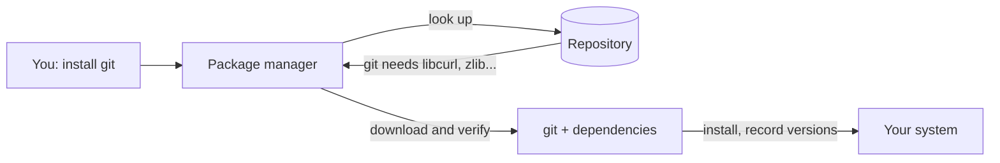
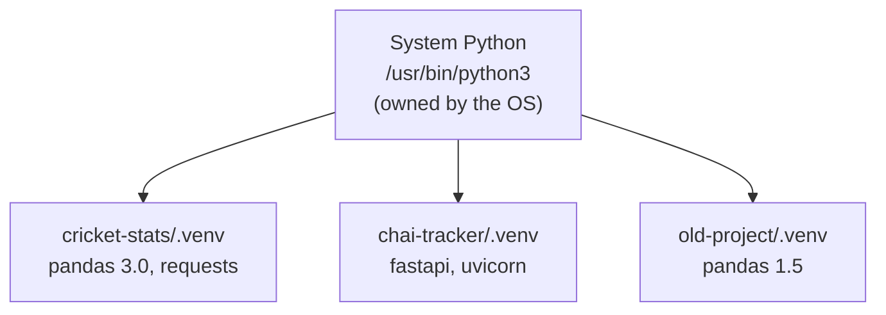

# Package Managers and Virtual Environments: The Complete Guide

> 📚 **Before you start**
>
> - [Permissions and Users](../02-terminal-fundamentals/permissions-and-users.md): `sudo` and why not to use it inside projects.
> - [Processes, Ports and Environment Variables](processes-ports-and-environment-variables.md): `PATH`, environment variables and `source`, which explain how virtual environments work.

## Introduction

Remember how phones used to get apps before app stores? You'd hunt for a file on some website, hope it was genuine, install it, and later have no idea which version you had or how to update it. App stores fixed that: one trusted place to search, one tap to install, automatic updates, clean removal.

**Package managers** are app stores for the command line. Instead of downloading installers from websites, you type `sudo apt install git` on Ubuntu, `brew install git` on a Mac or `winget install Git.Git` on Windows, and the tool fetches the right version, installs everything it depends on, and knows how to update or remove it later.

Python adds a second layer. Your projects need *libraries* (pandas, FastAPI, LangGraph), and different projects need different versions of them. Install everything into one shared Python and sooner or later project A needs pandas 2 while project B needs pandas 3, and one of them breaks. **Virtual environments** solve this by giving each project its own private set of packages.

By the end of this lesson you'll know the main system package managers on Linux, macOS and Windows, how to install, update and remove software with them, why `pip install` sometimes refuses to run, how to create and use virtual environments with `venv`, how to record dependencies so anyone can reproduce your setup, and how to do all of it faster with `uv`, the tool most new Python projects now use.

> 💡 **Key Insight**
>
> Keep two worlds separate: **system tools** (git, curl, Python itself) come from your **system package manager**; **project libraries** (pandas, FastAPI) go into **a virtual environment per project**. A virtual environment is just a folder with its own `python` and its own packages, put first on your `PATH` while it's active. Never mix the two with `sudo pip install`.

---

## Core Explanation

### 1. What a Package Manager Does

A **package** is a bundle of software plus information about it: its name, version, and which other packages it needs (its **dependencies**). A **package manager** is the tool that:

1. **Finds** packages in a **repository** (a trusted online catalogue).
2. **Resolves dependencies**: works out everything else that must be installed, in compatible versions.
3. **Installs** files into the right places and puts commands on your `PATH`.
4. **Tracks** what's installed, so it can **update** or **remove** it cleanly later.
5. **Verifies** downloads with checksums and signatures, so you get what the publisher released.



There are two families, and you'll use both:

| Kind | Installs | Examples |
|---|---|---|
| **System package managers** | Programs and system libraries for the whole machine | `apt` (Ubuntu, Debian, WSL), `dnf` (Fedora, RHEL), `pacman` (Arch), **Homebrew** (macOS), **winget** (Windows) |
| **Language package managers** | Libraries for one programming language | `pip` and `uv` (Python), `npm` (JavaScript), `cargo` (Rust) |

### 2. apt on Ubuntu, Debian and WSL

`apt` installs software system-wide, so it needs `sudo`. The workflow:

```bash
sudo apt update              # refresh the catalogue of what's available (installs nothing)
sudo apt upgrade             # upgrade everything that has a newer version
sudo apt install tree        # install a package (and its dependencies)
apt search json              # search the catalogue (no sudo needed)
apt show tree                # details about a package
sudo apt remove tree         # uninstall
```

The difference between `update` and `upgrade` confuses everyone at first: `update` only downloads the **list** of latest versions; `upgrade` actually **installs** them. Run `update` before `install` so you get current versions.

```bash
sudo apt install tree
```

Example output:

```
Reading package lists... Done
Building dependency tree... Done
Reading state information... Done
The following NEW packages will be installed:
  tree
0 upgraded, 1 newly installed, 0 to remove and 0 not upgraded.
...
Setting up tree (2.1.1-2ubuntu3) ...
```

For larger packages, `apt` lists the extra dependencies and asks `Do you want to continue? [Y/n]`; press Enter (or add `-y` to answer yes automatically, as scripts and Dockerfiles do).

Fedora and Red Hat use `dnf` with nearly the same verbs: `sudo dnf install tree`, `sudo dnf upgrade`, `dnf search json`.

### 3. Homebrew on macOS

macOS doesn't come with a command-line package manager, so almost every Mac developer installs **Homebrew** (from [brew.sh](https://brew.sh)). Its install command downloads and runs a script, so read what it does on the website first:

```bash
/bin/bash -c "$(curl -fsSL https://raw.githubusercontent.com/Homebrew/install/HEAD/install.sh)"
```

Then:

```bash
brew install git tree jq     # install one or more packages ("formulae")
brew install --cask visual-studio-code   # install a graphical app ("cask")
brew upgrade                 # upgrade everything
brew list                    # what's installed
brew uninstall tree
```

Homebrew doesn't need `sudo`. On Apple Silicon Macs it installs into `/opt/homebrew` (on Intel Macs, `/usr/local`), and the installer tells you which line to add to `~/.zprofile` so that folder is on your `PATH`. Homebrew also works on Linux, and some people use it there to get newer versions than `apt` offers.

### 4. winget on Windows

Windows 10 and 11 include **winget**, the Windows Package Manager, in PowerShell or Command Prompt:

```powershell
winget search python
winget install Git.Git
winget upgrade --all
```

Packages have IDs like `Git.Git` or `Microsoft.VisualStudioCode`. Inside WSL, of course, you use `apt`, because WSL is Ubuntu.

### 5. Installing Python Itself

You need a Python interpreter before you can use virtual environments. Options by system:

| System | Common choice |
|---|---|
| Ubuntu / WSL | Python 3 is preinstalled. Add the venv module with `sudo apt install python3-venv python3-pip`. |
| macOS | `brew install python`, or the installer from python.org, or let `uv` manage Python (section 10) |
| Windows (without WSL) | `winget install Python.Python.3.13`, or the python.org installer (tick "Add python.exe to PATH") |

On Linux and macOS the command is usually `python3` (plain `python` may not exist, or may be something else). On Windows it's `python` or the `py` launcher. Inside an activated virtual environment, `python` always works.

Check what you have:

```bash
python3 --version
type -a python3
```

Example output:

```
Python 3.13.16
python3 is /usr/bin/python3
```

### 6. Why Not Just `pip install` Everything?

`pip` is Python's package installer. It downloads packages from **PyPI** (the Python Package Index, pypi.org). It's tempting to run `pip install pandas` straight away, but on recent Ubuntu, Debian and Homebrew systems you'll see this:

```bash
pip install requests
```

Example output:

```
error: externally-managed-environment

× This environment is externally managed
╰─> To install Python packages system-wide, try apt install
    python3-xyz, where xyz is the package you are trying to
    install.

    If you wish to install a non-Debian-packaged Python package,
    create a virtual environment using python3 -m venv path/to/venv.
    Then use path/to/venv/bin/python and path/to/venv/bin/pip. Make
    sure you have python3-full installed.
...
```

This is a deliberate safety lock (introduced by a Python standard called PEP 668). The system's Python belongs to the operating system: Ubuntu's own tools are written in it and depend on specific package versions. If `pip` changed those packages, it could break your system. The message tells you the right answer: use a virtual environment.

The other reason is **conflicts between projects**. One global set of packages means one version of each. Projects drift apart over time, and a single shared install can't satisfy them all.

> Don't silence the error with `--break-system-packages` or `sudo pip install`. Both do exactly what they say.

### 7. Virtual Environments with `venv`

A **virtual environment** (venv) is a folder containing:

- a `python` that points at the real interpreter you created it from,
- its own empty `site-packages` folder where packages get installed,
- its own `pip`,
- an `activate` script that puts the venv's `bin` folder first on your `PATH`.



*One interpreter, many isolated sets of packages. Each project sees only its own.*

Create one inside your project. The convention is to name it `.venv`:

```bash
cd ~/projects/cricket-stats
python3 -m venv .venv
ls .venv
ls .venv/bin
```

Example output:

```
bin  include  lib  lib64  pyvenv.cfg
Activate.ps1  activate  activate.csh  activate.fish  pip  pip3  pip3.13  python  python3  python3.13
```

(On Ubuntu, if you get "ensurepip is not available", install `python3-venv` with apt first. On Windows the folder is called `Scripts` instead of `bin`.)

**Activate** it, which means *source* its activate script so it changes your current shell (remember from the previous lesson: a child process couldn't change your shell's `PATH`):

| Shell | Activate command |
|---|---|
| bash / zsh (Linux, macOS, WSL) | `source .venv/bin/activate` |
| fish | `source .venv/bin/activate.fish` |
| PowerShell (Windows) | `.venv\Scripts\Activate.ps1` |
| Command Prompt (Windows) | `.venv\Scripts\activate.bat` |

```bash
source .venv/bin/activate
which python
python --version
```

Example output:

```
/home/sourabh/projects/cricket-stats/.venv/bin/python
Python 3.13.16
```

Your prompt now starts with `(.venv)`, as a reminder. `python` and `pip` now mean the venv's copies, because the activate script put `.venv/bin` at the front of `PATH` and set `VIRTUAL_ENV`. That is all activation does.

Install packages, which go only into this project:

```bash
pip install requests
pip list
```

Example output:

```
Successfully installed certifi-2026.7.22 charset_normalizer-3.5.2 idna-3.20 requests-2.34.2 urllib3-2.8.0
Package            Version
------------------ ---------
certifi            2026.7.22
charset-normalizer 3.5.2
idna               3.20
pip                26.2.1
requests           2.34.2
urllib3            2.8.0
```

You asked for one package and got five: `requests` depends on four others, and `pip` resolved and installed them. When you're done, `deactivate` returns your shell to normal.

You don't **have** to activate. Calling the venv's Python directly does the same job, and it's what scripts and scheduled jobs should do: `.venv/bin/python scripts/summary.py`.

A venv is disposable. If it gets into a mess, delete the folder (`rm -r .venv`), create it again and reinstall. Never copy or move one to another folder (its scripts contain absolute paths), and never commit it to Git: add `.venv/` to `.gitignore`.

### 8. Recording Dependencies: `requirements.txt`

So that a teammate, a server or future-you can recreate the environment, record what's installed:

```bash
pip freeze > requirements.txt
cat requirements.txt
```

Example output:

```
certifi==2026.7.22
charset-normalizer==3.5.2
idna==3.20
requests==2.34.2
urllib3==2.8.0
```

`pip freeze` writes every installed package with its **exact** version (`==`). Someone else recreates the same environment with:

```bash
python3 -m venv .venv
source .venv/bin/activate
pip install -r requirements.txt
```

Version specifiers you'll see:

| Specifier | Means |
|---|---|
| `requests==2.34.2` | Exactly this version (fully reproducible) |
| `requests>=2.30` | This version or newer |
| `requests~=2.34` | Compatible release: at least 2.34, but below 3.0 |
| `requests` | Any version (whatever is newest today, which changes over time) |

Pinned exact versions make builds reproducible; looser ranges make upgrades easier. Modern tools give you both: you list loose requirements, and a **lock file** records the exact versions that were resolved.

### 9. A Glimpse of npm

JavaScript projects follow the same pattern with different names, so you'll recognise them: `package.json` lists dependencies (like `pyproject.toml`), `npm install` installs them into a `node_modules` folder inside the project (like `.venv`), `package-lock.json` is the lock file, and `npx some-tool` runs a tool without installing it globally. This site itself is built that way: `npm ci && npm run build`.

### 10. uv: The Modern Python Workflow

**uv** is a fast Python package and project manager from Astral. It replaces `pip`, `venv`, `pip-tools`, `pipx` and even Python installers with one tool, and it's dramatically faster. Many new projects and this site's later courses use it. Install it:

```bash
curl -LsSf https://astral.sh/uv/install.sh | sh     # Linux, macOS, WSL
brew install uv                                      # or with Homebrew
```

On Windows PowerShell: `powershell -ExecutionPolicy ByPass -c "irm https://astral.sh/uv/install.ps1 | iex"`, or `winget install astral-sh.uv`.

**Start a project:**

```bash
cd ~/projects
uv init chai-tracker
cd chai-tracker
ls -A
```

Example output:

```
Initialized project `chai-tracker` at `/home/sourabh/projects/chai-tracker`
.git  .gitignore  .python-version  README.md  main.py  pyproject.toml
```

`uv init` created a Git repository, a `.gitignore` (which already ignores `.venv`), a `.python-version` file recording which Python to use, a sample `main.py`, and `pyproject.toml`, the standard file that describes a Python project:

```bash
cat pyproject.toml
```

Example output:

```
[project]
name = "chai-tracker"
version = "0.1.0"
description = "Add your description here"
readme = "README.md"
requires-python = ">=3.13"
dependencies = []
```

**Add a dependency.** uv creates the virtual environment for you, installs the package, records it in `pyproject.toml` and writes the exact resolved versions to `uv.lock`:

```bash
uv add requests
```

Example output:

```
Using CPython 3.13.16 interpreter at: /usr/bin/python3.13
Creating virtual environment at: .venv
Resolved 6 packages in 909ms
Prepared 5 packages in 552ms
Installed 5 packages in 5ms
 + certifi==2026.7.22
 + charset-normalizer==3.5.2
 + idna==3.20
 + requests==2.34.2
 + urllib3==2.8.0
```

**Run code inside the environment** without activating anything:

```bash
uv run main.py
```

Example output:

```
Hello from chai-tracker!
```

`uv run` checks the environment matches the lock file (fixing it if not), then runs the command inside it. The rest of the everyday commands:

| Command | What it does |
|---|---|
| `uv add pandas` | Add a dependency (`uv add --dev pytest` for development-only tools) |
| `uv remove requests` | Remove one |
| `uv sync` | Make `.venv` match `uv.lock` exactly (what a teammate runs after cloning) |
| `uv lock --upgrade` | Re-resolve to the newest allowed versions |
| `uv tree` | Show the dependency tree |
| `uv python install 3.13` | Download and manage a Python version itself |
| `uv tool install ruff` | Install a command-line tool in its own isolated environment, available everywhere |
| `uvx ruff check .` | Run a tool once without installing it |
| `uv venv` and `uv pip install ...` | The classic venv/pip workflow, just faster |

```bash
uv tree
```

Example output:

```
chai-tracker v0.1.0
└── requests v2.34.2
    ├── certifi v2026.7.22
    ├── charset-normalizer v3.5.2
    ├── idna v3.20
    └── urllib3 v2.8.0
```

Commit `pyproject.toml` and `uv.lock`; never commit `.venv`. A teammate clones the project, runs `uv sync`, and gets identical versions.

| Task | pip + venv | uv |
|---|---|---|
| Create environment | `python3 -m venv .venv` | automatic (or `uv venv`) |
| Install a package | `pip install requests` | `uv add requests` |
| Record versions | `pip freeze > requirements.txt` | automatic (`uv.lock`) |
| Recreate elsewhere | `pip install -r requirements.txt` | `uv sync` |
| Run a script | `source .venv/bin/activate` then `python main.py` | `uv run main.py` |

### 11. Python: Looking Inside an Environment

Your code can tell whether it's running in a virtual environment: inside one, `sys.prefix` (the environment's folder) differs from `sys.base_prefix` (the interpreter it was created from). This example creates a venv in a temporary folder with the standard library's `venv` module (without pip, so it needs no internet), and asks its Python:

```python
import subprocess
import sys
import tempfile
import venv
from pathlib import Path

with tempfile.TemporaryDirectory() as tmp:
    env_dir = Path(tmp) / ".venv"
    venv.create(env_dir, with_pip=False)      # same as: python3 -m venv .venv --without-pip

    config = (env_dir / "pyvenv.cfg").read_text()
    keys = sorted(line.split(" = ")[0] for line in config.splitlines() if " = " in line)
    print("pyvenv.cfg keys:", keys)

    bin_dir = env_dir / ("Scripts" if sys.platform == "win32" else "bin")
    env_python = bin_dir / ("python.exe" if sys.platform == "win32" else "python")

    check = "import sys; print(sys.prefix != sys.base_prefix)"
    result = subprocess.run([str(env_python), "-c", check], capture_output=True, text=True)
    print("inside a virtual environment?", result.stdout.strip())
```

Output:

```
pyvenv.cfg keys: ['command', 'executable', 'home', 'include-system-site-packages', 'version']
inside a virtual environment? True
```

`pyvenv.cfg` is the small settings file that makes a folder a virtual environment: `home` points at the real interpreter, and `include-system-site-packages = false` is what keeps the environment isolated.

Your code can also ask which version of a package is installed, which is handy in bug reports and startup checks:

```python
from importlib.metadata import version, PackageNotFoundError

for package in ["pandas", "numpy", "definitely-not-installed"]:
    try:
        print(f"{package:<25} {version(package)}")
    except PackageNotFoundError:
        print(f"{package:<25} not installed")
```

Output:

```
pandas                    3.0.5
numpy                     2.5.3
definitely-not-installed  not installed
```

(The versions shown are the ones this site pins for its lesson examples. Yours will be whatever your environment has.)

---

## Try It Yourself

1. **System package.** Install `tree` (or `jq`) with your system package manager, run it, then find out where it was installed with `type`.
2. **A venv from scratch.** In a new folder `~/projects/venv-practice`, create a venv, activate it, install `rich`, and check that `which python` points inside the folder. Deactivate and check again.
3. **Reproduce it.** Save the environment from exercise 2 to `requirements.txt`, delete `.venv`, recreate it and reinstall from the file. Did you get the same versions?
4. **Same thing with uv.** Create a project with `uv init`, add `rich`, and run `uv run python -c "import rich; print('rich works')"`. Which files would you commit?

<details>
<summary>Show answers</summary>

**1.** Ubuntu/WSL: `sudo apt update && sudo apt install tree`; macOS: `brew install tree`. `type tree` shows `/usr/bin/tree` on Ubuntu or `/opt/homebrew/bin/tree` on an Apple Silicon Mac.

**2.**

```bash
mkdir -p ~/projects/venv-practice && cd ~/projects/venv-practice
python3 -m venv .venv
source .venv/bin/activate
pip install rich
which python        # .../venv-practice/.venv/bin/python
deactivate
which python3       # back to /usr/bin/python3 (or your Homebrew one)
```

**3.**

```bash
source .venv/bin/activate
pip freeze > requirements.txt
deactivate
rm -r .venv
python3 -m venv .venv && source .venv/bin/activate
pip install -r requirements.txt
pip freeze | diff - requirements.txt && echo "identical"
```

`diff -` compares standard input (the new `pip freeze`) with the file; no differences means the same versions.

**4.**

```bash
cd ~/projects && uv init rich-demo && cd rich-demo
uv add rich
uv run python -c "import rich; print('rich works')"
```

Commit `pyproject.toml`, `uv.lock`, `.python-version`, `.gitignore`, `README.md` and your code. Never commit `.venv`.

</details>

---

## Real-World Examples

### Example 1: Onboarding in Two Commands

A new data engineer joins a team whose repository uses uv. Their setup instructions are: install uv, then `git clone ... && cd project && uv sync`. Thirty seconds later they have the exact Python version and the exact package versions everyone else uses, and `uv run pytest` passes on their first day. Before lock files, "works on my machine" problems from mismatched versions could eat a week.

### Example 2: Docker Images

A Dockerfile for a FastAPI service typically starts from a slim Linux image, runs `apt-get install -y` for a few system libraries, then installs Python dependencies from a lock file. Every command is the same as on your laptop; the container just runs them automatically. You'll write these in [APIs and Apps: FastAPI, Streamlit and Docker](../../apis-and-apps-fastapi-streamlit-and-docker/course.md#m9).

### Example 3: The Broken System Python

A student on an older Ubuntu ran `sudo pip install --upgrade` on several packages to fix an error. Afterwards the system's software updater stopped opening, because it depended on the old versions. The fix took hours. With a virtual environment, the same experiment would have touched nothing outside one project folder.

---

## Common Misconceptions

### Misconception 1: "A virtual environment contains its own copy of Python"

Usually it doesn't. It contains a link to an existing interpreter plus its own package folder. That's why venvs are quick to create, and why deleting the Python they were made from breaks them.

### Misconception 2: "Activating is required to use a venv"

Activation only adjusts `PATH` for convenience. Running `.venv/bin/python` directly, or `uv run`, uses the environment without activating anything, which is more reliable in scripts and scheduled jobs.

### Misconception 3: "`sudo pip install` fixes permission errors"

It installs into the system Python, which can break your operating system's tools, and creates root-owned files. The real fix is a virtual environment.

### Misconception 4: "`apt update` updates my software"

It only refreshes the list of available versions. `apt upgrade` installs them.

---

## Interview Relevance

Environment and dependency questions are common in Python, data and ML engineering interviews, often framed as "how would you set up this project?" or "why does this work on your machine but not in CI?"

- **"What is a virtual environment and why use one?"** An isolated set of packages per project, sharing an interpreter; avoids conflicts between projects and protects the system Python. Explain that activation just changes `PATH`.
- **"How do you make an environment reproducible?"** Pin versions (`pip freeze` or, better, a lock file such as `uv.lock`), commit it, recreate with `pip install -r` or `uv sync`. Mention pinning the Python version too.
- **"What does `externally-managed-environment` mean?"** PEP 668: the OS manages that Python; use a venv, pipx or `uv tool` instead of installing globally.
- **"`apt update` vs `apt upgrade`?"** Refresh the catalogue vs install newer versions.
- **"Have you used uv or Poetry?"** Describe `pyproject.toml`, lock files and `uv run`/`uv sync`, and why lock files matter in CI and Docker.

---

## Key Takeaways

- **System package managers** (`apt`, `dnf`, Homebrew, winget) install tools for the whole machine; **language package managers** (`pip`, `uv`, `npm`) install libraries.
- **`apt update` refreshes the list; `apt upgrade` installs updates.** Homebrew needs no `sudo`.
- **One virtual environment per project**: `python3 -m venv .venv`, `source .venv/bin/activate`, `pip install ...`, `deactivate`. Never commit `.venv`.
- **Activation just puts `.venv/bin` first on `PATH`**; scripts can call `.venv/bin/python` directly.
- **Record dependencies** with `pip freeze > requirements.txt`, or let **uv** manage `pyproject.toml` and `uv.lock` (`uv add`, `uv run`, `uv sync`).
- **Never `sudo pip install`** or `--break-system-packages`; the "externally managed" error is protecting you.

---

**Up next:** [Shell Scripts and cron](shell-scripts-and-cron.md)
