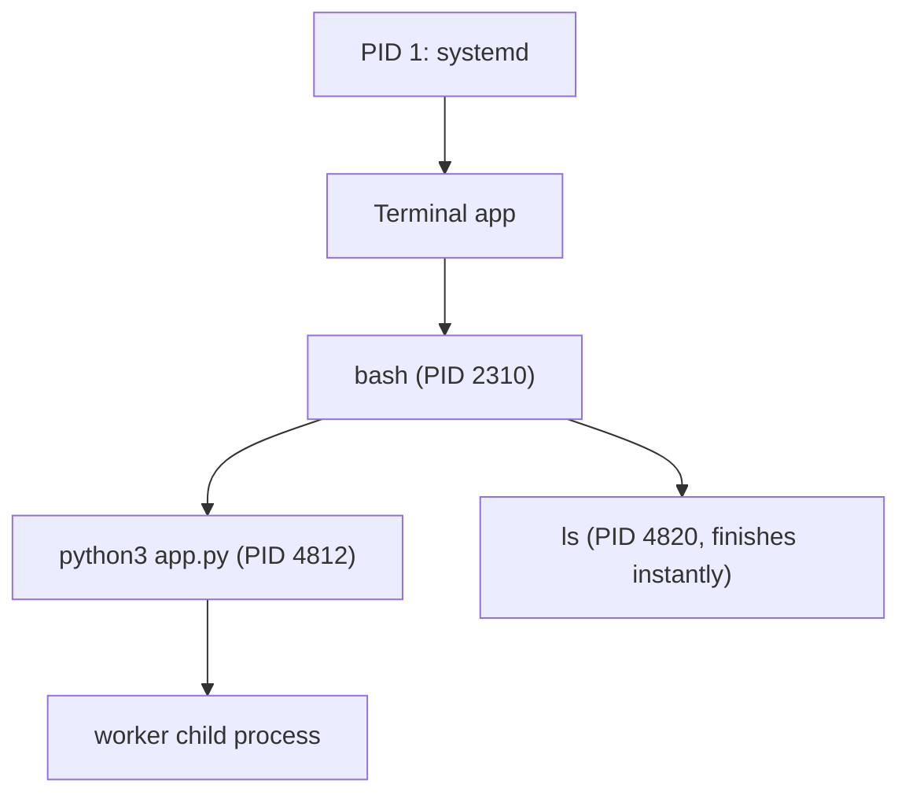
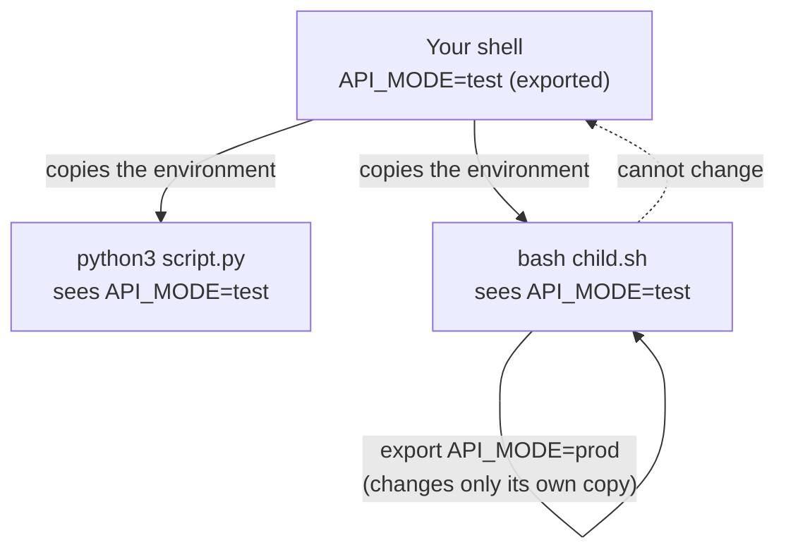

# Processes, Ports and Environment Variables: The Complete Guide

> 📚 **Before you start**
>
> - [What is a Terminal and a Shell?](../02-terminal-fundamentals/what-is-a-terminal-and-a-shell.md): how the shell finds and starts programs.
> - [Permissions and Users](../02-terminal-fundamentals/permissions-and-users.md): users, root and `sudo`.
> - [Pipes, Redirection and grep](pipes-redirection-and-grep.md): pipes, `grep` and exit codes, used throughout this lesson.

## Introduction

You start a FastAPI app with one command, close the terminal tab by accident, open a new one and start it again. This time it fails: **"Address already in use"**. Something is still holding port 8000, but you can't see it anywhere. Or you set an API key in one terminal tab and your script in another tab says the key is missing. Or a teammate's instructions say "add this folder to your PATH" and you're not sure what that means or where to do it.

These are some of the most common daily frustrations for new developers, and they all come from three ideas this lesson explains: **processes** (running programs), **ports** (the numbered doors programs listen on for network connections), and **environment variables** (settings passed from a program to the programs it starts).

By the end you'll be able to list and find running programs, stop them gently or forcefully, run things in the background, find out exactly which program is using a port and free it, and set environment variables correctly: for one command, for a session, or permanently. You'll also understand `PATH` properly, keep secrets out of your code with `.env` files, and do all of it from Python too.

> 💡 **Key Insight**
>
> A **process** is a running copy of a program, with its own ID (**PID**), its own user, and its own **copy** of the environment variables, inherited from the process that started it. A child can't change its parent's environment. That one fact explains why `export` matters, why settings "disappear" when you open a new tab, and why a script can't change your shell's folder or variables.

---

## Core Explanation

### 1. Programs and Processes

A **program** is a file on disk, such as `/usr/bin/python3`. A **process** is that program **running**: loaded into memory, using the CPU, with open files and network connections. Run `python3` in two terminal tabs and you have one program but two processes.

Every process has:

| Property | Meaning |
|---|---|
| **PID** | Process ID, a unique number while it runs |
| **PPID** | Parent process ID: the process that started it |
| **User** | Whose permissions it runs with |
| **Current directory** | Where relative paths start from |
| **Environment** | Its own copy of the environment variables |
| **State** | Running, sleeping (waiting for something), stopped, or zombie (finished but not yet collected by its parent) |

Processes form a family tree. When you type a command, your shell (one process) starts the command as its **child**. The very first process, PID 1 (usually `systemd` on Linux and `launchd` on macOS), is the ancestor of everything.



### 2. Seeing What's Running: `ps`, `pgrep` and `top`

`ps` on its own shows the processes in your current terminal:

```bash
ps
```

Example output:

```
    PID TTY          TIME CMD
   2310 pts/0    00:00:00 bash
   4831 pts/0    00:00:00 ps
```

To see **every** process on the system, use `ps aux` (the BSD-style options work on both Linux and macOS):

```bash
ps aux | head -n 5
```

Example output:

```
USER         PID %CPU %MEM    VSZ   RSS TTY      STAT START   TIME COMMAND
root           1  0.0  0.1 167700 11904 ?        Ss   09:12   0:02 /sbin/init splash
root         512  0.0  0.0  24840  5624 ?        Ss   09:12   0:00 /usr/lib/systemd/systemd-journald
postgres     980  0.0  0.3 220112 28440 ?        Ss   09:12   0:00 /usr/lib/postgresql/16/bin/postgres -D /var/lib/postgresql/16/main
sourabh     4812  2.1  1.4 412308 118272 pts/1   Sl+  10:41   0:03 python3 -m uvicorn main:app --port 8000
```

The columns that matter most: **USER** (who it runs as), **PID**, **%CPU** and **%MEM** (how much it's using), **STAT** (state: `S` sleeping, `R` running, `T` stopped, `Z` zombie, `+` in the foreground), **START** (when it began) and **COMMAND** (what was run). Notice `postgres` running as the `postgres` user: least privilege in action.

To find a particular process, filter with `grep`, or better, use `pgrep`:

```bash
ps aux | grep uvicorn
pgrep -af uvicorn
```

Example output:

```
sourabh     4812  2.1  1.4 412308 118272 pts/1   Sl+  10:41   0:03 python3 -m uvicorn main:app --port 8000
sourabh     4870  0.0  0.0   9212  2304 pts/0    S+   10:44   0:00 grep --color=auto uvicorn
4812 python3 -m uvicorn main:app --port 8000
```

The `ps | grep` version also finds the `grep` command itself (its command line contains "uvicorn"), a classic confusion. `pgrep -a` (Linux) prints the PID and full command line, without that noise; on macOS, use `pgrep -lf uvicorn`.

For a **live** view, run `top` (press `q` to quit, `M` to sort by memory and `P` by CPU on Linux). Many people install `htop`, a friendlier, colourful version. The graphical equivalents are **System Monitor** on Ubuntu, **Activity Monitor** on macOS and **Task Manager** on Windows.

### 3. Foreground and Background: Job Control

Normally a command runs in the **foreground**: the shell waits for it, and you can't type another command until it finishes. Add `&` at the end to run it in the **background** and get your prompt back at once:

```bash
sleep 300 &
```

Example output:

```
[1] 4821
```

`[1]` is the **job number** (the shell's own short label) and `4821` is the PID. The shell's job-control commands:

| Command or key | What it does |
|---|---|
| `command &` | Start in the background |
| `jobs` | List this shell's background and stopped jobs |
| **Ctrl + Z** | Pause (stop) the foreground program and get the prompt back |
| `bg` | Resume a stopped job in the background |
| `fg` | Bring a job to the foreground (`fg %2` for job 2) |
| **Ctrl + C** | Ask the foreground program to quit |

```bash
sleep 400 &
jobs
```

Example output:

```
[2] 4822
[1]-  Running                 sleep 300 &
[2]+  Running                 sleep 400 &
```

The `+` marks the "current" job that `fg` and `bg` use by default. A typical moment: you start a server, realise you need your prompt, press **Ctrl + Z** (it shows `[1]+  Stopped`), then type `bg` to let it carry on in the background.

Background jobs belong to your terminal. Close the terminal and they normally receive a "hang up" signal and stop. To keep a program running after you leave, use `nohup command &` (output goes to `nohup.out`), or better, a terminal multiplexer like `tmux` (covered in *SSH and Remote Servers*) or a proper service manager.

### 4. Stopping Processes: Signals and `kill`

You stop a process by sending it a **signal**, a small numbered message from the operating system. Despite its name, `kill` is the command that sends any signal. The ones you'll use:

| Signal | Number | Sent by | Meaning |
|---|---|---|---|
| `SIGINT` | 2 | **Ctrl + C** | "Interrupt": please stop |
| `SIGTERM` | 15 | `kill <pid>` (the default) | "Terminate": please shut down cleanly |
| `SIGKILL` | 9 | `kill -9 <pid>` | Stop immediately. Can't be caught or ignored. |
| `SIGHUP` | 1 | Closing the terminal | "Hang up". Many servers treat it as "reload your settings". |
| `SIGTSTP` | 20 | **Ctrl + Z** | Pause (Linux numbering; it differs on macOS) |

```bash
kill 4821          # polite: SIGTERM to PID 4821
kill %2            # by job number, for jobs in this shell
kill -9 4822       # forceful: SIGKILL, only when polite fails
pkill -f uvicorn   # signal every process whose command line matches
```

When a job ends, the shell tells you at the next prompt:

Example output:

```
[1]-  Terminated              sleep 300
[2]+  Killed                  sleep 400
```

**Always try `SIGTERM` before `SIGKILL`.** `SIGTERM` lets a program finish writing files, close database connections and remove temporary files. `SIGKILL` gives it no chance: data can be half-written, and lock files left behind can stop the program from starting again. Wait a few seconds after `kill`, check with `ps`, and only then reach for `-9`.

You can only signal your own processes, unless you use `sudo`. `kill -l` lists every signal.

### 5. Ports: The Numbered Doors

Programs talk over a network using an **IP address** (which machine) and a **port** (which program on that machine). Think of the IP address as a building's street address and the port as a flat number. A web server "listens" on a port, waiting for visitors; your browser "connects" to it.

Ports are numbered from 0 to 65535. Some numbers are traditions you'll see everywhere:

| Port | Usually used by |
|---|---|
| 22 | SSH |
| 80 / 443 | HTTP / HTTPS websites |
| 5432 | PostgreSQL |
| 3306 | MySQL |
| 6379 | Redis |
| 8000, 8080 | Development web servers (Django, FastAPI's uvicorn, many others) |
| 3000, 5173 | JavaScript dev servers |
| 8501 | Streamlit |

On Linux, ports below 1024 need root to listen on, which is why development servers use numbers like 8000.

Two special addresses matter:

- **`localhost`** or **`127.0.0.1`** means "this same machine". A server listening only there is reachable from your computer but not from others.
- **`0.0.0.0`**, when a server listens on it, means "every network interface", so other machines can reach it too. That's what you need in Docker containers and cloud servers, and what you should avoid on public Wi-Fi.

Start a tiny web server that comes with Python, in the background:

```bash
cd ~/projects/cricket-stats
python3 -m http.server 8000 &
curl http://localhost:8000/README.md
```

Example output:

```
[1] 4014
# Cricket stats

Small project to analyse match scores.
```

`curl` fetches a URL from the terminal and prints what it gets back. (You'll use it a lot; `curl -I` shows only the response headers.) The server serves files from the folder it was started in.

### 6. What's Using That Port?

Now try to start a second server on the same port:

```bash
python3 -m http.server 8000
```

Example output:

```
...
OSError: [Errno 98] Address already in use
```

Only one process can listen on a port at a time. To find out which one has it, use `lsof` ("list open files"; on Unix, network connections count as files) on Linux or macOS:

```bash
lsof -i :8000
```

Example output:

```
COMMAND  PID    USER   FD   TYPE DEVICE SIZE/OFF NODE NAME
python3 4014 sourabh    3u  IPv4  16128      0t0  TCP *:8000 (LISTEN)
```

On Linux, `ss` (socket statistics) gives the same answer and lists **all** listening ports at once. `-l` listening, `-t` TCP, `-n` numbers instead of names, `-p` show the process:

```bash
ss -ltnp
```

Example output:

```
State   Recv-Q  Send-Q   Local Address:Port   Peer Address:Port  Process
LISTEN  0       5              0.0.0.0:8000        0.0.0.0:*      users:(("python3",pid=4014,fd=3))
LISTEN  0       4096         127.0.0.1:5432        0.0.0.0:*
```

(The PostgreSQL line has no process name because it belongs to another user; `sudo ss -ltnp` shows everything.) On macOS, `lsof -nP -iTCP -sTCP:LISTEN` lists all listening ports. On Windows, `netstat -ano | findstr :8000` in Command Prompt or `Get-NetTCPConnection -LocalPort 8000` in PowerShell shows the PID, and `taskkill /PID 4014` stops it.

So the fix for "Address already in use" is: find the PID, check it's the program you expect, and stop it.

```bash
kill 4014
lsof -i :8000 || echo "port 8000 is free"
```

Example output:

```
[1]+  Terminated              python3 -m http.server 8000
port 8000 is free
```

(Or simply start your new server on a different port, like `--port 8001`.)

### 7. Environment Variables

An **environment variable** is a named piece of text that a process carries with it, like `HOME=/home/sourabh`. Programs read them for settings: where your home is, which language to use, which editor to open, which database to connect to, which API key to use.

Read one with `$NAME` (the shell replaces it with the value) or `printenv`:

```bash
echo $HOME
echo "I am $USER and my shell is $SHELL"
printenv LANG
```

Example output:

```
/home/sourabh
I am sourabh and my shell is /bin/bash
en_IN.UTF-8
```

`env` or `printenv` with no arguments lists them all. Some you'll meet often:

| Variable | Holds |
|---|---|
| `HOME` | Your home folder (what `~` expands to) |
| `USER` | Your user name |
| `PATH` | The folders searched for commands |
| `SHELL` | Your login shell |
| `PWD` | The current folder |
| `LANG` | Language and text encoding, such as `en_IN.UTF-8` |
| `EDITOR` | The editor tools like Git open for you |
| `VIRTUAL_ENV` | Set when a Python virtual environment is active |

By convention, environment variable names are UPPERCASE.

### 8. Shell Variables vs Environment Variables: `export`

This is where the Key Insight bites. Setting a variable in the shell creates a **shell variable**, which only the shell itself can see. `export` turns it into an **environment variable**, which is copied into every child process the shell starts afterwards.

```bash
API_MODE=test
echo "the shell sees: $API_MODE"
python3 -c 'import os; print("python sees:", os.environ.get("API_MODE"))'
export API_MODE
python3 -c 'import os; print("python sees:", os.environ.get("API_MODE"))'
```

Example output:

```
the shell sees: test
python sees: None
python sees: test
```

No spaces around the `=`: `API_MODE = test` would try to run a command called `API_MODE`. You can set and export in one go: `export API_MODE=test`. And `unset API_MODE` removes it.

To set a variable for **just one command**, put it in front of the command:

```bash
API_MODE=production python3 -c 'import os; print(os.environ["API_MODE"])'
```

Example output:

```
production
```

The variable exists only for that one process; your shell is unchanged afterwards. This is the cleanest way to try a setting without side effects.



Two consequences:

- **A script can't change your shell's environment or folder.** Running `./setup.sh` that does `export X=1` or `cd /tmp` changes only the script's own process, which ends a moment later. To run a file's commands *inside your current shell*, you **source** it: `source setup.sh` (or `. setup.sh`). That's exactly how `source .venv/bin/activate` works in the next lesson.
- **Each terminal tab is a separate shell.** Variables you `export` in one tab don't exist in another, and vanish when you close the tab.

### 9. PATH, Properly

`PATH` is a list of folders separated by colons. When you type a command name, the shell searches them **in order** and runs the first match (you saw this in the first lesson).

```bash
echo $PATH | tr ':' '\n'
```

Example output:

```
/home/sourabh/.local/bin
/usr/local/sbin
/usr/local/bin
/usr/sbin
/usr/bin
/sbin
/bin
```

To make your own scripts or a newly installed tool available everywhere, add its folder to `PATH`. Put new folders **at the front** so they win over system versions, and always keep the old value with `$PATH`:

```bash
export PATH="$HOME/bin:$PATH"
```

> ⚠️ Never write `export PATH=$HOME/bin` without `:$PATH`. That replaces the entire list, and suddenly `ls`, `python3` and every other command is "not found" in that shell. If it happens, close the terminal and open a new one.

When two versions of a tool are installed (a classic with Python), `type -a python3` shows every match in `PATH` order, and the first one is the one that runs.

### 10. Making Settings Permanent: Shell Startup Files

Anything you `export` lasts only for the current shell. To set things every time a terminal opens, add the lines to your shell's startup file:

| Shell | File | Notes |
|---|---|---|
| bash on Linux / WSL | `~/.bashrc` | Read by every new interactive terminal |
| bash login shells | `~/.profile` or `~/.bash_profile` | Read at login, for example over SSH |
| zsh (macOS default) | `~/.zshrc` | Read by every new interactive terminal |

For example, open `~/.bashrc` (or `~/.zshrc`) in an editor and add at the end:

```bash
export PATH="$HOME/bin:$PATH"
export EDITOR=nano
alias ll='ls -lah'
```

The file is only read when a shell starts, so either open a new terminal or reload it in the current one with `source ~/.bashrc`. Keep these files tidy; a mistake in them affects every terminal you open.

### 11. Secrets, `.env` Files and Configuration

Applications are commonly configured through environment variables, so the same code can run on your laptop, a test server and production with different settings. API keys and database passwords are passed the same way, which keeps them **out of your source code**.

Many projects keep local settings in a file called `.env`:

```bash
# .env  (never commit this file)
DATABASE_URL=postgresql://localhost:5432/cricket
ANTHROPIC_API_KEY=sk-ant-your-key-here
DEBUG=true
```

Libraries like `python-dotenv` (and tools like `uv run --env-file .env`) load it into the environment when your app starts. Three rules for secrets:

1. Add `.env` to `.gitignore` so it never reaches GitHub. Commit a `.env.example` with fake values instead, so teammates know which variables to set.
2. `chmod 600 .env` so other users on the machine can't read it.
3. Be aware that variables typed directly into the terminal (`export API_KEY=...`) are saved in your shell history. Typing a space before the command keeps it out of history on many setups, but loading from a file is safer.

### 12. Windows Equivalents

| Task | bash / zsh | PowerShell |
|---|---|---|
| List processes | `ps aux` | `Get-Process` |
| Stop a process | `kill 4014` | `Stop-Process -Id 4014` |
| Who uses port 8000? | `lsof -i :8000` | `Get-NetTCPConnection -LocalPort 8000` |
| Read a variable | `echo $HOME` | `$env:USERPROFILE` |
| Set for the session | `export MODE=test` | `$env:MODE = "test"` |
| Set permanently | Add to `~/.bashrc` | `setx MODE test` (new windows only), or System Properties → Environment Variables |
| PATH separator | `:` | `;` |

### 13. Processes and Environment in Python

Python can read its own PID and environment, start child processes with a modified environment, and start and stop a server. This example shows each idea from the lesson. (The port is chosen by asking the operating system for a free one, so it never clashes with something already running.)

```python
import os
import subprocess
import sys

print("my PID is a positive number:", os.getpid() > 0)
print("parent PID differs from mine:", os.getppid() != os.getpid())

# Reading environment variables, with a default when one is missing
print("HOME is set:", "HOME" in os.environ or "USERPROFILE" in os.environ)
print("APP_MODE:", os.environ.get("APP_MODE", "development"))

# A child process inherits a COPY of the environment we give it
child_env = {**os.environ, "APP_MODE": "production", "UPI_TIMEOUT_SECONDS": "30"}
code = "import os; print('child sees', os.environ['APP_MODE'], os.environ['UPI_TIMEOUT_SECONDS'])"
result = subprocess.run([sys.executable, "-c", code], env=child_env, capture_output=True, text=True)
print(result.stdout.strip())

# ...and changes made in the child never flow back to the parent
code = "import os; os.environ['APP_MODE'] = 'changed-in-child'"
subprocess.run([sys.executable, "-c", code], env=child_env)
print("parent still sees APP_MODE:", os.environ.get("APP_MODE", "development"))
```

Output:

```
my PID is a positive number: True
parent PID differs from mine: True
HOME is set: True
APP_MODE: development
child sees production 30
parent still sees APP_MODE: development
```

`os.environ.get("NAME", default)` is the standard way to read configuration: it never crashes when a variable is missing. Use `os.environ["NAME"]` (which raises `KeyError`) only for settings that must be present, such as an API key, so the app fails loudly at startup instead of mysteriously later.

Now start a web server as a background process, talk to it, and stop it with `SIGTERM`, exactly what you did by hand in sections 5 and 6:

```python
import socket
import tempfile
import time
import urllib.request

# Ask the OS for a free port: bind to port 0, read which port we got, release it
with socket.socket() as s:
    s.bind(("127.0.0.1", 0))
    port = s.getsockname()[1]

folder = tempfile.TemporaryDirectory()
server = subprocess.Popen(
    [sys.executable, "-m", "http.server", str(port), "--bind", "127.0.0.1"],
    cwd=folder.name, stdout=subprocess.DEVNULL, stderr=subprocess.DEVNULL,
)

status = None
for attempt in range(50):                 # wait up to ~5 seconds for it to start listening
    try:
        with urllib.request.urlopen(f"http://127.0.0.1:{port}/", timeout=1) as response:
            status = response.status
        break
    except OSError:
        time.sleep(0.1)

print("server answered with HTTP status:", status)
print("server still running:", server.poll() is None)

server.terminate()                        # send SIGTERM, like `kill <pid>`
server.wait(timeout=5)
print("exit code after SIGTERM:", server.returncode)
folder.cleanup()
```

Output:

```
server answered with HTTP status: 200
server still running: True
exit code after SIGTERM: -15
```

A negative return code in Python means "ended by a signal": `-15` is `SIGTERM`. (In the shell, the same situation shows up as exit status 143, which is 128 + 15.) `server.kill()` would send `SIGKILL` instead.

---

## Try It Yourself

1. **Background and back.** Run `sleep 120`, pause it with Ctrl + Z, resume it in the background, list your jobs, then bring it back to the foreground and stop it with Ctrl + C.
2. **Port detective.** Start `python3 -m http.server 8765 &`, then use `lsof` (or `ss`) to find its PID. Stop it politely and prove the port is free.
3. **Export or not?** Predict the output of these three lines, then run them: `CITY=Pune`, `bash -c 'echo "child: $CITY"'`, `CITY=Chennai bash -c 'echo "child: $CITY"'`. Then `echo $CITY`.
4. **PATH for your own tools.** Create `~/bin/hello` (a script that prints "hello from my bin"), make it executable, add `~/bin` to your PATH for this session, and run `hello` from any folder.

<details>
<summary>Show answers</summary>

**1.** `sleep 120`, then Ctrl + Z shows `[1]+  Stopped                 sleep 120`. `bg` prints `[1]+ sleep 120 &`. `jobs` shows it `Running`. `fg` brings it back (the terminal waits again) and Ctrl + C stops it.

**2.**

```bash
python3 -m http.server 8765 &
lsof -i :8765            # or: ss -ltnp | grep 8765
kill <pid>               # the PID from the lsof output (or: kill %1)
lsof -i :8765 || echo "port 8765 is free"
```

**3.** The first `bash -c` prints `child: ` with nothing after it, because `CITY` is a shell variable that wasn't exported. The second prints `child: Chennai`, because the one-command prefix puts it in that child's environment. `echo $CITY` still prints `Pune`: the prefix didn't change your shell.

**4.**

```bash
mkdir -p ~/bin
printf '#!/usr/bin/env bash\necho "hello from my bin"\n' > ~/bin/hello
chmod +x ~/bin/hello
export PATH="$HOME/bin:$PATH"
cd /tmp && hello
```

Example output:

```
hello from my bin
```

To keep it, add the `export PATH=...` line to `~/.bashrc` or `~/.zshrc`.

</details>

---

## Real-World Examples

### Example 1: The Zombie Dev Server

A developer's FastAPI app won't start: "Address already in use". `lsof -i :8000` reveals an old `uvicorn` from yesterday, still running in a forgotten terminal tab. `kill <pid>` and the port is free. Without knowing about ports and PIDs, the usual "fix" is rebooting the laptop.

### Example 2: Twelve-Factor Configuration

Modern web apps follow the "twelve-factor" practice of keeping configuration in environment variables. The same Docker image of a payments service runs in testing with `DATABASE_URL` pointing at a test database and in production with the real one. Nothing in the code changes; only the environment does. You'll use this pattern when deploying in [APIs and Apps: FastAPI, Streamlit and Docker](../../apis-and-apps-fastapi-streamlit-and-docker/course.md#m9).

### Example 3: A Runaway Data Job

A data engineer notices a laptop fan screaming. `top` shows a Python process at 100% CPU and 12 GB of memory: a pandas job reading a file far too large. `kill <pid>` stops it cleanly; the next version reads the file in chunks. Spotting the PID and sending the right signal took ten seconds.

---

## Common Misconceptions

### Misconception 1: "Closing the terminal stops everything I started"

Usually, but not always. Programs started with `nohup`, inside `tmux`, or that detach themselves (many servers do) keep running and keep their ports. When in doubt, check with `ps` or `lsof`.

### Misconception 2: "`kill -9` is the normal way to stop a program"

It's the last resort. `kill` (SIGTERM) asks the program to clean up and exit. `-9` gives it no chance to save data or release locks.

### Misconception 3: "Setting a variable makes it available to my programs"

Only if it's **exported** (or set as a prefix to the command). A plain `NAME=value` stays inside the shell.

### Misconception 4: "My script can set up my shell for me"

A script runs in a child process and can't change its parent's variables or folder. Use `source script.sh` when you want the commands to affect your current shell.

---

## Interview Relevance

Process and environment questions are core to DevOps, SRE and backend interviews, and appear in data engineering rounds about running jobs.

- **"What's the difference between a program and a process? What's a PID?"** File on disk vs running instance; PID is its unique ID; mention parent/child and PID 1.
- **"How do you find what's using port 8080 and free it?"** `lsof -i :8080` or `ss -ltnp`, then `kill <pid>`; explain SIGTERM vs SIGKILL and why you try SIGTERM first.
- **"Difference between a shell variable and an environment variable?"** Exported variables are inherited by child processes; shell variables are not. Strong answers mention that children get a copy and can't modify the parent.
- **"How does PATH work?"** Colon-separated folders searched in order; first match wins. Explain prepending with `$PATH` and checking with `type -a`.
- **"How should an application get its secrets?"** From environment variables or a secrets manager, never hard-coded or committed; `.env` files only for local development and in `.gitignore`.

---

## Key Takeaways

- A **process** is a running program with a **PID**, a parent, a user and its own **copy** of the environment.
- **`ps aux`, `pgrep`, `top`** show processes; **`&`, `jobs`, `fg`, `bg`, Ctrl + Z** manage them in a shell.
- **`kill` sends SIGTERM** (polite); **`kill -9` sends SIGKILL** (forced, last resort). Ctrl + C sends SIGINT.
- A **port** is a numbered door; only one process can listen on it. **`lsof -i :PORT`** or **`ss -ltnp`** shows who has it.
- **`export`** makes a variable visible to child processes; **`NAME=value command`** sets it for one command; startup files (`~/.bashrc`, `~/.zshrc`) make it permanent.
- **PATH** is searched in order; prepend with `export PATH="new:$PATH"`. Keep secrets in environment variables or an ignored `.env`, never in code.

---

**Up next:** [Package Managers and Virtual Environments](package-managers-and-virtual-environments.md)
