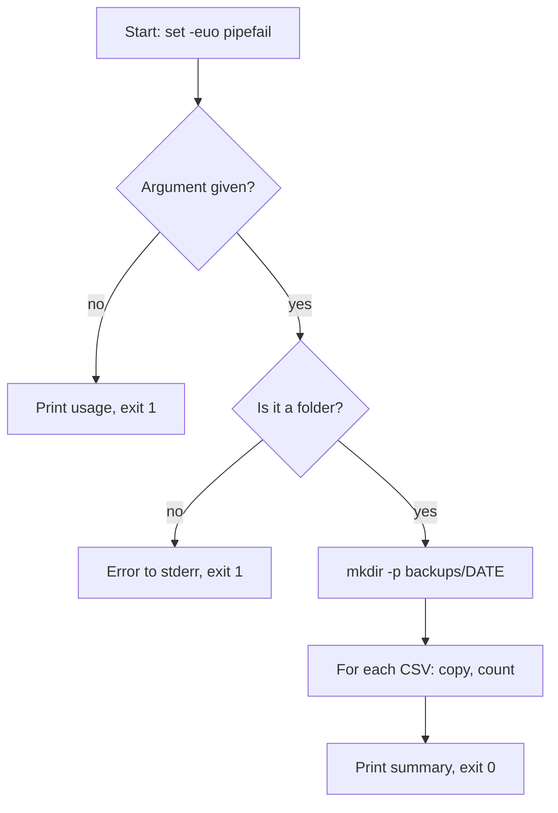

# Shell Scripts and cron: The Complete Guide

> 📚 **Before you start**
>
> - [Permissions and Users](../02-terminal-fundamentals/permissions-and-users.md): `chmod +x` and why a script needs it.
> - [Pipes, Redirection and grep](pipes-redirection-and-grep.md): redirection, pipes, exit codes, `&&`, and `$( )`.
> - [Processes, Ports and Environment Variables](processes-ports-and-environment-variables.md): variables, `export`, `PATH` and `source`.

## Introduction

Every Monday morning, Meera, a junior analyst, does the same ritual: open the shared folder, copy last week's sales CSVs into a backup folder named with today's date, count the rows in each to check nothing is missing, and delete backups older than a month. It takes fifteen minutes and she has forgotten it twice when she was on leave.

Every command in that ritual is one you already know: `mkdir -p`, `cp`, `wc -l`, `find ... -delete`. A **shell script** is simply those commands saved in a file, so you can run them all with one word. Add a few variables, an `if` and a loop, and the script handles any week, any folder and missing files. Then hand it to **cron**, the scheduler built into Linux and macOS, and it runs every Monday at 7 a.m. whether Meera is at her desk or on a beach in Goa.

In this lesson you'll write real scripts step by step: the shebang line, variables and quoting, arguments, conditions, loops, functions, and the "strict mode" settings that make scripts fail safely instead of silently. Then you'll schedule them with cron, learn the five-field schedule syntax, and avoid the classic traps that make a script work by hand but fail under cron. You'll also learn when to stop writing shell and switch to Python.

> 💡 **Key Insight**
>
> A shell script is just **commands you'd type, saved in a file**. Three habits make the difference between a fragile script and a reliable one: start with **`set -euo pipefail`**, **quote every variable** (`"$file"`), and **use absolute paths** for anything that runs unattended, especially from cron.

---

## Core Explanation

### 1. Your First Script

Scripts in this lesson live in the practice project. Make sure you have the folder and a couple of data files:

```bash
cd ~/projects/cricket-stats
mkdir -p scripts data
printf 'date,team,opponent,runs,wickets\n2026-09-01,India,Australia,287,6\n2026-09-03,India,England,312,4\n2026-09-05,India,Pakistan,245,9\n2026-09-08,India,South Africa,198,10\n2026-09-10,India,New Zealand,301,5\n' > data/scores.csv
printf 'date,opponent,venue\n2026-10-20,Bangladesh,Kolkata\n' > data/fixtures.csv
```

Create `scripts/hello.sh` in your editor (`nano scripts/hello.sh`) with these lines:

```bash
#!/usr/bin/env bash
# hello.sh: my first script
echo "Namaste, $USER!"
echo "Today is $(date +%A), and you are in $(pwd)"
```

Make it executable and run it:

```bash
chmod +x scripts/hello.sh
./scripts/hello.sh
```

Example output:

```
Namaste, sourabh!
Today is Sunday, and you are in /home/sourabh/projects/cricket-stats
```

Two details matter:

- **The shebang line**, `#!/usr/bin/env bash`, must be the very first line. When you run a file as a program, the system reads this line to know which interpreter should run it. `/usr/bin/env bash` means "find `bash` on the PATH", which works on Linux, macOS and WSL; `#!/bin/bash` is also common. A Python script would start with `#!/usr/bin/env python3`.
- **Lines starting with `#`** (apart from the shebang) are comments.

There are three ways to run a script, and they're not the same:

| Command | What happens |
|---|---|
| `./scripts/hello.sh` | Runs as a program in a **new** process, using the shebang. Needs `chmod +x`. |
| `bash scripts/hello.sh` | Runs in a new bash process; ignores the shebang; doesn't need `chmod +x`. |
| `source scripts/hello.sh` | Runs the lines **inside your current shell**, so `cd` and `export` in it affect you. |

Use the first for normal scripts. Use `source` only for files whose purpose is to change your shell, like a venv's `activate`.

> **macOS note:** macOS ships an old bash (version 3.2) for licensing reasons, while your interactive shell is zsh. Scripts in this lesson work with it. If you need modern bash features, `brew install bash`, and `#!/usr/bin/env bash` will pick it up from your PATH.

### 2. Variables and Quoting

Assign with `name=value` (**no spaces** around `=`) and read with `$name`:

```bash
city="Pune"
greeting="Good morning"
echo "$greeting from $city"
echo "Files are in ${city}_data"     # braces mark where the name ends
```

Example output:

```
Good morning from Pune
Files are in Pune_data
```

Without the braces, `$city_data` would look for a variable called `city_data`, which doesn't exist, and print nothing.

**Quotes change everything** in shell scripts:

| Quotes | Behaviour | Example | Result |
|---|---|---|---|
| Double `"..."` | Variables and `$( )` are expanded; spaces kept | `"Hi $city"` | `Hi Pune` |
| Single `'...'` | Completely literal; nothing expanded | `'Hi $city'` | `Hi $city` |
| None | Expanded, then **split on spaces** and wildcards expanded | `$file` | Can become several words |

That last row is the source of countless bugs. See it happen:

```bash
#!/usr/bin/env bash
file="match report.txt"
touch "$file"

echo "Without quotes:"
ls -l $file

echo "With quotes:"
ls -l "$file"

rm "$file"
```

Example output:

```
Without quotes:
ls: cannot access 'match': No such file or directory
ls: cannot access 'report.txt': No such file or directory
With quotes:
-rw-r--r-- 1 sourabh sourabh 0 Oct 11 05:32 match report.txt
```

Without quotes, `$file` split into two words. With `rm`, the same mistake can delete the wrong files. **Rule: always write `"$variable"` in double quotes**, unless you have a specific reason not to.

### 3. Arguments: `$1`, `$#` and `$@`

Scripts receive the words typed after their name as **positional parameters**:

| Variable | Holds |
|---|---|
| `$0` | The script's own name, as it was run |
| `$1`, `$2`, ... | The first, second, ... argument |
| `$#` | How many arguments there are |
| `"$@"` | All arguments, each kept as a separate word (always quote it) |
| `${1:-default}` | `$1`, or `default` if it's missing or empty |
| `${1:?message}` | `$1`, or stop the script with `message` if it's missing |

Create `scripts/greet.sh`:

```bash
#!/usr/bin/env bash
# greet.sh: say hello to whoever is named on the command line

name="${1:-friend}"
city="${2:-Pune}"

echo "Namaste, $name!"
echo "Script name: $0"
echo "Number of arguments: $#"
echo "All arguments: $@"
echo "Hope the weather in $city is good today."
```

```bash
chmod +x scripts/greet.sh
./scripts/greet.sh
./scripts/greet.sh "Asha Rao" Delhi
```

Example output:

```
Namaste, friend!
Script name: ./scripts/greet.sh
Number of arguments: 0
All arguments: 
Hope the weather in Pune is good today.
Namaste, Asha Rao!
Script name: ./scripts/greet.sh
Number of arguments: 2
All arguments: Asha Rao Delhi
Hope the weather in Delhi is good today.
```

Notice `"Asha Rao"` arrived as **one** argument, because the quotes on the command line kept it together.

### 4. Command Substitution and Arithmetic

You met `$( )` in the pipes lesson. In scripts it's how you capture results into variables:

```bash
today="$(date +%F)"                    # 2026-10-11
rows="$(wc -l < data/scores.csv)"      # 6
```

Bash does whole-number arithmetic inside `$(( ))`:

```bash
matches=$(( rows - 1 ))
echo "Matches: $matches, average per day: $(( 1343 / matches ))"
```

Example output:

```
Matches: 5, average per day: 268
```

Bash arithmetic is integers only (`1343 / 5` gives `268`, not `268.6`). For decimals, use `awk` or Python.

### 5. Conditions: `if`, `[[ ]]` and Exit Codes

An `if` runs a command and checks its **exit code**: `0` counts as true. That means any command can be a condition:

```bash
if grep -q ERROR logs/app.log; then
    echo "Errors found"
else
    echo "All clear"
fi
```

For comparisons and file checks, bash provides the `[[ ... ]]` test (spaces inside the brackets are required):

| Test | True when |
|---|---|
| `[[ -f "$path" ]]` | It exists and is a regular file |
| `[[ -d "$path" ]]` | It exists and is a directory |
| `[[ -e "$path" ]]` | It exists at all |
| `[[ -s "$path" ]]` | It exists and isn't empty |
| `[[ -x "$path" ]]` | It's executable |
| `[[ -z "$text" ]]` / `[[ -n "$text" ]]` | The text is empty / not empty |
| `[[ "$a" == "$b" ]]` / `!=` | Strings are equal / different |
| `[[ "$file" == *.csv ]]` | Matches a wildcard pattern |
| `(( count > 10 ))` | Numeric comparison (also `<`, `>=`, `==`) |
| `!` , `&&`, `\|\|` | Not, and, or |

```bash
if [[ ! -d "$folder" ]]; then
    echo "error: '$folder' is not a folder" >&2
    exit 1
elif (( $(ls "$folder" | wc -l) == 0 )); then
    echo "warning: '$folder' is empty"
fi
```

Two things to notice: `>&2` sends the message to **stderr**, where error messages belong, and `exit 1` stops the script with a failure exit code, so whoever ran it (you, another script, cron) knows it failed. `exit 0` (or reaching the end) means success.

You'll also see the older single-bracket form, `[ -f "$file" ]`. It works in every POSIX shell (`sh`), but `[[ ]]` is safer and more capable in bash scripts.

### 6. Loops

**`for` over a list of words, or files:**

```bash
for city in Mumbai Delhi Chennai; do
    echo "Weather check for $city"
done

for file in data/*.csv; do
    echo "$file has $(wc -l < "$file") lines"
done

for i in {1..3}; do
    echo "Attempt $i"
done
```

Example output:

```
Weather check for Mumbai
Weather check for Delhi
Weather check for Chennai
data/fixtures.csv has 2 lines
data/scores.csv has 6 lines
Attempt 1
Attempt 2
Attempt 3
```

The wildcard `data/*.csv` is expanded by the shell, so the loop gets one file per pass, safely even with spaces in names (as long as you quote `"$file"` inside).

**`while` for reading a file line by line**, splitting each line into fields:

```bash
tail -n +2 data/scores.csv | while IFS=, read -r date team opponent runs wickets; do
    echo "$opponent: $runs/$wickets"
done
```

Example output:

```
Australia: 287/6
England: 312/4
Pakistan: 245/9
South Africa: 198/10
New Zealand: 301/5
```

`IFS=,` tells `read` to split on commas, and `-r` stops backslashes from being treated specially. Always use `read -r`.

**`while` with a counter**, for retries and countdowns:

```bash
count=3
while (( count > 0 )); do
    echo "T-minus $count"
    count=$((count - 1))
done
```

Example output:

```
T-minus 3
T-minus 2
T-minus 1
```

`break` leaves a loop early and `continue` skips to the next pass, just like in Python.

### 7. Functions

Group repeated logic into functions. They take arguments the same way scripts do (`$1`, `$2`...), and `local` keeps variables from leaking out:

```bash
#!/usr/bin/env bash
set -euo pipefail

total_runs() {
    local file="$1"
    awk -F, 'NR > 1 { sum += $4 } END { print sum }' "$file"
}

csv="data/scores.csv"
runs="$(total_runs "$csv")"
matches=$(( $(wc -l < "$csv") - 1 ))

echo "Matches: $matches"
echo "Total runs: $runs"
echo "Average: $(( runs / matches ))"

if (( runs / matches >= 250 )); then
    echo "Verdict: strong batting month"
else
    echo "Verdict: room to improve"
fi

for team in Australia England Pakistan; do
    score=$(grep "$team" "$csv" | cut -d, -f4)
    echo "  vs $team: $score"
done
```

Save it as `scripts/stats.sh`, make it executable, and run it from the project folder:

Example output:

```
Matches: 5
Total runs: 1343
Average: 268
Verdict: strong batting month
  vs Australia: 287
  vs England: 312
  vs Pakistan: 245
```

A function "returns" data by **printing** it (captured with `$( )`), and returns success or failure with `return 0` / `return 1`, just like a command's exit code.

### 8. Strict Mode: Fail Loudly, Not Silently

By default, bash carries on after errors. That is dangerous. Look at this script without any safety settings:

```bash
#!/usr/bin/env bash
echo "Step 1: copy today's file"
cp data/missing.csv /tmp/
echo "Step 2: load it into the database"
echo "Hello, $USRE"
```

Example output:

```
Step 1: copy today's file
cp: cannot stat 'data/missing.csv': No such file or directory
Step 2: load it into the database
Hello, 
```

The copy failed, but step 2 ran anyway, on data that isn't there. The typo `$USRE` silently became an empty string. And the script finished with exit code `0`, so whoever ran it thinks everything worked.

Add one line near the top of every script:

```bash
set -euo pipefail
```

| Setting | Effect |
|---|---|
| `-e` | Exit immediately when a command fails |
| `-u` | Treat an unset variable as an error (catches typos like `$USRE`) |
| `-o pipefail` | A pipeline fails if **any** stage fails, not just the last one |

With it, the same script stops at the failed `cp` with exit code `1`, and a typo'd variable produces `line 5: USRE: unbound variable` instead of silence.

Strict mode has quirks (a command used as an `if` condition or followed by `||` is allowed to fail, by design), but it turns most silent disasters into clear errors. Pair it with **`trap`** to clean up whatever happens:

```bash
#!/usr/bin/env bash
set -euo pipefail

workdir="$(mktemp -d)"
trap 'rm -rf "$workdir"; echo "cleaned up temp folder"' EXIT

echo "working in a temp folder"
cp data/scores.csv "$workdir/"
echo "copied"
cp data/missing.csv "$workdir/"
echo "this line never runs"
```

Example output:

```
working in a temp folder
copied
cp: cannot stat 'data/missing.csv': No such file or directory
cleaned up temp folder
```

`mktemp -d` creates a unique temporary folder, and `trap '...' EXIT` runs the cleanup when the script ends, whether it succeeded, failed or was interrupted.

Finally, install **ShellCheck** (`sudo apt install shellcheck` or `brew install shellcheck`) and run `shellcheck scripts/*.sh`. It points out missing quotes, typos and dozens of subtle bugs, with an explanation for each. Many editors run it automatically.

### 9. A Complete, Reusable Script

Put it all together. `scripts/backup.sh` copies every CSV from a folder into a dated backup folder:

```bash
#!/usr/bin/env bash
# backup.sh: copy every CSV in a folder into a dated backup folder
set -euo pipefail

src="${1:?usage: backup.sh <folder>}"
today="$(date +%F)"
dest="backups/$today"

if [[ ! -d "$src" ]]; then
    echo "error: '$src' is not a folder" >&2
    exit 1
fi

mkdir -p "$dest"

count=0
for file in "$src"/*.csv; do
    [[ -e "$file" ]] || continue      # no CSVs at all: the glob stays literal, so skip it
    cp "$file" "$dest/"
    count=$((count + 1))
    echo "copied $(basename "$file")"
done

echo "Backed up $count file(s) to $dest"
```

```bash
chmod +x scripts/backup.sh
./scripts/backup.sh data
echo "exit code: $?"
```

Example output:

```
copied fixtures.csv
copied scores.csv
Backed up 2 file(s) to backups/2026-10-11
exit code: 0
```

And the failure cases behave well:

```bash
./scripts/backup.sh
./scripts/backup.sh nowhere
```

Example output:

```
./scripts/backup.sh: line 5: 1: usage: backup.sh <folder>
error: 'nowhere' is not a folder
```

Both exit with code `1`. Notice the line `[[ -e "$file" ]] || continue`: if the folder has no CSV files, bash leaves the pattern `data/*.csv` unexpanded, and without this check the loop would try to copy a file literally named `*.csv`.



### 10. When to Switch to Python

Shell scripts are perfect for gluing commands together: moving files, running programs in order, small checks. Switch to Python when you need:

- **Real data handling**: parsing CSV properly (quoted commas), JSON, dates, decimals.
- **Complex logic**: more than a few `if`s, data structures, error handling with retries and backoff.
- **Tests**, or code more than about a hundred lines long.
- **Windows support** without WSL.

A common, healthy pattern is a short shell script that sets things up (`cd`, activate an environment, set variables) and then runs a Python program for the real work. You'll build exactly that in the lab.

### 11. Scheduling with cron

**cron** is a background service (a **daemon**) on Linux and macOS that runs commands on a schedule. Each user has their own schedule table, called a **crontab**.

```bash
crontab -l         # list your scheduled jobs
crontab -e         # edit them (opens your EDITOR)
```

Example output (for `crontab -l` when nothing is scheduled yet):

```
no crontab for sourabh
```

The first time you run `crontab -e`, Ubuntu asks which editor to use; pick `nano` if unsure. Each line of the crontab is one job: **five time fields**, then the command.

```
┌───────────── minute (0-59)
│ ┌─────────── hour (0-23)
│ │ ┌───────── day of month (1-31)
│ │ │ ┌─────── month (1-12)
│ │ │ │ ┌───── day of week (0-7, where 0 and 7 are Sunday)
│ │ │ │ │
30 6 * * 1-5  /home/sourabh/projects/cricket-stats/scripts/backup.sh /home/sourabh/projects/cricket-stats/data
```

In each field: `*` means "every", `1-5` a range, `1,15` a list, and `*/15` "every 15th". Some schedules to recognise:

| Schedule | Runs |
|---|---|
| `30 6 * * 1-5` | 6:30 a.m., Monday to Friday |
| `*/15 * * * *` | Every 15 minutes |
| `0 * * * *` | At the start of every hour |
| `0 2 1 * *` | 2:00 a.m. on the 1st of every month |
| `0 9 * * 0` | 9:00 a.m. every Sunday |
| `@daily` | Once a day at midnight (also `@hourly`, `@weekly`, `@monthly`) |
| `@reboot` | Once, when the machine starts |

One oddity: if you restrict **both** day-of-month and day-of-week, cron runs when **either** matches. `0 9 13 * 5` means "the 13th of the month, *and also* every Friday", not "Friday the 13th". Sites like crontab.guru translate expressions into plain English; use them to double-check.

Times are in the machine's time zone. On a cloud server that's usually UTC, so 6:30 a.m. IST is `0 1 * * *` there (IST is UTC + 5:30).

### 12. Why Scripts Fail Under cron (and the Fixes)

A script that works perfectly when you run it can fail under cron, because cron runs it in a very bare environment:

| What's different under cron | Consequence | Fix |
|---|---|---|
| The current folder is your **home folder**, not your project | Relative paths like `data/scores.csv` aren't found | Use absolute paths, or `cd /full/path && ...` first |
| `PATH` is minimal (often just `/usr/bin:/bin`) | Commands in `/usr/local/bin`, `~/.local/bin` or Homebrew aren't found | Use full paths (`/home/sourabh/.local/bin/uv`), or set `PATH=...` at the top of the crontab |
| Your `~/.bashrc` isn't loaded | No aliases, no exported variables, no activated venv | Set variables in the script; call `.venv/bin/python` directly |
| No terminal | Output has nowhere to go (it may be emailed locally, or lost) | Redirect it: `>> /path/to/job.log 2>&1` |
| `%` is special in crontab lines | `date +%F` in a crontab line breaks | Escape as `\%`, or keep commands inside the script |

So a solid crontab line looks like this:

```
30 6 * * 1-5  cd /home/sourabh/projects/cricket-stats && ./scripts/backup.sh data >> /home/sourabh/projects/cricket-stats/logs/backup.log 2>&1
```

It moves into the project first, runs the script, and appends both normal output and errors to a log file you can read with `tail` later. When a cron job "does nothing", that log is the first place to look. Test the exact command by hand first, ideally with a schedule like `*/2 * * * *` so you don't wait a day to find a typo, then set the real schedule.

### 13. cron on macOS, WSL and Windows

- **Linux servers**: cron is usually installed and running. Check with `systemctl status cron` (the service is called `crond` on Fedora and RHEL). Many modern systems also offer **systemd timers**, which add logging and catch-up for missed runs; cron remains the simplest and most universal.
- **macOS**: `crontab -e` works, but Apple's own scheduler is **launchd**, configured with `.plist` files in `~/Library/LaunchAgents`. launchd can run jobs missed while the Mac was asleep, which cron can't. Scripts run by cron may need **Full Disk Access** (System Settings → Privacy & Security) to read protected folders like Documents or Desktop.
- **WSL**: services don't always start automatically. Run `sudo service cron start`, or enable systemd for your distribution (by adding `systemd=true` under `[boot]` in `/etc/wsl.conf`) so cron starts with WSL. Jobs only run while WSL is running.
- **Windows**: the equivalent is **Task Scheduler** (search for it in the Start menu), or the `schtasks` command.
- **Laptops sleep.** cron on a laptop misses any job scheduled while the lid is closed. Anything important belongs on an always-on server, or in a scheduler with catch-up (launchd, systemd timers, or a workflow orchestrator like Airflow, which you'll meet in [Orchestration with Airflow](../../orchestration-with-airflow/course.md#m2)).

### 14. Scripts and Schedules from Python

Python can run your shell scripts and check their exit codes, which is how test suites and orchestrators drive them. This example writes a tiny script into a temporary folder, makes it executable, and runs it with and without an argument:

```python
import os
import stat
import subprocess
import tempfile
from pathlib import Path

SCRIPT = """#!/usr/bin/env bash
set -euo pipefail
name="${1:?usage: greet.sh <name>}"
echo "Namaste, $name!"
"""

with tempfile.TemporaryDirectory() as tmp:
    script = Path(tmp) / "greet.sh"
    script.write_text(SCRIPT)
    script.chmod(script.stat().st_mode | stat.S_IXUSR)       # chmod u+x

    ok = subprocess.run([str(script), "Meera"], capture_output=True, text=True)
    print("stdout:", ok.stdout.strip(), "| exit code:", ok.returncode)

    bad = subprocess.run([str(script)], capture_output=True, text=True)
    print("exit code without an argument:", bad.returncode)
    print("usage message shown:", bad.stderr.strip().endswith("usage: greet.sh <name>"))
```

Output:

```
stdout: Namaste, Meera! | exit code: 0
exit code without an argument: 1
usage message shown: True
```

And to make cron's five fields concrete, here is a small checker that answers "when will this schedule run next?". It supports `*`, ranges, lists and steps, including cron's either-day rule from section 11:

```python
from datetime import datetime, timedelta

def field_values(field, low, high):
    """Expand one cron field such as '*/15', '1-5' or '0,30' into a set of numbers."""
    values = set()
    for part in field.split(","):
        step = 1
        if "/" in part:
            part, step_text = part.split("/")
            step = int(step_text)
        if part == "*":
            start, end = low, high
        elif "-" in part:
            start, end = (int(x) for x in part.split("-"))
        else:
            start = end = int(part)
        values.update(range(start, end + 1, step))
    return values

def cron_matches(expression, moment):
    minute, hour, day, month, weekday = expression.split()
    cron_weekday = (moment.weekday() + 1) % 7               # cron: 0 = Sunday ... 6 = Saturday
    weekdays = {d % 7 for d in field_values(weekday, 0, 7)}  # 7 also means Sunday
    day_ok = moment.day in field_values(day, 1, 31)
    weekday_ok = cron_weekday in weekdays
    if day != "*" and weekday != "*":
        date_ok = day_ok or weekday_ok                       # cron's either-day rule
    else:
        date_ok = day_ok and weekday_ok
    return (moment.minute in field_values(minute, 0, 59)
            and moment.hour in field_values(hour, 0, 23)
            and moment.month in field_values(month, 1, 12)
            and date_ok)

def next_runs(expression, start, count=3):
    moment = start.replace(second=0, microsecond=0) + timedelta(minutes=1)
    runs = []
    while len(runs) < count:
        if cron_matches(expression, moment):
            runs.append(moment)
        moment += timedelta(minutes=1)
    return runs

start = datetime(2026, 10, 11, 5, 32)      # a Sunday morning
for expression in ["30 6 * * 1-5", "*/15 * * * *", "0 2 1 * *", "0 9 * * 0"]:
    times = ", ".join(run.strftime("%a %d %b %H:%M") for run in next_runs(expression, start))
    print(f"{expression:<14} -> {times}")
```

Output:

```
30 6 * * 1-5   -> Mon 12 Oct 06:30, Tue 13 Oct 06:30, Wed 14 Oct 06:30
*/15 * * * *   -> Sun 11 Oct 05:45, Sun 11 Oct 06:00, Sun 11 Oct 06:15
0 2 1 * *      -> Sun 01 Nov 02:00, Tue 01 Dec 02:00, Fri 01 Jan 02:00
0 9 * * 0      -> Sun 11 Oct 09:00, Sun 18 Oct 09:00, Sun 25 Oct 09:00
```

Checking minute by minute is slow but crystal clear; real schedulers jump ahead field by field. For production Python code, libraries like `croniter` do this properly.

---

## Try It Yourself

1. **Arguments.** Write `scripts/count.sh` that takes a file name, stops with a usage message if none is given, prints an error to stderr and exits with 1 if the file doesn't exist, and otherwise prints `<file> has N lines`.
2. **Loop and condition.** Write a script that loops over every `.csv` file in `data/` and prints `EMPTY` for files with only a header (1 line) and `OK (N rows)` for the others.
3. **Read the schedule.** What do these mean? `0 */2 * * *`, `15 18 * * 1,3,5`, `0 0 1 1 *`. Then write one for 11:30 p.m. every Saturday.
4. **cron-proof it.** Rewrite this crontab line so it works: `0 7 * * * python3 scripts/summary.py > out.txt`.

<details>
<summary>Show answers</summary>

**1.**

```bash
#!/usr/bin/env bash
set -euo pipefail

file="${1:?usage: count.sh <file>}"
if [[ ! -f "$file" ]]; then
    echo "error: '$file' not found" >&2
    exit 1
fi
echo "$file has $(wc -l < "$file") lines"
```

**2.**

```bash
#!/usr/bin/env bash
set -euo pipefail

for file in data/*.csv; do
    [[ -e "$file" ]] || continue
    lines=$(wc -l < "$file")
    if (( lines <= 1 )); then
        echo "$file: EMPTY"
    else
        echo "$file: OK ($(( lines - 1 )) rows)"
    fi
done
```

Example output:

```
data/fixtures.csv: OK (1 rows)
data/scores.csv: OK (5 rows)
```

**3.** `0 */2 * * *`: at minute 0 of every second hour (00:00, 02:00, 04:00...). `15 18 * * 1,3,5`: 6:15 p.m. on Monday, Wednesday and Friday. `0 0 1 1 *`: midnight on 1 January. Every Saturday at 11:30 p.m. is `30 23 * * 6`.

**4.** Use absolute paths, the venv's Python (or the full path to `python3`), move into the project so relative paths inside the script work, and log both streams:

```
0 7 * * * cd /home/sourabh/projects/cricket-stats && .venv/bin/python scripts/summary.py >> /home/sourabh/projects/cricket-stats/logs/summary.log 2>&1
```

Using `>>` keeps a history instead of overwriting the log each day.

</details>

---

## Real-World Examples

### Example 1: Nightly Database Backups

Small companies often back up their PostgreSQL database with a cron job at 2 a.m.: a script runs `pg_dump` into a dated, compressed file, uploads it to cloud storage, deletes local copies older than a week with `find -mtime +7 -delete`, and exits non-zero if any step fails so the failure gets noticed. Ten lines of shell protecting the whole business.

### Example 2: Certificate Renewal

HTTPS certificates from Let's Encrypt expire every 90 days. The `certbot` tool installs a scheduled job (a cron entry or systemd timer, depending on the system) that tries renewal twice a day and only acts when a certificate is close to expiry. Millions of websites stay secure because of a scheduled command.

### Example 3: From cron to an Orchestrator

A data team starts with five cron jobs that download, clean and load data. As jobs multiply and depend on each other ("don't load until the download finishes"), they move to Airflow, which adds dependencies, retries, alerts and a dashboard. The scripts barely change; the scheduler around them does. Knowing cron first makes it obvious what an orchestrator adds.

---

## Common Misconceptions

### Misconception 1: "If the script printed an error, it failed"

Without `set -e`, a script keeps going after errors and usually ends with exit code `0`, which means "success" to cron and other tools. Use strict mode and explicit `exit 1` so failures are visible.

### Misconception 2: "cron runs my script just like I do"

cron uses your home folder as the working directory, a minimal `PATH`, and none of your shell settings. Absolute paths and explicit logging are mandatory, not optional.

### Misconception 3: "Quotes are only needed for text with spaces"

Variables can contain spaces, wildcards or be empty at any time, especially file names from users or other systems. Quote every expansion: `"$file"`, `"$@"`, `"$(command)"`.

### Misconception 4: "`sh script.sh` and `./script.sh` are the same"

`sh` may be a smaller shell (on Ubuntu it's `dash`) that doesn't understand bash features like `[[ ]]` or `{1..3}`. Run bash scripts with `./script.sh` (which honours the shebang) or `bash script.sh`.

---

## Interview Relevance

Scripting and scheduling questions are standard for DevOps, SRE, data engineering and backend roles, and often come with a small live exercise.

- **"What does `set -euo pipefail` do?"** Exit on error, error on unset variables, fail a pipeline if any stage fails. Mention `trap` for cleanup.
- **"What's the shebang line?"** The first line that tells the OS which interpreter runs the file; `#!/usr/bin/env bash` finds bash on the PATH.
- **"Why quote `"$var"`?"** To prevent word splitting and wildcard expansion; give the file-with-spaces example.
- **"Explain this cron expression: `*/5 9-17 * * 1-5`."** Every five minutes from 9:00 to 17:55, Monday to Friday.
- **"Your cron job works manually but not from cron. Why?"** Working directory, minimal PATH, no shell profile or venv, unescaped `%`, no output captured. Strong answers describe redirecting output to a log to diagnose it.
- **"When would you use Python instead of bash?"** Complex logic or data handling, testing, portability; shell for gluing commands together.

---

## Key Takeaways

- A **shell script** is saved commands, starting with the **shebang** `#!/usr/bin/env bash` and made runnable with `chmod +x`.
- **Quote every variable** (`"$file"`, `"$@"`), use `${1:-default}` and `${1:?usage}` for arguments, and capture output with `$( )`.
- **`if`** checks exit codes; **`[[ ]]`** tests files and strings; **`for`** loops over words or files; **`while read -r`** loops over lines; **functions** take `$1`, `$2`.
- **`set -euo pipefail`** plus **`trap ... EXIT`** turns silent failures into loud ones; **ShellCheck** catches the rest.
- **cron** runs jobs on a **five-field schedule** (minute, hour, day, month, weekday); edit with `crontab -e`.
- Under cron, use **absolute paths**, call **`.venv/bin/python`** directly, and **log with `>> file 2>&1`**.

---

**Up next:** [SSH and Remote Servers](ssh-and-remote-servers.md)
