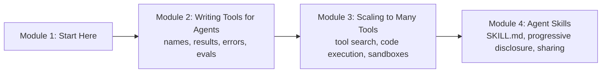

# How This Course Works

## Introduction

Think about a new delivery partner joining a grocery app in Pune. On day one they get three things. First, **equipment**: a phone with the rider app, a bag, a helmet. Second, a **safe place to practise**: a supervised first week on easy routes, where a wrong turn costs nothing. Third, an **onboarding booklet**: how to handle a customer who isn't home, what to do with a damaged packet, which society gates need an OTP. Nobody hands the rider the whole company manual on day one. They get the booklet for the situation in front of them, when they need it.

An AI agent needs the same three things, and this course is about all three:

1. **Tools** are the agent's equipment. A model can't check an order, issue a refund or read a file by itself; a tool lets it ask your code to do that. How you name, describe and shape a tool decides whether the agent uses it well or fumbles.
2. **Code execution in a sandbox** is the safe place to practise. Instead of calling tools one at a time, a capable agent can write a short program that calls them, filters the results and returns only the answer. That program must run somewhere it can't hurt anything.
3. **Agent Skills** are the onboarding booklets. A skill is a folder with a `SKILL.md` file of instructions, plus optional scripts and reference files. The agent sees a one-line summary of every skill, and opens the full booklet only when a task needs it.

These three ideas are how serious agent products are built in 2026. Claude Code, OpenAI's Codex, Gemini CLI, GitHub Copilot and Cursor all read the same `SKILL.md` format. The Claude and OpenAI APIs both offer **tool search**, so an agent can work with thousands of tools without loading them all. Agent SDKs now ship **sandboxes** as a first-class part of the harness. You will learn how each piece works, why it exists, and how to build it yourself.

> 💡 **Key Insight**
>
> An agent is only as good as what you give it to work with. **Tools** decide what it *can do*, **sandboxes** decide what it can do *safely*, and **skills** decide what it *knows how to do*. All three follow one rule from the previous course: keep the context window small and load detail only when the task needs it.

---

## What You Will Learn

By the end of this course you will be able to:

- **Write tool definitions models use well**: clear names, descriptions that say when to use the tool, parameters that are hard to get wrong, and JSON schemas you can enforce.
- **Design tool results** that give the agent exactly what its next step needs, with pagination, concise and detailed modes, and IDs it can chain.
- **Write error messages that make the agent recover** instead of retrying the same mistake.
- **Evaluate tools with an agent in the loop**: realistic tasks, verifiers, metrics and transcript reading.
- **Explain why hundreds of tool schemas break agents**, and fix it with **tool search and deferred loading**.
- **Let agents write code against tools** (programmatic tool calling and "code mode"), and run that code in a **sandbox** with limits on time, memory, files and network.
- **Build an agent with a code-execution sandbox** from scratch, in a lab.
- **Write Agent Skills**: the folder layout, the `SKILL.md` format, descriptions that trigger reliably, bundled scripts and references.
- **Explain progressive disclosure** (discovery, activation, execution) and implement it in your own harness.
- **Choose between skills, MCP servers, subagents and plain prompts**, then test, version and share a skill and use it in two different agents.

### The course at a glance

**Module 2** is about **one tool**: how to make a single tool definition, its results and its errors as easy as possible for a model to use, and how to prove it with evaluations. **Module 3** is about **many tools**: what happens when an agent is connected to fifty or five hundred of them, and the two big fixes, searching for tools on demand and letting the agent write code that calls them inside a sandbox. **Module 4** is about **know-how**: packaging the procedures your team follows into skills any compatible agent can load.

---

## The Running Example: MandiMart

Most examples in this course come from one made-up company, so you can watch the same system grow. **MandiMart** is a quick-commerce grocery service in Pune and Bengaluru. Its operations team wants an agent that can:

- look up orders, customers and riders,
- issue refunds within policy,
- answer questions like *"which dark stores ran out of Amul butter more than twice last week?"*,
- and produce **GST invoices** and weekly sales reports the way the finance team expects.

In Module 2 you'll design MandiMart's tools. In Module 3 its toolset grows to hundreds of tools across many systems, and you'll make that manageable. In Module 4 you'll write a `gst-invoice` skill that teaches any agent how MandiMart builds a tax invoice, with a script that does the arithmetic and a reference file of tax rates.

---

## How Every Lesson Is Built

Every article follows the same shape:

| Section | What it gives you |
|---|---|
| **Before you start** | Links to the earlier lessons this one depends on. |
| **Introduction** | Why the topic matters, with an everyday example. |
| **Key Insight** | The one idea to remember. |
| **Core Explanation** | The topic step by step, with diagrams, real-looking artefacts (JSON schemas, `SKILL.md` files, sandbox commands) and runnable code. |
| **Try It Yourself** | Exercises, with answers hidden in a fold. |
| **Real-World Examples** | How shipping products use the idea. |
| **Common Misconceptions** | Mistakes almost everyone makes, corrected. |
| **Interview Relevance** | What interviewers ask and what a strong answer covers. |
| **Key Takeaways** | A one-minute summary for revision. |

**Labs** are guided builds. This course has two: an agent that writes and runs code in a sandbox you build, and a skill you write once and use in two different agent harnesses.

---

## What You Need Before Starting

This course sits after [Context Engineering and Agent Memory](../../context-engineering-and-agent-memory/course.md) in the catalog and uses ideas from it and from earlier courses:

- **Tool calling.** You should know what a tool definition is and how a tool call and its result travel between your code and the model. [What is a Tool?](../../agentic-ai-fundamentals/04-tools-and-function-calling/what-is-a-tool.md), [Function Calling Step by Step](../../agentic-ai-fundamentals/04-tools-and-function-calling/function-calling-step-by-step.md) and [Designing Good Tools](../../agentic-ai-fundamentals/04-tools-and-function-calling/designing-good-tools.md) cover this. Module 2 of this course starts where *Designing Good Tools* stops.
- **The agent loop and the harness.** The model proposes a step, your code (the **harness**) decides whether it runs. See [How an Agent Decides What to Do Next](../../agentic-ai-fundamentals/03-the-agent-loop/how-an-agent-decides-what-to-do-next.md).
- **The context window as a budget.** Tool definitions, tool results and skills all spend context. [Tool Results that Don't Flood the Window](../../context-engineering-and-agent-memory/03-just-in-time-context/tool-results-that-don-t-flood-the-window.md) and [Semantic, Episodic and Procedural Memory](../../context-engineering-and-agent-memory/04-memory-systems/semantic-episodic-and-procedural-memory.md) are the most useful background.
- **A terminal.** Labs run commands and scripts. [Processes, Ports and Environment Variables](../../the-command-line-and-linux-basics/03-working-like-a-developer/processes-ports-and-environment-variables.md) is enough.
- **Python 3.10 or newer** with the packages in the site's `requirements-lessons.txt` (Pydantic, scikit-learn, NumPy and a few others).

One technology you'll hear about before its own course is the **Model Context Protocol (MCP)**, an open standard for packaging tools as servers that any AI app can connect to. This course only needs that one-line idea; the next course, [Model Context Protocol (MCP)](../../model-context-protocol-mcp/course.md), teaches it properly.

### Do I need an API key?

No. Every runnable example uses plain Python and a small pretend model, so it runs offline and prints exactly what the lesson shows. Where a real API call matters (strict tools, tool search, programmatic tool calling, the code execution tool, the Skills API), the lesson shows the real code in a block marked `# not-run`, written for the current Anthropic Python SDK with the model `claude-opus-5-5`, and sometimes the OpenAI equivalent, with example output.

### A note on token counts

As in the previous course, runnable code estimates tokens at **about 4 characters per token**. That's close enough to compare designs. For exact numbers, use the provider's token counter.

---

## How to Get the Most Out of It

1. **Read your tools the way the model reads them.** Print the definitions and results the model receives. Most tool problems are obvious once you look.
2. **Measure, don't guess.** Every claim in Module 2 and 3 ("this description is better", "tool search saves tokens") comes with a way to measure it. Use it on your own tools.
3. **Run code only where it can't hurt you.** From Module 3 on, treat any code a model writes as untrusted. The sandbox lesson explains why and how.
4. **Write one real skill.** Module 4 is much easier to remember after you've packaged one procedure you actually follow at work or college.

---

## Common Misconceptions

### "Better models make tool design unimportant"

Better models make fewer mistakes, but they can only act on what they read. A vague description or a 5,000-line result hurts every model. Anthropic reports that refining tool descriptions alone has produced state-of-the-art benchmark results.

### "Skills are just long prompts"

A prompt is loaded every time. A skill costs only its one-line description until a task needs it, and it can carry scripts that run deterministic work outside the context window.

### "Running model-written code is too dangerous to ever do"

It is dangerous *without a sandbox*. With limits on time, memory, files, network and credentials, it is how production agents analyse data, make documents and call many tools cheaply.

---

## Key Takeaways

- **Tools** are what an agent can do; their names, descriptions, schemas, results and errors are a user interface for a model.
- **Many tools** need tool search and code execution, and code execution needs a **sandbox**.
- **Agent Skills** package know-how as folders with a `SKILL.md`, loaded progressively, and work across many agents.
- **MandiMart**, a Pune grocery service, is the running example from start to finish.
- **No API key is needed**: runnable code uses pretend models; real API code is shown in clearly marked blocks.

---

**Up next:** [Naming, Descriptions and Parameters](../02-writing-tools-for-agents/naming-descriptions-and-parameters.md)
