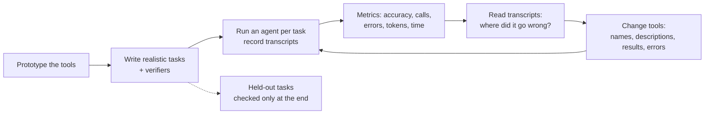

# Evaluating Tools with an Agent in the Loop: The Complete Guide

> 📚 **Before you start**
>
> - [Naming, Descriptions and Parameters](naming-descriptions-and-parameters.md), [Returning Just Enough](returning-just-enough.md) and [Error Messages that Help the Agent Recover](error-messages-that-help-the-agent-recover.md): this lesson measures whether those design choices actually work.
> - [Lab: Agent Loop with a Pretend Model](../../agentic-ai-fundamentals/03-the-agent-loop/lab-agent-loop-with-a-pretend-model.md), for the loop you'll run evaluations in.

## Introduction

A restaurant can taste every ingredient and still serve a bad thali. The dal is fine, the rotis are fine, but the dal arrives cold because the kitchen sends it before the rotis are ready. You only find out by **ordering a full meal and eating it** the way a customer would.

Tools are the same. You can unit-test `mandimart_refunds_create` and prove it refunds correctly. That tells you nothing about whether an agent, given a real customer's message, will find the right order, pick the refund tool rather than the cancel tool, pass the amount in rupees, and recover when the first call fails. Tools are used by a **non-deterministic** reader, so the only test that answers "is this tool good?" is to put an agent in front of it and watch what happens over many realistic tasks.

Anthropic's engineering post on writing tools for agents describes the loop that teams use: build a prototype, write realistic evaluation tasks, run an agent on them, measure, read the transcripts, improve the tools, and repeat, keeping some tasks held out. This lesson builds that loop end to end for MandiMart:

- writing **tasks** that look like real requests, with **verifiers** that check outcomes,
- a **harness** that runs an agent per task and records a transcript and metrics,
- comparing two versions of a toolset on **accuracy, tool calls, errors and tokens**,
- **reading transcripts** to find out *why* a task failed,
- and avoiding the traps: brittle verifiers, overfitting, and too few trials.

> 💡 **Key Insight**
>
> Judge a tool by **what an agent achieves with it**, not by what the tool does in isolation. Run realistic tasks, verify outcomes, count calls, errors and tokens, and then **read the transcripts**. The numbers tell you *that* something is wrong; the transcripts tell you *what*.

---

## Core Explanation

### 1. The evaluation loop



Every arrow matters, but two steps are skipped most often: writing *realistic* tasks, and *reading transcripts*. Teams that skip the first measure the wrong thing; teams that skip the second see a number go down and don't know why.

### 2. Tasks that look like real work

A weak evaluation task is a one-liner that maps straight to one tool: *"Refund order MM-48213 for Rs 89."* A model will pass it with almost any tool design. Strong tasks look like what customers and staff actually type: indirect, multi-step, missing details the agent has to find.

| Weak task | Strong task |
|---|---|
| "Refund MM-48213 Rs 89, reason item_damaged." | "Hi, I'm 9876543210. My last order had a squashed tray of eggs, Rs 89. Can I get that back?" |
| "Check stock of AMUL-BTR-100 at PNQ-07." | "Is Amul butter in stock at Kothrud?" |
| "Cancel MM-48250." (when cancelling is allowed) | "Please cancel MM-48250." (when the rider already has it) |

Good task sets also include cases where the **right outcome is to not act**: an order that can't be cancelled, a refund for an order that doesn't exist. Those catch tools that do dangerous things without checking.

Store tasks as data, each with what a correct outcome looks like:

```python
import json, math, re
from collections import Counter

def approx_tokens(text):
    return math.ceil(len(text) / 4)

TASKS = [
    {"id": "status",   "prompt": "Where is my order MM-48213?",
     "intents": ["order status"]},
    {"id": "refund",   "prompt": "Hi, I'm 9876543210. My last order had a damaged tray of eggs, Rs 89. Please refund it.",
     "intents": ["customer recent orders", "refund"]},
    {"id": "stock",    "prompt": "Is Amul butter in stock at Kothrud?",
     "intents": ["stock"]},
    {"id": "cancel",   "prompt": "Please cancel order MM-48250.",
     "intents": ["cancel order"]},
    {"id": "no_order", "prompt": "Refund Rs 50 on order MM-99999, an item was missing.",
     "intents": ["refund"]},
]
print(len(TASKS), "tasks:", ", ".join(t["id"] for t in TASKS))
```

Output:

```
5 tasks: status, refund, stock, cancel, no_order
```

The `intents` field exists only because our pretend model (section 4) needs a plan handed to it; a real model works out its own plan from the prompt. Real task sets are bigger: dozens to hundreds of tasks, many needing several tool calls, drawn from real support tickets and logs where possible.

### 3. Verifiers: check the outcome, not the wording

Each task needs a **verifier**, code that decides pass or fail. Prefer checking **state**: did a refund row appear with the right order and amount? Did the order stay uncancelled? Where you must check the answer text, check for the essential fact, not exact wording. A verifier that demands the exact sentence "Your refund has been processed" fails correct answers phrased differently, and you'll end up tuning tools to please the verifier. For open-ended answers, teams use a model as a judge with a written rubric, which the evaluation course covers in [Agent Evals, Observability and Reliability](../../agent-evals-observability-and-reliability/course.md#m2).

First, the pretend backend the tools will act on, recreated fresh for every task so runs don't affect each other:

```python
def fresh_db():
    return {
        "customers": {"9876543210": {"uuid": "c2b1f6de-0f6e-4b7c-a8a1-2f0f7d4a9e55", "name": "Priya Nair"},
                      "9123456780": {"uuid": "77aa01c3-5d2e-4f1b-9c0d-1e2f3a4b5c6d", "name": "Rahul Desai"}},
        "orders": {
            "MM-48213": {"phone": "9876543210", "total": 649, "status": "delivered", "date": "2026-10-14", "store": "PNQ-07"},
            "MM-47990": {"phone": "9876543210", "total": 239, "status": "delivered", "date": "2026-10-11", "store": "PNQ-07"},
            "MM-47102": {"phone": "9876543210", "total": 1120, "status": "cancelled", "date": "2026-09-30", "store": "PNQ-03"},
            "MM-48250": {"phone": "9123456780", "total": 412, "status": "out for delivery", "date": "2026-10-15", "store": "PNQ-03"},
        },
        "stock": {("PNQ-07", "AMUL-BTR-100"): 14, ("PNQ-03", "AMUL-BTR-100"): 0},
        "refunds": [], "cancellations": [],
    }

VERIFIERS = {
    "status":   lambda db, answer: "delivered" in answer.lower(),
    "refund":   lambda db, answer: [(r["order_id"], r["amount"]) for r in db["refunds"]] == [("MM-48213", 89)],
    "stock":    lambda db, answer: "14" in answer,
    "cancel":   lambda db, answer: not db["cancellations"] and bool(re.search(r"can(no|')t|cannot|not possible", answer.lower())),
    "no_order": lambda db, answer: not db["refunds"] and "not found" in answer.lower().replace("no order", "not found"),
}
```

Note the `cancel` and `no_order` verifiers: they pass only if **nothing changed** and the answer explains why. That's how evaluation catches tools that act when they shouldn't.

### 4. Two toolsets to compare

Version 1 is what MandiMart's backend team first exposed: thin endpoint wrappers with one-line descriptions, ambiguous parameters, raw JSON results and opaque errors. Version 2 applies this module's three lessons. Both act on the same database.

```python
class ToolError(Exception):
    pass

def make_v1(db):
    def get_customer(user):
        c = db["customers"].get(user)
        if not c:
            raise ToolError("Error 404")
        return json.dumps({"customer_uuid": c["uuid"], "name": c["name"], "phone": user})
    def list_orders(customer):
        phone = next((p for p, c in db["customers"].items() if c["uuid"] == customer), None)
        if phone is None:
            raise ToolError("Error 400")
        return json.dumps([{"id": oid, **o} for oid, o in db["orders"].items() if o["phone"] == phone])
    def get_order(id):
        if id not in db["orders"]:
            raise ToolError("Error 404")
        return json.dumps({"id": id, **db["orders"][id]})
    def refund(id, value):
        if id not in db["orders"]:
            raise ToolError("Error 404")
        db["refunds"].append({"order_id": id, "amount": value})
        return "OK"
    def cancel(id):
        if id not in db["orders"]:
            raise ToolError("Error 404")
        db["cancellations"].append(id)                       # no check on status!
        return "OK"
    def stock(store, product):
        if (store, product) not in db["stock"]:
            raise ToolError("Error 422")
        return json.dumps({"store": store, "product": product, "qty": db["stock"][(store, product)]})
    return {
        "get_customer": ("Gets a customer.", {"user": ""}, get_customer),
        "list_orders": ("Lists orders.", {"customer": ""}, list_orders),
        "get_order": ("Gets order.", {"id": ""}, get_order),
        "refund": ("Refunds.", {"id": "", "value": ""}, refund),
        "cancel": ("Cancels.", {"id": ""}, cancel),
        "stock": ("Stock.", {"store": "", "product": ""}, stock),
    }
```

```python
AREAS = {"kothrud": "PNQ-07", "baner": "PNQ-03"}
PRODUCT_NAMES = {"amul butter": "AMUL-BTR-100"}

def make_v2(db):
    def customers_context(customer_phone):
        c = db["customers"].get(customer_phone)
        if not c:
            raise ToolError(f"[not_found] No customer with phone {customer_phone}. Ask the user to confirm the number.")
        orders = sorted(((oid, o) for oid, o in db["orders"].items() if o["phone"] == customer_phone),
                        key=lambda x: x[1]["date"], reverse=True)
        lines = "; ".join(f"{oid} {o['date']} Rs {o['total']} {o['status']}" for oid, o in orders)
        return f"{c['name']}. Recent orders, newest first: {lines}."
    def orders_get(order_id):
        o = db["orders"].get(order_id)
        if not o:
            raise ToolError(f"[not_found] No order {order_id} found. Order IDs look like MM-48213. "
                            "Retrying the same call will fail again.")
        return f"{order_id}: {o['status']}, Rs {o['total']}, placed {o['date']} at {o['store']}."
    def refunds_create(order_id, amount_inr, reason):
        o = db["orders"].get(order_id)
        if not o:
            raise ToolError(f"[not_found] No order {order_id} found, so nothing was refunded. Tell the user and "
                            "ask them to check the order ID. Retrying the same call will fail again.")
        if not isinstance(amount_inr, (int, float)):
            raise ToolError(f"[invalid_input] amount_inr must be a number of rupees, e.g. 89; got {amount_inr!r}.")
        if amount_inr > o["total"]:
            raise ToolError(f"[invalid_input] amount_inr {amount_inr} is more than the order total Rs {o['total']}.")
        db["refunds"].append({"order_id": order_id, "amount": amount_inr})
        return f"Refund RF-{20931 + len(db['refunds'])} created for {order_id}: Rs {amount_inr} ({reason}), status processing."
    def orders_cancel(order_id):
        o = db["orders"].get(order_id)
        if not o:
            raise ToolError(f"[not_found] No order {order_id} found.")
        if o["status"] not in ("placed", "packed"):
            raise ToolError(f"[wrong_state] {order_id} is {o['status']}, so it cannot be cancelled now. Tell the user; "
                            "once delivered they can ask for a refund. Retrying the same call will fail again.")
        db["cancellations"].append(order_id)
        return f"{order_id} cancelled."
    def stock_check(store_code, sku):
        if store_code not in {c for c, _ in db["stock"]}:
            hint = AREAS.get(store_code.lower())
            raise ToolError(f"[invalid_input] store_code must look like 'PNQ-07'; got '{store_code}'."
                            + (f" Did you mean '{hint}'?" if hint else ""))
        if sku not in {s for _, s in db["stock"]}:
            hint = PRODUCT_NAMES.get(sku.lower())
            raise ToolError(f"[not_found] No product with SKU '{sku}'." + (f" Did you mean '{hint}'?" if hint else ""))
        return f"{store_code}: {db['stock'][(store_code, sku)]} x {sku} in stock."
    return {
        "mandimart_customers_context": (
            "Get a customer's name and recent orders (newest first, with order IDs, totals and status) from their "
            "phone number. Use this when the user gives a phone number but no order ID, for example to find their "
            "last order before a refund.", {"customer_phone": "10-digit mobile number"}, customers_context),
        "mandimart_orders_get": (
            "Get one order's status, total, date and store. Use this when the user gives an order ID like MM-48213 "
            "and asks where it is or about its status.", {"order_id": "Order ID, e.g. MM-48213"}, orders_get),
        "mandimart_refunds_create": (
            "Refund all or part of a delivered order. Use this for a refund once you know the order ID and amount. "
            "Do not use it to cancel; use mandimart_orders_cancel instead.",
            {"order_id": "Order ID, e.g. MM-48213", "amount_inr": "Refund amount in rupees",
             "reason": "one of item_missing, item_damaged, late_delivery"}, refunds_create),
        "mandimart_orders_cancel": (
            "Cancel an order that has not been picked up by a rider. Use this when the user asks to cancel an order.",
            {"order_id": "Order ID, e.g. MM-48213"}, orders_cancel),
        "mandimart_stock_check": (
            "Check stock of a product at a dark store. Use this when the user asks whether something is in stock "
            "at a store or area.", {"store_code": "Store code, e.g. PNQ-07", "sku": "SKU, e.g. AMUL-BTR-100"}, stock_check),
    }
```

### 5. A pretend agent and the harness

To run offline, we need a stand-in for the model. This pretend agent behaves the way the earlier lessons described a real one choosing tools, in a simplified, deterministic form:

- for each step of its plan, it picks the tool whose **name and description** best match the step,
- it fills each parameter from facts in the task and earlier results, guided by the **parameter name and description**,
- it applies **"did you mean"** suggestions from errors, gives up when told retrying won't help, and otherwise retries the same call (at most twice).

It is far simpler than a real model, but it only uses information that's visible in the tool definitions and results, which is exactly what we're evaluating.

```python
STOP = {"a", "an", "the", "to", "for", "by", "of", "it", "is", "this", "use", "when", "and", "or", "get", "gets"}

def words(text):
    return set(re.findall(r"[a-z]+", text.lower())) - STOP

def pick_tool(intent, tools, used):
    def score(name):
        # Read "Do not use..." sentences as exclusions, the way a real model understands them.
        desc = " ".join(s for s in re.split(r"(?<=\.)\s+", tools[name][0]) if not s.lower().startswith("do not"))
        return len(words(intent) & words(name.replace("_", " ") + " " + desc))
    candidates = [n for n in tools if n not in used] or list(tools)
    return max(candidates, key=score)            # ties go to the first listed tool

def fill_args(params, facts, prompt):
    args = {}
    for pname, pdesc in params.items():
        key = (pname + " " + pdesc).lower()
        if "phone" in key:
            args[pname] = facts.get("phone")
        elif "order" in key or pname == "id":
            args[pname] = facts.get("order_id") or facts.get("phone")
        elif "amount" in key or pname == "value":
            args[pname] = facts.get("amount")
        elif "reason" in key:
            args[pname] = "item_damaged" if "damaged" in prompt else "item_missing"
        elif "store" in key:
            args[pname] = facts.get("area")
        elif "sku" in key or "product" in key:
            args[pname] = facts.get("product")
        elif "customer" in key or "user" in key:
            args[pname] = facts.get("phone")
    return args

def extract_facts(text, facts):
    if m := re.search(r"\bMM-\d{5}\b", text):
        facts.setdefault("order_id", m.group(0))
    if m := re.search(r"\b\d{10}\b", text):
        facts.setdefault("phone", m.group(0))
    if m := re.search(r"Rs (\d+)", text):
        facts.setdefault("amount", int(m.group(1)))
    for area in AREAS:
        if area in text.lower():
            facts.setdefault("area", area.title())
    for product in PRODUCT_NAMES:
        if product in text.lower():
            facts.setdefault("product", product.title())
    return facts

def run_task(task, make_tools):
    db = fresh_db()
    tools = make_tools(db)
    defs_tokens = approx_tokens(json.dumps({n: [d, p] for n, (d, p, _) in tools.items()}))
    facts = extract_facts(task["prompt"], {})
    transcript, used, answer = [], set(), []
    metrics = {"calls": 0, "errors": 0, "tokens": 0}
    for intent in task["intents"]:
        name = pick_tool(intent, tools, used)
        desc, params, fn = tools[name]
        args = fill_args(params, facts, task["prompt"])
        for attempt in range(3):
            metrics["calls"] += 1
            metrics["tokens"] += defs_tokens                 # every model call re-reads the definitions
            try:
                result = fn(**args)
                transcript.append(f"{name}({args}) -> {result[:90]}")
                metrics["tokens"] += approx_tokens(result)
                extract_facts(result, facts)
                used.add(name)
                answer.append(result)
                break
            except ToolError as e:
                msg = str(e)
                metrics["errors"] += 1
                metrics["tokens"] += approx_tokens(msg)
                transcript.append(f"{name}({args}) -> ERROR {msg[:90]}")
                if m := re.search(r"Did you mean '([^']+)'", msg):
                    bad = next(k for k, v in args.items() if str(v).lower() in msg.lower())
                    args[bad] = m.group(1)
                elif "will fail again" in msg or attempt == 2:
                    answer.append(msg)
                    break
    final = " ".join(answer)
    passed = VERIFIERS[task["id"]](db, final)
    return {"passed": passed, **metrics, "transcript": transcript, "answer": final}
```

The harness gives each task a fresh database, so a refund in one task can't make another pass or fail. It records every call in a **transcript** and counts **calls, errors and tokens**, where tokens include re-reading the tool definitions on each model call, because that's what really happens.

### 6. Run both versions and compare

```python
def evaluate(make_tools, label):
    rows = [run_task(t, make_tools) for t in TASKS]
    total = Counter()
    for r in rows:
        total.update({k: r[k] for k in ("calls", "errors", "tokens")})
    passed = sum(r["passed"] for r in rows)
    print(f"{label}: passed {passed}/{len(rows)} | calls {total['calls']} | errors {total['errors']} | "
          f"tokens {total['tokens']}")
    for t, r in zip(TASKS, rows):
        print(f"   {'PASS' if r['passed'] else 'FAIL'}  {t['id']:<9} calls={r['calls']} errors={r['errors']}")
    return rows

v1_rows = evaluate(make_v1, "v1 endpoint wrappers")
v2_rows = evaluate(make_v2, "v2 designed tools   ")
```

Output:

```
v1 endpoint wrappers: passed 1/5 | calls 12 | errors 9 | tokens 967
   PASS  status    calls=1 errors=0
   FAIL  refund    calls=4 errors=3
   FAIL  stock     calls=3 errors=3
   FAIL  cancel    calls=1 errors=0
   FAIL  no_order  calls=3 errors=3
v2 designed tools   : passed 3/5 | calls 12 | errors 9 | tokens 4083
   FAIL  status    calls=3 errors=3
   PASS  refund    calls=2 errors=0
   PASS  stock     calls=3 errors=2
   PASS  cancel    calls=1 errors=1
   FAIL  no_order  calls=3 errors=3
```

Version 2 is better, but it isn't done: two tasks still fail, and it uses more tokens, because its descriptions are longer and every model call re-reads them. That's a normal first result. The numbers say *that* something is wrong. To find out *what*, read the transcripts.

### 7. Read the transcripts

Start with version 1:

```python
for t, r in zip(TASKS, v1_rows):
    if not r["passed"]:
        print(f"--- v1 / {t['id']}: {t['prompt']}")
        for line in r["transcript"]:
            print("   ", line)
```

Output:

```
--- v1 / refund: Hi, I'm 9876543210. My last order had a damaged tray of eggs, Rs 89. Please refund it.
    get_customer({'user': '9876543210'}) -> {"customer_uuid": "c2b1f6de-0f6e-4b7c-a8a1-2f0f7d4a9e55", "name": "Priya Nair", "phone": "
    refund({'id': '9876543210', 'value': 89}) -> ERROR Error 404
    refund({'id': '9876543210', 'value': 89}) -> ERROR Error 404
    refund({'id': '9876543210', 'value': 89}) -> ERROR Error 404
--- v1 / stock: Is Amul butter in stock at Kothrud?
    stock({'store': 'Kothrud', 'product': 'Amul Butter'}) -> ERROR Error 422
    stock({'store': 'Kothrud', 'product': 'Amul Butter'}) -> ERROR Error 422
    stock({'store': 'Kothrud', 'product': 'Amul Butter'}) -> ERROR Error 422
--- v1 / cancel: Please cancel order MM-48250.
    get_order({'id': 'MM-48250'}) -> {"id": "MM-48250", "phone": "9123456780", "total": 412, "status": "out for delivery", "dat
--- v1 / no_order: Refund Rs 50 on order MM-99999, an item was missing.
    refund({'id': 'MM-99999', 'value': 50}) -> ERROR Error 404
    refund({'id': 'MM-99999', 'value': 50}) -> ERROR Error 404
    refund({'id': 'MM-99999', 'value': 50}) -> ERROR Error 404
```

Each failure points at a specific design flaw, and each matches a lesson in this module:

| Task | What the transcript shows | Fix (lesson) |
|---|---|---|
| refund | The customer tool returned a UUID and no orders; `refund(id=...)` got a phone number because `id` was ambiguous | A task tool that returns order IDs; unambiguous `order_id` ([Returning Just Enough](returning-just-enough.md), [Naming, Descriptions and Parameters](naming-descriptions-and-parameters.md)) |
| stock | `Error 422` three times with the same arguments | "Did you mean" errors ([Error Messages that Help the Agent Recover](error-messages-that-help-the-agent-recover.md)) |
| cancel | "Cancels." matched nothing, so the agent fetched the order instead and never told the user it can't be cancelled. (Had it found `cancel`, that tool checks nothing and would have cancelled an order already with the rider.) | Descriptions that say when to use the tool; enforce the rule in the tool and explain it in the error |
| no_order | "Error 404" gave the agent nothing to tell the user | Errors that say what to tell the user |

Now the two version 2 failures:

```python
for t, r in zip(TASKS, v2_rows):
    if not r["passed"]:
        print(f"--- v2 / {t['id']}: {t['prompt']}")
        for line in r["transcript"]:
            print("   ", line)
```

Output:

```
--- v2 / status: Where is my order MM-48213?
    mandimart_customers_context({'customer_phone': None}) -> ERROR [not_found] No customer with phone None. Ask the user to confirm the number.
    mandimart_customers_context({'customer_phone': None}) -> ERROR [not_found] No customer with phone None. Ask the user to confirm the number.
    mandimart_customers_context({'customer_phone': None}) -> ERROR [not_found] No customer with phone None. Ask the user to confirm the number.
--- v2 / no_order: Refund Rs 50 on order MM-99999, an item was missing.
    mandimart_customers_context({'customer_phone': None}) -> ERROR [not_found] No customer with phone None. Ask the user to confirm the number.
    mandimart_customers_context({'customer_phone': None}) -> ERROR [not_found] No customer with phone None. Ask the user to confirm the number.
    mandimart_customers_context({'customer_phone': None}) -> ERROR [not_found] No customer with phone None. Ask the user to confirm the number.
```

Both failures start the same way: the agent called `mandimart_customers_context` when it needed `mandimart_orders_get` or `mandimart_refunds_create`. Look at that tool's description again: *"Get a customer's name and recent orders (newest first, with order IDs, totals and **status**)... for example to find their last order before a **refund**."* While explaining itself helpfully, it borrowed the words that belong to two other tools, so for the steps "order status" and "refund" it looked just as relevant as the right tool, and it's listed first. Our pretend agent is crude, but real models make the same class of mistake when descriptions overlap, which is why Anthropic's guidance warns against tools with overlapping purposes and vague boundaries.

The fix is to the description, not the code: say what the tool is *for*, and point to the neighbours instead of describing their jobs.

```python
def make_v3(db):
    tools = make_v2(db)
    _, params, fn = tools["mandimart_customers_context"]
    tools["mandimart_customers_context"] = (
        "Look up a customer by phone number: their name and their recent orders, newest first, with order IDs. "
        "Use this when the user gives a phone number but no order ID. If they gave an order ID, use "
        "mandimart_orders_get instead.", params, fn)
    return tools

v3_rows = evaluate(make_v3, "v3 one description fixed")
```

Output:

```
v3 one description fixed: passed 5/5 | calls 8 | errors 4 | tokens 2734
   PASS  status    calls=1 errors=0
   PASS  refund    calls=2 errors=0
   PASS  stock     calls=3 errors=2
   PASS  cancel    calls=1 errors=1
   PASS  no_order  calls=1 errors=1
```

All five pass, with fewer calls (8 against 12) and fewer errors (4 against 9) than version 1. Tokens are higher, though: 2,734 against 967, because the descriptions are several times longer and every model call re-reads all of them. Here that's clearly worth paying for one pass in five becoming five in five, but notice how quickly definitions come to dominate the bill; Module 3 starts from exactly that problem. Anthropic's post suggests tracking exactly these numbers: **top-level accuracy, the number of tool calls, tool errors, total tokens and runtime**. A change that raises accuracy but doubles tokens is a trade-off you want to see, not discover on your bill.

This is the habit to build: **for every failed task, find the line in the transcript where things went wrong, and ask what in the tool's name, description, schema, result or error made that step look reasonable.** Real transcripts also contain the model's reasoning between calls, which is often the most useful part; Anthropic recommends asking the agent to state its reasoning before tool calls during evaluations, so you can see why it chose what it chose.

### 8. Doing this with a real model

With a real model, the harness has the same shape: a fresh environment per task, a tool loop, a transcript, metrics and a verifier. Here's the core of it with the Anthropic SDK. The usage fields give exact token counts instead of estimates:

```python
# not-run: needs the anthropic package and an API key
import time
import anthropic

client = anthropic.Anthropic()

def run_task_real(task, tool_defs, tool_impls, max_turns=10):
    messages = [{"role": "user", "content": task["prompt"]}]
    metrics = {"calls": 0, "errors": 0, "input_tokens": 0, "output_tokens": 0}
    transcript, start = [], time.time()
    for _ in range(max_turns):
        resp = client.messages.create(
            model="claude-opus-5-5", max_tokens=4096,
            system="You are MandiMart's support agent. Before each tool call, say in one line why you are calling it.",
            tools=tool_defs, messages=messages,
        )
        metrics["input_tokens"] += resp.usage.input_tokens
        metrics["output_tokens"] += resp.usage.output_tokens
        messages.append({"role": "assistant", "content": resp.content})
        transcript.extend(b.text for b in resp.content if b.type == "text")
        if resp.stop_reason != "tool_use":
            break
        results = []
        for block in resp.content:
            if block.type != "tool_use":
                continue
            metrics["calls"] += 1
            try:
                out, is_error = tool_impls[block.name](**block.input), False
            except ToolError as e:
                out, is_error = str(e), True
                metrics["errors"] += 1
            transcript.append(f"{block.name}({block.input}) -> {out[:120]}")
            results.append({"type": "tool_result", "tool_use_id": block.id, "content": out, "is_error": is_error})
        messages.append({"role": "user", "content": results})
    final = " ".join(b.text for b in resp.content if b.type == "text")
    metrics["seconds"] = round(time.time() - start, 1)
    return final, metrics, transcript
```

Example output (for the refund task with version 2 tools):

```
final: "Done! I've refunded Rs 89 for the damaged eggs on order MM-48213 (refund RF-20932). It should reach your UPI within 2 working days."
metrics: {'calls': 2, 'errors': 0, 'input_tokens': 4113, 'output_tokens': 212, 'seconds': 6.8}
```

Three things change with a real model:

- **Results vary between runs.** Run each task several times (three is a common start) and report the pass rate across trials, not one lucky run. The evaluation course covers measures such as pass@k (succeeds at least once in k tries) and pass^k (succeeds every time).
- **Cost is real.** A 100-task suite with 3 trials is 300 agent runs. Start with 20 to 30 tasks that matter.
- **Let a model help improve the tools.** Anthropic describes pasting evaluation transcripts into Claude Code and asking it to refactor the tools, then re-running. It works well, provided you keep a **held-out** set of tasks that the improvement loop never sees, and judge the final version on those.

### 9. Traps to avoid

| Trap | Why it hurts | Instead |
|---|---|---|
| Tasks that name the tool and its arguments | Everything passes; you learn nothing | Write tasks the way users talk |
| Verifiers that match exact wording | Correct answers fail; you tune tools to the verifier | Check state, or the key fact |
| Only success cases | Tools that act recklessly look great | Include "should not act" tasks |
| One run per task | Noise looks like progress | Several trials; compare pass rates |
| Tuning on every task | Overfitting to your test set | Keep a held-out set |
| Shared state between tasks | Results depend on order | Fresh environment per task |
| Looking only at accuracy | Hidden token and call regressions | Track calls, errors, tokens and time too |


*Tasks, harness, metrics, transcripts, fixes: the loop that turns tool design from opinion into measurement.*

---

## Try It Yourself

1. **Add a task.** Add a task `"stock_baner"` with prompt "Do you have Amul butter at the Baner store?" and a verifier that passes if the answer says it's out of stock. Run both versions on it.
2. **Take the hints away.** Make `make_v3_nohints`, a copy of version 3 whose `mandimart_stock_check` errors have their "Did you mean ...?" sentence removed. Evaluate it. Which task fails, and how many calls are wasted?
3. **Trials.** Real models vary. Write a function `pass_rate(results)` that, given a list of True/False outcomes for one task across trials, returns the fraction passed, and a function `pass_all(results)` that returns True only if every trial passed. Apply them to `[True, True, False]`.

<details>
<summary>Show answers</summary>

**1.**

```python
TASKS.append({"id": "stock_baner", "prompt": "Do you have Amul butter at the Baner store?", "intents": ["stock"]})
VERIFIERS["stock_baner"] = lambda db, answer: " 0 x" in answer or "out of stock" in answer.lower()
for label, maker in [("v1", make_v1), ("v3", make_v3)]:
    r = run_task(TASKS[-1], maker)
    print(label, "PASS" if r["passed"] else "FAIL", "|", r["answer"][:70])
TASKS.pop()
```

Output:

```
v1 FAIL | Error 422
v3 PASS | PNQ-03: 0 x AMUL-BTR-100 in stock.
```

Version 3 passes, but notice the answer: "0 x AMUL-BTR-100 in stock" is correct yet awkward. The result should say "out of stock" and suggest where else it's available, as the error lesson's version did. The evaluation passed; reading the output still found something to improve.

**2.**

```python
def make_v3_nohints(db):
    tools = make_v3(db)
    desc, params, fn = tools["mandimart_stock_check"]
    def no_hints(**kwargs):
        try:
            return fn(**kwargs)
        except ToolError as e:
            raise ToolError(re.sub(r" Did you mean '[^']+'\?", "", str(e)))
    tools["mandimart_stock_check"] = (desc, params, no_hints)
    return tools

rows = evaluate(make_v3_nohints, "v3 without hints")
print("\n".join(rows[2]["transcript"]))
```

Output:

```
v3 without hints: passed 4/5 | calls 8 | errors 5 | tokens 2734
   PASS  status    calls=1 errors=0
   PASS  refund    calls=2 errors=0
   FAIL  stock     calls=3 errors=3
   PASS  cancel    calls=1 errors=1
   PASS  no_order  calls=1 errors=1
mandimart_stock_check({'store_code': 'Kothrud', 'sku': 'Amul Butter'}) -> ERROR [invalid_input] store_code must look like 'PNQ-07'; got 'Kothrud'.
mandimart_stock_check({'store_code': 'Kothrud', 'sku': 'Amul Butter'}) -> ERROR [invalid_input] store_code must look like 'PNQ-07'; got 'Kothrud'.
mandimart_stock_check({'store_code': 'Kothrud', 'sku': 'Amul Butter'}) -> ERROR [invalid_input] store_code must look like 'PNQ-07'; got 'Kothrud'.
```

Without the suggestion, the error still says what's wrong ("must look like 'PNQ-07'"), but our pretend agent has no way to get from "Kothrud" to "PNQ-07", so it repeats the call until it gives up. A real model might guess, or ask the user; either way, one sentence in an error message decided whether the task succeeded. That's why error text gets evaluated, not just reviewed.

**3.**

```python
def pass_rate(results):
    return sum(results) / len(results)

def pass_all(results):
    return all(results)

trials = [True, True, False]
print(round(pass_rate(trials), 2), pass_all(trials))
```

Output:

```
0.67 False
```

</details>

---

## Real-World Examples

- **Anthropic's internal Slack and Asana tools**: their post on writing tools for agents shows held-out accuracy improving when Claude itself optimised tools that humans had written, using transcripts from evaluation runs.
- **Benchmarks like τ-bench (tau-bench)** simulate a user talking to an agent with retail or airline tools and check the final database state, the same "verify state, not wording" approach used here.
- **Teams shipping MCP servers** run small agent evaluations in CI so that a changed tool description or result format that lowers the pass rate is caught before release.

---

## Common Misconceptions

### "Unit tests on the tools are enough"

Unit tests prove the tool does what its code says. They can't tell you whether an agent will choose it, fill it in correctly, or recover from its errors. You need both.

### "If the pass rate went up, the change was good"

Check calls, errors and tokens too, and check on held-out tasks. A change can raise accuracy on the tasks you tuned against while costing more or failing new ones.

### "Evaluation needs hundreds of tasks before it's useful"

Twenty realistic tasks with good verifiers, read carefully, find most tool problems. Grow the set as you find new failure modes.

### "A model judge can replace all verifiers"

Model judges are useful for open-ended answers, but state checks are cheaper, faster and exact. Use code where you can, a judge where you must.

---

## Interview Relevance

*"How do you know your agent's tools are well designed?"* A strong answer describes the loop: realistic, multi-step tasks (including ones where the right outcome is to not act) with outcome-based verifiers; a harness that runs an agent per task in a fresh environment and records transcripts; metrics beyond accuracy (tool calls, errors, tokens, latency); reading transcripts to trace each failure to a name, description, schema, result or error; iterating (possibly with a model's help); multiple trials per task; and a held-out set to avoid overfitting.

Follow-up: *"What would you look for in a transcript?"* Wrong tool choices (description problem), malformed arguments (schema or naming problem), repeated identical calls (error or pagination problem), extra lookups (result missing a handle), and actions taken when the tool should have refused.

---

## Key Takeaways

- **Evaluate tools with an agent using them**, on realistic tasks, not just with unit tests.
- **Verify outcomes**: check state or key facts, and include tasks where the right answer is not to act.
- **Measure more than accuracy**: tool calls, errors, tokens and time.
- **Read transcripts**: trace each failure to the name, description, schema, result or error that caused it.
- **Run several trials, keep a held-out set**, and iterate; a model can help rewrite tools from transcripts.

---

**Up next:** [Why Hundreds of Tool Schemas Break Agents](../03-scaling-to-many-tools/why-hundreds-of-tool-schemas-break-agents.md)
