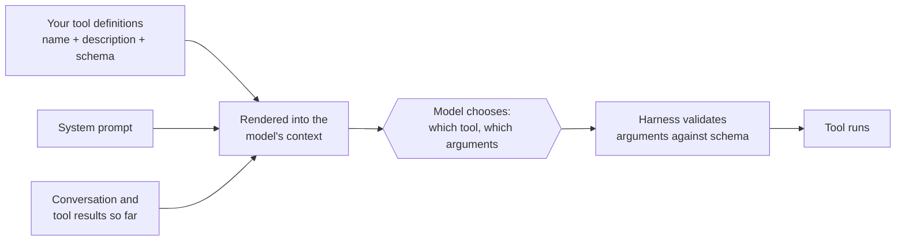
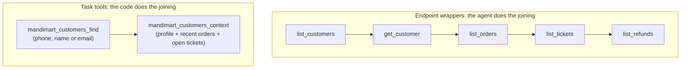

# Naming, Descriptions and Parameters: The Complete Guide

> 📚 **Before you start**
>
> - [How This Course Works](../01-start-here/how-this-course-works.md), for the MandiMart running example.
> - [What is a Tool?](../../agentic-ai-fundamentals/04-tools-and-function-calling/what-is-a-tool.md) and [Designing Good Tools](../../agentic-ai-fundamentals/04-tools-and-function-calling/designing-good-tools.md), for the parts of a tool definition and the seven basic design rules. This lesson goes deeper on the first three.
> - [Structured JSON Output](../../generative-ai-and-llm-foundations/04-prompting-and-structured-output/structured-json-output.md), for JSON Schema basics.

## Introduction

Walk into a busy Udupi restaurant and look at the menu board. *"Masala Dosa: crisp rice crêpe, potato filling, served with sambar and two chutneys. Ask for ghee roast at ₹20 extra."* In ten seconds you know what you'll get, when to order it, and what you can change. Now imagine the same board said only *"Item 14: Dosa (MD)"*. You'd have to ask the waiter. A model can't ask the waiter.

A tool definition is the menu board an agent reads before every single step. It has three parts the model can see: the **name**, the **description** and the **parameter schema**. [Designing Good Tools](../../agentic-ai-fundamentals/04-tools-and-function-calling/designing-good-tools.md) gave you the basic rules: verb_object names, descriptions that say what, when and when not, and typed inputs with enums. This lesson takes those three parts apart properly, the way you'd do it for a production agent with dozens of tools:

- what the model actually receives when you send a tool list, and what it costs,
- how to name tools so they form clear families, using **namespacing**,
- how to choose tools around **tasks**, not API endpoints, and when to merge tools,
- how to write descriptions with **trigger conditions**,
- how to design parameters, generate the schema from Pydantic, add **input examples** and enforce it with **strict mode**,
- and a small linter that checks all of this automatically.

> 💡 **Key Insight**
>
> The name, description and schema **are a prompt**, sent on every request, read by a reader who can't ask questions. Write them for that reader: names that sort into obvious families, descriptions that say *when* to call the tool, and parameters so constrained that a wrong call is hard to even write.

---

## Core Explanation

### 1. What the model actually sees

When you send tools to a model API, the provider turns each definition into text and places it near the start of the context, before the system prompt and the conversation. The exact formatting is internal to the provider, but the content is your JSON: name, description, and every property with its type, enum values and description.

Here is MandiMart's first tool, written as the Anthropic Messages API expects it (`input_schema` is a JSON Schema object):

```python
import json, math

def approx_tokens(text):
    return math.ceil(len(text) / 4)

orders_search = {
    "name": "mandimart_orders_search",
    "description": (
        "Search a customer's MandiMart orders by phone number, newest first. Use this when the "
        "user mentions an order but has not given an order ID (IDs look like 'MM-48213'). If they "
        "have an order ID, call mandimart_orders_get instead, which also returns line items. "
        "Returns at most 10 orders with order ID, date, total in rupees, store and status."
    ),
    "input_schema": {
        "type": "object",
        "properties": {
            "customer_phone": {
                "type": "string",
                "description": "10-digit Indian mobile number without +91 or spaces, e.g. '9876543210'.",
            },
            "status": {
                "type": "string",
                "enum": ["placed", "packed", "out_for_delivery", "delivered", "cancelled"],
                "description": "Only return orders in this status. Omit to return all statuses.",
            },
            "days": {
                "type": "integer",
                "description": "How many days back to search, 1-90. Default 30.",
            },
        },
        "required": ["customer_phone"],
    },
}

as_sent = json.dumps(orders_search)
print("characters:", len(as_sent), "| approx tokens:", approx_tokens(as_sent))
```

Output:

```
characters: 889 | approx tokens: 223
```

That's one tool. Every tool you add costs a similar amount **on every request** for the rest of the conversation (prompt caching makes repeats cheaper, but they still take space in the window). A support agent with 25 such tools spends a few thousand tokens before the user has said anything. Module 3 deals with hundreds of tools; for now, the lesson is that **each word in a definition should earn its place**, because it is paid for again and again.

The flow on every turn looks like this:



The model chooses the tool mostly from the **name and description**, and fills in arguments mostly from the **schema and its property descriptions**. So the three parts have different jobs. The rest of the lesson takes them one at a time.

### 2. Names: short, unique, and sorted into families

**The hard rules.** Anthropic's API requires tool names to match the regular expression `^[a-zA-Z0-9_-]{1,128}$`: letters, digits, underscores and hyphens, up to 128 characters. OpenAI's function names have a similar restriction. Spaces, dots and slashes are rejected, so `orders.search` or `orders/search` won't work.

**The soft rules** matter more:

| Rule | Bad | Good |
|---|---|---|
| Lead with what the user would recognise, then the action | `exec_q2` | `mandimart_orders_search` |
| One style everywhere | `getOrder`, `search-orders`, `Refund_Order` | `mandimart_orders_get`, `mandimart_orders_search`, `mandimart_orders_refund` |
| No two names that mean the same thing | `fetch_order`, `get_order`, `order_lookup` | one `mandimart_orders_get` |
| Specific verbs | `handle_refund` | `mandimart_refunds_create`, `mandimart_refunds_status` |

**Namespacing** means giving related tools a shared prefix by **service** and **resource**: `mandimart_orders_search`, `mandimart_orders_get`, `mandimart_riders_locate`, `zoho_invoices_create`. It does three jobs:

1. **It tells the model where a tool belongs.** When an agent is connected to MandiMart's tools and Zoho's and Slack's, `search` alone is ambiguous; `slack_messages_search` is not.
2. **It prevents collisions.** Two tool servers can each have a `search`; with prefixes they don't clash.
3. **It helps tool search** (Module 3), because a search for "orders" finds the whole family.

Anthropic's engineering team found that choosing **prefix** namespacing (`asana_search`) versus **suffix** namespacing (`search_asana`) measurably changed results in their evaluations, and that the better choice varied by model. There is no universal answer; pick one, apply it everywhere, and let your evaluations ([Evaluating Tools with an Agent in the Loop](evaluating-tools-with-an-agent-in-the-loop.md)) decide if you're unsure.

A small checker catches most naming mistakes before a model ever sees them:

```python
import re

NAME_RULE = re.compile(r"^[a-zA-Z0-9_-]{1,128}$")
VAGUE_VERBS = {"handle", "process", "do", "manage", "run", "exec"}

def check_names(names, prefix="mandimart_"):
    problems = []
    seen = {}
    for name in names:
        if not NAME_RULE.match(name):
            problems.append(f"{name!r}: not allowed by the API (letters, digits, _ and - only, max 128)")
            continue
        if not name.startswith(prefix):
            problems.append(f"{name}: missing the '{prefix}' namespace")
        if name != name.lower():
            problems.append(f"{name}: mixed case; use snake_case like its siblings")
        parts = name.lower().split("_")
        if VAGUE_VERBS & set(parts):
            problems.append(f"{name}: vague verb {sorted(VAGUE_VERBS & set(parts))}")
        key = tuple(sorted(parts))
        if key in seen:
            problems.append(f"{name}: same words as {seen[key]}")
        seen[key] = name
    return problems

tools = ["mandimart_orders_search", "mandimart.orders.get", "getRider", "mandimart_handle_refund",
         "mandimart_search_orders", "mandimart_riders_locate"]
for p in check_names(tools):
    print("-", p)
```

Output:

```
- 'mandimart.orders.get': not allowed by the API (letters, digits, _ and - only, max 128)
- getRider: missing the 'mandimart_' namespace
- getRider: mixed case; use snake_case like its siblings
- mandimart_handle_refund: vague verb ['handle']
- mandimart_search_orders: same words as mandimart_orders_search
```

Notice the duplicate check: `mandimart_search_orders` and `mandimart_orders_search` are the same tool under two names, the kind of drift that creeps in when two developers add tools in different months.

### 3. Choose tools around tasks, not endpoints

The most common mistake in production toolsets isn't a bad name. It's a **bad set of tools**: one tool per API endpoint, because that's what the backend already has.

MandiMart's backend has endpoints `GET /customers`, `GET /customers/{id}`, `GET /orders?customer_id=`, `GET /tickets?customer_id=` and `GET /refunds?order_id=`. Wrapping each one as a tool gives the agent five tools and makes it do the joining:



Anthropic's guidance on writing tools for agents gives examples of the same pattern: a `search_contacts` tool instead of `list_contacts` (which returns everyone and wastes context), a `schedule_event` tool instead of `list_users` + `list_events` + `create_event`, and a `get_customer_context` tool that gathers a customer's recent activity in one call. The reasoning is the context budget from the previous course: each extra call adds a round trip, more tokens and another chance to go wrong.

**When to merge tools.** Merge when steps *always* happen together, or when the agent would otherwise have to pass large data from one tool to the next. Anthropic's tool-use docs also suggest grouping closely related actions on one resource behind an `action` parameter, for example one `github_pull_requests` tool with `action` set to `create`, `review` or `merge`, instead of three near-identical tools, because fewer, clearer choices reduce confusion.

**When to keep tools apart.** Keep tools separate when their **risk** differs. Reading an order and refunding it should not be one tool: your harness wants to require approval for the refund, log it differently and maybe rate-limit it. A harness can gate a tool by name easily; gating "the `mandimart_orders` tool, but only when `action` is `refund`" is easier to get wrong.

| Situation | Choose |
|---|---|
| Steps that always run together (`get_order_header` then `get_order_lines`) | One tool |
| Same resource, same risk, several actions (`labels_add`, `labels_remove`) | One tool with an `action` enum, or a small family |
| Read vs write, or reversible vs irreversible | Separate tools, always |
| A tool that returns "everything" (`list_customers`) | Replace with a search or filter tool |
| Ten tools that differ only in one field (`report_daily`, `report_weekly`, ...) | One tool with an enum parameter |

### 4. Descriptions: what, when, when not, what comes back

The description is **by far the most important part** of a tool definition, according to Anthropic's own tool-use documentation, which recommends at least three or four sentences per tool, more for complex tools. A good description answers five questions:

| Question | Example for `mandimart_refunds_create` |
|---|---|
| **What** does it do? | "Refund all or part of a delivered or cancelled MandiMart order to the customer's original payment method." |
| **When** should it be used? | "Use this after you have confirmed the order ID and the refund amount with the user." |
| **When not**, and what instead? | "Do not use it for orders still out for delivery; use mandimart_orders_cancel instead." |
| **What comes back?** | "Returns a refund ID like 'RF-20931', the amount and the expected credit date." |
| **Anything surprising?** | "Refunds above ₹2,000 are created as pending and need a supervisor; the tool says so in its result." |

The **when** sentence matters more than people expect. Recent models tend to be careful about calling tools, so a description that states its trigger condition ("Call this when the user asks about...") gets called more reliably when it should be. And the **when not** sentence is how you separate two tools that sound alike. If you have `mandimart_orders_cancel` and `mandimart_refunds_create`, each description should point to the other.

Write descriptions as you'd brief a capable new colleague: spell out the jargon ("a *dark store* is a delivery-only warehouse"), formats ("IDs look like MM-48213"), and relationships between tools. Here is the full refund tool, with a description that does all five jobs:

```python
refunds_create = {
    "name": "mandimart_refunds_create",
    "description": (
        "Refund all or part of a delivered or cancelled MandiMart order to the customer's original "
        "payment method (UPI, card or MandiMart wallet). Use this only after you have confirmed the "
        "order ID and the refund amount with the user. Do not use it for orders that are still out "
        "for delivery; use mandimart_orders_cancel for those. Returns a refund ID like 'RF-20931', "
        "the amount and the expected credit date. Refunds above Rs 2,000 are created as pending "
        "supervisor approval, and the result will say so: tell the user, don't retry."
    ),
    "input_schema": {
        "type": "object",
        "properties": {
            "order_id": {"type": "string", "description": "MandiMart order ID, e.g. 'MM-48213'."},
            "amount_inr": {"type": "number", "description": "Refund amount in rupees, e.g. 149.50. At most the order total."},
            "reason": {
                "type": "string",
                "enum": ["item_missing", "item_damaged", "quality_issue", "late_delivery", "order_cancelled"],
                "description": "The customer's reason, as one of these codes.",
            },
            "note": {"type": "string", "description": "Optional short note for the support log, under 200 characters."},
        },
        "required": ["order_id", "amount_inr", "reason"],
    },
}
sentences = [s for s in re.split(r"(?<=[.!?:])\s+", refunds_create["description"]) if s]
print(len(sentences), "sentences,", len(refunds_create["description"].split()), "words")
```

Output:

```
6 sentences, 89 words
```

Two things to keep out of descriptions:

- **Implementation details** the model can't use ("calls the payments microservice v3 via gRPC").
- **Rules that must never break**. "Never refund more than the order total" belongs in the description *and* in the tool's code, because the description only persuades; the code enforces. You saw this in [Designing Good Tools](../../agentic-ai-fundamentals/04-tools-and-function-calling/designing-good-tools.md).

### 5. Parameters: make the wrong call hard to write

The schema is where most argument mistakes are won or lost. The basics (specific types, enums, formats with examples, few required fields) came in the earlier course. Here are the ones that matter at production scale:

**Unambiguous names.** `user` could be a name, an ID, a phone or an email. `customer_phone` can't. Anthropic's guide gives exactly this example: rename `user` to `user_id`. The same goes for units: `amount_inr`, `weight_grams`, `timeout_seconds`.

**Formats in the property description, with a real example.** "10-digit mobile number without +91, e.g. '9876543210'" stops the model from sending `+91 98765 43210`.

**Enums for every closed set.** Status, reason codes, report types, sort orders. An enum turns "the model invented a value" into "the model picked from a list".

**Defaults stated in words.** JSON Schema has a `default` keyword, but many providers don't act on it; say "Default 30" in the description and apply the default in your code.

**`additionalProperties: false`.** It says no other keys are allowed, so a model that invents `customer_email` is rejected clearly instead of silently ignored. It's also required for strict mode (section 7).

**Ask for evidence, not reasoning.** It's tempting to add a parameter like `reasoning: "explain your thinking"`. Anthropic's docs warn that a parameter asking for the model's reasoning can trigger a `reasoning_extraction` refusal on recent models. If you need it, ask for "a short explanation" or "the evidence from the conversation" instead.

**Flat beats nested** unless nesting carries meaning. `{"order_id": ..., "amount_inr": ...}` is easier to fill correctly than `{"refund": {"target": {"order": {"id": ...}}}}`.

#### Generating the schema from Pydantic

Writing JSON Schema by hand drifts out of sync with the code. In Python, the usual approach is to define the input as a **Pydantic model** and generate the schema from it. Field descriptions and `Literal` types become property descriptions and enums:

```python
from typing import Literal, Optional
from pydantic import BaseModel, ConfigDict, Field

class RefundInput(BaseModel):
    model_config = ConfigDict(extra="forbid")   # becomes additionalProperties: false

    order_id: str = Field(description="MandiMart order ID, e.g. 'MM-48213'.", pattern=r"^MM-\d{5}$")
    amount_inr: float = Field(description="Refund amount in rupees, e.g. 149.50. At most the order total.", gt=0)
    reason: Literal["item_missing", "item_damaged", "quality_issue", "late_delivery", "order_cancelled"] = Field(
        description="The customer's reason, as one of these codes.")
    note: Optional[str] = Field(default=None, description="Optional short note for the support log, under 200 characters.",
                                max_length=200)

def clean_schema(schema):
    """Drop Pydantic's auto-generated 'title' keys, which only add tokens."""
    if isinstance(schema, dict):
        return {k: clean_schema(v) for k, v in schema.items() if k != "title"}
    if isinstance(schema, list):
        return [clean_schema(v) for v in schema]
    return schema

schema = clean_schema(RefundInput.model_json_schema())
print(json.dumps(schema, indent=2))
```

Output:

```
{
  "additionalProperties": false,
  "properties": {
    "order_id": {
      "description": "MandiMart order ID, e.g. 'MM-48213'.",
      "pattern": "^MM-\\d{5}$",
      "type": "string"
    },
    "amount_inr": {
      "description": "Refund amount in rupees, e.g. 149.50. At most the order total.",
      "exclusiveMinimum": 0,
      "type": "number"
    },
    "reason": {
      "description": "The customer's reason, as one of these codes.",
      "enum": [
        "item_missing",
        "item_damaged",
        "quality_issue",
        "late_delivery",
        "order_cancelled"
      ],
      "type": "string"
    },
    "note": {
      "anyOf": [
        {
          "maxLength": 200,
          "type": "string"
        },
        {
          "type": "null"
        }
      ],
      "default": null,
      "description": "Optional short note for the support log, under 200 characters."
    }
  },
  "required": [
    "order_id",
    "amount_inr",
    "reason"
  ],
  "type": "object"
}
```

Read it the way the model will. `extra="forbid"` became `additionalProperties: false`, the `Literal` became an `enum`, the optional note became `anyOf` a string or `null`, and the constraints (`pattern`, `exclusiveMinimum`, `maxLength`) came along too. Not every provider enforces every keyword during generation, but they still tell the model what's expected, and your validation checks them.

The same model validates the arguments when the call arrives, so the schema the model saw and the check your code runs can never disagree:

```python
from pydantic import ValidationError

def validate_call(model_cls, args):
    try:
        return model_cls.model_validate(args), None
    except ValidationError as err:
        msgs = [f"{'.'.join(map(str, e['loc'])) or 'input'}: {e['msg']}" for e in err.errors()]
        return None, "; ".join(msgs)

ok, problem = validate_call(RefundInput, {"order_id": "MM-48213", "amount_inr": 149.5, "reason": "item_damaged"})
print("valid:", ok)
bad, problem = validate_call(RefundInput, {"order_id": "48213", "amount_inr": -10, "reason": "damaged", "email": "x@y.in"})
print("invalid:", problem)
```

Output:

```
valid: order_id='MM-48213' amount_inr=149.5 reason='item_damaged' note=None
invalid: order_id: String should match pattern '^MM-\d{5}$'; amount_inr: Input should be greater than 0; reason: Input should be 'item_missing', 'item_damaged', 'quality_issue', 'late_delivery' or 'order_cancelled'; email: Extra inputs are not permitted
```

The next lesson but one, [Error Messages that Help the Agent Recover](error-messages-that-help-the-agent-recover.md), turns messages like these into errors a model can act on.

### 6. Input examples: show, don't only tell

A schema says what shape the input has. It doesn't show what a **good** call looks like: which optional fields go together, what a realistic note looks like, when to leave something out. For that, the Anthropic API accepts an optional **`input_examples`** array on a tool definition. Each entry is one example input object, and **each must validate against the tool's own `input_schema`**, or the API rejects the request with a 400 error. Anthropic reported that on complex parameter handling, examples raised accuracy in internal tests from 72% to 90%.

Examples cost tokens (roughly 20 to 50 tokens for a simple example, 100 to 200 for a complex nested one), so use them where they pay off: nested objects, many optional fields, format-sensitive values, or two similar tools. One to five realistic examples per tool, showing variety, is the usual advice. Because invalid examples fail the whole request, check them in your own tests first:

```python
refund_examples = [
    {"order_id": "MM-48213", "amount_inr": 149.5, "reason": "item_damaged"},
    {"order_id": "MM-50777", "amount_inr": 1120.0, "reason": "order_cancelled",
     "note": "Customer cancelled before packing; full refund."},
    {"order_id": "MM-51002", "amount_inr": 45, "reason": "item_missing", "note": "1 x Amul butter 100 g missing"},
]

for ex in refund_examples:
    _, problem = validate_call(RefundInput, ex)
    print(ex["order_id"], "ok" if problem is None else f"INVALID: {problem}")

refund_tool = {
    "name": "mandimart_refunds_create",
    "description": refunds_create["description"],
    "input_schema": schema,
    "input_examples": refund_examples,
}
print("tokens without examples:", approx_tokens(json.dumps({k: v for k, v in refund_tool.items() if k != "input_examples"})))
print("tokens with examples:   ", approx_tokens(json.dumps(refund_tool)))
```

Output:

```
MM-48213 ok
MM-50777 ok
MM-51002 ok
tokens without examples: 332
tokens with examples:    417
```

### 7. Strict mode: let the API enforce the schema

Without extra settings, the schema is guidance: models follow it very reliably, but a missing field or a wrong type is still possible, which is why your harness validates. Both major APIs can go further and **guarantee** that arguments match the schema, using constrained decoding (the model is only allowed to produce tokens that keep the JSON valid against the schema):

- **Anthropic:** set `"strict": true` as a top-level field on the tool definition, alongside `name`, `description` and `input_schema`. The schema needs `additionalProperties: false` on every object and a `required` list.
- **OpenAI:** function tools take `"strict": true` too; their strict mode additionally expects every property to be listed in `required` (optional fields are written as a type that allows `null`).

```python
# not-run: needs the anthropic package and an API key
import anthropic

client = anthropic.Anthropic()
response = client.messages.create(
    model="claude-opus-5-5",
    max_tokens=2048,
    tools=[{
        "name": "mandimart_refunds_create",
        "description": refunds_create["description"],
        "strict": True,                      # arguments are guaranteed to match the schema
        "input_schema": schema,              # has additionalProperties: false and required
        "input_examples": refund_examples,
    }],
    tool_choice={"type": "auto"},
    messages=[{"role": "user", "content": "Order MM-48213 came with a squashed tray of eggs, Rs 89. Please refund it."}],
)
call = next(b for b in response.content if b.type == "tool_use")
print(call.name, call.input)
```

Example output:

```
mandimart_refunds_create {'order_id': 'MM-48213', 'amount_inr': 89, 'reason': 'item_damaged'}
```

The same tool for OpenAI's Responses API has the schema under `parameters` instead of `input_schema`:

```python
# not-run: needs the openai package and an API key; shown for comparison of the shape
openai_tool = {
    "type": "function",
    "name": "mandimart_refunds_create",
    "description": refunds_create["description"],
    "strict": True,
    "parameters": {
        "type": "object",
        "properties": {
            "order_id": {"type": "string", "description": "MandiMart order ID, e.g. 'MM-48213'."},
            "amount_inr": {"type": "number", "description": "Refund amount in rupees."},
            "reason": {"type": "string", "enum": ["item_missing", "item_damaged", "quality_issue",
                                                 "late_delivery", "order_cancelled"]},
            "note": {"type": ["string", "null"], "description": "Optional note, or null."},
        },
        "required": ["order_id", "amount_inr", "reason", "note"],   # strict: list every property
        "additionalProperties": False,
    },
}
```

Strict mode has limits worth knowing. It supports a subset of JSON Schema (on Anthropic, numeric bounds like `minimum` and string bounds like `maxLength` aren't enforced by the decoder; the Python SDK's helpers strip them and check them client-side), the first request with a new schema pays a one-time compilation delay, and some features don't combine with it (on Anthropic, tools that are called from code, which you'll meet in Module 3, can't be strict). Keep your own validation anyway: strict mode guarantees the *shape*, not that MM-48213 is a real order or that ₹89 is within policy.

> A note on forcing a tool: older code often forced a call with `tool_choice={"type": "tool", "name": ...}`. Several current Claude models, including `claude-opus-5-5`, reject forced `any` and `tool` choices with a 400 error. Use `auto`, name the tool you expect in the instructions, and rely on `strict: true` for valid arguments, or use structured outputs if all you wanted was JSON back.

### 8. A linter for tool definitions

Put everything together into a checker you can run in CI over every tool your agent exposes. It won't judge whether a description is *good*, but it catches the mechanical mistakes:

```python
def lint_tool(tool):
    issues = []
    issues += check_names([tool["name"]])
    desc = tool.get("description", "")
    n_sent = len([s for s in re.split(r"(?<=[.!?:])\s+", desc) if s])
    if n_sent < 3:
        issues.append(f"description has {n_sent} sentence(s); aim for 3-4+ covering what, when, when not, returns")
    if not re.search(r"\b(use this|use it|call this|use when)\b", desc, re.I):
        issues.append("description never says when to use the tool")
    if not re.search(r"\b(instead|do not|don't)\b", desc, re.I):
        issues.append("description never says when NOT to use it or what to use instead")
    if not re.search(r"\breturns?\b", desc, re.I):
        issues.append("description doesn't say what comes back")
    schema = tool.get("input_schema", {})
    props = schema.get("properties", {})
    for pname, spec in props.items():
        if pname in {"user", "id", "data", "value", "input", "query2"}:
            issues.append(f"parameter '{pname}' is ambiguous; say what it is (e.g. customer_phone)")
        if not spec.get("description") and "enum" not in spec:
            issues.append(f"parameter '{pname}' has no description")
        if (pname == "reason" or pname.endswith("_reason")) and "enum" not in spec and spec.get("type") == "string":
            issues.append(f"parameter '{pname}' looks like a closed set; consider an enum")
        if pname in {"reasoning", "thoughts", "chain_of_thought"}:
            issues.append(f"parameter '{pname}' asks for reasoning; ask for a short explanation or evidence")
    if schema.get("additionalProperties") is not False:
        issues.append("schema allows extra keys; set additionalProperties: false")
    return issues

vague_tool = {
    "name": "refund",
    "description": "Refunds an order.",
    "input_schema": {"type": "object",
                     "properties": {"id": {"type": "string"}, "value": {"type": "number"},
                                    "reason": {"type": "string"}, "reasoning": {"type": "string"}},
                     "required": ["id", "value"]},
}
for label, tool in [("vague", vague_tool), ("designed", refund_tool)]:
    issues = lint_tool(tool)
    print(f"{label}: {len(issues)} issue(s)")
    for i in issues:
        print("   -", i)
```

Output:

```
vague: 14 issue(s)
   - refund: missing the 'mandimart_' namespace
   - description has 1 sentence(s); aim for 3-4+ covering what, when, when not, returns
   - description never says when to use the tool
   - description never says when NOT to use it or what to use instead
   - description doesn't say what comes back
   - parameter 'id' is ambiguous; say what it is (e.g. customer_phone)
   - parameter 'id' has no description
   - parameter 'value' is ambiguous; say what it is (e.g. customer_phone)
   - parameter 'value' has no description
   - parameter 'reason' has no description
   - parameter 'reason' looks like a closed set; consider an enum
   - parameter 'reasoning' has no description
   - parameter 'reasoning' asks for reasoning; ask for a short explanation or evidence
   - schema allows extra keys; set additionalProperties: false
designed: 0 issue(s)
```

The designed tool passes; the vague one fails on almost every rule. Run a linter like this whenever someone adds a tool, then use real evaluations (the last lesson of this module) to judge the things a regex can't.


*The anatomy of a production tool definition, and who checks what.*

---

## Try It Yourself

1. **Rename a toolset.** MandiMart's inventory team wrote these tools: `GetStock`, `stock_check_v2`, `inventory.reorder`, `handleTransfer`. Propose namespaced names and run them through `check_names`.
2. **Write the missing description.** Write a description for `mandimart_orders_cancel` that answers what, when, when not (pointing to `mandimart_refunds_create`), what comes back, and one surprise (orders can't be cancelled once a rider has picked them up). Check it with `lint_tool`.
3. **Model the input.** Write a Pydantic model `StockCheckInput` with `store_code` (pattern `PNQ-\d{2}` or `BLR-\d{2}`, as one regex), `sku` (string, e.g. 'AMUL-BTR-100'), and `include_incoming` (boolean, default False), forbidding extra keys. Print its cleaned schema's `required` list.
4. **Merge or split?** For each pair, decide merge or keep apart, and why: (a) `riders_locate` and `riders_eta`; (b) `orders_get` and `orders_cancel`; (c) `report_daily_sales` and `report_weekly_sales`.

<details>
<summary>Show answers</summary>

**1.**

```python
renamed = ["mandimart_stock_get", "mandimart_stock_check", "mandimart_stock_reorder", "mandimart_stock_transfer"]
print(check_names(renamed))
```

Output:

```
[]
```

Wait: are `mandimart_stock_get` and `mandimart_stock_check` the same tool? If `GetStock` and `stock_check_v2` do the same job, keep one (`mandimart_stock_check`) and delete the other. The checker can't see that; you can.

**2.**

```python
cancel_tool = {
    "name": "mandimart_orders_cancel",
    "description": (
        "Cancel a MandiMart order that has not yet been picked up by a rider. Use this when the user "
        "asks to cancel an order in status placed or packed. Do not use it for delivered orders; use "
        "mandimart_refunds_create instead. Returns the cancellation ID and the refund that was started "
        "automatically. Orders already picked up by a rider cannot be cancelled: the tool says so."
    ),
    "input_schema": {"type": "object", "additionalProperties": False,
                     "properties": {"order_id": {"type": "string", "description": "Order ID, e.g. 'MM-48213'."}},
                     "required": ["order_id"]},
}
print(lint_tool(cancel_tool))
```

Output:

```
[]
```

**3.**

```python
class StockCheckInput(BaseModel):
    model_config = ConfigDict(extra="forbid")
    store_code: str = Field(description="Dark store code, e.g. 'PNQ-07' or 'BLR-12'.", pattern=r"^(PNQ|BLR)-\d{2}$")
    sku: str = Field(description="MandiMart SKU, e.g. 'AMUL-BTR-100'.")
    include_incoming: bool = Field(default=False, description="Also count stock on trucks arriving today. Default false.")

s = clean_schema(StockCheckInput.model_json_schema())
print(s["required"], s["additionalProperties"])
```

Output:

```
['store_code', 'sku'] False
```

**4.** (a) Merge if every "where is my rider" question needs both; one `mandimart_riders_status` returning location and ETA saves a call. (b) Keep apart: one reads, one changes the world and should be gated. (c) Merge into one `mandimart_reports_sales` with a `period` enum (`daily`, `weekly`, `monthly`).

</details>

---

## Real-World Examples

- **GitHub's MCP server** names its tools by resource and action (for example `list_pull_requests`, `create_pull_request`, `merge_pull_request`) and splits read and write tools so clients can offer a read-only mode.
- **Claude Code's built-in tools** (`Read`, `Edit`, `Grep`, `Glob`, `Bash`) each come with long, specific descriptions that include when *not* to use them, for example preferring the dedicated search tool over running `grep` through the shell.
- **Payment and banking APIs exposed to agents** typically separate quote, create and confirm steps into different tools, so the irreversible step can require a human's confirmation.

---

## Common Misconceptions

### "Short descriptions save tokens, so keep them to one line"

A one-line description saves a few dozen tokens and costs you wrong tool choices, extra turns and retries, each of which costs far more. Spend words on *when* and *when not*; cut implementation trivia.

### "The schema is enough; the description can just repeat it"

The schema says what shape the input takes. Only the description says when the tool fits the task. The model needs both.

### "Strict mode means I don't need validation"

Strict mode guarantees the JSON shape. It can't know that the order exists, that the amount is within the order total, or that the user agreed. Validate meaning in your code.

### "One tool per endpoint is the clean design"

It's the convenient design for the person writing the wrapper. For the agent it means more calls, more tokens and more joining in its head. Design tools around the tasks users ask for.

---

## Interview Relevance

*"How do you design tool interfaces for an LLM agent at scale?"* A strong answer covers: namespaced, consistent names (service, resource, action) within the API's name rules; tools shaped around user tasks rather than endpoints, merging steps that always co-occur while keeping read and write apart; descriptions that state what, when, when not, the return shape and surprises; parameters with unambiguous names and units, enums, formats with examples and `additionalProperties: false`; schemas generated from typed models (Pydantic) so validation and schema can't drift; input examples for complex tools; strict mode for guaranteed shape plus semantic validation in code; and a linter plus evals to keep quality up as tools are added.

A common follow-up: *"Your agent confuses two similar tools. What do you change first?"* The descriptions: make each say when to use it and point to the other for the other case. Then names (shared namespace, distinct verbs), then examples, and finally merge them if they really are one task.

---

## Key Takeaways

- **The definition is a prompt** sent every request: name for placement, description for choosing, schema for filling in.
- **Namespace and stay consistent**: `service_resource_action`, one style, no synonyms, within `^[a-zA-Z0-9_-]{1,128}$`.
- **Design around tasks**: search instead of list, one context tool instead of five lookups; keep read and write separate.
- **Descriptions** answer what, when, when not, what returns and what's surprising, in three or more sentences.
- **Parameters** use unambiguous names and units, enums, formats with examples and no extra keys; generate the schema from Pydantic, add **input examples**, and enforce shape with **strict mode** while still validating meaning.

---

**Up next:** [Returning Just Enough](returning-just-enough.md)
