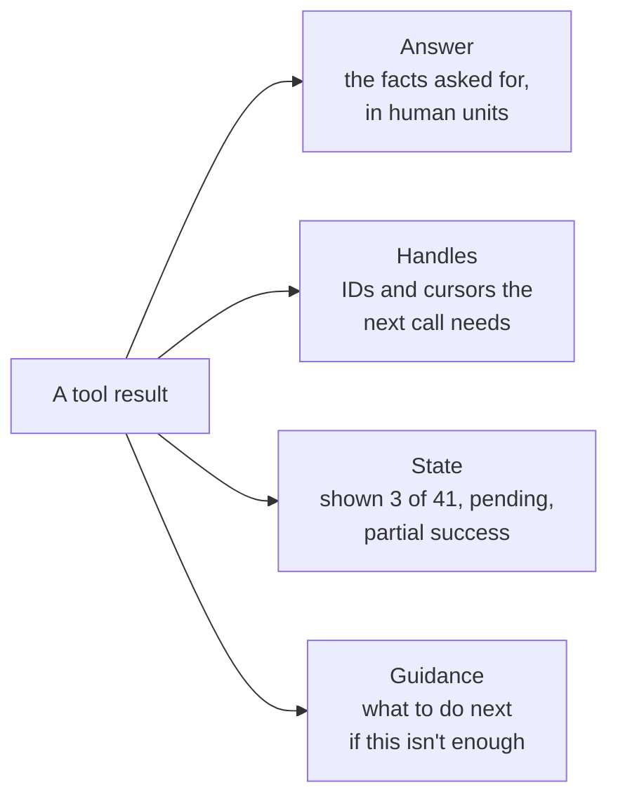

# Returning Just Enough: The Complete Guide

> 📚 **Before you start**
>
> - [Naming, Descriptions and Parameters](naming-descriptions-and-parameters.md), for MandiMart's tools and Pydantic schemas.
> - [Tool Results that Don't Flood the Window](../../context-engineering-and-agent-memory/03-just-in-time-context/tool-results-that-don-t-flood-the-window.md), which covered the *size* of results: filtering at the source, truncating with guidance, and clearing old results. This lesson builds on it and covers the *design* of what a result contains.

## Introduction

Call a good pharmacist and ask, *"Do you have Dolo 650?"* A good one says: *"Yes, three strips, ₹30 each. Shall I keep one aside under your name?"* A bad one reads out the entire stock register, or says only *"Yes"*, leaving you to ask about price, quantity and how to collect it. The good answer is short, answers the question, and hands you exactly what you need for the **next step**.

A tool result is the agent's phone call with your system. The previous course taught you to keep results **small**: filter at the source, paginate, cap, clear old results. Small is necessary but not sufficient. A tiny result that leaves out the order ID the agent needs to issue a refund is just as broken as a huge one, because the agent has to call again, guess, or give up.

This lesson is about designing the **contents** of a result, the response contract between your tool and the agent:

- starting from the agent's next step, and deciding what each result must carry,
- **semantic identifiers** the model can read and copy safely, instead of opaque UUIDs,
- a **`response_format`** switch between concise and detailed results,
- choosing a **format** (JSON, text, tables) by measuring it,
- **cursor pagination** that doesn't break when data changes,
- **summary-first** results for aggregate questions,
- **receipts** for write tools, rich content blocks such as images, and
- a per-tool **output budget** enforced in code.

> 💡 **Key Insight**
>
> Design every result backwards from the agent's **next step**. It must contain the answer, the **handles** needed to act on it (IDs the model can copy), and **guidance** on what to do if it isn't enough. Everything else is noise you pay for on every later turn.

---

## Core Explanation

### 1. Start from the next step

Before writing a tool's return value, list what the agent will plausibly do *after* reading it. For MandiMart's `mandimart_orders_search`:

| Likely next step | What the result must contain |
|---|---|
| Tell the user their order status | Status in words, date, total |
| Refund an item | The **order ID** (exact, copyable) and total |
| Check where the rider is | The **order ID** and whether it's out for delivery |
| Find a different order | Whether there are **more** results and how to get them |
| Nothing matched | **Why** (no orders in 30 days? wrong phone?) and what to try |

That table becomes a **response contract**, four kinds of content every result is checked against:



Results that skip **handles** cause extra lookups. Results that skip **state** cause wrong conclusions ("there are only 3 orders"). Results that skip **guidance** cause aimless retries.

### 2. Identifiers the model can read and copy

Backends love UUIDs: `3f9c2e1a-7b4d-4e0a-9c1f-5d2b8a6e4c13`. To a model, a UUID is 36 characters of high-entropy noise. It costs more tokens than a short name, it carries no meaning, and copying it exactly is a real source of errors: one wrong character and the next call fails. Anthropic's tool-writing guidance reports that resolving opaque IDs into **semantic, human-readable identifiers**, or even a simple 0-indexed scheme, reduced hallucinated IDs and improved retrieval precision in their tests.

There are two clean ways to do this:

- **Use the business's own readable IDs** where they exist: `MM-48213` for an order, `PNQ-07` for a dark store, `AMUL-BTR-100` for a product.
- **Alias** the ugly ones: the tool keeps a mapping from short handles (`store_1`, `rider_ravi_k`) to the real UUIDs, shows the model only the handles, and translates back when the next tool is called.

```python
import json, math, uuid, random

def approx_tokens(text):
    return math.ceil(len(text) / 4)

random.seed(7)
def fake_uuid():
    return str(uuid.UUID(int=random.getrandbits(128)))

class HandleRegistry:
    """Maps short, readable handles to backend IDs, per conversation."""
    def __init__(self):
        self.by_handle, self.by_real = {}, {}

    def handle_for(self, real_id, readable):
        if real_id not in self.by_real:
            base = readable.lower().replace(" ", "_")
            handle, n = base, 2
            while handle in self.by_handle:          # two riders called Ravi K
                handle, n = f"{base}_{n}", n + 1
            self.by_handle[handle], self.by_real[real_id] = real_id, handle
        return self.by_real[real_id]

    def resolve(self, handle):
        if handle not in self.by_handle:
            known = ", ".join(sorted(self.by_handle)[:5])
            raise KeyError(f"Unknown handle '{handle}'. Known handles include: {known}")
        return self.by_handle[handle]

riders = [{"id": fake_uuid(), "name": "Ravi K", "store": "PNQ-07"},
          {"id": fake_uuid(), "name": "Ravi K", "store": "PNQ-03"},
          {"id": fake_uuid(), "name": "Salma S", "store": "PNQ-07"}]

reg = HandleRegistry()
raw_view = [{"rider_id": r["id"], "name": r["name"], "store": r["store"]} for r in riders]
handle_view = [{"rider": reg.handle_for(r["id"], "rider " + r["name"]), "store": r["store"]} for r in riders]

print(json.dumps(handle_view))
print("UUID version:", approx_tokens(json.dumps(raw_view)), "tokens | handle version:",
      approx_tokens(json.dumps(handle_view)), "tokens")
print("next call with 'rider_ravi_k_2' resolves to", reg.resolve("rider_ravi_k_2"))
```

Output:

```
[{"rider": "rider_ravi_k", "store": "PNQ-07"}, {"rider": "rider_ravi_k_2", "store": "PNQ-03"}, {"rider": "rider_salma_s", "store": "PNQ-07"}]
UUID version: 69 tokens | handle version: 36 tokens
next call with 'rider_ravi_k_2' resolves to d23f0824-128b-2f33-0c5c-7fd0a6a3a450
```

The second Ravi gets `rider_ravi_k_2`, so handles stay unique, and the model never has to copy a UUID. If it invents a handle, `resolve` fails with a message listing real ones, which is the kind of error the next lesson is about.

Keep handles **stable** within a conversation (the same rider always gets the same handle), and never reuse a handle for a different object.

### 3. A `response_format` switch: concise by default, detailed on request

Often the agent needs only a summary, but sometimes it needs the full record, including the IDs required to chain another call. Instead of two tools, give one tool a **`response_format`** parameter. Anthropic's guidance describes exactly this pattern: an enum with `concise` and `detailed` values, where their Slack example came to 72 tokens concise against 206 detailed, about a third.

Here's MandiMart's customer context tool, which gathers profile, recent orders and open tickets in one call (the "task tool" from the previous lesson):

```python
CUSTOMER = {
    "customer_id": "c2b1f6de-0f6e-4b7c-a8a1-2f0f7d4a9e55", "name": "Priya Nair", "phone": "9876543210",
    "city": "Pune", "tier": "gold", "since": "2023-04-11", "wallet_balance_paise": 15000,
    "orders": [
        {"order_id": "MM-48213", "placed": "2026-10-14T19:02:11Z", "total_paise": 64900, "status": 4,
         "store": "PNQ-07", "items": 9, "payment": "UPI", "rider": "rider_salma_s"},
        {"order_id": "MM-47990", "placed": "2026-10-11T08:40:52Z", "total_paise": 23950, "status": 4,
         "store": "PNQ-07", "items": 4, "payment": "card", "rider": "rider_ravi_k"},
        {"order_id": "MM-47102", "placed": "2026-09-30T21:15:03Z", "total_paise": 112000, "status": 5,
         "store": "PNQ-03", "items": 17, "payment": "UPI", "rider": None},
    ],
    "tickets": [{"ticket": "TK-3319", "order_id": "MM-48213", "topic": "damaged item", "opened": "2026-10-14"}],
}
STATUS = {1: "placed", 2: "packed", 3: "out for delivery", 4: "delivered", 5: "cancelled"}

def rupees(paise):
    return f"Rs {paise / 100:,.2f}"

def customers_context(phone, response_format="concise"):
    c = CUSTOMER
    if response_format == "concise":
        lines = [f"{c['name']} ({c['tier']} member since {c['since'][:4]}), {c['city']}. "
                 f"Wallet {rupees(c['wallet_balance_paise'])}.",
                 "Recent orders: " + "; ".join(f"{o['order_id']} {o['placed'][:10]} {rupees(o['total_paise'])} "
                                                f"{STATUS[o['status']]}" for o in c["orders"]),
                 "Open tickets: " + "; ".join(f"{t['ticket']} on {t['order_id']} ({t['topic']})" for t in c["tickets"]),
                 "For line items, payment method and rider, call again with response_format='detailed'."]
        return "\n".join(lines)
    detailed = {k: c[k] for k in ("name", "phone", "city", "tier", "since")}
    detailed["wallet"] = rupees(c["wallet_balance_paise"])
    detailed["orders"] = [{**{k: o[k] for k in ("order_id", "store", "items", "payment", "rider")},
                           "placed": o["placed"][:16].replace("T", " "), "total": rupees(o["total_paise"]),
                           "status": STATUS[o["status"]]} for o in c["orders"]]
    detailed["tickets"] = c["tickets"]
    return json.dumps(detailed)

concise = customers_context("9876543210")
detailed = customers_context("9876543210", "detailed")
print(concise)
print("\nconcise:", approx_tokens(concise), "tokens | detailed:", approx_tokens(detailed), "tokens")
```

Output:

```
Priya Nair (gold member since 2023), Pune. Wallet Rs 150.00.
Recent orders: MM-48213 2026-10-14 Rs 649.00 delivered; MM-47990 2026-10-11 Rs 239.50 delivered; MM-47102 2026-09-30 Rs 1,120.00 cancelled
Open tickets: TK-3319 on MM-48213 (damaged item)
For line items, payment method and rider, call again with response_format='detailed'.

concise: 84 tokens | detailed: 191 tokens
```

Three details make this work:

- **Concise is the default.** Most turns need the summary, and defaults are what the model gets when it doesn't think about the parameter.
- **Concise still carries the handles that matter most** (order IDs, ticket IDs). Dropping *all* IDs from the concise form would force a second call for nearly every action.
- **The concise result says how to get more.** That last line is guidance, from the response contract.

The schema for the parameter is an enum with a description that says when to use each value: `"concise (default): summary for answering the user. detailed: every field, use before acting on a specific order."`

### 4. Choose a format by measuring it

There's no single best format for tool results. JSON is unambiguous and easy for code to parse; plain text and tables are often shorter and read naturally. Measure the same data in a few shapes:

```python
import csv, io

rows = [{"order_id": f"MM-{48213 - i * 37}", "date": f"2026-10-{14 - i:02d}", "total_inr": 649 - i * 41,
         "status": ["delivered", "cancelled", "out for delivery"][i % 3], "store": ["PNQ-07", "PNQ-03"][i % 2]}
        for i in range(10)]

as_json = json.dumps(rows)
as_json_pretty = json.dumps(rows, indent=2)
header = list(rows[0])
as_markdown = "| " + " | ".join(header) + " |\n|" + "---|" * len(header) + "\n" + \
              "\n".join("| " + " | ".join(str(r[h]) for h in header) + " |" for r in rows)
buf = io.StringIO()
writer = csv.DictWriter(buf, fieldnames=header, lineterminator="\n")
writer.writeheader()
writer.writerows(rows)
as_csv = buf.getvalue()
as_lines = "\n".join(f"{r['order_id']} {r['date']} Rs {r['total_inr']} {r['status']} ({r['store']})" for r in rows)

for name, text in [("JSON, indented", as_json_pretty), ("JSON, compact", as_json),
                   ("Markdown table", as_markdown), ("CSV", as_csv), ("one line per row", as_lines)]:
    print(f"{name:<18} {approx_tokens(text):>4} tokens")
```

Output:

```
JSON, indented      341 tokens
JSON, compact       276 tokens
Markdown table      156 tokens
CSV                 117 tokens
one line per row    120 tokens
```

Indented JSON is the most expensive, because indentation and repeated keys are paid for on every row. For **lists of uniform records**, a table or CSV with one header row is usually cheapest. For **nested or irregular data**, compact JSON keeps structure clear. Guidelines:

- **The model will read it?** Prefer compact text or a table, with units and words instead of codes.
- **Code will parse it?** (You'll see this in Module 3, when the agent writes code that calls tools.) Prefer JSON, and document the exact shape in the description.
- **Never mix formats within one tool.** If errors come back as prose and successes as JSON, the model has to guess which it got.

### 5. Pagination that survives changing data

The earlier course showed `page=2` style pagination. Page numbers have a flaw when the data changes between calls: if a new order arrives while the agent is on page 1, everything shifts by one and page 2 repeats an order or skips one. Production APIs use **cursors** instead: the result includes an opaque token that encodes "continue after this exact item", and the next call passes it back.

```python
import base64

ORDERS = [{"order_id": f"MM-{48300 - i}", "placed": f"2026-10-{14 - i // 4:02d} {20 - i % 4}:00",
           "total_inr": 150 + (i * 53) % 900} for i in range(23)]

def encode_cursor(last_order_id):
    return base64.urlsafe_b64encode(json.dumps({"after": last_order_id}).encode()).decode()

def decode_cursor(cursor):
    return json.loads(base64.urlsafe_b64decode(cursor.encode()))["after"]

def orders_list(store, cursor=None, limit=5, data=None):
    data = ORDERS if data is None else data
    ordered = sorted(data, key=lambda o: o["order_id"], reverse=True)      # stable order: newest ID first
    start = 0
    if cursor:
        after = decode_cursor(cursor)
        start = next(i for i, o in enumerate(ordered) if o["order_id"] < after)
    page = ordered[start:start + limit]
    more = start + limit < len(ordered)
    text = "\n".join(f"{o['order_id']} {o['placed']} Rs {o['total_inr']}" for o in page)
    footer = f"\n{len(page)} shown, {len(ordered) - start - len(page)} more after these."
    if more:
        footer += f" To continue, call again with cursor='{encode_cursor(page[-1]['order_id'])}'."
    return text + footer

first = orders_list("PNQ-07")
print(first)
cursor = first.split("cursor='")[1].rstrip("'.")
# A new order arrives between the two calls:
ORDERS.insert(0, {"order_id": "MM-48301", "placed": "2026-10-14 21:00", "total_inr": 410})
print("\n--- next call ---")
print(orders_list("PNQ-07", cursor=cursor))
```

Output:

```
MM-48300 2026-10-14 20:00 Rs 150
MM-48299 2026-10-14 19:00 Rs 203
MM-48298 2026-10-14 18:00 Rs 256
MM-48297 2026-10-14 17:00 Rs 309
MM-48296 2026-10-13 20:00 Rs 362
5 shown, 18 more after these. To continue, call again with cursor='eyJhZnRlciI6ICJNTS00ODI5NiJ9'.

--- next call ---
MM-48295 2026-10-13 19:00 Rs 415
MM-48294 2026-10-13 18:00 Rs 468
MM-48293 2026-10-13 17:00 Rs 521
MM-48292 2026-10-12 20:00 Rs 574
MM-48291 2026-10-12 19:00 Rs 627
5 shown, 13 more after these. To continue, call again with cursor='eyJhZnRlciI6ICJNTS00ODI5MSJ9'.
```

The new order `MM-48301` didn't shift the second page: it continued exactly after `MM-48296`. Cursor rules worth copying:

- **Order by something stable and unique** (an ID or a timestamp plus ID).
- **Keep cursors opaque.** The model should pass them back, not edit them. Base64 is enough to discourage tinkering; sign them if they could be abused.
- **Say how many more there are**, when it's cheap to count, so the agent can decide whether to keep paging or narrow the search.

### 6. Summary first for aggregate questions

Some questions are about *many* records: *"How did PNQ-07 do last week?"* No page size is right for that; the answer is an aggregate. Give such tools a **summary-first** result: totals, breakdowns and the few outliers worth acting on, with a pointer to the detail tool.

```python
WEEK = [{"store": "PNQ-07", "day": d, "orders": o, "revenue_inr": r, "stockouts": s}
        for d, o, r, s in [("Mon", 412, 151200, 1), ("Tue", 398, 146900, 0), ("Wed", 455, 170300, 3),
                           ("Thu", 430, 158800, 0), ("Fri", 501, 189400, 2), ("Sat", 640, 241100, 4),
                           ("Sun", 702, 266000, 1)]]

def stores_weekly_summary(store):
    rows = [w for w in WEEK if w["store"] == store]
    orders = sum(w["orders"] for w in rows)
    revenue = sum(w["revenue_inr"] for w in rows)
    best = max(rows, key=lambda w: w["revenue_inr"])
    worst_stock = sorted(rows, key=lambda w: -w["stockouts"])[:2]
    return (f"{store}, 7 days: {orders:,} orders, revenue Rs {revenue:,}, average order Rs {revenue / orders:,.0f}.\n"
            f"Best day: {best['day']} (Rs {best['revenue_inr']:,}). "
            f"Stockout days to check: " + ", ".join(f"{w['day']} ({w['stockouts']})" for w in worst_stock) + ".\n"
            f"For per-SKU stockouts on a day, call mandimart_stock_events with store and day.")

print(stores_weekly_summary("PNQ-07"))
```

Output:

```
PNQ-07, 7 days: 3,538 orders, revenue Rs 1,323,700, average order Rs 374.
Best day: Sun (Rs 266,000). Stockout days to check: Sat (4), Wed (3).
For per-SKU stockouts on a day, call mandimart_stock_events with store and day.
```

The model gets the answer to the question asked, the two days worth investigating, and the exact next tool, in under 80 tokens. The detailed rows never enter the context unless the agent decides it needs them.

### 7. Write tools return receipts

A result from a tool that *changes* something has a different job: it must let the agent **confirm what happened** and tell the user accurately. A good receipt includes:

- **what changed**, with the new state (`refund RF-20931 created: Rs 89.00, status pending_approval`),
- **IDs** of anything created, so later steps can refer to it,
- **what happens next** and when (`credit expected by 17 Oct`),
- anything the agent **must tell the user** (`needs supervisor approval because it exceeds Rs 2,000`),
- and, if the request was **idempotent**, the key it was matched on, so a retry is visibly harmless.

```python
REFUNDS = {}

def refunds_create(order_id, amount_inr, reason, idempotency_key):
    if idempotency_key in REFUNDS:
        r = REFUNDS[idempotency_key]
        return (f"Already done (same idempotency_key): refund {r['id']} for {order_id}, Rs {r['amount']:,.2f}, "
                f"status {r['status']}. No new refund was created.")
    status = "pending_approval" if amount_inr > 2000 else "processing"
    r = {"id": f"RF-{20931 + len(REFUNDS)}", "amount": amount_inr, "status": status}
    REFUNDS[idempotency_key] = r
    msg = (f"Refund {r['id']} created for {order_id}: Rs {amount_inr:,.2f} ({reason}), status {status}. ")
    if status == "pending_approval":
        msg += "Over Rs 2,000, so a supervisor must approve it within 4 working hours. Tell the user; do not retry."
    else:
        msg += "Credit to the original payment method expected within 2 working days."
    return msg

print(refunds_create("MM-48213", 89, "item_damaged", "conv42-refund-1"))
print(refunds_create("MM-48213", 89, "item_damaged", "conv42-refund-1"))
print(refunds_create("MM-47102", 1120 * 2, "order_cancelled", "conv42-refund-2"))
```

Output:

```
Refund RF-20931 created for MM-48213: Rs 89.00 (item_damaged), status processing. Credit to the original payment method expected within 2 working days.
Already done (same idempotency_key): refund RF-20931 for MM-48213, Rs 89.00, status processing. No new refund was created.
Refund RF-20932 created for MM-47102: Rs 2,240.00 (order_cancelled), status pending_approval. Over Rs 2,000, so a supervisor must approve it within 4 working hours. Tell the user; do not retry.
```

The second call shows why idempotency keys matter for agents in particular: a model whose context was compacted, or a harness that retried after a timeout, may send the same request twice. The receipt makes that safe and tells the model so.

### 8. Rich content: text is not the only option

A tool result isn't limited to a string. In the Anthropic Messages API, a `tool_result`'s `content` can be a list of content blocks, including **text**, **images** and **documents**, which lets a tool return a chart, a photo of a damaged item, or a PDF invoice for the model to look at:

```json
{
  "type": "tool_result",
  "tool_use_id": "toolu_01A9cd...",
  "content": [
    {"type": "text", "text": "Photo uploaded by the customer for MM-48213, taken 14 Oct 19:41."},
    {"type": "image", "source": {"type": "base64", "media_type": "image/jpeg", "data": "/9j/4AAQSk..."}}
  ]
}
```

Images are expensive (often a thousand tokens or more each), so return them only when the agent must *see* something, and pair each with a line of text saying what it is. The **Model Context Protocol**, covered in the next course, has its own result shape that can carry both human-readable content and a machine-readable `structuredContent` object; the same design rules apply. And when the result fails, the Anthropic API has an `is_error: true` flag on the `tool_result`, which is the subject of the next lesson.

### 9. Enforce an output budget in code

Finally, don't rely on every tool author remembering all of this. Wrap tools with a **per-tool output budget**: if a result exceeds it, the wrapper first tries the concise form, then truncates with guidance. Claude Code applies the same idea to tool output at a larger scale; Anthropic's post on writing tools mentions a default cap of 25,000 tokens per tool response there.

```python
def with_budget(max_tokens):
    def wrap(tool_fn):
        def run(**kwargs):
            out = tool_fn(**kwargs)
            if approx_tokens(out) <= max_tokens:
                return out
            if kwargs.get("response_format") == "detailed":
                kwargs["response_format"] = "concise"
                concise_out = tool_fn(**kwargs)
                if approx_tokens(concise_out) <= max_tokens:
                    return concise_out + f"\n[Detailed form was over the {max_tokens}-token budget, so the concise form is shown.]"
                out = concise_out
            keep = max_tokens * 4
            return out[:keep] + f"\n[Cut at {max_tokens} tokens. Narrow the request (fewer days, one store) to see the rest.]"
        run.__name__ = tool_fn.__name__
        return run
    return wrap

budgeted_context = with_budget(max_tokens=120)(customers_context)
print(budgeted_context(phone="9876543210", response_format="detailed"))
```

Output:

```
Priya Nair (gold member since 2023), Pune. Wallet Rs 150.00.
Recent orders: MM-48213 2026-10-14 Rs 649.00 delivered; MM-47990 2026-10-11 Rs 239.50 delivered; MM-47102 2026-09-30 Rs 1,120.00 cancelled
Open tickets: TK-3319 on MM-48213 (damaged item)
For line items, payment method and rider, call again with response_format='detailed'.
[Detailed form was over the 120-token budget, so the concise form is shown.]
```

The wrapper falls back gracefully and says what it did, so the model knows it's seeing the concise form and why.


*Every result answers, hands over the IDs for the next step, states what's missing, and says what to do next.*

---

## Try It Yourself

1. **Handles for stores.** MandiMart's store table uses UUIDs. Use `HandleRegistry` to give the stores "Kothrud" and "Baner" handles prefixed with `store`, print them, then call `resolve` on a handle that doesn't exist and print the error.
2. **Format choice.** For the 10 `rows` above, write a format that groups by status (one line per status listing its order IDs) and compare its tokens with "one line per row". When would the grouped form be the wrong choice?
3. **A missing guidance line.** `orders_list` says nothing when a store has no orders. Change it so an empty page returns guidance, and print the result for an empty list.
4. **Receipt check.** Write a function `receipt_ok(text)` that returns True only if a write-tool result mentions a created ID (like `RF-12345`) and a status. Test it on the three receipts above.

<details>
<summary>Show answers</summary>

**1.**

```python
stores = [{"id": fake_uuid(), "name": "Kothrud"}, {"id": fake_uuid(), "name": "Baner"}]
sreg = HandleRegistry()
print([sreg.handle_for(s["id"], "store " + s["name"]) for s in stores])
try:
    sreg.resolve("store_aundh")
except KeyError as err:
    print(err)
```

Output:

```
['store_kothrud', 'store_baner']
"Unknown handle 'store_aundh'. Known handles include: store_baner, store_kothrud"
```

**2.**

```python
from collections import defaultdict
groups = defaultdict(list)
for r in rows:
    groups[r["status"]].append(r["order_id"])
grouped = "\n".join(f"{status}: {', '.join(ids)}" for status, ids in sorted(groups.items()))
print(grouped)
print(approx_tokens(grouped), "tokens grouped vs", approx_tokens(as_lines), "one line per row")
```

Output:

```
cancelled: MM-48176, MM-48065, MM-47954
delivered: MM-48213, MM-48102, MM-47991, MM-47880
out for delivery: MM-48139, MM-48028, MM-47917
34 tokens grouped vs 120 one line per row
```

Grouping is shorter and great for "which orders were cancelled?", but it drops dates, totals and stores. If the next step needs those (a refund amount, say), the grouped form forces another call. Format follows the next step.

**3.**

```python
def orders_list_v2(store, cursor=None, limit=5, data=None):
    if data is not None and not data:
        return (f"No orders for {store} in this period. Check the store code (e.g. PNQ-07) "
                "or widen the date range.")
    return orders_list(store, cursor, limit, data)

print(orders_list_v2("PNQ-99", data=[]))
```

Output:

```
No orders for PNQ-99 in this period. Check the store code (e.g. PNQ-07) or widen the date range.
```

**4.**

```python
import re

def receipt_ok(text):
    return bool(re.search(r"\bRF-\d{5}\b", text)) and "status" in text

for k in ("conv42-refund-1", "conv42-refund-2"):
    r = REFUNDS[k]
    print(r["id"], receipt_ok(refunds_create("MM-0", 1, "x", k)))
```

Output:

```
RF-20931 True
RF-20932 True
```

</details>

---

## Real-World Examples

- **Slack and Asana tools at Anthropic**: their published write-up on tool design uses a Slack thread tool with a concise and detailed `response_format` to show the token difference, and reports better results after replacing UUIDs with readable identifiers.
- **Stripe and most payment APIs** use cursor pagination (`starting_after` an object ID) and idempotency keys on create requests, two patterns that carry over directly to agent tools.
- **Coding agents' search tools** return file paths and line numbers (handles) with short snippets, plus a count of further matches, rather than whole files.

---

## Common Misconceptions

### "Smaller results are always better"

Only down to the point where the next step still has what it needs. A result without the order ID forces another call, which costs more than the ID ever would.

### "JSON is the native language of models, so always return JSON"

Models read JSON well, but repeated keys and indentation cost tokens on every row. For lists the model will read, a table or plain lines are often cheaper and just as clear. Use JSON where structure or code parsing matters.

### "Page numbers are fine"

They're fine for data that doesn't change. Live data (orders, messages, logs) shifts between calls; cursors anchored to an item don't.

### "Write tools can just return 'OK'"

"OK" can't be quoted to the user, can't be referred to later, and can't distinguish "done" from "already done" or "pending approval". Return a receipt.

---

## Interview Relevance

*"How do you design what a tool returns to an agent?"* A strong answer works backwards from the next step: include the answer in human units, the handles the next call needs (readable IDs, cursors), the state (counts, pending, partial), and guidance on what to do next. It mentions semantic identifiers instead of UUIDs (with an alias map if needed), a concise/detailed `response_format` with concise as default, measuring formats rather than assuming JSON, cursor pagination for live data, summary-first results for aggregates, receipts with idempotency for writes, and a per-tool output budget enforced in code.

Follow-up: *"The agent keeps calling the same search twice."* Read the transcript: often the first result lacked a handle or didn't say there were more results, so the agent searched again to be sure. Fix the result, not the prompt.

---

## Key Takeaways

- **Design backwards from the next step**: answer, handles, state, guidance.
- **Readable IDs** beat UUIDs; alias opaque IDs to stable handles and resolve them back in code.
- **`response_format`**: concise by default (still with key IDs), detailed on request, with a line saying how to get more.
- **Measure formats**; use cursors for live data and **summary-first** results for aggregate questions.
- **Write tools return receipts**, idempotently, and every tool runs under an **output budget**.

---

**Up next:** [Error Messages that Help the Agent Recover](error-messages-that-help-the-agent-recover.md)
