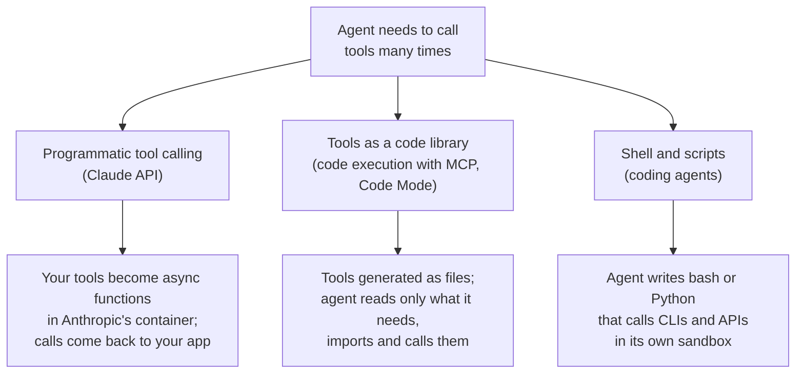
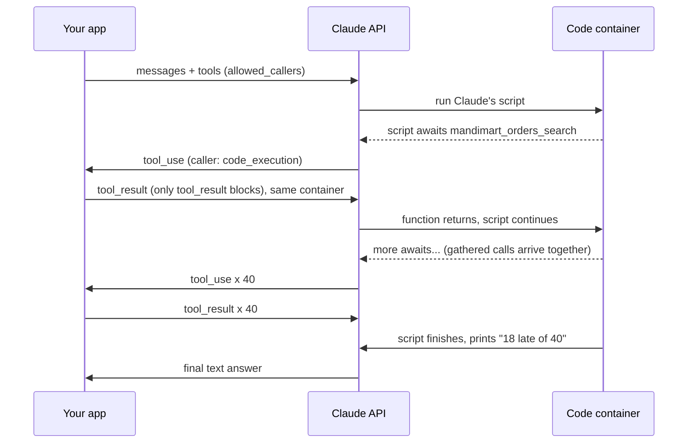

# Code Execution: Agents that Write Code against Tools: The Complete Guide

> 📚 **Before you start**
>
> - [Tool Search and Deferred Loading](tool-search-and-deferred-loading.md), which solved the cost of tool *definitions*; this lesson tackles the cost of tool *results*.
> - [Returning Just Enough](../02-writing-tools-for-agents/returning-just-enough.md), for why big results hurt and how output formats affect tokens.
> - Basic Python `async`/`await` helps for section 4; [Python Programming](../../python-programming/course.md) covers the language.

## Introduction

Suppose the Kothrud store manager asks: *"Yesterday, how many orders were delivered late, and how much do we owe in late-delivery coupons at Rs 20 each?"*

An agent with the tools from Module 2 would do this one call at a time: search yesterday's orders, get order 1, get order 2, ... get order 40, then add up the late ones in its head. Every one of those 40 results passes through the model's context, every step re-sends everything before it, and at the end the model does arithmetic, which it's not reliably good at. The answer is two numbers. The work to get there is thousands of tokens of order details nobody needed to read.

A person with a laptop wouldn't do it that way. They'd write a five-line loop. **Code execution** gives the agent that laptop: the model writes a short program that calls the tools, the program runs in a sandbox, and only what the program prints comes back to the model.

This idea is now everywhere in the market, under different names:

- **Programmatic tool calling** on the Claude API: your tools become functions that Claude's code can call inside Anthropic's code execution container.
- **Code execution with MCP** (Anthropic's engineering post, November 2025) and Cloudflare's **Code Mode**: MCP tools are presented as a folder of code modules that the agent discovers and imports.
- **Coding agents** like Claude Code and Codex, which mostly work by writing and running shell commands and scripts.

> 💡 **Key Insight**
>
> Loops, filters and sums belong in code, not in the context window. When the agent writes a program that calls tools, **intermediate results stay in the sandbox** and only the final answer returns. That saves tokens and steps, and makes the logic exact. In exchange, you must run model-written code safely.

---

## Core Explanation

### 1. One tool call per step, and what it costs

Let's set up MandiMart's data and the two tools the agent needs. Each order record is realistic: items, rider, address, timings.

```python
import json, math, random
from datetime import datetime, timedelta

def approx_tokens(text):
    return math.ceil(len(text) / 4)

rng = random.Random(16)
ITEMS = ["Amul Butter 100g", "MTR Dosa Mix 500g", "Aashirvaad Atta 5kg", "Tata Salt 1kg",
         "Mother Dairy Curd 400g", "Fortune Oil 1L", "Parle-G 800g", "Onion 1kg"]
ORDERS = {}
for i in range(40):
    placed = datetime(2026, 10, 16, 8, 0) + timedelta(minutes=rng.randint(0, 720))
    took = rng.choice([7, 8, 9, 9, 10, 11, 12, 14, 18, 25])
    oid = f"MM-{48300 + i}"
    ORDERS[oid] = {
        "order_id": oid, "store": "PNQ-07", "status": "delivered",
        "placed_at": placed.isoformat(timespec="minutes"),
        "delivered_at": (placed + timedelta(minutes=took)).isoformat(timespec="minutes"),
        "promised_minutes": 10,
        "items": [{"name": n, "qty": rng.randint(1, 3)} for n in rng.sample(ITEMS, rng.randint(2, 5))],
        "rider": {"name": rng.choice(["Ganesh", "Imran", "Sachin", "Ravi"]), "id": f"R-{rng.randint(100, 999)}"},
        "address": f"Flat {rng.randint(1, 20)}0{rng.randint(1, 4)}, Kothrud, Pune 411038",
        "payment": rng.choice(["UPI", "Card", "Cash"]),
    }

def mandimart_orders_search(store, date):
    ids = [o["order_id"] for o in ORDERS.values() if o["store"] == store and o["placed_at"].startswith(date)]
    return json.dumps({"order_ids": ids})

def mandimart_orders_get(order_id):
    return json.dumps(ORDERS[order_id])

print(mandimart_orders_get("MM-48300"))
print(approx_tokens(mandimart_orders_get("MM-48300")), "tokens per order result")
```

Output:

```
{"order_id": "MM-48300", "store": "PNQ-07", "status": "delivered", "placed_at": "2026-10-16T14:10", "delivered_at": "2026-10-16T14:24", "promised_minutes": 10, "items": [{"name": "Mother Dairy Curd 400g", "qty": 2}, {"name": "Tata Salt 1kg", "qty": 3}, {"name": "MTR Dosa Mix 500g", "qty": 3}, {"name": "Parle-G 800g", "qty": 2}, {"name": "Amul Butter 100g", "qty": 1}], "rider": {"name": "Imran", "id": "R-110"}, "address": "Flat 1003, Kothrud, Pune 411038", "payment": "Card"}
120 tokens per order result
```

Now simulate the classic agent loop: one tool call per step. On each step the model receives everything so far (system prompt, tools, history) and adds one call and one result.

```python
def classic_loop_cost(order_ids, prompt_tokens=1500):
    history = approx_tokens(mandimart_orders_search("PNQ-07", "2026-10-16"))   # first result
    total_input, steps = prompt_tokens, 1                                     # step 1: the search call
    for oid in order_ids:
        steps += 1
        total_input += prompt_tokens + history          # model re-reads everything so far
        call = approx_tokens(json.dumps({"name": "mandimart_orders_get", "input": {"order_id": oid}}))
        history += call + approx_tokens(mandimart_orders_get(oid))
    steps += 1
    total_input += prompt_tokens + history              # final step: write the answer
    return steps, history, total_input

ids = json.loads(mandimart_orders_search("PNQ-07", "2026-10-16"))["order_ids"]
steps, ctx, total = classic_loop_cost(ids)
print(f"{steps} model steps, {ctx:,} tokens of results in context, {total:,} input tokens in total")
```

Output:

```
42 model steps, 5,081 tokens of results in context, 170,467 input tokens in total
```

Forty-two model round-trips, and because each step re-sends the growing history, total input grows roughly with the *square* of the number of calls. Then the model must still count late deliveries correctly by reading 40 JSON blobs.

### 2. The same task as a program

With code execution the model writes this instead, in a single step:

```python
MODEL_WRITTEN = '''
ids = json.loads(mandimart_orders_search(store="PNQ-07", date="2026-10-16"))["order_ids"]
late = []
for oid in ids:
    o = json.loads(mandimart_orders_get(order_id=oid))
    took = (datetime.fromisoformat(o["delivered_at"]) - datetime.fromisoformat(o["placed_at"])).seconds // 60
    if took > o["promised_minutes"]:
        late.append((oid, took))
print(f"{len(late)} of {len(ids)} orders late; coupons owed: Rs {20 * len(late)}")
print("worst:", sorted(late, key=lambda x: -x[1])[:3])
'''
```

Your harness runs it with the tools available as functions, and captures what it prints. (Here we use plain `exec` to show the idea. `exec` is **not** a safe way to run model-written code; the next lesson is entirely about doing this safely.)

```python
import contextlib, io

def run_model_code(code, tools):
    namespace = {"json": json, "datetime": datetime, **tools}
    out = io.StringIO()
    with contextlib.redirect_stdout(out):
        exec(code, namespace)
    return out.getvalue()

printed = run_model_code(MODEL_WRITTEN, {"mandimart_orders_search": mandimart_orders_search,
                                         "mandimart_orders_get": mandimart_orders_get})
print(printed)
code_cost = 1500 + approx_tokens(MODEL_WRITTEN)          # step 1: read prompt, write code
code_cost += 1500 + approx_tokens(MODEL_WRITTEN) + approx_tokens(printed)   # step 2: read output, answer
print(f"2 model steps, {approx_tokens(printed)} tokens of results in context, ~{code_cost:,} input tokens in total")
print(f"saving: {1 - code_cost / total:.0%}")
```

Output:

```
18 of 40 orders late; coupons owed: Rs 360
worst: [('MM-48328', 25), ('MM-48333', 25), ('MM-48339', 25)]

2 model steps, 27 tokens of results in context, ~3,273 input tokens in total
saving: 98%
```

Same answer, exact arithmetic, two model steps instead of forty-two. The 41 tool calls still happened, but inside the program; their results never touched the context window.

Real measurements are smaller than this toy (because real tasks mix code with ordinary reasoning) but large. Anthropic reported:

- a **37% reduction** in average tokens on complex research tasks with programmatic tool calling (43,588 to 27,297 tokens);
- a team-budget example where processing 2,000+ expense line items dropped from about **200 KB** of context to about **1 KB** of results;
- for code execution with MCP, an example workflow going from about **150,000 tokens to 2,000**, a 98.7% cut.

### 3. Three ways the market does this



| | Programmatic tool calling | Tools as a code library | Shell and scripts |
|---|---|---|---|
| Who runs the code | Anthropic's code execution container | Your sandbox | Your sandbox (or the developer's machine) |
| Who runs the tools | Your app, called back mid-script | The sandbox, via MCP clients or APIs | CLIs and SDKs inside the sandbox |
| How the model finds tools | Normal tool definitions (can be deferred) | Lists and reads files in a `servers/` folder | `--help`, docs, skills |
| Typical use | API apps with your own tools | Agents with many MCP servers | Claude Code, Codex, Gemini CLI |

### 4. Programmatic tool calling on the Claude API

You enable the code execution tool and mark which of your tools may be called from code with `allowed_callers`:

```python
# not-run: needs the anthropic package and an API key
import anthropic

client = anthropic.Anthropic()
tools = [
    {"type": "code_execution_20260120", "name": "code_execution"},
    {
        "name": "mandimart_orders_search",
        "description": "Find MandiMart orders for a store and date. Returns JSON: {\"order_ids\": [\"MM-48300\", ...]}.",
        "input_schema": {"type": "object",
                         "properties": {"store": {"type": "string", "description": "Store code like PNQ-07"},
                                        "date": {"type": "string", "description": "YYYY-MM-DD"}},
                         "required": ["store", "date"]},
        "allowed_callers": ["code_execution_20260120"],
    },
    {
        "name": "mandimart_orders_get",
        "description": "Get one order as JSON with keys order_id, placed_at, delivered_at (ISO, IST), "
                       "promised_minutes, items, rider, address, payment.",
        "input_schema": {"type": "object", "properties": {"order_id": {"type": "string"}},
                         "required": ["order_id"]},
        "allowed_callers": ["code_execution_20260120"],
    },
]
messages = [{"role": "user", "content": "Kothrud (PNQ-07) yesterday, 2026-10-16: how many orders were late, "
                                        "and what do we owe at Rs 20 coupon per late order?"}]
response = client.messages.create(model="claude-opus-5-5", max_tokens=4096, tools=tools, messages=messages)
```

`allowed_callers` defaults to `["direct"]`, meaning normal tool calls only. With the code execution tool type listed, Claude can call the tool from inside its script, where it appears as an **async Python function**. The script Claude writes looks like this:

```python
# not-run: runs inside Anthropic's code execution container, where the tools are injected
import asyncio, json
ids = json.loads(await mandimart_orders_search({"store": "PNQ-07", "date": "2026-10-16"}))["order_ids"]
orders = await asyncio.gather(*[mandimart_orders_get({"order_id": i}) for i in ids])
late = [o for o in map(json.loads, orders) if minutes_taken(o) > o["promised_minutes"]]
print(len(late), "late of", len(ids))
```

Example output:

```
18 late of 40
```

Here is what happens on the wire. Each time the script awaits one of your tools, the API pauses the script and returns a `tool_use` block to you, tagged with a `caller` that says it came from code:

```json
{
  "type": "tool_use",
  "id": "toolu_01JK...",
  "name": "mandimart_orders_get",
  "input": {"order_id": "MM-48300"},
  "caller": {"type": "code_execution_20260120", "tool_id": "srvtoolu_01AB..."}
}
```



Your app runs the tool and replies with `tool_result` blocks as usual. The results go back **into the script**, not into Claude's context. Rules worth knowing:

- The reply that returns results must contain **only `tool_result` blocks** (no extra text), and must pass the `container` ID from the response so the paused script can resume.
- A paused script waits about **4 minutes** for your result before the call times out inside the script; idle containers are reclaimed after a few minutes.
- It isn't compatible with `strict` tool schemas, forced `tool_choice`, `disable_parallel_tool_use`, or tools from the MCP connector.
- `allowed_callers` controls *where* a tool may be called from. It is **not a security boundary**: your tool must still check permissions and validate input exactly as if the model called it directly.
- Because code parses your results, **document the output format** in the description (as above), and return structured JSON. Module 2's advice on returning just enough still applies; parseable becomes as important as readable.

### 5. Tools as a code library

Anthropic's "code execution with MCP" post and Cloudflare's Code Mode go one step further: don't send tool definitions at all. Generate a small code file for each tool, put them in a folder tree, and let the agent explore it with ordinary file commands. The agent reads only the files it needs, which is tool search done with `ls` and `cat`.

Let's generate such a tree for a few MCP servers:

```python
import os, tempfile, textwrap

SERVERS = {
    "mandimart": {"orders_search": "Find orders for a store and date. Returns {order_ids: [...]}.",
                  "orders_get": "Get one order with placed_at, delivered_at, promised_minutes, items, rider.",
                  "coupons_issue": "Issue a coupon of amount_rupees to a customer for an order."},
    "razorpay": {"refunds_search": "Search refunds by order ID; status pending, processed or failed."},
    "slack": {"messages_post": "Post a message to a Slack channel like #kothrud-ops."},
}
root = tempfile.mkdtemp()
for server, tools_ in SERVERS.items():
    os.makedirs(os.path.join(root, "servers", server))
    for name, doc in tools_.items():
        src = textwrap.dedent(f'''\
            from client import call_mcp_tool

            def {name}(**kwargs) -> dict:
                """{doc}"""
                return call_mcp_tool("{server}", "{name}", kwargs)
            ''')
        with open(os.path.join(root, "servers", server, f"{name}.py"), "w") as f:
            f.write(src)

for dirpath, _, files in sorted(os.walk(os.path.join(root, "servers"))):
    depth = dirpath[len(root):].count(os.sep)
    print("  " * (depth - 1) + os.path.basename(dirpath) + "/")
    for f in sorted(files):
        print("  " * depth + f)
print()
print(open(os.path.join(root, "servers", "mandimart", "coupons_issue.py")).read())
```

Output:

```
servers/
  mandimart/
    coupons_issue.py
    orders_get.py
    orders_search.py
  razorpay/
    refunds_search.py
  slack/
    messages_post.py

from client import call_mcp_tool

def coupons_issue(**kwargs) -> dict:
    """Issue a coupon of amount_rupees to a customer for an order."""
    return call_mcp_tool("mandimart", "coupons_issue", kwargs)
```

The agent's first steps look like a developer exploring a new codebase: `ls servers/` (a few tokens), `ls servers/mandimart/`, `cat servers/mandimart/orders_get.py`, then it writes a script that imports those functions. Hundreds of servers cost nothing until opened. The `call_mcp_tool` helper is the harness's bridge: it forwards the call to the real MCP server *outside* the sandbox, so the sandbox never holds the server's credentials.

This approach also lets the agent **save useful scripts** back into the workspace (for example `./skills/late_delivery_report.py`) and reuse them later. Module 4 turns that habit into a formal format: Agent Skills.

### 6. A bonus: data that never reaches the model

Because results stay in the sandbox, the harness can keep sensitive data away from the model entirely. Suppose the task is "send each late customer a sorry message on WhatsApp". The script needs phone numbers; the model doesn't. A harness can **tokenize** sensitive fields on the way out of a tool and swap the real values back in on the way into another tool:

```python
import re

class PIIVault:
    """Replace phone numbers with placeholders the model can pass around but not read."""
    def __init__(self):
        self.real, self.count = {}, 0

    def tokenize(self, text):
        def swap(m):
            self.count += 1
            token = f"[PHONE_{self.count}]"
            self.real[token] = m.group(0)
            return token
        return re.sub(r"\b[6-9]\d{9}\b", swap, text)

    def detokenize(self, text):
        return re.sub(r"\[PHONE_\d+\]", lambda m: self.real[m.group(0)], text)

vault = PIIVault()
raw = json.dumps({"order_id": "MM-48311", "customer": "Sneha", "phone": "9876543210"})
seen_by_model = vault.tokenize(raw)
print("model sees:   ", seen_by_model)
model_call = {"tool": "whatsapp_send", "to": "[PHONE_1]", "text": "Sorry your order was late, Rs 20 coupon added."}
print("tool receives:", vault.detokenize(json.dumps(model_call)))
```

Output:

```
model sees:    {"order_id": "MM-48311", "customer": "Sneha", "phone": "[PHONE_1]"}
tool receives: {"tool": "whatsapp_send", "to": "9876543210", "text": "Sorry your order was late, Rs 20 coupon added."}
```

Anthropic's post describes exactly this pattern for MCP: the MCP client tokenizes personal data so it flows from one system to another (a spreadsheet to a CRM, say) without ever entering the model's context. For Indian businesses handling phone numbers and addresses under the Digital Personal Data Protection Act, keeping personal data out of prompts is a real design benefit.

### 7. When code execution is the wrong tool

Code execution is not free:

- **You must run untrusted code.** Whatever the model writes, influenced by whatever text it read, runs on a machine. That needs a real sandbox: no network unless required, no secrets, resource limits. The next lesson is about exactly this.
- **Latency per round-trip.** A one-call task ("what's the status of MM-48213?") is faster as a direct tool call. Code adds a container start and a script.
- **Harder to audit.** A reviewer reads a script instead of a list of calls. Log both the code and every tool call it made.
- **The model must write correct code.** Strong models are good at this, but a typo means another step. Clear output formats in tool descriptions help a lot.
- **Not always cheaper.** Anthropic's own evaluations of programmatic tool calling found big savings on search-heavy tasks but an 8% *increase* in cost on τ²-bench, a customer-service benchmark with short, conversational tool use. Measure on your tasks.

A good rule: use direct calls for one or two dependent steps, and code for loops, fan-out over many items, filtering, aggregation, and anything where the raw results are large but the answer is small.

---

## Try It Yourself

1. **Change the question.** Write a new `MODEL_WRITTEN` script that finds which rider had the most late deliveries yesterday, and run it with `run_model_code`.
2. **Parallel calls.** Rewrite the late-delivery script with async tools: make `async` versions of the two tools and use `asyncio.gather` for the 40 `get` calls. (Hint: put the script inside `async def main():` and run it with `asyncio.run(main())`.)
3. **Where does the cost cross over?** Using `classic_loop_cost`, find how many orders it takes before the classic loop uses more than 10 times the input tokens of the two-step code approach (use `code_cost` from section 2 as the code cost).

<details>
<summary>Show answers</summary>

**1.**

```python
RIDER_SCRIPT = '''
from collections import Counter
late_by_rider = Counter()
for oid in json.loads(mandimart_orders_search(store="PNQ-07", date="2026-10-16"))["order_ids"]:
    o = json.loads(mandimart_orders_get(order_id=oid))
    took = (datetime.fromisoformat(o["delivered_at"]) - datetime.fromisoformat(o["placed_at"])).seconds // 60
    if took > o["promised_minutes"]:
        late_by_rider[o["rider"]["name"]] += 1
print(late_by_rider.most_common())
'''
print(run_model_code(RIDER_SCRIPT, {"mandimart_orders_search": mandimart_orders_search,
                                    "mandimart_orders_get": mandimart_orders_get}))
```

Output:

```
[('Imran', 5), ('Ganesh', 5), ('Ravi', 4), ('Sachin', 4)]
```

Note what the agent did *not* conclude: a rider with more late orders may simply have done more orders. A good follow-up script would divide by each rider's total.

**2.**

```python
import asyncio

async def orders_search_async(store, date):
    await asyncio.sleep(0.01)          # pretend network delay
    return mandimart_orders_search(store, date)

async def orders_get_async(order_id):
    await asyncio.sleep(0.01)
    return mandimart_orders_get(order_id)

async def main():
    ids = json.loads(await orders_search_async("PNQ-07", "2026-10-16"))["order_ids"]
    orders = map(json.loads, await asyncio.gather(*[orders_get_async(i) for i in ids]))
    late = [o["order_id"] for o in orders
            if (datetime.fromisoformat(o["delivered_at"]) - datetime.fromisoformat(o["placed_at"])).seconds // 60
            > o["promised_minutes"]]
    print(len(late), "late of", len(ids))

asyncio.run(main())
```

Output:

```
18 late of 40
```

With `gather`, the 40 calls run concurrently: about one network delay instead of forty. That's why programmatic tool calling exposes tools as async functions.

**3.**

```python
n = 1
while classic_loop_cost(ids[:n])[2] <= 10 * code_cost:
    n += 1
print(n, "orders")
```

Output:

```
13 orders
```

Beyond about a dozen items, one call per step becomes an order of magnitude more expensive, and the gap keeps widening because history is re-sent every step.

</details>

---

## Real-World Examples

- **Claude API programmatic tool calling** is used for fan-out tasks: checking dozens of records against a policy, aggregating metrics across services, or running a search-then-filter pipeline in one model turn.
- **Cloudflare Code Mode** converts MCP tools into a TypeScript API that the model programs against inside a lightweight isolate, reporting that models write code against APIs more reliably than they make long chains of tool calls.
- **Claude Code and OpenAI Codex** mostly act through shell commands and scripts: `grep`, `pytest`, `gh`, small Python one-offs. That's code execution as the default way of using tools.
- **Data agents** in notebooks (for example, analysis assistants in Databricks or Jupyter-based tools) load data and compute in a kernel, sending only summaries and charts back to the model.

---

## Common Misconceptions

### "Code execution replaces tools"

It changes *where tools are called from*. The tools still exist, still need good names, descriptions and errors, and still run with your permissions. Code just lets the model call them in loops and combine results.

### "Running the code with exec is fine for a prototype"

Model-written code is untrusted input. A prompt-injected document can make the model write code that reads files or sends data out. Even prototypes should run in a sandbox; the next lesson shows several cheap ones.

### "Programmatic tool calling makes my tools safe to expose"

`allowed_callers` decides where a tool may be called from, not whether a call is allowed. Authorisation and validation stay in your tool.

### "Fewer tokens always means cheaper and better"

Usually, for loop-heavy work. For short conversational tasks the overhead can make it slightly more expensive, as Anthropic measured on τ²-bench. Evaluate on your own tasks.

---

## Interview Relevance

*"An agent needs to check 500 records with a tool. How do you design it?"* Explain that one call per step puts every result in context and re-sends the growing history each step (roughly quadratic cost, many round-trips, error-prone arithmetic). Instead, let the model write code that calls tools: programmatic tool calling on the Claude API (`allowed_callers`, async tool functions, `asyncio.gather`, results returned into the script), or tools exposed as a code library for MCP. Mention exact aggregation, privacy benefits (tokenizing PII), and the costs: a sandbox for untrusted code, latency for simple tasks, auditing the script, and documenting output formats.

Follow-up: *"How would you show it's better?"* Compare both designs on an agent evaluation: accuracy, total tokens, model steps, latency and cost per task.

---

## Key Takeaways

- **One tool call per step sends every result through the context**, and re-sends history each step, so cost grows fast with the number of calls.
- **When the model writes code that calls tools, intermediate results stay in the sandbox**; only printed output returns.
- **The market offers three forms**: programmatic tool calling (Claude API), tools as a code library (code execution with MCP, Code Mode), and shell-driven coding agents.
- **Design tools for code callers**: structured, documented output formats; authorisation in the tool, not in `allowed_callers`.
- **Model-written code is untrusted**: it needs a real sandbox, which is the next lesson.

---

**Up next:** [Sandboxes for Running Agent Code](sandboxes-for-running-agent-code.md)
