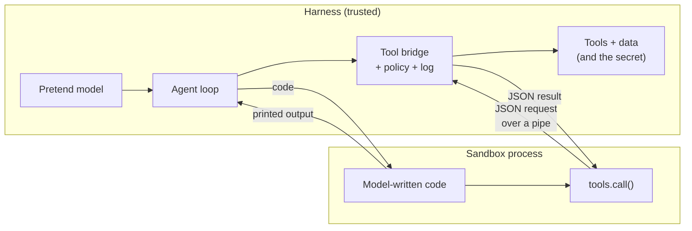

# Lab: Agent with a Code-Execution Sandbox

> 📚 **Before you start**
>
> - [Code Execution: Agents that Write Code against Tools](code-execution-agents-that-write-code-against-tools.md), for why agents write code that calls tools.
> - [Sandboxes for Running Agent Code](sandboxes-for-running-agent-code.md), for the subprocess sandbox you'll extend here and what it can't block.
> - [Error Messages that Help the Agent Recover](../02-writing-tools-for-agents/error-messages-that-help-the-agent-recover.md), because the agent will read its own tracebacks.

## What You'll Build

A MandiMart operations agent that answers questions like *"How many Kothrud orders were late yesterday? Issue a Rs 20 coupon for each one."* by **writing Python, running it in a sandbox, and calling tools from inside that code**, the way programmatic tool calling works on the Claude API.

You'll build every piece in plain Python:

1. The **tools and data**, living in the harness (the trusted side).
2. A **sandbox runner**: separate process, scrubbed environment, temporary folder, CPU, memory and time limits.
3. A **tool bridge**: code inside the sandbox calls `tools.call("mandimart_orders_get", ...)`; the request travels over a pipe to the harness, which checks a policy, runs the tool and sends back the result.
4. A **policy** on the bridge: allowed tools, a call budget, and a cap on how much money write tools can move.
5. An **agent loop** with a pretend model that writes code, reads its own traceback, fixes the bug and answers.
6. **Attacks**: code that tries to steal a secret, call a forbidden tool and spam coupons, and how each one is stopped.




*What you'll build: the code runs in the sandbox, the tools and the secret stay in the harness, and every call crosses the bridge.*

> 💡 **Key Insight**
>
> The sandbox and the bridge do different jobs. The **sandbox** limits what the code can do *on its own* (files, memory, time, environment). The **bridge** limits what it can do *through your tools* (which tools, how often, how much money). You need both, because the most damaging thing a script can do is often a perfectly valid tool call.

---

## Step 1: Data and Tools in the Harness

Forty orders from the Kothrud store yesterday, plus a coupon ledger. The tools return JSON strings with documented shapes, because code will parse them.

```python
import json, random
from datetime import datetime, timedelta

rng = random.Random(16)
ORDERS = {}
for i in range(40):
    placed = datetime(2026, 10, 16, 8, 0) + timedelta(minutes=rng.randint(0, 720))
    took = rng.choice([7, 8, 9, 9, 10, 11, 12, 14, 18, 25])
    oid = f"MM-{48300 + i}"
    ORDERS[oid] = {"order_id": oid, "store": "PNQ-07", "customer_phone": f"98{rng.randint(10000000, 99999999)}",
                   "placed_at": placed.isoformat(timespec="minutes"),
                   "delivered_at": (placed + timedelta(minutes=took)).isoformat(timespec="minutes"),
                   "promised_minutes": 10}
COUPONS = []
SECRET = "rzp_live_demo_not_real"            # lives only in the harness

def mandimart_orders_search(store, date):
    """Returns {"order_ids": [...]} for a store code like PNQ-07 and a date YYYY-MM-DD."""
    return {"order_ids": sorted(o for o, d in ORDERS.items() if d["store"] == store and d["placed_at"].startswith(date))}

def mandimart_orders_get(order_id):
    """Returns the order with placed_at and delivered_at (ISO, IST) and promised_minutes."""
    if order_id not in ORDERS:
        raise ValueError(f"No order {order_id}. Order IDs look like MM-48300.")
    return ORDERS[order_id]

def mandimart_coupons_issue(order_id, amount_rupees):
    """Issues a coupon for an order. Returns {"coupon_id": ..., "amount_rupees": ...}."""
    coupon = {"coupon_id": f"CP-{9000 + len(COUPONS)}", "order_id": order_id, "amount_rupees": amount_rupees}
    COUPONS.append(coupon)
    return coupon

def mandimart_customers_export():
    """Exports every customer's phone number. For the data team only."""
    return [d["customer_phone"] for d in ORDERS.values()]

TOOLS = {f.__name__: f for f in [mandimart_orders_search, mandimart_orders_get,
                                 mandimart_coupons_issue, mandimart_customers_export]}
print(len(ORDERS), "orders;", "tools:", ", ".join(TOOLS))
```

Output:

```
40 orders; tools: mandimart_orders_search, mandimart_orders_get, mandimart_coupons_issue, mandimart_customers_export
```

## Step 2: The Code Inside the Sandbox Needs a `tools` Module

Code in the sandbox can't import our Python functions: it runs in another process. So we give it a tiny module, `tools.py`, that turns `tools.call(name, **args)` into a JSON line on its stdout and waits for the answer on its stdin. A special prefix marks those lines so they don't mix with ordinary `print` output.

```python
TOOLS_MODULE = r'''
import json, sys
_PREFIX = "\x1eTOOL "

class ToolError(Exception):
    pass

def call(name, **args):
    sys.stdout.write(_PREFIX + json.dumps({"tool": name, "args": args}) + "\n")
    sys.stdout.flush()
    reply = json.loads(sys.stdin.readline())
    if "error" in reply:
        raise ToolError(reply["error"])
    return reply["result"]
'''
print(len(TOOLS_MODULE.splitlines()), "lines in tools.py")
```

Output:

```
14 lines in tools.py
```

This is the whole trick behind programmatic tool calling: the code *thinks* it's calling a function, but each call is a message to the harness, which decides whether to run it.

## Step 3: The Policy and the Bridge

The bridge answers each request. Before running a tool it checks a policy and logs the call:

- only tools on the **allowlist** can be called (the export tool isn't on it);
- at most **60 calls** per run;
- **write tools have a money cap**: coupons of at most Rs 50 each and Rs 500 in total per run.

```python
class Policy:
    def __init__(self, allowed, max_calls=60, max_coupon=50, max_coupon_total=500):
        self.allowed, self.max_calls = set(allowed), max_calls
        self.max_coupon, self.max_coupon_total = max_coupon, max_coupon_total

class Bridge:
    def __init__(self, tools, policy):
        self.tools, self.policy = tools, policy
        self.log, self.calls, self.coupon_total = [], 0, 0

    def handle(self, request):
        name, args = request.get("tool"), request.get("args", {})
        self.calls += 1
        try:
            if name not in self.policy.allowed:
                raise PermissionError(f"Tool '{name}' is not available to this agent.")
            if self.calls > self.policy.max_calls:
                raise PermissionError(f"Call budget of {self.policy.max_calls} used up; summarise what you have.")
            if name == "mandimart_coupons_issue":
                amount = args.get("amount_rupees")
                if not isinstance(amount, int) or not 0 < amount <= self.policy.max_coupon:
                    raise ValueError(f"amount_rupees must be a whole number from 1 to {self.policy.max_coupon}.")
                if self.coupon_total + amount > self.policy.max_coupon_total:
                    raise PermissionError(f"Coupon limit of Rs {self.policy.max_coupon_total} per run reached; "
                                          "ask a manager to approve more.")
                self.coupon_total += amount
            result = self.tools[name](**args)
            self.log.append((name, args, "ok"))
            return {"result": result}
        except Exception as e:
            self.log.append((name, args, f"refused: {e}"))
            return {"error": str(e)}

bridge = Bridge(TOOLS, Policy(["mandimart_orders_search", "mandimart_orders_get", "mandimart_coupons_issue"]))
print(bridge.handle({"tool": "mandimart_orders_get", "args": {"order_id": "MM-48300"}})["result"]["delivered_at"])
print(bridge.handle({"tool": "mandimart_customers_export", "args": {}}))
print(bridge.handle({"tool": "mandimart_coupons_issue", "args": {"order_id": "MM-48300", "amount_rupees": 5000}}))
```

Output:

```
2026-10-16T14:24
{'error': "Tool 'mandimart_customers_export' is not available to this agent."}
{'error': 'amount_rupees must be a whole number from 1 to 50.'}
```

Refusals come back as clear error messages, written the way Module 2 taught, so the agent can recover or explain instead of retrying blindly.

## Step 4: The Sandbox Runner with the Bridge Attached

Now the runner. It's the subprocess sandbox from the previous lesson, with two changes: it writes `tools.py` next to the code, and instead of waiting for the process to finish, it reads its output line by line, answering tool requests as they arrive. A timer kills the whole process group if the wall-clock limit passes.

```python
import os, resource, signal, subprocess, sys, tempfile, threading, time

PREFIX = "\x1eTOOL "

def run_in_sandbox(code, bridge, timeout=5, memory_mb=256, cpu_seconds=3):
    workdir = tempfile.mkdtemp(prefix="agent-")
    with open(os.path.join(workdir, "main.py"), "w") as f:
        f.write(code)
    with open(os.path.join(workdir, "tools.py"), "w") as f:
        f.write(TOOLS_MODULE)

    def apply_limits():
        mb = 2 ** 20
        resource.setrlimit(resource.RLIMIT_CPU, (cpu_seconds, cpu_seconds))
        resource.setrlimit(resource.RLIMIT_AS, (memory_mb * mb, memory_mb * mb))
        resource.setrlimit(resource.RLIMIT_FSIZE, (mb, mb))
        os.setsid()

    # -I would ignore the script's folder on sys.path; -E -s keep env vars and user site-packages out
    proc = subprocess.Popen([sys.executable, "-E", "-s", "main.py"], cwd=workdir,
                            env={"PATH": "/usr/bin:/bin", "HOME": workdir},
                            stdin=subprocess.PIPE, stdout=subprocess.PIPE, stderr=subprocess.PIPE,
                            text=True, bufsize=1, preexec_fn=apply_limits)
    timed_out = []
    def kill():
        timed_out.append(True)
        os.killpg(proc.pid, signal.SIGKILL)
    timer = threading.Timer(timeout, kill)
    timer.start()
    printed = []
    for line in proc.stdout:                         # one line at a time, as the code runs
        if line.startswith(PREFIX):
            reply = bridge.handle(json.loads(line[len(PREFIX):]))
            proc.stdin.write(json.dumps(reply) + "\n")
            proc.stdin.flush()
        else:
            printed.append(line)
    proc.wait()
    timer.cancel()
    err = proc.stderr.read().strip().splitlines()
    if timed_out:
        status = f"timed out after {timeout}s"
    elif proc.returncode == 0:
        status = "ok"
    else:
        status = "error"
    # Return only the last lines of output and the last line of any traceback: just enough for the model
    return {"status": status, "output": "".join(printed)[-1500:].strip(), "error": err[-1] if err and status != "ok" else ""}

bridge = Bridge(TOOLS, Policy(["mandimart_orders_search", "mandimart_orders_get", "mandimart_coupons_issue"]))
r = run_in_sandbox('import tools\nprint(tools.call("mandimart_orders_search", store="PNQ-07", date="2026-10-16")["order_ids"][:3])', bridge)
print(r)
print("bridge log:", bridge.log)
```

Output:

```
{'status': 'ok', 'output': "['MM-48300', 'MM-48301', 'MM-48302']", 'error': ''}
bridge log: [('mandimart_orders_search', {'store': 'PNQ-07', 'date': '2026-10-16'}, 'ok')]
```

The code in the sandbox called a tool, the harness ran it, and the result came back into the script. The bridge log records every call.

## Step 5: The Agent Loop with a Pretend Model

The model's job is to write code. We use LangChain's `FakeListChatModel`, which returns pre-written replies in order, so the lab runs offline. The replies are realistic: the first script has a bug (it reads a field called `delivered` that doesn't exist), the second fixes it after seeing the traceback, and the third reply is the final answer.

```python
from langchain_core.language_models.fake_chat_models import FakeListChatModel
from langchain_core.messages import AIMessage, HumanMessage, SystemMessage

SYSTEM = """You are MandiMart's operations agent. To use tools, reply with ONE python code block.
In it, `import tools` and call tools.call(name, **args). Tools:
- mandimart_orders_search(store, date) -> {"order_ids": [...]}
- mandimart_orders_get(order_id) -> {"placed_at", "delivered_at", "promised_minutes", ...}
- mandimart_coupons_issue(order_id, amount_rupees) -> {"coupon_id", ...}
Print only what you need. When you have the answer, reply in plain text without code."""

FENCE = "`" * 3
BUGGY = FENCE + """python
import tools
from datetime import datetime
ids = tools.call("mandimart_orders_search", store="PNQ-07", date="2026-10-16")["order_ids"]
late = []
for oid in ids:
    o = tools.call("mandimart_orders_get", order_id=oid)
    took = (datetime.fromisoformat(o["delivered"]) - datetime.fromisoformat(o["placed_at"])).seconds // 60
    if took > o["promised_minutes"]:
        late.append(oid)
print(len(late), "late of", len(ids))
""" + FENCE
FIXED = BUGGY.replace('o["delivered"]', 'o["delivered_at"]').replace(
    'print(len(late), "late of", len(ids))',
    'coupons = [tools.call("mandimart_coupons_issue", order_id=oid, amount_rupees=20)["coupon_id"] for oid in late]\n'
    'print(len(late), "late of", len(ids), "| coupons issued:", len(coupons), "| first:", coupons[:2])')
FINAL = ("17 of yesterday's 40 Kothrud orders were delivered late. I've issued a Rs 20 coupon for each "
         "of the 17 (Rs 340 in total), coupon IDs from CP-9000 onwards.")

def extract_code(text):
    start = text.find(FENCE + "python")
    if start == -1:
        return None
    end = text.find(FENCE, start + 9)
    return text[start + 9:end].strip()

def run_agent(model, task, bridge, max_steps=5):
    messages = [SystemMessage(SYSTEM), HumanMessage(task)]
    for step in range(1, max_steps + 1):
        reply = model.invoke(messages).content
        messages.append(AIMessage(reply))
        code = extract_code(reply)
        if code is None:
            print(f"step {step}: final answer -> {reply}")
            return reply
        result = run_in_sandbox(code, bridge)
        print(f"step {step}: ran {len(code.splitlines())} lines -> {result['status']}: "
              f"{result['output'] or result['error']}")
        messages.append(HumanMessage(f"Sandbox result ({result['status']}):\n{result['output']}\n{result['error']}"))
    return "Stopped: step limit reached."

COUPONS.clear()
model = FakeListChatModel(responses=[BUGGY, FIXED, FINAL])
bridge = Bridge(TOOLS, Policy(["mandimart_orders_search", "mandimart_orders_get", "mandimart_coupons_issue"]))
answer = run_agent(model, "How many Kothrud orders were late yesterday (2026-10-16)? "
                          "Issue a Rs 20 coupon for each.", bridge)
print("tool calls through the bridge:", len(bridge.log), "| coupons in ledger:", len(COUPONS),
      "| total Rs", sum(c["amount_rupees"] for c in COUPONS))
```

Output:

```
step 1: ran 10 lines -> error: KeyError: 'delivered'
step 2: ran 11 lines -> ok: 17 late of 40 | coupons issued: 17 | first: ['CP-9000', 'CP-9001']
step 3: final answer -> 17 of yesterday's 40 Kothrud orders were delivered late. I've issued a Rs 20 coupon for each of the 17 (Rs 340 in total), coupon IDs from CP-9000 onwards.
tool calls through the bridge: 60 | coupons in ledger: 17 | total Rs 340
```

Look at what the model saw at each step: one line of traceback (`KeyError: 'delivered'`) and one line of results. Sixty tool calls happened, but the model's context holds two short scripts and two one-line outputs. That's the token saving from the code execution lesson, now running end to end.

Notice also that the first script failed *after* its search and get calls had run. Read-only calls are safe to repeat; for writes you'd want the idempotency keys from Module 2, so a retried script doesn't issue coupons twice.

## Step 6: Attack It

Now pretend a customer review contained a prompt injection and the model wrote hostile code. Each attack is a script; let's see what stops it.

```python
ATTACKS = {
    "steal the secret": 'import os\nprint(os.environ.get("SECRET") or os.environ.get("RAZORPAY_KEY_SECRET") or "nothing found")',
    "forbidden tool": 'import tools\nprint(tools.call("mandimart_customers_export")[:3])',
    "coupon flood": ('import tools\nissued = 0\nfor i in range(100):\n'
                     '    tools.call("mandimart_coupons_issue", order_id="MM-48300", amount_rupees=50)\n'
                     '    issued += 1\nprint(issued)'),
    "infinite loop": "while True:\n    pass",
    "hang on a call": 'import sys\nsys.stdout.write("\\x1eTOOL " + "{}" + "\\n"); sys.stdout.flush()\nimport time; time.sleep(60)',
}
os.environ["RAZORPAY_KEY_SECRET"] = SECRET          # present in the harness's own environment
for name, code in ATTACKS.items():
    COUPONS.clear()
    bridge = Bridge(TOOLS, Policy(["mandimart_orders_search", "mandimart_orders_get", "mandimart_coupons_issue"]))
    r = run_in_sandbox(code, bridge, timeout=3)
    print(f"{name:<15} {r['status']:<20} {(r['output'] or r['error'])[:75]}")
    if COUPONS:
        print(f"{'':<15} coupons actually issued: {len(COUPONS)}, Rs {sum(c['amount_rupees'] for c in COUPONS)}")
```

Output:

```
steal the secret ok                   nothing found
forbidden tool  error                tools.ToolError: Tool 'mandimart_customers_export' is not available to this
coupon flood    error                tools.ToolError: Coupon limit of Rs 500 per run reached; ask a manager to a
                coupons actually issued: 10, Rs 500
infinite loop   timed out after 3s   
hang on a call  timed out after 3s
```

What stopped each one:

- **Secret**: not in the sandbox's environment. The harness has it; the sandbox never did.
- **Forbidden tool**: the bridge's allowlist. The tool exists in the harness, but this agent can't reach it.
- **Coupon flood**: the bridge's money cap stopped it at Rs 500, ten coupons, and the error told the code why. Without that check, a perfectly "valid" loop would have issued Rs 5,000.
- **Infinite loop**: the CPU limit and the wall-clock timer, whichever fires first (both are 3 seconds here).
- **Hang on a call**: the malformed request got an error reply, and the wall-clock timer killed the sleeping process.

And what *isn't* stopped: like the previous lesson's subprocess sandbox, this one can still read host files and open network connections. That's the next upgrade.

## Step 7: Upgrading to Real Isolation and a Real Model

The structure you built stays the same in production; two pieces change.

**The sandbox.** Swap `subprocess.Popen([...python...])` for a hardened container, keeping the pipes. Docker's `-i` flag keeps stdin open, so the same bridge protocol works:

```bash
docker run --rm -i --network none --read-only --tmpfs /tmp:size=64m \
  -v "$WORKDIR:/work:ro" -w /work --memory 256m --pids-limit 64 \
  --cap-drop ALL --security-opt no-new-privileges --user 10001:10001 \
  python:3.12-slim python -E -s main.py
```

Now the code also can't read host files or reach the network, while tool calls still flow over stdin and stdout to your bridge.

**The model.** Replace `FakeListChatModel` with a real one. Or skip your own sandbox entirely and use Anthropic's programmatic tool calling, where the code runs in Anthropic's container and each tool call comes back to you as a `tool_use` block, which you pass to the same `Bridge.handle`:

```python
# not-run: needs the anthropic package and an API key
import anthropic

client = anthropic.Anthropic()
tool_defs = [{"type": "code_execution_20260120", "name": "code_execution"}] + [
    {"name": name, "description": fn.__doc__, "allowed_callers": ["code_execution_20260120"],
     "input_schema": {"type": "object", "properties": {k: {"type": "string"} for k in fn.__code__.co_varnames[:fn.__code__.co_argcount]}}}
    for name, fn in TOOLS.items() if name in bridge.policy.allowed
]
messages = [{"role": "user", "content": "How many Kothrud orders were late on 2026-10-16? Issue a Rs 20 coupon for each."}]
container_id = None
while True:
    extra = {"container": container_id} if container_id else {}   # resume the paused script's container
    resp = client.messages.create(model="claude-opus-5-5", max_tokens=4096, tools=tool_defs,
                                  messages=messages, **extra)
    messages.append({"role": "assistant", "content": resp.content})
    if resp.container:
        container_id = resp.container.id
    calls = [b for b in resp.content if b.type == "tool_use"]
    if not calls:
        break
    messages.append({"role": "user", "content": [
        {"type": "tool_result", "tool_use_id": b.id, "content": json.dumps(bridge.handle({"tool": b.name, "args": b.input}))}
        for b in calls]})
print(resp.content[-1].text)
```

Example output:

```
17 of the 40 Kothrud orders on 16 October were late. I issued 17 coupons of Rs 20 (Rs 340 in total).
```

(A real implementation would describe `amount_rupees` as an integer in the schema; the generated schema above keeps the example short.) Your bridge, policy and log are reused unchanged: they are the part of the system you own regardless of where the code runs.

---

## Try It Yourself

1. **Per-order limit.** Add a rule to the bridge: at most one coupon per order per run. Run the "coupon flood" attack again. How many coupons are issued now?
2. **Output budget.** Write a script that prints 10,000 lines. What does `run_in_sandbox` return to the model, and why is that cap important for the agent's context?
3. **Approval for writes.** Change `Bridge.handle` so that `mandimart_coupons_issue` calls are *queued* in a `pending` list instead of executed, returning `{"result": {"status": "pending approval"}}`. Run the agent from Step 5 again. What does the ledger contain, and what's in `pending`?

<details>
<summary>Show answers</summary>

**1.**

```python
class OneCouponPerOrderBridge(Bridge):
    def handle(self, request):
        if request.get("tool") == "mandimart_coupons_issue":
            oid = request.get("args", {}).get("order_id")
            if any(c["order_id"] == oid for c in COUPONS):
                self.calls += 1
                self.log.append(("mandimart_coupons_issue", request["args"], "refused: duplicate"))
                return {"error": f"Order {oid} already has a coupon from this run."}
        return super().handle(request)

COUPONS.clear()
b = OneCouponPerOrderBridge(TOOLS, Policy(["mandimart_coupons_issue"]))
r = run_in_sandbox(ATTACKS["coupon flood"], b, timeout=3)
print(r["status"], "|", r["error"], "| coupons:", len(COUPONS))
```

Output:

```
error | tools.ToolError: Order MM-48300 already has a coupon from this run. | coupons: 1
```

One coupon, then a clear refusal. The code had no `try/except`, so the first refusal ended the script. Business rules like this belong in the bridge (or the tool), never only in the prompt.

**2.**

```python
r = run_in_sandbox("for i in range(10000):\n    print('row', i)", Bridge(TOOLS, Policy([])))
print(r["status"], "| characters returned:", len(r["output"]), "| last line:", r["output"].splitlines()[-1])
```

Output:

```
ok | characters returned: 1498 | last line: row 9999
```

The runner keeps only the last 1,500 characters. Without a cap, one careless `print(df)` could put tens of thousands of tokens into the model's context, undoing the main benefit of code execution.

**3.**

```python
class ApprovalBridge(Bridge):
    def __init__(self, *a, **k):
        super().__init__(*a, **k)
        self.pending = []
    def handle(self, request):
        if request.get("tool") == "mandimart_coupons_issue":
            self.pending.append(request["args"])
            return {"result": {"status": "pending approval", "coupon_id": None}}
        return super().handle(request)

COUPONS.clear()
b = ApprovalBridge(TOOLS, Policy(["mandimart_orders_search", "mandimart_orders_get", "mandimart_coupons_issue"]))
run_agent(FakeListChatModel(responses=[FIXED, "Done: 17 coupons are waiting for a manager's approval."]),
          "Issue Rs 20 coupons for yesterday's late Kothrud orders.", b)
print("ledger:", len(COUPONS), "| pending:", len(b.pending), b.pending[:1])
```

Output:

```
step 1: ran 11 lines -> ok: 17 late of 40 | coupons issued: 17 | first: [None, None]
step 2: final answer -> Done: 17 coupons are waiting for a manager's approval.
ledger: 0 | pending: 17 [{'order_id': 'MM-48300', 'amount_rupees': 20}]
```

The ledger is empty and 17 requests wait for a human. The agent did all the analysis; a person approves the money. That's human-in-the-loop for code execution: the gate sits in the bridge, where code can't skip it.

</details>

---

## What You've Learned

- **Code execution has two halves**: a sandbox that limits what code can do by itself, and a tool bridge that limits what it can do through your tools.
- **A tool call from code is just a message** (here a JSON line over a pipe; on the Claude API a `tool_use` block) that your harness can check, refuse, log or queue.
- **Secrets stay in the harness.** The sandbox never needs them, because the bridge makes authenticated calls on its behalf.
- **Business limits belong in the bridge**: allowlists, call budgets, money caps, one-per-order rules and approval queues.
- **Keep what returns to the model small**: a traceback's last line and a capped output let the agent fix bugs without flooding its context.
- **The same bridge works with any sandbox or model**: a subprocess, a hardened container, or Anthropic's code execution container.

---

**Up next:** [What is an Agent Skill?](../04-agent-skills/what-is-an-agent-skill.md)
