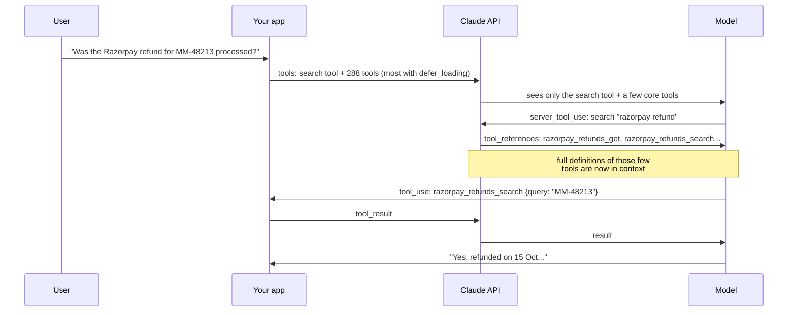
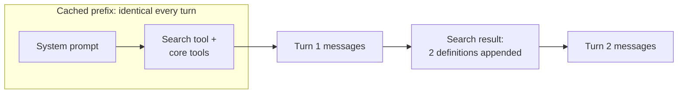

# Tool Search and Deferred Loading: The Complete Guide

> 📚 **Before you start**
>
> - [Why Hundreds of Tool Schemas Break Agents](why-hundreds-of-tool-schemas-break-agents.md), for the token and confusion costs this lesson removes.
> - [Naming, Descriptions and Parameters](../02-writing-tools-for-agents/naming-descriptions-and-parameters.md), because with tool search, names and descriptions also become search keywords.

## Introduction

A good kirana store owner doesn't stack all 3,000 products on the counter. The counter holds what almost everyone buys: milk, bread, eggs. When you ask for "that Kerala banana chips brand, the one in the yellow pack", he checks the shelves at the back and brings out two or three candidates. You choose, he bills it, and the counter stays clear.

**Tool search** does the same for an agent. Instead of putting all 288 tool definitions in front of the model, you mark most of them as **deferred**. The model sees a small counter of always-loaded tools plus one extra tool: a search tool. When it needs something it can't see, it searches, and only the few matching definitions are loaded into the conversation. The rest never cost a token.

In this lesson you'll learn:

- how deferred loading and tool search work on the Claude API, with the exact request and response shapes,
- the two built-in search variants (regex and BM25) and when to write your own,
- the same idea on OpenAI's Responses API, with namespaces,
- how to build and measure a deferred toolset yourself in Python,
- and how to write tools that are *findable*, not just usable.

> 💡 **Key Insight**
>
> Deferred loading turns "show the model every tool" into "let the model **ask** for the tools it needs". It cuts tool-definition tokens by around 85% on large toolsets and, by keeping only a few candidates in view, improves selection accuracy. The price: one extra search step, and your tool names and descriptions now have to work as **search keywords**.

---

## Core Explanation

### 1. How it works

You still send every tool definition with every request. The difference is a flag: `defer_loading: true` tells the API not to put that definition in front of the model. The model gets the non-deferred tools and the search tool. When it searches, the API returns **references** to matching tools, and only then are their full definitions expanded into the conversation.



Two things to notice. The search runs on Anthropic's side (it's a **server tool**), so your code never handles the search call. And the tool the model finally calls is an ordinary tool that **your** code executes, exactly as in Module 2.

### 2. The request

Here's a MandiMart support request with the BM25 search variant, two always-loaded tools and deferred tools from other services (three shown; in production there would be hundreds):

```python
# not-run: needs the anthropic package and an API key
import anthropic

client = anthropic.Anthropic()

tools = [
    {"type": "tool_search_tool_bm25_20251119", "name": "tool_search_tool_bm25"},
    # Always loaded: used in almost every conversation
    {"name": "mandimart_customers_context",
     "description": "Get a MandiMart customer's profile, last 5 orders and open tickets from a phone number or order ID...",
     "input_schema": {"type": "object", "properties": {"phone_or_order": {"type": "string"}},
                      "required": ["phone_or_order"]}},
    {"name": "mandimart_orders_get",
     "description": "Get one MandiMart order by ID (like MM-48213) with items, status and delivery slot...",
     "input_schema": {"type": "object", "properties": {"order_id": {"type": "string"}},
                      "required": ["order_id"]}},
    # Deferred: found through search when needed
    {"name": "razorpay_refunds_search",
     "description": "Search Razorpay refunds by order reference, payment ID or date. Use to check whether a refund reached the customer's bank or UPI...",
     "input_schema": {"type": "object", "properties": {"query": {"type": "string"}}, "required": ["query"]},
     "defer_loading": True},
    {"name": "shiprocket_returns_create",
     "description": "Book a courier pickup for a return of a non-grocery item (kitchen appliances, electronics)...",
     "input_schema": {"type": "object", "properties": {"order_id": {"type": "string"}}, "required": ["order_id"]},
     "defer_loading": True},
    {"name": "zoho_books_invoices_get",
     "description": "Get a GST tax invoice from Zoho Books by invoice number...",
     "input_schema": {"type": "object", "properties": {"invoice_no": {"type": "string"}}, "required": ["invoice_no"]},
     "defer_loading": True},
]

response = client.messages.create(
    model="claude-opus-5-5",
    max_tokens=2048,
    tools=tools,
    messages=[{"role": "user", "content": "Was the Razorpay refund for MM-48213 processed?"}],
)
for block in response.content:
    print(block.type, getattr(block, "name", ""), getattr(block, "input", ""))
```

Example output:

```
text
server_tool_use tool_search_tool_bm25 {'query': 'razorpay refund status order'}
tool_search_tool_result
text
tool_use razorpay_refunds_search {'query': 'MM-48213'}
```

The rules that trip people up:

- **At least one tool must be non-deferred.** If every tool has `defer_loading: true`, the request fails with a 400 ("All tools cannot be deferred"). The search tool itself is never deferred.
- **Never send a `tool_result` for the search call.** Its ID starts with `srvtoolu_` and the API already filled in the result. Keep the `server_tool_use` and `tool_search_tool_result` blocks in the history unchanged; you only execute the ordinary `tool_use`.
- **Every referenced tool must be in `tools`.** You still send the full list every time. "Deferred" means "hidden from the model until found", not "not sent".
- **No `cache_control` on a deferred tool.** Put your cache breakpoint on a non-deferred one.

The search result block looks like this:

```json
{
  "type": "tool_search_tool_result",
  "tool_use_id": "srvtoolu_01ABC123",
  "content": {
    "type": "tool_search_tool_search_result",
    "tool_references": [
      {"type": "tool_reference", "tool_name": "razorpay_refunds_search"},
      {"type": "tool_reference", "tool_name": "razorpay_refunds_get"}
    ]
  }
}
```

### 3. Regex or BM25?

Anthropic offers two built-in variants, both dated `20251119`:

| Variant | The model sends | Matches by | Good when |
|---|---|---|---|
| `tool_search_tool_regex_20251119` | `pattern`, a Python `re.search` regex, up to 200 characters, e.g. `"(?i)razorpay.*refund"` | Exact patterns over names, descriptions and parameter names | Names follow a strict convention, like `service_resource_action` |
| `tool_search_tool_bm25_20251119` | `query`, natural language, up to 500 characters, e.g. `"check refund reached bank"` | BM25 ranking, a classic keyword-relevance score | Users describe needs in their own words |

Both return 5 references by default (the model may set `limit`), and up to 10,000 tools can be deferred. A search that finds nothing isn't an error: it returns an empty list, and the model can try different words.

### 4. Why it keeps the prompt cache

The previous lesson warned that changing the tool list mid-conversation breaks prompt caching. Tool search avoids that: deferred definitions are left out of the cached prefix entirely, and discovered definitions are **appended inside the conversation**, after the cached part. The prefix (system prompt, non-deferred tools) stays byte-for-byte the same from turn to turn.



### 5. Build one yourself: a deferred toolset

To see the mechanics and measure them, let's build a small version in plain Python. First the same 288-tool generator as the previous lesson:

```python
import json, math, re
from sklearn.feature_extraction.text import TfidfVectorizer
from sklearn.metrics.pairwise import cosine_similarity

def approx_tokens(text):
    return math.ceil(len(text) / 4)

SERVICES = {
    "mandimart": ["orders", "refunds", "riders", "stock", "customers", "stores", "coupons", "tickets"],
    "github": ["issues", "pull_requests", "repositories", "branches", "commits", "releases", "workflows"],
    "jira": ["issues", "sprints", "boards", "comments", "projects"],
    "slack": ["messages", "channels", "users", "reminders"],
    "zoho_books": ["invoices", "customers", "payments", "credit_notes", "items"],
    "razorpay": ["payments", "refunds", "orders", "settlements", "payment_links"],
    "freshdesk": ["tickets", "contacts", "agents", "canned_responses"],
    "google_drive": ["files", "folders", "permissions"],
    "sentry": ["issues", "events", "releases"],
    "shiprocket": ["shipments", "couriers", "pickups", "returns"],
}
ACTIONS = {
    "search": "Search {svc} {res} by keyword, date range or status and return a short list with IDs. Use this when you do not know the exact ID.",
    "get": "Get one {svc} {one} by its ID, with all fields. Use this when you already have the ID.",
    "create": "Create a new {svc} {one}. Use this when the user asks to add or open one.",
    "update": "Update fields of an existing {svc} {one}, such as status, owner or notes.",
    "delete": "Delete a {svc} {one} permanently. Use only when the user explicitly asks to remove it.",
    "list_recent": "List the most recent {svc} {res}, newest first, 20 at a time.",
}

def build_toolset():
    tools = []
    for svc, resources in SERVICES.items():
        for res in resources:
            one = res[:-1] if res.endswith("s") else res
            words = dict(svc=svc.replace("_", " "), res=res.replace("_", " "), one=one.replace("_", " "))
            for act, template in ACTIONS.items():
                props = {}
                if act == "search":
                    props = {"query": {"type": "string", "description": "Keywords."},
                             "status": {"type": "string", "description": "Optional status filter."},
                             "from_date": {"type": "string", "description": "YYYY-MM-DD"}}
                if act in ("get", "update", "delete"):
                    props["id"] = {"type": "string", "description": f"The {words['one']} ID."}
                if act in ("create", "update"):
                    props["fields"] = {"type": "object", "description": "Field names and values to set."}
                tools.append({"name": f"{svc}_{res}_{act}",
                              "description": template.format(**words),
                              "input_schema": {"type": "object", "properties": props}})
    return tools

ALL_TOOLS = build_toolset()
print(len(ALL_TOOLS), "tools,", approx_tokens(json.dumps(ALL_TOOLS)), "tokens if all loaded")
```

Output:

```
288 tools, 20677 tokens if all loaded
```

Now the deferred toolset. It keeps every definition, tracks which ones the model can currently see, and offers two search methods that mirror the API's variants. Our keyword search is a simplified cousin of BM25: a tool's score is the sum of the weights of the query words it contains, where words found in few tools (like "razorpay" or "refund") weigh a lot, words found in many (like "get" or "ID") weigh little, and filler words ("the", "for") are ignored.

```python
class DeferredToolset:
    def __init__(self, tools, always_loaded):
        self.by_name = {t["name"]: t for t in tools}
        self.visible = list(always_loaded)          # what the model can see right now
        self.searchable = [t for t in tools if t["name"] not in always_loaded]
        self.texts = [self._text(t) for t in self.searchable]
        # rare words weigh more; repeated words count with diminishing returns, like BM25
        self.vectorizer = TfidfVectorizer(stop_words="english", norm=None, sublinear_tf=True).fit(self.texts)
        self.matrix = self.vectorizer.transform(self.texts)

    @staticmethod
    def _text(t):
        params = " ".join(t["input_schema"]["properties"])
        return f'{t["name"].replace("_", " ")} {t["description"]} {params}'

    def search_bm25_like(self, query, limit=5):
        q = self.vectorizer.transform([query])
        q.data[:] = 1.0                                   # each query word counts once
        scores = (self.matrix @ q.T).toarray().ravel()    # sum of matching word weights
        ranked = sorted(range(len(scores)), key=lambda i: -scores[i])
        return [self.searchable[i]["name"] for i in ranked[:limit] if scores[i] > 0]

    def search_regex(self, pattern, limit=5):
        if len(pattern) > 200:
            raise ValueError("pattern longer than 200 characters")
        rx = re.compile(pattern)
        hits = [t["name"] for t, text in zip(self.searchable, self.texts) if rx.search(t["name"]) or rx.search(text)]
        return hits[:limit]

    def load(self, names):
        """Like the API expanding tool_references: add definitions to what the model sees."""
        for n in names:
            if n not in self.visible:
                self.visible.append(n)
        return [{"type": "tool_reference", "tool_name": n} for n in names]

    def search_tool_definition(self):
        return {"name": "tool_search", "description": "Search for more tools by describing what you need to do. "
                "Returns references to matching tools, which then become callable.",
                "input_schema": {"type": "object", "properties": {"query": {"type": "string"}},
                                 "required": ["query"]}}

    def context_tokens(self):
        defs = [self.search_tool_definition()] + [self.by_name[n] for n in self.visible]
        return approx_tokens(json.dumps(defs))

CORE = ["mandimart_customers_get", "mandimart_orders_get", "mandimart_orders_search",
        "mandimart_refunds_create", "mandimart_tickets_create"]
ts = DeferredToolset(ALL_TOOLS, always_loaded=CORE)
print("visible at start:", len(ts.visible), "tools,", ts.context_tokens(), "tokens")
print("bm25-like:", ts.search_bm25_like("razorpay refund status for an order"))
print("regex:    ", ts.search_regex(r"(?i)razorpay.*refund"))
```

Output:

```
visible at start: 5 tools, 438 tokens
bm25-like: ['razorpay_refunds_update', 'razorpay_orders_update', 'razorpay_refunds_get', 'razorpay_refunds_create', 'razorpay_refunds_delete']
regex:     ['razorpay_refunds_search', 'razorpay_refunds_get', 'razorpay_refunds_create', 'razorpay_refunds_update', 'razorpay_refunds_delete']
```

Both find the Razorpay refund family. The keyword search ranks by relevance, so it pulls in a Razorpay order tool too, since the query mentioned "order". It also puts `razorpay_refunds_update` first because "status" appears in that description. That's fine: search only has to bring the right tool into the shortlist, and the model then chooses among five definitions it can read in full (`razorpay_refunds_get` is there). The regex search returns exactly what the pattern matches, in list order. That's great when the model knows the naming convention and useless when it doesn't.

### 6. Measure a whole conversation

Let's replay a three-turn support conversation. In each turn the "model" (scripted here) searches for what it needs and then calls a tool. We count the definition tokens it sees in each turn, against loading everything.

```python
conversation = [
    ("Was the Razorpay refund for MM-48213 processed?", "razorpay refund status for an order"),
    ("Also raise a Freshdesk ticket so finance checks it", "create freshdesk ticket"),
    ("And post in the #payments Slack channel", "send slack message to channel"),
]
everything = approx_tokens(json.dumps(ALL_TOOLS))
ts = DeferredToolset(ALL_TOOLS, always_loaded=CORE)
total_deferred = total_all = 0
for user_msg, query in conversation:
    found = ts.search_bm25_like(query, limit=5)
    ts.load(found)
    total_deferred += ts.context_tokens()
    total_all += everything
    print(f"{user_msg[:40]:<41} +{len(found)} tools | sees {ts.context_tokens():>5} tokens vs {everything}")
print(f"definition tokens over 3 turns: {total_deferred:,} vs {total_all:,} "
      f"({1 - total_deferred / total_all:.0%} fewer)")
```

Output:

```
Was the Razorpay refund for MM-48213 pro  +5 tools | sees   792 tokens vs 20677
Also raise a Freshdesk ticket so finance  +5 tools | sees  1127 tokens vs 20677
And post in the #payments Slack channel   +5 tools | sees  1461 tokens vs 20677
definition tokens over 3 turns: 3,380 vs 62,031 (95% fewer)
```

The saving is in line with Anthropic's own measurement: on their large internal MCP setup, tool definitions dropped from about 77,000 tokens to about 8,700, an 85% cut. Our toy saves more because our core tools are small; real core tools are bigger. Accuracy also improved in their tests because the model compares a handful of candidates instead of every tool (49% to 74% on Opus 4, 79.5% to 88.1% on Opus 4.5 in their MCP evaluations).

### 7. Is your toolset findable?

Tool search moves the hard problem from "pick the right tool from the list" to "find the right tool with a query". So evaluate search the way Module 2 evaluated tools: write realistic requests with the tool that *should* be found, and measure **recall@k**, the share of requests where the right tool appears in the top k results.

```python
CHECKS = [
    ("has the refund reached the customer's bank", "razorpay_refunds_search"),
    ("book a courier pickup to return the mixer grinder", "shiprocket_pickups_create"),
    ("find the GitHub PR that changed the checkout page", "github_pull_requests_search"),
    ("what errors did Sentry record after the last release", "sentry_events_search"),
    ("give Asha access to the store audit spreadsheet", "google_drive_permissions_create"),
    ("send a GST credit note to the customer", "zoho_books_credit_notes_create"),
]
def recall_at_k(search, k=5):
    hits = 0
    for query, gold in CHECKS:
        found = search(query, limit=k)
        hits += gold in found
        if gold not in found:
            print(f"  miss: {query!r} -> {found[:3]}")
    return hits / len(CHECKS)

ts = DeferredToolset(ALL_TOOLS, always_loaded=CORE)
print("recall@5:", round(recall_at_k(ts.search_bm25_like), 2))
```

Output:

```
  miss: "has the refund reached the customer's bank" -> ['mandimart_refunds_get', 'mandimart_refunds_update', 'mandimart_refunds_delete']
  miss: 'book a courier pickup to return the mixer grinder' -> ['shiprocket_couriers_get', 'shiprocket_couriers_create', 'shiprocket_couriers_update']
  miss: 'find the GitHub PR that changed the checkout page' -> ['github_issues_search', 'github_issues_get', 'github_issues_create']
  miss: 'what errors did Sentry record after the last release' -> ['sentry_releases_get', 'sentry_releases_create', 'sentry_releases_update']
  miss: 'give Asha access to the store audit spreadsheet' -> ['mandimart_stores_get', 'mandimart_stores_create', 'mandimart_stores_update']
recall@5: 0.17
```

Read the misses the way you'd read a failed transcript. Every one is a vocabulary gap between the user and the tool:

- The user said "reached the bank"; no Razorpay description mentions banks or UPI.
- The user said "courier pickup"; the word "courier" pulled in the `shiprocket_couriers_*` tools, and the pickup tool's description never says "return".
- The user said "PR"; the tool says "pull requests".
- The user said "errors"; Sentry's tool says "events".
- The user said "give access to"; the tool says "permissions".

The fix is in the descriptions: write them with the words users use.

```python
BETTER = {
    "razorpay_refunds_search": "Search Razorpay refunds by order ID, payment ID or date, and see whether each refund "
        "has reached the customer's bank account or UPI app (status: pending, processed, failed).",
    "github_pull_requests_search": "Search GitHub pull requests (PRs) by keyword, author, file path or state. "
        "Use to find the PR that changed some code or a page.",
    "sentry_events_search": "Search Sentry error events (exceptions, crashes) by message, release or time range. "
        "Use to see which errors happened after a release.",
    "google_drive_permissions_create": "Share a Google Drive file, folder or spreadsheet with someone: give a "
        "person view, comment or edit access by email. Use when asked to share, give access or invite.",
    "shiprocket_pickups_create": "Book a Shiprocket courier pickup from the customer's address to return a "
        "non-grocery item such as a mixer grinder or kettle.",
}
for t in ALL_TOOLS:
    if t["name"] in BETTER:
        t["description"] = BETTER[t["name"]]
ts = DeferredToolset(ALL_TOOLS, always_loaded=CORE)
print("recall@5:", round(recall_at_k(ts.search_bm25_like), 2))
```

Output:

```
recall@5: 1.0
```

This is the main writing lesson of tool search: **a description is now also an index entry**. Include the verbs and nouns users actually say (share, give access, PR, errors, reached the bank), not only the API's own vocabulary.

### 8. Your own search: returning tool references

Sometimes the built-in search isn't the right ranker: you want embeddings, or to filter by the user's permissions, or to hide tools from services the customer hasn't enabled. Then you write a normal client tool (like `tool_search` above) and return **`tool_reference` blocks** inside an ordinary `tool_result`:

```json
{
  "type": "tool_result",
  "tool_use_id": "toolu_01Q8...",
  "content": [
    {"type": "tool_reference", "tool_name": "razorpay_refunds_search"},
    {"type": "tool_reference", "tool_name": "razorpay_refunds_get"}
  ]
}
```

The API expands those references into full definitions exactly as the built-in variants do. Every name you return must exist in the `tools` array, normally with `defer_loading: true`; an unknown name gets a 400 error. Our `DeferredToolset.load` method returns this shape.

### 9. MCP servers and deferred loading

When tools come from an MCP server through the Claude API's MCP connector, you don't set `defer_loading` on individual tools (you don't write their definitions). Instead you set it on the server's toolset entry, for all its tools by default, with exceptions per tool:

```json
{
  "type": "mcp_toolset",
  "mcp_server_name": "razorpay",
  "default_config": {"defer_loading": true},
  "configs": {
    "razorpay_refunds_search": {"defer_loading": false}
  }
}
```

Here every Razorpay tool is deferred except refund search, which this support agent uses constantly. Agent products do the same automatically: Claude Code defers MCP tools behind tool search by default, so connecting a large server no longer fills the context window at start-up.

### 10. The same idea on OpenAI

OpenAI's Responses API added tool search in 2026 (supported on `gpt-5.4` and later models). The shapes differ but the idea is identical: a `tool_search` tool, `defer_loading` on functions, and **namespaces** that group related functions under one description the model can search:

```json
{
  "tools": [
    {"type": "tool_search"},
    {
      "type": "namespace",
      "name": "razorpay",
      "description": "Payments, refunds and settlements in Razorpay for MandiMart orders.",
      "tools": [
        {"type": "function", "name": "refunds_search", "description": "...", "parameters": {"type": "object", "properties": {"query": {"type": "string"}}}},
        {"type": "function", "name": "settlements_get", "description": "...", "parameters": {"type": "object", "properties": {"id": {"type": "string"}}}, "defer_loading": true}
      ]
    }
  ]
}
```

The output contains a `tool_search_call` item, a `tool_search_output` item listing what was loaded, and then a normal `function_call`. OpenAI recommends keeping each namespace under about 10 functions. You can also run the search yourself (`"execution": "client"` on the `tool_search` tool) and return your own `tool_search_output`.

### 11. What to keep always loaded

Deferral isn't all-or-nothing. A practical split:

| Keep loaded | Defer |
|---|---|
| The 3 to 5 tools used in most conversations (`mandimart_customers_context`, `mandimart_orders_get`) | Long-tail tools from secondary services |
| Tools the model must know exist to plan (a `handoff_to_human` tool) | Admin and destructive tools rarely needed (`*_delete`) |
| Tools with very short definitions | Tools with huge schemas |

And when *not* to use tool search: with fewer than about ten tools, or when nearly every tool is used in nearly every conversation. Then the extra search step adds latency and saves nothing.

---

## Try It Yourself

1. **Regex practice.** Write a regex that finds all Sentry and GitHub *issue* tools (not Jira) using `ts.search_regex` with `limit=20`.
2. **Bad split.** Make a `DeferredToolset` whose `always_loaded` list is every `mandimart_` tool (48 tools). How many tokens does the model see at start? Is that a good split for a support agent?
3. **Fix a miss.** Add the check `("who is the delivery partner on order MM-48213", "mandimart_riders_get")` to `CHECKS` and run `recall_at_k`. If it misses, improve the description until it's found.

<details>
<summary>Show answers</summary>

**1.**

```python
print(ts.search_regex(r"^(sentry|github)_issues_", limit=20))
```

Output:

```
['github_issues_search', 'github_issues_get', 'github_issues_create', 'github_issues_update', 'github_issues_delete', 'github_issues_list_recent', 'sentry_issues_search', 'sentry_issues_get', 'sentry_issues_create', 'sentry_issues_update', 'sentry_issues_delete', 'sentry_issues_list_recent']
```

Anchoring with `^` and naming both services keeps Jira out. The model can write patterns like this only if your names follow a strict `service_resource_action` convention.

**2.**

```python
wide = DeferredToolset(ALL_TOOLS, always_loaded=[t["name"] for t in ALL_TOOLS if t["name"].startswith("mandimart_")])
print(len(wide.visible), "visible,", wide.context_tokens(), "tokens at start")
```

Output:

```
48 visible, 3506 tokens at start
```

Several thousand tokens for 48 tools, most of which (coupon deletes, store updates) a support agent rarely touches. Better to keep the handful used daily and defer the rest; measure which tools your agent actually calls.

**3.**

```python
CHECKS.append(("who is the delivery partner on order MM-48213", "mandimart_riders_get"))
print("before:", round(recall_at_k(ts.search_bm25_like), 2))
for t in ALL_TOOLS:
    if t["name"] == "mandimart_riders_get":
        t["description"] = ("Get the MandiMart delivery rider (delivery partner) assigned to an order, with name, "
                            "phone and live location. Pass the rider ID or an order ID like MM-48213.")
ts = DeferredToolset(ALL_TOOLS, always_loaded=CORE)
print("after:", round(recall_at_k(ts.search_bm25_like), 2))
```

Output:

```
  miss: 'who is the delivery partner on order MM-48213' -> ['mandimart_orders_create', 'mandimart_orders_update', 'mandimart_orders_delete']
before: 0.86
after: 1.0
```

Users say "delivery partner" or "delivery boy"; the API says "rider". Putting both in the description makes the tool findable.

</details>

---

## Real-World Examples

- **Claude Code** defers MCP tool definitions behind tool search, so developers can connect large servers (GitHub, Jira, databases) without filling the context window before typing a word.
- **Anthropic's own evaluations** with 50+ MCP tools showed definitions shrinking from about 77K to 8.7K tokens with tool search, with higher accuracy on large toolsets.
- **OpenAI's Responses API** uses namespaces and deferred functions so agents built on `gpt-5.4` and later can expose large internal APIs without listing every function up front.
- **Enterprise MCP gateways** (single endpoints fronting many internal servers) commonly add their own search tool and return references, filtered by what the signed-in employee is allowed to use.

---

## Common Misconceptions

### "Deferred tools aren't sent to the API"

They are sent on every request. They just aren't shown to the model until a search references them. That's why referencing an unknown tool name is an error.

### "Tool search always helps"

With a small toolset where every tool is used often, it only adds a search step. Use it when definitions are large (more than about 10K tokens) or numerous (more than about ten, not all needed each time).

### "Once tool search is on, descriptions matter less"

They matter more. A description now has to make the tool *findable* by the words users use, and then *choosable* among the few candidates returned.

### "Searching breaks the prompt cache"

Discovered definitions are appended inside the conversation, not inserted into the cached prefix, so caching keeps working.

---

## Interview Relevance

*"How would you give an agent access to 500 tools?"* Describe deferred loading: send all definitions but mark most `defer_loading`; keep 3 to 5 core tools visible; provide a search tool (regex for strict naming, BM25 or embeddings for natural language); the API expands `tool_reference` results into definitions appended to the conversation, preserving the cache. Mention custom search for permission filtering, MCP `default_config`, OpenAI's namespaces, and measuring recall@k of the search plus end-to-end task accuracy.

Follow-up: *"What's the downside?"* An extra round-trip per new capability, possible misses if descriptions don't contain users' words, and dependence on the model choosing to search instead of guessing.

---

## Key Takeaways

- **`defer_loading: true` hides a tool until a search finds it**; you still send every definition on every request.
- **Built-in search comes in regex and BM25 variants**; or return `tool_reference` blocks from your own search tool.
- **Keep a few core tools always loaded** and defer the long tail; at least one tool must be non-deferred.
- **Tool search preserves prompt caching** by appending discovered definitions inside the conversation.
- **Descriptions become search keywords**: evaluate recall@k and write in your users' words.

---

**Up next:** [Code Execution: Agents that Write Code against Tools](code-execution-agents-that-write-code-against-tools.md)
