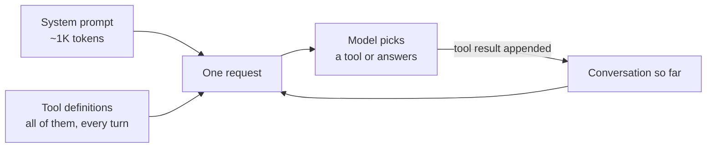
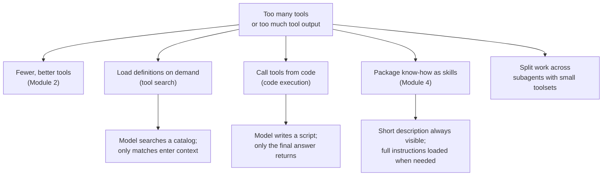

# Why Hundreds of Tool Schemas Break Agents: The Complete Guide

> 📚 **Before you start**
>
> - [Naming, Descriptions and Parameters](../02-writing-tools-for-agents/naming-descriptions-and-parameters.md), for what a tool definition contains and how the model reads it.
> - [Evaluating Tools with an Agent in the Loop](../02-writing-tools-for-agents/evaluating-tools-with-an-agent-in-the-loop.md), for how to measure whether an agent picks the right tool.
> - [Context Engineering and Agent Memory](../../context-engineering-and-agent-memory/course.md), for why a crowded context window hurts the model even when everything fits.

## Introduction

Picture the menu at a big Udupi restaurant on MG Road: 300 items over eight laminated pages. Regulars order in five seconds because they know what they want. A new customer spends ten minutes reading, then orders the masala dosa anyway, and sometimes points at "rava masala dosa" when they meant "masala dosa" because the two lines look almost the same. The kitchen can cook all 300 dishes. The menu is the problem.

An agent's toolset works the same way. In Module 2 you designed a handful of MandiMart tools well. Now the support team wants the agent to also reach Razorpay for payments, Shiprocket for courier returns, Freshdesk for tickets, Zoho Books for invoices, GitHub and Sentry for the engineering on-call, and Slack for alerts. Each of those arrives as an MCP server (the Model Context Protocol, a standard way for a service to offer tools to any agent; it has [its own course](../../model-context-protocol-mcp/course.md)) with 10 to 40 tools. Connect them all and the agent is reading a 300-item menu before every single step.

This lesson shows, with numbers, what goes wrong:

- **Tokens**: every tool definition is sent on every request, so the toolset costs context and money before the user has said anything.
- **Confusion**: the number of tools that look alike grows much faster than the number of tools, and look-alikes are where agents pick wrong.
- **Hidden costs**: slower first tokens, cache misses when the list changes, and parameters borrowed from the wrong tool.

Then it maps the fixes that the rest of this module covers.

> 💡 **Key Insight**
>
> A model can only choose well among tools it can tell apart, and it pays for every tool it is shown on every turn. Past a few dozen tools, **loading everything up front** stops working, and the fix is to **load tools on demand** or let the agent **call them from code** instead of from the context window.

---

## Core Explanation

### 1. What the model is sent on every turn

Recall from the agent loop: each step is a fresh request containing the system prompt, the tool definitions and the conversation so far. Tool definitions are not "installed" in the model. They are text, re-sent every time.



So the cost of a toolset is paid once per step, not once per session. A 20-step task with 30,000 tokens of tool definitions pushes 600,000 tokens of tool definitions through the model, even though only three of the tools were used. Prompt caching (covered in the context engineering course) makes those repeated tokens much cheaper, but they still occupy the context window and the model still has to attend over them.

### 2. Measuring a realistic toolset

Let's build a synthetic toolset the way connected services produce one: each service exposes resources (orders, refunds, issues...) and each resource gets the usual six actions.

```python
import json, math, random

def approx_tokens(text):
    """Rough count: about 4 characters per token for English and JSON."""
    return math.ceil(len(text) / 4)

SERVICES = {
    "mandimart": ["orders", "refunds", "riders", "stock", "customers", "stores", "coupons", "tickets"],
    "github": ["issues", "pull_requests", "repositories", "branches", "commits", "releases", "workflows"],
    "jira": ["issues", "sprints", "boards", "comments", "projects"],
    "slack": ["messages", "channels", "users", "reminders"],
    "zoho_books": ["invoices", "customers", "payments", "credit_notes", "items"],
    "razorpay": ["payments", "refunds", "orders", "settlements", "payment_links"],
    "freshdesk": ["tickets", "contacts", "agents", "canned_responses"],
    "google_drive": ["files", "folders", "permissions"],
    "sentry": ["issues", "events", "releases"],
    "shiprocket": ["shipments", "couriers", "pickups", "returns"],
}
ACTIONS = {
    "search": "Search {svc} {res} by keyword, date range or status and return a short list with IDs. Use this when you do not know the exact ID.",
    "get": "Get one {svc} {one} by its ID, with all fields. Use this when you already have the ID.",
    "create": "Create a new {svc} {one}. Use this when the user asks to add or open one.",
    "update": "Update fields of an existing {svc} {one}, such as status, owner or notes.",
    "delete": "Delete a {svc} {one} permanently. Use only when the user explicitly asks to remove it.",
    "list_recent": "List the most recent {svc} {res}, newest first, 20 at a time.",
}

def build_toolset():
    tools = []
    for svc, resources in SERVICES.items():
        for res in resources:
            one = res[:-1] if res.endswith("s") else res
            words = dict(svc=svc.replace("_", " "), res=res.replace("_", " "), one=one.replace("_", " "))
            for act, template in ACTIONS.items():
                props = {}
                if act == "search":
                    props = {"query": {"type": "string", "description": "Keywords."},
                             "status": {"type": "string", "description": "Optional status filter."},
                             "from_date": {"type": "string", "description": "YYYY-MM-DD"}}
                if act in ("get", "update", "delete"):
                    props["id"] = {"type": "string", "description": f"The {words['one']} ID."}
                if act in ("create", "update"):
                    props["fields"] = {"type": "object", "description": "Field names and values to set."}
                tools.append({"name": f"{svc}_{res}_{act}",
                              "description": template.format(**words),
                              "input_schema": {"type": "object", "properties": props}})
    return tools

tools = build_toolset()
print(len(tools), "tools")
print(approx_tokens(json.dumps(tools)), "tokens of definitions")
print(round(approx_tokens(json.dumps(tools)) / len(tools)), "tokens per tool on average")
```

Output:

```
288 tools
20677 tokens of definitions
72 tokens per tool on average
```

About 20,000 tokens, and these definitions are short. Real tools carry longer descriptions, enums, nested objects and examples. Anthropic's write-up on advanced tool use gives a real setup: five common MCP servers (GitHub, Slack, Sentry, Grafana, Splunk) with 58 tools came to about **55,000 tokens** before the conversation started, roughly 950 tokens per tool, and they reported seeing toolsets of **134,000 tokens** internally before optimising. At those sizes the tools can take a quarter or more of the context window.

Now count the cost across a session:

```python
def session_tokens(tool_tokens, steps, prompt=1000, per_step_growth=600):
    """Input tokens across a task: every step re-sends prompt + tools + growing history."""
    total, history = 0, 0
    for _ in range(steps):
        total += prompt + tool_tokens + history
        history += per_step_growth
    return total

for label, tok in [("6 well-chosen tools", 2500), ("our 288 tools", 20677), ("58 real MCP tools", 55000)]:
    total = session_tokens(tok, steps=15)
    share = 15 * tok / total
    print(f"{label:<22} {total:>9,} input tokens, {share:.0%} of them tool definitions")
```

Output:

```
6 well-chosen tools      115,500 input tokens, 32% of them tool definitions
our 288 tools            388,155 input tokens, 80% of them tool definitions
58 real MCP tools        903,000 input tokens, 91% of them tool definitions
```

With a large toolset, most of what the agent reads on a 15-step task is the menu, not the work.

### 3. Look-alike tools grow faster than tools

Tokens are the visible cost. The quieter one is confusion. When a support agent is asked "show me order MM-48213", it has to choose between `mandimart_orders_get`, `razorpay_orders_get` and maybe `shiprocket_shipments_get`. Each one is reasonable on its own. Together they are a trap.

We can measure how many pairs of tools look nearly the same to a reader, using TF-IDF (a classic way to turn text into word-weight vectors) and cosine similarity (1.0 means identical wording):

```python
import numpy as np
from sklearn.feature_extraction.text import TfidfVectorizer
from sklearn.metrics.pairwise import cosine_similarity

def tool_text(t):
    return t["name"].replace("_", " ") + ". " + t["description"]

vectorizer = TfidfVectorizer().fit([tool_text(t) for t in tools])

def lookalike_pairs(subset, threshold=0.8):
    vectors = vectorizer.transform([tool_text(t) for t in subset])
    sim = cosine_similarity(vectors)
    i, j = np.triu_indices(len(subset), 1)   # each pair once
    keep = sim[i, j] >= threshold
    return [(subset[a]["name"], subset[b]["name"], round(float(s), 2))
            for a, b, s in zip(i[keep], j[keep], sim[i, j][keep])]

order = tools[:]
random.Random(7).shuffle(order)          # connect services in a random order
for n in [10, 25, 50, 100, 200, 288]:
    print(f"{n:>3} tools -> {len(lookalike_pairs(order[:n])):>3} look-alike pairs")
```

Output:

```
 10 tools ->   0 look-alike pairs
 25 tools ->   2 look-alike pairs
 50 tools ->   2 look-alike pairs
100 tools ->   9 look-alike pairs
200 tools ->  39 look-alike pairs
288 tools ->  63 look-alike pairs
```

Tokens grow in a straight line with the number of tools. Look-alike pairs grow roughly with the *square* of it, because every new tool can collide with every tool already there. Doubling the toolset from 100 to 200 doubles the tokens but quadruples the confusable pairs.

Which pairs are they?

```python
pairs = sorted(lookalike_pairs(tools), key=lambda p: -p[2])
for a, b, s in pairs[:6]:
    print(f"{s:.2f}  {a}  ~  {b}")
```

Output:

```
0.86  mandimart_orders_search  ~  razorpay_orders_search
0.86  mandimart_refunds_search  ~  razorpay_refunds_search
0.85  mandimart_tickets_search  ~  freshdesk_tickets_search
0.85  github_issues_search  ~  jira_issues_search
0.85  zoho_books_customers_get  ~  zoho_books_payments_get
0.84  zoho_books_customers_update  ~  zoho_books_payments_update
```

These are the confusions you see in production: orders and refunds in MandiMart versus Razorpay, tickets in MandiMart versus Freshdesk, issues in GitHub versus Jira. Often the only thing separating two tools is one word, the service prefix. The Zoho Books pair is a different trap: two tools in the same service whose generated descriptions differ by a single word (customer or payment). Namespacing (from Module 2) helps the model tell them apart, but it cannot remove the choice.

### 4. What the research shows about accuracy

TF-IDF is a stand-in for the model, so treat the numbers above as a picture of the problem, not a measurement of Claude or GPT. The real measurements point the same way:

| Observation | Source |
|---|---|
| Tool selection accuracy degrades noticeably once a model is shown more than about 30 to 50 tools | Anthropic tool search documentation |
| On MCP evaluations with large toolsets, loading tools on demand raised accuracy from 49% to 74% for Claude Opus 4 and from 79.5% to 88.1% for Opus 4.5 | Anthropic, "Introducing advanced tool use", November 2025 |
| The most common failures are wrong tool selection and wrong parameters, especially between similarly named tools such as `notification-send-user` and `notification-send-channel` | same post |
| OpenAI recommends grouping deferred functions into namespaces of fewer than 10 functions each, and loading the rest only when needed | OpenAI tool search guide |

So newer models cope better, but none of them is immune. And a 9-point accuracy gain on Opus 4.5 is huge when every miss is a customer refunded from the wrong system.

### 5. Hidden costs that don't show up in accuracy

Even when the model picks right, a huge toolset hurts in other ways:

- **Slower first token.** The model must process the whole prompt before it starts answering. Tens of thousands of tool tokens add latency to every step, which users feel in a chat.
- **Cache breaks.** Prompt caching reuses a prefix only if it's byte-for-byte identical. If your harness adds or removes tools between turns (say, enabling the Shiprocket tools only after the user mentions a return), every change invalidates the cache from that point on. The next lesson shows how tool search avoids this.
- **Borrowed parameters.** With many similar schemas side by side, a model sometimes fills `mandimart_refunds_create` with an `amount_paise` field copied from the Razorpay schema. Strict mode (from Module 2) rejects this, but you still pay for the failed call.
- **Less room for the work.** Every token spent on unused tools is a token unavailable for the order history, the policy document or the user's last ten messages: the things the context engineering course is about.
- **Intermediate results flood the context.** Separately from the definitions, an agent that calls tools one at a time pulls every result through the context window. Fetching 50 orders to sum their totals means 50 results in context, when only the sum mattered. The code execution lesson later in this module is about this.

### 6. The fixes, and where each one lives

There is no single fix. Teams combine several:



- **Fewer, better tools.** Consolidate endpoint-style tools into task tools (`mandimart_customers_context` instead of four lookups) and remove tools the agent never needs. This was Module 2, and it's always the first step.
- **Tool search and deferred loading.** Keep most definitions out of the prompt; give the model a search tool, and load the few that match. This is the [next lesson](tool-search-and-deferred-loading.md).
- **Code execution.** Expose tools as functions the model can call from a script in a sandbox. Definitions can be discovered from a folder, and intermediate results stay in the sandbox. This is the third lesson of the module.
- **Agent skills.** Many "tools" are really procedures: "how we raise a GST invoice", "how we triage a Sentry alert". A skill packages that know-how with a short description that's always visible and full instructions that load only when relevant. Skills are Module 4.
- **Subagents.** A coordinator delegates "check the payment" to a payments subagent that sees only the Razorpay tools. That's covered in [Multi-Agent Systems and Agent Protocols](../../multi-agent-systems-and-agent-protocols/course.md).


*Each problem of a huge toolset has a matching fix; real systems combine several.*

### 7. A quick health check for your own toolset

Before reaching for any of these, measure. The two numbers from this lesson make a useful check:

```python
def toolset_report(tools, budget_tokens=10_000, max_tools=30):
    tok = approx_tokens(json.dumps(tools))
    pairs = lookalike_pairs(tools)
    print(f"{len(tools)} tools, ~{tok:,} tokens, {len(pairs)} look-alike pairs")
    if tok > budget_tokens or len(tools) > max_tools:
        print("-> too big to load up front: defer most tools behind search")
    if pairs:
        print("-> merge or sharpen descriptions for:", pairs[0][0], "and", pairs[0][1])
    if tok <= budget_tokens and len(tools) <= max_tools and not pairs:
        print("-> fine to load everything")

toolset_report([t for t in tools if t["name"].startswith("mandimart_orders")])
print()
toolset_report(tools)
```

Output:

```
6 tools, ~428 tokens, 0 look-alike pairs
-> fine to load everything

288 tools, ~20,677 tokens, 63 look-alike pairs
-> too big to load up front: defer most tools behind search
-> merge or sharpen descriptions for: mandimart_orders_search and razorpay_orders_search
```

The thresholds come from current guidance: Anthropic suggests tool search when definitions exceed about 10,000 tokens or you have ten or more tools that aren't all needed every time, and accuracy concerns start in the 30 to 50 tool range. Treat them as starting points, and confirm with an evaluation like the one in Module 2.

---

## Try It Yourself

1. **Price the menu.** Using `session_tokens`, how many input tokens does a 30-step task use with the 288-tool set, and how many of those are tool definitions?
2. **Find the worst service.** For each service, count how many look-alike pairs (from `lookalike_pairs(tools)`) involve one of its tools. Which service collides most?
3. **Sharpen one description.** Change `mandimart_refunds_create`'s description to mention what makes it different (refunds go to the customer's MandiMart wallet or original UPI, for one order, in rupees). Does it still look like `razorpay_refunds_create`?

<details>
<summary>Show answers</summary>

**1.**

```python
total = session_tokens(20677, steps=30)
print(f"{total:,} total, {30 * 20677:,} from tool definitions ({30 * 20677 / total:.0%})")
```

Output:

```
911,310 total, 620,310 from tool definitions (68%)
```

**2.**

```python
from collections import Counter
hits = Counter()
for a, b, _ in lookalike_pairs(tools):
    for name in (a, b):
        hits[next(s for s in SERVICES if name.startswith(s + "_"))] += 1
print(hits.most_common(4))
```

Output:

```
[('zoho_books', 38), ('google_drive', 24), ('razorpay', 20), ('sentry', 13)]
```

Two kinds of collision show up. Services with long names and templated descriptions (Zoho Books, Google Drive) collide with themselves, because the service words outweigh the one word that differs. Services that share resource names with others (Razorpay with MandiMart, Sentry with GitHub and Jira) collide across services. That's the signal to namespace clearly, describe the difference, and consider whether the agent needs both services at once.

**3.**

```python
sharp = [dict(t) for t in tools]
for t in sharp:
    if t["name"] == "mandimart_refunds_create":
        t["description"] = ("Refund a MandiMart grocery order to the customer's MandiMart wallet or original UPI. "
                            "Takes one order ID like MM-48213 and an amount in rupees. "
                            "For payment-gateway settlements use the Razorpay tools instead.")
vec = vectorizer.transform([tool_text(t) for t in sharp if t["name"] in ("mandimart_refunds_create", "razorpay_refunds_create")])
print(round(float(cosine_similarity(vec)[0, 1]), 2))
```

Output:

```
0.41
```

Similarity drops well below the 0.8 line. A description that says what the tool is *for*, and points to the other tool for the other case, is the cheapest fix for look-alikes.

</details>

---

## Real-World Examples

- **Claude Code and MCP**: developers who connect several MCP servers (GitHub, Linear, Sentry, a database) routinely end up with tens of thousands of tokens of tool definitions; Claude Code defers MCP tools behind tool search by default, and in its automatic mode does so once the connected tools would take more than about 10% of the context window.
- **Cursor and VS Code** let users switch off whole MCP servers or individual tools per chat, because large toolsets visibly hurt answer quality.
- **OpenAI's Responses API** added tool search and namespaces in 2026 for the same reason: let the model load groups of functions only when needed.
- **Enterprise assistants** that front dozens of internal systems (HR, IT, finance) typically route a request to a small domain-specific agent rather than give one agent every tool.

---

## Common Misconceptions

### "A bigger context window solves this"

A larger window means the tools *fit*. It doesn't make them free (you still pay and wait for every token) or easy to tell apart. Models also use crowded contexts less reliably than sparse ones.

### "Prompt caching makes tool definitions free"

Caching cuts the price of repeated tokens a lot, but not to zero, and it doesn't reduce the attention the model spends on them or the confusion between look-alikes. It also breaks if you change the tool list mid-conversation.

### "Namespacing fixes look-alikes"

Prefixes like `razorpay_` and `mandimart_` make the difference visible, which helps. But the model still has to make the choice, and the more choices it faces, the more it gets wrong. Descriptions that say when *not* to use a tool, and fewer tools in view, do more.

### "The problem is only the number of tools"

It's also the size of what they return. A dozen tools whose results are each 5,000 tokens can flood the context just as badly. That's why code execution, which keeps results out of the context, is part of the answer.

---

## Interview Relevance

*"What happens when you give an agent 200 tools?"* Explain that definitions are re-sent every step and can consume tens of thousands of tokens (cite something like 58 MCP tools at about 55K tokens); that selection accuracy drops beyond roughly 30 to 50 tools because confusable pairs grow quadratically; that latency rises and caching breaks if the list changes; and then give the toolbox: consolidate tools, defer loading behind tool search, use code execution to keep intermediate results out of context, package procedures as skills, and split across subagents.

Follow-up: *"How would you decide whether a toolset is too big?"* Measure token cost and confusable pairs, then run an agent evaluation comparing everything-loaded with deferred loading on accuracy, tokens and latency.

---

## Key Takeaways

- **Tool definitions are re-sent every step**, so a large toolset is paid for on every turn of every task.
- **Look-alike tools grow roughly with the square of the toolset**, and look-alikes are where agents choose wrong.
- **Accuracy drops beyond a few dozen tools** even on strong models; loading on demand measurably restores it.
- **Large toolsets also cost latency, cache hits and room for the real work.**
- **Fix it in layers**: fewer task tools first, then tool search, code execution, skills and subagents.

---

**Up next:** [Tool Search and Deferred Loading](tool-search-and-deferred-loading.md)
