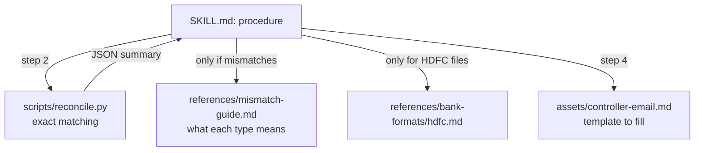

# Bundling Scripts and Reference Files: The Complete Guide

> 📚 **Before you start**
>
> - [Anatomy of a Skill Folder and SKILL.md](anatomy-of-a-skill-folder-and-skill-md.md), where `scripts/`, `references/` and `assets/` first appeared.
> - [Error Messages that Help the Agent Recover](../02-writing-tools-for-agents/error-messages-that-help-the-agent-recover.md): a script's errors are read by the agent, so the same rules apply.
> - [Sandboxes for Running Agent Code](../03-scaling-to-many-tools/sandboxes-for-running-agent-code.md), because bundled scripts run with the agent's permissions.

## Introduction

Every Monday, MandiMart's finance team reconciles Razorpay settlements against the HDFC bank statement: each settlement Razorpay says it paid out must appear in the bank account with the same UTR (the bank's unique transfer reference) and amount. A person does it with two spreadsheets and a VLOOKUP. An agent could do it by reading both files into its context and comparing rows, but that's slow, expensive and, with 600 rows, likely to miss one.

The better design is a skill whose **instructions** say when and how to reconcile, whose **script** does the matching exactly, whose **references** explain the bank's file formats and what each mismatch means, and whose **assets** hold the email template for reporting problems. The model provides judgement (what does this mismatch mean, who should be told); the files provide precision and detail.

This lesson is about building those files well:

- deciding what belongs in instructions, scripts, references or assets;
- writing scripts that agents can run reliably: no prompts, `--help`, JSON output, clear errors, exit codes, dry runs, bounded output;
- handling dependencies (standard library first; inline dependencies with `uv` when needed);
- organising reference files so the agent reads only what it needs;
- and keeping bundled code safe.

> 💡 **Key Insight**
>
> A bundled script is a tool the agent discovers through instructions instead of a schema. Design it like one: **one clear job, arguments in, structured results out, helpful errors, and no surprises**. And let reference files do for knowledge what scripts do for computation: hold the detail, out of context, until a step needs it.

---

## Core Explanation

### 1. What goes where

| Put it in... | When it is... | Example from the reconciliation skill |
|---|---|---|
| `SKILL.md` body | The procedure and judgement calls, needed every time | "Run the matcher, then explain each mismatch using the reference" |
| `scripts/` | Exact, repeatable, or fiddly work: calculations, parsing, validation, file conversion | Match settlements to bank rows by UTR and amount |
| `references/` | Detail needed only sometimes, or too long for the body | HDFC and ICICI statement formats; what each mismatch type usually means |
| `assets/` | Things copied or filled in, not read for understanding | The email template for the finance controller |

A useful test: if the model would need to be *exactly* right every time, it's a script. If it needs to *know* something only in some cases, it's a reference. If it would produce the same output shape every time, it's an asset.



### 2. A script an agent can't use

First, the kind of script people write for themselves, run by a human at a terminal:

```python
import os, subprocess, sys, tempfile, json

WORK = tempfile.mkdtemp()

BAD_SCRIPT = '''
import csv
path = input("Settlements file? ")
rows = list(csv.DictReader(open(path)))
print("Loaded", len(rows), "rows. Looks good!")
for r in rows:
    print(r)
'''
with open(os.path.join(WORK, "bad_reconcile.py"), "w") as f:
    f.write(BAD_SCRIPT)

r = subprocess.run([sys.executable, "bad_reconcile.py"], cwd=WORK, capture_output=True, text=True,
                   stdin=subprocess.DEVNULL, timeout=10)
print("exit code:", r.returncode)
print(r.stderr.strip().splitlines()[-1])
```

Output:

```
exit code: 1
EOFError: EOF when reading a line
```

It asks a question with `input()`. Agents run commands without a keyboard attached, so the script either hangs (waiting forever, until a timeout) or crashes, as here. Even if it ran, it would print every row as prose: hundreds of lines flooding the context, in a format the model has to parse by eye.

### 3. Rules for agent-friendly scripts

The specification's guide to using scripts in skills lists the habits that matter. Here they are, applied:

- **No interactive prompts.** Everything comes in as arguments or files.
- **A `--help`** that explains usage, so the agent can check how to call it without reading the source.
- **Structured output on stdout** (JSON), and diagnostics or progress on **stderr**, so the result is easy to parse and noise is separate.
- **Helpful errors**: say what was wrong and what to do, in one line, and exit with a non-zero code.
- **Meaningful exit codes**: for example 0 for success, 1 for "ran fine but found problems", 2 for bad input.
- **Bounded output**: summaries and counts by default, with `--limit` to control how many detail rows to print.
- **Idempotent and safe**: running twice does no harm; anything that changes state gets a `--dry-run`.

Let's write the reconciliation script that way. First some sample data: Razorpay settlements and an HDFC statement for the week.

```python
import csv, random

rng = random.Random(7)
settlements, bank = [], []
for i in range(40):
    utr = f"HDFCN2026101{i:04d}"
    amount = round(rng.uniform(15000, 90000), 2)
    settlements.append({"settlement_id": f"setl_{1000 + i}", "utr": utr, "amount": f"{amount:.2f}",
                        "settled_on": f"2026-10-{12 + i % 5:02d}"})
    if i == 7:
        continue                                            # missing from the bank
    bank_amount = amount - 18.0 if i == 21 else amount      # short by Rs 18
    bank.append({"Narration": f"NEFT CR-RAZORPAY SOFTWARE-{utr}", "Value Dt": f"{12 + i % 5:02d}/10/26",
                 "Deposit Amt.": f"{bank_amount:.2f}"})
bank.append({"Narration": "NEFT CR-RAZORPAY SOFTWARE-HDFCN20261019999", "Value Dt": "16/10/26",
             "Deposit Amt.": "1250.00"})                    # in the bank, unknown to Razorpay

def write_csv(name, rows):
    with open(os.path.join(WORK, name), "w", newline="") as f:
        w = csv.DictWriter(f, fieldnames=list(rows[0]))
        w.writeheader()
        w.writerows(rows)

write_csv("settlements.csv", settlements)
write_csv("hdfc_statement.csv", bank)
print(len(settlements), "settlements,", len(bank), "bank credits")
```

Output:

```
40 settlements, 40 bank credits
```

Now the script:

```python
RECONCILE = r'''#!/usr/bin/env python3
"""Match Razorpay settlements to bank credits by UTR and amount; print a JSON summary."""
import argparse, csv, json, os, sys

def load_bank(path, fmt):
    rows = list(csv.DictReader(open(path)))
    if fmt == "hdfc":
        # HDFC narration ends with the UTR, e.g. 'NEFT CR-RAZORPAY SOFTWARE-HDFCN20261010001'
        return {r["Narration"].rsplit("-", 1)[-1]: float(r["Deposit Amt."]) for r in rows}
    print(f"error: unsupported --bank-format '{fmt}'. Supported: hdfc. "
          "See references/bank-formats/ for adding a bank.", file=sys.stderr)
    sys.exit(2)

def main():
    p = argparse.ArgumentParser(description=__doc__)
    p.add_argument("--settlements", required=True, help="Razorpay settlements CSV (utr, amount, settlement_id)")
    p.add_argument("--bank", required=True, help="bank statement CSV")
    p.add_argument("--bank-format", default="hdfc", help="statement layout (default: hdfc)")
    p.add_argument("--limit", type=int, default=10, help="max mismatches to list (default 10)")
    a = p.parse_args()
    for path in (a.settlements, a.bank):
        if not os.path.exists(path):
            print(f"error: file not found: {path}. Pass the path relative to the current folder.", file=sys.stderr)
            sys.exit(2)

    settle = {r["utr"]: (r["settlement_id"], float(r["amount"])) for r in csv.DictReader(open(a.settlements))}
    bank = load_bank(a.bank, a.bank_format)
    print(f"loaded {len(settle)} settlements, {len(bank)} bank credits", file=sys.stderr)

    issues = []
    for utr, (sid, amt) in sorted(settle.items()):
        if utr not in bank:
            issues.append({"type": "missing_in_bank", "utr": utr, "settlement_id": sid, "amount": amt})
        elif abs(bank[utr] - amt) > 0.005:
            issues.append({"type": "amount_mismatch", "utr": utr, "settlement_id": sid,
                           "expected": amt, "received": bank[utr], "difference": round(bank[utr] - amt, 2)})
    for utr in sorted(set(bank) - set(settle)):
        issues.append({"type": "unknown_credit", "utr": utr, "amount": bank[utr]})

    matched = len(settle) - sum(i["type"] != "unknown_credit" for i in issues)
    print(json.dumps({"matched": matched, "issues_total": len(issues),
                      "by_type": {t: sum(i["type"] == t for i in issues)
                                  for t in ("missing_in_bank", "amount_mismatch", "unknown_credit")},
                      "issues": issues[:a.limit], "truncated": len(issues) > a.limit}, indent=1))
    sys.exit(1 if issues else 0)

if __name__ == "__main__":
    main()
'''
with open(os.path.join(WORK, "reconcile.py"), "w") as f:
    f.write(RECONCILE)

def run(*args):
    return subprocess.run([sys.executable, "reconcile.py", *args], cwd=WORK, capture_output=True, text=True,
                          stdin=subprocess.DEVNULL, timeout=30)

r = run("--settlements", "settlements.csv", "--bank", "hdfc_statement.csv")
print("exit code:", r.returncode, "| stderr:", r.stderr.strip())
print(r.stdout)
```

Output:

```
exit code: 1 | stderr: loaded 40 settlements, 40 bank credits
{
 "matched": 38,
 "issues_total": 3,
 "by_type": {
  "missing_in_bank": 1,
  "amount_mismatch": 1,
  "unknown_credit": 1
 },
 "issues": [
  {
   "type": "missing_in_bank",
   "utr": "HDFCN20261010007",
   "settlement_id": "setl_1007",
   "amount": 53057.68
  },
  {
   "type": "amount_mismatch",
   "utr": "HDFCN20261010021",
   "settlement_id": "setl_1021",
   "expected": 18493.7,
   "received": 18475.7,
   "difference": -18.0
  },
  {
   "type": "unknown_credit",
   "utr": "HDFCN20261019999",
   "amount": 1250.0
  }
 ],
 "truncated": false
}
```

Everything the agent needs, in about 150 tokens: the counts, the three problems with the exact UTRs, and an exit code of 1 meaning "ran fine, found issues". The 40 matching rows never entered the context. Now the error paths:

```python
for args in [("--settlements", "setlements.csv", "--bank", "hdfc_statement.csv"),
             ("--settlements", "settlements.csv", "--bank", "hdfc_statement.csv", "--bank-format", "icici")]:
    r = run(*args)
    print(r.returncode, "|", r.stderr.strip())
```

Output:

```
2 | error: file not found: setlements.csv. Pass the path relative to the current folder.
2 | error: unsupported --bank-format 'icici'. Supported: hdfc. See references/bank-formats/ for adding a bank.
```

A typo in the file name and an unsupported bank both produce one-line errors that tell the agent what to do next, with exit code 2 ("bad input") distinct from 1 ("found mismatches"). The instructions can then say: "If the script exits with 2, fix the arguments; if 1, explain each issue."

### 4. Dry runs for anything that changes state

Suppose the skill also marks matched settlements as reconciled in the finance ledger. That changes state, so the script needs two more properties: **`--dry-run`**, which shows what would change without changing it, and **idempotency**, so running it twice doesn't double-mark anything.

```python
MARK = r'''#!/usr/bin/env python3
"""Mark settlements as reconciled in ledger.json. Safe to run more than once."""
import argparse, json, os, sys
p = argparse.ArgumentParser(description=__doc__)
p.add_argument("--ids", required=True, help="comma-separated settlement IDs")
p.add_argument("--dry-run", action="store_true", help="show what would change, change nothing")
a = p.parse_args()
ledger = json.load(open("ledger.json")) if os.path.exists("ledger.json") else {"reconciled": []}
new = [i for i in a.ids.split(",") if i not in ledger["reconciled"]]
if not a.dry_run:
    ledger["reconciled"] += new
    json.dump(ledger, open("ledger.json", "w"))
print(json.dumps({"dry_run": a.dry_run, "newly_marked": len(new), "already_marked": len(a.ids.split(",")) - len(new)}))
'''
with open(os.path.join(WORK, "mark_reconciled.py"), "w") as f:
    f.write(MARK)

ids = ",".join(s["settlement_id"] for i, s in enumerate(settlements) if i not in (7, 21))
for extra in (["--dry-run"], [], []):
    r = subprocess.run([sys.executable, "mark_reconciled.py", "--ids", ids, *extra], cwd=WORK,
                       capture_output=True, text=True)
    print(r.stdout.strip())
```

Output:

```
{"dry_run": true, "newly_marked": 38, "already_marked": 0}
{"dry_run": false, "newly_marked": 38, "already_marked": 0}
{"dry_run": false, "newly_marked": 0, "already_marked": 38}
```

The dry run reports 38 changes and makes none; the real run makes them; the accidental second run changes nothing. Agents do retry steps (after an error, after compaction, or because they lost track), so idempotency isn't optional for scripts that write.

### 5. Dependencies

A script that imports a package the environment doesn't have fails on the first line. Options, in order of preference:

1. **Standard library only.** Our scripts use `csv`, `json` and `argparse`; they run anywhere Python does. This matters especially on the Claude API, whose code execution container has **no network access**, so a skill there can't install anything at run time; it can only use the packages pre-installed in the container.
2. **Inline dependencies (PEP 723) run with `uv`.** Python's standard for declaring a script's dependencies in a comment block at the top. `uv run script.py` reads it and creates a cached environment with exactly those versions:

```python
# not-run: shows the PEP 723 header; running it needs uv and network access to install pandas
# /// script
# requires-python = ">=3.11"
# dependencies = [
#   "pandas==2.2.3",
# ]
# ///
import pandas as pd
print(pd.read_csv("settlements.csv")["amount"].sum())
```

Example output:

```
1774433.2
```

and the instructions would say: run `uv run scripts/summary.py`. For Node tools, the equivalent is pinning a version with `npx some-tool@1.4.2`, and for Python command-line tools, `uvx tool@version`.

3. **Document the requirement** in the `compatibility` frontmatter field ("Requires uv and network access to PyPI") so people and products know before they install the skill.

Always **pin versions**. A skill that runs whatever the latest version is today may break silently next month, and an unpinned package is an easy route for a supply-chain attack.

### 6. Reference files the agent reads in pieces

References hold knowledge the agent needs only sometimes. Organise them so the agent can find and read **just the relevant part**:

```
razorpay-reconcile/
├── SKILL.md
├── scripts/
│   ├── reconcile.py
│   └── mark_reconciled.py
├── references/
│   ├── mismatch-guide.md          # what each issue type usually means and who to tell
│   └── bank-formats/
│       ├── hdfc.md                # one file per bank
│       ├── icici.md
│       └── axis.md
└── assets/
    └── controller-email.md
```

and point to them from the instructions with the condition for reading them:

```markdown
## Steps
1. Run `python scripts/reconcile.py --settlements <file> --bank <file> --bank-format <bank>`.
2. If it exits with 2, fix the arguments. For a bank it doesn't support, read
   `references/bank-formats/<bank>.md` and ask the user before changing anything.
3. If it exits with 1, read `references/mismatch-guide.md` and explain each issue.
4. Fill `assets/controller-email.md` with the summary and show it to the user.
```

Let's measure why "one file per topic" matters:

```python
import math

def approx_tokens(text):
    return math.ceil(len(text) / 4)

banks = {b: f"# {b.upper()} statement format\n" + "\n".join(
             f"- Column {c}: description of column {c} for {b}, with examples and edge cases." for c in range(60))
         for b in ["hdfc", "icici", "axis", "sbi", "kotak"]}
one_big_file = "\n\n".join(banks.values())
print("all banks in one reference:", approx_tokens(one_big_file), "tokens")
print("just references/bank-formats/hdfc.md:", approx_tokens(banks["hdfc"]), "tokens")
```

Output:

```
all banks in one reference: 5871 tokens
just references/bank-formats/hdfc.md: 1171 tokens
```

The spec's advice to keep references **one level deep** from `SKILL.md` serves the same goal: the agent should be able to go from the instructions straight to the one file it needs, without opening a chain of documents to find it. For long single files, a short table of contents at the top, or clear headings the agent can search with `grep`, lets it read only a section.

### 7. Assets: templates the agent fills

An asset is used, not studied. The finance controller's email has a fixed shape, so it's a template:

```python
from string import Template

EMAIL = Template("""Subject: Razorpay reconciliation, week of $week: $issues issue(s)

Hi $controller,

Matched $matched of $total settlements. Issues:
$issue_lines

Raw report attached. Please confirm before we raise these with Razorpay.
MandiMart Finance Ops (prepared by the reconciliation agent)""")

report = json.loads(run("--settlements", "settlements.csv", "--bank", "hdfc_statement.csv").stdout)
lines = "\n".join(f"- {i['type'].replace('_', ' ')}: {i['utr']} ({i.get('difference', i.get('amount'))})"
                  for i in report["issues"])
print(EMAIL.substitute(week="12 Oct 2026", issues=report["issues_total"], controller="Meera",
                       matched=report["matched"], total=len(settlements), issue_lines=lines))
```

Output:

```
Subject: Razorpay reconciliation, week of 12 Oct 2026: 3 issue(s)

Hi Meera,

Matched 38 of 40 settlements. Issues:
- missing in bank: HDFCN20261010007 (53057.68)
- amount mismatch: HDFCN20261010021 (-18.0)
- unknown credit: HDFCN20261019999 (1250.0)

Raw report attached. Please confirm before we raise these with Razorpay.
MandiMart Finance Ops (prepared by the reconciliation agent)
```

The model decides *what to say about* each issue; the template guarantees the email always has the same subject format, greeting and sign-off.

### 8. Bundled code is code you're running

Scripts in a skill run with whatever permissions the agent has: on a developer's laptop, that can mean their files, their git credentials and their network. So:

- **Review scripts before installing a skill**, exactly as you would a package. A skill from the internet can contain a script that does something other than what its instructions claim.
- **Keep secrets out of skills.** Read keys from the environment or a secrets manager at run time; never commit them into `scripts/` or `references/`.
- **Prefer sandboxed execution** (Module 3) for skills that process untrusted input, and use permission rules such as Claude Code's `allowed-tools` to pre-approve only the specific commands a skill needs (for example `Bash(python scripts/reconcile.py:*)`), not all of Bash.
- **Keep scripts small and readable.** A reviewer should be able to understand a skill's scripts in minutes. Large dependencies are a reason to reconsider.

---

## Try It Yourself

1. **Add a `--format csv` option** idea, without code: why might a CSV output be *worse* for the agent than JSON here, even though it's fewer tokens? When would it be better?
2. **Bounded output.** Run `reconcile.py` with `--limit 1`. What does the agent learn from `truncated`, and how should the instructions tell it to respond?
3. **Make the bad script good.** Rewrite `BAD_SCRIPT` as `count_rows.py` that takes `--file`, prints `{"rows": N}` as JSON, and exits with code 2 and a helpful one-line error if the file is missing. Run it on `settlements.csv` and on a missing file.

<details>
<summary>Show answers</summary>

**1.** The issues have different fields (an amount mismatch has `expected` and `received`; a missing credit doesn't), which JSON represents naturally and CSV forces into empty columns. JSON also carries the summary counts and `truncated` flag alongside the rows. CSV is better for long, uniform tables, for example if the agent needed to pass all 600 matched rows to another script, as the "Returning Just Enough" lesson measured.

**2.**

```python
r = run("--settlements", "settlements.csv", "--bank", "hdfc_statement.csv", "--limit", "1")
out = json.loads(r.stdout)
print(out["issues_total"], len(out["issues"]), out["truncated"])
```

Output:

```
3 1 True
```

The agent sees there are 3 issues but only 1 is listed. The instructions should say: "If `truncated` is true, report the counts by type and rerun with a higher `--limit` only if the user wants the full list." That keeps the default cheap without hiding problems.

**3.**

```python
GOOD = r'''
import argparse, csv, json, os, sys
p = argparse.ArgumentParser(description="Count data rows in a CSV file.")
p.add_argument("--file", required=True)
a = p.parse_args()
if not os.path.exists(a.file):
    print(f"error: {a.file} not found. List the folder to check the name.", file=sys.stderr)
    sys.exit(2)
print(json.dumps({"rows": sum(1 for _ in csv.DictReader(open(a.file)))}))
'''
with open(os.path.join(WORK, "count_rows.py"), "w") as f:
    f.write(GOOD)
for name in ["settlements.csv", "settlement.csv"]:
    r = subprocess.run([sys.executable, "count_rows.py", "--file", name], cwd=WORK,
                       capture_output=True, text=True, stdin=subprocess.DEVNULL)
    print(r.returncode, r.stdout.strip() or r.stderr.strip())
```

Output:

```
0 {"rows": 40}
2 error: settlement.csv not found. List the folder to check the name.
```

</details>

---

## Real-World Examples

- **Anthropic's document skills** (`docx`, `pptx`, `xlsx`, `pdf`) are mostly scripts: unpacking and repacking Office files, validating XML, converting formats, with instructions that say which script to run for which job.
- **The `skill-creator` skill** bundles scripts that run evaluations and aggregate benchmark results, so the model orchestrates while the scripts do the counting.
- **Teams packaging CLIs as skills** wrap internal tools (`deployctl`, `dbt`, Tally exporters) with a short `SKILL.md` that explains which subcommands to use, rather than re-implementing them.
- **Claude API skills** must work without network access, so authors bundle pure-Python helpers or rely on the container's pre-installed packages.

---

## Common Misconceptions

### "The model can just read the script and do the same thing"

It can read it, but running it is cheaper (no source in context) and exact. Instructions should say to run scripts, and the scripts should make reading them unnecessary through `--help` and clear output.

### "Print everything so the agent has full information"

Unbounded output floods the context and hides the important lines. Summaries first, details on request with a limit.

### "One big reference file is easier to maintain"

It's easier for you, and costlier for every agent run. Split by topic, keep references one level deep, and say in the instructions when each is needed.

### "Scripts in a skill are trusted because they came with the skill"

They're as trustworthy as their author. Review them, pin their dependencies and run them with the least permissions that work.

---

## Interview Relevance

*"How do you design scripts and resources for an Agent Skill?"* Separate procedure (`SKILL.md`), exact work (`scripts/`), conditional knowledge (`references/`, one topic per file, one level deep) and templates (`assets/`). Scripts are non-interactive with `--help`, JSON on stdout and diagnostics on stderr, helpful one-line errors, distinct exit codes, bounded output with a limit flag, idempotent writes and `--dry-run`. Dependencies: standard library first; PEP 723 with `uv run` and pinned versions when needed; note environments without network such as the Claude API container. Security: review bundled code, keep secrets out, pre-approve only specific commands.

Follow-up: *"How does the agent know how to call a script?"* The instructions give the exact command; `--help` covers the rest; errors say what to fix.

---

## Key Takeaways

- **Instructions for procedure, scripts for exact work, references for conditional knowledge, assets for templates.**
- **Agent-friendly scripts** take arguments, offer `--help`, print JSON, send noise to stderr, fail with clear one-line errors and meaningful exit codes, and bound their output.
- **Scripts that change state need `--dry-run` and idempotency**, because agents retry.
- **Prefer the standard library; otherwise pin dependencies** (PEP 723 with `uv`, `npx tool@version`), and remember some environments have no network.
- **Bundled code runs with the agent's permissions**: review it, keep secrets out, and pre-approve only what's needed.

---

**Up next:** [Skills vs MCP vs Subagents vs Prompts](skills-vs-mcp-vs-subagents-vs-prompts.md)
