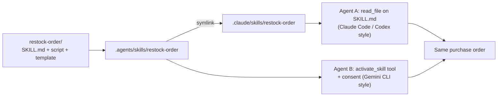

# Lab: Write a Skill and Use It in Two Different Agents

> 📚 **Before you start**
>
> - [Anatomy of a Skill Folder and SKILL.md](anatomy-of-a-skill-folder-and-skill-md.md) and [Bundling Scripts and Reference Files](bundling-scripts-and-reference-files.md), for writing the skill.
> - [Progressive Disclosure: Discovery, Activation, Execution](progressive-disclosure-discovery-activation-execution.md), for the two activation styles you'll implement.
> - [Lab: Agent with a code-execution sandbox](../03-scaling-to-many-tools/lab-agent-with-a-code-execution-sandbox.md), for the pretend-model agent loop pattern.

## What You'll Build

MandiMart's dark stores run out of fast movers (Amul butter, curd, Parle-G) every weekend. Store managers want the agent to draft a **restock purchase order**: which SKUs are below their reorder point, how many units to order, in the supplier's format.

You'll write that as **one skill**, `restock-order`, and then load it into **two different agent harnesses** that work the way real products do:

1. **Agent A, file-read style** (like Claude Code or Codex): the catalog lists each skill's `SKILL.md` location, and the model loads a skill by reading that file with its ordinary `read_file` tool.
2. **Agent B, activation-tool style** (like Gemini CLI): the model calls a dedicated `activate_skill` tool, the harness asks the user for consent, and returns the instructions wrapped with a list of the skill's files.

Same folder, same result, two harnesses. Then you'll see the commands to use the same folder in the real Claude Code, Codex and Gemini CLI, and on the Claude API.




*One skill folder, two harnesses, one result: the portability the open standard promises.*

> 💡 **Key Insight**
>
> A portable skill depends only on the core of the standard: **folder name equals `name`, a clear `description`, instructions with relative paths, and self-contained scripts**. Everything product-specific (where the folder lives, how activation happens, consent prompts) is the harness's job. Keep the skill plain and it works everywhere.

---

## Step 1: Write the Skill

The skill has three files: instructions, a script that calculates reorder quantities exactly, and a template for the supplier's purchase order.

The reorder rule MandiMart uses: a SKU needs restocking when the stock on hand won't last through the supplier's lead time plus a safety buffer. If it does, order enough for that period plus three more days of sales.

```python
import json, os, subprocess, sys, tempfile, textwrap, math

def approx_tokens(text):
    # count with the temporary folder's path shortened, so results match on every machine
    return math.ceil(len(text.replace(REPO, "<tmp>")) / 4)

REPO = tempfile.mkdtemp(prefix="mandimart-ops-")
SKILL = os.path.join(REPO, ".agents", "skills", "restock-order")
for sub in ["scripts", "assets"]:
    os.makedirs(os.path.join(SKILL, sub))

SKILL_MD = """---
name: restock-order
description: Drafts a restock purchase order for a MandiMart dark store, listing SKUs below their reorder point and how many units to order, in the supplier's PO format. Use when a store manager asks what to reorder, which items are running low, or for a purchase order or indent for a store.
compatibility: Needs Python 3.10+. No network access required.
metadata:
  owner: store-ops
  version: "1.0"
---

# Restock purchase order

## Steps
1. Find the store code (e.g. PNQ-07 for Kothrud) and the stock file for that store.
2. Run `python scripts/restock.py --stock <file> --lead-days 2 --safety-days 1`.
   It prints JSON with the SKUs to reorder and the quantity for each. Never change the quantities.
3. If the list is empty, say no restock is needed and stop.
4. Fill `assets/po-template.md`: one line per SKU, then the total units.
5. Show the draft to the manager. Do not send it to the supplier.
"""
RESTOCK_PY = r'''#!/usr/bin/env python3
"""List SKUs below their reorder point and how many units to order. Prints JSON."""
import argparse, csv, json, math, os, sys
p = argparse.ArgumentParser(description=__doc__)
p.add_argument("--stock", required=True, help="CSV with sku, name, on_hand, avg_daily_sales")
p.add_argument("--lead-days", type=float, default=2, help="supplier lead time in days")
p.add_argument("--safety-days", type=float, default=1, help="extra days of buffer")
p.add_argument("--cover-days", type=float, default=3, help="days of sales to order beyond the buffer")
a = p.parse_args()
if not os.path.exists(a.stock):
    print(f"error: stock file {a.stock} not found", file=sys.stderr)
    sys.exit(2)
orders = []
for r in csv.DictReader(open(a.stock)):
    on_hand, daily = int(r["on_hand"]), float(r["avg_daily_sales"])
    reorder_point = daily * (a.lead_days + a.safety_days)
    if on_hand < reorder_point:
        qty = math.ceil(daily * (a.lead_days + a.safety_days + a.cover_days) - on_hand)
        orders.append({"sku": r["sku"], "name": r["name"], "on_hand": on_hand, "order_qty": qty})
print(json.dumps({"skus_checked": sum(1 for _ in open(a.stock)) - 1, "to_order": orders}))
'''
PO_TEMPLATE = """PURCHASE ORDER (DRAFT) - MandiMart {store}
Supplier: {supplier}   Deliver by: {deliver_by}
{lines}
Total units: {total_units}
Prepared by the restock agent. Not sent.
"""
files = {"SKILL.md": SKILL_MD, "scripts/restock.py": RESTOCK_PY, "assets/po-template.md": PO_TEMPLATE}
for rel, text in files.items():
    with open(os.path.join(SKILL, rel), "w") as f:
        f.write(text)
print(sorted(files), "written to", os.path.relpath(SKILL, REPO))
```

Output:

```
['SKILL.md', 'assets/po-template.md', 'scripts/restock.py'] written to .agents/skills/restock-order
```

And the store's stock data, which a real agent would fetch with a tool; here it's a file in the repository:

```python
STOCK_CSV = os.path.join(REPO, "stock_PNQ-07.csv")
with open(STOCK_CSV, "w") as f:
    f.write("sku,name,on_hand,avg_daily_sales\n"
            "AMUL-BTR-100,Amul Butter 100g,22,14.5\n"
            "MTR-DOSA-500,MTR Dosa Mix 500g,40,6.0\n"
            "MD-CURD-400,Mother Dairy Curd 400g,18,21.0\n"
            "PARLE-G-800,Parle-G 800g,9,4.2\n"
            "TATA-SALT-1K,Tata Salt 1kg,60,5.5\n")
print(open(STOCK_CSV).read())
```

Output:

```
sku,name,on_hand,avg_daily_sales
AMUL-BTR-100,Amul Butter 100g,22,14.5
MTR-DOSA-500,MTR Dosa Mix 500g,40,6.0
MD-CURD-400,Mother Dairy Curd 400g,18,21.0
PARLE-G-800,Parle-G 800g,9,4.2
TATA-SALT-1K,Tata Salt 1kg,60,5.5
```

## Step 2: Validate It Against the Standard

Before any agent sees it, check the core rules that make a skill portable: frontmatter present, `name` valid and equal to the folder name, `description` present and within limits, and every referenced file present.

```python
import re

def frontmatter(text):
    front = text.split("---\n")[1]
    meta = {}
    for line in front.splitlines():
        if line and not line.startswith(" "):
            k, _, v = line.partition(":")
            meta[k.strip()] = v.strip()
    return meta, text.split("---\n", 2)[2]

def validate(skill_dir):
    meta, body = frontmatter(open(os.path.join(skill_dir, "SKILL.md")).read())
    problems = []
    if not re.fullmatch(r"[a-z0-9]+(-[a-z0-9]+)*", meta.get("name", "")) or len(meta["name"]) > 64:
        problems.append("bad name")
    if meta.get("name") != os.path.basename(skill_dir):
        problems.append("name doesn't match folder")
    if not 0 < len(meta.get("description", "")) <= 1024:
        problems.append("description missing or over 1024 chars")
    for ref in re.findall(r"`((?:scripts|references|assets)/[^`\s]+)`", body):
        if not os.path.exists(os.path.join(skill_dir, ref)):
            problems.append(f"missing {ref}")
    return problems or ["ok"]

print(validate(SKILL))
```

Output:

```
['ok']
```

## Step 3: Make One Folder Visible to Both Kinds of Agent

Codex, Gemini CLI and VS Code read `.agents/skills/`; Claude Code reads `.claude/skills/`. Rather than keeping two copies that drift apart, link one to the other:

```python
claude_skills = os.path.join(REPO, ".claude", "skills")
os.makedirs(claude_skills)
os.symlink(os.path.join("..", "..", ".agents", "skills", "restock-order"),
           os.path.join(claude_skills, "restock-order"))

link = os.path.join(claude_skills, "restock-order")
print(os.path.islink(link), "->", os.readlink(link))
print(open(os.path.join(link, "SKILL.md")).read().splitlines()[1])
```

Output:

```
True -> ../../.agents/skills/restock-order
name: restock-order
```

The link is relative, so it keeps working when the repository is cloned elsewhere. (On Windows, use a directory junction or ask contributors to enable symlinks in git; or keep `.claude/skills` as the real folder and link the other way.)

## Step 4: The Shared Pieces

Both agents use a pretend model, LangChain's `FakeListChatModel`, which returns pre-written replies. Each reply is a JSON action (call a tool) or a final answer, a simple stand-in for the tool calls a real model makes. Both agents also share the same "run a command" tool, which runs commands inside the skill folder or repository with a timeout.

```python
from langchain_core.language_models.fake_chat_models import FakeListChatModel

def run_command(argv, cwd):
    r = subprocess.run(argv, cwd=cwd, capture_output=True, text=True, timeout=30)
    return r.stdout.strip() if r.returncode == 0 else f"exit {r.returncode}: {r.stderr.strip()}"

def fill_po(result_json, store):
    plan = json.loads(result_json)
    template = open(os.path.join(SKILL, "assets", "po-template.md")).read()
    lines = "\n".join(f"- {o['sku']:<14} {o['name']:<24} order {o['order_qty']:>3} (on hand {o['on_hand']})"
                      for o in plan["to_order"])
    return template.format(store=store, supplier="Shree Distributors, Hadapsar", deliver_by="2026-10-19",
                           lines=lines, total_units=sum(o["order_qty"] for o in plan["to_order"]))

def show(value):
    """Hide machine-specific paths so the trace reads the same on every computer."""
    return repr(value).replace(REPO, "<repo>").replace(sys.executable, "python")

def run_agent(name, model, tools, system):
    """Generic loop: the model returns JSON actions; tools run; results go back as messages."""
    context = [system]
    print(f"--- {name} | system prompt: {approx_tokens(system)} tokens")
    while True:
        action = json.loads(model.invoke("\n".join(context)).content)
        if "final" in action:
            print(f"final answer:\n{action['final']}")
            return context
        result = tools[action["tool"]](**action["args"])
        args = ", ".join(f"{k}={show(v)}" for k, v in action["args"].items())
        print(f"{action['tool']}({args[:110]}{'...' if len(args) > 110 else ''}) -> {show(result)[:80]}...")
        context.append(f"[{action['tool']} result]\n{result}")
```

## Step 5: Agent A, File-Read Activation

Agent A's harness scans `.claude/skills/` (as Claude Code would), puts each skill's name, description and **location** in the system prompt, and tells the model to read a skill's `SKILL.md` before using it. The only tools are general ones: `read_file` and `run_command`.

```python
def scan(skills_dir):
    found = {}
    for name in sorted(os.listdir(skills_dir)):
        path = os.path.join(skills_dir, name, "SKILL.md")
        if os.path.isfile(path):
            meta, _ = frontmatter(open(path).read())
            found[name] = {"description": meta["description"], "location": path}
    return found

skills_a = scan(os.path.join(REPO, ".claude", "skills"))
system_a = ("You are MandiMart's store-ops agent. Skills available:\n" + "\n".join(
    f"- {n}: {s['description']} (instructions: {s['location']})" for n, s in skills_a.items()) +
    "\nIf a skill matches the task, read its SKILL.md with read_file first and follow it. "
    "Paths in a skill are relative to its folder.")

loc = skills_a["restock-order"]["location"]
skill_dir_a = os.path.dirname(loc)
tools_a = {
    "read_file": lambda path: open(path).read(),
    "run_command": lambda argv, cwd: run_command(argv, cwd),
    "fill_template": lambda result_json, store: fill_po(result_json, store),
}
model_a = FakeListChatModel(responses=[
    json.dumps({"tool": "read_file", "args": {"path": loc}}),
    json.dumps({"tool": "run_command", "args": {"argv": [sys.executable, "scripts/restock.py", "--stock", STOCK_CSV,
                                                         "--lead-days", "2", "--safety-days", "1"],
                                                "cwd": skill_dir_a}}),
    json.dumps({"tool": "fill_template", "args": {"result_json": run_command(
        [sys.executable, "scripts/restock.py", "--stock", STOCK_CSV], skill_dir_a), "store": "PNQ-07 Kothrud"}}),
    json.dumps({"final": "Here's the draft PO for Kothrud: 3 SKUs to restock. I haven't sent it to the supplier."}),
])
context_a = run_agent("Agent A (file-read)", model_a, tools_a, system_a)
```

Output:

```
--- Agent A (file-read) | system prompt: 135 tokens
read_file(path='<repo>/.claude/skills/restock-order/SKILL.md') -> '---\nname: restock-order\ndescription: Drafts a restock purchase order for a Ma...
run_command(argv=['python', 'scripts/restock.py', '--stock', '<repo>/stock_PNQ-07.csv', '--lead-days', '2', '--safety-days...) -> '{"skus_checked": 5, "to_order": [{"sku": "AMUL-BTR-100", "name": "Amul Butter 1...
fill_template(result_json='{"skus_checked": 5, "to_order": [{"sku": "AMUL-BTR-100", "name": "Amul Butter 100g", "on_hand": 2...) -> 'PURCHASE ORDER (DRAFT) - MandiMart PNQ-07 Kothrud\nSupplier: Shree Distributors...
final answer:
Here's the draft PO for Kothrud: 3 SKUs to restock. I haven't sent it to the supplier.
```

The model's third reply contains the script output it saw in step 2; a real model would copy it from its context the same way. Notice the first tool call: the skill was "activated" just by reading a file. That's why this style suits coding agents, which read files all day anyway.

Let's look at the purchase order the template produced:

```python
print(fill_po(run_command([sys.executable, "scripts/restock.py", "--stock", STOCK_CSV], skill_dir_a), "PNQ-07 Kothrud"))
```

Output:

```
PURCHASE ORDER (DRAFT) - MandiMart PNQ-07 Kothrud
Supplier: Shree Distributors, Hadapsar   Deliver by: 2026-10-19
- AMUL-BTR-100   Amul Butter 100g         order  65 (on hand 22)
- MD-CURD-400    Mother Dairy Curd 400g   order 108 (on hand 18)
- PARLE-G-800    Parle-G 800g             order  17 (on hand 9)
Total units: 190
Prepared by the restock agent. Not sent.
```

Amul butter, curd and Parle-G are below their reorder points; dosa mix and salt have enough stock. The quantities came from the script, so they're exact, and the "Not sent" line came from the template, so it's always there.

## Step 6: Agent B, Activation Tool with Consent

Agent B's harness scans `.agents/skills/` (as Gemini CLI and Codex would), and instead of a file tool it offers `activate_skill`, whose `name` parameter is an **enum** of discovered skills. Before loading a skill for the first time it asks the user for consent (we approve automatically and print the prompt). The returned content is wrapped, states the skill folder, and lists the files without reading them.

```python
skills_b = scan(os.path.join(REPO, ".agents", "skills"))
system_b = ("You are MandiMart's store-ops agent.\n<available_skills>\n" + "\n".join(
    f"  <skill><name>{n}</name><description>{s['description']}</description></skill>"
    for n, s in skills_b.items()) + "\n</available_skills>\n"
    "When a task matches a skill, call activate_skill with its name, then follow the instructions.")

ACTIVATE_SCHEMA = {"name": "activate_skill",
                   "input_schema": {"type": "object", "properties": {"name": {"type": "string", "enum": sorted(skills_b)}},
                                    "required": ["name"]}}
consented = set()

def activate_skill(name):
    if name not in ACTIVATE_SCHEMA["input_schema"]["properties"]["name"]["enum"]:
        return f"Error: unknown skill '{name}'."
    if name not in consented:
        print(f"  [consent] Activate skill '{name}'? It may run scripts in its folder. -> approved")
        consented.add(name)
    folder = os.path.dirname(skills_b[name]["location"])
    body = open(skills_b[name]["location"]).read().split("---\n", 2)[2].strip()
    resources = sorted(os.path.relpath(os.path.join(d, f), folder) for d, _, fs in os.walk(folder)
                       for f in fs if f != "SKILL.md")
    return (f'<skill_content name="{name}">\n{body}\nSkill directory: {folder}\n<skill_resources>\n'
            + "\n".join(f"  <file>{r}</file>" for r in resources) + "\n</skill_resources>\n</skill_content>")

skill_dir_b = os.path.dirname(skills_b["restock-order"]["location"])
tools_b = {"activate_skill": activate_skill,
           "run_command": lambda argv, cwd: run_command(argv, cwd),
           "fill_template": lambda result_json, store: fill_po(result_json, store)}
script_out = run_command([sys.executable, "scripts/restock.py", "--stock", STOCK_CSV], skill_dir_b)
model_b = FakeListChatModel(responses=[
    json.dumps({"tool": "activate_skill", "args": {"name": "restock-order"}}),
    json.dumps({"tool": "run_command", "args": {"argv": [sys.executable, "scripts/restock.py", "--stock", STOCK_CSV,
                                                         "--lead-days", "2", "--safety-days", "1"],
                                                "cwd": skill_dir_b}}),
    json.dumps({"tool": "fill_template", "args": {"result_json": script_out, "store": "PNQ-07 Kothrud"}}),
    json.dumps({"final": "Here's the draft PO for Kothrud: 3 SKUs to restock. I haven't sent it to the supplier."}),
])
context_b = run_agent("Agent B (activate_skill)", model_b, tools_b, system_b)
```

Output:

```
--- Agent B (activate_skill) | system prompt: 130 tokens
  [consent] Activate skill 'restock-order'? It may run scripts in its folder. -> approved
activate_skill(name='restock-order') -> '<skill_content name="restock-order">\n# Restock purchase order\n\n## Steps\n1. ...
run_command(argv=['python', 'scripts/restock.py', '--stock', '<repo>/stock_PNQ-07.csv', '--lead-days', '2', '--safety-days...) -> '{"skus_checked": 5, "to_order": [{"sku": "AMUL-BTR-100", "name": "Amul Butter 1...
fill_template(result_json='{"skus_checked": 5, "to_order": [{"sku": "AMUL-BTR-100", "name": "Amul Butter 100g", "on_hand": 2...) -> 'PURCHASE ORDER (DRAFT) - MandiMart PNQ-07 Kothrud\nSupplier: Shree Distributors...
final answer:
Here's the draft PO for Kothrud: 3 SKUs to restock. I haven't sent it to the supplier.
```

Different harness, different activation, consent prompt, wrapped content, and the same final purchase order, because the skill didn't depend on any of those details.

## Step 7: Compare What Each Agent Paid

```python
def context_tokens(ctx):
    return sum(approx_tokens(c) for c in ctx)

for label, ctx in [("Agent A", context_a), ("Agent B", context_b)]:
    print(f"{label}: system {approx_tokens(ctx[0]):>4} tokens | after activation and script "
          f"{context_tokens(ctx):>5} tokens | messages {len(ctx)}")
```

Output:

```
Agent A: system  135 tokens | after activation and script   548 tokens | messages 4
Agent B: system  130 tokens | after activation and script   490 tokens | messages 4
```

Both are small, because both followed progressive disclosure: only one `SKILL.md` was loaded, the script's source never entered the context, and only its JSON output did. Agent B comes out slightly smaller: its activation strips the frontmatter (the model already saw the description in the catalog) and adds only a short wrapper and file list, which buys clear boundaries and a list of files the model can use without guessing paths.

## Step 8: The Same Folder in Real Agents

The folder you built works unchanged in the real products. From the repository root:

```bash
# Claude Code: reads .claude/skills (our symlink); -p runs one prompt non-interactively
claude -p "What should Kothrud (PNQ-07) reorder? Stock is in stock_PNQ-07.csv"
# or invoke it explicitly inside a session:  /restock-order PNQ-07

# OpenAI Codex: reads .agents/skills; mention the skill with $ to force it
codex exec "\$restock-order for PNQ-07 using stock_PNQ-07.csv"

# Gemini CLI: reads .agents/skills; activates via its activate_skill tool (asks for consent)
gemini -p "Draft the restock PO for PNQ-07 from stock_PNQ-07.csv"
```

Example output:

```
PURCHASE ORDER (DRAFT) - MandiMart PNQ-07 Kothrud
...
Total units: 190
```

And for an API agent, upload the folder with the Skills API and attach it to requests, as in the previous lesson:

```python
# not-run: needs the anthropic package and an API key
import anthropic
from anthropic.lib import files_from_dir

client = anthropic.Anthropic()
skill = client.skills.create(files=files_from_dir(SKILL))
response = client.messages.create(
    model="claude-opus-5-5",
    max_tokens=4096,
    container={"skills": [{"type": "custom", "skill_id": skill.id, "version": "latest"}]},
    tools=[{"type": "code_execution_20250825", "name": "code_execution"}],
    messages=[{"role": "user", "content": "Draft a restock PO for PNQ-07. Stock CSV:\n" + open(STOCK_CSV).read()}],
)
print(response.content[-1].text)
```

Example output:

```
Draft purchase order for PNQ-07: Amul Butter 100g x 65, Mother Dairy Curd 400g x 108, Parle-G 800g x 17... (not sent)
```

On the API the script runs inside Anthropic's code execution container, which has no network access; our script uses only the standard library, so it works there too.

---

## Try It Yourself

1. **Break portability.** Change the `SKILL.md` to say `Run python ${CLAUDE_SKILL_DIR}/scripts/restock.py ...` (a Claude Code substitution). What would Agent B, Codex or Gemini CLI see? How would you write the step so it works everywhere?
2. **A second skill.** Add a skill `supplier-email` in `.agents/skills/` that drafts the email to the supplier from a PO. Re-run `scan` for both harnesses. Does Agent A see it? What do you need to do?
3. **Consent memory.** Call `activate_skill("restock-order")` twice. How many consent prompts appear, and why is remembering consent per session reasonable?

<details>
<summary>Show answers</summary>

**1.** Other agents would see the literal text `${CLAUDE_SKILL_DIR}`, which their shells may expand to an empty string, giving `/scripts/restock.py` and a "file not found" error. Write paths relative to the skill folder (`scripts/restock.py`), as the standard expects, and let each harness resolve them; Agent A and B both ran commands with the skill folder as the working directory for exactly this reason.

**2.**

```python
os.makedirs(os.path.join(REPO, ".agents", "skills", "supplier-email"))
with open(os.path.join(REPO, ".agents", "skills", "supplier-email", "SKILL.md"), "w") as f:
    f.write("---\nname: supplier-email\ndescription: Drafts the email sending a MandiMart purchase order to a "
            "supplier. Use after a restock PO is approved.\n---\n\n# Supplier email\nGreet, attach PO, ask for confirmation.\n")
print("Agent B sees:", sorted(scan(os.path.join(REPO, ".agents", "skills"))))
print("Agent A sees:", sorted(scan(os.path.join(REPO, ".claude", "skills"))))
os.symlink(os.path.join("..", "..", ".agents", "skills", "supplier-email"),
           os.path.join(REPO, ".claude", "skills", "supplier-email"))
print("Agent A after linking:", sorted(scan(os.path.join(REPO, ".claude", "skills"))))
```

Output:

```
Agent B sees: ['restock-order', 'supplier-email']
Agent A sees: ['restock-order']
Agent A after linking: ['restock-order', 'supplier-email']
```

Each skill needs its own link (or link the whole `skills` folder once: `.claude/skills -> ../.agents/skills`). A CI check that every folder in `.agents/skills` is visible in `.claude/skills` prevents surprises.

**3.**

```python
consented.clear()
for _ in range(2):
    activate_skill("restock-order")
print("consented:", consented)
```

Output:

```
  [consent] Activate skill 'restock-order'? It may run scripts in its folder. -> approved
consented: {'restock-order'}
```

One prompt. The user approved this skill's instructions and scripts once; asking on every activation would train people to click "yes" without reading. A new skill, or a changed one, should ask again.

</details>

---

## What You've Learned

- **A portable skill relies only on the standard's core**: matching folder and `name`, a clear `description`, instructions with relative paths, and self-contained scripts.
- **One canonical folder can serve every agent**: keep it in `.agents/skills/` and link it into `.claude/skills/`.
- **File-read activation** (Claude Code, Codex) and **activation tools** (Gemini CLI) differ in the harness, not in the skill.
- **Consent, wrapping and resource lists** are harness features that make activation safer and clearer.
- **Scripts make results identical across agents**: the model chooses and explains; the script calculates.
- **The same folder runs in real products and on the Claude API**, provided scripts avoid network access and product-specific substitutions.

---

**Up next:** You've finished the course. Continue with [Model Context Protocol (MCP)](../../model-context-protocol-mcp/course.md), which goes deep on the servers your tools and skills connect to.
