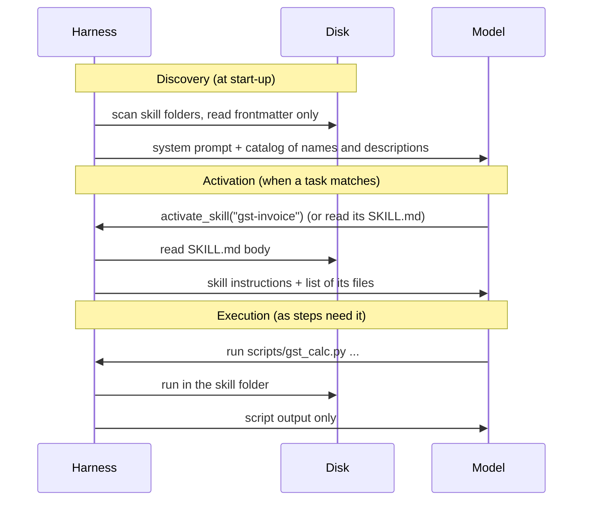

# Progressive Disclosure: Discovery, Activation, Execution: The Complete Guide

> 📚 **Before you start**
>
> - [Anatomy of a Skill Folder and SKILL.md](anatomy-of-a-skill-folder-and-skill-md.md), for the folder you'll now teach an agent to load.
> - [Tool Search and Deferred Loading](../03-scaling-to-many-tools/tool-search-and-deferred-loading.md): skills load on demand for the same reason deferred tools do.

## Introduction

A good library doesn't hand you every book at the door. You get a catalogue (titles and one-line summaries). When one looks right, you fetch that book and read the relevant chapter. If the chapter says "see Appendix C for the tables", you turn to Appendix C, and only then.

Skills reach the model in the same three stages, and the piece of software that makes this happen is the agent's **harness**: the code around the model that runs the loop, executes tools and builds each request. When people say an agent "supports skills", they mean its harness does three jobs:

1. **Discovery**: find skill folders on disk, read only their frontmatter, and put a short **catalog** in front of the model.
2. **Activation**: when the model decides a skill applies (or the user types `/gst-invoice`), load that skill's `SKILL.md` instructions into the conversation.
3. **Execution**: let the model follow the instructions: read a reference file, run a script, fill a template, with paths resolved relative to the skill's folder.

In this lesson you'll build all three in Python, following the open specification's guide for client implementers, and see how Claude Code, Codex and Gemini CLI each do them. You'll also measure the token cost at each stage.

> 💡 **Key Insight**
>
> Progressive disclosure is a contract between the skill and the harness: **the skill keeps its description short and its details in files; the harness shows descriptions always, instructions on activation, and files only when asked**. Get either side wrong (a bloated description, a harness that eagerly reads every file) and the token savings disappear.

---

## Core Explanation

### 1. The whole flow



### 2. Set up some skills on disk

We'll create a realistic layout: two project skills, a personal (user-level) skill with the same name as one of them, and one broken skill.

```python
import json, math, os, re, subprocess, sys, tempfile, textwrap

def approx_tokens(text):
    return math.ceil(len(text) / 4)

BASE = tempfile.mkdtemp()
PROJECT = os.path.join(BASE, "mandimart-ops")           # a repository
HOME = os.path.join(BASE, "home")                       # the user's home folder

def make_skill(root, name, description, body, files=None, raw_front=None):
    folder = os.path.join(root, name)
    os.makedirs(folder, exist_ok=True)
    front = raw_front if raw_front is not None else f"name: {name}\ndescription: {description}"
    with open(os.path.join(folder, "SKILL.md"), "w") as f:
        f.write(f"---\n{front}\n---\n\n{textwrap.dedent(body).strip()}\n")
    for rel, content in (files or {}).items():
        os.makedirs(os.path.dirname(os.path.join(folder, rel)), exist_ok=True)
        with open(os.path.join(folder, rel), "w") as f:
            f.write(content)

proj_skills = os.path.join(PROJECT, ".agents", "skills")
user_skills = os.path.join(HOME, ".agents", "skills")

make_skill(proj_skills, "gst-invoice",
    "Prepares GST tax invoices for MandiMart orders with the CGST/SGST or IGST split. Use when someone "
    "asks for a GST invoice, tax invoice, B2B bill, or the GST breakup of an order.",
    textwrap.dedent("""
    # GST invoice
    1. Get the order's items and map each to a category in `references/gst-rates.md`.
    2. Run `python scripts/gst_calc.py --amount <taxable> --rate <pct> --seller 27 --buyer <state>`.
    3. Fill `assets/invoice-template.md` with the output. Never recalculate.
    """) + "\n".join(f"- Rule {i}: detail about invoices." for i in range(1, 41)),
    files={"references/gst-rates.md": "| butter | 5 |\n| paneer | 0 |\n" * 200,
           "scripts/gst_calc.py": textwrap.dedent('''
               import argparse, json
               p = argparse.ArgumentParser()
               for a in ["--amount", "--rate", "--seller", "--buyer"]:
                   p.add_argument(a, required=True)
               a = p.parse_args()
               tax = round(float(a.amount) * float(a.rate) / 100, 2)
               split = {"igst": tax} if a.seller != a.buyer else {"cgst": tax / 2, "sgst": tax / 2}
               print(json.dumps({"taxable": float(a.amount), **split, "total": round(float(a.amount) + tax, 2)}))
               '''),
           "assets/invoice-template.md": "TAX INVOICE ... {total}\n"})

make_skill(proj_skills, "late-delivery-report",
    "Builds the daily late-delivery report for one store: late orders, riders and coupons owed. Use when a "
    "store manager asks how many orders were late or wants an SLA report.",
    "# Late-delivery report\n1. Confirm store code and date.\n2. Count orders over 10 minutes.\n")

make_skill(user_skills, "late-delivery-report",
    "OLD personal copy of the late-delivery report.", "# Old version\nUse a 15-minute promise.\n")
make_skill(user_skills, "refund-email",
    "Drafts a polite refund confirmation email to a MandiMart customer. Use when asked to write or send "
    "a refund email or message.", "# Refund email\nGreet by first name. State amount and UPI/wallet. Sign off as MandiMart Care.\n")
make_skill(user_skills, "broken-skill", "", "No frontmatter fields at all.", raw_front="just some text")

for root in (proj_skills, user_skills):
    print(os.path.relpath(root, BASE), "->", sorted(os.listdir(root)))
```

Output:

```
mandimart-ops/.agents/skills -> ['gst-invoice', 'late-delivery-report']
home/.agents/skills -> ['broken-skill', 'late-delivery-report', 'refund-email']
```

### 3. Discovery: scan, parse leniently, resolve clashes

The specification's implementer guide gives clear advice for this stage:

- **Scan known locations**, project-level and user-level. Here: `<project>/.agents/skills/` and `~/.agents/skills/`. Real clients add their own folders too (`.claude/skills/`, `.gemini/skills/`).
- **Project skills override user skills** with the same name, because the repository's version is what the team agreed on.
- **Only trust project skills in trusted projects.** A repository you just cloned from a stranger could contain a skill that tells the agent to do harmful things; clients ask before loading skills from an untrusted folder.
- **Be lenient when parsing**: skip skills without a description, warn about other problems, but don't crash the agent over one bad file.
- **Read only the frontmatter.** Store name, description and location; leave the body on disk.

```python
def read_frontmatter(path):
    text = open(path).read()
    if not text.startswith("---\n") or "\n---\n" not in text[4:]:
        return None
    front = text[4:].split("\n---\n", 1)[0]
    meta = {}
    for line in front.splitlines():
        key, sep, value = line.partition(":")
        if sep and not line.startswith(" "):
            meta[key.strip()] = value.strip()
    return meta

def discover(project_dir, home_dir, project_trusted=True):
    locations = [("user", os.path.join(home_dir, ".agents", "skills"))]
    if project_trusted:
        locations.append(("project", os.path.join(project_dir, ".agents", "skills")))   # later wins
    skills, notes = {}, []
    for scope, root in locations:
        if not os.path.isdir(root):
            continue
        for name in sorted(os.listdir(root)):
            path = os.path.join(root, name, "SKILL.md")
            if not os.path.isfile(path):
                continue
            meta = read_frontmatter(path)
            if not meta or not meta.get("description"):
                notes.append(f"skipped {scope}/{name}: no description")
                continue
            if meta.get("name") != name:
                notes.append(f"warning {scope}/{name}: name field doesn't match folder")
            if name in skills:
                notes.append(f"{scope}/{name} overrides {skills[name]['scope']}/{name}")
            skills[name] = {"name": name, "description": meta["description"],
                            "location": path, "scope": scope}
    return skills, notes

SKILLS, notes = discover(PROJECT, HOME)
for n in notes:
    print(n)
for s in SKILLS.values():
    print(f"{s['scope']:<8} {s['name']:<22} {os.path.relpath(s['location'], BASE)}")
```

Output:

```
skipped user/broken-skill: no description
project/late-delivery-report overrides user/late-delivery-report
project  late-delivery-report   mandimart-ops/.agents/skills/late-delivery-report/SKILL.md
user     refund-email           home/.agents/skills/refund-email/SKILL.md
project  gst-invoice            mandimart-ops/.agents/skills/gst-invoice/SKILL.md
```

The broken skill was skipped with a note, and the project's `late-delivery-report` replaced the old personal copy.

### 4. The catalog the model sees

The harness turns the discovered skills into a short block for the system prompt. The specification's guide suggests a simple XML-style structure, plus an instruction telling the model how to activate a skill:

```python
def build_catalog(skills):
    entries = "\n".join(
        f"  <skill>\n    <name>{s['name']}</name>\n    <description>{s['description']}</description>\n"
        f"    <location>{s['location']}</location>\n  </skill>"
        for s in skills.values())
    return ("<available_skills>\n" + entries + "\n</available_skills>\n"
            "When a task matches a skill's description, call activate_skill with its name before doing the "
            "task, then follow its instructions. Paths in a skill are relative to its folder.")

catalog = build_catalog(SKILLS)
print(catalog.replace(BASE, "<base>")[:620])
print("...")
print("catalog tokens:", approx_tokens(catalog), "for", len(SKILLS), "skills")
```

Output:

```
<available_skills>
  <skill>
    <name>late-delivery-report</name>
    <description>Builds the daily late-delivery report for one store: late orders, riders and coupons owed. Use when a store manager asks how many orders were late or wants an SLA report.</description>
    <location><base>/mandimart-ops/.agents/skills/late-delivery-report/SKILL.md</location>
  </skill>
  <skill>
    <name>refund-email</name>
    <description>Drafts a polite refund confirmation email to a MandiMart customer. Use when asked to write or send a refund email or message.</description>
    <location><base>/home/.agents/skills/refund-emai
...
catalog tokens: 305 for 3 skills
```

About a hundred tokens per skill, mostly description. That's level 1: always paid, so keep descriptions tight.

### 5. Activation: two styles

There are two common ways for the model to load a skill:

- **File-read activation.** The model uses its ordinary file-reading tool on the `<location>` path. Simple, and natural for coding agents that already read files all day. Codex and many other agents work like this.
- **A dedicated activation tool.** The harness offers a tool such as `activate_skill(name)`. Gemini CLI has exactly this tool (and asks the user for consent the first time), and Claude Code has a `Skill` tool. A dedicated tool has advantages: the `name` parameter can be an **enum** of discovered skills (so the model can't invent one), the harness can **wrap** the content in clear markers, and it can **record** which skills are active.

Here's a dedicated activation tool, following the guide's suggestions: wrap the body in a `<skill_content>` tag, state the skill's folder so relative paths make sense, **list** the bundled files without reading them, and don't load the same skill twice.

```python
ACTIVE = []

def activate_skill_definition(skills):
    return {"name": "activate_skill",
            "description": "Load a skill's full instructions. Use when a task matches a skill in <available_skills>.",
            "input_schema": {"type": "object",
                             "properties": {"name": {"type": "string", "enum": sorted(skills)}},
                             "required": ["name"]}}

def activate_skill(name, skills=SKILLS):
    if name not in skills:
        return f"Error: no skill named '{name}'. Available: {', '.join(sorted(skills))}."
    if name in ACTIVE:
        return f"Skill '{name}' is already active; its instructions are earlier in this conversation."
    folder = os.path.dirname(skills[name]["location"])
    body = open(skills[name]["location"]).read().split("\n---\n", 1)[1].strip()
    resources = sorted(os.path.relpath(os.path.join(dp, f), folder)
                       for dp, _, fs in os.walk(folder) for f in fs if f != "SKILL.md")
    ACTIVE.append(name)
    listing = "\n".join(f"  <file>{r}</file>" for r in resources)
    return (f'<skill_content name="{name}">\n{body}\n\nSkill directory: {folder}\n'
            f"<skill_resources>\n{listing}\n</skill_resources>\n</skill_content>")

print(json.dumps(activate_skill_definition(SKILLS)["input_schema"]["properties"]["name"]))
loaded = activate_skill("gst-invoice")
print(loaded.replace(BASE, "<base>")[:330], "\n...")
print(loaded.replace(BASE, "<base>")[loaded.replace(BASE, "<base>").index("Skill directory"):])
print("activation tokens:", approx_tokens(loaded))
print(activate_skill("gst-invoice"))
```

Output:

```
{"type": "string", "enum": ["gst-invoice", "late-delivery-report", "refund-email"]}
<skill_content name="gst-invoice">
# GST invoice
1. Get the order's items and map each to a category in `references/gst-rates.md`.
2. Run `python scripts/gst_calc.py --amount <taxable> --rate <pct> --seller 27 --buyer <state>`.
3. Fill `assets/invoice-template.md` with the output. Never recalculate.
- Rule 1: detail about invoic 
...
Skill directory: <base>/mandimart-ops/.agents/skills/gst-invoice
<skill_resources>
  <file>assets/invoice-template.md</file>
  <file>references/gst-rates.md</file>
  <file>scripts/gst_calc.py</file>
</skill_resources>
</skill_content>
activation tokens: 475
Skill 'gst-invoice' is already active; its instructions are earlier in this conversation.
```

Notice the 400-line rate table in `references/gst-rates.md` was **listed, not loaded**. That's level 3 waiting on disk.

### 6. Execution: running the skill's script

The instructions say "Run `python scripts/gst_calc.py ...`". That path is relative to the skill's folder, which is why activation stated the folder. The harness runs it there and returns only the output. The guide also recommends that harnesses **allowlist skill folders** for file reads, so following a skill doesn't trigger a permission prompt for every file it ships.

```python
def run_skill_script(skill, command_args):
    folder = os.path.dirname(SKILLS[skill]["location"])
    if skill not in ACTIVE:
        return "Error: activate the skill before running its scripts."
    result = subprocess.run([sys.executable] + command_args, cwd=folder,
                            capture_output=True, text=True, timeout=30)
    return result.stdout.strip() or result.stderr.strip()

out = run_skill_script("gst-invoice", ["scripts/gst_calc.py", "--amount", "2714.30", "--rate", "5",
                                       "--seller", "27", "--buyer", "29"])
print(out)
print("execution tokens added:", approx_tokens(out))
```

Output:

```
{"taxable": 2714.3, "igst": 135.72, "total": 2850.02}
execution tokens added: 14
```

### 7. Token accounting across the three levels

Let's add up what the model sees at each stage, against the naive alternative of pasting every skill and every file into the system prompt:

```python
def folder_tokens(location):
    folder = os.path.dirname(location)
    return sum(approx_tokens(open(os.path.join(dp, f)).read()) for dp, _, fs in os.walk(folder) for f in fs)

everything = sum(folder_tokens(s["location"]) for s in SKILLS.values())
level1 = approx_tokens(catalog)
level2 = approx_tokens(loaded)
level3 = approx_tokens(out)
print(f"paste everything into the prompt: {everything:>6,} tokens")
print(f"level 1, catalog (always):        {level1:>6,} tokens")
print(f"level 2, one skill activated:     {level2:>6,} tokens")
print(f"level 3, one script's output:     {level3:>6,} tokens")
print(f"total with progressive disclosure: {level1 + level2 + level3:>5,} tokens "
      f"({(level1 + level2 + level3) / everything:.0%} of everything)")
```

Output:

```
paste everything into the prompt:  2,208 tokens
level 1, catalog (always):           305 tokens
level 2, one skill activated:        475 tokens
level 3, one script's output:         14 tokens
total with progressive disclosure:   794 tokens (36% of everything)
```

The saving grows with every skill you add, because each new skill costs only its catalog line until it's used.

### 8. Keeping skills alive in long sessions

Long conversations get **compacted**: the harness summarises older messages to free space (the context engineering course covered this). A skill's instructions, loaded 50 turns ago, are exactly the kind of thing that must not be summarised away mid-task. Harnesses handle it in a few ways:

- **Protect skill content from compaction**, or re-insert it afterwards. Claude Code, for instance, re-attaches the most recent activation of each invoked skill after compacting, keeping the first 5,000 tokens of each, within a combined budget of 25,000 tokens.
- **Deduplicate activations**, as our `activate_skill` does, so a skill isn't loaded twice into one context.
- **Run a skill in a subagent.** With Claude Code's `context: fork` (also supported in VS Code), the skill runs in a separate context and returns only its result, so a long procedure never fills the main conversation.

### 9. Explicit invocation

Models don't always notice that a skill applies, and some skills should never run by themselves. So products also let users load a skill directly:

| Product | How the user invokes a skill |
|---|---|
| Claude Code | Type `/gst-invoice` (with arguments after it, available to the skill as `$ARGUMENTS`) |
| OpenAI Codex | Mention `$gst-invoice` in the prompt, or pick from `/skills` |
| Gemini CLI | `/skills` commands to list, enable and disable; the model activates via `activate_skill` |
| VS Code / Copilot | Type `/gst-invoice` in chat |

In a harness like ours, explicit invocation just means the harness calls `activate_skill` itself before the model's first turn, so the instructions are already in context.

---

## Try It Yourself

1. **Untrusted repository.** Call `discover(PROJECT, HOME, project_trusted=False)`. Which version of `late-delivery-report` is loaded, and why is that the safe behaviour?
2. **Read a reference on demand.** Write `read_skill_file(skill, rel_path, max_lines=5)` that returns only the first lines of a file inside an active skill's folder, and refuses paths that escape the folder (like `../../secrets.txt`). Test both.
3. **Catalog budget.** Claude Code truncates very long skill listings. Write `trim_catalog(skills, max_chars_per_skill=120)` that shortens each description to at most 120 characters (ending with "..."), and compare its token count with the full catalog.

<details>
<summary>Show answers</summary>

**1.**

```python
skills_untrusted, notes_untrusted = discover(PROJECT, HOME, project_trusted=False)
print(sorted(skills_untrusted))
print(skills_untrusted["late-delivery-report"]["description"])
```

Output:

```
['late-delivery-report', 'refund-email']
OLD personal copy of the late-delivery report.
```

Only the user's own skills load, including the old personal copy. A cloned repository's skills are instructions written by someone else; until you trust the folder, the agent shouldn't follow them. (Claude Code and Gemini CLI both ask before trusting a new project folder.)

**2.**

```python
def read_skill_file(skill, rel_path, max_lines=5):
    folder = os.path.realpath(os.path.dirname(SKILLS[skill]["location"]))
    target = os.path.realpath(os.path.join(folder, rel_path))
    if not target.startswith(folder + os.sep):
        return f"Error: {rel_path} is outside the skill folder."
    with open(target) as f:
        return "".join(f.readline() for _ in range(max_lines)).strip()

print(read_skill_file("gst-invoice", "references/gst-rates.md", max_lines=2))
print(read_skill_file("gst-invoice", "../../secrets.txt"))
```

Output:

```
| butter | 5 |
| paneer | 0 |
Error: ../../secrets.txt is outside the skill folder.
```

Reading only what's needed keeps level 3 cheap, and the path check stops a skill (or a confused model) from using the skill folder as a way to read arbitrary files.

**3.**

```python
def trim_catalog(skills, max_chars_per_skill=120):
    trimmed = {}
    for name, s in skills.items():
        d = s["description"]
        trimmed[name] = {**s, "description": d if len(d) <= max_chars_per_skill else d[:max_chars_per_skill - 3] + "..."}
    return build_catalog(trimmed)

print(approx_tokens(build_catalog(SKILLS)), "->", approx_tokens(trim_catalog(SKILLS)))
print(trim_catalog(SKILLS).split("<description>")[1].split("</description>")[0])
```

Output:

```
305 -> 277
Builds the daily late-delivery report for one store: late orders, riders and coupons owed. Use when a store manager a...
```

Trimming saves tokens but cut off "...asks how many orders were late or wants an SLA report", which is the part that makes the skill trigger. That's why the description should put the most important trigger words early, which the next lesson covers.

</details>

---

## Real-World Examples

- **Claude Code** scans personal, project, nested and plugin skill folders, lists skills to the model, loads one through its `Skill` tool or a `/name` command, live-reloads skills when files change, and re-attaches invoked skills after compaction.
- **Gemini CLI** discovers skills from `.gemini/skills` and `.agents/skills`, and activates them through an `activate_skill` tool that asks the user for consent before loading.
- **OpenAI Codex** includes the skill list in its context, lets the model open `SKILL.md` when relevant, and supports `$skill` mentions; a skill can be marked explicit-only.
- **The Claude API** runs skills inside its code execution container: the skill's files are mounted there, and Claude reads `SKILL.md` and runs the scripts with the same progressive disclosure.

---

## Common Misconceptions

### "The agent reads all my skills at start-up"

Only the frontmatter (name and description). Instructions load on activation and files only when a step uses them.

### "If a skill is installed, the model will use it"

The model chooses based on the description, and it may skip skills for tasks it thinks are simple. Explicit invocation (`/name`, `$name`) guarantees loading.

### "Bigger catalogs are free because they're just descriptions"

Each description costs tokens in every conversation and competes with every other description. Fifty overlapping skills cause the same confusion as fifty look-alike tools.

### "Skills from any folder are safe to load"

Project skills come from whoever wrote the repository. Clients gate them on folder trust for good reason.

---

## Interview Relevance

*"How does an agent harness support Agent Skills?"* Describe the three stages: discovery (scan project and user folders, parse frontmatter leniently, project overrides user, gate untrusted projects, inject an `<available_skills>` catalog with name, description, location); activation (file-read or a dedicated `activate_skill` tool with an enum of names, wrapping content, listing resources without reading them, deduplicating); execution (resolve paths relative to the skill folder, run scripts and return output, allowlist skill folders). Then context management: protecting skills from compaction, subagent forks, and explicit `/name` invocation. Quantify the savings: about 100 tokens per skill until used.

Follow-up: *"File-read or activation tool: which would you build?"* The tool, for most custom agents: it constrains names, marks content clearly, tracks activations and makes consent prompts possible. File-read is fine for coding agents that already have a file tool.

---

## Key Takeaways

- **The harness does three jobs**: discovery (catalog), activation (instructions) and execution (files and scripts).
- **Discovery reads frontmatter only**, resolves clashes (project over user), and gates untrusted folders.
- **Activation can be a file read or a dedicated tool**; a tool constrains names, wraps content, lists resources and avoids duplicates.
- **Execution resolves paths against the skill folder** and returns script output, not source.
- **Protect active skills in long sessions** with compaction rules or subagent forks, and support explicit `/name` invocation.

---

**Up next:** [Writing Descriptions that Trigger Correctly](writing-descriptions-that-trigger-correctly.md)
