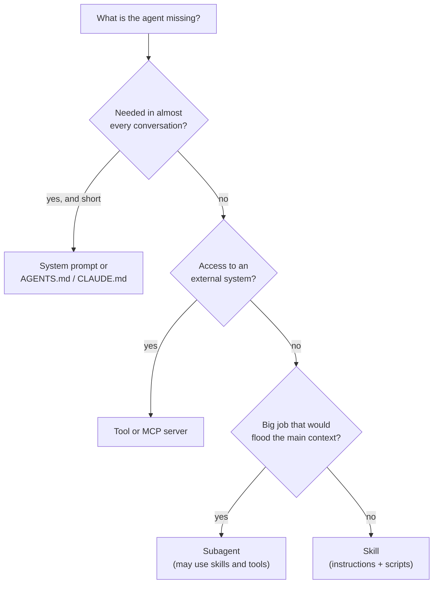
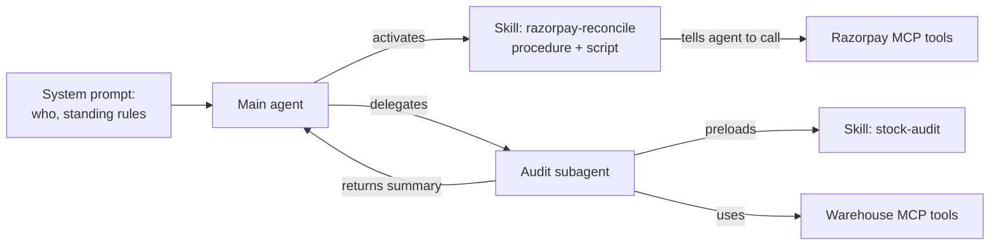

# Skills vs MCP vs Subagents vs Prompts: The Complete Guide

> 📚 **Before you start**
>
> - [What is an Agent Skill?](what-is-an-agent-skill.md) and [Bundling Scripts and Reference Files](bundling-scripts-and-reference-files.md), for what skills can contain.
> - [Why Hundreds of Tool Schemas Break Agents](../03-scaling-to-many-tools/why-hundreds-of-tool-schemas-break-agents.md), where MCP servers and subagents first appeared as ways to scale.

## Introduction

When a new store opens in Viman Nagar, MandiMart's operations head has several ways to get the team ready. She can put up a **notice on the wall** that everyone sees every day ("Doors open at 6 am. Masks in the cold room."). She can give them **access cards** to the warehouse system and the payment terminal. She can hand them the **procedures binder** for the jobs they'll do now and then. And for big jobs, like the monthly stock audit, she can **send a specialist** who does the audit separately and reports back.

Agent builders face the same choice with four mechanisms:

- **System prompts and instruction files** (like `CLAUDE.md` or `AGENTS.md`): the notice on the wall, always in context.
- **MCP servers and tools**: the access cards, connections to systems that let the agent act.
- **Skills**: the binder, know-how loaded when a task needs it.
- **Subagents**: the specialist, a separate agent with its own context that does a job and returns a result.

They overlap enough that teams often pick the wrong one: a 3,000-word procedure in the system prompt, an MCP server that's really just instructions, a skill that should have been a subagent. This lesson gives you a clear way to choose, and shows how they combine.

> 💡 **Key Insight**
>
> Ask what the agent is missing. **Always-needed rules** belong in the prompt. **Access to a system** is a tool or MCP server. **Know-how for a kind of task** is a skill. **A big, separable job that would clutter the main context** is a subagent. Most real agents use all four together.

---

## Core Explanation

### 1. The four side by side

| | System prompt / instruction file | MCP server (tools) | Skill | Subagent |
|---|---|---|---|---|
| **Gives the agent** | Identity, standing rules, project facts | Abilities: read and change external systems | Procedures, domain knowledge, scripts, templates | A delegate with its own context and tools |
| **In context** | Always, in full | Tool definitions (unless deferred) | Description always; body on demand | Only the task sent and the result returned |
| **Runs code?** | No | Yes, in the server | Its scripts, in the agent's environment | Its own agent loop |
| **Who writes it** | The team using the agent | The system's owner (Razorpay, GitHub) or platform team | Whoever owns the procedure | Whoever designs the agent |
| **Portable across agents?** | Partly (`AGENTS.md` is widely read) | Yes, MCP is a standard | Yes, Agent Skills is a standard | Mostly product-specific |
| **MandiMart example** | "Use IST. Amounts in rupees. Never share phone numbers." | Razorpay MCP: `refunds_search`, `payments_get` | `gst-invoice`, `razorpay-reconcile` | "Audit agent": checks 300 SKUs and returns a discrepancy list |

### 2. A decision guide



Some quick calls:

- *"Always reply in the customer's language."* Every conversation: **prompt**.
- *"Let the agent check a Shiprocket pickup's status."* Access to a system: **MCP server or tool**.
- *"Raise GST invoices our way, with the right rate table."* Know-how for a kind of task: **skill**.
- *"Review this 2,000-line pull request for security issues while I keep chatting."* A large, separable job: **subagent** (which might load a security-review skill).
- *"Never issue refunds above Rs 5,000 without approval."* A hard limit: **enforce it in the tool** (or a hook that blocks the call), and state it in the prompt so the agent knows. Neither a skill nor a prompt can *guarantee* it.

### 3. Where the costs fall

The mechanisms differ most in what they put in the context, and when. Let's model a day of MandiMart support conversations to see it in numbers:

```python
import math

def per_conversation_tokens(always, on_use, use_rate):
    """Average tokens per conversation: always-loaded part + the on-demand part when used."""
    return always + on_use * use_rate

# A 1,800-token GST procedure used in 5% of conversations
as_prompt = per_conversation_tokens(always=1800, on_use=0, use_rate=0.05)
as_skill = per_conversation_tokens(always=80, on_use=1800, use_rate=0.05)
# A 6,000-token stock audit (instructions + tool results), done in 2% of conversations
audit_inline = per_conversation_tokens(always=80, on_use=6000, use_rate=0.02)
audit_subagent = per_conversation_tokens(always=80, on_use=250, use_rate=0.02)   # main context sees only the summary

conversations = 20_000
for label, tokens in [("GST procedure in the system prompt", as_prompt), ("GST procedure as a skill", as_skill),
                      ("stock audit inline (main context)", audit_inline),
                      ("stock audit in a subagent (main context)", audit_subagent)]:
    print(f"{label:<42} {tokens:>7.0f} tokens/conversation  {tokens * conversations / 1e6:>6.1f}M per day")
```

Output:

```
GST procedure in the system prompt            1800 tokens/conversation    36.0M per day
GST procedure as a skill                       170 tokens/conversation     3.4M per day
stock audit inline (main context)              200 tokens/conversation     4.0M per day
stock audit in a subagent (main context)        85 tokens/conversation     1.7M per day
```

Two lessons from the numbers. A procedure used now and then is far cheaper as a skill than in the prompt. And a subagent doesn't make work free (its own context still costs tokens), but it keeps the **main** conversation small, which matters for long chats where every later turn re-reads the history.

### 4. They combine

The mechanisms aren't rivals; good agents layer them:



- **Skills use tools.** The reconciliation skill's instructions can say "fetch settlements with the Razorpay MCP tool `settlements_list`, then run `scripts/reconcile.py`". The MCP server gives access; the skill gives the procedure. This pairing is common enough that people describe MCP as "what the agent can reach" and skills as "how to do the work".
- **Subagents use skills.** In Claude Code a subagent definition can list skills to preload, and a skill can do the reverse with `context: fork`, running itself inside a subagent. The specialist arrives already holding the right binder.
- **Prompts point to skills.** A short line in `AGENTS.md` ("For invoices, use the gst-invoice skill") raises the chance the skill triggers.
- **Plugins bundle everything.** Claude Code plugins and Codex plugins package skills, MCP server configs, subagents and hooks into one installable unit, so a team can ship "MandiMart finance tooling" as a single thing.

### 5. Common wrong choices, and the fix

| Symptom | Likely wrong choice | Better |
|---|---|---|
| The system prompt is 8,000 tokens and keeps growing | Procedures in the prompt | Move each procedure into a skill; keep the prompt for always-on rules |
| An "MCP server" whose tools just return instructions or documents | Know-how disguised as tools | A skill with references; no server to run |
| A skill whose instructions are mostly "call this API with these headers" | Access disguised as know-how | A tool or MCP server (with auth handled properly), plus a short skill if the procedure is non-trivial |
| The main conversation fills up during long research or review jobs | Doing separable work inline | A subagent that returns a summary |
| "The skill says never do X" but the agent sometimes does X | Relying on guidance for a hard rule | Enforce in the tool, a hook or the sandbox |
| Five skills with nearly identical descriptions | Too fine-grained skills | Merge into one skill with sections in references |

### 6. Picking for MandiMart

Let's apply the guide to a real backlog. A small helper encodes the decision tree from section 2:

```python
def choose(needed_every_time, needs_system_access, big_separable_job, hard_rule=False):
    if hard_rule:
        return "enforce in tool/hook + mention in prompt"
    if needed_every_time:
        return "system prompt / AGENTS.md"
    if needs_system_access:
        return "tool or MCP server"
    if big_separable_job:
        return "subagent"
    return "skill"

backlog = [
    ("Use Hindi or Marathi if the customer writes in it", True, False, False, False),
    ("Check courier pickup status in Shiprocket", False, True, False, False),
    ("Prepare the weekly ops review deck in our format", False, False, False, False),
    ("Investigate why Baner's wastage doubled this month (reads 3 months of data)", False, False, True, False),
    ("Refunds above Rs 5,000 need a manager", False, False, False, True),
    ("How to handle a food-safety complaint, step by step", False, False, False, False),
]
for need, every, access, big, hard in backlog:
    print(f"{choose(every, access, big, hard):<42} <- {need}")
```

Output:

```
system prompt / AGENTS.md                  <- Use Hindi or Marathi if the customer writes in it
tool or MCP server                         <- Check courier pickup status in Shiprocket
skill                                      <- Prepare the weekly ops review deck in our format
subagent                                   <- Investigate why Baner's wastage doubled this month (reads 3 months of data)
enforce in tool/hook + mention in prompt   <- Refunds above Rs 5,000 need a manager
skill                                      <- How to handle a food-safety complaint, step by step
```

Notice "how to handle a food-safety complaint" is a skill, not a prompt rule, even though it's important: it's needed in a small share of conversations, it has several steps and perhaps a form template, and the description will make sure it loads when a complaint mentions spoiled food or illness.

---

## Try It Yourself

1. **Classify.** Where would you put each of these for a coding agent working on MandiMart's app? (a) "Run `pytest -q` before saying a change is done." (b) "How to add a new payment method end to end (8 steps, touches 5 files)." (c) "Read Sentry errors." (d) "Upgrade all 40 services to the new logging library." (e) "Never push directly to `main`."
2. **Cost check.** With `per_conversation_tokens`, find the usage rate above which a 1,800-token procedure is cheaper in the system prompt than as a skill with an 80-token description. Is it realistic?
3. **Combine.** Sketch (in words) how a "monthly GST filing" job could use all four mechanisms.

<details>
<summary>Show answers</summary>

**1.** (a) Every coding task: instruction file (`AGENTS.md` or `CLAUDE.md`). (b) A skill: occasional, multi-step, specific to this codebase. (c) Access: the Sentry MCP server. (d) A big, separable job: subagents, perhaps one per batch of services, each loading an "upgrade-logging" skill. (e) A hard rule: enforce with branch protection on the git host (and a hook), and mention it in the instruction file.

**2.**

```python
rate = 0.0
while per_conversation_tokens(1800, 0, rate) > per_conversation_tokens(80, 1800, rate):
    rate += 0.001
print(round(rate, 3))
```

Output:

```
0.956
```

Only at about 96% usage, nearly every conversation, does the prompt win, and even then by just a few tokens. That matches the guide: if something is needed almost every time, put it in the prompt; otherwise a skill is cheaper.

**3.** The **system prompt** says the agent works for MandiMart finance, uses IST and rupees, and must show filings to a human before submission. A **GST portal or accounting MCP server** gives access to sales data and draft returns. A **`gst-returns` skill** holds the procedure, the rate references and a script that aggregates invoices by rate. A **subagent** reconciles each state's data separately (Maharashtra, Karnataka) and returns a short summary, keeping the main conversation small. And a **hook or tool rule** blocks the "submit return" call until a human approves.

</details>

---

## Real-World Examples

- **Claude Code** reads `CLAUDE.md` for standing instructions, connects MCP servers for access, loads skills for procedures, and runs subagents (including skills with `context: fork`); plugins package all of them.
- **OpenAI Codex** uses `AGENTS.md` for repository instructions, MCP for external tools, and `.agents/skills` for procedures, and its plugins bundle skills and MCP configuration.
- **GitHub Copilot in VS Code** combines custom instructions files, MCP servers, agent skills and custom agents, with skills able to run in a subagent context.
- **Anthropic's own guidance** pairs MCP and skills explicitly: MCP connects Claude to data and systems, skills teach Claude what to do with them.

---

## Common Misconceptions

### "Skills make MCP unnecessary"

Skills can call APIs through scripts, but that means handling credentials and errors inside every skill. MCP servers centralise access, authentication and permissions. Use skills for the procedure on top.

### "Everything important belongs in the system prompt"

Importance isn't the test; frequency is. An important but occasional procedure is better as a skill with a precise description, so it's loaded fully when needed and costs almost nothing otherwise.

### "Subagents are just for parallelism"

Their main benefit is context isolation: the delegate can read thousands of tokens of logs or code and return a paragraph. Parallelism is a bonus.

### "A skill can enforce a rule"

It can describe a rule. Enforcement belongs in tools, hooks, permissions or the sandbox.

---

## Interview Relevance

*"When would you use a skill instead of an MCP server, a subagent or the system prompt?"* System prompt for short, always-needed rules; MCP or tools for access to systems (with auth and permissions); skills for task-specific know-how, loaded on demand with scripts and references; subagents for large separable jobs whose details would clutter the main context. Mention combinations (skills calling MCP tools, subagents preloading skills, plugins bundling all), the cost argument (description always vs full text always), and that hard limits are enforced in tools, hooks or sandboxes rather than written instructions.

---

## Key Takeaways

- **Prompts hold always-needed rules; tools and MCP give access; skills give know-how on demand; subagents isolate big jobs.**
- **Choose by frequency and kind of need**, not by importance.
- **Skills are cheaper than prompt text** for anything not needed in almost every conversation.
- **Combine them**: skills call tools, subagents load skills, plugins ship them together.
- **Enforce hard limits in tools, hooks or sandboxes**, whichever mechanism describes them.

---

**Up next:** [Testing, Versioning and Sharing Skills](testing-versioning-and-sharing-skills.md)
